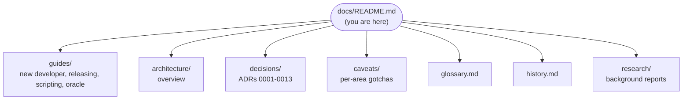

# Controls documentation hub

Everything written about the project is reachable from this page. Pick an entry point by **role**, or jump to a **topic**.

## Start by role

| Role                       | Your path                                                                                                                                  |
| -------------------------- | ------------------------------------------------------------------------------------------------------------------------------------------ |
| **Player / curious**       | [README](../README.md) → [glossary](glossary.md) for trade terms                                                                           |
| **New contributor**        | **[New-developer guide](guides/new-developer-guide.md)** → [architecture overview](architecture/overview.md) → [`CLAUDE.md`](../CLAUDE.md) |
| **Feature developer**      | [Architecture overview](architecture/overview.md) → the [caveat file](caveats/README.md) for your area **before** you edit                 |
| **Reviewer / architect**   | [The spec](../controls-development-plan.md) → [ADRs](decisions/) → [`CLAUDE.md`](../CLAUDE.md) (invariants, Definition of Done)            |
| **Release manager**        | [Releasing guide](guides/releasing.md) → [release caveats](caveats/release.md)                                                             |
| **Scenario / test author** | [Scripting guide](guides/scripting.md) → [scripting caveats](caveats/scripting.md)                                                         |
| **Solver developer**       | [Simulation architecture](architecture/simulation.md) → [oracle guide](guides/oracle.md) → [simulation caveats](caveats/simulation.md)     |

## Architecture

| Page                                               | Covers                                                                                                           |
| -------------------------------------------------- | ---------------------------------------------------------------------------------------------------------------- |
| [Overview](architecture/overview.md)               | Process and thread model, module boundaries, what P0 implements versus the target design                         |
| [World and saves](architecture/world-and-saves.md) | World document v1, settings, migrations, the load pipeline; save I/O and handles; `.ctrl` container              |
| [Rendering](architecture/rendering.md)             | Renderer layers, walk/work cameras, BVH picking and selection, integer-mm snapping, disposal                     |
| [Commands](architecture/commands.md)               | Command registry and bus, undo/redo, the replay log, world commands, `world.hash` and the PRNG                   |
| [UI shell](architecture/ui-shell.md)               | Shell libraries, screens and focus flow, the docking workspace, settings, theming and notifications              |
| [Scripting and sim-cli](architecture/scripting.md) | The scripting API `Game`, console-line files, `sim-cli` run/replay/hash, the four-surface scenario               |
| [Dev console](architecture/console.md)             | The in-game console: CodeMirror input, completion, history, `help`, `run`, cheat banner, gating                  |
| [Simulation](architecture/simulation.md)           | The netlist compiler: fragments, union-find, canonical numbering, islands, `topologyHash`, incremental recompile |

Subsystem pages (sim-core, PLC, HMI, …) are added in the phase that builds them.

## Decisions (ADRs)

| ADR                                                                       | Decision                                                                                                                                                                      |
| ------------------------------------------------------------------------- | ----------------------------------------------------------------------------------------------------------------------------------------------------------------------------- |
| [0001 Stack](decisions/0001-stack.md)                                     | Electron + Angular 22 zoneless + imperative Three.js, Nx + pnpm, electron-builder                                                                                             |
| [0002 Simulation architecture](decisions/0002-simulation-architecture.md) | Quasi-static phasor MNA in a worker, layered discrete/continuous/protection, deterministic ticks                                                                              |
| [0003 Licence policy](decisions/0003-licence-policy.md)                   | MIT; permissive deps with attribution; GPL/AGPL reference-only                                                                                                                |
| [0004 Save format](decisions/0004-save-format.md)                         | `.ctrl` ZIP of JSON, Zod schemas, integer `schemaVersion` + migration chain                                                                                                   |
| [0005 Docking workspace](decisions/0005-docking-workspace.md)             | Custom keyboard-operable split panes, not dockview (revisit for tabbed editors)                                                                                               |
| [0006 Command system](decisions/0006-command-system.md)                   | Pure apply/invert commands, undo/redo logged and replayed, view commands, advisory `when` grammar                                                                             |
| [0007 World document v1](decisions/0007-world-document-v1.md)             | World v1 shape, id allocation, orientation encoding, sfc32 PRNG, SHA-256 canonical hash, replay log                                                                           |
| [0008 Console and scripts](decisions/0008-console-and-scripts.md)         | Console-line grammar, TS scripts only in `sim-cli` (esbuild), what replay/hash read; CodeMirror 6 under the CSP (F1.5)                                                        |
| [0009 Save I/O boundary](decisions/0009-save-io-boundary.md)              | Main-owned save directory, opaque handles, atomic writes, OPFS in the web harness, autosave rotation                                                                          |
| [0010 Wire-routing spike](decisions/0010-wire-routing-spike.md)           | F1.10 findings: two-click auto-routed wires, instanced segments, screen-space terminal picking, deterministic bake (P3)                                                       |
| [0011 Sim worker contract](decisions/0011-sim-worker-contract.md)         | P2: main-thread clock and bus, mirror bus in the worker, SAB snapshot layout and seqlock, descriptor, fallback, readers                                                       |
| [0012 Oracle corpus](decisions/0012-oracle-corpus.md)                     | P2 (Accepted for DC; AC with F2.2 part 2): 500 DC + 500 AC ngspice decks and results checked in, staleness check, explicit gmin, 1e-6 relative tolerance to confirm with F2.2 |
| [0013 World document v2](decisions/0013-world-document-v2.md)             | P2: connections (test leads) and their id rule, commanded and sim state bags, `MODEL_KINDS`, solution record, `firstSeq`/`endTick`, catalogue v1                              |

## Reference

| Resource                                    | What it's for                                                                                  |
| ------------------------------------------- | ---------------------------------------------------------------------------------------------- |
| [Caveats index](caveats/README.md)          | Load-bearing gotchas per area, each with a "Load this when…" trigger                           |
| [Glossary](glossary.md)                     | Trade terms (NEC, LOTO, MNA…) and codebase terms (`app://`, Command, world document)           |
| [History](history.md)                       | Phase-by-phase record, plus app, save-format and catalogue version history                     |
| [Research](research/)                       | The 2026-10 reports behind the plan: tech stack, circuit simulation, PLC/SCADA, domain realism |
| [Plans](../plans/README.md)                 | Per-phase implementation plans                                                                 |
| [The spec](../controls-development-plan.md) | Vision, realism charter, architecture, roadmap                                                 |
| [`CLAUDE.md`](../CLAUDE.md)                 | Working agreements: invariants, Definition of Done, commands, agent routing                    |

## Documentation rules

Documentation drift is treated like a failing test. When a change lands, in the same PR (the `docs-keeper` agent or `/docs-sync` does this):

- New user-visible capability → README feature bullet (and remove the TODO line it closes) + a `CHANGELOG.md` `[Unreleased]` entry
- New gotcha → the area's `caveats/*.md` (a new area gets a new file, a row in the [caveats index](caveats/README.md) **and** a row in the `CLAUDE.md` table)
- New subsystem or contract → an `architecture/` page and a link here
- New term of art → a [glossary](glossary.md) row
- One-time architectural choice → an ADR in `decisions/`
- Phase or milestone completion, or a `schemaVersion`/`catalogVersion` bump → [`history.md`](history.md)
