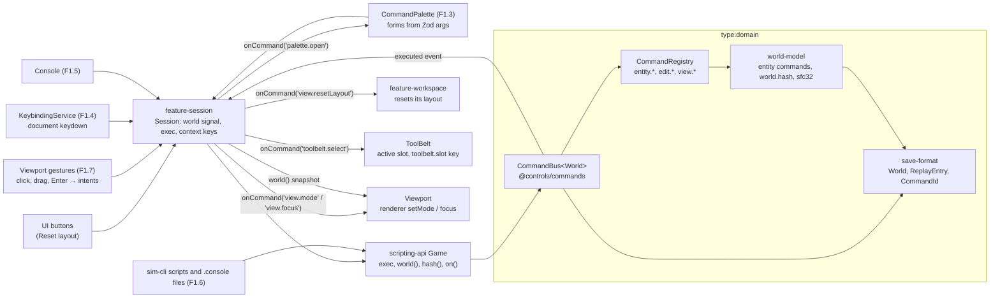
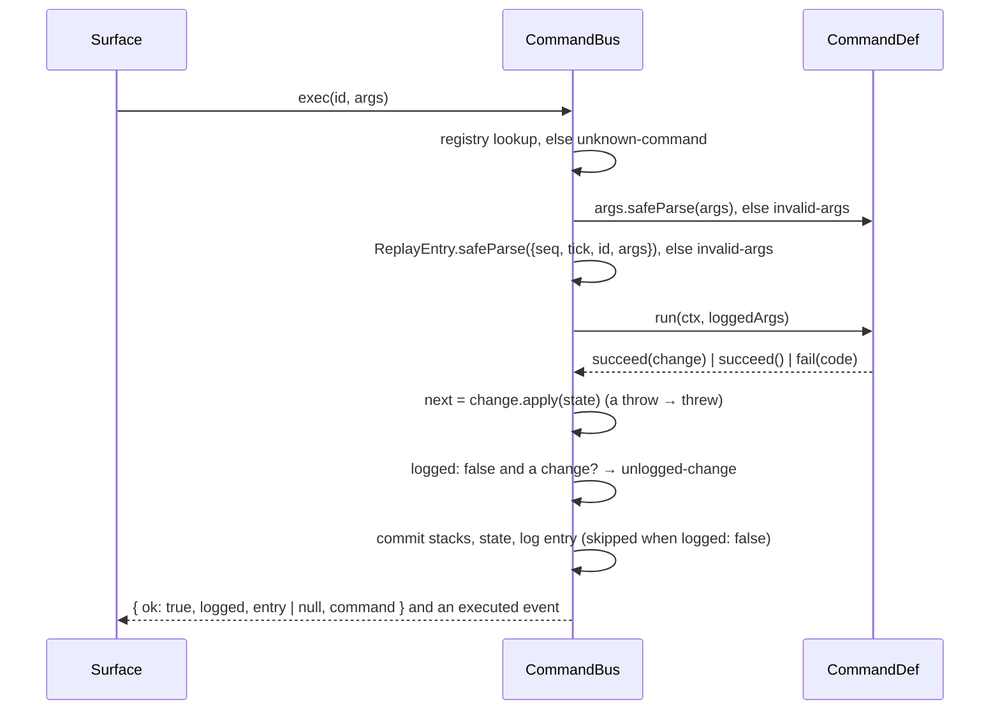
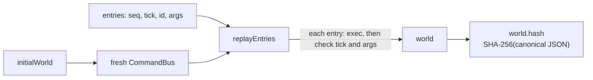
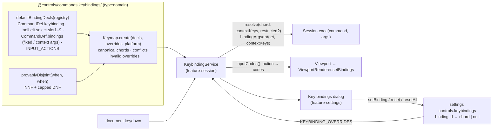

# Commands and the world model

> **Status (F1.6):** the registry, bus, undo/redo, replay and `when` live in `libs/domain/commands` (`@controls/commands`), with the keybinding core (chords, conflicts, resolution, input actions) under `keybindings/` and the console-line parser under `console/`. The world commands, PRNG and `world.hash` live in `libs/domain/world-model` (`@controls/world-model`). The scripting API's `Game` (`@controls/scripting-api`) wraps them; `sim-cli` scripts drive it, and so does the Angular adapter `libs/features/session` (`@controls/feature-session`: `Session`, `KeybindingService` and `ToolBelt`); see [scripting and sim-cli](scripting.md). The command palette (`feature-palette`, F1.3) is the second UI surface; F1.7 added the viewport's view commands (`view.mode`, `view.focus`), bindings whose arguments come from context keys, and mouse and keyboard gestures that commit as `entity.place` / `entity.move` ([rendering](rendering.md#placement-and-moves)). The console UI (F1.5) is the third. Decisions: [ADR 0006](../decisions/0006-command-system.md) (semantics) and [ADR 0007](../decisions/0007-world-document-v1.md) (ids, PRNG, hash). Gotchas: [commands caveats](../caveats/commands.md).

## One registry, four surfaces

Every surface goes through the same registry and bus. Only the bus changes the world; the UI reacts to the signal.

## `exec`

A failure at any step returns a typed error and changes nothing.

## Undo, redo and the log

| Command result              | Undo stack | Redo stack | Logged |
| --------------------------- | ---------- | ---------- | ------ |
| Undoable change             | push       | clear      | yes    |
| Non-undoable change         | clear      | clear      | yes    |
| No change (view command)    | unchanged  | unchanged  | yes    |
| UI chrome (`logged: false`) | unchanged  | unchanged  | no     |
| `edit.undo`                 | pop        | push       | yes    |
| `edit.redo`                 | push       | pop        | yes    |
| Failure (incl. empty undo)  | unchanged  | unchanged  | no     |

Replay re-runs every entry, `edit.undo` included, through a fresh bus from the log's `initialWorld`. The bus is deterministic, so it rebuilds the same stacks and reaches the live hash. That is the F1.2 property test.

## World commands

| Id                | Args                                                   | Apply                                                              | Invert                                                |
| ----------------- | ------------------------------------------------------ | ------------------------------------------------------------------ | ----------------------------------------------------- |
| `entity.place`    | `ref`, `positionMm`, `orientationMdeg` (default zeros) | appends an entity with id `nextEntityId`, increments it            | removes it and restores `nextEntityId`                |
| `entity.move`     | `id`, `positionMm` (absolute)                          | sets the position                                                  | restores the old position                             |
| `entity.rotate`   | `id`, `deltaMdeg` (each in ±359 999)                   | adds the delta per axis modulo 360 000                             | subtracts it                                          |
| `entity.delete`   | `id`                                                   | removes the entity and its leads; `nextEntityId` unchanged         | reinserts it and its leads, same ids, in sorted order |
| `lead.connect`    | `ref` (a lead), `a`, `b` (`{ entity, terminal }`)      | appends a connection with id `nextConnectionId`, increments it     | removes it and restores `nextConnectionId`            |
| `lead.disconnect` | `id`                                                   | removes the connection; `nextConnectionId` unchanged               | reinserts it, same id, in sorted order                |
| `device.operate`  | `id`, `control`, `value` (boolean, number or text)     | sets the commanded state key `control` (never reads the `sim` bag) | restores the previous `state` bag                     |

Positions are integer mm and angles integer millidegrees, validated by the `save-format` primitives. Unknown ids fail with `not-found`. The world registry resolves catalogue refs through `createWorldRegistry({ catalog })` (default the built-in catalogue): `entity.place` gives a device its model kind's initial state bags, `lead.connect` checks terminals and `device.operate` checks controls against it (world v2, [ADR 0013](../decisions/0013-world-document-v2.md)). Every logged command's argument JSON Schema is frozen in `libs/domain/world-model/json-schema/command-args/`.

## View commands

| Id                 | Args                                                          | Effect (applied by the UI through `Session.onCommand`)                                                        |
| ------------------ | ------------------------------------------------------------- | ------------------------------------------------------------------------------------------------------------- |
| `view.resetLayout` | none                                                          | the workspace restores its default panel layout                                                               |
| `toolbelt.select`  | `slot`: integer 1–9 (required)                                | `ToolBelt` sets the active slot and the `toolbelt.slot` context key; HUD shows it; the viewport arms its prop |
| `view.mode`        | `mode`: `walk` or `work` (required)                           | the viewport switches mode and publishes the `mode` context key                                               |
| `view.focus`       | `target`: view target id, `[a-z][a-z0-9]*(-[a-z0-9]+)*`, ≤ 64 | the viewport frames that target in work mode (an id it can't focus is ignored)                                |

All are logged, never change the world or its hash, and replay headless as no-ops. `view.mode` and `view.focus` stay logged on purpose: they change what the player sees, unlike the unlogged UI chrome (`palette.open`, `console.toggle`). `view.mode` and `view.focus` are registered by `createWorldRegistry()` (`viewportCommands()` in `@controls/commands`).

**Save and load (F1.8b)** are unlogged UI commands too, registered by the game host's `Session` (`fileCommands()`), not by `createWorldRegistry()`, so `sim-cli` doesn't offer them. `feature-saves` performs them ([UI shell](ui-shell.md#saving-and-loading-f18b)); the reasoning is in [ADR 0006](../decisions/0006-command-system.md#saving-and-loading-f18b).

| Id            | Key         | `when`           | Effect                                                                          |
| ------------- | ----------- | ---------------- | ------------------------------------------------------------------------------- |
| `file.save`   | Mod+S       | `session.active` | save under the game's save name, or ask for one (Save game dialog)              |
| `file.saveAs` | Mod+Shift+S | `session.active` | save to a file the player picks (native Save As; a download in the web harness) |
| `file.open`   | Mod+O       |                  | load a file the player picks (native Open; an upload in the web harness)        |
| `file.load`   | Mod+L       |                  | show the Load game dialog (the save directory, newest first)                    |

`session.active` is published by `Session` itself: true after New sandbox or a load, false while the menu shows the bare level at start-up.

## Keybindings

- **Binding ids** are the settings keys: a command id (`edit.undo`), a fixed-argument binding (`toolbelt.select.slot3` → `toolbelt.select {slot: 3}`, `view.mode.walk` → `view.mode {mode: 'walk'}`), a context-argument binding (`view.focus.selection`, `entity.delete.selection`) or an input action (`input.moveForward`, reserved namespace). Overrides replace every default of a binding; `null` unbinds.
- **Context arguments (F1.7):** a command binding may take arguments from context keys (`contextArgs: { id: 'selection.entityId' }`). It only resolves while every such key is set, and `bindingArgs` reads the values at key time, so the log holds concrete arguments. Commands declare these extra bindings in `CommandDef.bindings`.
- **Viewport keys (F1.7):** `V` is two bindings on disjoint `when`s (`mode == 'work'` → walk, `mode == 'walk'` → work); `F` focuses the selection when `selection.focusable`; `Delete` and `Backspace` delete the selected entity. All three need `viewport.focused`, like the input actions they replaced.
- **Canonical chords** (`Mod+Shift+Z`): modifiers `Mod`, `Ctrl`, `Meta`, `Alt`, `Shift`, then a key name (`KeyboardEvent.code` without `Key`/`Digit`). `Mod` is Ctrl, or Cmd on macOS. Command letters follow the layout, everything else is positional; input actions are always positional bare keys.
- **Resolution:** the player's bindings first, then by id. The first command binding whose `when` holds runs; in text fields, code editors and dialogs only `globalKeybinding` commands do. Tab, Shift+Tab and Escape are reserved.
- **Conflicts:** same chord and `when`s not provably disjoint (input actions count as `viewport.focused`). Shown on both bindings, never shadowed. Rules and the proof are in [ADR 0006](../decisions/0006-command-system.md#keybindings-f14).

## Determinism primitives

- **`world.hash`:** `sha256Hex(canonicalJson(world))`. The canonical JSON sorts keys by UTF-16 code units and formats numbers and strings as `JSON.stringify` does. SHA-256 is written from FIPS 180-4 and is synchronous, so it runs in Node, the renderer and the worker. Golden hashes are asserted in Node (`world-model`) and in Chromium (`apps/game-e2e/src/world-hash.spec.ts`).
- **PRNG:** sfc32 with streams from `deriveStream(seed, key)`. Keys are `command:<seq>` or `entity:<id>`. No generator state is persisted.
