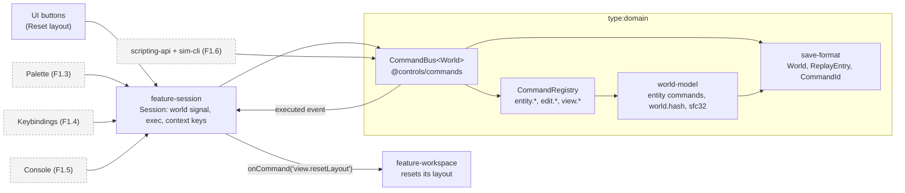
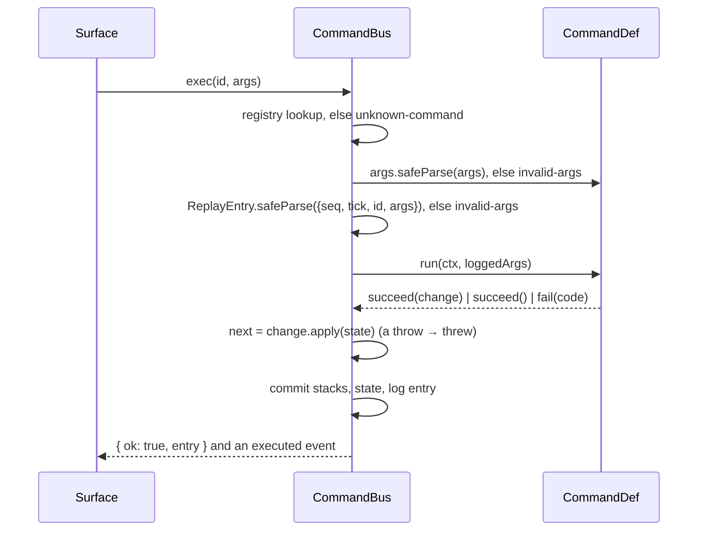
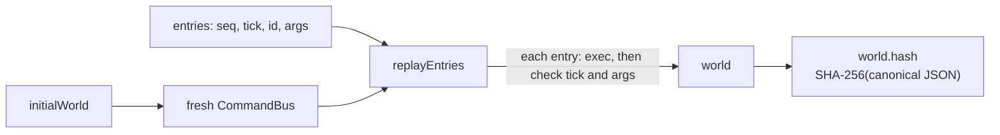

# Commands and the world model

> **Status (F1.2):** the registry, bus, undo/redo, replay and `when` live in `libs/domain/commands` (`@controls/commands`). The world commands, PRNG and `world.hash` live in `libs/domain/world-model` (`@controls/world-model`). The Angular adapter is `libs/features/session` (`@controls/feature-session`). The palette (F1.3), keybindings (F1.4), console (F1.5) and scripting API with `sim-cli` (F1.6) are still to come. Decisions: [ADR 0006](../decisions/0006-command-system.md) (semantics) and [ADR 0007](../decisions/0007-world-document-v1.md) (ids, PRNG, hash). Gotchas: [commands caveats](../caveats/commands.md).

## One registry, four surfaces

Every surface goes through the same registry and bus. Only the bus changes the world; the UI reacts to the signal.

## `exec`

A failure at any step returns a typed error and changes nothing.

## Undo, redo and the log

| Command result             | Undo stack | Redo stack | Logged |
| -------------------------- | ---------- | ---------- | ------ |
| Undoable change            | push       | clear      | yes    |
| Non-undoable change        | clear      | clear      | yes    |
| No change (view command)   | unchanged  | unchanged  | yes    |
| `edit.undo`                | pop        | push       | yes    |
| `edit.redo`                | push       | pop        | yes    |
| Failure (incl. empty undo) | unchanged  | unchanged  | no     |

Replay re-runs every entry, `edit.undo` included, through a fresh bus from the log's `initialWorld`. The bus is deterministic, so it rebuilds the same stacks and reaches the live hash. That is the F1.2 property test.

## World commands

| Id              | Args                                                   | Apply                                                   | Invert                                 |
| --------------- | ------------------------------------------------------ | ------------------------------------------------------- | -------------------------------------- |
| `entity.place`  | `ref`, `positionMm`, `orientationMdeg` (default zeros) | appends an entity with id `nextEntityId`, increments it | removes it and restores `nextEntityId` |
| `entity.move`   | `id`, `positionMm` (absolute)                          | sets the position                                       | restores the old position              |
| `entity.rotate` | `id`, `deltaMdeg` (each in ±359 999)                   | adds the delta per axis modulo 360 000                  | subtracts it                           |
| `entity.delete` | `id`                                                   | removes the entity; `nextEntityId` unchanged            | reinserts it, same id, in sorted order |

Positions are integer mm and angles integer millidegrees, validated by the `save-format` primitives. Unknown ids fail with `not-found`.

## Determinism primitives

- **`world.hash`:** `sha256Hex(canonicalJson(world))`. The canonical JSON sorts keys by UTF-16 code units and formats numbers and strings as `JSON.stringify` does. SHA-256 is written from FIPS 180-4 and is synchronous, so it runs in Node, the renderer and the worker. Golden hashes are asserted in Node (`world-model`) and in Chromium (`apps/game-e2e/src/world-hash.spec.ts`).
- **PRNG:** sfc32 with streams from `deriveStream(seed, key)`. Keys are `command:<seq>` or `entity:<id>`. No generator state is persisted.
