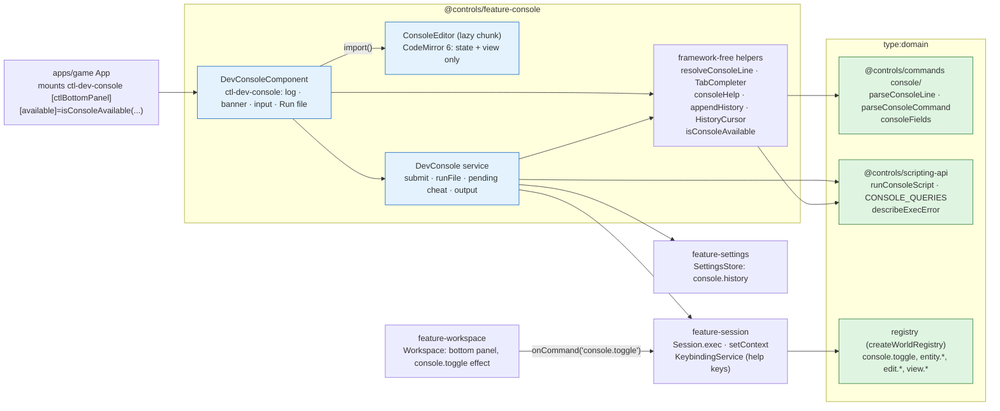
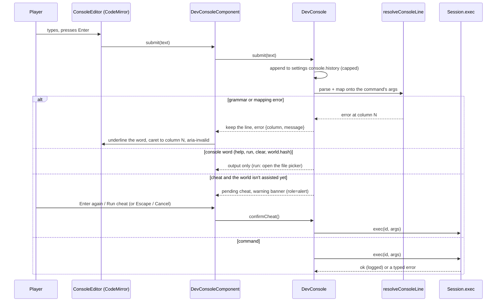

# Dev console

> **Status (F1.5):** `libs/features/console` (`@controls/feature-console`, `type:feature`) docks in the workspace's bottom panel. It runs typed lines and console-line files through `Session.exec`, using the shared grammar in `@controls/commands` (`console/`) and the file runner in `@controls/scripting-api`. Decisions: [ADR 0008](../decisions/0008-console-and-scripts.md) (grammar, where scripts run, CodeMirror 6). Gotchas: [UI caveats](../caveats/ui.md), [electron caveats](../caveats/electron.md) (CSP), [scripting caveats](../caveats/scripting.md).

## Pieces

- **Nothing in the console changes the world itself.** Commands go through `Session.exec`; console words (`help`, `run`, `clear`, `world.hash`) only read.
- **CodeMirror is a lazy chunk** (`import('./console-editor')`, about 60 kB gzipped), loaded when the console first becomes available, so it isn't in the initial bundle. The input's host `div` carries `data-autofocus` and forwards focus into CodeMirror, including focus that arrives while the chunk is still loading.
- **One registry.** Completion and `help` read ids from `registry.list()` and flags from `consoleFields(def.args)`, the same walk over the Zod shape that `consoleArgs` uses to map flags, so neither can offer a flag the mapping would refuse. There is no console-only command list.

## A typed line

## Keys

| Where             | Key       | Does                                                                                                                        |
| ----------------- | --------- | --------------------------------------------------------------------------------------------------------------------------- |
| Anywhere in a run | `` ` ``   | `console.toggle` (global binding, `when: console.available`): opens and focuses the console, or closes it if focus is in it |
| Console input     | Enter     | Runs the line (or confirms a pending cheat when the line is unchanged)                                                      |
| Console input     | ↑ / ↓     | Older / newer history line; ↓ past the newest gives back what was being typed                                               |
| Console input     | Tab       | Completes the word (id, `--flag`, enum or boolean value); cycles when several match. On an empty line it moves focus on     |
| Console input     | Escape    | Cancels a pending cheat, else clears an error or completion hint, else closes the console (`console.toggle`)                |
| Console input     | Shift+Tab | Moves focus back (never captured)                                                                                           |

`console.toggle` is a view command, but unlike `view.resetLayout` it is UI chrome and stays out of the replay log (`logged: false`, the rule F1.3 introduces for `palette.open`). Its effect is in `Workspace`: with focus inside the bottom panel it collapses the panel and restores focus to where it was (else the viewport canvas); otherwise it expands the panel if needed and focuses its `[data-autofocus]` element.

## Gating

`isConsoleAvailable({ inWorkspace, sessionKind, devBuild })` is true in a Sandbox or a dev build, and only while the workspace is on screen. `App` computes it and passes it to `ctl-dev-console [available]`, which publishes it as the `console.available` context key (and clears it when destroyed). The key gates `console.toggle`, so the backtick does nothing behind the main menu, and `when`-aware surfaces (the palette, F1.3) can show it disabled there. Every P1 game is a Sandbox; career saves (where the console is hidden) arrive with the job system.

## Files

`run`, the Run file button or dropping a file on the console runs a console-line file:

- the renderer can't open paths (save I/O arrives with F1.8b), so the player picks the file with a standard file input, or drops it. This works the same in the web harness and in Electron, whose sandboxed renderer shows the native file dialog for `<input type="file">`;
- the text is read with `File.text()` (at most 1 MiB) and run with `runConsoleScript`: every line is parsed first, so a typo runs nothing; then it stops at the first failing command. The file is data: nothing is evaluated;
- if the file holds a cheat and the world isn't assisted, the banner asks first.

## History

Submitted lines (errors included, so they can be recalled and fixed) go to settings `console.history`, oldest first. `appendHistory` keeps the schema's caps: no blank lines or repeats of the newest, at most 200 lines, at most 2,000 characters per line (a longer line still runs but isn't kept) and only well-formed strings. Output is UI state (the last 500 entries) and isn't saved.
