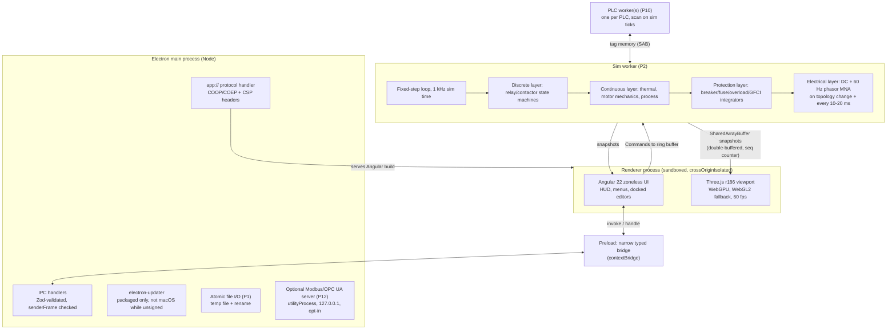
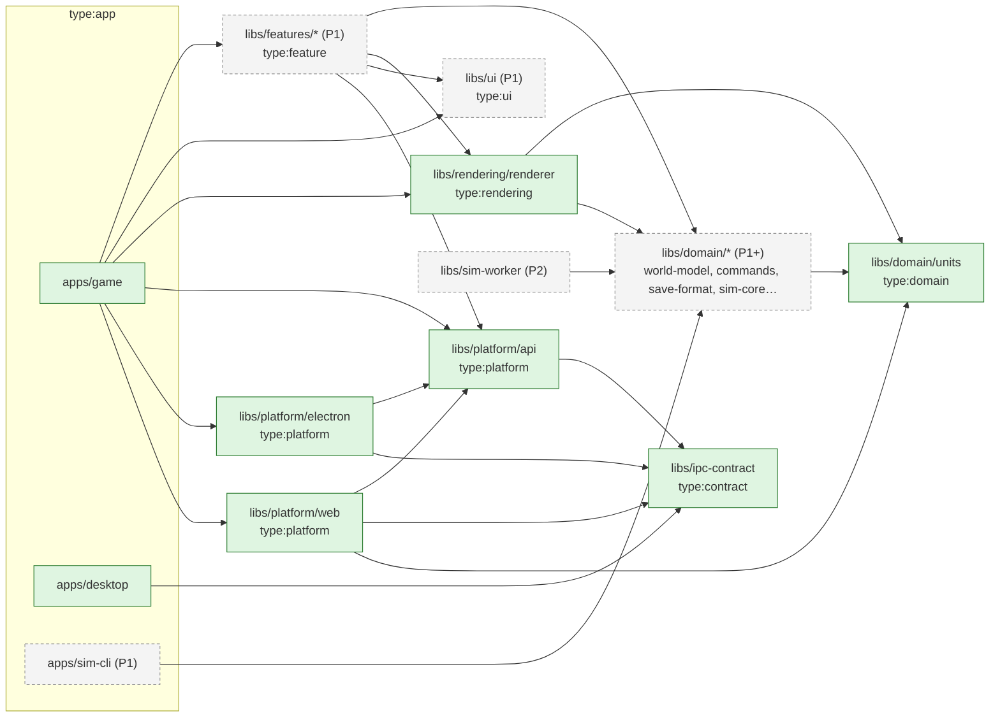
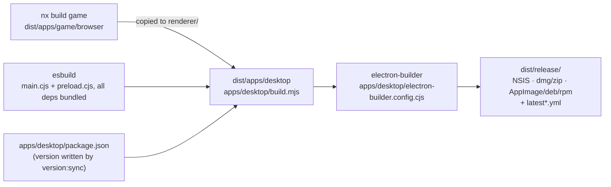

# Architecture overview

> **This page shows the target architecture** from [`controls-development-plan.md`](../../controls-development-plan.md) §4. Most of it doesn't exist yet.
>
> **P0 implements:** `apps/desktop` (Electron main + preload, `app://` protocol, one IPC channel `app:info`, updater wiring), `apps/game` (Angular 22 zoneless shell with an about box and the viewport), `apps/game-e2e` (Playwright against the web harness) and `apps/desktop-e2e` (Playwright `_electron`, or a CDP attach to a packaged binary), `libs/domain/units` (`@controls/units`, so far only the generated `lib/version.ts`), `libs/ipc-contract` (`@controls/ipc-contract`, plus the narrow `@controls/ipc-contract/preload` entry), `libs/rendering/renderer` (`@controls/renderer`, sub-panel + two DIN rails) and `libs/platform/api|electron|web`. There is **no** sim worker, PLC worker, command registry or save format yet.
>
> Items marked _(PN)_ below arrive in that phase.

## Process and thread model

- `SharedArrayBuffer` needs `crossOriginIsolated`, which is why content is served from `app://` (not `file://`) with COOP/COEP headers. A `postMessage` snapshot path is kept as a fallback and for the web harness.
- **Determinism** _(P2)_: sim time is an integer tick count, all randomness comes from a seeded PRNG, and the seed plus the command log reproduces a session.
- The UI never mutates the world directly. Every change is a registered Command _(P1)_.

## Module boundaries

Nx project tags, enforced by `@nx/enforce-module-boundaries` in the root ESLint config. The authoritative `depConstraints` live in `eslint.config.mjs`; this diagram shows the intent from plan §4.2. Green boxes exist in P0, and the edges between them are the imports P0 actually has. `REND --> UNITS` is intended: the renderer still uses its own `mm()` helper. E2E projects (`type:e2e`) may import no workspace libs, so they aren't drawn.

**Rules** (plan §4.2):

- `type:domain` is pure TypeScript (no Angular, DOM or Electron) and depends only on other domain libs. That's what lets `sim-cli` run the game headless.
- `sim-worker` depends on domain libs only.
- `type:rendering` depends on `world-model`, `catalog` and `units`, plus read-only snapshot types from `sim-worker`. It is framework-free.
- `type:feature` may depend on domain, rendering, ui and `platform/api`, **never** on a concrete platform implementation.
- `type:app` projects assemble features and inject a platform implementation (`platform-electron` inside Electron, `platform-web` in the browser harness).
- `type:contract` (`ipc-contract`) is shared by the Electron main process, the preload and the platform libs, so the bridge has one source of truth. The preload imports only `@controls/ipc-contract/preload` (channel names and the bridge type, no Zod) to stay tiny. Main validates each response with Zod, and `platform-electron` validates it again in the renderer.

## Desktop packaging (P0)

The packaged app directory has **no `node_modules`**: every main-process dependency is bundled by esbuild. See [electron caveats](../caveats/electron.md) and [release caveats](../caveats/release.md).

## Related

- [ADR 0001 Stack](../decisions/0001-stack.md) · [ADR 0002 Simulation architecture](../decisions/0002-simulation-architecture.md)
- Research: [tech stack](../research/2026-10-tech-stack.md), [circuit simulation](../research/2026-10-circuit-simulation.md)
