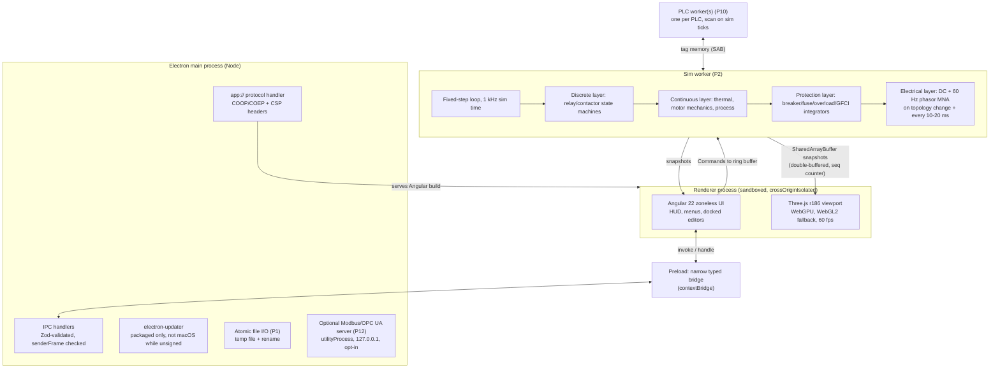
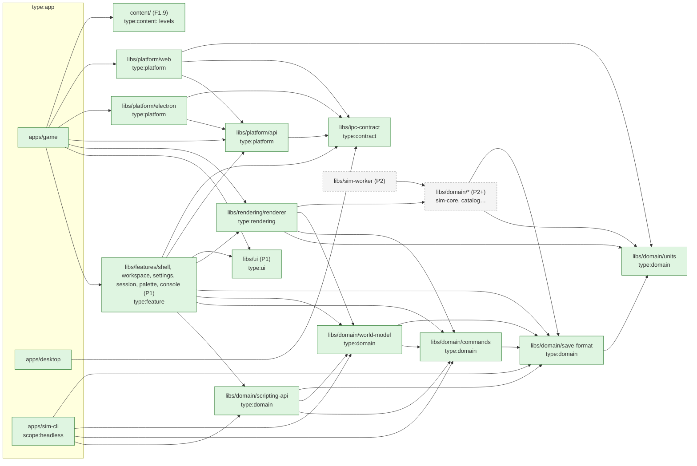
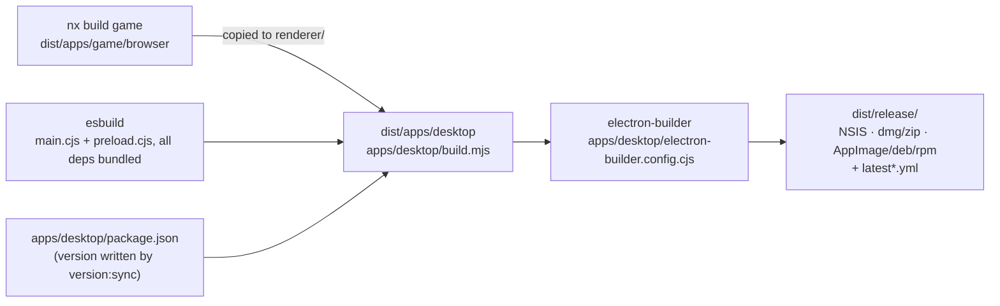

# Architecture overview

> **This page shows the target architecture** from [`controls-development-plan.md`](../../controls-development-plan.md) §4. Most of it doesn't exist yet.
>
> **P0 implements:** `apps/desktop` (Electron main + preload, `app://` protocol, one IPC channel `app:info`, updater wiring), `apps/game` (Angular 22 zoneless shell with an about box and the viewport), `apps/game-e2e` (Playwright against the web harness) and `apps/desktop-e2e` (Playwright `_electron`, or a CDP attach to a packaged binary), `libs/domain/units` (`@controls/units`, so far only the generated `lib/version.ts`), `libs/ipc-contract` (`@controls/ipc-contract`, plus the narrow `@controls/ipc-contract/preload` entry), `libs/rendering/renderer` (`@controls/renderer`, sub-panel + two DIN rails) and `libs/platform/api|electron|web`. There is **no** sim worker, PLC worker, command registry or save format in P0.
>
> **P1 so far:** `libs/domain/save-format` (`@controls/save-format`, F1.8a): the v1 world, manifest, replay-log and settings schemas, the migration framework, fixtures and JSON Schema export. See [world and saves](world-and-saves.md).
>
> **P1 so far (F1.1):** `libs/ui` (`@controls/ui`, `type:ui`), `libs/features/shell`, `libs/features/workspace` and `libs/features/settings` (`type:feature`). The `Viewport` component moved from `apps/game` into `feature-workspace`. `platform-api` gained `Platform.settings` (`SettingsService`) and `Platform.quit`, and three IPC channels joined `app:info`: `settings:get`, `settings:set` (atomic write of `userData/settings.json`) and `app:quit`. Flush before quit later added `Platform.lifecycle` (`AppLifecycle`) and `app:flush-request` (main → renderer) / `app:flush-ack`, so buffered writes reach disk before a window closes or the app quits. See [UI shell](ui-shell.md#flush-before-quit). F1.8b part 2 added `Platform.files` and `Platform.dialogs` and five channels (`save:list`, `save:read`, `save:write`, `dialog:open`, `dialog:saveAs`): main owns `userData/saves/`, the renderer holds opaque handles, writes are atomic; the web harness uses OPFS. See [World and saves](world-and-saves.md#save-io-f18b) and [ADR 0009](../decisions/0009-save-io-boundary.md).
>
> **P1 so far (F1.2):** `libs/domain/commands` (`@controls/commands`: registry, bus, undo/redo, replay, `when`), `libs/domain/world-model` (`@controls/world-model`: entity commands, sfc32, SHA-256 `world.hash`) and `libs/features/session` (`@controls/feature-session`, the Angular adapter). See [commands](commands.md).

> **P1 so far (F1.4):** the keybinding core in `@controls/commands` (`keybindings/`: chords, conflicts, resolution, the `INPUT_ACTIONS` table), `KeybindingService` and `ToolBelt` in `feature-session`, and the Key bindings dialog in `feature-settings`. The renderer now reads its input-action defaults from `@controls/commands` (`REND --> CMDS`). See [commands](commands.md#keybindings) and [UI shell](ui-shell.md#keybindings-and-the-tool-belt).
>
> **P1 so far (F1.6):** `libs/domain/scripting-api` (`@controls/scripting-api`: the `Game` facade that `Session` and scripts share), the console-line parser in `@controls/commands`, and `apps/sim-cli` (`type:app`, `scope:headless`: `pnpm sim run|replay|hash`). See [scripting and sim-cli](scripting.md).
>
> **P1 so far (F1.3):** `libs/features/palette` (`@controls/feature-palette`, `type:feature`): the command palette, with argument forms generated from each command's Zod `args`. `palette.open` joined the built-in view commands in `@controls/commands`, with the `.meta()` arg hints (`x-controls-ref`) and the `selection.entityId` context key. See [UI shell](ui-shell.md#command-palette-f13).
> **P1 so far (F1.5):** `libs/features/console` (`@controls/feature-console`): the dev console on CodeMirror 6 (`@codemirror/state`, `@codemirror/view`, loaded lazily), docked in the workspace, with the `console.toggle` view command in `@controls/commands` and `consoleFields` next to the console-line mapping. See [dev console](console.md).
>
> **P1 so far (F1.7):** the renderer draws world snapshots by entity id and turns gestures into intents that `feature-workspace` executes as `entity.place` / `entity.move` (`REND --> WM` is real: snap and placement maths, prop sizes and world types come from `@controls/world-model`). `view.mode` and `view.focus` are view commands. `feature-workspace` now reads the tool belt's props from `feature-settings`. See [rendering](rendering.md).
>
> **P1 so far (F1.8b):** `@controls/save-format` writes and reads the `.ctrl` container; `Platform.files` / `.dialogs` store saves behind opaque handles ([ADR 0009](../decisions/0009-save-io-boundary.md)); `libs/features/saves` (`@controls/feature-saves`) saves, loads, autosaves and continues through the unlogged `file.*` commands that `Session` registers. See [world and saves](world-and-saves.md#saving-and-loading-in-the-game-f18b-part-3).
>
> Items marked _(PN)_ below arrive in that phase.

## Process and thread model

- `SharedArrayBuffer` needs `crossOriginIsolated`, which is why content is served from `app://` (not `file://`) with COOP/COEP headers. A `postMessage` snapshot path is kept as a fallback and for the web harness.
- **Determinism** _(P2)_: sim time is an integer tick count, all randomness comes from a seeded PRNG, and the seed plus the command log reproduces a session.
- The UI never mutates the world directly. Every change is a registered Command _(P1)_.

## Module boundaries

Nx project tags, enforced by `@nx/enforce-module-boundaries` in the root ESLint config. The authoritative `depConstraints` live in `eslint.config.mjs`; this diagram shows the intent from plan §4.2. Green boxes exist today (including the F1.1 UI libs and the F1.2 command libs), and the edges between them are the imports that actually exist (`REND --> DOM` is still intended). `REND --> UNITS` is real since F1.7: the renderer converts scene units with `mm()`, `metresToMm()` and `mdegToRadians()` from `@controls/units`. `REND --> WM` is real since F1.7 part 2: world types, snapping and placement come from `@controls/world-model`. `REND --> CMDS` is real since F1.4: the renderer takes its input-action table from `@controls/commands`. The renderer's internals are on the [rendering page](rendering.md). E2E projects (`type:e2e`) may import no workspace libs, so they aren't drawn.

**Rules** (plan §4.2):

- `type:domain` is pure TypeScript (no Angular, DOM or Electron) and depends only on other domain libs. That's what lets `sim-cli` run the game headless. Since the P1 kickoff this is enforced beyond tags: banned npm imports (Angular, RxJS, Electron, Three.js, …), a no-`dom` tsconfig, no Node built-ins in source, a determinism lint (no `Math.random`, wall clock, `performance` or `crypto`), and a 90 % coverage gate. See [workspace caveats](../caveats/workspace.md).
- `scope:headless` (`apps/sim-cli`) may depend only on domain libs, on top of its `type:app` tag. A test lints a probe import with the real config to keep it that way.
- `type:content` (`content/`, F1.9) is data only and imports nothing. The game bundles levels through `@controls/content/*`; `sim-cli` and specs read the files from disk.
- `sim-worker` depends on domain libs only.
- `type:rendering` depends on `world-model`, `catalog` and `units`, plus read-only snapshot types from `sim-worker`. It is framework-free.
- `type:feature` may depend on domain, rendering, ui and `platform/api`, **never** on a concrete platform implementation.
- `type:app` projects assemble features and inject a platform implementation (`platform-electron` inside Electron, `platform-web` in the browser harness).
- `type:contract` (`ipc-contract`) is shared by the Electron main process, the preload and the platform libs, so the bridge has one source of truth. The preload imports only `@controls/ipc-contract/preload` (channel names and the bridge type, no Zod) to stay tiny. Main validates each response with Zod, and `platform-electron` validates it again in the renderer.

## Desktop packaging (P0)

The packaged app directory has **no `node_modules`**: every main-process dependency is bundled by esbuild. See [electron caveats](../caveats/electron.md) and [release caveats](../caveats/release.md).

## Related

- [ADR 0001 Stack](../decisions/0001-stack.md) · [ADR 0002 Simulation architecture](../decisions/0002-simulation-architecture.md)
- Research: [tech stack](../research/2026-10-tech-stack.md), [circuit simulation](../research/2026-10-circuit-simulation.md)
