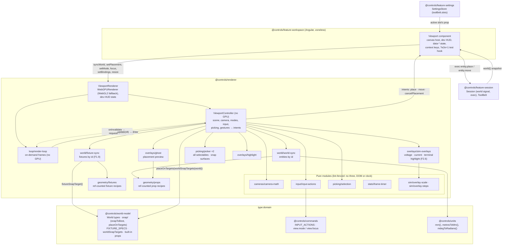
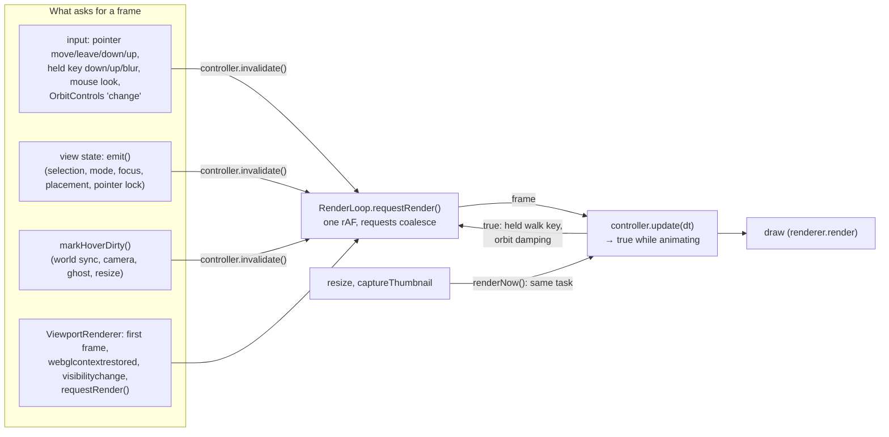
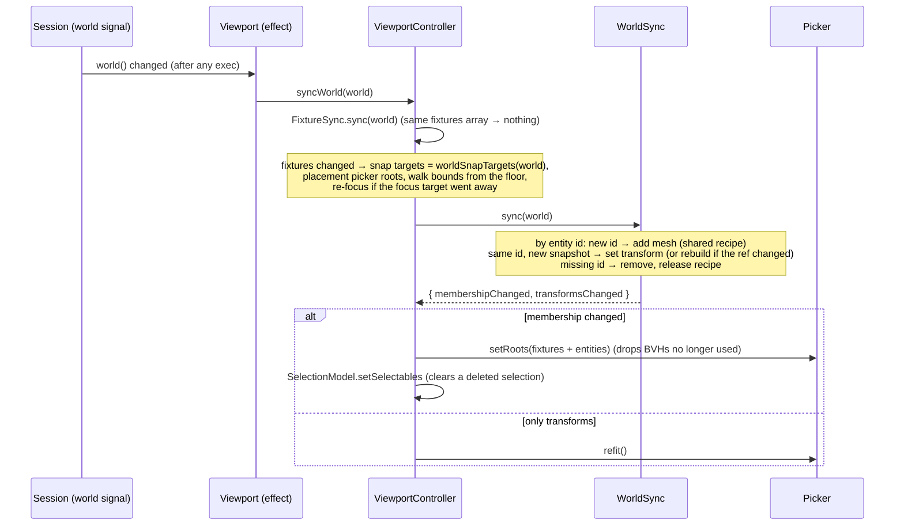
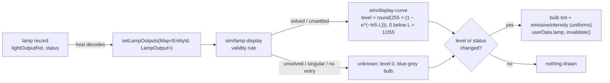
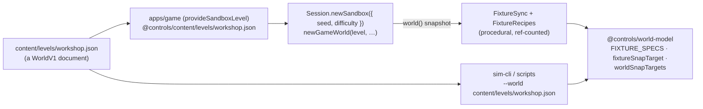
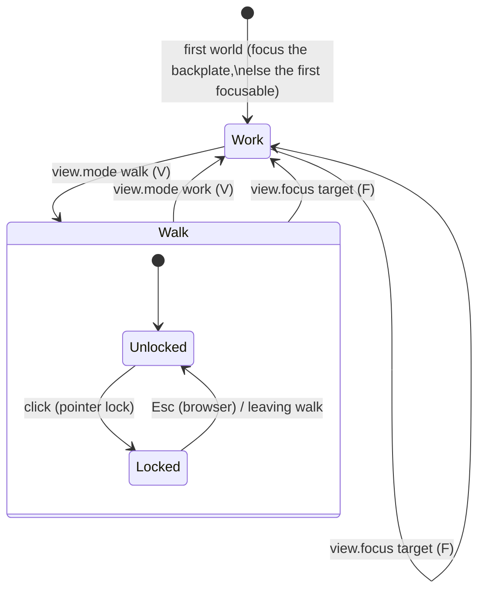
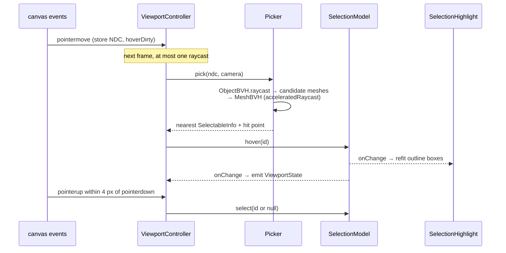
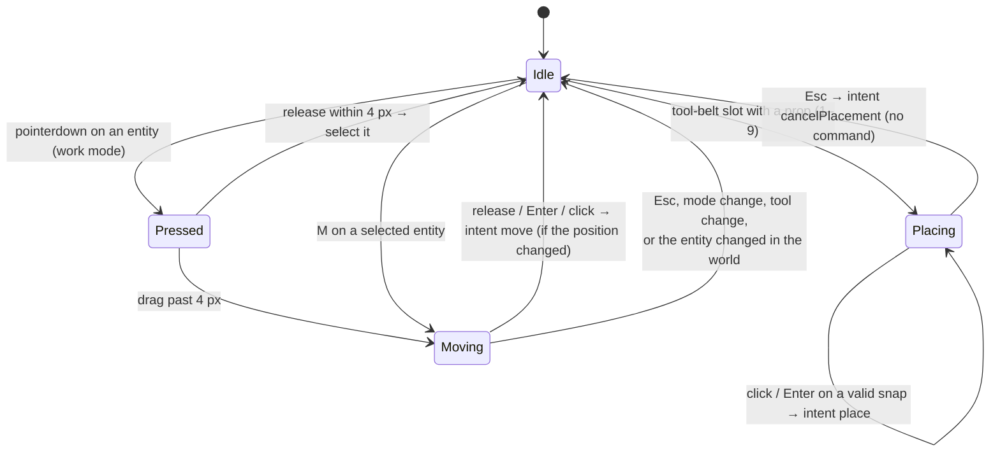
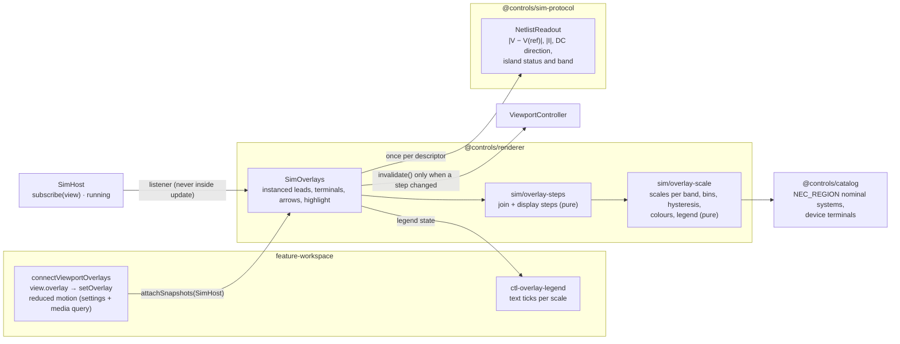

# Rendering and interaction

> **Status (P1, F1.7 and F1.9 done; P2: device recipes in F2.4, the debug overlays in F2.6):** cameras, BVH picking, selection, scene sync from world snapshots, the placement ghost and gestures as Commands (`entity.place`, `entity.move`, `entity.delete`, `view.mode`, `view.focus`) have shipped. Since F1.9 the scene is the **workshop level**: its floor, stud wall, backboard, backplate, DIN rails and bench are the world's **fixtures**, drawn by procedural recipes, and walls and benches are focus and snap targets. The snap maths lives in `@controls/world-model` so scripts snap like the mouse. Gotchas: [rendering caveats](../caveats/rendering.md). Spec: plan §4.9 and [phase 1 F1.7](../../plans/phase-1-game-shell.md#f17-cameras-and-interaction).

`@controls/renderer` (`type:rendering`) is framework-free imperative Three.js r186. It **draws the world model and never owns it**: the world arrives as read-only snapshots, and everything the renderer keeps (camera pose, mode, hover, selection, the ghost, overlays) is view state. Gestures leave it as **intents**, which `feature-workspace` executes as Commands.

## Layers

- **`ViewportRenderer`** owns only the GPU: the `WebGPURenderer` (its WebGL2 backend is forced with `?renderer=webgl2`), the draw callback it gives the `RenderLoop`, and the dev-HUD stats. It keeps the latest world snapshot and placement prop until `init()` resolves, then hands them to the controller. Each frame it draws, the loop calls `controller.update(dt)` and then `render()` (see [the frame loop](#the-frame-loop-on-demand)).
- **`ViewportController`** owns the scene, the camera and every listener. It is constructed against any `HTMLElement`, so unit tests run it in Node with fake event targets, real geometry and real BVHs.
- **Domain maths** (snapping, placement, prop and fixture sizes) lives in `@controls/world-model`; the renderer imports it. Camera, input and selection maths stay in the renderer's pure, lint-fenced modules.
- **The base scene** (`buildBaseScene`) holds only the background and lights. Everything else is drawn from the world: fixtures by `FixtureSync`, entities by `WorldSync`. An empty world draws an empty room.

## The frame loop (on demand)

The viewport draws a frame **only when something changed**. With nothing to draw no `requestAnimationFrame` is outstanding, so the page's main thread is free: behind the main menu it draws once and then idles. That saves battery and GPU, and it made every Playwright round trip cheap again (under SwiftShader each frame used to block the page for 100–200 ms; see the [UI caveats](../caveats/ui.md)).

- **One funnel.** The controller's `invalidate()` notifies the loop. It is called from three places, so features rarely call it themselves: `markHoverDirty()` (every camera, pointer, world, ghost and size change already set the hover-dirty flag), `emit()` (every published view-state change) and the input sources (`KeyboardInput`'s held-set callback, mouse-look deltas, OrbitControls' `change`). Invalidations raised _inside_ `update()` are ignored, because the frame in progress draws them; `update()` returns `true` to ask for the next frame instead.
- **Animations keep requesting frames until they settle.** `update()` returns `true` in walk mode while any key is held (movement is applied per frame) and in work mode while OrbitControls damping still moves the camera. A frame that follows idle time gets `dt = 0`, so nothing jumps after a pause; back-to-back frames get the real interval.
- **`renderNow()` draws in the calling task.** A resize clears the canvas, and the host's `ResizeObserver` runs before paint, so drawing there avoids a blank frame. `captureThumbnail()` needs the drawing buffer in the same task (it isn't preserved), so it draws through `renderNow()` too, idle or not.
- **three's own loop is stopped.** `Renderer.init()` in r186 starts an internal `requestAnimationFrame` loop whether or not `setAnimationLoop` is used; `ViewportRenderer` stops it (`_animation.stop()`, a private field, guarded) and resets `info.render` before each draw itself.
- **The dev HUD reports cost, not cadence.** `FrameTimer.record(costMs, intervalMs?)` gets each frame's main-thread cost (update + draw submission); the frame rate comes only from back-to-back frames. Stats are reported every 500 ms while drawing and once more after the loop goes idle, so the HUD reads `idle · last frame N ms` instead of freezing on stale numbers.
- **Tests wait on the loop, not on time.** `RenderLoop` is GPU-free and takes an injected `FrameClock`; `ManualFrameClock` ticks it by hand in `render-loop.spec.ts` and in the controller spec's "on-demand rendering" block. E2E uses `whenIdle()` (everything requested is drawn) and `afterFrames(n)` (draw n more) through the `?e2e=1` hook, and `framesDrawn` to prove the menu idles.

## Scene sync from world snapshots

- Snapshots are immutable, so an unchanged entity is skipped by identity. The renderer never writes to a world.
- Each entity is a `Mesh` named `entity-<id>`, selectable as `{ id: 'entity-<id>', kind: 'prop', entityId }`. Its transform is the world's integer mm and millidegrees, converted at draw time (`mm()`, `mdegToRadians()`, Euler order `YXZ` = ADR 0007's intrinsic yaw, pitch, roll).
- **Prop recipes** are procedural (plan §4.9): a box, or a cylinder along the prop's depth, sized from the built-in prop table in `world-model`. One geometry and one material per prop ref, reference-counted, so removing the last entity of a prop disposes them. Unknown refs draw as a 100 mm placeholder cube.
- **Device recipes** (`geometry/devices.ts`, F2.4 and F2.5) draw catalogue devices from their entry's size and terminals: the battery, the bench supply, the DIN PSU, the SPST switch, the lamp, the resistor and the heater. One merged geometry with a group per material slot (`DEVICE_SLOTS`), labelled with the fictional brand and model.
- **Per-entity device state (F2.5).** A switch has a child mesh `lever` (shared lever geometry), turned ±25° by the entity's commanded `state.closed` on every sync of a new snapshot. A lamp draws its `bulb` slot with its own clone of the recipe's material, so each lamp glows by its own sim output.
- The scene-graph JSON snapshot (`describeSceneGraph`: name, type, integer-mm position, rotation in millidegrees, selectable, label, and for meshes their geometry bounds in integer mm and `drawn: false` for snap proxies; `lamp: { level, status }` for lamps and `switch: { closed }` for switches) covers add, update and remove, and the whole workshop level.

## Lamp brightness from sim output (F2.5)

The host (`feature-workspace`'s `LampSnapshotFeed`, subscribed to `SimHost.subscribe`) reads each lamp's `lightOutputRel` and `status` from every snapshot the sim worker publishes, through field offsets resolved once per topology generation, and calls `ViewportRenderer.setLampOutputs(map)` (by entity id, the same map updated in place). A warming filament is therefore drawn as time runs, not only after a command; a source reset (`null`) gives an empty map, every lamp unknown. The renderer computes no electrical quantity; it maps and draws:

- **The display curve** (`sim/display-curve.ts`, pure, lint-fenced, game-design source): `glow = 1 − e^(−ln5·L)`, 0 below `L = 1/255`, quantised to `level = round(255 × glow)`. Rated light (`L = 1`) draws at level 204; over-voltage is brighter and saturates toward 255 without clipping.
- **The validity rule** (`sim/lamp-display.ts`): `solved` draws its level (level 0 is a real "off", clear glass); `unsettled` draws its level with a violet-grey tint; `unsolved`, `singular` or no entry is **unknown**: no glow and a blue-grey tint, never an off lamp.
- `invalidate()` is called only when some lamp's drawn level or status changed (ADR 0011 §9.2). A step writes only uniforms (colour, `emissiveIntensity`).

## The workshop level (F1.9)

| Fixture id     | Ref                      | Kind        | World position (mm)  | Focus              | Snap target                   |
| -------------- | ------------------------ | ----------- | -------------------- | ------------------ | ----------------------------- |
| `backboard`    | `prop.plywood-backboard` | `board`     | (-610, -610, -3)     | +z                 | none (hides the studs behind) |
| `backplate`    | `prop.backplate`         | `backplate` | (-300, -400, 0)      | +z                 | `backplate-grid` 600 × 800    |
| `bench`        | `prop.bench`             | `bench`     | (700, -1200, 80)     | +z, from 40° above | `bench-top` 1800 × 750        |
| `din-rail-1/2` | `prop.din-rail`          | `din-rail`  | (-250, 150 / -50, 0) | +z                 | `din-rail` 500 mm             |
| `floor`        | `prop.workshop-floor`    | `floor`     | (-2500, -1200, -110) | none               | none (sets the walk bounds)   |
| `stud-wall`    | `prop.stud-wall`         | `stud-wall` | (-2500, -1200, -21)  | +z                 | `wall-studs` 4915 × 2440      |

- **Positions live in the level document, sizes in `FIXTURE_SPECS`**, and the snap targets are derived from both by one function (`fixtureSnapTarget`), so the renderer and a headless script get identical targets. Each fixture is a group named by its id; the fixture id is also its selectable id, `view.focus` target and snap-target id.
- The backplate sits where the P0/P1 demo panel was (centred on the origin, front face at z = 0), so panel coordinates in older scenarios still mean the same spot.
- The stud wall draws its studs on the same `studCentres()` layout the snapping uses (merged into one mesh) plus an undrawn **snap plane** across the stud faces, so the placement ray finds the wall between studs. The backboard is selectable and sits in the placement picker, so a ray that hits it never reaches the studs behind it.
- Fixtures are view-stable: syncing a world whose `fixtures` array is the same object (every command keeps it) does nothing. A new session (`Session.generation`) resets the view (`resetView`: work mode, the backplate, no selection).

## Modes

- **Work:** `OrbitControls` around a focus target. `workOrbitFor()` frames the target's bounding sphere along its face normal (benches from 40° above, so their top is in view), and limits orbit to ±75° azimuth and ±60° elevation, zoom to 0.15 m–3× the framing distance, and pan to the focus sphere (`cursor` + `maxTargetRadius`). Click selects; dragging empty space orbits; dragging an entity moves it.
- **Walk:** first person at a fixed eye height (1.6 m, game-design). WASD/arrows move, Shift sprints, and mouse look needs pointer lock. The pose is clamped to the room bounds (the world's floor fixture; a default bay without one) minus a 0.25 m body radius.
- **Switching and focusing are view commands** (`view.mode`, `view.focus`; ADR 0006): any surface runs them, they are logged, and the workspace applies them through `Session.onCommand`. The viewport publishes `mode` as a `when` context key. Movement, look, selection cycling and the placement keys stay **input actions** (`KeyboardEvent.code`), so per-frame input never reaches the replay log.

## Picking and selection

- Selectables are scene objects marked with `userData.selectable`, a JSON-plain `SelectableInfo`: `id`, `kind`, `label`, and optionally `focusNormal`, `snapTarget` and `entityId`. Fixture sync marks every fixture except the floor (the backboard, backplate, bench, DIN rails and stud wall); world sync marks every entity.
- `ViewportState` (`mode`, `pointerLocked`, `focusId`, `hovered`, `selected`, `placement`) is published through `onChange`. The Angular host mirrors it to `data-*` attributes and to the `when` context keys `mode`, `selection.id`, `selection.kind`, `selection.focusable` and `selection.entityId`.
- Keyboard: `]` and `[` cycle through selectables in id order; `F` (`view.focus.selection`) focuses a focusable selection; `Delete` (`entity.delete.selection`) deletes a selected entity.

## Placement and moves

- **The ghost** previews the active prop (or the entity being moved) at `placeOnTargets(ref, cursor, targets)` from `@controls/world-model`: the cursor ray hits a fixture (a second picker that holds only fixtures, so props never block it), the hit converts to integer mm with `metresToMm`, and `snapToBest` picks a DIN rail before the backplate grid before wall studs before a bench top. The targets are `worldSnapTargets(world)`, the same list a script gets. A failed snap hides the ghost. The ghost is renderer-local and unpickable.
- **Aiming:** the mouse pointer over the canvas, otherwise the screen-centre reticle (pointer lock in walk mode, or keyboard play with the pointer elsewhere). The crosshair shows whenever the reticle aims.
- **Commit points only:** a click or `Enter` emits one `place` intent; releasing a drag, or `Enter`/click after `M`, emits one `move` intent if the position changed. Pointer moves and drags emit nothing. A move keeps the entity's orientation, so only targets facing the same way count (one `entity.move`, never a rotate as well).
- **Escape, innermost first:** cancel a move, cancel placement (the workspace puts the tool away; no command), clear the selection, then fall through to the shell's menu.
- **Intents to Commands:** the `Viewport` component runs `entity.place {ref, positionMm, orientationMdeg}` or `entity.move {id, positionMm}` through `Session.exec`. The arguments are exactly what `placeOnTargets` returned, so a script that snaps the same cursor point logs identical entries (`apps/sim-cli/scenarios/mouse-place-move-delete.ts`).

## Snapping (pure, integer mm, `@controls/world-model`)

`snap(target, footprint, cursorWorld)` converts the cursor into the target's surface frame and returns the footprint's lower-left **anchor** in surface and world integer mm plus the target's normal, or a typed failure (`out-of-capture`, `out-of-bounds`, `too-large`). Vertical frames face ±x or ±z (`u` = right, `v` = up); since F1.9 a horizontal frame faces `+y` (`u` = its `right`, `v` = away from the front edge). An entity's `positionMm` is that world anchor; its prop geometry spans +x, +y, +z from it, turned by `orientationForFrame`: a yaw quarter-turn on a wall, plus pitch -90° on a bench top so the prop's depth stands up.

| Target           | Rule                                                                                                                                                                                                      | Constants (source in `world-model` `snap/constants.ts`)                                     |
| ---------------- | --------------------------------------------------------------------------------------------------------------------------------------------------------------------------------------------------------- | ------------------------------------------------------------------------------------------- |
| `din-rail`       | Centred across the rail; left edge at the start of a 17.5 mm module slot, `round(k × 17.5)` from the rail end; must fit on the rail; cursor within 40 mm of the centreline.                               | TS35 (EN 60715), module width 17.5 mm (DIN 43880), capture (game-design)                    |
| `backplate-grid` | Corner on a 5 mm grid inside the plate minus its 20 mm margin.                                                                                                                                            | grid pitch, margin (game-design)                                                            |
| `wall-studs`     | Flush against the side of the nearest stud that the cursor is on, inside one stud bay (falls back to the other side at a wall edge); bottom on a 10 mm grid. Stud centres are `round(first + i × 406.4)`. | 16 in o.c. (IRC R602.3(5), NIST), 2×4 dressed 38.1 mm (PS 20), vertical pitch (game-design) |
| `bench-top`      | Horizontal: corner on a 10 mm grid inside the top minus its 10 mm margin; the prop stands on the top.                                                                                                     | grid pitch, margin (game-design)                                                            |

`snapToBest(targets, footprint, cursor)` keeps the targets whose plane is within 10 mm of the cursor (`SNAP_PLANE_TOLERANCE`, covering a hit on a rail top) and whose extent contains it, then tries them by priority and id. The targets come from the world's fixtures (`worldSnapTargets(world)`): on the workshop, the backplate, both rails, the stud wall and the bench top.

## Disposal

The controller registers each resource owner with a LIFO `Disposer`, scene first so it's disposed last: the scene's geometries and materials, both pickers (they delete `boundsTree` and the own `raycast`), `FixtureSync` (removes fixture groups and disposes every fixture recipe), `WorldSync` (removes entity meshes and disposes every prop recipe), the ghost (returns its borrowed geometry, disposes its material and placeholder), the overlay helpers, the `SelectionModel` listeners, the pointer listeners, `OrbitControls`, the keyboard and pointer-lock listeners, and the state and intent listeners. `ViewportRenderer.dispose()` disposes the `RenderLoop` (cancels the pending frame and the idle-stats timer, releases test waiters) and removes its `webglcontextrestored` and `visibilitychange` listeners, then disposes the controller, then the `WebGPURenderer`. The Angular host disconnects its `ResizeObserver` and removes the test hook.

Removing every entity (without disposing the viewport) also returns to baseline: recipes reach zero and the picker drops BVHs for geometry no longer under a root. Loading a world without fixtures does the same for fixture recipes (`fixtureRecipeCount` reaches zero). Unit tests (`viewport-controller.spec.ts`) and `apps/game-e2e/src/placement.spec.ts` (renderer `info` geometry count) check both.

## Performance (F1.7 measurements)

| Measurement (500 props: box, crate, spool)     | Result                                                                                     |
| ---------------------------------------------- | ------------------------------------------------------------------------------------------ |
| First sync of 500 entities (Node)              | 42 ms, once: builds the object BVH and 3 geometry BVHs                                     |
| Sync after one `entity.move` (Node)            | 9 ms: diff, transform update and BVH refit (on commit, never per frame)                    |
| BVH pick (Node)                                | 27.5 µs per pick                                                                           |
| Idle `update()` with placement armed (Node)    | 3.7 µs, no allocation (since on-demand rendering, an idle viewport doesn't call it at all) |
| 1080p, AMD Radeon RX 7600 (discrete), Chromium | WebGPU and WebGL2 both a steady 60 fps (vsync-capped), 258 draw calls after culling        |
| 1080p, headless SwiftShader                    | WebGL2 60 fps; WebGPU-on-SwiftShader-Vulkan 3.8 fps (CPU per-draw cost, not a GPU figure)  |

The budget target (60 fps on a 2020-era integrated GPU) still needs measuring on such a GPU; props are one draw call each, and instancing repeated props is the obvious next step if that budget is missed.

**F1.9:** the workshop adds 9 drawn meshes (the 13 studs and 3 plates are one merged mesh; the snap plane is never drawn) and 8 geometry BVHs (the rails share one). The headless dev HUD showed 16 draw calls for the workshop with six props at 1280 × 720 on SwiftShader WebGL2; as above, headless frame times are not a GPU figure.

## Debug overlays (F2.6)

`view.overlay {name: 'voltage' | 'current', on}` is a view command (logged, no world change, `when: console.available`). The workspace applies it through `Session.onCommand`; the overlays are renderer-local view state in `SimOverlays` (`overlays/sim-overlays.ts`), which the controller owns, syncs with the world and updates each frame. Gotchas: [rendering caveats](../caveats/rendering.md).

- **What is drawn.** No scene mesh draws leads yet (wire routing is P3), so the overlays draw their own: a straight segment per world connection, in two halves (one per end, so a voltage drop shows), and a marker per catalogue terminal of every device, at the terminal's `positionMm` turned by the entity's transform. Six `InstancedMesh`es (lead halves, terminal spheres, unknown-terminal diamonds, DC arrows, AC markers, highlight rings): one draw each whatever the plant size, `frustumCulled = false`, a no-op `raycast`, never among the picker's roots. The group `overlay:sim` is in the scene only while an overlay or a highlight is shown, so with everything off the scene graph is exactly what it was.
- **Reading.** Every snapshot is read (also while the overlays are off, so switching one on draws the latest values at once): `NetlistReadout.of(descriptor)` is built once per descriptor and reads the view into a `NetlistReading` without allocating; the join of drawn items to nodes and branches is rebuilt per descriptor or world change. `updateOverlaySteps` turns the reading into display steps with half-step hysteresis; only a changed step rewrites instance colours and matrices and calls `invalidate()`.
- **Scales.** Voltage: a fixed linear scale per nominal band, 0 V to 4/3 of the band's nominal (the nominal sits at bin 24 of 32), from the region profile for AC (`120/240`, `208Y/120`, `480Y/277`) taken **line to neutral**, because an AC island's reference node is its neutral (a healthy 120 V line reads at bin 24 on a 160 V scale; line-to-line differences aren't what a node reads) and the catalogue's 12 V and 24 V DC classes; band 0 (`none`) and any band without a row are _no scale_. Current: one logarithmic scale for every band, bin 0 below 1 mA, bins 1–31 up to 100 A, then over range. Islands that aren't solved, items missing from the generation and a source reset are _unknown_: a dark, thinner lead and diamond markers, never a 0 V or 0 A colour.
- **Current animation.** DC arrows travel along the current's direction (positive from the connection's end `a` to end `b`) at 20 to 200 mm/s by bin; AC markers sway in place (magnitude only). `update()` animates only while `SimHost.running`, the current overlay is on, reduced motion is off and some lead's bin is above 0, and returns `true` then; otherwise the arrows return to their evenly spaced rest positions. Reduced motion is the setting `display.reducedMotion`, or `prefers-reduced-motion` while it is `system`.
- **The legend** (`ctl-overlay-legend`) lists, for each overlay on, its scale as a decorative colour bar with text ticks (the nominal marked) and an over-range label, then the _no scale_ and _no reading_ styles in words. The host carries `data-overlays` (`current voltage`).
- **Terminal highlight** for the netlist inspector: `ViewportRenderer.highlightTerminals(refs)` rings the given `{entity, terminal}`s (view state, whatever the overlays show) and returns how many are drawn; `null` or `[]` clears it, and it survives world changes for the terminals that still exist.
- **Frame time (F2.6, headless).** Measured 2026-10-31 with `apps/game-e2e/src/overlay-frame-time.spec.ts` (a manual tool, skipped unless `CONTROLS_MEASURE_OVERLAYS=1`): 250 battery-and-switch pairs on the bench, each switch closed across its battery through two test leads (500 devices, 500 leads, every lead over range), the sim running at 1×, Chromium's software WebGL2 (SwiftShader, `?renderer=webgl2`), DPR 1, on a machine under load (load average 5–14 on 12 threads), wall time per frame over back-to-back frames:

  | Viewport    | Overlays off | Voltage and current on | Draw calls (off / on) |
  | ----------- | ------------ | ---------------------- | --------------------- |
  | 1280 × 720  | 81–91 ms     | 115–245 ms             | 1 760 / 1 763         |
  | 1920 × 1080 | 194–210 ms   | 247–267 ms             | 1 760 / 1 763         |

  Two runs each; the spread is the machine's load, not the overlays. The main-thread cost the HUD reports (update plus draw submission) stayed at 5–12 ms with the overlays on: the rest is SwiftShader rasterising on the CPU. The overlays add 3 draw calls here (lead halves, terminal markers, DC arrows; empty layers draw nothing), and their instance layers are packed, so only shown instances are drawn. As with the props (above), **these are not GPU figures**: the 1 760 draw calls are the devices' material groups.

- **Real-GPU frame time is a manual step** (plan F2.6 TODO): on a desktop with the GPU in question, run `CONTROLS_MEASURE_OVERLAYS=1 pnpm nx run game-e2e:e2e -- overlay-frame-time.spec.ts --headed` (it starts or reuses the dev server on port 4200; headed Chromium uses the real GPU; add `CONTROLS_MEASURE_RENDERER=webgpu` to measure WebGPU instead of the pinned WebGL2), and record both sizes' JSON lines here. The plan's budget is 60 fps at 1080p on a 2020-era integrated GPU.
- **Tests:** `sim/overlay-scale.spec.ts` and `sim/overlay-steps.spec.ts` (scales, band 0, unknown islands, hysteresis, legend text, arrows), `overlays/sim-overlays.spec.ts` (fake snapshots from the codec: the overlay graph snapshot, invalidation only on change, animation and reduced motion, the highlight, growth, disposal), `sim-protocol`'s `netlist-readout.spec.ts`, `sim bench`'s `overlay-read-500-devices` (0 B per read), and `apps/game-e2e/src/overlays.spec.ts` (console and palette, with the real worker), and the disposal pattern of the controller spec.

## Reading the sim snapshot (F2.3b measurements)

The renderer reads sim output only through the `SnapshotSource` `SimHost` gives it ([ADR 0011](../decisions/0011-sim-worker-contract.md) §9.1–§9.2). Each read is `SnapshotReader.latest()`: the seqlock check and one `set()` of the slot's used bytes into a private copy, then the listener reads its fields through `FieldRef`s resolved once per generation. Measured 2026-10-31, AMD Ryzen 5 5600X, Node 24 (V8, as Chromium's), outside coverage, 5,000 reads after 1,000 warm-up, one publish before each read (so every read copies), on a machine under load (load average 5–9):

| Plant                                                      | Slot    | Read, p50 / p99  | Read + 500 device fields, p50 / p99 |
| ---------------------------------------------------------- | ------- | ---------------- | ----------------------------------- |
| 500 devices, 1,000 nodes, 1,500 branches, 50 islands       | 52.9 kB | 3.4 / 4.7–8.7 µs | 6.3 / 18.5–27 µs                    |
| 500 devices at the 2,000-node bench scale (3,000 branches) | 92.2 kB | 5.6 / 12–14 µs   | 8.9 / 22–28 µs                      |

ADR 0011 §9.2's budget is **0.1 ms at p99 on a 500-device plant**: the whole-slot copy uses about a seventh of it with its field reads, so the devices-only read the ADR allows for later isn't needed yet. `pnpm sim bench` measures it every `verify` (`snapshot-read-500-devices`: p50 5–10 µs, p99 11–18 µs over ten runs on a loaded machine) and **gates it on allocation**: a frame's `latest()` plus 500 `readAll` field reads must allocate under 1 B per frame (`READ_ALLOCATION_GATE_BYTES`; any per-frame object is 12 B or more). It measures 0 B: 23 of 23 `sim bench` runs (#60 review 2). That gate found two allocations the earlier probe missed (#60 review): `SnapshotView.read` returned its double boxed whenever V8 didn't inline the four-way switch (about 14 B a field, 6.9 kB a frame), and each copy built a `DataView` of the slot header. `read` now has a small f64 path, `readAll(fields, out)` reads a whole list into a `Float64Array`, and the header views are made on attach. The time is reported (p50, p90, p99), not gated: a raw-ms gate would need the calibrated headroom of the solver cases first. Not measured yet: the click-to-lamp latency (it needs F2.5's lamp) and `world.hash` at 2k and 20k nodes (ADR 0011 "Deferred to implementation"); the bench e2e asserts `misses === 0` (`apps/game-e2e/src/sim-engine.spec.ts`).
