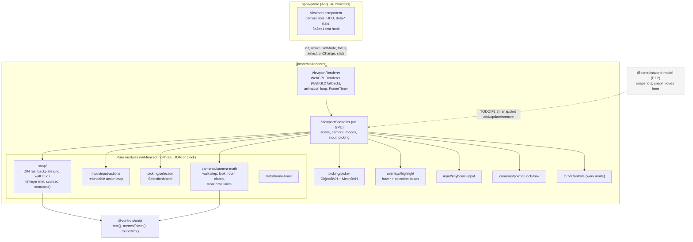
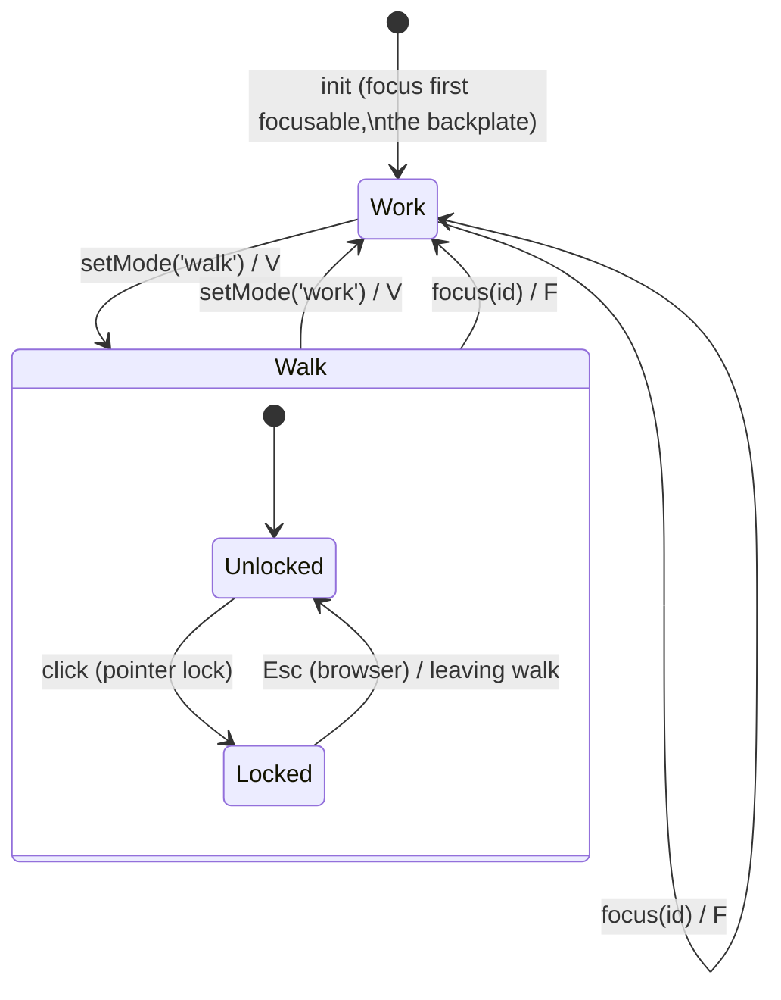
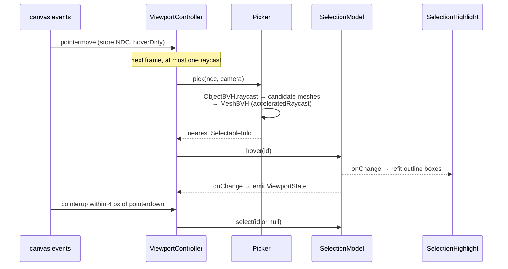

# Rendering and interaction

> **Status (P1, F1.7 part 1):** cameras, BVH picking, selection and the snap maths have shipped. Scene sync from world snapshots, ghost placement and Commands (`entity.place`/`move`/`delete`, `view.mode`, `view.focus`) follow F1.2. Gotchas: [rendering caveats](../caveats/rendering.md). Spec: plan §4.9 and [phase 1 F1.7](../../plans/phase-1-game-shell.md#f17-cameras-and-interaction).

`@controls/renderer` (`type:rendering`) is framework-free imperative Three.js r186. It **draws the world model and never owns it**: everything it keeps (camera pose, mode, hover, selection, overlays) is view state.

## Layers

- **`ViewportRenderer`** owns only the GPU: the `WebGPURenderer` (its WebGL2 backend is forced with `?renderer=webgl2`), the `setAnimationLoop` callback and the dev-HUD stats. Each frame it calls `controller.update(dt)` and then `render()`.
- **`ViewportController`** owns the scene, the camera and every listener. It is constructed against any `HTMLElement`, so unit tests run it in Node with fake event targets, real geometry and real BVHs.
- **Pure modules** hold all the maths. They're lint-fenced and unit-tested without a GPU.

## Modes

- **Work:** `OrbitControls` around a focus target. `workOrbitFor()` frames the target's bounding sphere along its face normal, and limits orbit to ±75° azimuth and ±60° elevation, zoom to 0.15 m–3× the framing distance, and pan to the focus sphere (`cursor` + `maxTargetRadius`). Click selects; dragging orbits.
- **Walk:** first person at a fixed eye height (1.6 m, game-design). WASD/arrows move, Shift sprints, and mouse look needs pointer lock. The pose is clamped to the room bounds minus a 0.25 m body radius. Entering walk keeps the current eye position and view direction; entering work re-focuses the last target.
- Movement uses **input actions** (`DEFAULT_INPUT_BINDINGS`, keyed by `KeyboardEvent.code`), not Commands, so per-frame input never reaches the replay log (ADR 0006, F1.2).

## Picking and selection

- Selectables are scene objects marked with `userData.selectable`, a JSON-plain `SelectableInfo`: `id`, `kind`, `label`, an optional `focusNormal` and an optional `snapTarget`. Today the demo panel marks the backplate and both DIN rails. From F1.2 the id is the world entity id.
- `ViewportState` (`mode`, `pointerLocked`, `focusId`, `hovered`, `selected`) is published through `onChange`. The Angular host mirrors it to `data-mode`, `data-focus`, `data-selected`, `data-selection-kind` and `data-hovered`. `selection.kind` becomes a `when` context key in F1.2.
- Keyboard: `]` and `[` cycle through selectables in id order, `Escape` clears the selection, `F` focuses it and `V` toggles walk/work.

## Snapping (pure, integer mm)

`snap(target, footprint, cursorWorld)` converts the cursor into the target's surface frame (`u` = right, `v` = up, axis-aligned normal) and returns the footprint's lower-left **anchor** in surface and world integer mm, or a typed failure (`out-of-capture`, `out-of-bounds`, `too-large`).

| Target           | Rule                                                                                                                                                                                                      | Constants (source in `snap/constants.ts`)                                                   |
| ---------------- | --------------------------------------------------------------------------------------------------------------------------------------------------------------------------------------------------------- | ------------------------------------------------------------------------------------------- |
| `din-rail`       | Centred across the rail; left edge on a whole 18 mm module from the rail end; must fit on the rail; cursor within 40 mm of the centreline.                                                                | TS35 (EN 60715), module pitch (DIN 43880, rounded), capture (game-design)                   |
| `backplate-grid` | Corner on a 5 mm grid inside the plate minus its margin.                                                                                                                                                  | grid pitch (game-design)                                                                    |
| `wall-studs`     | Flush against the side of the nearest stud that the cursor is on, inside one stud bay (falls back to the other side at a wall edge); bottom on a 10 mm grid. Stud centres are `round(first + i × 406.4)`. | 16 in o.c. (IRC R602.3(5), NIST), 2×4 dressed 38.1 mm (PS 20), vertical pitch (game-design) |

Placement integration (F1.7 part 2, after F1.2): a ghost preview calls `snap()` on the hovered selectable's `snapTarget`; committing emits exactly one `entity.place` or `entity.move` with the anchor; Esc cancels without a Command.

## Disposal

The controller registers each resource owner with a LIFO `Disposer`, scene first so it's disposed last: the scene's geometries and materials, the `Picker` (deletes `boundsTree` and the own `raycast`), the overlay helpers, the `SelectionModel` listeners, `OrbitControls`, the keyboard and pointer-lock listeners, pointer listeners and state listeners. `ViewportRenderer.dispose()` stops the loop, then disposes the controller, then the `WebGPURenderer`. The Angular host disconnects its `ResizeObserver` and removes the test hook.
