# Rendering and interaction

> **Status (P1, F1.7 and F1.9 done; P2: device recipes in F2.4, the debug overlays in F2.6; P3: enclosures and raceways in F3.5, routing maths in F3.2 part 1, the [wire renderer](#the-wire-renderer-f32-part-2) in F3.2 part 2):** cameras, BVH picking, selection, scene sync from world snapshots, the placement ghost and gestures as Commands (`entity.place`, `entity.move`, `entity.delete`, `view.mode`, `view.focus`) have shipped. Since F1.9 the scene is the **workshop level**: its floor, stud wall, backboard, backplate, DIN rails and bench are the world's **fixtures**, drawn by procedural recipes, and walls and benches are focus and snap targets. The snap maths lives in `@controls/world-model` so scripts snap like the mouse. Gotchas: [rendering caveats](../caveats/rendering.md). Spec: plan §4.9 and [phase 1 F1.7](../../plans/phase-1-game-shell.md#f17-cameras-and-interaction).

`@controls/renderer` (`type:rendering`) is framework-free imperative Three.js r186. It **draws the world model and never owns it**: the world arrives as read-only snapshots, and everything the renderer keeps (camera pose, mode, hover, selection, the ghost, overlays) is view state. Gestures leave it as **intents**, which `feature-workspace` executes as Commands.

## Layers

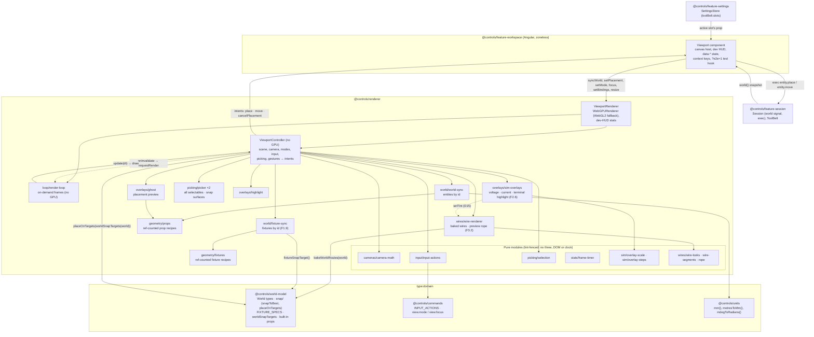

- **`ViewportRenderer`** owns only the GPU: the `WebGPURenderer` (its WebGL2 backend is forced with `?renderer=webgl2`), the draw callback it gives the `RenderLoop`, and the dev-HUD stats. It keeps the latest world snapshot and placement prop until `init()` resolves, then hands them to the controller. Each frame it draws, the loop calls `controller.update(dt)` and then `render()` (see [the frame loop](#the-frame-loop-on-demand)).
- **`ViewportController`** owns the scene, the camera and every listener. It is constructed against any `HTMLElement`, so unit tests run it in Node with fake event targets, real geometry and real BVHs.
- **Domain maths** (snapping, placement, prop and fixture sizes) lives in `@controls/world-model`; the renderer imports it. Camera, input and selection maths stay in the renderer's pure, lint-fenced modules.
- **The base scene** (`buildBaseScene`) holds only the background and lights. Everything else is drawn from the world: fixtures by `FixtureSync`, entities by `WorldSync`. An empty world draws an empty room.

## The frame loop (on demand)

The viewport draws a frame **only when something changed**. With nothing to draw no `requestAnimationFrame` is outstanding, so the page's main thread is free: behind the main menu it draws once and then idles. That saves battery and GPU, and it made every Playwright round trip cheap again (under SwiftShader each frame used to block the page for 100–200 ms; see the [UI caveats](../caveats/ui.md)).

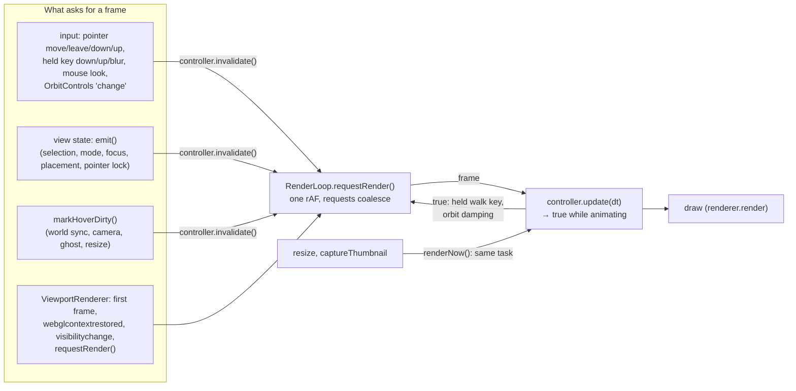

- **One funnel.** The controller's `invalidate()` notifies the loop. It is called from three places, so features rarely call it themselves: `markHoverDirty()` (every camera, pointer, world, ghost and size change already set the hover-dirty flag), `emit()` (every published view-state change) and the input sources (`KeyboardInput`'s held-set callback, mouse-look deltas, OrbitControls' `change`). Invalidations raised _inside_ `update()` are ignored, because the frame in progress draws them; `update()` returns `true` to ask for the next frame instead.
- **Animations keep requesting frames until they settle.** `update()` returns `true` in walk mode while any key is held (movement is applied per frame) and in work mode while OrbitControls damping still moves the camera. A frame that follows idle time gets `dt = 0`, so nothing jumps after a pause; back-to-back frames get the real interval.
- **`renderNow()` draws in the calling task.** A resize clears the canvas, and the host's `ResizeObserver` runs before paint, so drawing there avoids a blank frame. `captureThumbnail()` needs the drawing buffer in the same task (it isn't preserved), so it draws through `renderNow()` too, idle or not.
- **three's own loop is stopped.** `Renderer.init()` in r186 starts an internal `requestAnimationFrame` loop whether or not `setAnimationLoop` is used; `ViewportRenderer` stops it (`_animation.stop()`, a private field, guarded) and resets `info.render` before each draw itself.
- **The dev HUD reports cost, not cadence.** `FrameTimer.record(costMs, intervalMs?)` gets each frame's main-thread cost (update + draw submission); the frame rate comes only from back-to-back frames. Stats are reported every 500 ms while drawing and once more after the loop goes idle, so the HUD reads `idle · last frame N ms` instead of freezing on stale numbers.
- **Tests wait on the loop, not on time.** `RenderLoop` is GPU-free and takes an injected `FrameClock`; `ManualFrameClock` ticks it by hand in `render-loop.spec.ts` and in the controller spec's "on-demand rendering" block. E2E uses `whenIdle()` (everything requested is drawn) and `afterFrames(n)` (draw n more) through the `?e2e=1` hook, and `framesDrawn` to prove the menu idles.

## Scene sync from world snapshots

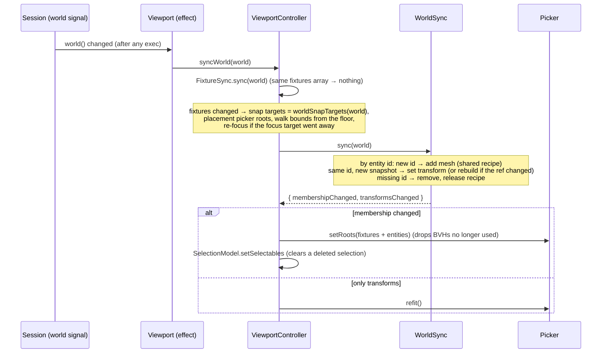

- Snapshots are immutable, so an unchanged entity is skipped by identity. The renderer never writes to a world.
- Each entity is a `Mesh` named `entity-<id>`, selectable as `{ id: 'entity-<id>', kind: 'prop', entityId }`. Its transform is the world's integer mm and millidegrees, converted at draw time (`mm()`, `mdegToRadians()`, Euler order `YXZ` = ADR 0007's intrinsic yaw, pitch, roll).
- **Prop recipes** are procedural (plan §4.9): a box, or a cylinder along the prop's depth, sized from the built-in prop table in `world-model`. One geometry and one material per prop ref, reference-counted, so removing the last entity of a prop disposes them. Unknown refs draw as a 100 mm placeholder cube.
- **Device recipes** (`geometry/devices.ts`, F2.4 and F2.5) draw catalogue devices from their entry's size and terminals: the battery, the bench supply, the DIN PSU, the SPST switch, the lamp, the resistor and the heater. One merged geometry with a group per material slot (`DEVICE_SLOTS`), labelled with the fictional brand and model.
- **Per-entity device state (F2.5).** A switch has a child mesh `lever` (shared lever geometry), turned ±25° by the entity's commanded `state.closed` on every sync of a new snapshot. A lamp draws its `bulb` slot with its own clone of the recipe's material, so each lamp glows by its own sim output.
- The scene-graph JSON snapshot (`describeSceneGraph`: name, type, integer-mm position, rotation in millidegrees, selectable, label, and for meshes their geometry bounds in integer mm and `drawn: false` for snap proxies; `lamp: { level, status }` for lamps and `switch: { closed }` for switches) covers add, update and remove, and the whole workshop level.

## Lamp brightness from sim output (F2.5)

The host (`feature-workspace`'s `LampSnapshotFeed`, subscribed to `SimHost.subscribe`) reads each lamp's `lightOutputRel` and `status` from every snapshot the sim worker publishes, through field offsets resolved once per topology generation, and calls `ViewportRenderer.setLampOutputs(map)` (by entity id, the same map updated in place). A warming filament is therefore drawn as time runs, not only after a command; a source reset (`null`) gives an empty map, every lamp unknown. The renderer computes no electrical quantity; it maps and draws:

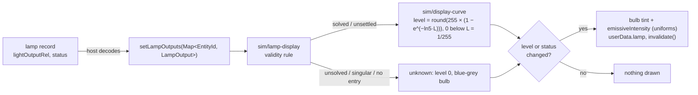

- **The display curve** (`sim/display-curve.ts`, pure, lint-fenced, game-design source): `glow = 1 − e^(−ln5·L)`, 0 below `L = 1/255`, quantised to `level = round(255 × glow)`. Rated light (`L = 1`) draws at level 204; over-voltage is brighter and saturates toward 255 without clipping.
- **The validity rule** (`sim/lamp-display.ts`): `solved` draws its level (level 0 is a real "off", clear glass); `unsettled` draws its level with a violet-grey tint; `unsolved`, `singular` or no entry is **unknown**: no glow and a blue-grey tint, never an off lamp.
- `invalidate()` is called only when some lamp's drawn level or status changed (ADR 0011 §9.2). A step writes only uniforms (colour, `emissiveIntensity`).

## The workshop level (F1.9)

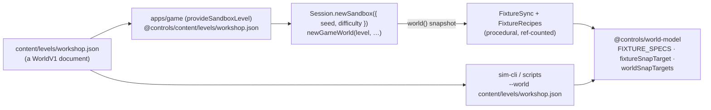

| Fixture id     | Ref                      | Kind        | World position (mm)  | Focus              | Snap target                   |
| -------------- | ------------------------ | ----------- | -------------------- | ------------------ | ----------------------------- |
| `backboard`    | `prop.plywood-backboard` | `board`     | (-610, -610, -3)     | +z                 | none (hides the studs behind) |
| `backplate`    | `prop.backplate`         | `backplate` | (-300, -400, 0)      | +z                 | `backplate-grid` 600 × 800    |
| `bench`        | `prop.bench`             | `bench`     | (700, -1200, 80)     | +z, from 40° above | `bench-top` 1800 × 750        |
| `din-rail-1/2` | `prop.din-rail`          | `din-rail`  | (-250, 150 / -50, 0) | +z                 | `din-rail` 500 mm             |
| `floor`        | `prop.workshop-floor`    | `floor`     | (-2500, -1200, -110) | none               | none (sets the walk bounds)   |
| `stud-wall`    | `prop.stud-wall`         | `stud-wall` | (-2500, -1200, -21)  | +z                 | `wall-studs` 4915 × 2440      |

- **Positions live in the level document, sizes in `FIXTURE_SPECS`**, and the snap targets are derived from both by one function (`fixtureSnapTarget`), so the renderer and a headless script get identical targets. Each fixture is a group named by its id; the fixture id is also its selectable id, `view.focus` target and snap-target id.
- The backplate sits where the P0/P1 demo panel was (centred on the origin, front face at z = 0), so panel coordinates in older scenarios still mean the same spot.
- The stud wall draws its studs on the same `studCentres()` layout the snapping uses (merged into one mesh) plus an undrawn **snap plane** across the stud faces, so the placement ray finds the wall between studs. The backboard is selectable and sits in the placement picker, so a ray that hits it never reaches the studs behind it.
- Fixtures are view-stable: syncing a world whose `fixtures` array is the same object (every command keeps it) does nothing. A new session (`Session.generation`) resets the view (`resetView`: work mode, the backplate, no selection).

## Modes

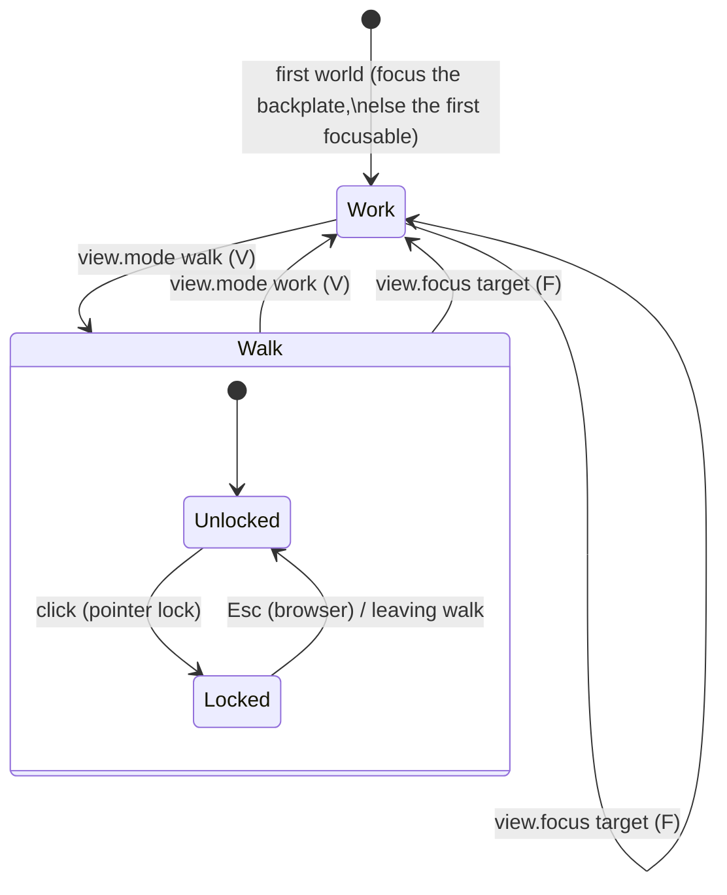

- **Work:** `OrbitControls` around a focus target. `workOrbitFor()` frames the target's bounding sphere along its face normal (benches from 40° above, so their top is in view), and limits orbit to ±75° azimuth and ±60° elevation, zoom to 0.15 m–3× the framing distance, and pan to the focus sphere (`cursor` + `maxTargetRadius`). Click selects; dragging empty space orbits; dragging an entity moves it.
- **Walk:** first person at a fixed eye height (1.6 m, game-design). WASD/arrows move, Shift sprints, and mouse look needs pointer lock. The pose is clamped to the room bounds (the world's floor fixture; a default bay without one) minus a 0.25 m body radius.
- **Switching and focusing are view commands** (`view.mode`, `view.focus`; ADR 0006): any surface runs them, they are logged, and the workspace applies them through `Session.onCommand`. The viewport publishes `mode` as a `when` context key. Movement, look, selection cycling and the placement keys stay **input actions** (`KeyboardEvent.code`), so per-frame input never reaches the replay log.

## Picking and selection

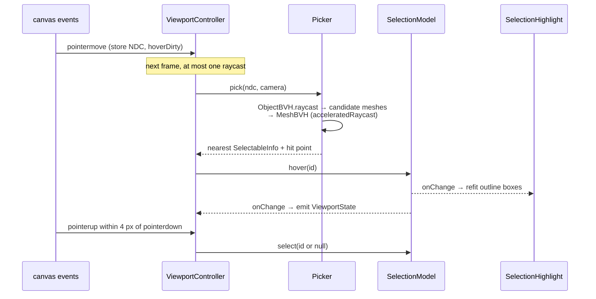

- Selectables are scene objects marked with `userData.selectable`, a JSON-plain `SelectableInfo`: `id`, `kind`, `label`, and optionally `focusNormal`, `snapTarget` and `entityId`. Fixture sync marks every fixture except the floor (the backboard, backplate, bench, DIN rails and stud wall); world sync marks every entity.
- `ViewportState` (`mode`, `pointerLocked`, `focusId`, `hovered`, `selected`, `placement`, and since F3.2 part 3 `terminal`, `keyTerminal`, `routing`, `hoveredWire`, `selectedWire`: see [pickers](#pickers-and-the-routing-gesture-f32-part-3)) is published through `onChange`. The Angular host mirrors it to `data-*` attributes and to the `when` context keys `mode`, `selection.id`, `selection.kind`, `selection.focusable` and `selection.entityId`.
- Keyboard: `]` and `[` cycle through selectables in id order; `F` (`view.focus.selection`) focuses a focusable selection; `Delete` (`entity.delete.selection`) deletes a selected entity.

## Placement and moves

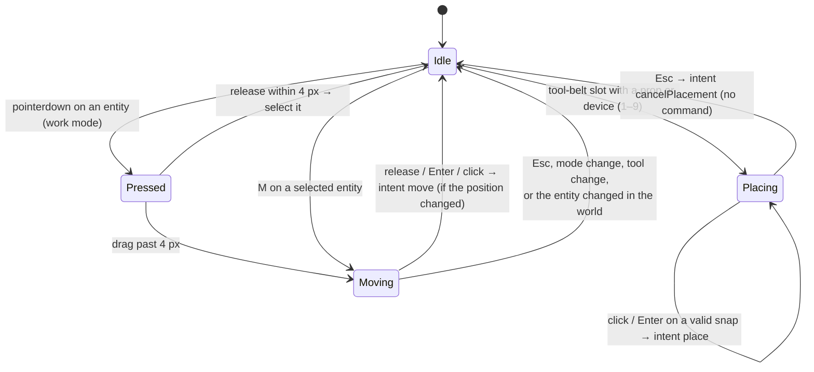

- **The ghost** previews the active prop or catalogue device (or the entity being moved) at `placeInWorld(world, ref, cursor, targets)` from `@controls/world-model` (F3.5; `placeOnTargets` before it, props only). The cursor ray hits a surface (a second picker that holds only fixtures and drawn enclosures, so props and devices never block it), the hit converts to integer mm with `metresToMm`, and `placeInWorld` tries an enclosure mount the device fits first (see [Enclosures and mounting](#enclosures-and-mounting-f35-part-1)), then the fixtures, where `snapToBest` picks a DIN rail before the backplate grid before wall studs before a bench top. The fixture targets are `worldSnapTargets(world)`, the same list a script gets. A placement the command would refuse (`mount-full`, `overlaps`, `occupied`, `wired`, `off-mount`) is invalid and says why (`PlacementView.reason`); the ghost hides. The ghost is renderer-local and unpickable.
- **Aiming:** the mouse pointer over the canvas, otherwise the screen-centre reticle (pointer lock in walk mode, or keyboard play with the pointer elsewhere). The crosshair shows whenever the reticle aims.
- **Commit points only:** a click or `Enter` emits one `place` intent; releasing a drag, or `Enter`/click after `M`, emits one `move` intent if the position changed. Pointer moves and drags emit nothing. A move keeps the entity's orientation, so only targets facing the same way count (one `entity.move`, never a rotate as well).
- **Escape, innermost first:** cancel a move, cancel placement (the workspace puts the tool away; no command), clear the selection, then fall through to the shell's menu.
- **Intents to Commands:** the `Viewport` component runs `entity.place {ref, positionMm, orientationMdeg, mountedOn}` or `entity.move {id, positionMm}` through `Session.execFromInput` (so a refusal reaches the shell's toasts). The arguments are exactly what `placeInWorld` returned, so a script that snaps the same cursor point logs identical entries (`apps/sim-cli/scenarios/mouse-place-move-delete.ts`, `din-panel-breaker.ts`).

## Enclosures and mounting (F3.5 part 1)

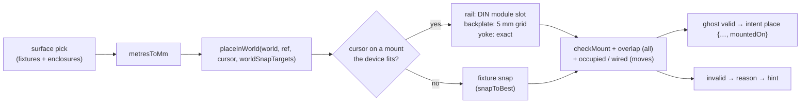

- **Mount targets come from the world's enclosures** (`worldMountTargets(world)`): each catalogue mount of an axis-aligned enclosure entity, turned into world space (origin, and the mounted device's +x, +y and +z). A device snaps to a mount whose type it declares (`mounts[].type`, `din35` for the breaker) when the cursor is within `MOUNT_CAPTURE_DEPTH` (20 mm, game-design) of the mount's plane and over the place the device would take. Rails beat yokes beat backplates, then the nearer plane, then the target id (`entity-<id>:<mount>`). Along a rail the left edge snaps to `dinSlotStartMm(k)`, as on the workshop's rails; on an area mount to the 5 mm grid; a yoke takes the device exactly. The orientation is the canonical quarter-turn triple whose +x and +z are the mount's (`orientationForAxes`), so `checkMount` accepts it whichever way the enclosure is turned.
- **The surface picker holds the drawn enclosures** (`WorldSync.enclosureRoots()`), so the ray finds a panel's rail or backplate, and a hit on a box's side wall is on no target (it hides what is behind it, like the backboard).
- **Moves keep the mount:** a mounted device slides along its own mount only (`off-mount` elsewhere); a free device never moves onto a mount (`entity.move` can't change `mountedOn`: delete and place).
- **Overlap:** the placement maths refuses every body overlap (the `all` scope of `overlappingEntity`), while the commands refuse only overlaps involving an enclosure or a mounted device (the `mounting` scope, `overlaps`), so logs written before world v3, which stack free props, still replay. See [world-model `wiring/overlap.ts`](../../libs/domain/world-model/src/lib/wiring/overlap.ts).
- **Recipes** (`geometry/devices.ts`): the breaker (a DIN-rail case facing +z, its handle a lever turned by `state.on`), the fuse (an inline holder on a base), open-fronted boxes (rectangular, or round for the ceiling box; nonmetallic ones blue), and the DIN panel (case, backplate under its area mount, a TS35 rail along each `din35` mount, its centreline 45 mm above the mount origin).
- **Entries** (knockouts, pryouts, clamps, drill sites) are drawn from the commanded `openEntries` bits as two child meshes per enclosure, `entries:closed` (slugs and tabs) and `entries:open` (dark holes), so a box costs at most two extra draws whatever its entry count. With every entry closed it draws the recipe's shared merged geometry; with some open it owns two merged geometries, rebuilt only when the bits change and disposed on the next change or removal. Entry meshes carry `userData.unpickable` (the picker gives them no BVH) and a no-op `raycast`: a pick lands on the body. The scene-graph snapshot records `openEntries` (ids) on the entity node, and `breaker: { on }` for a breaker.

## Raceways and terminal blocks (F3.5 part 2)

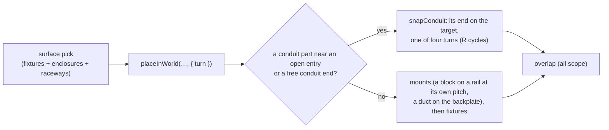

- **Cut-to-length parts draw their cut length.** A duct's or stick's recipe is built for its commanded `lengthMm` (`deviceBodySizeMm`), so `PropRecipes` keys it `id@version#lengthMm` (`keyOf`): pieces cut alike share a recipe, and `raceway.cut` swaps the entity's recipe like a ref change (a membership change, so both pickers rebuild) and releases the old length's. The ghost borrows the recipe for the length it shows (a new part's default, a moved part's own).
- **A duct's cover is a child mesh** (`cover`, the recipe's geometry, the `panel` slot) shown by the commanded `coverOn`: no recipe change, no picker rebuild. The scene-graph snapshot records `duct: { coverOn, lengthMm }` and, for a cut stick, `raceway: { lengthMm }`.
- **Conduit snapping** (`world-model` `snap/raceway-placement.ts`): a connector's entry end goes into an open enclosure entry of its trade size; any part's first joint end onto a free joint end of a placed part of its size (one no other end meets), facing it, within `RACEWAY_CAPTURE_DISTANCE` (60 mm). The four turns about that end are ranked (the part's +z, then +y, nearest world +y, +z, +x, −x, −z, −y) and the `turnPlacement` input action (R) cycles them while placing. The surface picker holds the raceways (`WorldSync.surfaceRoots()`), so the ray finds a stick's end.
- **Terminal blocks** sit on a rail centred (their fit's `crossMm`), and a device narrower than `NARROW_RAIL_DEVICE` (17 mm) snaps at multiples of its own width from the rail's start instead of to DIN module slots, so blocks of one width pack with no gaps.
- **Recipes**: a duct is a base and two walls of a solid band and fingers (slot and finger widths from the entry, at most 256 fingers a wall); a stick a tube in its even-rounded body with a dark bore at each end; an elbow a straight leg, a quarter torus and another leg from end a to end b; a connector a hex shoulder and gland outside the wall, its throat and locknut drawn inside (beyond its body box on purpose); a terminal block a body, a DIN foot at its mid-height, a marker carrier, a screw or spring release and a dark entry per terminal, green with a yellow stripe for the ground block.

## Routing maths and the bake (F3.2 part 1)

Headless and GPU-free, in `@controls/world-model` `routing/` under the D6 lint ([ADR 0017](../decisions/0017-routing-and-bake.md)). The renderer draws what it produces (F3.2 part 2) and binds its pickers to it (part 3); it never routes or bakes on its own.

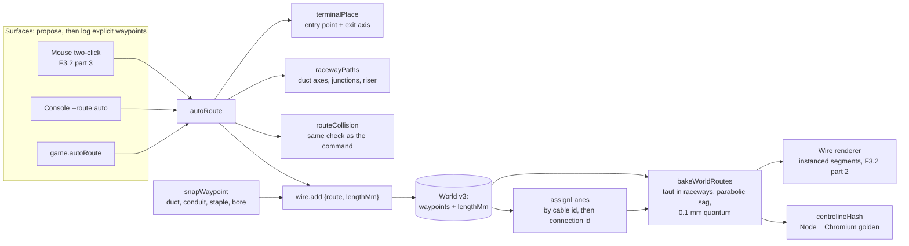

- **Auto-route:** each terminal enters the nearest duct ahead of its exit direction (then nearest, then lowest id) at the axis point nearest it; ducts whose bodies touch join where their axes come closest; Dijkstra finds the path; the first candidate pair clear of every body wins; fallbacks are the direct line and a 50 mm lead-out from each terminal.
- **Bake:** a straight 12 mm lead-out from each landed terminal; hosted waypoints moved onto their lanes; taut segments between hosted waypoints (an elbow's legs and arc between two of its ports); spare length as parabolic sag on free spans (at most 1 % of each chord), then hidden in raceway runs (up to 10 %), then a coil only when more than 20 % of the cut length is left. 500 wires bake in about 2 ms (`route-bake-500-wires`, budget 16 ms).
- **Never persisted:** the bake, lanes and proposals; the world stores waypoints and `lengthMm` only.

## The wire renderer (F3.2 part 2)

`wires/wire-renderer.ts` draws every routed conductor and cable **from the domain bake only** (`bakeWorldRoutes`, ADR 0017): it computes no route shape. The live preview rope is the one wire it simulates. Its pure parts (`wire-looks`, `wire-segments`, `rope`) are lint-fenced like the other pure modules.

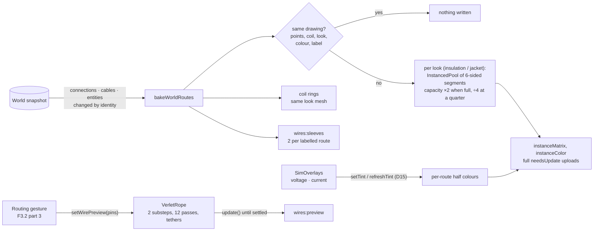

- **Looks.** A look is the conductor's insulation table key (`thhnThwn2`, `mtw`, `xhhw2`), `bare`, a cable's jacket key (`nmbJacket`), or `unknown`. Each look is one `InstancedMesh` (`wires:<look>`) with one `MeshStandardMaterial` whose finish comes from `WIRE_LOOK_FINISHES` (game-design); the colour is per instance, from the catalogue's `colours` table (a conductor's stored base colour, a cable's jacket colour). Draw calls follow the looks in use, never the number of wires: 500 THHN wires are one draw. A tracer stripe isn't drawn yet.
- **Segments.** Each link of the baked polyline (integer tenths of a millimetre, divided by 10 once, then `mm()`) is one instance of a 6-sided unit cylinder (`CylinderGeometry(1, 1, 1, 6, 1)`, one per pool mesh): positioned at the link's midpoint, turned from +y onto it, scaled to the wire's radius and the link's length plus one radius so a bend has no gap on its outside. The drawn diameter is the routing lane's (`laneSizeTenths`), so a wire is exactly as wide as the lane the bake packed it into (the lane takes a solid conductor's diameter, so stranded wire is drawn about 8 % thin: a lane-maths follow-up); a flat NM-B cable is drawn round at the mean of its width and height until F3.2 part 4.
- **Pools** (`instancing/instanced-pool.ts`, shared with the debug overlays) double their capacity when full and, for wires, rebuild at a quarter when at most a quarter is used (first size 64). Each pool mesh owns its geometry: a rebuild disposes the old mesh **and its geometry** (in three r186 only a geometry dispose frees a large mesh's interleaved instance attributes; see the [caveats](../caveats/rendering.md)) and builds a new pair; writes are always a full `needsUpdate`, never `addUpdateRange` ([ADR 0010](../decisions/0010-wire-routing-spike.md)'s r186 gotcha, now an ESLint rule). The group's children keep a fixed order (looks by name, sleeves, preview). A look with no instances left is disposed with its geometry and material, so a world without wires holds **no** wire resource (`wireResourceCount` 0) and the `wires` group is out of the scene: every pre-F3.2 scene-graph snapshot is unchanged.
- **Coils** (the bake's `coil`: a cut well past its route) are drawn as up to three 150 mm rings hanging from the coil point, in the route's look mesh. **Labels** (`connection.label`, `cable.label`) are two white sleeve markers per labelled route, 25 mm in from each end, in one `wires:sleeves` mesh; the text is data on it (`userData.wires.labels`), as a device's label is: no canvas text.
- **When it redraws.** `sync(world)` re-bakes only when the world's `connections`, `cables` or `entities` array changed, and writes the GPU side only when some route's points, coil, look, colour or label changed. Measured in Node on the 500-wire bench panel (5 877 segments in one look, capacity 8 192): a first sync (bake and every write) about 5.2 ms median; a re-tint of every instance 0.4 ms. A world change that leaves the wires alone (a switch toggled) still pays the bake (about 2 ms at 500 wires) to find that out.
- **Overlays recolour conductors (D15).** `SimOverlays` joins each routed single conductor to the netlist like a lead (its own `OverlaySteps`) and, while voltage or current is on, gives the wire renderer a `WireTint`: end `a`'s half of the conductor in its end-`a` voltage step's colour and end `b`'s half in its end-`b` one (or both in the current step's colour when only current is on; a mid-length split is an abstraction, a real IR drop is linear along the conductor). Cables, which have no reading until part 4, draw in the unknown colour while a tint is on. The overlays draw no lead segment of their own for a conductor (test leads keep theirs). A conductor outside the netlist or in an unsolved island is drawn in the unknown colour, never as 0 V. Instance colours are rewritten only when a half's colour changed. The heat overlay (F3.6 part 3) uses the same hook: [below](#the-heat-overlay-f36-part-3).
- **The preview rope** (`VerletRope`): pinned at every point the gesture gives (terminal points, waypoints, the cursor), particles every 15 mm (at most 1 024), 1 % slack (the bake's sag cap), two fixed 1/120 s substeps a frame with 12 alternating constraint passes and long-range tethers to each span's pins (a nearly taut Verlet rope otherwise stretches: 48 mm of sag on a 300 mm span instead of the parabola's 18; with tethers about 22 mm). It settles in about 20 frames and then asks for none; re-pinning lays the old sag onto the new chords, so moving the cursor doesn't pop the rope straight. A pure function of its pins and the frame count; never committed, stored or hashed.
- **Picked through their own BVH, never raycast.** Wire meshes are never among the picker's roots; `pick()` casts against a BVH over the drawn segments (see [pickers](#pickers-and-the-routing-gesture-f32-part-3)). A `wires:highlight` mesh (after the sleeves, before the preview) draws the hovered and selected wire as a translucent sleeve 1.8 × the wire's radius.
- **Frame time** (`apps/game-e2e/src/wiring-frame-time.spec.ts`, a manual tool: `CONTROLS_MEASURE_WIRING=1`): `sim bench`'s 500-wire panel (512 blocks and ducts, 500 THHN wires routed `--route auto` in Chromium, 5 877 segments, the same count as Node's bake) in front of the backplate. Headless SwiftShader WebGL2 at 1280 × 720 on the loaded developer desktop, 2026-11-15: 2 022 draw calls (the blocks and ducts; the wires are one), main-thread cost 5.3 ms a frame and 170 ms wall per frame (software rasterising); with both overlays on (every conductor recoloured) 6.5 ms and 189 ms. Not a GPU figure; the real-GPU and 2020-era iGPU numbers are the user's manual run, as in P2.

## Pickers and the routing gesture (F3.2 part 3)

The renderer half of F3.2 part 3 ([ADR 0017 §9](../decisions/0017-routing-and-bake.md), [ADR 0010](../decisions/0010-wire-routing-spike.md)'s measured design): screen-space terminal picking, a wire BVH, keyboard terminal cycling, and the routing gesture's view. **The UI owns the gesture** (the spool on the belt, the clicks so far, Backspace, the one `wire.add`; see [UI shell](ui-shell.md#routing-a-wire-f32-part-3)); the controller only draws it and reports picks. Nothing here mutates the world or logs a command.

```mermaid
sequenceDiagram
    participant UI as UI (feature-workspace)
    participant VC as ViewportController
    participant TP as TerminalPicker + screen-terminals
    participant PK as Picker (BVH)
    participant WM as world-model routing
    participant WR as WireRenderer
    UI->>VC: setRouting({ ref, colour, from, waypoints })
    Note over VC: pointer moves → next frame (hoverDirty)
    VC->>TP: project(camera) → ScreenPoints grid
    VC->>TP: pick(cursor px, visible)
    TP->>PK: occlusion: ray through the terminal (lazily, nearest first)
    TP-->>VC: hit / near / pitch → state.terminal
    alt over a second terminal
        VC->>WM: proposeRoute(from, target, waypoints)
    else elsewhere (after the first pick)
        VC->>PK: surface pick → metresToMm
        VC->>WM: snapWaypoint(cursor) → next
    end
    VC->>WR: setPreview(points) (VerletRope)
    VC-->>UI: state.routing { from, target, proposal, next }
    Note over VC: click / Enter / Escape
    VC-->>UI: RoutingEvent terminal { end, proposal } · waypoint · cancel
    UI->>UI: fold into the session; on the second terminal: exec wire.add (one)
```

- **Terminals are data points** (`picking/terminal-picker.ts`): every catalogue terminal `terminalPlace` can place (its first method's entry point, in world integer mm), in canonical order (entities by id, then catalogue order; a device's terminals are contiguous). Rebuilt when `world.entities` changes; projected with the camera on each hover pass while routing (or with `setTerminalPicking(true)`), into a uniform screen grid (`ScreenPoints`, 48 px cells, allocation-free once grown).
- **The pick rule** (`picking/screen-terminals.ts`, pure and lint-fenced): the nearest **visible** terminal within 16 CSS px is `near`; its **pitch** is its distance to the nearest other visible terminal (looked for within 48 px, else ample); a click picks `near` only within `min(16 px, pitch / 2)`. So a click is never nearer another terminal than the one it picks, and where terminals crowd the radius shrinks with them instead of guessing (ADR 0010: at the default framing a 6 mm block row is 4 to 6 px, and the spike's fixed 12 px picked the neighbour). Ties break by canonical index.
- **Occlusion** is the BVH picker's: the ray through a terminal's projected point must first hit nothing, the terminal's own device within 15 mm in front of it (`TERMINAL_OWN_DEVICE_TOLERANCE_M`: a top-face entry seen head-on grazes its own clamp up to 11.3 mm first, so a terminal on the far side of its own body is hidden), or something else within 3 mm in front of it (`TERMINAL_OCCLUSION_TOLERANCE_M`). Asked lazily (nearest first, memoised per pass), so a hover pass costs a few raycasts, not one per terminal. Wires aren't among the picker's roots, so a terminal behind a freshly drawn wire stays pickable (ADR 0010).
- **The zoom offer.** `state.terminal.groupPitchPx` is the device's terminal-group pitch (the least distance from one of its on-screen terminals to any other on-screen terminal, occlusion ignored); under 24 CSS px (WCAG 2.2 SC 2.5.8) `zoomSuggested` is true and the UI offers `view.focus` on `device`, unless `device` is already the focus target (zooming again wouldn't help). **Catalogue devices are now focus targets:** their selectable carries a `focusNormal`, and `applyFocus` frames a device from its current orientation (`deviceFocusFrame`: the front, local +z, when horizontal; a bench device's near side from 35° above). A focused 6 mm block is framed so its pitch is far above 24 px. The initial focus stays a fixture.
- **Keyboard** (`picking/terminal-order.ts`, pure): Tab order is reading order on the device in its own frame (top row first, then left to right, then front to back, then id in code-unit order), from the catalogue only. `cycleTerminal(±1)` walks the terminals of the device in hand (selected, else focused, else the keyboard terminal's, else the hovered one's), wrapping; `state.keyTerminal` holds it and a cyan marker shows it; Enter (`commitPlacement`) while routing reports it. Ending the gesture (`setRouting(null)`) drops it and its marker unless terminal picking stays on. The UI binds Tab and Shift+Tab, and enables them only for a selected, focused or keyboard-terminal device, never a hovered one.
- **Wires** (`picking/segment-bvh.ts`, pure): a binary BVH over the drawn segments' bounds (median split on the longest centroid axis by a deterministic quickselect, leaves of four), built lazily on the first pick after the wires changed, and an exact ray-to-capsule test (Ericson's closest approach, the ray clamped below only) whose radius is `max(r, 4 px × pxAngle × depth)`. A ray through the insulation beats a widened hit; among real hits the nearest along the ray wins, among widened ones the nearest centreline on screen. A wire beats the device the BVH picker hits unless the device is more than 2 mm nearer. Hover and click pick wires when no gesture is active: `state.hoveredWire`, `state.selectedWire` (exclusive with the entity selection; Escape clears it).
- **The routing view** (`state.routing`): `from`, `target` (the pointer's pick, else the keyboard terminal, never `from` itself), `proposal` and `next`. Over a second terminal the proposal is `proposeRoute` (`@controls/world-model` `routing/propose.ts`): with no waypoints exactly `autoRoute`, otherwise the session's waypoints checked as `wire.add` checks them (`checkRoute`, `checkGeometry`), with the default cut length. Elsewhere the surface picker's hit, rounded to whole mm, goes through `snapWaypoint` (the session's `snap` options) and is `next`. The preview rope (`setPreview`) runs through the proposal's points, or through `from`, the waypoints and `next`; it is re-pinned only when its points change. **No route maths in the renderer**: the shape, length and check are the domain's, so the `wire.add` the UI logs is exactly what was previewed.
- **Events** (`onRouting`): `terminal` (pointer click or Enter; with `from` set it carries the proposal), `waypoint` (a click off every terminal after the first, with `next`), `cancel` (Escape while routing). A pick on a crowded terminal (`near` but no `hit`) reports nothing: the UI shows the zoom offer.
- **Markers** (`overlays/routing-markers.ts`): one instanced mesh of small spheres drawn over everything (`depthTest` off), sized in CSS px at their depth: amber `pick`, orange `near` (crowded), cyan `focus`, green `from`, white `waypoint`, grey `next`. The `routing` group is in the scene only while a marker shows, and its mesh owns its geometry, so scene-graph snapshots without a gesture are unchanged and `routingResourceCount` returns to 0.

| API (controller and `ViewportRenderer`, also the `?e2e=1` hook) | What it does                                                                                       |
| --------------------------------------------------------------- | -------------------------------------------------------------------------------------------------- |
| `setRouting(session \| null)`, `onRouting(listener)`            | Starts, updates or ends the gesture's drawing; picks arrive as `RoutingEvent`s                     |
| `setTerminalPicking(on)`                                        | Terminal hover outside routing (tools that act on a terminal, F3.3)                                |
| `cycleTerminal(±1)`, `setKeyTerminal(ref)`, `pickKeyTerminal()` | Tab / Shift+Tab, a direct keyboard terminal, Enter                                                 |
| `terminalCycleOrder(entity)`, `terminalPitchPx(entity)`         | Tab order; the group pitch on screen now (`null`: ample or off screen)                             |
| `terminalAt(x, y)`, `projectTerminal(ref)`                      | The occlusion-filtered pick at canvas px without changing hover; a terminal's canvas px (e2e aims) |
| `pickWireAt(ndcX, ndcY)`, `selectWire(ref \| null)`             | The wire BVH's answer; select or clear a wire                                                      |
| `routingMarkers()`                                              | The markers drawn now                                                                              |

**Cost** (Node, the loaded developer desktop, 2026-11-15; a one-off measurement on `sim bench`'s 500-wire panel: 512 blocks and ducts, 1 000 terminals, 500 wires and 5 877 segments, a 1920 × 1080 canvas, 400 pointer moves across the panel): a routing hover pass (projecting every terminal, the grid, the lazy occlusion raycasts, `proposeRoute` or `snapWaypoint`, the preview and markers) median 0.11 ms, p95 0.40 ms, worst 0.87 ms; a plain hover pass (the entity BVH plus the wire BVH) median 3 µs, p95 0.26 ms. The wire BVH builds lazily on the first pick after a change (35 000 segments built and 1 000 picks: 34 ms in `segment-bvh.spec.ts`). A routing hover pass allocates a few small objects (the views, the marker list, the proposal on a target change); outside routing only a hit allocates its answer. Not a GPU figure: the markers and preview add two small instanced draws.

## Snapping (pure, integer mm, `@controls/world-model`)

`snap(target, footprint, cursorWorld)` converts the cursor into the target's surface frame and returns the footprint's lower-left **anchor** in surface and world integer mm plus the target's normal, or a typed failure (`out-of-capture`, `out-of-bounds`, `too-large`). Vertical frames face ±x or ±z (`u` = right, `v` = up); since F1.9 a horizontal frame faces `+y` (`u` = its `right`, `v` = away from the front edge). An entity's `positionMm` is that world anchor; its prop geometry spans +x, +y, +z from it, turned by `orientationForFrame`: a yaw quarter-turn on a wall, plus pitch -90° on a bench top so the prop's depth stands up.

| Target           | Rule                                                                                                                                                                                                      | Constants (source in `world-model` `snap/constants.ts`)                                     |
| ---------------- | --------------------------------------------------------------------------------------------------------------------------------------------------------------------------------------------------------- | ------------------------------------------------------------------------------------------- |
| `din-rail`       | Centred across the rail; left edge at the start of a 17.5 mm module slot, `round(k × 17.5)` from the rail end; must fit on the rail; cursor within 40 mm of the centreline.                               | TS35 (EN 60715), module width 17.5 mm (DIN 43880), capture (game-design)                    |
| `backplate-grid` | Corner on a 5 mm grid inside the plate minus its 20 mm margin.                                                                                                                                            | grid pitch, margin (game-design)                                                            |
| `wall-studs`     | Flush against the side of the nearest stud that the cursor is on, inside one stud bay (falls back to the other side at a wall edge); bottom on a 10 mm grid. Stud centres are `round(first + i × 406.4)`. | 16 in o.c. (IRC R602.3(5), NIST), 2×4 dressed 38.1 mm (PS 20), vertical pitch (game-design) |
| `bench-top`      | Horizontal: corner on a 10 mm grid inside the top minus its 10 mm margin; the prop stands on the top.                                                                                                     | grid pitch, margin (game-design)                                                            |

`snapToBest(targets, footprint, cursor)` keeps the targets whose plane is within 10 mm of the cursor (`SNAP_PLANE_TOLERANCE`, covering a hit on a rail top) and whose extent contains it, then tries them by priority and id. The targets come from the world's fixtures (`worldSnapTargets(world)`): on the workshop, the backplate, both rails, the stud wall and the bench top.

## Disposal

The controller registers each resource owner with a LIFO `Disposer`, scene first so it's disposed last: the scene's geometries and materials, both pickers (they delete `boundsTree` and the own `raycast`), `FixtureSync` (removes fixture groups and disposes every fixture recipe), `WorldSync` (removes entity meshes and disposes every prop recipe), the ghost (returns its borrowed geometry, disposes its material and placeholder), the overlay helpers, the wire renderer (every look, sleeve, highlight and preview mesh with its own geometry and its material, and the wire BVH; it leaves the scene first, since its geometry isn't the scene's to dispose), the routing markers (their mesh with its own geometry and their material; the `routing` group leaves the scene first), the `SelectionModel` listeners, the pointer listeners, `OrbitControls`, the keyboard and pointer-lock listeners, and the state, intent and routing listeners. `ViewportRenderer.dispose()` disposes the `RenderLoop` (cancels the pending frame and the idle-stats timer, releases test waiters) and removes its `webglcontextrestored` and `visibilitychange` listeners, then disposes the controller, then the `WebGPURenderer`. The Angular host disconnects its `ResizeObserver` and removes the test hook.

Removing every entity (without disposing the viewport) also returns to baseline: recipes reach zero and the picker drops BVHs for geometry no longer under a root. An enclosure's own merged entry geometries are disposed when its open entries change and when it is removed (F3.5; measured in WebGL2: 480 boxes, 10 panels and 70 breakers placed and undone leave renderer geometries at 9 and BVHs at 8, the baseline). Loading a world without fixtures does the same for fixture recipes (`fixtureRecipeCount` reaches zero). Unit tests (`viewport-controller.spec.ts`) and `apps/game-e2e/src/placement.spec.ts` (renderer `info` geometry count) check both.

## Performance (F1.7 measurements)

| Measurement (500 props: box, crate, spool)     | Result                                                                                     |
| ---------------------------------------------- | ------------------------------------------------------------------------------------------ |
| First sync of 500 entities (Node)              | 42 ms, once: builds the object BVH and 3 geometry BVHs                                     |
| Sync after one `entity.move` (Node)            | 9 ms: diff, transform update and BVH refit (on commit, never per frame)                    |
| BVH pick (Node)                                | 27.5 µs per pick                                                                           |
| Idle `update()` with placement armed (Node)    | 3.7 µs, no allocation (since on-demand rendering, an idle viewport doesn't call it at all) |
| 1080p, AMD Radeon RX 7600 (discrete), Chromium | WebGPU and WebGL2 both a steady 60 fps (vsync-capped), 258 draw calls after culling        |
| 1080p, headless SwiftShader                    | WebGL2 60 fps; WebGPU-on-SwiftShader-Vulkan 3.8 fps (CPU per-draw cost, not a GPU figure)  |

The budget target (60 fps on a 2020-era integrated GPU) still needs measuring on such a GPU; props are one draw call each, and instancing repeated props is the obvious next step if that budget is missed.

**F1.9:** the workshop adds 9 drawn meshes (the 13 studs and 3 plates are one merged mesh; the snap plane is never drawn) and 8 geometry BVHs (the rails share one). The headless dev HUD showed 16 draw calls for the workshop with six props at 1280 × 720 on SwiftShader WebGL2; as above, headless frame times are not a GPU figure.

## Debug overlays (F2.6)

`view.overlay {name: 'voltage' | 'current' | 'heat', on}` is a view command (logged, no world change, `when: console.available`). The workspace applies it through `Session.onCommand`; the overlays are renderer-local view state in `SimOverlays` (`overlays/sim-overlays.ts`), which the controller owns, syncs with the world and updates each frame. Gotchas: [rendering caveats](../caveats/rendering.md).

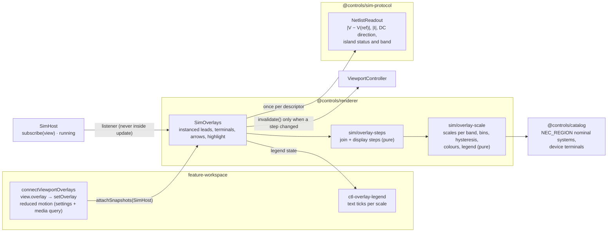

- **What is drawn.** No scene mesh draws leads yet (wire routing is P3), so the overlays draw their own: a straight segment per world connection, in two halves (one per end, so a voltage drop shows), and a marker per catalogue terminal of every device, at the terminal's `positionMm` turned by the entity's transform. Six `InstancedMesh`es (lead halves, terminal spheres, unknown-terminal diamonds, DC arrows, AC markers, highlight rings): one draw each whatever the plant size, `frustumCulled = false`, a no-op `raycast`, never among the picker's roots. The group `overlay:sim` is in the scene only while an overlay or a highlight is shown, so with everything off the scene graph is exactly what it was.
- **Reading.** Every snapshot is read (also while the overlays are off, so switching one on draws the latest values at once): `NetlistReadout.of(descriptor)` is built once per descriptor and reads the view into a `NetlistReading` without allocating; the join of drawn items to nodes and branches is rebuilt per descriptor or world change. `updateOverlaySteps` turns the reading into display steps with half-step hysteresis; only a changed step rewrites instance colours and matrices and calls `invalidate()`.
- **Scales.** Voltage: a fixed linear scale per nominal band, 0 V to 4/3 of the band's nominal (the nominal sits at bin 24 of 32), from the region profile for AC (`120/240`, `208Y/120`, `480Y/277`) taken **line to neutral**, because an AC island's reference node is its neutral (a healthy 120 V line reads at bin 24 on a 160 V scale; line-to-line differences aren't what a node reads) and the catalogue's 12 V and 24 V DC classes; band 0 (`none`) and any band without a row are _no scale_. Current: one logarithmic scale for every band, bin 0 below 1 mA, bins 1–31 up to 100 A, then over range. Islands that aren't solved, items missing from the generation and a source reset are _unknown_: a dark, thinner lead and diamond markers, never a 0 V or 0 A colour.
- **Current animation.** DC arrows travel along the current's direction (positive from the connection's end `a` to end `b`) at 20 to 200 mm/s by bin; AC markers sway in place (magnitude only). `update()` animates only while `SimHost.running`, the current overlay is on, reduced motion is off and some lead's bin is above 0, and returns `true` then; otherwise the arrows return to their evenly spaced rest positions. Reduced motion is the setting `display.reducedMotion`, or `prefers-reduced-motion` while it is `system`.
- **The legend** (`ctl-overlay-legend`) lists, for each overlay on, its scale as a decorative colour bar with text ticks (the nominal marked) and an over-range label, then the _no scale_ and _no reading_ styles in words. The host carries `data-overlays` (`current voltage`).
- **Terminal highlight** for the netlist inspector ([UI shell](ui-shell.md#the-netlist-inspector-f26); the workspace passes the selected node's members through `Viewport.highlightTerminals`): `ViewportRenderer.highlightTerminals(refs)` rings the given `{entity, terminal}`s (view state, whatever the overlays show) and returns how many are drawn; `null` or `[]` clears it, and it survives world changes for the terminals that still exist.
- **Frame time (F2.6, headless).** Measured 2026-10-31 with `apps/game-e2e/src/overlay-frame-time.spec.ts` (a manual tool, skipped unless `CONTROLS_MEASURE_OVERLAYS=1`): 250 battery-and-switch pairs on the bench, each switch closed across its battery through two test leads (500 devices, 500 leads, every lead over range), the sim running at 1×, Chromium's software WebGL2 (SwiftShader, `?renderer=webgl2`), DPR 1, on a machine under load (load average 5–14 on 12 threads), wall time per frame over back-to-back frames:

  | Viewport    | Overlays off | Voltage and current on | Draw calls (off / on) |
  | ----------- | ------------ | ---------------------- | --------------------- |
  | 1280 × 720  | 81–91 ms     | 115–245 ms             | 1 760 / 1 763         |
  | 1920 × 1080 | 194–210 ms   | 247–267 ms             | 1 760 / 1 763         |

  Two runs each; the spread is the machine's load, not the overlays. The main-thread cost the HUD reports (update plus draw submission) stayed at 5–12 ms with the overlays on: the rest is SwiftShader rasterising on the CPU. The overlays add 3 draw calls here (lead halves, terminal markers, DC arrows; empty layers draw nothing), and their instance layers are packed, so only shown instances are drawn. As with the props (above), **these are not GPU figures**: the 1 760 draw calls are the devices' material groups.

- **Frame time (F2.6, real GPU).** Measured 2026-11-11 by the procedure below on an AMD Radeon RX 7600 XT (RADV), Fedora 45, headed Playwright Chromium, a 144 Hz display, `--workers=1`, the same 500-device, 500-lead plant with the sim at 1×. "Main thread" is the HUD's average and worst per-frame cost (update plus draw submission); "wall" is wall time per frame over back-to-back frames:

  | Backend | Viewport    | Main thread, off (avg / worst) | Main thread, both on (avg / worst) | Wall per frame, on | Draw calls (off / on) |
  | ------- | ----------- | ------------------------------ | ---------------------------------- | ------------------ | --------------------- |
  | WebGL2  | 1280 × 720  | 4.2 / 5.0 ms                   | 4.5 / 8.2 ms                       | 6.94 ms (144 fps)  | 2 760 / 2 763         |
  | WebGL2  | 1920 × 1080 | 4.3 / 6.1 ms                   | 4.3 / 6.4 ms                       | 6.94 ms (144 fps)  | 2 760 / 2 763         |
  | WebGPU  | 1280 × 720  | 3.3 / 4.1 ms                   | 3.5 / 4.9 ms                       | 6.94 ms (144 fps)  | 2 760 / 2 763         |
  | WebGPU  | 1920 × 1080 | 3.5 / 4.7 ms                   | 4.4 / 7.1 ms                       | 6.94 ms (144 fps)  | 2 760 / 2 763         |

  Every case is held at the display's 144 Hz refresh (6.94 ms), so this GPU isn't the limit; the overlays add 3 draw calls and well under 1 ms of main-thread time on average. This is a discrete 2023 GPU, not the plan's 2020-era integrated budget GPU, which is still unmeasured. Draw calls are higher than the headless run above (2 760 against 1 760), the device meshes' material groups at the current catalogue.

- **Real-GPU frame time is a manual step** (plan F2.6 TODO): on a desktop with the GPU in question, run `CONTROLS_MEASURE_OVERLAYS=1 pnpm nx run game-e2e:e2e -- overlay-frame-time.spec.ts --headed` (it starts or reuses the dev server on port 4200; headed Chromium uses the real GPU; add `CONTROLS_MEASURE_RENDERER=webgpu` to measure WebGPU instead of the pinned WebGL2), and record both sizes' JSON lines here. Run with `--workers=1`, or the two sizes share the GPU. **On Linux, `CONTROLS_MEASURE_RENDERER=webgpu` alone still measures WebGL2:** it only drops `?renderer=webgl2`, and Playwright's Chromium needs `--ozone-platform=x11 --enable-unsafe-webgpu --enable-features=Vulkan` (a `launchOptions.args` override in a local config) before `auto` picks WebGPU; the JSON's `backend: "auto"` doesn't say which one ran, so check the viewport's `data-backend`. The plan's budget is 60 fps at 1080p on a 2020-era integrated GPU.
- **Tests:** `sim/overlay-scale.spec.ts` and `sim/overlay-steps.spec.ts` (scales, band 0, unknown islands, hysteresis, legend text, arrows), `overlays/sim-overlays.spec.ts` (fake snapshots from the codec: the overlay graph snapshot, invalidation only on change, animation and reduced motion, the highlight, growth, disposal), `sim-protocol`'s `netlist-readout.spec.ts`, `sim bench`'s `overlay-read-500-devices` (0 B per read), and `apps/game-e2e/src/overlays.spec.ts` (console and palette, with the real worker), and the disposal pattern of the controller spec.

## The heat overlay (F3.6 part 3)

`view.overlay {name: 'heat', on}` colours every routed conductor and every test lead by temperature, from the protocol 7 connection records ([ADR 0011 amendment](../decisions/0011-sim-worker-contract.md#amendment-protocol-7-connection-records-and-connection-events-f36-part-3)) that `NetlistReadout` already reads on every snapshot. It is part of `SimOverlays`; the pure halves are `sim/heat-scale.ts` and `sim/heat-steps.ts` (lint-fenced like `sim/overlay-scale`). Gotchas: [rendering caveats](../caveats/rendering.md).

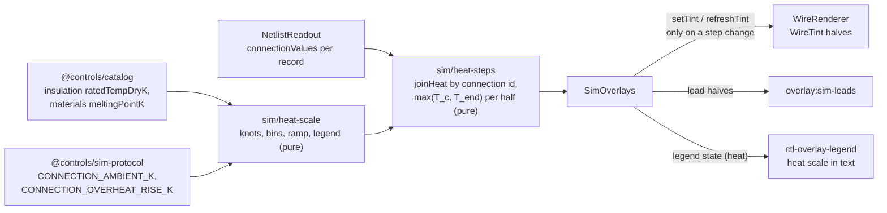

- **The scale** (`heatScale(catalog)`, `HEAT_SCALE` for the built-in catalogue) is piecewise linear through named points, each an existing sourced constant and each a knot at a whole bin: ambient 293.15 K (bin 0); the catalogue's lowest insulation dry rating, 363.15 K (90 °C, every P3 row, source `ul-type-ratings`; bin 12); the termination overheat point, ambient + 100 K = 393.15 K (bin 16); insulation damage, that rating + 40 K = 403.15 K (bin 18); the contact oxidation onset 422.15 K (149 °C, bin 20); aluminium's melting point 933.473 K (bin 27, the nearest whole bin); copper's 1357.77 K (ITS-90) as the over-range boundary. The engine thresholds come through `sim-protocol` copies pinned to sim-core. The knot bins and the 0.5 K hysteresis are game-design (`HEAT_KNOT_BINS`, `HEAT_HYSTERESIS_K`): hysteresis is in kelvin, not half a bin (a deviation from ADR 0011 §9.2 for heat), so crossing a named point changes the colour within 0.5 K. A catalogue point that doesn't fit is omitted and listed in the legend; a catalogue with no usable scale makes heat unavailable with a reason. Same 32 bins and over-range bin as the other overlays; its own inferno-like ramp (dark violet to pale yellow, rising luminance), magenta at melting.
- **What each half shows.** D15's two halves per conductor: half `a` shows max(T_c, T_a), half `b` max(T_c, T_b), the hottest node it contains; an end with no termination node (state `none`) is skipped, so a lead's halves both show its conductor. On the bad-termination scenario the loose wire's end-`a` half reads bin 16 (393.8 K) and its other half bin 1 (303.0 K).
- **Unknown, never cold.** Temperatures are own state, so every record is drawn by them whatever its `status` (an open wire at ambient is a real bin 0). Only no snapshot, no record in this descriptor, or a non-positive conductor temperature is _no reading_; a cable is always _no reading_.
- **Precedence.** With heat on, wire and lead colours are heat's; the voltage overlay's terminal markers and the current overlay's arrows stay. Steps are tracked for every overlay on every snapshot; a heat change counts (rewrites colours, requests a frame) only while heat is shown, and the wire renderer still writes nothing when no colour changed. Heat steps are re-joined by connection id on a new descriptor and kept (ADR 0011 amendment §6).
- **Legend.** `heatLegend(scale)`, carried in `OverlayLegendState.heatLegend` (the overlays' own scale): ticks `293 K (20 °C) ambient`, `363 K (90 °C) lowest insulation rating in the catalogue`, `393 K (120 °C) termination overheat`, `403 K (130 °C) insulation damage (lowest rating + 40 K)`, `422 K (149 °C) contact oxidation onset`, `933 K (660 °C) aluminium melts`, and `1358 K (1085 °C) and above: copper melts` as over range, kelvin first as the inspector shows them; any omitted point as "Not marked: …"; `heatUnavailable` when there is no scale. A note says what is coloured and that a cable shows no reading. The host's `data-overlays` includes `heat`.
- **Not yet:** the work-mode hover readout over a wire (F3.6 part 3's last item) needs the F3.2 part 3 wire picker. It should show the conductor temperature and each end's temperature separately, since a half's colour is only their maximum.
- **Frame time** (`wiring-frame-time.spec.ts`, after the voltage-and-current run): the same 500-wire plant with only heat on (nothing solved, so every conductor reads its record's ambient temperature, bin 0, and all 5 877 instances are recoloured from the heat ramp). Headless SwiftShader WebGL2 on the loaded developer desktop, 2026-11-15, wall time per frame over 240 back-to-back frames: 1280 × 720 183 ms (main-thread cost 5.1 ms), against 174 ms (4.9 ms) with the wires alone and 189 ms (5.3 ms) with voltage and current on; 1920 × 1080 324 ms, against 313 ms (5.3 ms) and 334 ms (6.2 ms); the HUD's main-thread window read 0 for the 1080p heat run, so that figure is missing. Heat adds no draw call (2 022: the plant has no test leads, so the lead layer draws nothing). Not a GPU figure; the real-GPU and 2020-era iGPU numbers remain the user's manual run.

## Reading the sim snapshot (F2.3b measurements)

The renderer reads sim output only through the `SnapshotSource` `SimHost` gives it ([ADR 0011](../decisions/0011-sim-worker-contract.md) §9.1–§9.2). Each read is `SnapshotReader.latest()`: the seqlock check and one `set()` of the slot's used bytes into a private copy, then the listener reads its fields through `FieldRef`s resolved once per generation. Measured 2026-10-31, AMD Ryzen 5 5600X, Node 24 (V8, as Chromium's), outside coverage, 5,000 reads after 1,000 warm-up, one publish before each read (so every read copies), on a machine under load (load average 5–9):

| Plant                                                      | Slot    | Read, p50 / p99  | Read + 500 device fields, p50 / p99 |
| ---------------------------------------------------------- | ------- | ---------------- | ----------------------------------- |
| 500 devices, 1,000 nodes, 1,500 branches, 50 islands       | 52.9 kB | 3.4 / 4.7–8.7 µs | 6.3 / 18.5–27 µs                    |
| 500 devices at the 2,000-node bench scale (3,000 branches) | 92.2 kB | 5.6 / 12–14 µs   | 8.9 / 22–28 µs                      |

ADR 0011 §9.2's budget is **0.1 ms at p99 on a 500-device plant**: the whole-slot copy uses about a seventh of it with its field reads, so the devices-only read the ADR allows for later isn't needed yet. `pnpm sim bench` measures it every `verify` (`snapshot-read-500-devices`: p50 5–10 µs, p99 11–18 µs over ten runs on a loaded machine) and **gates it on allocation**: a frame's `latest()` plus 500 `readAll` field reads must allocate under 1 B per frame (`READ_ALLOCATION_GATE_BYTES`; any per-frame object is 12 B or more). It measures 0 B: 23 of 23 `sim bench` runs (#60 review 2). That gate found two allocations the earlier probe missed (#60 review): `SnapshotView.read` returned its double boxed whenever V8 didn't inline the four-way switch (about 14 B a field, 6.9 kB a frame), and each copy built a `DataView` of the slot header. `read` now has a small f64 path, `readAll(fields, out)` reads a whole list into a `Float64Array`, and the header views are made on attach. The time is reported (p50, p90, p99), not gated: a raw-ms gate would need the calibrated headroom of the solver cases first. Not measured yet: the click-to-lamp latency (it needs F2.5's lamp) and `world.hash` at 2k and 20k nodes (ADR 0011 "Deferred to implementation"); the bench e2e asserts `misses === 0` (`apps/game-e2e/src/sim-engine.spec.ts`).
