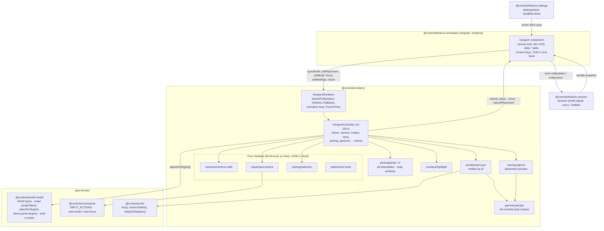
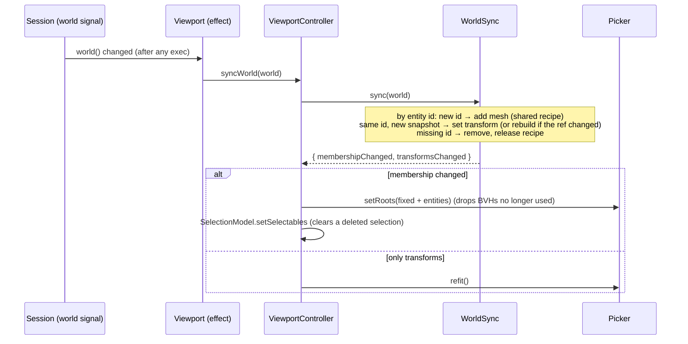
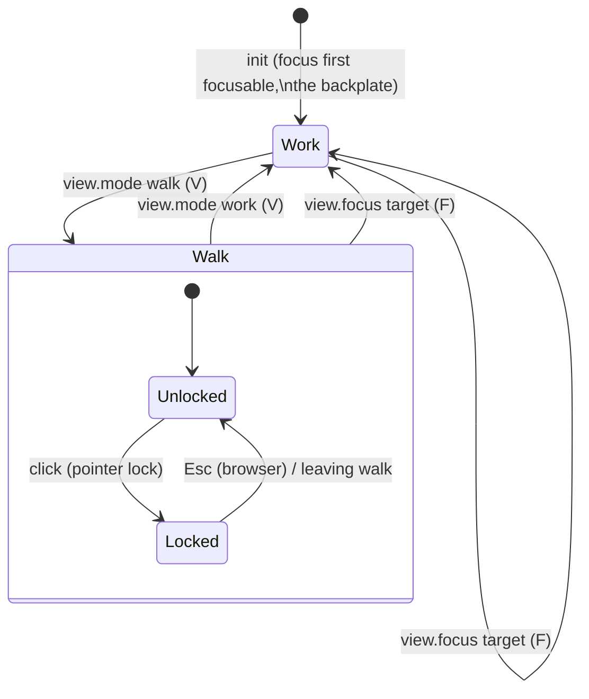
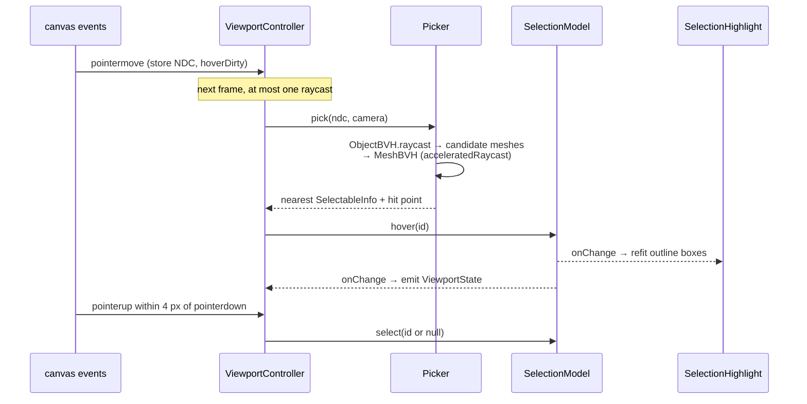
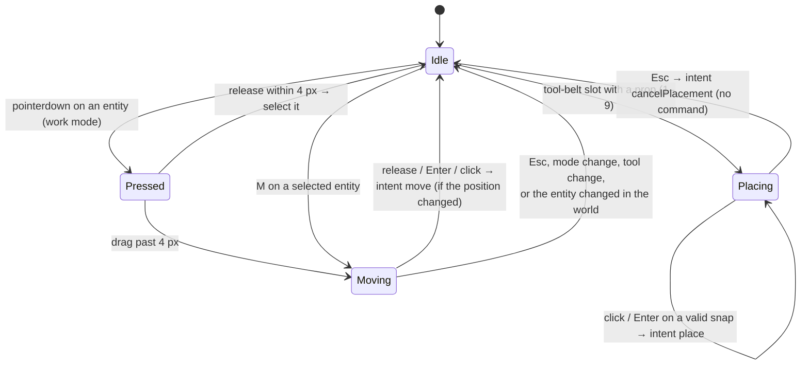

# Rendering and interaction

> **Status (P1, F1.7 done):** cameras, BVH picking, selection, scene sync from world snapshots, the placement ghost and gestures as Commands (`entity.place`, `entity.move`, `entity.delete`, `view.mode`, `view.focus`) have shipped. The snap maths lives in `@controls/world-model` so scripts snap like the mouse. Walls and benches arrive with F1.9. Gotchas: [rendering caveats](../caveats/rendering.md). Spec: plan §4.9 and [phase 1 F1.7](../../plans/phase-1-game-shell.md#f17-cameras-and-interaction).

`@controls/renderer` (`type:rendering`) is framework-free imperative Three.js r186. It **draws the world model and never owns it**: the world arrives as read-only snapshots, and everything the renderer keeps (camera pose, mode, hover, selection, the ghost, overlays) is view state. Gestures leave it as **intents**, which `feature-workspace` executes as Commands.

## Layers

- **`ViewportRenderer`** owns only the GPU: the `WebGPURenderer` (its WebGL2 backend is forced with `?renderer=webgl2`), the `setAnimationLoop` callback and the dev-HUD stats. It keeps the latest world snapshot and placement prop until `init()` resolves, then hands them to the controller. Each frame it calls `controller.update(dt)` and then `render()`.
- **`ViewportController`** owns the scene, the camera and every listener. It is constructed against any `HTMLElement`, so unit tests run it in Node with fake event targets, real geometry and real BVHs.
- **Domain maths** (snapping, placement, prop sizes) lives in `@controls/world-model`; the renderer imports it. Camera, input and selection maths stay in the renderer's pure, lint-fenced modules.

## Scene sync from world snapshots

- Snapshots are immutable, so an unchanged entity is skipped by identity. The renderer never writes to a world.
- Each entity is a `Mesh` named `entity-<id>`, selectable as `{ id: 'entity-<id>', kind: 'prop', entityId }`. Its transform is the world's integer mm and millidegrees, converted at draw time (`mm()`, `mdegToRadians()`, Euler order `YXZ` = ADR 0007's intrinsic yaw, pitch, roll).
- **Prop recipes** are procedural (plan §4.9): a box, or a cylinder along the prop's depth, sized from the built-in prop table in `world-model`. One geometry and one material per prop ref, reference-counted, so removing the last entity of a prop disposes them. Unknown refs draw as a 100 mm placeholder cube.
- The scene-graph JSON snapshot (`describeSceneGraph`: name, type, integer-mm position, rotation in millidegrees, selectable) covers add, update and remove.

## Modes

- **Work:** `OrbitControls` around a focus target. `workOrbitFor()` frames the target's bounding sphere along its face normal, and limits orbit to ±75° azimuth and ±60° elevation, zoom to 0.15 m–3× the framing distance, and pan to the focus sphere (`cursor` + `maxTargetRadius`). Click selects; dragging empty space orbits; dragging an entity moves it.
- **Walk:** first person at a fixed eye height (1.6 m, game-design). WASD/arrows move, Shift sprints, and mouse look needs pointer lock. The pose is clamped to the room bounds minus a 0.25 m body radius.
- **Switching and focusing are view commands** (`view.mode`, `view.focus`; ADR 0006): any surface runs them, they are logged, and the workspace applies them through `Session.onCommand`. The viewport publishes `mode` as a `when` context key. Movement, look, selection cycling and the placement keys stay **input actions** (`KeyboardEvent.code`), so per-frame input never reaches the replay log.

## Picking and selection

- Selectables are scene objects marked with `userData.selectable`, a JSON-plain `SelectableInfo`: `id`, `kind`, `label`, and optionally `focusNormal`, `snapTarget` and `entityId`. The demo panel marks the backplate and both DIN rails; world sync marks every entity.
- `ViewportState` (`mode`, `pointerLocked`, `focusId`, `hovered`, `selected`, `placement`) is published through `onChange`. The Angular host mirrors it to `data-*` attributes and to the `when` context keys `mode`, `selection.id`, `selection.kind`, `selection.focusable` and `selection.entityId`.
- Keyboard: `]` and `[` cycle through selectables in id order; `F` (`view.focus.selection`) focuses a focusable selection; `Delete` (`entity.delete.selection`) deletes a selected entity.

## Placement and moves

- **The ghost** previews the active prop (or the entity being moved) at `placeOnTargets(ref, cursor, targets)` from `@controls/world-model`: the cursor ray hits a snap surface (a second picker that holds only snap surfaces, so props never block it), the hit converts to integer mm with `metresToMm`, and `snapToBest` picks a DIN rail before the backplate grid before wall studs. A failed snap hides the ghost. The ghost is renderer-local and unpickable.
- **Aiming:** the mouse pointer over the canvas, otherwise the screen-centre reticle (pointer lock in walk mode, or keyboard play with the pointer elsewhere). The crosshair shows whenever the reticle aims.
- **Commit points only:** a click or `Enter` emits one `place` intent; releasing a drag, or `Enter`/click after `M`, emits one `move` intent if the position changed. Pointer moves and drags emit nothing. A move keeps the entity's orientation, so only targets facing the same way count (one `entity.move`, never a rotate as well).
- **Escape, innermost first:** cancel a move, cancel placement (the workspace puts the tool away; no command), clear the selection, then fall through to the shell's menu.
- **Intents to Commands:** the `Viewport` component runs `entity.place {ref, positionMm, orientationMdeg}` or `entity.move {id, positionMm}` through `Session.exec`. The arguments are exactly what `placeOnTargets` returned, so a script that snaps the same cursor point logs identical entries (`apps/sim-cli/scenarios/mouse-place-move-delete.ts`).

## Snapping (pure, integer mm, `@controls/world-model`)

`snap(target, footprint, cursorWorld)` converts the cursor into the target's surface frame (`u` = right, `v` = up, axis-aligned normal) and returns the footprint's lower-left **anchor** in surface and world integer mm plus the target's normal, or a typed failure (`out-of-capture`, `out-of-bounds`, `too-large`). An entity's `positionMm` is that world anchor; its prop geometry spans +x, +y, +z from it, turned by a yaw quarter-turn per surface normal (`orientationForNormal`).

| Target           | Rule                                                                                                                                                                                                      | Constants (source in `world-model` `snap/constants.ts`)                                     |
| ---------------- | --------------------------------------------------------------------------------------------------------------------------------------------------------------------------------------------------------- | ------------------------------------------------------------------------------------------- |
| `din-rail`       | Centred across the rail; left edge on a whole 18 mm module from the rail end; must fit on the rail; cursor within 40 mm of the centreline.                                                                | TS35 (EN 60715), module pitch (DIN 43880, rounded), capture (game-design)                   |
| `backplate-grid` | Corner on a 5 mm grid inside the plate minus its 20 mm margin.                                                                                                                                            | grid pitch, margin (game-design)                                                            |
| `wall-studs`     | Flush against the side of the nearest stud that the cursor is on, inside one stud bay (falls back to the other side at a wall edge); bottom on a 10 mm grid. Stud centres are `round(first + i × 406.4)`. | 16 in o.c. (IRC R602.3(5), NIST), 2×4 dressed 38.1 mm (PS 20), vertical pitch (game-design) |

`snapToBest(targets, footprint, cursor)` keeps the targets whose plane is within 10 mm of the cursor (`SNAP_PLANE_TOLERANCE`, covering a hit on a rail top) and whose extent contains it, then tries them by priority and id. P1's targets are the demo panel's (`demoPanelSnapTargets()`); wall studs are implemented and tested but no wall exists until F1.9.

## Disposal

The controller registers each resource owner with a LIFO `Disposer`, scene first so it's disposed last: the scene's geometries and materials, both pickers (they delete `boundsTree` and the own `raycast`), `WorldSync` (removes entity meshes and disposes every prop recipe), the ghost (returns its borrowed geometry, disposes its material and placeholder), the overlay helpers, the `SelectionModel` listeners, the pointer listeners, `OrbitControls`, the keyboard and pointer-lock listeners, and the state and intent listeners. `ViewportRenderer.dispose()` stops the loop, then disposes the controller, then the `WebGPURenderer`. The Angular host disconnects its `ResizeObserver` and removes the test hook.

Removing every entity (without disposing the viewport) also returns to baseline: recipes reach zero and the picker drops BVHs for geometry no longer under a root. Unit tests (`viewport-controller.spec.ts`) and `apps/game-e2e/src/placement.spec.ts` (renderer `info` geometry count) check both.

## Performance (F1.7 measurements)

| Measurement (500 props: box, crate, spool)     | Result                                                                                    |
| ---------------------------------------------- | ----------------------------------------------------------------------------------------- |
| First sync of 500 entities (Node)              | 42 ms, once: builds the object BVH and 3 geometry BVHs                                    |
| Sync after one `entity.move` (Node)            | 9 ms: diff, transform update and BVH refit (on commit, never per frame)                   |
| BVH pick (Node)                                | 27.5 µs per pick                                                                          |
| Idle `update()` with placement armed (Node)    | 3.7 µs, no allocation                                                                     |
| 1080p, AMD Radeon RX 7600 (discrete), Chromium | WebGPU and WebGL2 both a steady 60 fps (vsync-capped), 258 draw calls after culling       |
| 1080p, headless SwiftShader                    | WebGL2 60 fps; WebGPU-on-SwiftShader-Vulkan 3.8 fps (CPU per-draw cost, not a GPU figure) |

The budget target (60 fps on a 2020-era integrated GPU) still needs measuring on such a GPU; props are one draw call each, and instancing repeated props is the obvious next step if that budget is missed.
