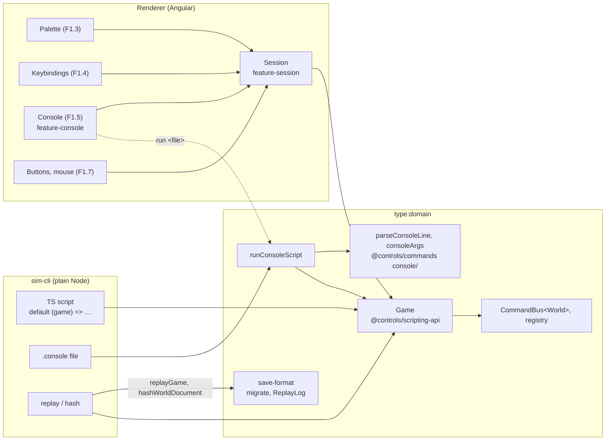
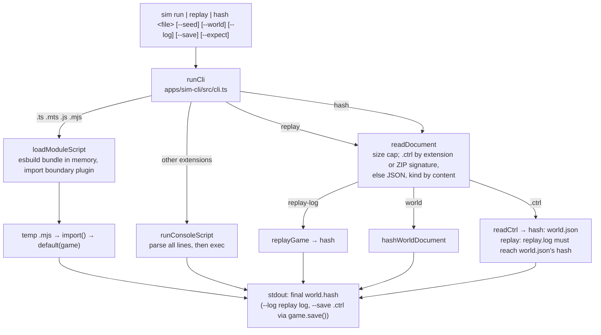
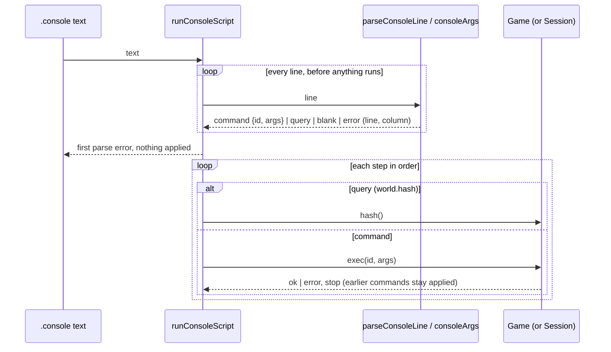

# Scripting API and `sim-cli`

> **Status (F1.6):** `libs/domain/scripting-api` (`@controls/scripting-api`) is the typed `Game` facade over the world command bus; `feature-session`'s `Session` wraps it. The console-line parser lives in `@controls/commands` (`console/`). `apps/sim-cli` (`type:app`, `scope:headless`) runs scripts, replays and hashes headless in plain Node. The in-game console is `@controls/feature-console` ([dev console](console.md), F1.5) and the `.ctrl` container is `@controls/save-format` (F1.8b): `game.save()` writes one, `loadGame(bytes)` loads one, and `sim-cli` reads and writes them ([world and saves](world-and-saves.md#the-ctrl-container-f18b)). Decisions: [ADR 0008](../decisions/0008-console-and-scripts.md). How-to: [scripting guide](../guides/scripting.md). Gotchas: [scripting caveats](../caveats/scripting.md).

## One `Game`, every driver

The UI and scripts run identical code: `Session` is a thin Angular adapter (signals, context keys, `onCommand`) over the same `Game` a script gets, and a `Game` is a thin facade over one `CommandBus<World>`.

## `sim-cli`

- **Bundle:** `apps/sim-cli/build.mjs` bundles `src/main.ts` with esbuild into `dist/apps/sim-cli/main.mjs` (ESM, Node 24, domain libs and zod inlined, esbuild external). The Nx `build` target and `pnpm sim` (via `bin/sim.mjs`) both call it.
- **No DOM:** the app's tsconfig has `lib: ["es2024"]` without `dom`, its lint tag `scope:headless` allows only `type:domain` libs and bans framework packages, and the four-surface test runs the bundle in a plain `node` child process.
- **Script imports:** an esbuild plugin allows relative files, `type:domain` aliases (from `tsconfig.base.json`) and `zod`; anything else is a build error.

## Console-line files

## The four-surface scenario

`apps/sim-cli/scenarios/four-surface.ts` and `four-surface.console` express one scenario. `apps/sim-cli/src/four-surface.spec.ts` drives it through the scripting API in-process, `sim run` of each file and `sim replay` of the log the script run wrote, and pins the resulting hash. The test target depends on `build`, so it runs the real bundle, and it is part of `pnpm verify`. The palette, keybinding and mouse drivers are UI and live in `apps/game-e2e`.

**The palette scenario (F1.3).** `scenarios/palette-place-undo.console` lists, as console lines, exactly what `apps/game-e2e/src/palette.spec.ts` logs with the palette and the keyboard: place a crate, place a spool, undo. Opening the palette (`palette.open`) is unlogged UI chrome, so it appears in neither. `apps/sim-cli/src/palette-place-undo.spec.ts` runs it with `sim run` and pins `PALETTE_PLACE_UNDO_HASH`; the e2e test asserts the same literal and that its replay log has the file's command ids, so the palette path is checked against the console-line path.

**The console scenarios (F1.5).** `scenarios/console-place-undo.console` (place a crate, undo) is pinned to `CONSOLE_PLACE_UNDO_HASH` by `apps/sim-cli/src/console-place-undo.spec.ts`. `apps/game-e2e/src/console.spec.ts` types it into the in-game console, types the lines of `palette-place-undo.console` into a fresh session and asserts `PALETTE_PLACE_UNDO_HASH` (the console-versus-palette cross-check), and `run`s `four-surface.console` to `FOUR_SURFACE_HASH`. Opening the console (`console.toggle`) is unlogged UI chrome too.

**The phase-acceptance scenario.** `scenarios/phase-acceptance.{console,ts}` is the one scenario the P1 phase acceptance runs on all four drivers: place a box and a crate on the workshop backplate, drag the box onto DIN rail 1, delete the crate, then undo, redo and undo again. `apps/game-e2e/src/phase-acceptance.spec.ts` drives it with the mouse (undo and redo on the keyboard), with the palette alone through its generated argument forms, and with the in-game console's `run` of the file; `apps/sim-cli/src/phase-acceptance.spec.ts` runs the snapping script and the console file through `sim run`, replays the script's log and a save of the run. Every driver must log exactly the file's command ids and reach `PHASE_ACCEPTANCE_HASH`.

## The sim in the scripting API (F2.3a)

A `Game` owns an in-process `SimEngine` (`@controls/sim-core`) as its time host (ADR 0011 §3, §11): `exec` hands each logged entry to it (`applied`), and carries out `sim.step` by advancing once it is logged; `advance` and `advanceTo` move the engine, then the bus (`CommandBus.advanceTo`). `hash()` and `save()` write the engine's export into the world with `materialiseWorld` (`@controls/sim-protocol`); `world()` stays the commanded world. `probe`, `islands`, `snapshot` and `snapshotHash` read the engine, and `on('sim')` delivers its events after each `exec` or `advance`. `createGame({ engine: false })` gives a game without one (the commanded world only; the sim queries throw `NotAvailableError`). `createGame({ world, time })` gives the game whose engine runs elsewhere (F2.3b): every logged entry and advance goes to the `TimeHost` (in the game, the sim worker's `SimHost`), no engine starts, a replay rebuilds the commanded state only, and `hash()`, `save()` and the sim queries throw `NotAvailableError` with phase `worker` unless the host can `exportState()`. `writeSave(world, log)` writes a materialised world as this build's save, `planLoad(contents)` decides whether a save's log is verified (the one rule for headless and the game) and `resumeLogGame(log, options)` replays a verified log with its undo history cleared.

Loading verifies a save's log with an engine replaying it from its initial world, unless `engineCompatible(manifest, build)` (D8) says the save is from another engine or catalogue: then `world.json` loads as saved and a new log starts (`engine-changed`). The engine refusing a world at start (`SimStartError`) is the load error `start-failed`.

## Reserved queries

`game.tag(path)` (P10, PLC tags) is in the `Game` type now and throws `NotAvailableError` (`code: 'not-available'`). Reserving it keeps the name stable and gives a script a precise error instead of `is not a function`. `game.probe` was reserved the same way until F2.3a implemented it.
