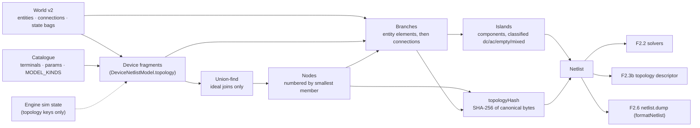

# Simulation

How `@controls/sim-core` turns the as-built world into something a solver can run. This page grows with Phase 2: today it covers the netlist compiler (F2.1). The solvers (F2.2), the engine loop (F2.3a) and the worker transport (F2.3b, [ADR 0011](../decisions/0011-sim-worker-contract.md)) are added as they land. Gotchas: [simulation caveats](../caveats/simulation.md).

## The netlist compiler (F2.1)

`compileNetlist(world, catalog, options?)` is a pure function from the world document to a `Netlist` of nodes, branches and islands. It reads only what is wired:

- entities, with their catalogue entry's terminals and parameters;
- `world.connections` (test leads; wires from P3);
- each entity's commanded `state` bag (a switch's `closed`);
- the engine's sim-owned topology state (a fuse that blew, a breaker that tripped), passed in by the engine as `options.sim`. The world's own `sim` bags are inert during play ([ADR 0011 §1](../decisions/0011-sim-worker-contract.md#1-ownership-and-threads)), so they are only a fallback, which is correct at a session start or a load.

Positions, orientations, the renderer and prints never enter it. **The simulator runs what is wired, not what is drawn**: a lamp set down touching a battery is its own unpowered island until a lead joins them.

### Fragments and netlist models

Each placed entity contributes a **fragment**: its sorted terminals, the groups of terminals it joins ideally, and its elements. A fragment comes from the model kind's `DeviceNetlistModel.topology({ params, state, sim })` in `DEVICE_NETLIST_MODELS`; a test checks every placed kind in `MODEL_KINDS` has one. The model says only what the netlist needs: which terminals are joined, which elements sit between which terminals, and when. Stamps and electrical behaviour belong to the device models of F2.4 and F2.5.

| Model kind          | Topology                                                                                 |
| ------------------- | ---------------------------------------------------------------------------------------- |
| `battery`           | One `vsource` element `cell`, `neg` → `pos`, a DC source                                 |
| `lamp.incandescent` | One `resistor` element `filament`, `a` → `b`; its value is R(T), computed by F2.5        |
| `switch.spst`       | Closed: an ideal join of `a` and `b`, no element. Open: nothing                          |
| `lead` (connection) | One `resistor` branch, `a` → `b`, from `leadResistanceOhm` at the 20 °C bench (293.15 K) |

A model that changes topology on a sim-owned event lists those keys in `simTopologyKeys` (F2.5's fuse lists `blown`). It is shown only those keys, never the rest of the engine's state. The P2 bench kinds list none.

Absent from the netlist, with a diagnostic where useful: props (silently), entities whose ref the catalogue doesn't know (`unknown-device`), kinds without a netlist model (`no-model`), and connections whose ref is unknown or not a connection kind, or that end on an absent entity or an unknown terminal (`absent-connection`, with a reason).

### Canonical order

Every index is a pure function of the world, never of the edit history. That order is the order of `WorldV2.sim.nodes` and `branches` and of the snapshot payload ([ADR 0013](../decisions/0013-world-document-v2.md)).

- **Terminals** are visited in canonical order: entity id (numerically), then terminal id (UTF-16 code units).
- **Nodes:** union-find merges ideal joins only. A node is numbered when its first member is visited, so nodes are numbered by their smallest member, whatever order the unions ran in. Members are listed in canonical order.
- **Branches:** each entity's elements (entity id, then part), then each netlisted connection by id. Each connection is **exactly one branch** from `connection.a`'s node to `connection.b`'s node. A closed switch has no branch, and a lead across one is a branch with `a === b`.
- **Islands:** connected components of the nodes over the branches, numbered by their smallest node. Each is classified by its source elements: `empty` (none), `dc`, `ac`, or `mixed`, which is also reported as a `mixed-island` diagnostic because P2 has no converters.

The compiler sorts its input by id first, so permuting `entities` or `connections` changes nothing (a property test).

### `topologyHash`

SHA-256, using the pure implementation in `@controls/world-model`, over a compact canonical byte encoding of the structure. The encoding is documented in `netlist/hash.ts`: the partition, then each branch's element ref, element kind, source domain, model kind and end nodes. The normative rules, including when to bump the version byte and `SIM_ENGINE_VERSION`, are in [ADR 0013, "Solution order and `topologyHash`"](../decisions/0013-world-document-v2.md#solution-order-and-topologyhash). Values are left out, so a value-only change (a longer lead, a supply setpoint) keeps the hash, and F2.2's factorisation cache can key on it. Element refs are in, because the solution record is ordered by branch and checked against this hash when the engine starts. The encoding is binary rather than text because it is hashed on every topology change, inside F2.2's re-solve budget. `sim-core` imports the SHA-256 from `world-model` directly; both are `type:domain`, so the Nx boundary allows it, and `world-model` doesn't depend on `sim-core`.

### Incremental recompile

`NetlistCompiler` keeps state between compiles:

1. **Fragment cache.** Each entity's fragment is reused while its ref and its `state` bag are unchanged (world commands keep an untouched entity's bag object) and its sim topology keys still have the same values. Those are every input of a fragment, so a reused id (an entity placed again after an undo) can only hit the cache with an identical fragment. Each connection's resolved model and resistance are reused while the connection object is unchanged; a reconnect after an undo is a new object.
2. **Structure check.** Each compile records, in one flat list built as the inputs are placed, everything the assembly step reads except values: per entity its id and fragment key (or why it is absent); per connection its id, its two ends and its model (or why it is absent). The list is compared element by element with the previous compile's. An input that isn't in the list can't reach the assembly, so equal lists give equal nodes, islands, diagnostics and hash by construction.
   - Same structure, same values: the previous `Netlist` object is returned.
   - Same structure, new values: only the changed branches are rebuilt. Nodes, islands, the hash and the diagnostics are shared.
   - Otherwise everything is renumbered and rehashed from the cached fragments, because one merge shifts every later node index.

A property test drives random bench circuits (each seeded with 3–8 devices) through random sequences of edits (place, connect between real terminals, disconnect, operate, delete, move, undo, redo) and sim topology events (a test fuse blowing). It compiles only on randomly flagged steps, so the compiler also sees several edits at once, and checks each incremental result deep-equals a from-scratch compile, with the world and sim state frozen. A generator-health test pins how often runs produce leads, blows, value changes and AC and mixed islands. Measured on a 2,000-node chain, on an AMD Ryzen 5 5600X under Node 24:

| Operation                                           | Time         |
| --------------------------------------------------- | ------------ |
| From-scratch compile (a new compiler, as on a load) | about 4 ms   |
| Structural recompile (a switch toggled)             | about 1.3 ms |
| `topologyHash` alone, part of the structural figure | about 0.6 ms |
| Recompile with nothing changed                      | about 0.2 ms |

These are the netlist's share of F2.2 part 3's budget, which allows 2 ms to re-solve a 2,000-node plant after a topology change. F2.7's bench measures compile and solve together.

Netlists are read-only: fragments and their frozen `values` objects are shared between compiles.

### `formatNetlist`

`formatNetlist(netlist)` writes deterministic text for F2.6's `netlist.dump` and for golden tests. It lists the counts, the topology hash, islands, nodes with their members, branches with their values (`String(n)`, which ECMAScript defines exactly), and diagnostics.

## Not yet

- **Solvers** (F2.2): DC and phasor MNA, `gmin`, dense and sparse LU, the factorisation cache keyed by `topologyHash`.
- **Engine loop** (F2.3a): the tick layers, and calling `NetlistCompiler.compile` on each command and topology event with the engine's sim state.
- **Topology descriptor** (F2.3b): built from `Netlist.nodes`, `branches`, `islands` and `devices`, adding each island's reference node and nominal band.
