# Simulation

How `@controls/sim-core` turns the as-built world into something a solver can run. This page grows with Phase 2: today it covers the netlist compiler (F2.1), the DC solver (F2.2 part 1), sparse LU and the factorisation cache (part 3), the phasor solver (part 2), the oracle corpus and the bench (F2.7), the engine loop (F2.3a) and the sim worker with its snapshot transport (F2.3b, [ADR 0011](../decisions/0011-sim-worker-contract.md)). Gotchas: [simulation caveats](../caveats/simulation.md).

## The netlist compiler (F2.1)

`compileNetlist(world, catalog, options?)` is a pure function from the world document to a `Netlist` of nodes, branches and islands. It reads only what is wired:

- entities, with their catalogue entry's terminals and parameters;
- `world.connections` (test leads; wires from P3);
- each entity's commanded `state` bag (a switch's `closed`);
- the engine's sim-owned topology state (a fuse that blew, a breaker that tripped), passed in by the engine as `options.sim`. The world's own `sim` bags are inert during play ([ADR 0011 §1](../decisions/0011-sim-worker-contract.md#1-ownership-and-threads)), so they are only a fallback, which is correct at a session start or a load.

Positions, orientations, the renderer and prints never enter it. **The simulator runs what is wired, not what is drawn**: a lamp set down touching a battery is its own unpowered island until a lead joins them.

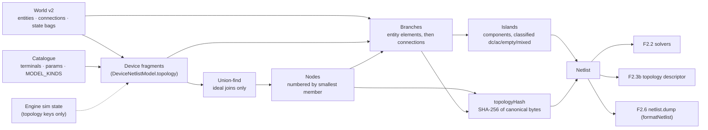

### Fragments and netlist models

Each placed entity contributes a **fragment**: its sorted terminals, the groups of terminals it joins ideally, and its elements. A fragment comes from the model kind's `DeviceNetlistModel.topology({ params, state, sim })` in `DEVICE_NETLIST_MODELS`; a test checks every placed kind in `MODEL_KINDS` has one. The model says only what the netlist needs: which terminals are joined, which elements sit between which terminals, and when. Stamps and electrical behaviour belong to the device models of F2.4 and F2.5.

| Model kind                | Topology                                                                                                |
| ------------------------- | ------------------------------------------------------------------------------------------------------- |
| `battery`                 | One `vsource` element `cell`, `neg` → `pos`, a DC source                                                |
| `lamp.incandescent`       | One `resistor` element `filament`, `a` → `b`; its value is R(T), from the lamp's bank                   |
| `resistor`, `heater`      | One `resistor` element `element`, `a` → `b`, of fixed value (F2.5)                                      |
| `switch.spst`             | Closed: an ideal join of `a` and `b`, no element. Open: nothing                                         |
| `fuse`                    | Intact: one `resistor` element `link`, `a` → `b`. Blown (sim `blown`): nothing (F2.5)                   |
| `breaker.thermalMagnetic` | Handle `on` and not `tripped`: one `resistor` element `pole`, `line` → `load`. Otherwise nothing (F2.5) |
| `lead` (connection)       | One `resistor` branch, `a` → `b`, from `leadResistanceOhm` at the 20 °C bench (293.15 K)                |

A model that changes topology on a sim-owned event lists those keys in `simTopologyKeys` (the fuse lists `blown`, the breaker `tripped`). It is shown only those keys, never the rest of the engine's state. The other P2 kinds list none. A protective device compiles to a branch while closed, never to an ideal join, because its current is what heats it.

Absent from the netlist, with a diagnostic where useful: props (silently), entities whose ref the catalogue doesn't know (`unknown-device`), kinds without a netlist model (`no-model`), and connections whose ref is unknown or not a connection kind, or that end on an absent entity or an unknown terminal (`absent-connection`, with a reason).

### Canonical order

Every index is a pure function of the world, never of the edit history. That order is the order of `WorldV2.sim.nodes` and `branches` and of the snapshot payload ([ADR 0013](../decisions/0013-world-document-v2.md)).

- **Terminals** are visited in canonical order: entity id (numerically), then terminal id (UTF-16 code units).
- **Nodes:** union-find merges ideal joins only. A node is numbered when its first member is visited, so nodes are numbered by their smallest member, whatever order the unions ran in. Members are listed in canonical order.
- **Branches:** each entity's elements (entity id, then part), then each netlisted connection by id. Each connection is **exactly one branch** from `connection.a`'s node to `connection.b`'s node. A closed switch has no branch, and a lead across one is a branch with `a === b`.
- **Islands:** connected components of the nodes over the branches, numbered by their smallest node. Each is classified by its source elements: `empty` (none), `dc`, `ac`, or `mixed`, which is also reported as a `mixed-island` diagnostic because P2 has no converters.

The compiler sorts its input by id first, so permuting `entities` or `connections` changes nothing (a property test).

### `topologyHash`

SHA-256, using the pure implementation in `@controls/world-model`, over a compact canonical byte encoding of the structure. The encoding is documented in `netlist/hash.ts`: the partition, then each branch's element ref, element kind, source domain, model kind and end nodes. The normative rules, including when to bump the version byte and `SIM_ENGINE_VERSION`, are in [ADR 0013, "Solution order and `topologyHash`"](../decisions/0013-world-document-v2.md#solution-order-and-topologyhash). Values are left out, so a value-only change (a longer lead, a supply setpoint) keeps the hash, and F2.2's factorisation cache can key on it. Element refs are in, because the solution record is ordered by branch and checked against this hash when the engine starts. The encoding is binary rather than text because it is hashed on every topology change, inside F2.2's re-solve budget. `sim-core` imports the SHA-256 from `world-model` directly; both are `type:domain`, so the Nx boundary allows it, and `world-model` doesn't depend on `sim-core`.

### Incremental recompile

`NetlistCompiler` keeps state between compiles:

1. **Fragment cache.** Each entity's fragment is reused while its ref and its `state` bag are unchanged (world commands keep an untouched entity's bag object) and its sim topology keys still have the same values. Those are every input of a fragment, so a reused id (an entity placed again after an undo) can only hit the cache with an identical fragment. Each connection's resolved model and resistance are reused while the connection object is unchanged; a reconnect after an undo is a new object.
2. **Structure check.** Each compile records, in one flat list built as the inputs are placed, everything the assembly step reads except values: per entity its id and fragment key (or why it is absent); per connection its id, its two ends and its model (or why it is absent). The list is compared element by element with the previous compile's. An input that isn't in the list can't reach the assembly, so equal lists give equal nodes, islands, diagnostics and hash by construction.
   - Same structure, same values: the previous `Netlist` object is returned.
   - Same structure, new values: only the changed branches are rebuilt. Nodes, islands, the hash and the diagnostics are shared.
   - Otherwise everything is renumbered and rehashed from the cached fragments, because one merge shifts every later node index.

A property test drives random bench circuits (each seeded with 3–8 devices) through random sequences of edits (place, connect between real terminals, disconnect, operate, delete, move, undo, redo) and sim topology events (a test fuse blowing). It compiles only on randomly flagged steps, so the compiler also sees several edits at once, and checks each incremental result deep-equals a from-scratch compile, with the world and sim state frozen. A generator-health test pins how often runs produce leads, blows, value changes and AC and mixed islands. Measured on a 2,000-node chain, on an AMD Ryzen 5 5600X under Node 24:

| Operation                                           | Time         |
| --------------------------------------------------- | ------------ |
| From-scratch compile (a new compiler, as on a load) | about 4 ms   |
| Structural recompile (a switch toggled)             | about 1.3 ms |
| `topologyHash` alone, part of the structural figure | about 0.6 ms |
| Recompile with nothing changed                      | about 0.2 ms |

These are the netlist's share of F2.2 part 3's budget, which allows 2 ms to re-solve a 2,000-node plant after a topology change. F2.7's bench measures them on a 2,000-node plant (below); F2.2 part 3 adds the solve.

Netlists are read-only: fragments and their frozen `values` objects are shared between compiles.

### `formatNetlist`

`formatNetlist(netlist)` writes deterministic text for F2.6's `netlist.dump` and for golden tests. It lists the counts, the topology hash, islands, nodes with their members, branches with their values (`String(n)`, which ECMAScript defines exactly), and diagnostics.

## The DC solver (F2.2 part 1)

`DcSolver.solve(netlist, values, out?)` in `sim-core/src/lib/mna/` solves every `dc` and `empty` island of a netlist by modified nodal analysis (MNA), with the dense LU in `sim-core/src/lib/lu/`. Both are reimplemented from published sources: Ho, Ruehli and Brennan's 1975 MNA paper, and Gaussian elimination with partial pivoting as in Golub and Van Loan. No third-party code is used. `ac` and `mixed` islands are left at zero with `solved: false`: `ac` islands are the phasor solver's (part 2, below), and `mixed` ones are solved by neither.

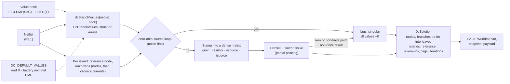

### Values

Values are kept apart from the netlist, because they change on every solve and the topology does not. `DcBranchValues` holds one stamp per branch on preallocated typed arrays, so the engine can refill it without allocating:

| Stamp      | On element kind       | Meaning                                                                                                                      |
| ---------- | --------------------- | ---------------------------------------------------------------------------------------------------------------------------- |
| `resistor` | `resistor`            | `ohms` > 0, finite. Current a → b is (Va − Vb) / R                                                                           |
| `vsource`  | `vsource`             | EMF `emfV` from `a` (negative) to `b` (positive) behind a series `ohms` ≥ 0: Vb − Va = E − R·I, with I positive a → b inside |
| `isource`  | `resistor`, `vsource` | Exactly `amps` from a to b through the element, whatever the voltage (a supply in current limit)                             |

`dcBranchValues(netlist, hook?)` fills them. A `DcValueHook` gets the first say on each branch: it is where F2.4's battery EMF against state of charge and F2.5's filament R(T) plug in (through the engine's banks). Otherwise the model kind's default in `DC_DEFAULT_VALUES` applies. A `lead` defaults to its `resistanceOhm`; a `battery` defaults to its `nominalVoltageV` behind its `internalResistanceOhm`, a placeholder until F2.4. A branch with neither (a lamp, until F2.5) throws, since that is a programming error in a device model.

### The system per island

Each island is solved on its own against its own **reference node**, which is eliminated. `islandReferenceNode` picks the negative end of the island's lowest-numbered `vsource` element, or its smallest node if it has none. It is a pure function of the topology. For a floating DC island with one source, that is the most negative source terminal, as ADR 0011 §5.3 asks.

Unknowns come in a fixed order: the voltages of the island's other nodes (ascending node index), then one current per `vsource` element (ascending branch index). Rows are KCL at each non-reference node, then one row per `vsource` element: Vb − Va + R·I = E, or I = amps while it is stamped as a current source. A `vsource` element keeps its current unknown in current-limit mode, so **the matrix layout depends only on the topology**, which is what part 3's factorisation cache keys on (`topologyHash`). A branch with both ends on one node is accepted. As a resistor or current source it adds nothing to the matrix. As a voltage source it gives R·I = E, the source's short-circuit current.

`gmin` (`GMIN_S`, 1e-12 S, numerical) is stamped from every non-reference node to the reference. It gives every node a defined voltage. An `empty` island is solved like any other (to exactly 0 with no sources), not assumed dead.

### Singular islands

With `gmin` on every node and every series resistance ≥ 0, the matrix [[G, B], [−Bᵀ, R]] satisfies xᵀMx = VᵀGV + IᵀRI. So it is singular **exactly** when the island's zero-ohm voltage sources contain a loop: two ideal sources in parallel, or one whose ends a closed switch joins. The solver checks this structurally with a union-find before any arithmetic, so the `singular` flag never depends on a pivot tolerance. This check is not redundant. When pivoting runs through a resistive mesh, elimination is inexact, and the singular pivot comes out as rounding noise rather than 0 (a planted-fault test showed about 3 in 4 such loops slipping past a numerical check). As a backstop, a zero or non-finite pivot, or a non-finite result (an overflow from extreme values), also flags the island. A singular island's values are all `+0`, never NaN.

### Floating components

A conductive component (nodes joined by resistors and voltage-mode sources) that doesn't hold the island's reference reaches it only through current sources, so only `gmin` holds it. Stamped node by node, its rows are nearly dependent. Above about gmin / ε (≈ 4.5e3 S) the last pivot rounds to exactly 0, a false `singular`; below that its common mode is mostly rounding. The solver pins it structurally instead:

- its representative (smallest node) carries the common mode c = V(rep), and each other member u = V − c, so resistor and source-row differences involve only u (c cancels exactly) and only `gmin` terms carry c;
- the representative's row is the component's structural sum row, gmin · (|S| c + Σ u) plus the currents of the branches that leave it.

That is an exact change of variables plus a row operation: the same solution, now well-conditioned. Voltages are written as c + u, and currents inside the component come from u. Other islands are bit-identical.

### Determinism and allocation

The solver uses a fixed loop order and IEEE-exact operations only (D6). Pivot ties go to the lowest row. Every stored value is normalised so that −0 becomes +0, and imaginary parts are +0. The same netlist and values give bit-identical results on a fresh or a reused solver (a property test). `DcSolver` keeps its LU storage and index maps and grows them only for a larger island. `solve` writes into `out` when it fits, so a steady-state solve allocates nothing.

### The solution

`DcSolution` is in the netlist's canonical order:

- `nodes` and `branches` are `Float64Array`s of interleaved `re, im` pairs (V against the island reference; A positive from end `a` to end `b`);
- `islands` holds per island `{ solved, referenceNode, unknowns, flags, iterations }` (`ISLAND_FLAG_SINGULAR` = 1 and `ISLAND_FLAG_NON_CONVERGED` = 2, as in the snapshot's island entry; `iterations` is 1 for a linear solve).

F2.3a can copy this straight into `WorldV2.sim` and the snapshot payload ([ADR 0011 §5.3, §9.6](../decisions/0011-sim-worker-contract.md)).

### Tests

- **Goldens** (`src/testing/dc-goldens.ts`, each with its hand calculation): a divider and a battery into a load (real bench worlds through `compileNetlist`); two unequal batteries in parallel, alone and sharing a load (Millman); an unbalanced and a balanced Wheatstone bridge (Thévenin); floating islands under `gmin` (a lone lamp, and a lamp left dangling off a battery); a current source into nothing but `gmin` (V = I / gmin); and ideal sources in parallel (singular, beside a healthy island). They hold to 1e-9 relative, except two stated cases: the bridge's difference current (1e-8, because gmin moves it about 7e-10) and currents of gmin size (≈ 1e-11 A), bounded by their stated absolute floors (1e-13 A for the battery's, 5e-14 A for the lamp's). All are within the plan's 0.5 %.
- **Properties** (fast-check), under the plan's F2.2 floor policy (KCL at every node within 1e-9 · max|I| + 1e-12 A plus the island's sum of g · ulp(V)-scale rounding terms):
  - KCL at every node, every source row, and power balance with `gmin` losses;
  - linearity: exact, bit for bit, for a factor of 0 or a power of two; for other factors, in residual space;
  - superposition in residual space: after every solve compared has passed KCL and its source rows, every row of x̂(all) − x̂(first) − x̂(second) holds within their summed bounds, and the sources cancel exactly (values aren't compared: forward error is the residual times |A⁻¹|, which ill-conditioned circuits make unbounded);
  - two CI counterexamples pinned as fixed examples;
  - singular exactly when an ideal-source loop exists, including inside resistive meshes;
  - bit-identical solves, including into an `out` full of sentinels, and no −0 anywhere;
  - a current source into a floating cluster down to 0.1 mΩ: never singular, with KCL and power holding;
  - a SHA-256 pin over the bits of 300 seeded solves (a deliberate numeric change re-pins it and bumps `SIM_ENGINE_VERSION`).

  They run over synthetic circuits (2–14 nodes, 1–3 islands, loops, self-loops, every stamp, resistances from 0.1 mΩ to 100 kΩ) and over compiled bench worlds, with generator-health floors.

## Sparse LU and the factorisation cache (F2.2 part 3)

An island with at least `SPARSE_MIN_UNKNOWNS` (64) unknowns is solved by sparse LU instead of dense; smaller ones keep part 1's dense path bit for bit (the pinned 300-solve hash didn't move). Both paths stamp through the same routine, so they see the same matrix entries; they differ only in pivot order, so they agree to rounding, not to the bit. All of it is reimplemented from the papers, with no third-party code: Gilbert and Peierls (1988, doi:10.1137/0909058) for the left-looking LU, Amestoy, Davis and Duff (1996, doi:10.1137/S0895479894278952) for AMD, and Duff, Erisman and Reid (1986, §7.8) for threshold pivoting.

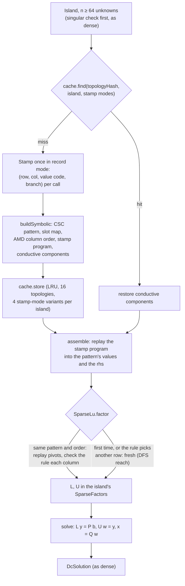

### Sparse LU

`SparseLu` (`lu/sparse-lu.ts`) is left-looking: one column at a time, in the AMD order. For each column it does three things:

1. finds, by an iterative depth-first search over L's graph, the rows the column reaches (Gilbert–Peierls: exactly the pattern of the triangular solve);
2. applies the earlier columns in topological order;
3. picks the pivot by **threshold partial pivoting**. The diagonal row is kept while |a_kk| ≥ `PIVOT_THRESHOLD` × the largest candidate; otherwise the largest wins, the lowest row on a tie. `PIVOT_THRESHOLD` was 0.1 and is 1 since #51 (plain partial pivoting, multipliers at most 1, as dense): u = 0.1's multipliers of up to 10 put about 3,000 ulps of noise on one node of a fresh-seed circuit, and the outer loop, which expects partial-pivoting precision, stalled at 41 iterations where dense took 18. On the seeded 2,000-node plants u = 1 costs 0.33 % more L + U entries and falls back from replay less often (19 against 227 fallbacks over 2,197 nonlinear islands). It moved the sparse pins, so `SIM_ENGINE_VERSION` is 2.

MNA's zero diagonals (ideal sources) make off-diagonal pivots routine. Floating components keep part 1's structural pinning, since both paths stamp the same rows. A property drives clusters of 70–160 nodes, down to 0.1 mΩ, through the sparse path: they are never singular, and gmin · ΣV equals the feed to 1e-13.

**Replay.** The factors live in a `SparseFactors` object per island, in the cache entry. When it already holds a factorisation of the same pattern, order and threshold, `factor` replays it: it keeps the L/U patterns and the pivot sequence, skips the searches, and recomputes every value in the order a fresh factorisation would, applying the full pivot rule at every column. If the rule would choose another row, it starts again afresh. So a replay is accepted only when it is the fresh factorisation, bit for bit. On the bench plant it halves the cost of the numeric factorisation.

### AMD

`amdOrder` (`lu/amd.ts`) orders A + Aᵀ by approximate minimum degree on the quotient graph:

- elements absorb their neighbours;
- the approximate external degree uses |L_e \ L_p|, computed for all elements at once;
- elements inside L_p are absorbed (aggressive absorption);
- indistinguishable variables merge into supervariables;
- rows denser than max(16, 10√n) go last.

It is deterministic: fixed scan orders, LIFO degree buckets, and candidates compared in hash-then-index order. On one 250-unknown plant island it leaves about 970 L+U entries, where the natural order leaves about 22 000.

### The factorisation cache

`FactorisationCache` (`mna/factorisation-cache.ts`) keys its entries by `topologyHash`, island and **stamp-mode signature** (each branch's stamp code). The signature is needed because a mode can change the matrix without changing `topologyHash`: a `vsource` element in current limit has a different row, and a current source can split a conductive component. Each entry keeps:

- the CSC pattern, and the slot of every stamp call (duplicates add in call order);
- the AMD order;
- the **stamp program**: each call's value code (`gmin`, ±1, R, ±1/R) and branch, plus the right-hand-side steps. Assembly replays the same additions in the same order as `stamp`, without its branching;
- the island's conductive components, and a fingerprint of its branch ends. A hit with different ends or unknowns throws: two netlists sharing a `topologyHash` is a caller bug;
- the island's last `SparseFactors`, for replay.

Everything it keeps is a function of the topology and the stamp modes, except the factors, which are used only after the pivot rule re-verifies them. So **results never depend on the cache's state**.

Eviction is least recently used, by a logical clock, over topologies (`FACTORISATION_CACHE_CAPACITY`, 16) and over each island's mode variants (4). `cache.stats` counts hits, misses and evictions; `sparse.replays`, `.fresh` and `.fallbacks` count numeric factorisations. Returning to an earlier switch state is all hits, and a spec counts them.

### The crossover

Measured on the built bundle (Node 24, AMD Ryzen 5 5600X); each figure is the median over single-island plant-like circuits:

| Unknowns | Dense  | Sparse, warm cache | Sparse, cold (rebuild symbolic) |
| -------- | ------ | ------------------ | ------------------------------- |
| 27       | 5.7 µs | 5.6 µs             | 29 µs                           |
| 53       | 17 µs  | 10 µs              | 54 µs                           |
| 108      | 86 µs  | 21 µs              | 121 µs                          |
| 290      | 941 µs | 58 µs              | 348 µs                          |

Sparse with a warm cache wins from about 30 unknowns, and with a cold one from about 130. The threshold is 64. That is above every circuit of the pinned hash (at most 40 unknowns), so small circuits keep their dense bits.

### The nonlinear outer loop

`DcSolver.solveNonlinear(netlist, values, { hook, warmStart?, maxIterations? }, out?)` repeats each DC island's linear solve. Before each solve it calls `hook(island, iterate, values)`, a `DcIterationHook` that sets the island's nonlinear values from the current iterate. On a cold start the iterate is `null` and the hook sets its initial guess. This is the interface F2.4's CV/CC supply and F2.5's lamp R(T) plug into.

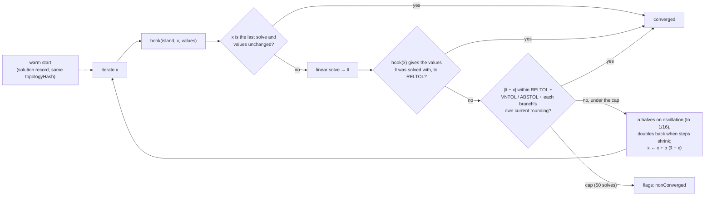

**Two stopping tests (#51).** After each solve the loop asks the hook for its values at x̃: if they are the values x̃ was solved with, to `OUTER_LOOP_RELTOL` and in the same stamp mode, x̃ is the fixed point and the loop stops. Otherwise the older step test on voltages and currents still applies. The value-space test was added because a current is only as repeatable as the solve resolves it (cond · ε · V · g): on ill-conditioned islands small currents repeated only to 5e-5 relative, and the step test alone stalled to 42 and 50 iterations on the dense path. With it, 6,542 seeded islands take at most 20 iterations forced dense and 26 forced sparse (median 16), within the bound of 40 that the damping schedule's contraction gives.

The reported solution is always the last linear solve, never a damped blend, so every row holds for the values left in `values`. A linear island takes one solve, and a singular solve ends the loop.

Each branch's current tolerance includes its own rounding (`currentResolution`): a resistor's 32 ε (|Va| + |Vb|) / R, and for a voltage-mode source the sum over the branches at its nodes. No solve resolves a current better: without the term, a 2.2e-7 A current wobbling by 6e-13 A once kept an island from converging. The term is per branch, never island-wide. An island-wide sum grows with the island and let a 1e-5 A load on a long busbar loop stop with its resistance off by ×35 (#49 review). The constants (`OUTER_LOOP_*`) are numerical, and sourced against SPICE's defaults.

A `nonConverged` island's values are the last linear solve's: self-consistent, so they look real. Anything player-facing must show such an island as unsettled (caveats).

### Tests (part 3)

- **Dense against sparse** (`mna/sparse.spec.ts`), per the floor policy. It runs on random circuits of 40–260 nodes, and on 2–24-node circuits forced sparse:
  - residuals: both solutions pass KCL and the source rows;
  - values, on the well-conditioned subset (1 Ω–10 kΩ, every source behind ≥ 0.1 Ω): they agree within 1e-9 of the island's largest |V| or |I|, plus the ε·G·V current floor. Over 1,500 fresh circuits, the worst used 5 % of that bound.

  The DC oracle runs on both paths.

- **Cache:**
  - a property against a reference LRU model;
  - mode variants;
  - the switch round trip: all hits, bit-identical;
  - value-only changes: a hit and a replay;
  - a mismatched `topologyHash`, refused;
  - bit identity cold, warm, shared and thrashed (capacity 1).
- **LU and AMD:**
  - backward stability against dense LU;
  - replay bit-identical to a fresh factorisation, with fallbacks counted;
  - the arrow matrix: no fill in AMD order;
  - a 20 000-long chain: no stack overflow;
  - AMD's fill against the natural order, on random patterns and a grid.
- **Outer loop** (`mna/nonlinear.spec.ts`):
  - closed-form fixed points of a self-heating resistor, R(I) = R0 + k|I|, with I* = (−(Rs+R0) + √((Rs+R0)² + 4kE)) / 2k;
  - damping on a slope of −0.995;
  - a discontinuous R that must end `nonConverged`;
  - a CV/CC supply in both modes;
  - warm starts;
  - properties bounding the iterations at 40, on random bench worlds with self-heating lamps (hot/cold up to 21×) and on large sparse circuits. The bound is measured: from a cold start the median is 16, the 99th percentile about 21, and the most seen 32.
- **Generator health** floors on both generators, and 17 planted faults, all killed (listed in the PR).

## The phasor solver (F2.2 part 2)

`AcSolver.solve(netlist, values, frequencyHz, out?)` in `sim-core/src/lib/mna/ac.ts` solves every `ac` island as **phasors**: the steady state at one frequency, the region's (`RegionProfile.frequencyHz`, 60 Hz for NEC). It is the DC solver's formulation in complex arithmetic, with the same unknowns in the same order (the non-reference node voltages, then each `vsource` element's current) and the same reference node. Values are RMS phasors, `re, im` interleaved in the same `DcSolution` record DC writes (ADR 0011 §5.3), so one record holds both kinds of island.

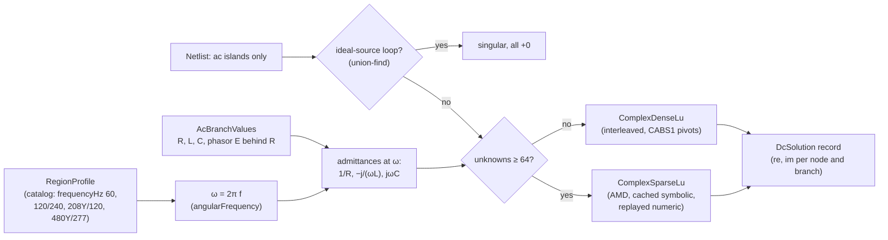

- **Order of solves.** `AcSolver` writes only `ac` islands and leaves every other island's entries in `out` as they are, so the engine (F2.3a) runs `DcSolver.solve` then `AcSolver.solve` into one record (`DcSolver` zeroes every island it doesn't solve). `mixed` islands are solved by neither: they stay a diagnostic, since P2 has no converters.
- **Values** (`mna/ac-values.ts`): `AcBranchValues` holds per branch a stamp (`resistor`, `inductor`, `capacitor` on a `resistor` element; `vsource` on a `vsource` element), R, L, C and the EMF phasor. `vsourcePolar(branch, rms, angle, ohms)` takes the angle from `phasorUnit`. Inductance and capacitance are **stamp modes, not element kinds**: F2.1's `ElementKind` and `topologyHash` are unchanged, and every passive stamp has the same four-entry pattern. `acBranchValues(netlist, hook?)` fills `ac` islands from a hook, else `AC_DEFAULT_VALUES` (a lead's resistance). There is no AC current source yet (caveats).
- **Angles** (`mna/phasor.ts`): 0°, 180° and ±120° only, from exact constants (cos 120° = −0.5, sin 120° = `Math.sqrt(3) / 2`, decision D6). ω = `2 * Math.PI * f`, two correctly rounded products.
- **Singular is structural, as in DC.** With M = [[Y, B], [−Bᵀ, R]], Re(xᴴMx) = Vᴴ Re(Y) V + Iᴴ R I: the incidence terms only add an imaginary part, and an inductor's or capacitor's admittance is purely imaginary. gmin on every node makes it positive unless current circulates in zero-ohm sources only. So an island is singular exactly when its ideal sources close a loop, and the same union-find decides it. An L–C pair at resonance is ill-conditioned, not singular.
- **No floating components.** Every AC stamp conducts, so an island is one conductive component holding its reference; the DC solver's pinning isn't needed.

### Complex LU, not the real 2n system

The equivalent real system [[Re, −Im], [Im, Re]] of order 2n has the same solution and could reuse `DenseLu` and `SparseLu` unchanged. It was measured and rejected:

| n (complex) | `ComplexDenseLu` | `DenseLu` on the 2n system |
| ----------- | ---------------- | -------------------------- |
| 16          | 4.1 µs           | 25 µs (6.1×)               |
| 32          | 23 µs            | 94 µs (4.1×)               |
| 64          | 164 µs           | 689 µs (4.2×)              |
| 128         | 1.27 ms          | 5.33 ms (4.2×)             |

(Node 24, AMD Ryzen 5 5600X, factor and solve, median of 7.) It stores 4n² numbers instead of 2n², does twice the real flops (16n³/3 against 8n³/3), and its partial pivoting is free to pick a real row that splits a complex entry's pair, so its rounding isn't a complex factorisation's. Sparse, it would quadruple the pattern.

- **`ComplexDenseLu`** (`lu/complex-dense-lu.ts`): interleaved row-major storage, partial pivoting by CABS1 (|re| + |im|, LAPACK's choice for complex pivoting: no square root, within √2 of the modulus), the lowest row on a tie. Each pivot's reciprocal is computed once by Smith's algorithm (1962), which never forms |p|², and reused by the back substitution.
- **`ComplexSparseLu`** (`lu/complex-sparse-lu.ts`): the real sparse LU's algorithm with complex values. The pattern work is shared: the CSC pattern, `sparseReach` (the depth-first search, factored out of `sparse-lu.ts`), AMD, `buildSymbolic` (now in `mna/shared.ts`) and the generic `FactorisationCache<ComplexSparseFactors>`. Replay works as in DC: the last pivot sequence is reused only when the full pivot rule picks it again.
- **The stamp program** records value codes (gmin, ±1, the source's R, ±y), never values. Each solve recomputes every admittance from its own ω and values before assembly, so a cached factorisation can't carry a frequency or a value into another solve (planted faults prove both). The cache signature is each branch's pattern class (passive or source), so changing a resistor into an inductor is a hit.

### The crossover

The same shape as DC (vitest, Node 24, plant-like single islands):

| Unknowns | Dense   | Sparse, warm | Sparse, cold |
| -------- | ------- | ------------ | ------------ |
| 19       | 14 µs   | 16 µs        | 72 µs        |
| 31       | 13 µs   | 8.3 µs       | 99 µs        |
| 48       | 29 µs   | 12 µs        | 86 µs        |
| 111      | 193 µs  | 27 µs        | 222 µs       |
| 237      | 1.30 ms | 84 µs        | 632 µs       |

Warm sparse wins from about 30 unknowns, cold from about 120, so `SPARSE_MIN_UNKNOWNS` (64) is shared by both solvers.

### Tests (part 2)

The floor policy (plan F2.2) with complex magnitudes, in `src/testing/ac.ts`: KCL at every node within `1e-9 · max|I| + 1e-12 A` plus the island's Σ 2 · 16 ε |y_b| (|V_a| + |V_b|) (a source behind R > 0 counting as y = 1 / R, with |E| added to its voltages, as in DC since #51) and the source-row term; each source row Vb − Va + R I = E; each passive element's law I = y (Va − Vb).

- **Goldens** (`testing/ac-goldens.ts`, both paths), each with its derivation in the fixture:
  - series RL at 60 Hz: 120 V into 10 Ω + 50 mH, I = 5.6238 A lagging 62.05°, P = 316.27 W, Q = 596.16 var;
  - unbalanced 120/240 V split-phase with a 0.05 Ω service neutral: the neutral carries the **phasor** sum of the line currents, 7.153 A, where the magnitudes differ by 1.29 A;
  - balanced 208Y/120 V wye of 8 + j6 Ω: 12 A per phase, the neutral about 0 (under 1e-9 A), |V_A − V_B| = 120√3.
- **Properties** (`mna/ac-properties.spec.ts`): KCL, source rows and element laws; real power balance (sources against R and gmin); reactive power bookkeeping (sources against Σ ωL|I|² − Σ |I|²/(ωC)), both within 1e-9 of their terms (apparent power for a source) plus the Tellegen floor; linearity bit for bit for k = 0, ±2^m and ±j·2^m (a quarter turn only swaps and negates parts), in residual space for other k (including the exact 120° rotation) and for superposition; singular ⇔ an ideal-source loop; bit identity across solvers, frequencies solved in between and a dirty `out`; a frequency change is an input, not state; a pinned SHA-256 over 300 seeded dense solves, and a generator-health ceiling on floor / max|I|.
- **Dense against sparse** (`mna/ac-sparse.spec.ts`): residuals on every circuit (40–260 nodes, and 2–24 forced sparse); values on the well-conditioned subset (a resistive 1 Ω–10 kΩ spanning tree, impedances of 1 Ω–10 kΩ, sources behind ≥ 0.1 Ω: Re(Y) stays definite, which bounds ‖M⁻¹‖ however the reactances cancel); warm equals cold across frequency and value changes; the cache round trip; the `topologyHash` tripwire; and a pinned SHA-256 over 40 seeded large sparse solves.
- **LU** (`lu/complex-lu.spec.ts`): backward stability on random complex systems, dense against sparse, exact scaling by j, bit-identical reuse and replay, fallbacks, the singular contract and a 20 000-long chain.
- **The AC oracle** (`oracle/ac-oracle.spec.ts`), on both paths: below.
- **Generator health** floors, and 12 planted faults, all killed (listed in the PR).

## The engine loop (F2.3a)

`SimEngine` (`sim-core` `engine/`) is the sim clock: it follows a world bus deterministically ([ADR 0011](../decisions/0011-sim-worker-contract.md) §2–§4, §9.6). The same engine is the scripting API's time host headless (`sim-cli`, every domain test) and runs in the sim worker ([below](#the-sim-worker-and-snapshot-transport-f23b)). Since F2.3b it also builds the topology descriptor of each generation (`topologyDescriptor()`) and encodes snapshots into the worker's slots (`encodeInto`).

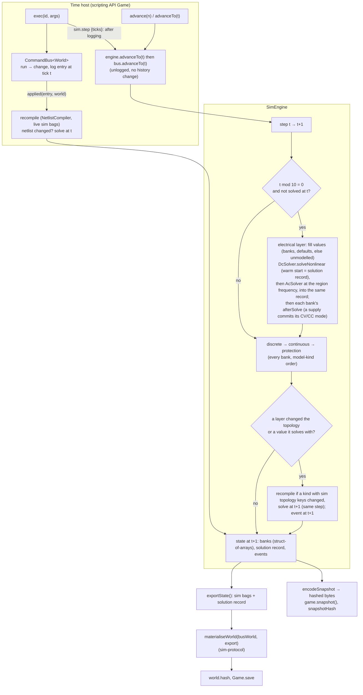

**Time.** Ticks are integers, 1 tick = 1 ms (`TICK_S`). The state at tick T is the state after every command logged at T, before step T's cadence solve. `advanceTo(target)` runs steps T … target − 1. The electrical layer runs at every multiple of `SOLVE_INTERVAL_TICKS` (10, absolute ticks) that nothing has solved at yet, after any command that changes the netlist (topology or a value: a move solves nothing), and in the same step as a layer's topology change (a fuse blowing at step t is solved at t + 1, before the state at t + 1 is observable). Every solve is a pure function of the netlist, the banks' values and the warm start, which is the solution record itself.

**Commands and time.** `CommandBus.advanceTo(tick)` moves the bus's state without logging, taking a `seq` or touching the history (ADR 0011 §3). `replayEntries(bus, entries, { time, endTick })` advances the time host and the bus to each entry's tick, runs it, calls `time.applied(entry, state)`, and finally advances to `endTick`; an earlier tick is still `tick-mismatch`. In the scripting API, `Game.exec` hands every logged entry to the engine and carries out `sim.step` by advancing once it is logged; on replay a step moves nothing, and the next entry's tick (or `endTick`) carries its effect. `sim.setSpeed` and `sim.resume` are no-ops headless (pacing is F2.3b's).

**Device models are banks** (`SimDeviceModel` in `engine/device-model.ts`). For each model kind with netlisted devices the engine builds one bank: preallocated struct-of-arrays state, plus optional hooks: a DC value per branch, the outer loop's per-iteration value, the discrete, continuous and protection layers (each over the whole bank, so a tick makes no per-device calls or allocations) and an output record. Banks are rebuilt at every topology change, because branch indices move, from each device's **sim bag**, which must therefore hold every value that affects the future. A device that leaves keeps its bag as a **tombstone** if its id can't be reused (it was deleted: undoing the delete restores a blown fuse blown) and drops it if its `entity.place` was undone. Per-device randomness (a tolerance) comes only from `deriveStream(world.seed, entityStreamKey(id))`. Since F2.4 the battery and the supplies have banks, and since F2.5 the lamp, resistor and heater, the fuse and the breaker (below). A branch nothing can value leaves its island **unmodelled** (engines 3 and 4 did this to every lamp): solved with a placeholder only to keep the solver going, then zeroed and recorded with 0 iterations. Two hooks came with F2.4: `afterSolve(ctx, values)`, called after every solve with exactly the values it was solved with, commits state the solve decided (a supply's CV/CC mode) before anything reads it; and a layer that returns `true` gets a re-solve within the step even when only a value changed (a PSU switching its output off), not only on a topology change. `LayerContext.islandStatus` gives a record its island's status.

**Honest results.** `islands()` gives each island's status: `solved`, `singular`, `nonConverged`, `unmodelled` or `mixed`; only `solved` values are readings, and the status follows from the netlist and the solution record alone, so a loaded engine says the same. `probe(a, b)` (ideal, non-loading) returns DC volts V(a) − V(b) on a solved DC island, and on an AC island the phasor V(a) − V(b) with its RMS magnitude (`rmsVolts`, what a meter shows by default) at the region frequency, `floating` for terminals on different islands (never a difference of two references), and `singular`, `unsettled` or `unsolved` otherwise. Island flags raise `singular` and `nonConverged` sim events on their rising edge; across a topology change a flag rises only if none of the island's entities was in an island with it before. Layer events (`blown`, …) are stamped at the end of their step.

**AC islands** (since #51's phasor solver): every solve runs `DcSolver.solveNonlinear`, which zeroes the islands it doesn't solve, then `AcSolver.solve` into the same record, which writes only `ac` islands, at `regionProfile(world.regionId).frequencyHz` (60 Hz for NEC; the world's `regionId` is the region). A bank's `acValue` gives an AC branch's phasor value, else `AC_DEFAULT_VALUES` (a lead's resistance), else the island is unmodelled, as in DC. AC islands are linear in P2 (no outer loop). A phase angle needs `atan2`, which D6 keeps out of `sim-core`: the engine's probe returns the phasor and its magnitude, and the scripting API adds a display-only `phaseDeg` that never reaches a snapshot, a save or `world.hash`. Mixed islands stay unsolved (no converters in P2).

**State and saves.** `exportState()` is every netlisted device's whole sim bag plus the solution record (`null` for an empty netlist). `materialiseWorld` (`sim-protocol`) writes exactly those bags and `WorldV2.sim` into the bus world; everything else is the bus world's. `SimEngine.start(world)` continues from a materialised world: with `sim: null` it solves at the world's tick, with a record it checks `topologyHash` and the sizes against the compiled netlist and adopts it, or throws `SimStartError` (`start-failed`), never re-solving silently. A save at any tick, loaded and run on, equals the uninterrupted run (a property, step by step, through JSON and through `.ctrl` bytes).

**The snapshot** (`sim-protocol`, ADR 0011 §5): `encodeSnapshot` writes one slot from the engine's preallocated arrays with little-endian `DataView` stores, every reserved byte zero; the hashed region is bytes 8 onwards (the tick, the counts, the flags, the raw topology hash, then nodes, branches, islands and device records). `game.snapshot()` returns those bytes, `snapshotHash` their SHA-256. An unsolved island's entry has 0 iterations, 0 unknowns and no reference node. Device records are written from the bags and the solution, never from per-step caches, so a snapshot is a pure function of the export. The seqlock transport, the descriptor and `SnapshotView` are in [the sim worker](#the-sim-worker-and-snapshot-transport-f23b) below.

**Load and D8.** `engineCompatible(manifest, build)` decides whether a save's log is verified: the same engine and catalogue verify; a migrated P1 save (both 0) verifies but restarts as `engine-changed` on failure; any other mismatch restarts as `engine-changed` without replaying. `SIM_ENGINE_VERSION` became 3 when this feature materialised the solution record (2 was #51's sparse pivoting), 4 with F2.4's sources, and is 5 since F2.5's lamp.

**Measured** (built bundle, AMD Ryzen 5 5600X, Node 24): one step of the layers (`tick-device-mix`, gated at §4.5's 0.3 ms) took about 0.015 ms median on F2.3a's 750 synthetic devices; on the real catalogue devices since F2.5 part 2 (1,000 devices: battery, fuse, breaker and lamp loops; [the bench](#the-bench-f27)) it takes about 0.053 ms.

## Power sources (F2.4)

`sim-core` `devices/` holds the built-in device models (`BUILTIN_DEVICE_MODELS`); `devices/sources/` has the battery, the bench supply and the DIN-rail PSU. Each is a netlist model (what the compiler needs: one `vsource` element from `neg` to `pos`, `devices/sources/netlist-models.ts`, registered in `netlist/models.ts`) plus an engine bank. Catalogue entries are in `content/devices/` (`battery.ferrovane-12v-7ah`, `supply.brindlecore-bench-30v-5a`, `supply.railwick-din-24v-5a`), their kinds in `MODEL_KINDS`.

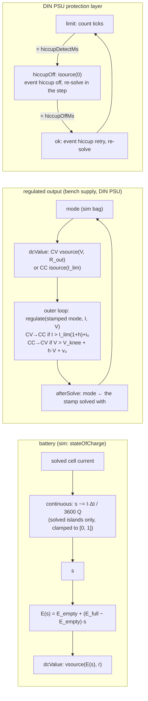

**The battery.** The EMF is the rested open-circuit voltage, linear in the state of charge between the catalogue's empty and full values (11.8 V and 12.9 V; the lead-acid open-circuit voltage tracks the electrolyte's specific gravity, which falls about linearly with charge), behind its constant internal resistance. The continuous layer coulomb-counts the cell's solved current each tick into `stateOfCharge` (its only sim key, unchanged since catalogue v1, so no `schemaVersion` bump). The nominal-EMF placeholder is gone: `DC_DEFAULT_VALUES.battery` is now the full-charge EMF (a new battery, for raw solver callers with no engine model), and the DC goldens set their 12 V test EMF through their own hook. **It never creates energy** (realism review): below 2 % the EMF collapses linearly to 0 V at empty, and charging it is a piecewise-linear cell (discharge EMF E(s); charge EMF rising from E(s) at 80 % to the 14.4 V gassing voltage at full; no current in between), its segment chosen by an `iterate` hook from the iterate's terminal voltage, so a full battery on a float charger settles at no current. The abstractions (constant r; no Peukert or temperature effect, so capacity optimistic by about 20 % at C/5, 40 % at C/2 and roughly 70 % at 1C; 100 % charge efficiency; a straight-line charge curve with no overpotential, so a 13.8 V float charges to about 93 % and overcharge is limited by r alone) are in the simulation caveats.

**CV/CC regulation** (`regulator.ts`). A regulated output is a `vsource` element stamped CV (setpoint behind the output resistance, from the class's load-regulation figure: 1 mΩ for the bench supply, 48 mΩ for the DIN PSU) or CC (`isource` at the limit). The mode is a discrete choice in the outer loop, from the iterate and the mode it was solved in (the branch's stamp), with a 0.1 % hysteresis band (`CV_CC_HYSTERESIS`, plus 1 µA and 1 µV floors) either way, so a load at the crossover never chatters. Crossover is at R_load = V / I − R_out. After the solve, `afterSolve` commits the mode into the bank, so the `sim` bag, a save and the record agree with the solution. Because the output resistance is never 0, supplies paralleled in CV are a resistive loop that the loop settles (one limits), never `singular`.

**The bench supply** (`supply.bench`): commanded `setpointV`, `currentLimitA` and `outputOn` (`device.operate`; the catalogue controls bound them to 0–30 V and 0–5 A) reach the solver as the output element's netlist values, so a setting change keeps `topologyHash` and is re-solved at the command's tick. Off is an open circuit (`isource(0)`), and the mode resets to CV.

**The DIN PSU** (`supply.dinPsu`): 24 V behind 48 mΩ, a 6 A limit, and hiccup mode in the protection layer: `hiccupDetectMs` (100) ticks in limit switch the output off (`hiccupOff`, an open circuit) for `hiccupOffMs` (1000) ticks, then it retries. The off and retry re-solve within their step, so a short hiccups with a period of exactly 1100 ticks; `mode` and `phaseTicks` are in the `sim` bag, so a save mid-hiccup resumes the same period.

**Records and the validity rule** (ADR 0011 §5.4, amended): each source publishes a record ending in `u8 status` (`unsolved`, `solved`, `unsettled`, `singular`). Solved quantities (terminal voltage, current) are written only on a solved island and are 0 otherwise; the device's own state (EMF, state of charge, mode) is always written. A `nonConverged` island's supply is `unsettled`, never a steady reading. The schemas are `BUILTIN_DEVICE_OUTPUTS`; registering them in `sim-protocol` is F2.3b's.

**AC services** (`ac-source.ts`, headless in P2). `utility.splitPhase` (120/240 V: windings N→L1 at 0° and N→L2 at 180°), `utility.threePhase` (208Y/120 V or 480Y/277 V by catalogue entry: N→L1, L2, L3 at 0°, −120°, +120°) and the `generator.portable` stub (split-phase, nameplate impedance, no dynamics; no catalogue entry, so not placeable). L1, L2, (L3) and N are separate nodes; N is the island's reference. Each winding is a phasor source behind R + jωL, derived from kVA and %Z on the source's own base (Z_base = V_LL²/S, |Z| = %Z · Z_base, R = |Z|/√(1 + (X/R)²), X = R · X/R, only `Math.sqrt`), with V_LL = √3 · V_LN for wye (never the 208 or 480 name) and 2 · V_LN split-phase; each split-phase half takes half the full winding's impedance (so L–N and L–L bolted faults are equal here, an abstraction). This needed the AC solver's one new stamp value: **a source's series inductance** (`AcBranchValues.vsource(…, ohms, henries)`; Z = R + jωL on the source row's diagonal, value code `VALUE_Z`; R > 0 is required with L, so "singular ⇔ a loop of zero-ohm sources" stays structural), with the oracle corpus extended to match (ADR 0012, amended) and a new engine hook, `SimDevice.frequencyHz` (L = X/ω at the region frequency). The services publish no record yet. `RegionProfile.voltageRanges` adds ANSI C84.1's Range A and B service and utilization bands, as fractions of nominal.

**Placeable.** The renderer draws the three with procedural recipes (`libs/rendering/renderer` `geometry/devices.ts`): one merged geometry per kind with a group per material slot, sized and with terminals from the catalogue entry, the fictional brand and model as the label (rendering caveats).

**Saves.** Loads check each control's value against its catalogue range (`invalid-device-state`); `fixtures/v2/ctrl/sources-engine-4.ctrl` (the sources scenario: a DIN PSU mid-hiccup, a bench supply in CC, a discharged battery) loads as `continued` and the PSU retries at the uninterrupted run's tick; a save from another engine loads its devices' bags but solves again at the save's tick.

**Tests.** Goldens with their hand calculations: terminal voltage = E − I·r (to 1e-9), the state of charge over a minute (sim-core) and over one hour against ∫I dt and the closed form (`apps/sim-cli/src/battery-hour.spec.ts`, outside coverage instrumentation), CV and CC values, the crossover at V/I ± 0.5 % from fresh starts, the hiccup's event ticks. Properties: never past either setpoint beyond the band, over random setpoints and load histories (with a fixed-seed health floor); F2.4's own session arbitrary (`devices/sources/properties.spec.ts`: a hiccuping DIN PSU, a bench supply in CC, a discharging battery, random operations and advances up to 2,500 ticks) with its save-and-load, replay and at-cut and after-cut health tests, beside the engine sessions' F2.3a mix; reload goldens mid-hiccup and inside the hysteresis band; the sources scenario pinned in Node and Chromium (D6); allocation gates for the DIN PSU regulating and shorted. No chatter: 100 cadence solves at the crossover, a sweep up and down crossing once each way a band apart, and a self-heating lamp-like load that pulls a supply into CC and lets it back to CV once.

## The sim worker and snapshot transport (F2.3b)

The engine runs in a module Web Worker (`@controls/sim-worker`, `type:worker`); the page reads its output from a `SharedArrayBuffer` (ADR 0011 §4–§8). The main thread owns the bus, `seq` and the clock, and the worker follows it: `SimWorkerRunner` (`runner.ts`) is the inbox and run loop, `SnapshotWriter` and `SnapshotReader` (`@controls/sim-protocol`) are the two ends of the seqlock, and the message schemas (`messages.ts`) are parsed on receipt at both ends.

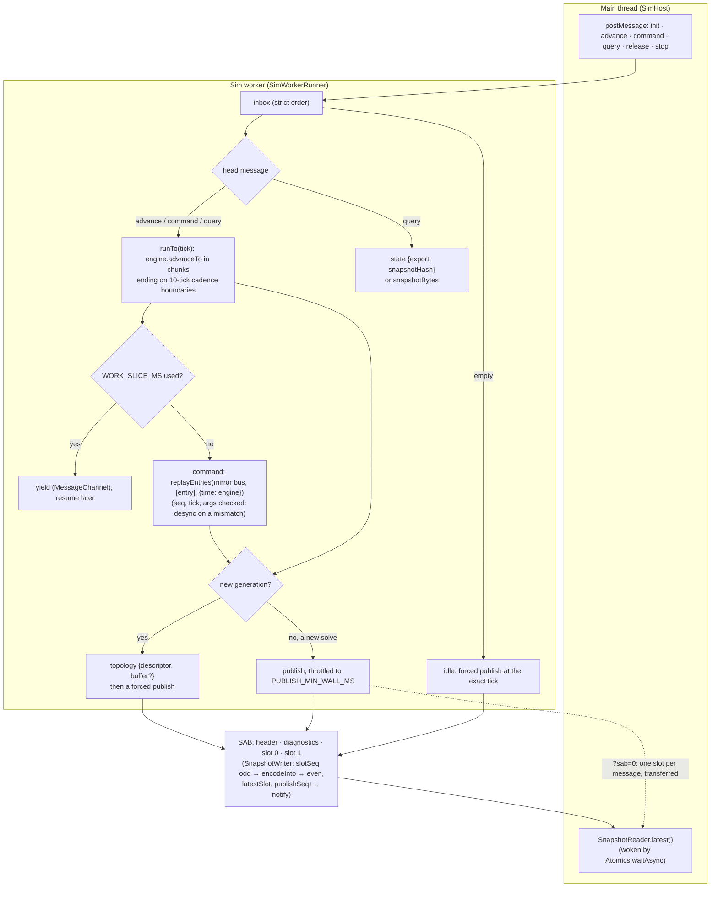

- **Starting.** The first message must be `init`, and its `protocol` is checked before anything else is parsed: another version is `error {code: 'protocol-mismatch'}` and the worker says nothing more. A big-endian platform, or a world whose solution record doesn't fit its netlist, is `start-failed`. The transport is `sab` only when `init` asks for it and the worker's own scope is `crossOriginIsolated` with `SharedArrayBuffer`; otherwise `message`. The worker replies `ready`, the first descriptor and a snapshot at the start tick.
- **A replay start** (`{kind: 'replay', log}`: load verification and the crash restart) starts the engine on the log's initial world and queues every entry, then an `advance` to `endTick`, through the same inbox as live commands. So it is sliced and published the same way, and its sim events (history, not news) are dropped.
- **The mirror bus** is a world bus on the same catalogue; each `command` is run through `replayEntries(bus, [entry], {time: engine})`, so its `seq`, tick and logged args are checked exactly as a replay checks them, and the engine applies it at its tick. Any refusal is `desync`.
- **Order.** Messages are handled strictly in order: a command or a query whose tick is ahead of the engine first runs the engine to it; one behind it is `desync`. A `query` is answered only after every earlier message, so a `state` export is always at the query's tick. `release`, `watch`, `unwatch` and `stop` are handled on receipt (they don't depend on the engine's progress).
- **Publishing** (§7): after a solve, throttled to one per `PUBLISH_MIN_WALL_MS` (4 ms) of worker wall time; unthrottled on a new generation (after its `topology` message) and when the inbox empties (the idle publish, so a paused sim shows its exact tick). Events go out just before the publish that follows them. Slots are sized for twice the first topology with minimums; a generation that outgrows them gets a new buffer in its `topology` message, and one over `MAX_SLOT_BYTES` is `capacity`.
- **The fallback** (`?sab=0`, or no isolation) encodes each publish into one of three pooled `ArrayBuffer`s with the same `encodeInto` and transfers it; the host copies it like a shared slot and sends it back with `release`. With none free, a throttled publish is skipped and a forced one waits for a buffer.
- **Wall time** reaches only `pacing/worker-clock.ts` (the lint exemption): the slice, the throttle and the diagnostics area (§5.6, written under its own seqlock, shared mode only). The engine sees integer ticks only, and the bytes of a tick's snapshot never depend on which ticks were published.
- **The reader** (`SnapshotReader`) copies the latest complete slot into a private, double-buffered copy: a read is one `set()` and a few `Atomics.load`s, retried up to `MAX_READ_ATTEMPTS` per slot when the slot's sequence word is odd or changed, then the previous slot, else a counted miss. A slot whose generation has no descriptor yet is held back (`awaitingDescriptor`) until the `topology` message arrives; the view the listeners hold is never touched by a rejected copy. `latest()` returns the same `SnapshotView` every time.
- **`islandStatus(kind, flags, iterations)`** (`sim-protocol`) is the one rule for whether an island's values are a reading (`solved`, `singular`, `nonConverged`, `unmodelled`, `mixed`); `SimEngine.islands()` uses it, so a status read from a snapshot always agrees with the engine's.
- **Tests:** `transport.spec.ts` (round trip, a torn read retried with a simulated writer that laps the reader mid-copy and with a real writer thread, the generation join, fallback bytes identical), `runner.spec.ts` (the protocol check, both starts, desync, ordered queries, slicing, throttled and forced publishes, buffer growth, the starved pool, and a property: the worker's snapshot bytes and materialised hash equal the headless `Game`'s after any session, either transport, any slicing).

### `SimHost`: the main thread's side (F2.3b part 2)

`SimHost` (`feature-session`) is the game's `TimeHost`: `Session` creates every game with `createGame({ world, time: simHost.time })`, so no engine runs on the main thread. It owns one `SimLink` per worker (its messages, its `SnapshotReader`, its pending queries and its `Atomics.waitAsync` waiter), the pacing loop and the panel-rate signals.

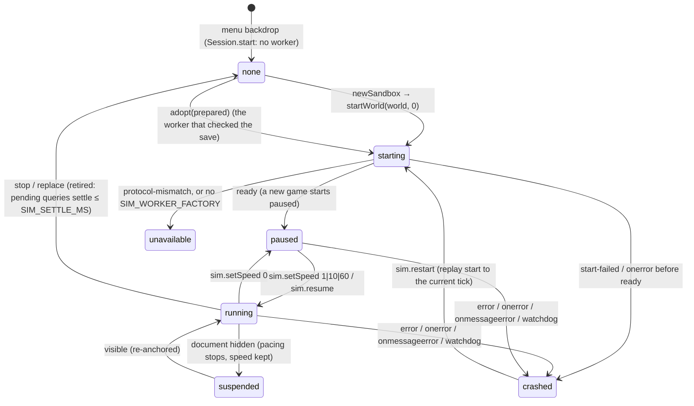

- **Forwarding.** `time.applied(entry)` posts every logged entry (`sim.setSpeed` and `sim.resume` also set the requested speed); `time.advanceTo(tick)` posts an `advance` when the bus moves past the last one. Both come from `Game.exec`, `sim.step` and the host's own pacing, so the worker sees them in the order main produced them.
- **Pacing** runs on a `SIM_CLOCK` timer every `PACE_INTERVAL_MS`: `Pacer.target(now, progress, busTick)` gives the integer tick, and `Session`'s binding advances the game to it (which posts the advance). An advance the host didn't make (a `sim.step`) re-anchors, so time doesn't jump when the worker catches up. `SpeedMeter` gives the effective speed and "falling behind". The loop also runs while the commanded tick is ahead of progress at speed 0, for the watchdog and the catch-up signals; it stops while hidden or held.
- **Reading.** Shared mode wakes on `Atomics.waitAsync(publishSeq)` and re-arms after each read (not while a descriptor is awaited; the `topology` message triggers that read); the fallback reads on each `snapshot` message and sends the buffer back. Listeners get every accepted view, `null` on a reset; `select()` samples for panels at most `PANEL_SAMPLE_HZ` with a trailing sample, resets on a new generation and goes `stale` on a crash.
- **Queries.** `capture()` takes the bus world at T and posts `state` at T in the same call; `hashAt()` and `Session.saver()` materialise the reply into that world. Queries time out after `STATE_QUERY_TIMEOUT_MS`; replacing a worker retires it, letting pending queries settle for up to `SIM_SETTLE_MS` before they are `superseded`.
- **Loads** (`Session.prepareLoad`) start a candidate worker that isn't the game's until `adopt` promotes it: a replay start to verify, or a world start from `world.json`, and the materialised hash it answers is the dirty model's baseline.
- **Crashes** terminate the worker, stop pacing, reset readers and raise `onCrash` (the app's toast with **Restart simulation**, which runs `sim.restart`: a replay start of the session's log to the current tick, resuming paused). The world and the log are untouched; saves are refused until then.

## First loads (F2.5)

`sim-core` `devices/loads/` holds the incandescent lamp (`lamp.ts`, with tungsten's resistivity in `tungsten.ts`), the resistor and the heater (`resistive.ts`). Their netlist models are one `resistor` element each; catalogue entries are `lamp.lumivane-12v-5w`, `resistor.orrinwood-10r-10w` and `heater.hearthvale-12v-50w`.

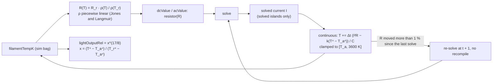

**The lamp.** The filament's resistance is its rated (hot) resistance, R_r = V_r² / P_r, scaled by tungsten's resistivity at its temperature over the resistivity at the rated temperature, so the rated point is exact and the cold resistance follows from the material (28.8 Ω hot and 1.95 Ω at 20 °C for the bench lamp, 14.8:1). The resistivity table is a subset of Jones and Langmuir's 1927 measurements, linear between points and looked up by bucket, without a loop. The temperature, the lamp's only sim key (`filamentTempK`), follows C dT/dt = I²R(T) − k(T⁴ − T_a⁴): k from the rated point (so T_r is the steady state at rated power) and C = 4kT_r³τ from the catalogue's thermal time constant (`thermalTimeConstantMs`, 50 ms; `filamentRatedTempK` 2700 K). Explicit Euler at the 1 ms tick is stable here (Δt / τ = 0.02). **Inrush emerges**: the first solve after the switch closes draws 14.3× the settled current on the bench, inside the sourced 10–15× band, and the current halves within 2 ms and settles within about 200 ms.

**Light output.** `lightOutputRel` = x^(17/8), where x is the power the filament radiates over the rated radiated power, a function of its temperature alone; the exponent comes from Fink and Beaty's L ∝ V^3.4 and P ∝ V^1.6. It is 1 at the rated point and 0 at ambient, and computed as x² · ⁸√x with three `Math.sqrt`s (D6). So the light is dark during the cold inrush and fades as the filament cools.

**Re-solving within the step.** Between the 10-tick cadence solves the layers integrate against the last solution, which goes stale while a cold filament heats. A continuous layer may now return `true` (`SimDeviceBank.continuous`): the engine then re-solves at t + 1, within the step and without a recompile, and counts it in `stats.continuousSolves`. The lamp returns `true` when R(T) has moved more than 1 % (`LAMP_RESOLVE_RELTOL`) from the resistance the last solve saw, read back from the solution as |ΔV| / |I|, never cached, so a loaded engine re-solves at the same ticks; a lamp carrying under 1 µA (`LAMP_RESOLVE_MIN_A`) never asks. A bench lamp's warm-up takes about 270 such solves, then none.

**Validity.** The filament moves only on a solved island; on any other it is frozen, and its record says so. `LAMP_OUTPUT` holds `powerW`, `currentA` and `voltageV` (solved, RMS magnitudes on an AC island), then `resistanceOhm`, `filamentTempK` and `lightOutputRel` (its own state, always written) and `status`. A reader shows a lamp that isn't `solved` as unknown or unsettled, never as a dark lamp drawing 0 W.

**The resistor and heater** have no sim state; their banks only publish records. The resistor (`resistanceOhm`, `powerRatingW`) publishes `overRated`, a solved flag for I²R above the rating, with no damage model. The heater is R = V_r² / P_r, constant (a nickel-chromium element's resistance moves only a few percent from cold to hot). Both have `DC_DEFAULT_VALUES` and `AC_DEFAULT_VALUES` entries, so a solver run with no engine model gives the same answer.

**Reading a record.** The records are in `sim-protocol`'s `DEVICE_OUTPUT_SCHEMAS` (protocol 4), so the worker's descriptor carries them. The game reads them from each snapshot: the viewport's `LampSnapshotFeed` resolves every lamp's `lightOutputRel` and `status` once per topology generation (`DescriptorIndex.of(view.descriptor).field(id, name, 'lamp.incandescent')`) and reads them with one `readAll` per snapshot, allocating nothing; a `null` view (a source reset) leaves every lamp unknown. Headless, `SimEngine.deviceRecord(entity)` decodes one device's whole record with `sim-protocol`'s `decodeDeviceRecord` (enums by name), the one record decoder; the scripting API exposes it as `game.device(id)`. It allocates, so it is for scripts and tests, never the per-tick path.

**Operating a switch.** `device.operate` gained a binding, `device.operate.selection` (E by default, when the viewport is focused and the selection has a toggle). Its id, control and value are context arguments from `selection.entityId`, `selection.toggleControl` and `selection.toggleValue`, which the viewport publishes from `selectionToggle(world, id)`: the selected device's first toggle control and its opposite, from the **commanded** state only. A double-click on the canvas runs the same command. Either way the log holds one concrete `device.operate {id, control, value}`, as the palette, the console and a script do.

**The bench demo** (`apps/sim-cli/scenarios/bench-lamp.{console,ts}`): a battery, a switch and a lamp joined by three leads; closing the switch for 1.5 s lights the lamp (about 2770 K, `lightOutputRel` about 1.25, since the full battery is above the lamp's 12 V rating, within 4 % of (V / 12)^3.4), and opening it for 0.5 s leaves its light under one display step. Its hashes are the Node-vs-Chromium golden (D6), and `fixtures/v2/ctrl/bench-lamp-engine-5.ctrl` is its save.

**Abstractions** (for `electrical-realism-reviewer`; detail in the caveats): constant emissivity and heat capacity, no conduction loss to the supports, no burnout (clamped at 3600 K), and a constant-resistance heater. No transcendental was needed, so `dmath` and ADR 0014 wait for the first real one.

## Protection (F2.5 part 2)

`sim-core` `devices/protection/` holds the cartridge fuse (`fuse.ts`) and the single-pole thermal-magnetic breaker (`breaker.ts`), with their netlist models (`netlist-models.ts`). Closed, each is one `resistor` branch (the fuse's link resistance, the breaker's contact resistance; `DC_DEFAULT_VALUES` and `AC_DEFAULT_VALUES` value it); open, it has no element. Catalogue entries are `fuse.emberlyn-5x20-fa-1a` (1 A fast-acting 5 × 20 mm, melting I²t 0.7 A²s, I_min 1.2 A, 0.1 Ω) and `breaker.saltmere-1p-15a` (15 A, τ 60 s, k_u 1.25, magnetic 8–12 × I_n, 10 mΩ), in the new `protection` category. The fuse's entry also has `elementFraction` 0.3 and `bodyTimeConstantS` 10 s (game-design, source `two-body-melt`).

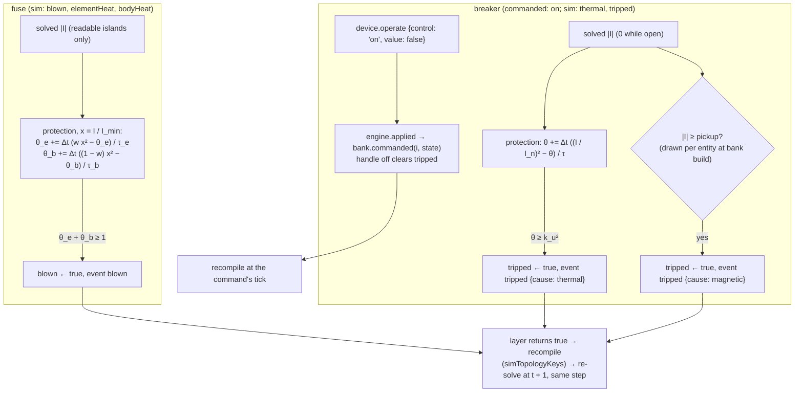

**The fuse: two thermal bodies.** A fast element sits inside a slow body (its end caps and holder). Each temperature rise, in units of the rise that melts the element, is a first-order lag towards its share of a steady rise ∝ I²: with x = I / I_min (I_min = `minimumFusingRatio` × the rating, the minimum fusing current), dθ_e/dt = (w x² − θ_e) / τ_e for the element (`elementHeat`) and dθ_b/dt = ((1 − w) x² − θ_b) / τ_b for the body (`bodyHeat`), with w = `elementFraction` and τ_b = `bodyTimeConstantS`. It melts at θ_e + θ_b ≥ 1, so it never melts below I_min (the steady sum is x²). At large currents both lags are negligible and the fuse melts when ∫I² dt reaches I_min² / (w / τ_e + (1 − w) / τ_b); setting that to the datasheet's melting I²t gives τ_e = w / (I_min² / I²t − (1 − w) / τ_b) (`fuseElementTimeConstantS`; the catalogue refuses parameters that make it negative). For the bench fuse τ_e = 0.151 s, and it melts after 12.05 s at 135 %, 0.908 s at 200 %, 0.1072 s at 300 % and 7.16 ms at 1000 %, and carries 110 % (`protection.spec.ts` computes these figures). The slow body gives the long-overload end the seconds a real fast-acting fuse takes, where a single body melted in under a second. Explicit Euler at the 1 ms tick (Δt / τ_e = 0.0066); a current that takes the sum past 1 in one tick (a bolted short) blows in that tick. Blowing sets `blown`, raises `blown` and returns `true`, so the engine recompiles (`simTopologyKeys: ['blown']`) and re-solves within the step. `blown` and both rises are in the `sim` bag, so a blown fuse stays blown across a save, a reload and an undone delete (the tombstone), and a reload mid-melt blows at the same tick; replacing it means deleting it and placing a new one.

**The breaker.** The handle is commanded (`on`, a toggle control; a new breaker starts off); `thermal` and `tripped` are sim-owned. It conducts only while the handle is on and it hasn't tripped (`simTopologyKeys: ['tripped']`), and the sim never writes `on`. The bimetal follows dθ/dt = ((I / I_n)² − θ) / τ and trips at θ ≥ k_u², k_u the ultimate trip ratio, so the thermal trip time at a constant overload is −τ ln(1 − (k_u I_n / I)²): 116.84 s at 135 %, 29.72 s at 200 %, 3.872 s at 500 %, never at 125 % or below (θ approaches (I / I_n)² from below, so exactly 125 % never reaches k_u²). It cools while open. The magnetic element trips at once above a pickup of I_n (8 + 4u), u the first draw of the entity's seeded stream (`deriveStream(world.seed, entityStreamKey(id)).nextFloat()`, at every bank build): 120 + 60u A for the 15 A breaker, so it is reproducible per entity and seed, the same after a load, and independent for two breakers. A save holding `tripped` with the handle off (which the engine never writes) starts reset. A trip sets `tripped`, raises `tripped` with `{ cause: 'thermal' | 'magnetic' }` and re-solves within the step. The band is manufacturer-style for NEC-region breakers, not IEC 60898; the catalogue's citations paraphrase the UL 489 and UL 248-14 envelopes.

**Resetting: the `commanded` hook.** A tripped breaker resets only when its handle is turned off, and closes when it is turned on again. Commands never read sim state (ADR 0011 §1), so the engine resolves this: `SimEngine.applied` calls `SimDeviceBank.commanded(index, state)` for each netlisted device whose commanded `state` bag the command replaced, before the recompile, so an off and an on at the same tick reset and close the breaker. `SimDevice.state` gives a bank build the commanded bag (the handle). The hook isn't called for a bank build, and it may be called with a bag equal to the last one it saw, so it must be idempotent. Undoing a handle-off after a trip restores the handle, not the trip: the breaker closes and the circuit is live again.

**Records.** `FUSE_OUTPUT`: `currentA` (solved), `meltFraction` (θ_e + θ_b, capped at 1) and `state` (`intact`, `blown`; its own, always) and `status`. `BREAKER_OUTPUT`: `currentA` (solved), `thermalFraction` (θ / k_u²), `magneticPickupA` and `state` (`off`, `on`, `tripped`; its own) and `status`. An open fuse or pole reads `solved` with exactly 0 A, whatever its island. On an island that isn't `solved` (unmodelled, mixed, singular or non-converged: its current is unknown), the fuse's two bodies and the closed breaker's bimetal are frozen, as the lamp's filament is.

**Tests.** Goldens against hand calculations (`devices/protection/protection.spec.ts`); protection sessions with save-and-load parity and replay (`devices/protection/properties.spec.ts`, with generator-health floors), covered by the engine's parity guard through `PROTECTION_SESSION_REFS`; the breaker's 135 % trip (117,000 ticks) in `apps/sim-cli/src/breaker-curve.spec.ts`, outside coverage, like the battery hour; `topologyHash` pins for the fuse and the breaker off and on; allocation gates for a fuse carrying a lit lamp, a closed breaker and a world of every F2.5 kind, and each layer alone (simulation caveats). The protection scenario (`apps/sim-cli/scenarios/protection.console`: a fuse blown by the heater, a part-melted fuse into the resistor, a breaker tripped by a short, `sim.step 2500`) pins `PROTECTION_HASH` and `PROTECTION_SNAPSHOT_HASH` in `apps/sim-cli/src/protection.spec.ts`, with its save `protection-engine-5.ctrl`. No previously pinned hash moved, so `SIM_ENGINE_VERSION` stays 5.

**Abstractions** (for `electrical-realism-reviewer`; detail in the caveats): two lumped bodies for the fuse and one time constant for the breaker, constant resistances, no arcing or clearing I²t, no interrupting or voltage rating, the same magnetic pickup on AC and DC, no ambient compensation.

## The oracle corpus (F2.7)

The solvers are checked against ngspice on a checked-in corpus ([ADR 0012](../decisions/0012-oracle-corpus.md), decision D5). One intermediate representation feeds both sides, so they can't describe different circuits:

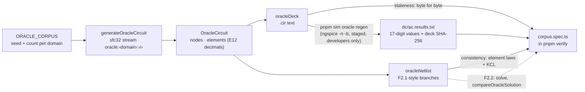

- **Circuits:** 2–30 nodes, one island, node 0 the reference sim-core picks (the negative end of the first voltage source). DC: R, V with internal R, I. AC at 60 Hz: R, L, C, phasor V at 0°, 180°, ±120° from exact constants, half of them behind a series inductance as well (F2.4). A spanning tree plus random chords, then biconnected (current sources ignored), so every element shares a loop with a source: about 99 % of branches carry more than 1e-6 of their circuit's largest current (at least 95 % is checked).
- **Decks:** `.options sparse`, explicit `gmin` resistors on the circuit nodes, a 0 V sense source per element (its current is the branch current), `noopac`, `set numdgt=17`.
- **In `pnpm verify`:** the decks regenerate byte for byte; the results were solved from those decks; ngspice's solution satisfies every element equation and KCL in `oracleNetlist` (about 3e-9 of the circuit's scale, allowed 1e-7). **The DC comparison is on** (`dc-oracle.spec.ts`): each DC circuit is adapted to the solver's input (`oracleDcInput`: a `Netlist` plus `DcBranchValues`, a current source as a `resistor` element stamped `DC_STAMP_ISOURCE`), solved by `DcSolver`, and its values compared at `1e-6·|x_ref| + max(1e-12, 1e-7·max|x_ref|)`, set by ngspice's own noise of about 3e-9; sim-core's own KCL and source-row checks run on the same solution. The worst value uses 1.06e-3 of its allowance (ADR 0012). **The AC comparison is on too** (`ac-oracle.spec.ts`, F2.2 part 2): `oracleAcInput` maps R, L and C to `resistor` elements with their AC stamp and each phasor source to a `vsource` element with its EMF from the exact angle constants; `AcSolver` solves at 60 Hz and every value is compared with complex magnitudes at the same tolerance, with sim-core's own complex KCL and source rows alongside. The worst uses 1.8e-5 of its allowance for volts and 5.0e-4 for amps (ADR 0012), on both the dense and the forced-sparse path.
- `sim-cli`'s `oracle regen` does the file and process work; `sim-core` stays framework-free.

## The bench (F2.7)

`pnpm sim bench` (the Nx `bench` target, in `pnpm verify`, from the built bundle) builds a seeded synthetic plant of exactly 2,000 netlist nodes from P2's catalogue: 8 battery feeders, each a random recursive tree of units (an SPST switch and a lamp, with the return path mirroring the supply tree), about 1 unit in 50 adding a tie lead (a loop) and about 1 switch in 20 open. It times:

| Case                            | What                                                                                                                                                                                                                                       | Budget                                                        |
| ------------------------------- | ------------------------------------------------------------------------------------------------------------------------------------------------------------------------------------------------------------------------------------------ | ------------------------------------------------------------- |
| `plant-compile`                 | A from-scratch `compileNetlist`, as on a load                                                                                                                                                                                              | None in the spec (reported)                                   |
| `plant-recompile-switch`        | One topology change: open a feeder's root switch (an untimed `prepare` closes it first)                                                                                                                                                    | None of its own: part of the re-solve (reported)              |
| `plant-resolve-topology-change` | The same change, then the values and the sparse solve of all 8 islands, with the factorisation cache warm (both states seen)                                                                                                               | 2 ms (spec §4.5) on the reference machine, calibrated (below) |
| `plant-resolve-new-topology`    | The same, with the cache cleared in `prepare`: every symbolic factorisation is rebuilt                                                                                                                                                     | None in the spec (reported)                                   |
| `tick-device-mix`               | One step's discrete, continuous and protection layers on 250 battery–fuse–breaker–lamp loops of real catalogue devices (1,000 devices), at tick 2001 (lamps settled, not a cadence tick), no solve (F2.3a; real devices since F2.5 part 2) | 0.3 ms (spec §4.5), gated                                     |

Each case reports its median and p90 in the JSON. Budgets gate on the median. Nx hides a passing task's output, so the `bench` target also writes the report to `dist/apps/sim-cli/bench-report.json` (`sim bench --report <file>`), and a CI step after `pnpm verify` prints it on every OS. That step only prints, so `verify` still equals CI.

Measured 2026-10-30 on an AMD Ryzen 5 5600X under Node 24: `plant-compile` took 4.2–4.7 ms, and `plant-recompile-switch` 1.2–1.3 ms per topology change (8.5–11 ms and 1.7–2.8 ms with heavy load from other jobs). F2.2 part 3 made the hashing faster (recompile 1.1 ms) and measured the re-solve:

- **1.45–1.49 ms** with a warm cache (p90 2.5 ms);
- **4.5–4.6 ms** for a topology never seen (about 0.37 ms of AMD and pattern building per 250-unknown island).

Alone, the warm case meets the 2 ms budget with 0.5 ms to spare. Beside `pnpm verify`'s parallel test workers it measured 2.3–2.6 ms, and CI runners are slower than this machine. The CI runners measured it at 2.12 ms (Ubuntu), 3.74 ms (macOS) and 4.77 ms (Windows). **Decided 2026-10-31:** optimise the structural recompile (about 75 % of the cost), then gate the case with the 2 ms budget scaled by a calibration loop timed in the same process, so `verify` stays identical to CI. §4.5's 2 ms remains the target on player hardware.

### The recompile optimisation and the calibrated gate (F2.2 part 3b)

The structural recompile after one switch toggle is **0.94 ms, from 1.20 ms** (in-process, interleaved with the old compiler, 5,000 toggles each), with the netlist, `topologyHash` and every golden unchanged. In the built bundle, alternating old and new over 16 runs each under ambient load, the warm re-solve's best median went from 1.50 to 1.21 ms (median of medians 1.78 → 1.36 ms). SHA-256 of the 62 KB encoding is now about a third of it. What changed:

- **No structure list per compile.** The compiler overwrites its previous structure list in place and compares while it writes, instead of building a second list of about 13,700 entries and comparing them after.
- **Connection ends resolved once.** Each connection's cache entry keeps the entity entries its ends resolved to; a recompile looks an end up again only when that entity's entry was rebuilt or the entity is gone (its `epoch` is stale). No per-compile `Map` of placed devices.
- **Members and element refs built once per fragment**, shared by every netlist that reuses it (netlists are read-only).
- **Reused storage:** the union-finds (`UnionFind.reset`), the per-terminal, per-branch and per-island index arrays, and the encoding buffer grow to the largest plant seen and are reused.
- **The encoding is written directly** by `TopologyWriter` (`netlist/encode.ts`) into that buffer, one capacity check per member and per branch; `topologyBytes` stays the reference it is checked against.

Rejected: a local renumber (nodes are numbered canonically by their smallest member, so a split shifts every later node and branch end, ADR 0011 §7); hashing only what changed (SHA-256 is sequential, and every later branch's end nodes change, so a tree hash would move every persisted `topologyHash`); caching each fragment's encoded bytes (0.1 ms saved per recompile, 0.75 ms lost per load).

The gate (`apps/sim-cli/src/bench/bench.ts`, `calibration.ts`):

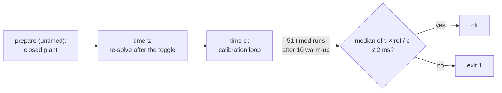

Each timed re-solve is put in the reference machine's milliseconds by the calibration run beside it, so a slower or loaded runner slows both halves of every pair. The calibration loop is a fixed workload sharing no code with sim-core (a scattered float multiply-add, SHA-like integer rounds, short-lived records and a pointer chase, roughly in the re-solve's proportions), and `CALIBRATION_REFERENCE_MS` (0.69 ms) is its median on the reference machine, an AMD Ryzen 5 5600X under Node 24.12.0. The report carries the raw median and `calibration.scale` beside the gated `ratio`. Measured on the reference machine: the gated ratio is 0.50–0.79 under ambient load (31 runs, median 0.67) and 0.43–0.91 beside a saturating parallel test load (32 runs, all passing), and an exact 1.5× slowdown planted in the re-solve fails 25 of 30 runs (a planted triple hash in the compile, about 1.6×, fails 20 of 20). On the CI runners, inside `pnpm verify` on the PR that switched it on, the raw medians were 3.35 ms (Ubuntu), 3.23 ms (macOS) and 3.32 ms (Windows), and the gated ratios 0.76, 0.58 and 0.85. How to re-baseline, and why the pairing: [simulation caveats](../caveats/simulation.md).

## `netlist.dump` (F2.6)

`netlist.dump` is a console query, like `world.hash` (`CONSOLE_QUERIES` in `scripting-api`): never a command, never logged, no hash moves. Its text is `netlistDump(world)` in `sim-core` (`engine/dump.ts`), a **pure function of the materialised world**: it starts a throwaway `SimEngine` on the world, which compiles the same netlist and adopts the same solution record as the engine that exported it, then writes `formatNetlist` and one `solve island` line per island from `SimEngine.islandDiagnostics()`.

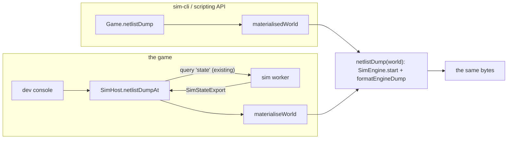

- **No new worker message.** The game reuses the `state` query that `world.hash` and saves use, and dumps on the main thread, so `SIM_PROTOCOL_VERSION` is unchanged (ADR 0011 §9.4 note).
- **Why an island wasn't solved** needs one thing the solution record doesn't hold: which branches no model could value. `islandDiagnostics()` runs the value pass every solve starts with (`fillValues`), which marks them in a per-branch array. The pass only refills the solver's scratch values, so it changes no state, snapshot or hash; a property test takes dumps throughout random sessions and compares every snapshot with an undumped twin.
- **Status** is `islandStatus(kind, flags, iterations)`, as everywhere; `reference` and `unknowns` are what the snapshot's island entry holds (`none`/0 when unsolved); `band` is `NOMINAL_BANDS[band]` (an unknown index prints as `#N`, never a wrong name).

## Not yet

- **AC nonlinear loads**: F2.5's lamp, resistor and heater value AC branches through `acValue` and `AC_DEFAULT_VALUES` (the lamp's R(T) is fixed within a solve); an AC current source, or an AC nonlinear outer loop, would need the DC solver's floating-component pinning and `solveNonlinear` in complex form first.
- **Device models** (F2.5 part 2): the fuse and breaker. F2.4's sources and F2.5's loads have theirs (above).
- **Nominal bands** (`NOMINAL_BANDS`, overlays): only `none`; the sources' records are registered (protocol 3, F2.3b), and the loads' (protocol 4, F2.5).
- **Traces** (F2.6): the worker records `watch`/`unwatch` but sends no `trace` batches yet.
- **Fuse and breaker recipes** (renderer): the fuse and the breaker have engine models but no procedural recipe yet, so they draw as unknown objects.
