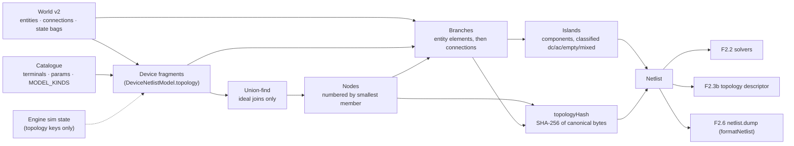
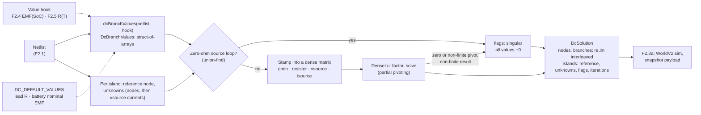
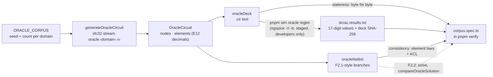

# Simulation

How `@controls/sim-core` turns the as-built world into something a solver can run. This page grows with Phase 2: today it covers the netlist compiler (F2.1) and the dense DC solver (F2.2 part 1). The phasor and sparse solvers (F2.2 parts 2 and 3), the engine loop (F2.3a) and the worker transport (F2.3b, [ADR 0011](../decisions/0011-sim-worker-contract.md)) are added as they land. Gotchas: [simulation caveats](../caveats/simulation.md).

## The netlist compiler (F2.1)

`compileNetlist(world, catalog, options?)` is a pure function from the world document to a `Netlist` of nodes, branches and islands. It reads only what is wired:

- entities, with their catalogue entry's terminals and parameters;
- `world.connections` (test leads; wires from P3);
- each entity's commanded `state` bag (a switch's `closed`);
- the engine's sim-owned topology state (a fuse that blew, a breaker that tripped), passed in by the engine as `options.sim`. The world's own `sim` bags are inert during play ([ADR 0011 §1](../decisions/0011-sim-worker-contract.md#1-ownership-and-threads)), so they are only a fallback, which is correct at a session start or a load.

Positions, orientations, the renderer and prints never enter it. **The simulator runs what is wired, not what is drawn**: a lamp set down touching a battery is its own unpowered island until a lead joins them.

### Fragments and netlist models

Each placed entity contributes a **fragment**: its sorted terminals, the groups of terminals it joins ideally, and its elements. A fragment comes from the model kind's `DeviceNetlistModel.topology({ params, state, sim })` in `DEVICE_NETLIST_MODELS`; a test checks every placed kind in `MODEL_KINDS` has one. The model says only what the netlist needs: which terminals are joined, which elements sit between which terminals, and when. Stamps and electrical behaviour belong to the device models of F2.4 and F2.5.

| Model kind          | Topology                                                                                 |
| ------------------- | ---------------------------------------------------------------------------------------- |
| `battery`           | One `vsource` element `cell`, `neg` → `pos`, a DC source                                 |
| `lamp.incandescent` | One `resistor` element `filament`, `a` → `b`; its value is R(T), computed by F2.5        |
| `switch.spst`       | Closed: an ideal join of `a` and `b`, no element. Open: nothing                          |
| `lead` (connection) | One `resistor` branch, `a` → `b`, from `leadResistanceOhm` at the 20 °C bench (293.15 K) |

A model that changes topology on a sim-owned event lists those keys in `simTopologyKeys` (F2.5's fuse lists `blown`). It is shown only those keys, never the rest of the engine's state. The P2 bench kinds list none.

Absent from the netlist, with a diagnostic where useful: props (silently), entities whose ref the catalogue doesn't know (`unknown-device`), kinds without a netlist model (`no-model`), and connections whose ref is unknown or not a connection kind, or that end on an absent entity or an unknown terminal (`absent-connection`, with a reason).

### Canonical order

Every index is a pure function of the world, never of the edit history. That order is the order of `WorldV2.sim.nodes` and `branches` and of the snapshot payload ([ADR 0013](../decisions/0013-world-document-v2.md)).

- **Terminals** are visited in canonical order: entity id (numerically), then terminal id (UTF-16 code units).
- **Nodes:** union-find merges ideal joins only. A node is numbered when its first member is visited, so nodes are numbered by their smallest member, whatever order the unions ran in. Members are listed in canonical order.
- **Branches:** each entity's elements (entity id, then part), then each netlisted connection by id. Each connection is **exactly one branch** from `connection.a`'s node to `connection.b`'s node. A closed switch has no branch, and a lead across one is a branch with `a === b`.
- **Islands:** connected components of the nodes over the branches, numbered by their smallest node. Each is classified by its source elements: `empty` (none), `dc`, `ac`, or `mixed`, which is also reported as a `mixed-island` diagnostic because P2 has no converters.

The compiler sorts its input by id first, so permuting `entities` or `connections` changes nothing (a property test).

### `topologyHash`

SHA-256, using the pure implementation in `@controls/world-model`, over a compact canonical byte encoding of the structure. The encoding is documented in `netlist/hash.ts`: the partition, then each branch's element ref, element kind, source domain, model kind and end nodes. The normative rules, including when to bump the version byte and `SIM_ENGINE_VERSION`, are in [ADR 0013, "Solution order and `topologyHash`"](../decisions/0013-world-document-v2.md#solution-order-and-topologyhash). Values are left out, so a value-only change (a longer lead, a supply setpoint) keeps the hash, and F2.2's factorisation cache can key on it. Element refs are in, because the solution record is ordered by branch and checked against this hash when the engine starts. The encoding is binary rather than text because it is hashed on every topology change, inside F2.2's re-solve budget. `sim-core` imports the SHA-256 from `world-model` directly; both are `type:domain`, so the Nx boundary allows it, and `world-model` doesn't depend on `sim-core`.

### Incremental recompile

`NetlistCompiler` keeps state between compiles:

1. **Fragment cache.** Each entity's fragment is reused while its ref and its `state` bag are unchanged (world commands keep an untouched entity's bag object) and its sim topology keys still have the same values. Those are every input of a fragment, so a reused id (an entity placed again after an undo) can only hit the cache with an identical fragment. Each connection's resolved model and resistance are reused while the connection object is unchanged; a reconnect after an undo is a new object.
2. **Structure check.** Each compile records, in one flat list built as the inputs are placed, everything the assembly step reads except values: per entity its id and fragment key (or why it is absent); per connection its id, its two ends and its model (or why it is absent). The list is compared element by element with the previous compile's. An input that isn't in the list can't reach the assembly, so equal lists give equal nodes, islands, diagnostics and hash by construction.
   - Same structure, same values: the previous `Netlist` object is returned.
   - Same structure, new values: only the changed branches are rebuilt. Nodes, islands, the hash and the diagnostics are shared.
   - Otherwise everything is renumbered and rehashed from the cached fragments, because one merge shifts every later node index.

A property test drives random bench circuits (each seeded with 3–8 devices) through random sequences of edits (place, connect between real terminals, disconnect, operate, delete, move, undo, redo) and sim topology events (a test fuse blowing). It compiles only on randomly flagged steps, so the compiler also sees several edits at once, and checks each incremental result deep-equals a from-scratch compile, with the world and sim state frozen. A generator-health test pins how often runs produce leads, blows, value changes and AC and mixed islands. Measured on a 2,000-node chain, on an AMD Ryzen 5 5600X under Node 24:

| Operation                                           | Time         |
| --------------------------------------------------- | ------------ |
| From-scratch compile (a new compiler, as on a load) | about 4 ms   |
| Structural recompile (a switch toggled)             | about 1.3 ms |
| `topologyHash` alone, part of the structural figure | about 0.6 ms |
| Recompile with nothing changed                      | about 0.2 ms |

These are the netlist's share of F2.2 part 3's budget, which allows 2 ms to re-solve a 2,000-node plant after a topology change. F2.7's bench measures them on a 2,000-node plant (below); F2.2 part 3 adds the solve.

Netlists are read-only: fragments and their frozen `values` objects are shared between compiles.

### `formatNetlist`

`formatNetlist(netlist)` writes deterministic text for F2.6's `netlist.dump` and for golden tests. It lists the counts, the topology hash, islands, nodes with their members, branches with their values (`String(n)`, which ECMAScript defines exactly), and diagnostics.

## The DC solver (F2.2 part 1)

`DcSolver.solve(netlist, values, out?)` in `sim-core/src/lib/mna/` solves every `dc` and `empty` island of a netlist by modified nodal analysis (MNA), with the dense LU in `sim-core/src/lib/lu/`. Both are reimplemented from published sources: Ho, Ruehli and Brennan's 1975 MNA paper, and Gaussian elimination with partial pivoting as in Golub and Van Loan. No third-party code is used. `ac` and `mixed` islands are left at zero with `solved: false`, for part 2's phasor solver.

### Values

Values are kept apart from the netlist, because they change on every solve and the topology does not. `DcBranchValues` holds one stamp per branch on preallocated typed arrays, so the engine can refill it without allocating:

| Stamp      | On element kind       | Meaning                                                                                                                      |
| ---------- | --------------------- | ---------------------------------------------------------------------------------------------------------------------------- |
| `resistor` | `resistor`            | `ohms` > 0, finite. Current a → b is (Va − Vb) / R                                                                           |
| `vsource`  | `vsource`             | EMF `emfV` from `a` (negative) to `b` (positive) behind a series `ohms` ≥ 0: Vb − Va = E − R·I, with I positive a → b inside |
| `isource`  | `resistor`, `vsource` | Exactly `amps` from a to b through the element, whatever the voltage (a supply in current limit)                             |

`dcBranchValues(netlist, hook?)` fills them. A `DcValueHook` gets the first say on each branch: it is where F2.4's battery EMF against state of charge and F2.5's filament R(T) will plug in. Otherwise the model kind's default in `DC_DEFAULT_VALUES` applies. A `lead` defaults to its `resistanceOhm`; a `battery` defaults to its `nominalVoltageV` behind its `internalResistanceOhm`, a placeholder until F2.4. A branch with neither (a lamp, until F2.5) throws, since that is a programming error in a device model.

### The system per island

Each island is solved on its own against its own **reference node**, which is eliminated. `islandReferenceNode` picks the negative end of the island's lowest-numbered `vsource` element, or its smallest node if it has none. It is a pure function of the topology. For a floating DC island with one source, that is the most negative source terminal, as ADR 0011 §5.3 asks.

Unknowns come in a fixed order: the voltages of the island's other nodes (ascending node index), then one current per `vsource` element (ascending branch index). Rows are KCL at each non-reference node, then one row per `vsource` element: Vb − Va + R·I = E, or I = amps while it is stamped as a current source. A `vsource` element keeps its current unknown in current-limit mode, so **the matrix layout depends only on the topology**, which is what part 3's factorisation cache keys on (`topologyHash`). A branch with both ends on one node is accepted. As a resistor or current source it adds nothing to the matrix. As a voltage source it gives R·I = E, the source's short-circuit current.

`gmin` (`GMIN_S`, 1e-12 S, numerical) is stamped from every non-reference node to the reference. It gives every node a defined voltage. An `empty` island is solved like any other (to exactly 0 with no sources), not assumed dead.

### Singular islands

With `gmin` on every node and every series resistance ≥ 0, the matrix [[G, B], [−Bᵀ, R]] satisfies xᵀMx = VᵀGV + IᵀRI. So it is singular **exactly** when the island's zero-ohm voltage sources contain a loop: two ideal sources in parallel, or one whose ends a closed switch joins. The solver checks this structurally with a union-find before any arithmetic, so the `singular` flag never depends on a pivot tolerance. This check is not redundant. When pivoting runs through a resistive mesh, elimination is inexact, and the singular pivot comes out as rounding noise rather than 0 (a planted-fault test showed about 3 in 4 such loops slipping past a numerical check). As a backstop, a zero or non-finite pivot, or a non-finite result (an overflow from extreme values), also flags the island. A singular island's values are all `+0`, never NaN.

### Floating components

A conductive component (nodes joined by resistors and voltage-mode sources) that doesn't hold the island's reference reaches it only through current sources, so only `gmin` holds it. Stamped node by node, its rows are nearly dependent. Above about gmin / ε (≈ 4.5e3 S) the last pivot rounds to exactly 0, a false `singular`; below that its common mode is mostly rounding. The solver pins it structurally instead:

- its representative (smallest node) carries the common mode c = V(rep), and each other member u = V − c, so resistor and source-row differences involve only u (c cancels exactly) and only `gmin` terms carry c;
- the representative's row is the component's structural sum row, gmin · (|S| c + Σ u) plus the currents of the branches that leave it.

That is an exact change of variables plus a row operation: the same solution, now well-conditioned. Voltages are written as c + u, and currents inside the component come from u. Other islands are bit-identical.

### Determinism and allocation

The solver uses a fixed loop order and IEEE-exact operations only (D6). Pivot ties go to the lowest row. Every stored value is normalised so that −0 becomes +0, and imaginary parts are +0. The same netlist and values give bit-identical results on a fresh or a reused solver (a property test). `DcSolver` keeps its LU storage and index maps and grows them only for a larger island. `solve` writes into `out` when it fits, so a steady-state solve allocates nothing.

### The solution

`DcSolution` is in the netlist's canonical order:

- `nodes` and `branches` are `Float64Array`s of interleaved `re, im` pairs (V against the island reference; A positive from end `a` to end `b`);
- `islands` holds per island `{ solved, referenceNode, unknowns, flags, iterations }` (`ISLAND_FLAG_SINGULAR` = 1 and `ISLAND_FLAG_NON_CONVERGED` = 2, as in the snapshot's island entry; `iterations` is 1 for a linear solve).

F2.3a can copy this straight into `WorldV2.sim` and the snapshot payload ([ADR 0011 §5.3, §9.6](../decisions/0011-sim-worker-contract.md)).

### Tests

- **Goldens** (`src/testing/dc-goldens.ts`, each with its hand calculation): a divider and a battery into a load (real bench worlds through `compileNetlist`); two unequal batteries in parallel, alone and sharing a load (Millman); an unbalanced and a balanced Wheatstone bridge (Thévenin); floating islands under `gmin` (a lone lamp, and a lamp left dangling off a battery); a current source into nothing but `gmin` (V = I / gmin); and ideal sources in parallel (singular, beside a healthy island). They hold to 1e-9 relative, except two stated cases: the bridge's difference current (1e-8, because gmin moves it about 7e-10) and currents of gmin size (≈ 1e-11 A), bounded by their stated absolute floors (1e-13 A for the battery's, 5e-14 A for the lamp's). All are within the plan's 0.5 %.
- **Properties** (fast-check), under the plan's F2.2 floor policy (KCL at every node within 1e-9 · max|I| + 1e-12 A plus the island's sum of g · ulp(V)-scale rounding terms):
  - KCL at every node, every source row, and power balance with `gmin` losses;
  - linearity: exact, bit for bit, for a factor of 0 or a power of two; for other factors, in residual space;
  - superposition in residual space: after every solve compared has passed KCL and its source rows, every row of x̂(all) − x̂(first) − x̂(second) holds within their summed bounds, and the sources cancel exactly (values aren't compared: forward error is the residual times |A⁻¹|, which ill-conditioned circuits make unbounded);
  - two CI counterexamples pinned as fixed examples;
  - singular exactly when an ideal-source loop exists, including inside resistive meshes;
  - bit-identical solves, including into an `out` full of sentinels, and no −0 anywhere;
  - a current source into a floating cluster down to 0.1 mΩ: never singular, with KCL and power holding;
  - a SHA-256 pin over the bits of 300 seeded solves (a deliberate numeric change re-pins it and bumps `SIM_ENGINE_VERSION`).

  They run over synthetic circuits (2–14 nodes, 1–3 islands, loops, self-loops, every stamp, resistances from 0.1 mΩ to 100 kΩ) and over compiled bench worlds, with generator-health floors.

## The oracle corpus (F2.7)

The solvers are checked against ngspice on a checked-in corpus ([ADR 0012](../decisions/0012-oracle-corpus.md), decision D5). One intermediate representation feeds both sides, so they can't describe different circuits:

- **Circuits:** 2–30 nodes, one island, node 0 the reference sim-core picks (the negative end of the first voltage source). DC: R, V with internal R, I. AC at 60 Hz: R, L, C, phasor V at 0°, 180°, ±120° from exact constants. A spanning tree plus random chords, then biconnected (current sources ignored), so every element shares a loop with a source: about 99 % of branches carry more than 1e-6 of their circuit's largest current (at least 95 % is checked).
- **Decks:** `.options sparse`, explicit `gmin` resistors on the circuit nodes, a 0 V sense source per element (its current is the branch current), `noopac`, `set numdgt=17`.
- **In `pnpm verify`:** the decks regenerate byte for byte; the results were solved from those decks; ngspice's solution satisfies every element equation and KCL in `oracleNetlist` (about 3e-9 of the circuit's scale, allowed 1e-7). **The DC comparison is on** (`dc-oracle.spec.ts`): each DC circuit is adapted to the solver's input (`oracleDcInput`: a `Netlist` plus `DcBranchValues`, a current source as a `resistor` element stamped `DC_STAMP_ISOURCE`), solved by `DcSolver`, and its values compared at `1e-6·|x_ref| + max(1e-12, 1e-7·max|x_ref|)`, set by ngspice's own noise of about 3e-9; sim-core's own KCL and source-row checks run on the same solution. The worst value uses 1.06e-3 of its allowance (ADR 0012). The AC comparison is `it.todo` until F2.2 part 2.
- `sim-cli`'s `oracle regen` does the file and process work; `sim-core` stays framework-free.

## The bench (F2.7)

`pnpm sim bench` (the Nx `bench` target, in `pnpm verify`, from the built bundle) builds a seeded synthetic plant of exactly 2,000 netlist nodes from P2's catalogue: 8 battery feeders, each a random recursive tree of units (an SPST switch and a lamp, with the return path mirroring the supply tree), about 1 unit in 50 adding a tie lead (a loop) and about 1 switch in 20 open. It times:

| Case                     | What                                                                                    | Budget                                           |
| ------------------------ | --------------------------------------------------------------------------------------- | ------------------------------------------------ |
| `plant-compile`          | A from-scratch `compileNetlist`, as on a load                                           | None in the spec (reported)                      |
| `plant-recompile-switch` | One topology change: open a feeder's root switch (an untimed `prepare` closes it first) | None of its own: part of the re-solve (reported) |
| re-solve (pending)       | Recompile and solve after a topology change                                             | 2 ms (spec §4.5), switched on by F2.2 part 3     |
| per tick (pending)       | Discrete + continuous + protection layers                                               | 0.3 ms (spec §4.5), switched on by F2.3a         |

Measured 2026-10-30 on an AMD Ryzen 5 5600X under Node 24: `plant-compile` 4.2–4.7 ms and `plant-recompile-switch` 1.2–1.3 ms per topology change (8.5–11 ms and 1.7–2.8 ms with heavy load from other jobs). At 1.3 ms per structural recompile the netlist alone uses about two thirds of the 2 ms re-solve budget, so F2.2 part 3 must measure compile and solve together on this plant, on the slowest CI runner.

## Not yet

- **Solvers** (F2.2 parts 2 and 3): complex phasor MNA for AC islands, sparse LU, the factorisation cache keyed by `topologyHash`, and the nonlinear outer loop (`nonConverged`).
- **Engine loop** (F2.3a): the tick layers, and calling `NetlistCompiler.compile` on each command and topology event with the engine's sim state.
- **Topology descriptor** (F2.3b): built from `Netlist.nodes`, `branches`, `islands` and `devices`, adding each island's reference node and nominal band.
