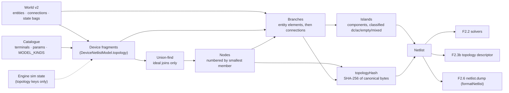
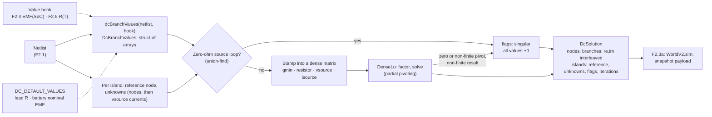
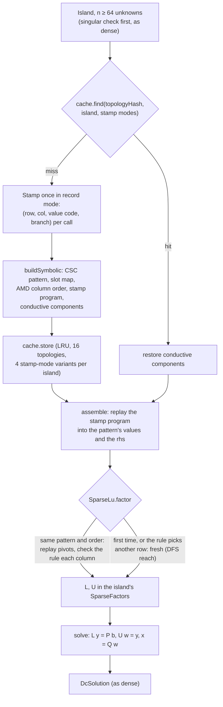
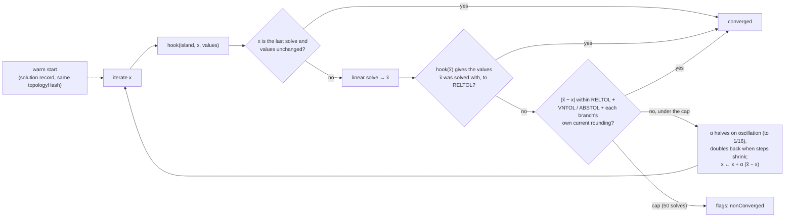
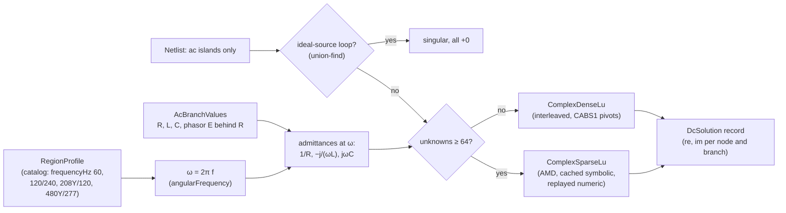
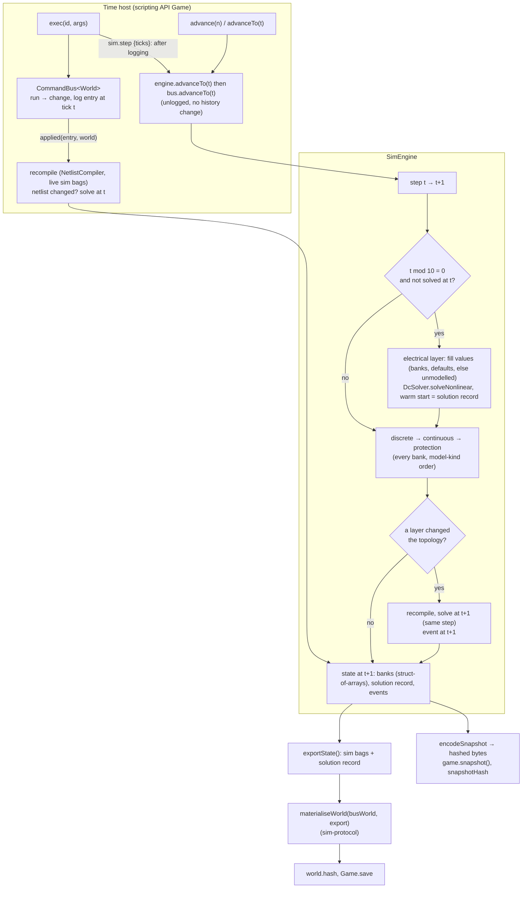
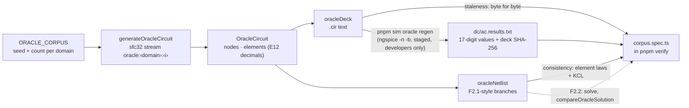

# Simulation

How `@controls/sim-core` turns the as-built world into something a solver can run. This page grows with Phase 2: today it covers the netlist compiler (F2.1), the DC solver (F2.2 part 1), sparse LU and the factorisation cache (part 3), the phasor solver (part 2), the oracle corpus and the bench (F2.7). The engine loop (F2.3a) and the worker transport (F2.3b, [ADR 0011](../decisions/0011-sim-worker-contract.md)) are added as they land. Gotchas: [simulation caveats](../caveats/simulation.md).

## The netlist compiler (F2.1)

`compileNetlist(world, catalog, options?)` is a pure function from the world document to a `Netlist` of nodes, branches and islands. It reads only what is wired:

- entities, with their catalogue entry's terminals and parameters;
- `world.connections` (test leads; wires from P3);
- each entity's commanded `state` bag (a switch's `closed`);
- the engine's sim-owned topology state (a fuse that blew, a breaker that tripped), passed in by the engine as `options.sim`. The world's own `sim` bags are inert during play ([ADR 0011 §1](../decisions/0011-sim-worker-contract.md#1-ownership-and-threads)), so they are only a fallback, which is correct at a session start or a load.

Positions, orientations, the renderer and prints never enter it. **The simulator runs what is wired, not what is drawn**: a lamp set down touching a battery is its own unpowered island until a lead joins them.

### Fragments and netlist models

Each placed entity contributes a **fragment**: its sorted terminals, the groups of terminals it joins ideally, and its elements. A fragment comes from the model kind's `DeviceNetlistModel.topology({ params, state, sim })` in `DEVICE_NETLIST_MODELS`; a test checks every placed kind in `MODEL_KINDS` has one. The model says only what the netlist needs: which terminals are joined, which elements sit between which terminals, and when. Stamps and electrical behaviour belong to the device models of F2.4 and F2.5.

| Model kind          | Topology                                                                                 |
| ------------------- | ---------------------------------------------------------------------------------------- |
| `battery`           | One `vsource` element `cell`, `neg` → `pos`, a DC source                                 |
| `lamp.incandescent` | One `resistor` element `filament`, `a` → `b`; its value is R(T), computed by F2.5        |
| `switch.spst`       | Closed: an ideal join of `a` and `b`, no element. Open: nothing                          |
| `lead` (connection) | One `resistor` branch, `a` → `b`, from `leadResistanceOhm` at the 20 °C bench (293.15 K) |

A model that changes topology on a sim-owned event lists those keys in `simTopologyKeys` (F2.5's fuse lists `blown`). It is shown only those keys, never the rest of the engine's state. The P2 bench kinds list none.

Absent from the netlist, with a diagnostic where useful: props (silently), entities whose ref the catalogue doesn't know (`unknown-device`), kinds without a netlist model (`no-model`), and connections whose ref is unknown or not a connection kind, or that end on an absent entity or an unknown terminal (`absent-connection`, with a reason).

### Canonical order

Every index is a pure function of the world, never of the edit history. That order is the order of `WorldV2.sim.nodes` and `branches` and of the snapshot payload ([ADR 0013](../decisions/0013-world-document-v2.md)).

- **Terminals** are visited in canonical order: entity id (numerically), then terminal id (UTF-16 code units).
- **Nodes:** union-find merges ideal joins only. A node is numbered when its first member is visited, so nodes are numbered by their smallest member, whatever order the unions ran in. Members are listed in canonical order.
- **Branches:** each entity's elements (entity id, then part), then each netlisted connection by id. Each connection is **exactly one branch** from `connection.a`'s node to `connection.b`'s node. A closed switch has no branch, and a lead across one is a branch with `a === b`.
- **Islands:** connected components of the nodes over the branches, numbered by their smallest node. Each is classified by its source elements: `empty` (none), `dc`, `ac`, or `mixed`, which is also reported as a `mixed-island` diagnostic because P2 has no converters.

The compiler sorts its input by id first, so permuting `entities` or `connections` changes nothing (a property test).

### `topologyHash`

SHA-256, using the pure implementation in `@controls/world-model`, over a compact canonical byte encoding of the structure. The encoding is documented in `netlist/hash.ts`: the partition, then each branch's element ref, element kind, source domain, model kind and end nodes. The normative rules, including when to bump the version byte and `SIM_ENGINE_VERSION`, are in [ADR 0013, "Solution order and `topologyHash`"](../decisions/0013-world-document-v2.md#solution-order-and-topologyhash). Values are left out, so a value-only change (a longer lead, a supply setpoint) keeps the hash, and F2.2's factorisation cache can key on it. Element refs are in, because the solution record is ordered by branch and checked against this hash when the engine starts. The encoding is binary rather than text because it is hashed on every topology change, inside F2.2's re-solve budget. `sim-core` imports the SHA-256 from `world-model` directly; both are `type:domain`, so the Nx boundary allows it, and `world-model` doesn't depend on `sim-core`.

### Incremental recompile

`NetlistCompiler` keeps state between compiles:

1. **Fragment cache.** Each entity's fragment is reused while its ref and its `state` bag are unchanged (world commands keep an untouched entity's bag object) and its sim topology keys still have the same values. Those are every input of a fragment, so a reused id (an entity placed again after an undo) can only hit the cache with an identical fragment. Each connection's resolved model and resistance are reused while the connection object is unchanged; a reconnect after an undo is a new object.
2. **Structure check.** Each compile records, in one flat list built as the inputs are placed, everything the assembly step reads except values: per entity its id and fragment key (or why it is absent); per connection its id, its two ends and its model (or why it is absent). The list is compared element by element with the previous compile's. An input that isn't in the list can't reach the assembly, so equal lists give equal nodes, islands, diagnostics and hash by construction.
   - Same structure, same values: the previous `Netlist` object is returned.
   - Same structure, new values: only the changed branches are rebuilt. Nodes, islands, the hash and the diagnostics are shared.
   - Otherwise everything is renumbered and rehashed from the cached fragments, because one merge shifts every later node index.

A property test drives random bench circuits (each seeded with 3–8 devices) through random sequences of edits (place, connect between real terminals, disconnect, operate, delete, move, undo, redo) and sim topology events (a test fuse blowing). It compiles only on randomly flagged steps, so the compiler also sees several edits at once, and checks each incremental result deep-equals a from-scratch compile, with the world and sim state frozen. A generator-health test pins how often runs produce leads, blows, value changes and AC and mixed islands. Measured on a 2,000-node chain, on an AMD Ryzen 5 5600X under Node 24:

| Operation                                           | Time         |
| --------------------------------------------------- | ------------ |
| From-scratch compile (a new compiler, as on a load) | about 4 ms   |
| Structural recompile (a switch toggled)             | about 1.3 ms |
| `topologyHash` alone, part of the structural figure | about 0.6 ms |
| Recompile with nothing changed                      | about 0.2 ms |

These are the netlist's share of F2.2 part 3's budget, which allows 2 ms to re-solve a 2,000-node plant after a topology change. F2.7's bench measures them on a 2,000-node plant (below); F2.2 part 3 adds the solve.

Netlists are read-only: fragments and their frozen `values` objects are shared between compiles.

### `formatNetlist`

`formatNetlist(netlist)` writes deterministic text for F2.6's `netlist.dump` and for golden tests. It lists the counts, the topology hash, islands, nodes with their members, branches with their values (`String(n)`, which ECMAScript defines exactly), and diagnostics.

## The DC solver (F2.2 part 1)

`DcSolver.solve(netlist, values, out?)` in `sim-core/src/lib/mna/` solves every `dc` and `empty` island of a netlist by modified nodal analysis (MNA), with the dense LU in `sim-core/src/lib/lu/`. Both are reimplemented from published sources: Ho, Ruehli and Brennan's 1975 MNA paper, and Gaussian elimination with partial pivoting as in Golub and Van Loan. No third-party code is used. `ac` and `mixed` islands are left at zero with `solved: false`: `ac` islands are the phasor solver's (part 2, below), and `mixed` ones are solved by neither.

### Values

Values are kept apart from the netlist, because they change on every solve and the topology does not. `DcBranchValues` holds one stamp per branch on preallocated typed arrays, so the engine can refill it without allocating:

| Stamp      | On element kind       | Meaning                                                                                                                      |
| ---------- | --------------------- | ---------------------------------------------------------------------------------------------------------------------------- |
| `resistor` | `resistor`            | `ohms` > 0, finite. Current a → b is (Va − Vb) / R                                                                           |
| `vsource`  | `vsource`             | EMF `emfV` from `a` (negative) to `b` (positive) behind a series `ohms` ≥ 0: Vb − Va = E − R·I, with I positive a → b inside |
| `isource`  | `resistor`, `vsource` | Exactly `amps` from a to b through the element, whatever the voltage (a supply in current limit)                             |

`dcBranchValues(netlist, hook?)` fills them. A `DcValueHook` gets the first say on each branch: it is where F2.4's battery EMF against state of charge and F2.5's filament R(T) will plug in. Otherwise the model kind's default in `DC_DEFAULT_VALUES` applies. A `lead` defaults to its `resistanceOhm`; a `battery` defaults to its `nominalVoltageV` behind its `internalResistanceOhm`, a placeholder until F2.4. A branch with neither (a lamp, until F2.5) throws, since that is a programming error in a device model.

### The system per island

Each island is solved on its own against its own **reference node**, which is eliminated. `islandReferenceNode` picks the negative end of the island's lowest-numbered `vsource` element, or its smallest node if it has none. It is a pure function of the topology. For a floating DC island with one source, that is the most negative source terminal, as ADR 0011 §5.3 asks.

Unknowns come in a fixed order: the voltages of the island's other nodes (ascending node index), then one current per `vsource` element (ascending branch index). Rows are KCL at each non-reference node, then one row per `vsource` element: Vb − Va + R·I = E, or I = amps while it is stamped as a current source. A `vsource` element keeps its current unknown in current-limit mode, so **the matrix layout depends only on the topology**, which is what part 3's factorisation cache keys on (`topologyHash`). A branch with both ends on one node is accepted. As a resistor or current source it adds nothing to the matrix. As a voltage source it gives R·I = E, the source's short-circuit current.

`gmin` (`GMIN_S`, 1e-12 S, numerical) is stamped from every non-reference node to the reference. It gives every node a defined voltage. An `empty` island is solved like any other (to exactly 0 with no sources), not assumed dead.

### Singular islands

With `gmin` on every node and every series resistance ≥ 0, the matrix [[G, B], [−Bᵀ, R]] satisfies xᵀMx = VᵀGV + IᵀRI. So it is singular **exactly** when the island's zero-ohm voltage sources contain a loop: two ideal sources in parallel, or one whose ends a closed switch joins. The solver checks this structurally with a union-find before any arithmetic, so the `singular` flag never depends on a pivot tolerance. This check is not redundant. When pivoting runs through a resistive mesh, elimination is inexact, and the singular pivot comes out as rounding noise rather than 0 (a planted-fault test showed about 3 in 4 such loops slipping past a numerical check). As a backstop, a zero or non-finite pivot, or a non-finite result (an overflow from extreme values), also flags the island. A singular island's values are all `+0`, never NaN.

### Floating components

A conductive component (nodes joined by resistors and voltage-mode sources) that doesn't hold the island's reference reaches it only through current sources, so only `gmin` holds it. Stamped node by node, its rows are nearly dependent. Above about gmin / ε (≈ 4.5e3 S) the last pivot rounds to exactly 0, a false `singular`; below that its common mode is mostly rounding. The solver pins it structurally instead:

- its representative (smallest node) carries the common mode c = V(rep), and each other member u = V − c, so resistor and source-row differences involve only u (c cancels exactly) and only `gmin` terms carry c;
- the representative's row is the component's structural sum row, gmin · (|S| c + Σ u) plus the currents of the branches that leave it.

That is an exact change of variables plus a row operation: the same solution, now well-conditioned. Voltages are written as c + u, and currents inside the component come from u. Other islands are bit-identical.

### Determinism and allocation

The solver uses a fixed loop order and IEEE-exact operations only (D6). Pivot ties go to the lowest row. Every stored value is normalised so that −0 becomes +0, and imaginary parts are +0. The same netlist and values give bit-identical results on a fresh or a reused solver (a property test). `DcSolver` keeps its LU storage and index maps and grows them only for a larger island. `solve` writes into `out` when it fits, so a steady-state solve allocates nothing.

### The solution

`DcSolution` is in the netlist's canonical order:

- `nodes` and `branches` are `Float64Array`s of interleaved `re, im` pairs (V against the island reference; A positive from end `a` to end `b`);
- `islands` holds per island `{ solved, referenceNode, unknowns, flags, iterations }` (`ISLAND_FLAG_SINGULAR` = 1 and `ISLAND_FLAG_NON_CONVERGED` = 2, as in the snapshot's island entry; `iterations` is 1 for a linear solve).

F2.3a can copy this straight into `WorldV2.sim` and the snapshot payload ([ADR 0011 §5.3, §9.6](../decisions/0011-sim-worker-contract.md)).

### Tests

- **Goldens** (`src/testing/dc-goldens.ts`, each with its hand calculation): a divider and a battery into a load (real bench worlds through `compileNetlist`); two unequal batteries in parallel, alone and sharing a load (Millman); an unbalanced and a balanced Wheatstone bridge (Thévenin); floating islands under `gmin` (a lone lamp, and a lamp left dangling off a battery); a current source into nothing but `gmin` (V = I / gmin); and ideal sources in parallel (singular, beside a healthy island). They hold to 1e-9 relative, except two stated cases: the bridge's difference current (1e-8, because gmin moves it about 7e-10) and currents of gmin size (≈ 1e-11 A), bounded by their stated absolute floors (1e-13 A for the battery's, 5e-14 A for the lamp's). All are within the plan's 0.5 %.
- **Properties** (fast-check), under the plan's F2.2 floor policy (KCL at every node within 1e-9 · max|I| + 1e-12 A plus the island's sum of g · ulp(V)-scale rounding terms):
  - KCL at every node, every source row, and power balance with `gmin` losses;
  - linearity: exact, bit for bit, for a factor of 0 or a power of two; for other factors, in residual space;
  - superposition in residual space: after every solve compared has passed KCL and its source rows, every row of x̂(all) − x̂(first) − x̂(second) holds within their summed bounds, and the sources cancel exactly (values aren't compared: forward error is the residual times |A⁻¹|, which ill-conditioned circuits make unbounded);
  - two CI counterexamples pinned as fixed examples;
  - singular exactly when an ideal-source loop exists, including inside resistive meshes;
  - bit-identical solves, including into an `out` full of sentinels, and no −0 anywhere;
  - a current source into a floating cluster down to 0.1 mΩ: never singular, with KCL and power holding;
  - a SHA-256 pin over the bits of 300 seeded solves (a deliberate numeric change re-pins it and bumps `SIM_ENGINE_VERSION`).

  They run over synthetic circuits (2–14 nodes, 1–3 islands, loops, self-loops, every stamp, resistances from 0.1 mΩ to 100 kΩ) and over compiled bench worlds, with generator-health floors.

## Sparse LU and the factorisation cache (F2.2 part 3)

An island with at least `SPARSE_MIN_UNKNOWNS` (64) unknowns is solved by sparse LU instead of dense; smaller ones keep part 1's dense path bit for bit (the pinned 300-solve hash didn't move). Both paths stamp through the same routine, so they see the same matrix entries; they differ only in pivot order, so they agree to rounding, not to the bit. All of it is reimplemented from the papers, with no third-party code: Gilbert and Peierls (1988, doi:10.1137/0909058) for the left-looking LU, Amestoy, Davis and Duff (1996, doi:10.1137/S0895479894278952) for AMD, and Duff, Erisman and Reid (1986, §7.8) for threshold pivoting.

### Sparse LU

`SparseLu` (`lu/sparse-lu.ts`) is left-looking: one column at a time, in the AMD order. For each column it does three things:

1. finds, by an iterative depth-first search over L's graph, the rows the column reaches (Gilbert–Peierls: exactly the pattern of the triangular solve);
2. applies the earlier columns in topological order;
3. picks the pivot by **threshold partial pivoting**. The diagonal row is kept while |a_kk| ≥ `PIVOT_THRESHOLD` × the largest candidate; otherwise the largest wins, the lowest row on a tie. `PIVOT_THRESHOLD` was 0.1 and is 1 since #51 (plain partial pivoting, multipliers at most 1, as dense): u = 0.1's multipliers of up to 10 put about 3,000 ulps of noise on one node of a fresh-seed circuit, and the outer loop, which expects partial-pivoting precision, stalled at 41 iterations where dense took 18. On the seeded 2,000-node plants u = 1 costs 0.33 % more L + U entries and falls back from replay less often (19 against 227 fallbacks over 2,197 nonlinear islands). It moved the sparse pins, so `SIM_ENGINE_VERSION` is 2.

MNA's zero diagonals (ideal sources) make off-diagonal pivots routine. Floating components keep part 1's structural pinning, since both paths stamp the same rows. A property drives clusters of 70–160 nodes, down to 0.1 mΩ, through the sparse path: they are never singular, and gmin · ΣV equals the feed to 1e-13.

**Replay.** The factors live in a `SparseFactors` object per island, in the cache entry. When it already holds a factorisation of the same pattern, order and threshold, `factor` replays it: it keeps the L/U patterns and the pivot sequence, skips the searches, and recomputes every value in the order a fresh factorisation would, applying the full pivot rule at every column. If the rule would choose another row, it starts again afresh. So a replay is accepted only when it is the fresh factorisation, bit for bit. On the bench plant it halves the cost of the numeric factorisation.

### AMD

`amdOrder` (`lu/amd.ts`) orders A + Aᵀ by approximate minimum degree on the quotient graph:

- elements absorb their neighbours;
- the approximate external degree uses |L_e \ L_p|, computed for all elements at once;
- elements inside L_p are absorbed (aggressive absorption);
- indistinguishable variables merge into supervariables;
- rows denser than max(16, 10√n) go last.

It is deterministic: fixed scan orders, LIFO degree buckets, and candidates compared in hash-then-index order. On one 250-unknown plant island it leaves about 970 L+U entries, where the natural order leaves about 22 000.

### The factorisation cache

`FactorisationCache` (`mna/factorisation-cache.ts`) keys its entries by `topologyHash`, island and **stamp-mode signature** (each branch's stamp code). The signature is needed because a mode can change the matrix without changing `topologyHash`: a `vsource` element in current limit has a different row, and a current source can split a conductive component. Each entry keeps:

- the CSC pattern, and the slot of every stamp call (duplicates add in call order);
- the AMD order;
- the **stamp program**: each call's value code (`gmin`, ±1, R, ±1/R) and branch, plus the right-hand-side steps. Assembly replays the same additions in the same order as `stamp`, without its branching;
- the island's conductive components, and a fingerprint of its branch ends. A hit with different ends or unknowns throws: two netlists sharing a `topologyHash` is a caller bug;
- the island's last `SparseFactors`, for replay.

Everything it keeps is a function of the topology and the stamp modes, except the factors, which are used only after the pivot rule re-verifies them. So **results never depend on the cache's state**.

Eviction is least recently used, by a logical clock, over topologies (`FACTORISATION_CACHE_CAPACITY`, 16) and over each island's mode variants (4). `cache.stats` counts hits, misses and evictions; `sparse.replays`, `.fresh` and `.fallbacks` count numeric factorisations. Returning to an earlier switch state is all hits, and a spec counts them.

### The crossover

Measured on the built bundle (Node 24, AMD Ryzen 5 5600X); each figure is the median over single-island plant-like circuits:

| Unknowns | Dense  | Sparse, warm cache | Sparse, cold (rebuild symbolic) |
| -------- | ------ | ------------------ | ------------------------------- |
| 27       | 5.7 µs | 5.6 µs             | 29 µs                           |
| 53       | 17 µs  | 10 µs              | 54 µs                           |
| 108      | 86 µs  | 21 µs              | 121 µs                          |
| 290      | 941 µs | 58 µs              | 348 µs                          |

Sparse with a warm cache wins from about 30 unknowns, and with a cold one from about 130. The threshold is 64. That is above every circuit of the pinned hash (at most 40 unknowns), so small circuits keep their dense bits.

### The nonlinear outer loop

`DcSolver.solveNonlinear(netlist, values, { hook, warmStart?, maxIterations? }, out?)` repeats each DC island's linear solve. Before each solve it calls `hook(island, iterate, values)`, a `DcIterationHook` that sets the island's nonlinear values from the current iterate. On a cold start the iterate is `null` and the hook sets its initial guess. This is the interface F2.4's CV/CC supply and F2.5's lamp R(T) plug into.

**Two stopping tests (#51).** After each solve the loop asks the hook for its values at x̃: if they are the values x̃ was solved with, to `OUTER_LOOP_RELTOL` and in the same stamp mode, x̃ is the fixed point and the loop stops. Otherwise the older step test on voltages and currents still applies. The value-space test was added because a current is only as repeatable as the solve resolves it (cond · ε · V · g): on ill-conditioned islands small currents repeated only to 5e-5 relative, and the step test alone stalled to 42 and 50 iterations on the dense path. With it, 6,542 seeded islands take at most 20 iterations forced dense and 26 forced sparse (median 16), within the bound of 40 that the damping schedule's contraction gives.

The reported solution is always the last linear solve, never a damped blend, so every row holds for the values left in `values`. A linear island takes one solve, and a singular solve ends the loop.

Each branch's current tolerance includes its own rounding (`currentResolution`): a resistor's 32 ε (|Va| + |Vb|) / R, and for a voltage-mode source the sum over the branches at its nodes. No solve resolves a current better: without the term, a 2.2e-7 A current wobbling by 6e-13 A once kept an island from converging. The term is per branch, never island-wide. An island-wide sum grows with the island and let a 1e-5 A load on a long busbar loop stop with its resistance off by ×35 (#49 review). The constants (`OUTER_LOOP_*`) are numerical, and sourced against SPICE's defaults.

A `nonConverged` island's values are the last linear solve's: self-consistent, so they look real. Anything player-facing must show such an island as unsettled (caveats).

### Tests (part 3)

- **Dense against sparse** (`mna/sparse.spec.ts`), per the floor policy. It runs on random circuits of 40–260 nodes, and on 2–24-node circuits forced sparse:
  - residuals: both solutions pass KCL and the source rows;
  - values, on the well-conditioned subset (1 Ω–10 kΩ, every source behind ≥ 0.1 Ω): they agree within 1e-9 of the island's largest |V| or |I|, plus the ε·G·V current floor. Over 1,500 fresh circuits, the worst used 5 % of that bound.

  The DC oracle runs on both paths.

- **Cache:**
  - a property against a reference LRU model;
  - mode variants;
  - the switch round trip: all hits, bit-identical;
  - value-only changes: a hit and a replay;
  - a mismatched `topologyHash`, refused;
  - bit identity cold, warm, shared and thrashed (capacity 1).
- **LU and AMD:**
  - backward stability against dense LU;
  - replay bit-identical to a fresh factorisation, with fallbacks counted;
  - the arrow matrix: no fill in AMD order;
  - a 20 000-long chain: no stack overflow;
  - AMD's fill against the natural order, on random patterns and a grid.
- **Outer loop** (`mna/nonlinear.spec.ts`):
  - closed-form fixed points of a self-heating resistor, R(I) = R0 + k|I|, with I* = (−(Rs+R0) + √((Rs+R0)² + 4kE)) / 2k;
  - damping on a slope of −0.995;
  - a discontinuous R that must end `nonConverged`;
  - a CV/CC supply in both modes;
  - warm starts;
  - properties bounding the iterations at 40, on random bench worlds with self-heating lamps (hot/cold up to 21×) and on large sparse circuits. The bound is measured: from a cold start the median is 16, the 99th percentile about 21, and the most seen 32.
- **Generator health** floors on both generators, and 17 planted faults, all killed (listed in the PR).

## The phasor solver (F2.2 part 2)

`AcSolver.solve(netlist, values, frequencyHz, out?)` in `sim-core/src/lib/mna/ac.ts` solves every `ac` island as **phasors**: the steady state at one frequency, the region's (`RegionProfile.frequencyHz`, 60 Hz for NEC). It is the DC solver's formulation in complex arithmetic, with the same unknowns in the same order (the non-reference node voltages, then each `vsource` element's current) and the same reference node. Values are RMS phasors, `re, im` interleaved in the same `DcSolution` record DC writes (ADR 0011 §5.3), so one record holds both kinds of island.

- **Order of solves.** `AcSolver` writes only `ac` islands and leaves every other island's entries in `out` as they are, so the engine (F2.3a) runs `DcSolver.solve` then `AcSolver.solve` into one record (`DcSolver` zeroes every island it doesn't solve). `mixed` islands are solved by neither: they stay a diagnostic, since P2 has no converters.
- **Values** (`mna/ac-values.ts`): `AcBranchValues` holds per branch a stamp (`resistor`, `inductor`, `capacitor` on a `resistor` element; `vsource` on a `vsource` element), R, L, C and the EMF phasor. `vsourcePolar(branch, rms, angle, ohms)` takes the angle from `phasorUnit`. Inductance and capacitance are **stamp modes, not element kinds**: F2.1's `ElementKind` and `topologyHash` are unchanged, and every passive stamp has the same four-entry pattern. `acBranchValues(netlist, hook?)` fills `ac` islands from a hook, else `AC_DEFAULT_VALUES` (a lead's resistance). There is no AC current source yet (caveats).
- **Angles** (`mna/phasor.ts`): 0°, 180° and ±120° only, from exact constants (cos 120° = −0.5, sin 120° = `Math.sqrt(3) / 2`, decision D6). ω = `2 * Math.PI * f`, two correctly rounded products.
- **Singular is structural, as in DC.** With M = [[Y, B], [−Bᵀ, R]], Re(xᴴMx) = Vᴴ Re(Y) V + Iᴴ R I: the incidence terms only add an imaginary part, and an inductor's or capacitor's admittance is purely imaginary. gmin on every node makes it positive unless current circulates in zero-ohm sources only. So an island is singular exactly when its ideal sources close a loop, and the same union-find decides it. An L–C pair at resonance is ill-conditioned, not singular.
- **No floating components.** Every AC stamp conducts, so an island is one conductive component holding its reference; the DC solver's pinning isn't needed.

### Complex LU, not the real 2n system

The equivalent real system [[Re, −Im], [Im, Re]] of order 2n has the same solution and could reuse `DenseLu` and `SparseLu` unchanged. It was measured and rejected:

| n (complex) | `ComplexDenseLu` | `DenseLu` on the 2n system |
| ----------- | ---------------- | -------------------------- |
| 16          | 4.1 µs           | 25 µs (6.1×)               |
| 32          | 23 µs            | 94 µs (4.1×)               |
| 64          | 164 µs           | 689 µs (4.2×)              |
| 128         | 1.27 ms          | 5.33 ms (4.2×)             |

(Node 24, AMD Ryzen 5 5600X, factor and solve, median of 7.) It stores 4n² numbers instead of 2n², does twice the real flops (16n³/3 against 8n³/3), and its partial pivoting is free to pick a real row that splits a complex entry's pair, so its rounding isn't a complex factorisation's. Sparse, it would quadruple the pattern.

- **`ComplexDenseLu`** (`lu/complex-dense-lu.ts`): interleaved row-major storage, partial pivoting by CABS1 (|re| + |im|, LAPACK's choice for complex pivoting: no square root, within √2 of the modulus), the lowest row on a tie. Each pivot's reciprocal is computed once by Smith's algorithm (1962), which never forms |p|², and reused by the back substitution.
- **`ComplexSparseLu`** (`lu/complex-sparse-lu.ts`): the real sparse LU's algorithm with complex values. The pattern work is shared: the CSC pattern, `sparseReach` (the depth-first search, factored out of `sparse-lu.ts`), AMD, `buildSymbolic` (now in `mna/shared.ts`) and the generic `FactorisationCache<ComplexSparseFactors>`. Replay works as in DC: the last pivot sequence is reused only when the full pivot rule picks it again.
- **The stamp program** records value codes (gmin, ±1, the source's R, ±y), never values. Each solve recomputes every admittance from its own ω and values before assembly, so a cached factorisation can't carry a frequency or a value into another solve (planted faults prove both). The cache signature is each branch's pattern class (passive or source), so changing a resistor into an inductor is a hit.

### The crossover

The same shape as DC (vitest, Node 24, plant-like single islands):

| Unknowns | Dense   | Sparse, warm | Sparse, cold |
| -------- | ------- | ------------ | ------------ |
| 19       | 14 µs   | 16 µs        | 72 µs        |
| 31       | 13 µs   | 8.3 µs       | 99 µs        |
| 48       | 29 µs   | 12 µs        | 86 µs        |
| 111      | 193 µs  | 27 µs        | 222 µs       |
| 237      | 1.30 ms | 84 µs        | 632 µs       |

Warm sparse wins from about 30 unknowns, cold from about 120, so `SPARSE_MIN_UNKNOWNS` (64) is shared by both solvers.

### Tests (part 2)

The floor policy (plan F2.2) with complex magnitudes, in `src/testing/ac.ts`: KCL at every node within `1e-9 · max|I| + 1e-12 A` plus the island's Σ 2 · 16 ε |y_b| (|V_a| + |V_b|) (a source behind R > 0 counting as y = 1 / R, with |E| added to its voltages, as in DC since #51) and the source-row term; each source row Vb − Va + R I = E; each passive element's law I = y (Va − Vb).

- **Goldens** (`testing/ac-goldens.ts`, both paths), each with its derivation in the fixture:
  - series RL at 60 Hz: 120 V into 10 Ω + 50 mH, I = 5.6238 A lagging 62.05°, P = 316.27 W, Q = 596.16 var;
  - unbalanced 120/240 V split-phase with a 0.05 Ω service neutral: the neutral carries the **phasor** sum of the line currents, 7.153 A, where the magnitudes differ by 1.29 A;
  - balanced 208Y/120 V wye of 8 + j6 Ω: 12 A per phase, the neutral about 0 (under 1e-9 A), |V_A − V_B| = 120√3.
- **Properties** (`mna/ac-properties.spec.ts`): KCL, source rows and element laws; real power balance (sources against R and gmin); reactive power bookkeeping (sources against Σ ωL|I|² − Σ |I|²/(ωC)), both within 1e-9 of their terms (apparent power for a source) plus the Tellegen floor; linearity bit for bit for k = 0, ±2^m and ±j·2^m (a quarter turn only swaps and negates parts), in residual space for other k (including the exact 120° rotation) and for superposition; singular ⇔ an ideal-source loop; bit identity across solvers, frequencies solved in between and a dirty `out`; a frequency change is an input, not state; a pinned SHA-256 over 300 seeded dense solves, and a generator-health ceiling on floor / max|I|.
- **Dense against sparse** (`mna/ac-sparse.spec.ts`): residuals on every circuit (40–260 nodes, and 2–24 forced sparse); values on the well-conditioned subset (a resistive 1 Ω–10 kΩ spanning tree, impedances of 1 Ω–10 kΩ, sources behind ≥ 0.1 Ω: Re(Y) stays definite, which bounds ‖M⁻¹‖ however the reactances cancel); warm equals cold across frequency and value changes; the cache round trip; the `topologyHash` tripwire; and a pinned SHA-256 over 40 seeded large sparse solves.
- **LU** (`lu/complex-lu.spec.ts`): backward stability on random complex systems, dense against sparse, exact scaling by j, bit-identical reuse and replay, fallbacks, the singular contract and a 20 000-long chain.
- **The AC oracle** (`oracle/ac-oracle.spec.ts`), on both paths: below.
- **Generator health** floors, and 12 planted faults, all killed (listed in the PR).
## The engine loop (F2.3a)

`SimEngine` (`sim-core` `engine/`) is the sim clock: it follows a world bus deterministically ([ADR 0011](../decisions/0011-sim-worker-contract.md) §2–§4, §9.6). The same engine is the scripting API's time host headless (`sim-cli`, every domain test) and, until F2.3b moves it to the sim worker, runs in-process in the game's session.

**Time.** Ticks are integers, 1 tick = 1 ms (`TICK_S`). The state at tick T is the state after every command logged at T, before step T's cadence solve. `advanceTo(target)` runs steps T … target − 1. The electrical layer runs at every multiple of `SOLVE_INTERVAL_TICKS` (10, absolute ticks) that nothing has solved at yet, after any command that changes the netlist (topology or a value: a move solves nothing), and in the same step as a layer's topology change (a fuse blowing at step t is solved at t + 1, before the state at t + 1 is observable). Every solve is a pure function of the netlist, the banks' values and the warm start, which is the solution record itself.

**Commands and time.** `CommandBus.advanceTo(tick)` moves the bus's state without logging, taking a `seq` or touching the history (ADR 0011 §3). `replayEntries(bus, entries, { time, endTick })` advances the time host and the bus to each entry's tick, runs it, calls `time.applied(entry, state)`, and finally advances to `endTick`; an earlier tick is still `tick-mismatch`. In the scripting API, `Game.exec` hands every logged entry to the engine and carries out `sim.step` by advancing once it is logged; on replay a step moves nothing, and the next entry's tick (or `endTick`) carries its effect. `sim.setSpeed` and `sim.resume` are no-ops headless (pacing is F2.3b's).

**Device models are banks** (`SimDeviceModel` in `engine/device-model.ts`). For each model kind with netlisted devices the engine builds one bank: preallocated struct-of-arrays state, plus optional hooks: a DC value per branch, the outer loop's per-iteration value, the discrete, continuous and protection layers (each over the whole bank, so a tick makes no per-device calls or allocations) and an output record. Banks are rebuilt at every topology change, because branch indices move, from each device's **sim bag**, which must therefore hold every value that affects the future. A device that leaves keeps its bag as a **tombstone** if its id can't be reused (it was deleted: undoing the delete restores a blown fuse blown) and drops it if its `entity.place` was undone. Per-device randomness (a tolerance) comes only from `deriveStream(world.seed, entityStreamKey(id))`. In F2.3a no built-in kind has a bank: the battery keeps its placeholder EMF from `DC_DEFAULT_VALUES` (F2.4), and the lamp has no filament model (F2.5), so a branch nothing can value leaves its island **unmodelled**: solved with a placeholder only to keep the solver going, then zeroed and recorded with 0 iterations.

**Honest results.** `islands()` gives each island's status: `solved`, `singular`, `nonConverged`, `unmodelled`, `acPending` (until F2.2 part 2) or `mixed`; only `solved` values are readings, and the status follows from the netlist and the solution record alone, so a loaded engine says the same. `probe(a, b)` (ideal, non-loading) returns DC volts V(a) − V(b) on a solved island, `floating` for terminals on different islands (never a difference of two references), and `singular`, `unsettled` or `unsolved` otherwise. Island flags raise `singular` and `nonConverged` sim events on their rising edge; across a topology change a flag rises only if none of the island's entities was in an island with it before. Layer events (`blown`, …) are stamped at the end of their step.

**State and saves.** `exportState()` is every netlisted device's whole sim bag plus the solution record (`null` for an empty netlist). `materialiseWorld` (`sim-protocol`) writes exactly those bags and `WorldV2.sim` into the bus world; everything else is the bus world's. `SimEngine.start(world)` continues from a materialised world: with `sim: null` it solves at the world's tick, with a record it checks `topologyHash` and the sizes against the compiled netlist and adopts it, or throws `SimStartError` (`start-failed`), never re-solving silently. A save at any tick, loaded and run on, equals the uninterrupted run (a property, step by step, through JSON and through `.ctrl` bytes).

**The snapshot** (`sim-protocol`, ADR 0011 §5): `encodeSnapshot` writes one slot from the engine's preallocated arrays with little-endian `DataView` stores, every reserved byte zero; the hashed region is bytes 8 onwards (the tick, the counts, the flags, the raw topology hash, then nodes, branches, islands and device records). `game.snapshot()` returns those bytes, `snapshotHash` their SHA-256. An unsolved island's entry has 0 iterations, 0 unknowns and no reference node. Device records are written from the bags and the solution, never from per-step caches, so a snapshot is a pure function of the export. The seqlock transport, the descriptor and `SnapshotView` are F2.3b's.

**Load and D8.** `engineCompatible(manifest, build)` decides whether a save's log is verified: the same engine and catalogue verify; a migrated P1 save (both 0) verifies but restarts as `engine-changed` on failure; any other mismatch restarts as `engine-changed` without replaying. `SIM_ENGINE_VERSION` is 2 since this feature materialised the solution record.

**Measured** (built bundle, AMD Ryzen 5 5600X, Node 24): one step of the layers on 750 synthetic devices (`tick-device-mix`, gated at §4.5's 0.3 ms) takes about 0.015 ms median.

## The oracle corpus (F2.7)

The solvers are checked against ngspice on a checked-in corpus ([ADR 0012](../decisions/0012-oracle-corpus.md), decision D5). One intermediate representation feeds both sides, so they can't describe different circuits:

- **Circuits:** 2–30 nodes, one island, node 0 the reference sim-core picks (the negative end of the first voltage source). DC: R, V with internal R, I. AC at 60 Hz: R, L, C, phasor V at 0°, 180°, ±120° from exact constants. A spanning tree plus random chords, then biconnected (current sources ignored), so every element shares a loop with a source: about 99 % of branches carry more than 1e-6 of their circuit's largest current (at least 95 % is checked).
- **Decks:** `.options sparse`, explicit `gmin` resistors on the circuit nodes, a 0 V sense source per element (its current is the branch current), `noopac`, `set numdgt=17`.
- **In `pnpm verify`:** the decks regenerate byte for byte; the results were solved from those decks; ngspice's solution satisfies every element equation and KCL in `oracleNetlist` (about 3e-9 of the circuit's scale, allowed 1e-7). **The DC comparison is on** (`dc-oracle.spec.ts`): each DC circuit is adapted to the solver's input (`oracleDcInput`: a `Netlist` plus `DcBranchValues`, a current source as a `resistor` element stamped `DC_STAMP_ISOURCE`), solved by `DcSolver`, and its values compared at `1e-6·|x_ref| + max(1e-12, 1e-7·max|x_ref|)`, set by ngspice's own noise of about 3e-9; sim-core's own KCL and source-row checks run on the same solution. The worst value uses 1.06e-3 of its allowance (ADR 0012). **The AC comparison is on too** (`ac-oracle.spec.ts`, F2.2 part 2): `oracleAcInput` maps R, L and C to `resistor` elements with their AC stamp and each phasor source to a `vsource` element with its EMF from the exact angle constants; `AcSolver` solves at 60 Hz and every value is compared with complex magnitudes at the same tolerance, with sim-core's own complex KCL and source rows alongside. The worst uses 1.8e-5 of its allowance for volts and 5.0e-4 for amps (ADR 0012), on both the dense and the forced-sparse path.
- `sim-cli`'s `oracle regen` does the file and process work; `sim-core` stays framework-free.

## The bench (F2.7)

`pnpm sim bench` (the Nx `bench` target, in `pnpm verify`, from the built bundle) builds a seeded synthetic plant of exactly 2,000 netlist nodes from P2's catalogue: 8 battery feeders, each a random recursive tree of units (an SPST switch and a lamp, with the return path mirroring the supply tree), about 1 unit in 50 adding a tie lead (a loop) and about 1 switch in 20 open. It times:

| Case                            | What                                                                                                                         | Budget                                           |
| ------------------------------- | ---------------------------------------------------------------------------------------------------------------------------- | ------------------------------------------------ |
| `plant-compile`                 | A from-scratch `compileNetlist`, as on a load                                                                                | None in the spec (reported)                      |
| `plant-recompile-switch`        | One topology change: open a feeder's root switch (an untimed `prepare` closes it first)                                      | None of its own: part of the re-solve (reported) |
| `plant-resolve-topology-change` | The same change, then the values and the sparse solve of all 8 islands, with the factorisation cache warm (both states seen) | 2 ms (spec §4.5): reported, gate pending (below) |
| `plant-resolve-new-topology`    | The same, with the cache cleared in `prepare`: every symbolic factorisation is rebuilt                                       | None in the spec (reported)                      |
| `tick-device-mix`               | One step's discrete, continuous and protection layers on 250 battery–fuse–load loops (750 devices), no solve (F2.3a)         | 0.3 ms (spec §4.5), gated                        |

Each case reports its median and p90 in the JSON. Budgets gate on the median. Nx hides a passing task's output, so the `bench` target also writes the report to `dist/apps/sim-cli/bench-report.json` (`sim bench --report <file>`), and a CI step after `pnpm verify` prints it on every OS. That step only prints, so `verify` still equals CI.

Measured 2026-10-30 on an AMD Ryzen 5 5600X under Node 24: `plant-compile` took 4.2–4.7 ms, and `plant-recompile-switch` 1.2–1.3 ms per topology change (8.5–11 ms and 1.7–2.8 ms with heavy load from other jobs). F2.2 part 3 made the hashing faster (recompile 1.1 ms) and measured the re-solve:

- **1.45–1.49 ms** with a warm cache (p90 2.5 ms);
- **4.5–4.6 ms** for a topology never seen (about 0.37 ms of AMD and pattern building per 250-unknown island).

Alone, the warm case meets the 2 ms budget with 0.5 ms to spare. Beside `pnpm verify`'s parallel test workers it measured 2.3–2.6 ms, and CI runners are slower than this machine. The CI runners measured it at 2.12 ms (Ubuntu), 3.74 ms (macOS) and 4.77 ms (Windows). **Decided 2026-10-31:** the case stays reported-only, the structural recompile (about 75 % of the cost) is optimised next, and then a gate switches on with the 2 ms budget scaled by a calibration loop timed in the same process (plan F2.2 part 3b), so `verify` stays identical to CI. §4.5's 2 ms remains the target on player hardware.

## Not yet

- **AC sources and loads** (F2.4, F2.5): the utility and three-phase sources and AC loads reach the phasor solver through `AcValueHook`; an AC current source, or an AC nonlinear outer loop, would need the DC solver's floating-component pinning and `solveNonlinear` in complex form first.
- **The re-solve gate** (spec §4.5's 2 ms): reported now; the recompile optimisation and the calibrated gate follow (plan F2.2 part 3b).
- **Device models** (F2.4, F2.5): the battery's state of charge, the supplies, the lamp's filament, the fuse and breaker. The engine's hooks exist (above); the built-in kinds have no bank yet.
- **The sim worker** (F2.3b): the seqlock transport, the descriptor, pacing and `SimHost`; until then the game runs the engine in-process.
- **Topology descriptor** (F2.3b): built from `Netlist.nodes`, `branches`, `islands` and `devices`, adding each island's reference node and nominal band.
