# UI shell

> **Status (F1.8b part 3):** the shell, workspace, settings screen, HUD, notifications and theming exist. The command registry and `feature-session` landed in F1.2 ([commands](commands.md)), the keybinding service, the Key bindings dialog and the tool belt in F1.4, the command palette (`feature-palette`) in F1.3, the dev console in F1.5 ([dev console](console.md)), and saving and loading (`feature-saves`: Save game, Load game, Continue, autosave) in F1.8b ([below](#saving-and-loading-f18b)). Settings persist on both platforms (below). Reset layout runs the `view.resetLayout` command, and the HUD's assisted badge reads the world's `assisted` flag from the session. Gotchas: [UI caveats](../caveats/ui.md). Docking choice: [ADR 0005](../decisions/0005-docking-workspace.md).

## Libraries

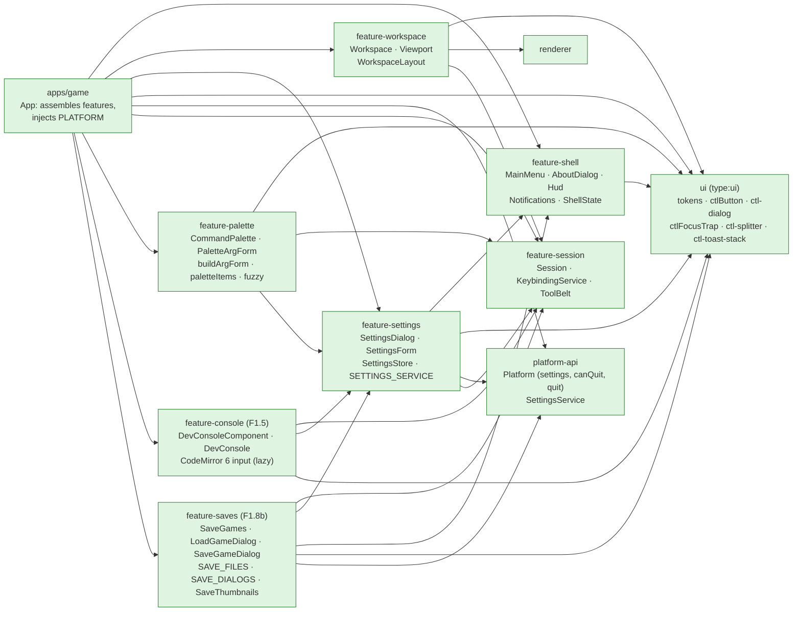

`ui` is presentational: it holds no services, state or commands. Features may use each other (`feature-settings` uses `NotificationService` from `feature-shell`), but none of them imports a concrete platform. The app provides `PLATFORM` (Electron bridge or web harness) and, from it, `SETTINGS_SERVICE`, `APP_LIFECYCLE`, `SAVE_FILES` and `SAVE_DIALOGS` (`app.config.ts`).

## Screens and focus

The workspace is always mounted. Behind the main menu it shows only the viewport (`[chrome]="false"`) and is `inert`, so the menu sits over a live 3D backdrop.

```mermaid
stateDiagram-v2
    [*] --> Menu: boot (focus: first menu item)
    Menu --> NewGameDialog: New sandbox (focus: Seed, a fresh seed)
    NewGameDialog --> Workspace: Enter / Start, valid seed → Session.newSandbox (focus: viewport canvas)
    NewGameDialog --> Menu: Escape / Cancel (focus returns to New sandbox)
    Menu --> Workspace: Resume (focus: viewport canvas)
    Menu --> Workspace: Continue resumes the last-played save, else the newest that loads (focus: viewport canvas)
    Workspace --> Menu: Menu button, or Escape outside the canvas (focus: Resume; autosave if changed)
    Menu --> Workspace: Escape (session running)
    state Menu {
        [*] --> Items
        Items --> SaveGameDialog: Save game (game running)
        SaveGameDialog --> Items: Enter / Save, or Escape / Cancel (focus returns to Save game)
        Items --> LoadGameDialog: Load (file.load)
        LoadGameDialog --> Items: Escape / Cancel, or a save that doesn't load (focus returns to Load)
        Items --> SettingsDialog: Settings
        SettingsDialog --> Items: Back / Escape (focus returns to Settings)
        SettingsDialog --> KeyBindingsDialog: Key bindings…
        KeyBindingsDialog --> SettingsDialog: Back / Escape (focus returns to Key bindings…)
        Items --> AboutDialog: About
        AboutDialog --> Items: Close / Escape (focus returns to About)
    }
    Workspace --> Palette: Ctrl+K / Ctrl+Shift+P (palette.open; also from the menu or a dialog)
    Palette --> Workspace: Escape or a command runs (focus returns to the opener)
```

- **Dialogs** are native `<dialog>` elements opened with `showModal()` (`ctl-dialog`). The page behind them is inert, focus moves inside and is trapped, Escape closes, and focus returns to the opener.
- **Escape** is handled innermost-first: a key capture in the Key bindings dialog, a dialog or the focused viewport canvas (cancel a move, cancel placement, clear the selection, in that order; F1.7) consumes it; otherwise `App.onEscape` toggles between the menu and the workspace. Escape is the shell's fixed "back" key, reserved by the keybinding service, so no command can take it.
- **New sandbox** (F1.9) opens the new-game dialog: the level (Workshop), a seed field with a fresh seed (`SEED_SOURCE`, `crypto.getRandomValues`) and a New seed button. A typed seed must be a whole number from 0 to 4294967295 (`parseSeed`); an invalid one is refused inline (`aria-invalid`, an alert) and the dialog stays open. Start runs `Session.newSandbox({ seed, difficulty: settings.gameplay.defaultDifficulty })`, which loads the workshop level with a fresh history and replay log; the viewport resets to its starting view (`Session.generation`).
- **Main menu** items are plain buttons in a `<nav>`: Resume and Save game (while a game runs), New sandbox, Continue, Load, Settings, About and Quit. Tab, Up/Down, Home and End move between them. Continue is `aria-disabled`, described by "No saved games yet.", until the save directory lists a save; it is one element either way, so focus on it survives the list arriving. Quit is hidden where `Platform.canQuit` is false (the web harness).

## Saving and loading (F1.8b)

`SaveGames` (`feature-saves`) is the one place that writes and loads games; `App` injects it at start-up. It sits on `Session` (the game), `loadGame` (`@controls/scripting-api`: bytes to a validated game) and the platform's save I/O (`SAVE_FILES` / `SAVE_DIALOGS`, provided from `Platform.files` / `.dialogs`; [ADR 0009](../decisions/0009-save-io-boundary.md)). The `.ctrl` format and loading rules are on [world and saves](world-and-saves.md#saving-and-loading-in-the-game-f18b-part-3).

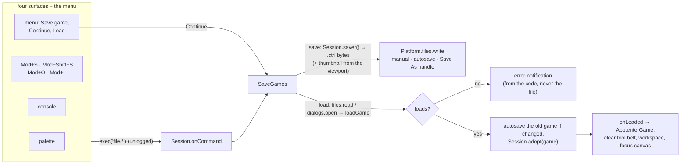

- **Commands.** `file.save` (Mod+S; under the game's save name, or the Save game dialog if it has none), `file.saveAs` (Mod+Shift+S; a native Save As, a download in the web harness), `file.open` (Mod+O; a native Open, an upload in the web harness) and `file.load` (Mod+L; the Load game dialog). All four are `logged: false`, `file.save` and `file.saveAs` need `session.active`. Why they are commands but unlogged: [ADR 0006](../decisions/0006-command-system.md#saving-and-loading-f18b).
- **Save game dialog:** one field, opening on the game's save name or `Sandbox <seed>`, selected so typing replaces it. Names follow `SaveNameSchema` and are explained inline; a name another save already has (compared without case) asks first (the button becomes Replace). The save runs after the dialog closes.
- **Load game dialog:** the save directory, newest first, one button per save named by the save and described by kind, time and size; Up/Down, Home and End move between them. Open file… opens the picker inside the click and keeps the dialog open if the player cancels. A chosen save loads after the dialog has closed and returned focus. No thumbnails in the list yet (reading one means reading the whole save).
- **Continue** lists again and tries the save of the game the player was last in first (`settings.saves.lastPlayed`), then the rest newest first (manual and autosave alike); saves that don't load, or a last-played save that has gone, are skipped with one warning naming them.
- **Autosave** writes the next of `autosave.slotCount` slots, only for a game with unsaved changes (its world differs from the last saved, loaded or starting one, so an untouched New sandbox never takes a slot): every `autosave.intervalSeconds` while a game runs, when the player returns to the menu, before a load replaces the game, and before quit (a flush registered with `APP_LIFECYCLE`, without a thumbnail to stay inside the 2 s budget). Settings → Saves edits the three autosave settings.
- **Errors** become notifications written from the `CtrlError` kind or `SaveIoError` code (`messages.ts`); nothing from the file or a host path is shown. A save whose replay log had to restart loads with a warning (`REPLAY_MISMATCH_POLICY`, `notify` by default, `refuse` to refuse such saves).
- **Thumbnails:** `SaveThumbnails` calls the viewport's `captureThumbnail()` (a 320 × 180 PNG, rendered and copied in one task); a failed capture or a non-PNG is dropped and the save goes ahead without one.

## Workspace layout

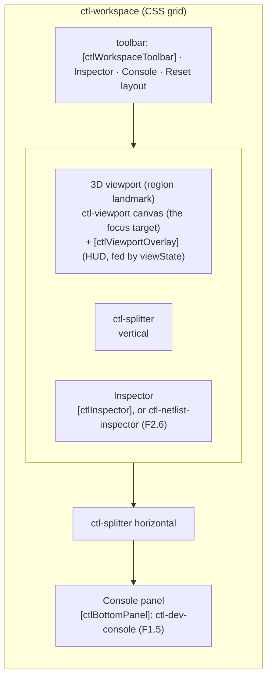

- `WorkspaceLayout` is plain JSON: `{ inspector: { size, collapsed }, bottom: { size, collapsed } }`, with integer CSS pixels clamped by `normaliseLayout` (inspector 200–640, bottom 96–560, and at most 60 % of the window in CSS).
- It is two-way bound to `settings.workspace.layout`, so it persists once F1.8a wires the storage.
- Splitters follow the WAI-ARIA window-splitter pattern: arrows resize (Shift for big steps), Home/End jump to the limits, and Enter collapses or restores. Pointer drags use pointer capture.
- **`console.toggle`** (backtick) is applied by the workspace too: it expands the bottom panel and focuses its `[data-autofocus]` element, or collapses it and restores focus when focus is already inside. See [dev console](console.md).
- **`view.netlistInspector`** (F2.6, `when: console.available`, unlogged UI chrome, no default key) shows the netlist inspector in the side panel the same way: it expands the panel if collapsed and focuses the tree, or, with focus already inside, closes it (the projected `[ctlInspector]` content comes back) and restores focus. See [the netlist inspector](#the-netlist-inspector-f26).
- **Reset layout** runs the `view.resetLayout` view command through `Session.exec`. The workspace applies it when the command reports back (`Session.onCommand`), so any surface that runs the command resets the layout. It is logged and never changes the world hash.

## The netlist inspector (F2.6)

`ctl-netlist-inspector` (`feature-workspace`, `netlist/`) lists the sim's islands, each island's nodes (with their member terminals) and branches, with live |V| and |I|. It is a view: it reads the SimHost snapshot and never the world.

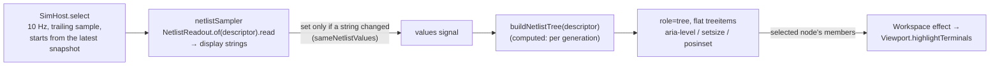

- **Structure** comes from the snapshot's topology descriptor, named as `netlist.dump` (`formatNetlist`) names it: `Node 4: 3:a`, `Branch 1 e3.filament: 3 -> 4`. Rows are keyed by identity (a node by its first member, a branch by its element), so expansion and the selection survive a new generation.
- **Values** go through `NetlistReadout`, the overlays' readout: an island shows its `islandStatus` and nominal band (`solved · band dc12`); a node of an unsolved or unreferenced island and a branch of an unsolved island read `no reading`, never 0 V or 0 A. Quantities have three significant figures and an SI prefix (`formatQuantity`); a DC branch adds its direction against its ends (`a -> b`).
- **Connection rows** (F3.6 part 3, protocol 7): a lead's or a wire's branch row adds a detail line from its connection record (`connectionDetail`): the conductor's drop and temperature, then each end with a termination node, its drop, its hot-spot temperature and its state when not `ok` (`drop 201 mV · 303 K · a 300 mV 394 K · b 6.10 mV 302 K`), and `insulation damaged` when set. A lead's clip ends have none, so a lead shows only its conductor. The line is part of the row's text (no extra tab stop), read with the row by a screen reader. Records only, never `connection.sim`; a connection that isn't netlisted has no branch row (`wire.info` covers it).
- **Rate:** `SimHost.select` at `PANEL_SAMPLE_HZ` (10 Hz); a sample whose strings and tick are unchanged is not set, so the panel redraws at most ten times a second and not at all while paused. Rows are tracked by key, so a new sample only rewrites text.
- **Keyboard:** one tab stop (roving `tabindex`); Up and Down, Home and End, Right expands or enters, Left collapses or goes to the parent, Enter and Space toggle. The focused row is the selection (`aria-selected`). Selecting a node rings its terminals in 3D (`ViewportRenderer.highlightTerminals`, view state only); closing the inspector clears it.
- **Trace** (phase 2 acceptance): T on a branch row (`aria-keyshortcuts="T"`), or the "Trace selected branch" button below the tree, starts a live trace of that branch's current through `SimHost.watch` (one at a time; T again, or "Stop trace", stops it; closing the inspector stops it). `ctl-trace-plot` draws it as an SVG line against sim time with a value axis from 0 to the peak; a gap is no reading, never 0 A. The plot is `role="img"` with a text alternative, also its caption ("Peak 6.16 A at 0.000 s; last solve at 1.500 s: 432 mA."), drawn sample-and-hold (a step at each solve). It redraws when the trace's `version` changes: at most 10 Hz, or 1 Hz under `prefers-reduced-motion` (`REDUCED_MOTION_TRACE_HZ`), and nothing animates between redraws. The button sits outside the tree, so no treeitem holds an interactive child.

## Keybindings and the tool belt

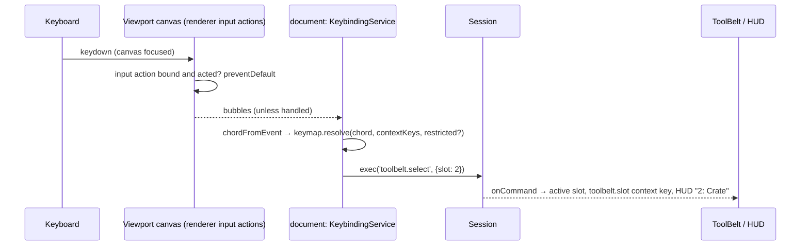

- `KeybindingService` (`feature-session`) owns the one document `keydown` listener for commands. It builds its keymap from the registry (`defaultBindingDecls`) and the player's overrides, which `apps/game` stores in settings with `provideKeybindingOverridesFromSettings()` (`feature-settings`). Without that provider the overrides live in memory.
- The **viewport** pushes `KeybindingService.inputBindings()` into the renderer, names the current keys in the canvas's accessible name, and sets the `viewport.focused` context key while the canvas has focus.
- **Settings → Key bindings…** opens a sibling dialog (`ctl-keybindings-dialog`) with one table per category. **Change** captures the next key press (Escape cancels, Tab leaves); **Unbind**, **Reset** and **Reset all bindings** act at once. Conflicts and ignored stored bindings are shown in the row and wired to the Change button with `aria-describedby`; a polite status region announces each change. Inactive buttons are `aria-disabled`, so focus never falls out of the dialog.
- The **HUD** shows the active tool-belt slot and what it holds (settings `toolBelt.slots`), by its catalogue or prop title (`4: Wire strippers, …`, `2: Crate`).
- **Time controls** (F2.3b, ADR 0011 §13): `ctl-sim-controls` (`feature-session`) sits under the HUD in the viewport overlay (both projected through one `ng-container ctlViewportOverlay`). It shows `SimHost.simTick` (the latest snapshot's tick, never the bus world's), the requested speed as one native radio group that runs `sim.setSpeed`, the achieved speed while running, "Falling behind" and "Catching up", and a polite live region that announces only transitions. The keys are bindings on the sim commands: `P` is `sim.setSpeed.pause` (`!sim.paused`) and `sim.resume` (`sim.paused`), two disjoint `when`s; `Shift+1–3` are `sim.setSpeed.x1/x10/x60`; `Period` and `Shift+Period` are `sim.step.short` (10 ticks) and `sim.step.long` (1 000). All need `session.active && sim.status != 'crashed'`.
- The **viewport** places the active slot's prop when the slot is placeable (F1.7): it arms the renderer's ghost with it, runs one `entity.place` per click or Enter, and calls `ToolBelt.clear()` (UI state, not a command) when Escape cancels placement. It also applies `view.mode` / `view.focus` and publishes the `mode` and `selection.*` context keys that the V, F and Delete bindings use ([rendering](rendering.md#placement-and-moves)).

### Tools on the belt (F3.4 part 1)

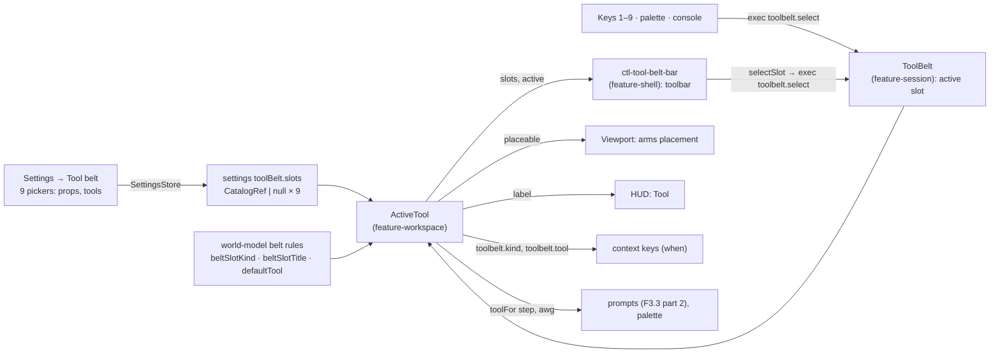

- **A slot holds a `CatalogRef`** (settings `toolBelt.slots`, unchanged since settings v1: no `settingsVersion` bump). What it means is decided by what the ref resolves to, through `beltSlotKind` in `@controls/world-model` (`lib/tools/tool-belt.ts`): a built-in prop or an entity device is **placeable**, a `tool.*` entry is a **tool**, a conductor, cable or lead is a **spool**, `null` is **empty**, anything else **unknown**. A tool or spool slot arms its flow (a conductor spool arms the routing gesture since F3.2 part 3, below; the termination prompts arrive with F3.3 part 2) and **never placement**; only a placeable slot arms the viewport's ghost.
- **`ActiveTool`** (`feature-workspace`) joins `ToolBelt`'s active slot with the belt, so the HUD, the bar and the viewport read one answer: `slots()`, `active()`, `placeable()`, `tool()` (the `ToolDefinition`), `label()` (the HUD line). It publishes `toolbelt.kind` and `toolbelt.tool` (the tool's kind) as context keys, so a flow's commands can bind on a `when`. `App` injects it at start-up.
- **The default-tool rule** is `defaultTool(catalog, belt, step, awg)` in world-model, exposed to the UI as `ActiveTool.toolFor(step, awg)`: a tool the player didn't pick is the first tool on the belt (slot order) whose capability for the step reaches the conductor size, else the first catalogue tool with it by id (newest version of that id). It returns where the tool came from, and a surface always shows it (`describeDefaultTool`: `Torque screwdriver, 1–5 N·m (belt slot 5)` or `… (not on the belt)`), never picks silently.
- **The belt bar** (`ctl-tool-belt-bar`, `feature-shell`, presentational) sits at the bottom centre of the viewport (the workspace's `[ctlViewportBottom]` slot). It is an ARIA `toolbar` named "Tool belt": nine buttons whose accessible names start with their visible number (`4: Wire strippers, … (tool)`), `aria-pressed` on the active slot, one tab stop (roving `tabindex` on the active slot, else slot 1), Left/Right/Home/End to move focus without choosing, Enter/Space or a click to choose. Choosing emits `selectSlot`, and `App` runs the same `toolbelt.select` view command as the number keys.
- **Settings → Tool belt** has one labelled native `<select>` per slot: Empty, the props, the placeable devices, the conductor spools (F3.2 part 3: building wire, never a conductor some cable lists), then the tools (`beltChoices`), plus a stored ref the picker doesn't offer, so it is never shown blank. Restore defaults keeps the belt.

### Routing a wire (F3.2 part 3)

The UI half of [ADR 0017 §9](../decisions/0017-routing-and-bake.md) and [ADR 0010](../decisions/0010-wire-routing-spike.md)'s measured design. The renderer picks terminals and waypoints and previews the route ([rendering](rendering.md#pickers-and-the-routing-gesture-f32-part-3)); the workspace owns the gesture and turns a completed route into **exactly one** `wire.add`. Nothing else is logged.

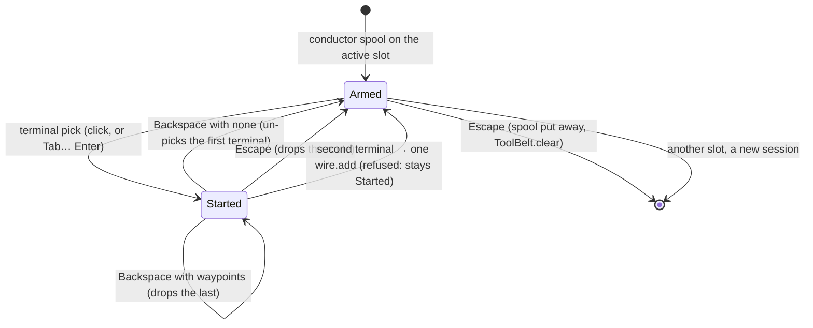

- **`connectRouting(renderer, state)`** (`feature-workspace` `routing/routing-flow.ts`, in the viewport's injection context, like the overlays). `spoolOf` (a conductor entry, with its first colour and AWG; a cable spool is the cable gesture's, below, and a test lead's hint says leads are connected with `lead.connect`) and the gesture (a `linkedSignal` reset by a new spool or session generation) make a `RoutingSession`, which an `effect` pushes to `ViewportRenderer.setRouting`. The renderer's `RoutingEvent`s and the `routing.*` commands step the pure state machine in `routing/routing-gesture.ts` (`pickTerminal`, `addWaypoint`, `stepBack`, `cancelGesture`).
- **The one command.** The second terminal's event carries the renderer's proposal (`proposeRoute`, the command's own maths). `pickTerminal` builds `wire.add {ref, a, b, route, lengthMm, colour, tool}` from it: each end's termination (`'auto'` at Trainee; above it the end's prompt's `TerminationArgs`, below), the proposal's route and length, the conductor's first colour, and the cutter from `ActiveTool.toolFor('cut', awg)`. It runs through `Session.execFromInput`, so a refusal is the shell's warning toast and the picks are kept. A proposal the command would refuse (`route-collides`, the same terminal twice, no cutter) is a warning toast from the flow, without running anything. After a success the gesture starts over with the spool still armed.
- **Keys are view commands on `when`s** (`@controls/commands` `routing.ts`, all `logged: false`, all rebindable in Key bindings): `routing.terminalNext` / `routing.terminalPrevious` on Tab / Shift+Tab under `viewport.focused && routing.terminalDevice` (call `ViewportRenderer.cycleTerminal`); `routing.back` on Backspace under `viewport.focused && routing.active && routing.started`; `routing.cancel` with no key (the palette and console; Escape reaches the gesture as the renderer's `cancel` event); Z is `view.focus`'s binding `view.focus.terminals`, with `target` from `routing.zoomTarget`. Enter is the renderer's `commitPlacement` input action (`pickKeyTerminal`). `entity.delete.selection` gained `!routing.started`, so Backspace and Delete never delete the device being wired once a route is started (with a spool merely armed they still delete the selection), and the default keymap stays conflict-free.
- **Context keys** (published by the flow from an `effect`): `routing.active` (a routable spool), `routing.started` (a first terminal), `routing.terminalDevice` (the device Tab would cycle: selected, focused, the keyboard terminal's; never a merely hovered one, so a resting pointer never takes Tab from focus traversal), `routing.zoomTarget` (`entity-<id>` while `state.terminal.zoomSuggested`).
- **A first terminal that leaves the world** (an undone `entity.place`, a console delete) starts the route over, announced (`dropMissingFrom`, from an effect on the world).
- **What the player sees and hears.** A top-centre hint (`data-testid="routing-hint"`, `pointer-events: none`, not a live region because it follows the pointer) says what the next pick does, the route under the pointer with its length or its refusal, and the zoom offer. A polite status (`routing-status`) announces the first terminal, each Tab stop, waypoints added and removed, the finished wire with its length, a cancelled route and the spool put away. The canvas's accessible name lists the routing keys. The viewport host carries `data-routing="armed|started"`.

### Termination prompts (F3.3 part 2)

D9 and [ADR 0015](../decisions/0015-world-document-v3.md) ("Which command a surface logs"): above Trainee each terminal pick first collects that end's tool steps, and the route still logs **one** `wire.add`, carrying both ends' `TerminationArgs`. A half-landed end is never persisted and the prompts never log anything.

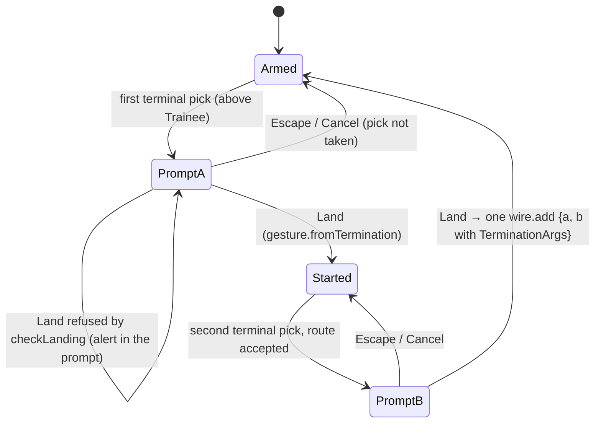

- **Modes** (`termination-model.ts` `promptMode`, from the world's difficulty, so replay agrees): `automatic` (Trainee: no prompt, `'auto'`), `preselected` (Apprentice: every field from world-model's `suggestTermination` over the tools at hand, so no surface encodes which hole, die or torque is right; a note says so when the tools can't make an ideal landing), `blank` (Journeyman and Realistic: only the tools in hand, from the default-tool rule, and the method when the terminal has one; hole, strip length, accessory, die and torque blank). Realistic shows nothing more than Journeyman: the prompt never shows an outcome at any difficulty.
- **The tools at hand** (`toolsAtHand`): the belt's tools in slot order, then every other catalogue tool, newest version per id, labelled "(belt slot N)" or "(not on the belt)", matching `defaultTool`'s catalogue fallback. Strippers, crimpers and drivers are the tools with that capability for the conductor's size; accessories are every catalogue ferrule or lug of a kind the method takes (a wrong size is the command's `wrong-accessory` to give, not a filter).
- **Steps** (`ctl-termination-prompt`, a `ctl-dialog`): _strip and finish_ (method, stripper, hole, strip length in whole mm, ferrule or lug, and with one the crimper and die) and, for a `clampTorque` method, _tighten_ (driver; a torque setting field only for a driver with a range, else "tightened by feel": the command draws the plain screwdriver's spread). Hints show the method's gauge range and strandings, the terminal's marked strip length and torque, the screw's drive types and the driver's range: the device's own markings, not the answer's quality.
- **Checks.** Blank or malformed fields (`stripProblems`, `torqueProblems`) are an alert naming the first one, which takes focus with `aria-invalid`. A complete draft (`argsOf`) goes to `RoutingFlow.confirmTermination`, which parses `TerminationArgsSchema` and runs world-model's `checkLanding` (`landingRefusal`, the command's own validation, end b with the next termination id); a refusal (`wrong-tool`, `wrong-drive`, `beyond-tool-capacity`, `gauge-out-of-range`, `wrong-accessory`, `terminal-full`, …) returns to the prompt as `Refused: <message> (<code>)` until the draft changes, and nothing is logged. A clip-only terminal is refused (`wrong-method`, a warning toast) without a prompt.
- **The route.** End a's arguments become `RouteGesture.fromTermination`, and the routing session's `from.termination` follows the chosen method, so the preview starts at that method's entry point. End b's Land always re-proposes against the current world with its chosen method (`proposeCompletion` in `routing-gesture.ts`, over `proposeRoute`); a refusal (`route-collides`, `not-found` when the first terminal has left the world) stays in the prompt with the entries kept. Then `pickTerminal` builds the one `wire.add` and it runs through `Session.execFromInput` as before.
- **Keyboard and focus.** The dialog opens focused on its first field and moves focus to the first field of each step; choices are native `<select>`s (type-ahead on every platform; arrows change the value in place on Windows and Linux and open the menu on macOS); Enter in a text field goes on (a visually hidden submit button), Back returns to the first step with the draft kept, Escape or Cancel dismisses (`dismissed` → `cancelTermination`: the pick isn't taken, announced) and focus returns to the canvas. While a prompt is open, picks, Tab cycling and the `routing.*` keys do nothing. The step and the alerts are announced by a status and an alert **inside** the dialog; the flow's own announcements (`Terminate end a at …`, `From … (screw clamp)`, `Termination cancelled …`) use the viewport's region.

### The wire readout (F3.6 part 3)

The last of D16's inspection surfaces: in work mode, while the console is available (`console.available`: sandbox and dev builds, until F5.3 gates debug tools by difficulty), the wire under the pointer, else the selected wire, shows its protocol 7 connection record as text. It is the readout the heat overlay can't be: a half's colour is only max(T_c, T_end), so the panel shows the conductor's temperature and **each end's** separately.

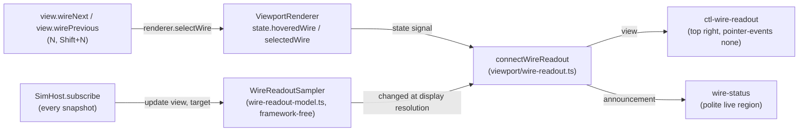

- **What it shows** (`WireReadoutView`, strings only): a title from the world (`Wire 2`, `Wire 5 "L1"`, `Wire 7 (cable 1)`, `Test lead 3`, `Cable 1`), the current, a table of drop and temperature for the conductor, end a and end b (`394 K (121 °C)`, the heat legend's format), and a state in words, worst first: `fused`, `intermittent at end a, open now` / `closed now`, `arcing at end a`, `open: not in a circuit`, `degrading at end a (above the oxidation onset)`, `overheating at end a` (at or above ambient + 100 K, the engine's `terminationOverheat` point), else `normal` or `not solved (<status>)`; `insulation damaged` is added to any of them. Quantities use the inspector's `formatQuantity` (three significant figures, SI prefixes).
- **The never-0 rules** are the inspector's and `wire.info`'s: an electrical field whose `readings` bit is clear is "no reading"; a gap (an `intermittentOpen` end; a conductor whose `conductorState` is `open`, a fused lead or conductor, stated `fused`; any other code but `closed` is stated `conductor open`) reads `gap 119 V` or `gap, no reading`, never 0 V; an end with state `none` (a lead's clip, an unlanded end) reads "no termination", never 0 K; no snapshot, or no record for the connection, is no reading everywhere. A cable jacket has no record and says so.
- **Allocation.** The sampler reads every snapshot with `NetlistReadout` (allocation-free, into a reading made once per topology generation) only while a wire is the target, and compares the target's values at display resolution (three significant figures, whole K and whole °C, the state codes) with what is shown, in preallocated arrays. Only a change bumps a signal, and only then are strings formatted: a steady wire costs nothing per snapshot.
- **Placement.** Top right of the viewport (clear of the HUD, the routing hint, the belt bar and the legend), `pointer-events: none`, so it never takes a pick or a click (e2e aims pass through it). A native `pointermove` listener (no change detection per move) moves it to the bottom left while the pointer is in its corner, and back; an `afterRenderEffect` does the same when the panel first appears, since the hover (and so the panel) arrives a frame after the pointer stopped, possibly under it.
- **Keyboard.** Selection cycling (`[` `]`) holds entities only, so `view.wireNext` (N) and `view.wirePrevious` (Shift+N), unlogged view commands under `viewport.focused && mode && !routing.started` (never mid-route, like Delete), select the next or previous drawn wire (routed conductors, then cables, by id, wrapping) through `ViewportRenderer.selectWire`; Escape clears it. The selected wire shows the same readout. A new selection is announced once in the polite `wire-status` region (`Wire 2 selected. Current 11.8 A. Conductor 303 K (30 °C), drop 201 mV. End a 394 K (121 °C), …`); hovers and changing values never are. Without the readout (walk mode, no console) the selection is still named, and N with nothing to select says "No wire to select." (again on each repeated miss, by alternating a trailing no-break space; any change of the selected wire, by click, N or Escape, replaces it: a `linkedSignal` on the selection) The canvas's accessible name lists both keys. The viewport host carries `data-wire-hovered` and `data-wire-selected` (`c2`, `k1`).

### Cables: run, strip, land and label (F3.2 part 4)

The UI half of F3.2 part 4 ([commands](commands.md#cables-in-framing-f32-part-4), [rendering](rendering.md#cables-f32-part-4)). A cable run is a gesture that logs **one** `cable.add`; the strip, landing and label prompts each log their own command (`cable.strip` per end, `wire.land` per conductor end, `wire.label` / `cable.label`), and nothing else is logged.

```mermaid
stateDiagram-v2
    [*] --> Armed: cable spool on the active slot
    Armed --> Started: entry pick (click a box, or select it, Tab… Enter)
    Started --> Started: staple / bore / duct waypoint (click off every enclosure)
    Started --> Armed: Backspace with no waypoint, Escape
    Started --> Strip: far entry → one cable.add (refused: stays Started)
    Strip --> Armed: Strip → one cable.strip per filled-in end; Escape strips nothing
    Armed --> [*]: Escape (spool put away)
    [*] --> Landing: wiring.land (L on a selected conductor, palette, console)
    Landing --> Prompt: terminal pick (above Trainee)
    Prompt --> Landing: Land → one wire.land; the next conductor free at that end
    Landing --> [*]: every conductor landed at that end, Escape
```

- **Three flows, one renderer session.** `connectCableRouting` (`routing/cable-flow.ts`) and `connectWiring` (`routing/wiring-flow.ts`) are `RoutingMode`s passed to `connectRouting`, which pushes the first session in force to the renderer (a conductor spool's, else a cable spool's, else landing's) and publishes the `routing.*` keys for it. The modes are exclusive: each is armed by something that puts the others away. One `Announcer` (`routing/announcer.ts`) feeds the viewport's single `routing-status` region.
- **The cable gesture** (`routing/cable-gesture.ts`, pure). A cable spool (`cableSpoolOf`: a cable assembly, sized by its largest conductor) runs the renderer in `entries` mode (`RoutingSession.ends`). A click on an entity is an `entity` event; on an enclosure the nearest entry a cable can enter is picked (`nearestEntry` over `enclosureEntries`, each checked with `checkCableEnd`), else the nearest with its problem (`entry-closed`, `entry-full`) as a refusal; on anything else (a duct) the event's waypoint is added. Waypoints snap through `snapWaypoint` in the renderer with `kinds` duct, conduit, staple and (with a drill bit from the default-tool rule) bore. A bore whose bit leaves under 31.75 mm to the stud edge raises the nail-plate warning (`nailPlateWarning`, `boreNeedsNailPlate`): a toast and the announcement, never a refusal. The far entry builds `cable.add` with `defaultTailsMm` and `routeDefaultLengthMm` through the entry points and waypoints, and the cutter from `ActiveTool.toolFor('cut', awg)`.
- **Pre-check with the command itself** (`precheck`): the args schema, then the command's own pure `run` against the world now (a change is returned, never applied). A refusal (`staple-spacing`, `same-entry`, `entry-full`, …) is a warning toast and an announcement with the picks kept, and nothing is logged. While routing, the hint shows the support rule so far (`supportProblem`: `checkCableSupport` from the first entry, framing by the waypoints or a box on a stud wall), before anything is logged.
- **Keyboard.** With a cable spool, `routing.terminalDevice` is the selected (or focused) enclosure, so Tab / Shift+Tab cycle its entries (each announced with its problem, if any) and draw the focus marker (`RoutingSession.keyPointMm`); Enter is the renderer's `enter` event and picks it. Backspace and Escape step back as for wires. Keyboard **waypoints** are a known gap (as for wires).
- **The strip prompt** (`ctl-cable-strip-prompt`, `wiring-model.ts` `stripRequest`): opens after each `cable.add`, and by `wiring.strip` (J on a selected cable or one of its conductors, `wiring.stripTarget`). Each end shows its tail and the most a box end allows (`maxStripAtBoxMm`: 6.35 mm of sheath stays inside); the stripper is the default-tool rule's (`stripJacket`). Trainee and Apprentice start at that most, Journeyman and Realistic blank. A blank end is left alone; each filled-in end is one `cable.strip`, all pre-checked before the first is logged, a refusal (`strip-too-long`, `cannot-unstrip`, `wrong-tool`) an alert in the prompt.
- **Landing a free end** (`wiring.land {id}`: L on a selected conductor, the palette's form, the console). It puts the belt away and arms a terminal-picking session (no first terminal), so Tab, Enter, Z and clicks work as for wires. A pick lands the conductor's free end whose stripped tail reaches the terminal (`landingEnd`, `checkTailReach`); at Trainee it logs `wire.land` with `'auto'`, above it F3.3 part 2's termination prompt opens for that end (`terminationRequest`, the same dialog), and its Land is pre-checked with `wire.land`'s own `run` (`tail-too-short`, `beyond-tool-capacity`, … in the prompt). Then the next conductor of the same cable with that end free follows (`nextToLand`), announced, until none is left.
- **Labels** (`ctl-label-prompt`, `labelRequest`, `labelCommand`): `wiring.label {wire, cable}` (Shift+L on the selected wire or cable), or a click on a wire with the label maker in hand, opens a text field and the label maker (default-tool rule `label`). Print logs `wire.label` or `cable.label`; with a label already printed, empty text removes it. The text rules are the command schema's (`bad-args` in the prompt).
- **Context keys** (from `connectWiring`): `selection.connectionId` / `selection.cableId` from the selected wire (the palette prefills reference fields from them), `wiring.stripTarget`, and `wiring.cables`, `wiring.freeEnds`, `wiring.wires` (the commands' palette `when`s).

## Command palette (F1.3)

`ctl-command-palette` (`feature-palette`, mounted once by `App`) is one of the four surfaces over the registry. `palette.open` is a view command with the default chords `Mod+K` and `Mod+Shift+P` and `globalKeybinding: true`, so it fires from a text field or an open dialog too; the palette opens when the session reports it (`Session.onCommand`). It is `logged: false` UI chrome: it runs through the registry and fires `onCommand`, but never enters the replay log. Closing isn't a command.

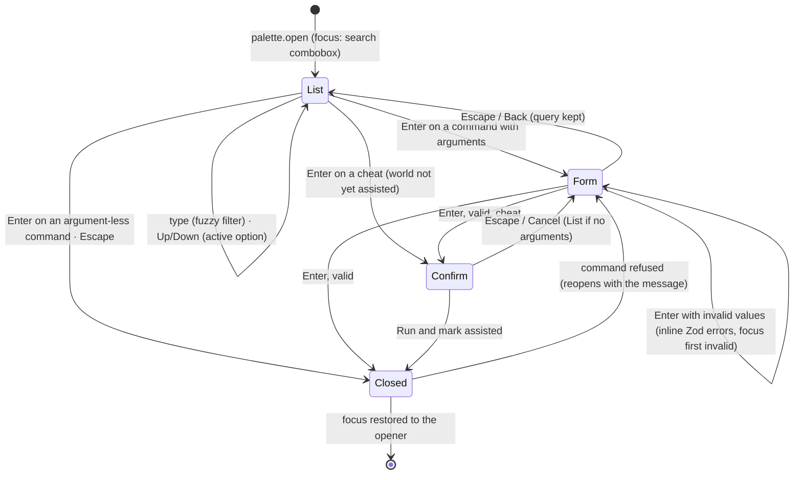

- **List.** An ARIA combobox (`role="combobox"`, `aria-controls`, `aria-activedescendant`, `aria-autocomplete="list"`) over a `listbox` of every registered command except `palette.open`. Focus stays in the search field; Up/Down wrap. `paletteItems` ranks with a small fuzzy matcher (`fuzzyMatch`: ordered subsequence, bonuses for word starts, camelCase humps and runs, a charge for gaps) over title, id and category; every query word must match. Commands whose `when` is false stay listed after the enabled ones, `aria-disabled`, with the reason; Enter on one announces the reason in a status region. Recent commands (settings `palette.recents`, at most 20, most recent first) lead an empty query and get a score boost otherwise. Each option shows the command's current keys.
- **Form.** `buildArgForm(def.args)` runs `z.toJSONSchema(args, { io: 'input' })` and turns the JSON Schema into fields: string, integer/number (bounds become a hint such as "Whole number, 1 to 9"), boolean (a checkbox, or Yes/No/Not set when optional without a default), enum and literal (a `<select>`), nested object (a `fieldset`) and optional object ("Include …"). Defaults, including a parent object's default, prefill the fields. `.meta()` hints: `title` (label), `description` (help text) and `x-controls-ref` (`entity`, `connection` or `cable`: an id prefilled from the `selection.entityId`, `selection.connectionId` or `selection.cableId` context key when it is published, and for entities suggested from the world's entities). Labels otherwise come from the key (`positionMm` → "Position (mm)").
- **ADR 0015 shapes (P3 PR 5a).** A **choice** (`anyOf` of `null`, const or enum scalars and at most one object: a nullable object, `'auto' | TerminationArgs`, a nullable enum or boolean) is a radio group in a `fieldset`/`legend`, labelled "None", the value, or the object's `title` (else "Specify"); the object's fields show only while it is chosen, with ids under the choice's id (`a.termination.method`). A **nullable scalar** (`z.string().nullable()`, `z.int().nullable()`) is a text field where blank is `null` when the key has no default and left out when it has one ("Leave blank for none"); a nullable reference is never prefilled. A **list** (`z.array(item)`, item an object or a scalar) is a `fieldset` of item fieldsets ("Waypoint 3 of 5", from the items' `title`, else "Item"), each with Move up, Move down and Remove, plus Add; the buttons are `aria-disabled` at the ends, at `minItems` and at `maxItems`, each change is announced in a polite `role="status"` region, and focus follows the item (after Remove: the item that took its place, else the one before, else Add). Item field ids carry the index (`route.3.positionMm.x`), and `validateArgs(schema, form, args, values)` maps Zod issues onto them through `visibleFields`. The item count is the value at the list's id; `addListItem`, `removeListItem` and `moveListItem` re-key the nested values.
- **Validation** is the command's own schema: `validateArgs` maps each Zod issue to the field at its path (a missing value reads "Required"), shown inline with `aria-invalid` and `aria-describedby`. Errors appear after the first Run and then update as the player types; focus moves to the first invalid field only on Run.
- **Running.** The palette closes first and runs `Session.exec` once the dialog has restored focus, so a command that moves focus keeps it. If the command is refused, the palette reopens on it with the message. A success is added to the recents.
- **Cheats** (`cheat: true`) ask "Run a cheat?" once per world: confirming runs the command, and the bus sets the world's `assisted` flag, which the HUD badge shows and the save keeps. Once the world is assisted there is nothing left to lose, so the palette runs cheats without asking.
- **Keyboard.** List: type, Up/Down, Enter, Escape. Form: Up/Down or Tab between fields (a `<select>` and a radio group keep the arrows for their options), Enter runs (Enter also toggles a checkbox), Escape goes back; a list's buttons are reached with Tab and pressed with Enter or Space. Confirmation: arrows switch buttons, Enter, Escape.
- A spec builds and renders a form for every registered command, so a command whose args the palette can't express fails at registration time.

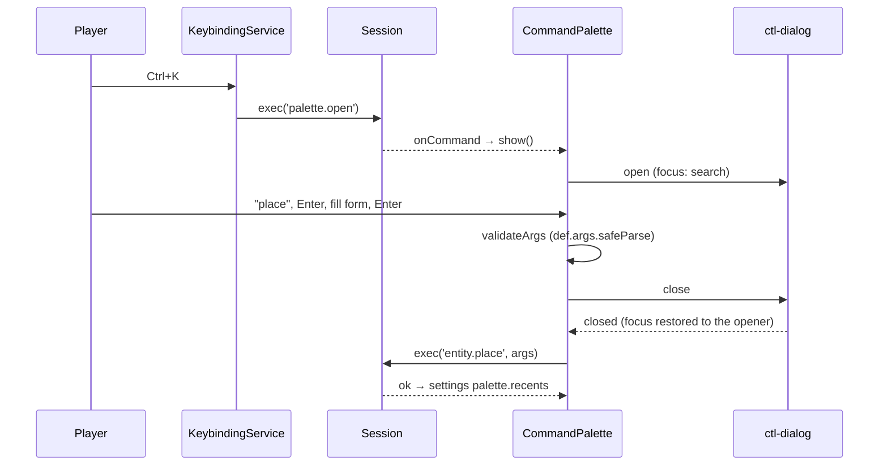

## Settings, theme and notifications

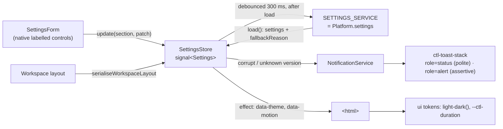

- **Document:** `Settings` from `@controls/save-format` (`settingsVersion` 2 since the Continue fix: `saves.lastPlayed`). The store edits it section by section; edits made before the first load finishes are replayed on top of the loaded document, and nothing is saved until the load has finished.
- **Theme:** tokens are `light-dark()` pairs under `color-scheme: light dark`, so they follow `prefers-color-scheme`. A settings override pins `color-scheme` through `data-theme`.
- **Reduced motion:** `display.reducedMotion` is `system` (follow `prefers-reduced-motion`), `reduce` (`data-motion="reduce"`) or `full` (`data-motion="full"`, ignores the OS preference).

### Persistence

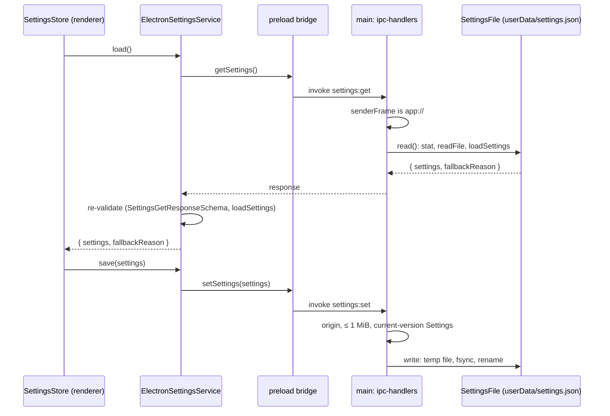

- **Web harness:** `WebSettingsService` stores the same JSON in `localStorage` (`controls.settings`), with every access in try/catch. Both platforms parse stored text with `parseStoredSettings` from `@controls/ipc-contract`, so fallback behaviour is identical.
- **Quit:** `Platform.quit()` → `app:quit` → `app.quit()` on desktop (including macOS). The web harness has no Quit.

### Flush before quit

Buffered writes (the settings debounce and, since F1.8b, autosave) must reach disk before the window closes or the app quits; Angular's `DestroyRef` doesn't run then. Features register a flush with `Platform.lifecycle.onBeforeQuit` (Angular: `APP_LIFECYCLE`), and main holds the close or quit until the renderer acknowledges.

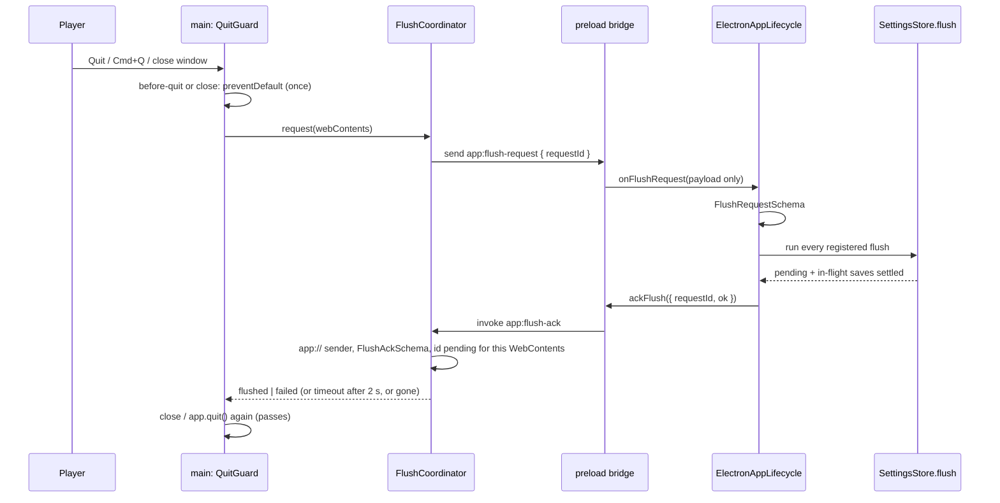

| Channel             | Direction       | Payload (`@controls/ipc-contract`)                   | Notes                                                                                  |
| ------------------- | --------------- | ---------------------------------------------------- | -------------------------------------------------------------------------------------- |
| `app:flush-request` | main → renderer | `FlushRequestSchema`: `{ requestId: int > 0 }`       | `webContents.send`; the preload forwards the payload only, never the IPC event.        |
| `app:flush-ack`     | renderer → main | `FlushAckSchema`: `{ requestId: int > 0, ok: bool }` | `invoke`/`handle`; refused unless the sender is `app://` and the id is pending for it. |

- **Every close path:** `before-quit` (menu Quit through `app:quit`, Cmd+Q, the Dock, `window-all-closed`) flushes every open window; a window's `close` (title-bar button) flushes that window. A close during a quit shares its flush.
- **Never blocks quitting:** `FLUSH_BEFORE_QUIT_TIMEOUT_MS` (2 s) bounds the wait, a destroyed or crashed renderer isn't waited for, and a failed flush still closes (the store has already shown an error).
- **Web harness:** `WebAppLifecycle` runs the flushes on `pagehide`. The browser doesn't wait for promises, so each flush is called synchronously (`runFlushes`), which is enough for the `localStorage` write.
- **Notifications:** info and success auto-dismiss after 8 s; warnings and errors stay until dismissed. Expiry pauses while the pointer or keyboard focus is in the stack. Each toast has a Dismiss button, Escape dismisses the focused toast, and focus then moves to the next toast or back to where it came from.

### Renderer crash recovery

When the window's renderer process dies, main reloads it and the menu offers Continue from the latest autosave ([ADR 0011 §10](../decisions/0011-sim-worker-contract.md#10-lifecycle)). Main writes nothing on the way: the recovery point is what the save directory already holds.

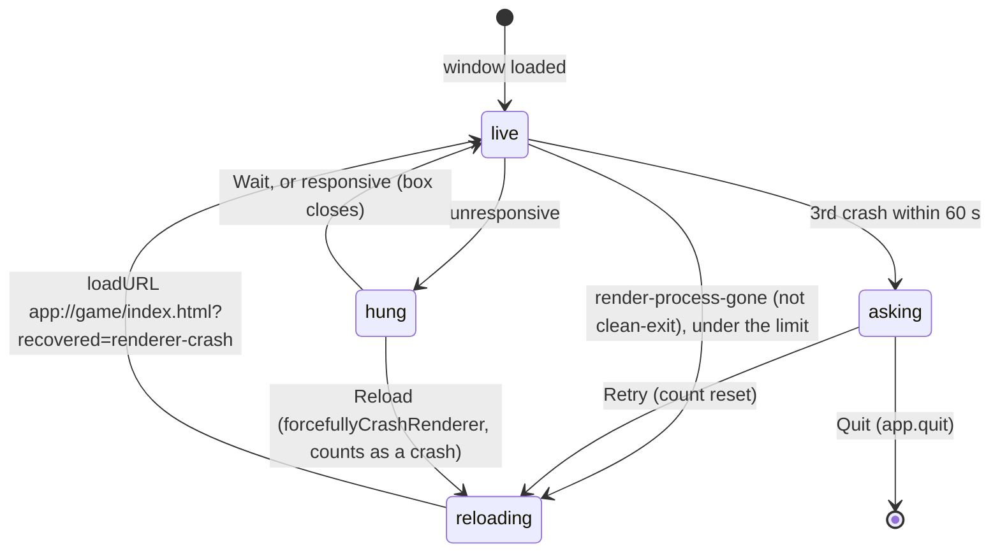

- **Main:** `RendererRecovery` and `CrashLoopLimiter` (`apps/desktop/src/crash-recovery.ts`, electron-free). The crash-loop and not-responding prompts are native message boxes, which the OS makes accessible. The old page's save handles are dropped on reload.
- **Renderer:** `Platform.recoveredFromCrash` (`true` on the recovery URL in Electron, always `false` in the web harness) → `App.recovered` → `MainMenu`'s `recovered` input: a `role="alert"` notice, Continue focused and described by it. The notice goes once a game starts or loads.
- **Continue** resumes `settings.saves.lastPlayed`, which each autosave points at the slot it wrote; `SaveGames` writes that pointer at once (no debounce), because a crash skips the quit flush.

## Related

- [ADR 0005 Docking workspace](../decisions/0005-docking-workspace.md) · [UI caveats](../caveats/ui.md) · [Architecture overview](overview.md)
- Plan §4.6 (one registry, four surfaces), §4.9 (modes) and the [phase-1 plan](../../plans/phase-1-game-shell.md) F1.1–F1.5 and F1.8b.
- [Commands](commands.md) (registry, `when`, view commands) · [Scripting](scripting.md) (the palette scenario's hash against `sim run`).
