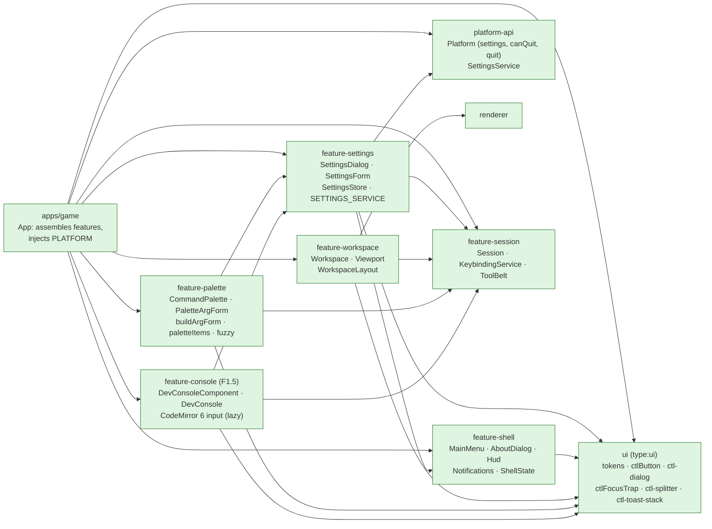
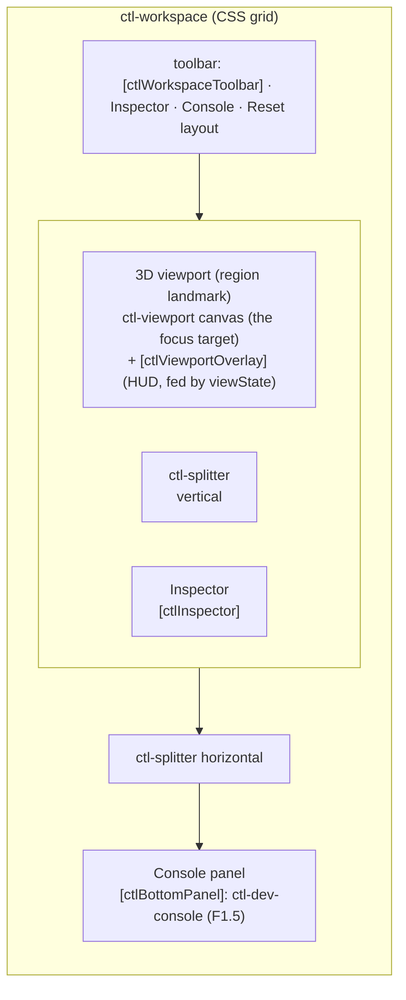
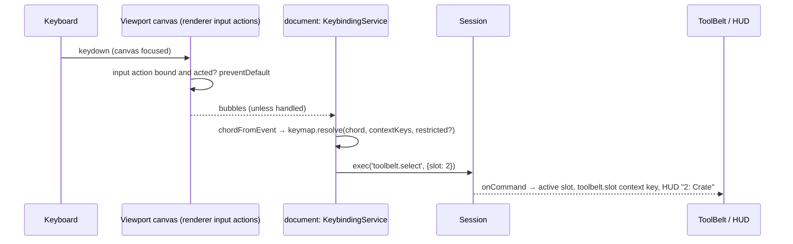
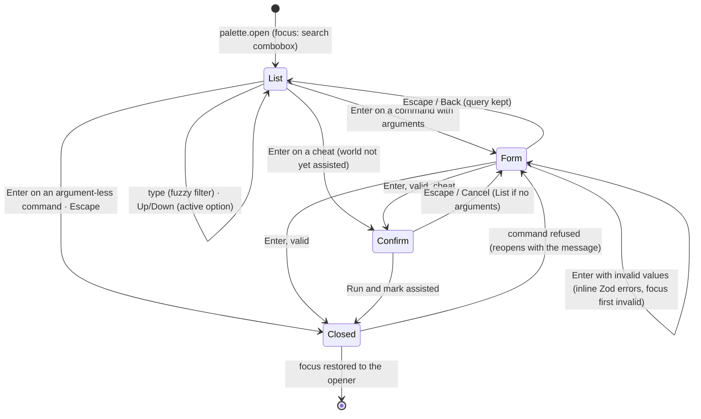
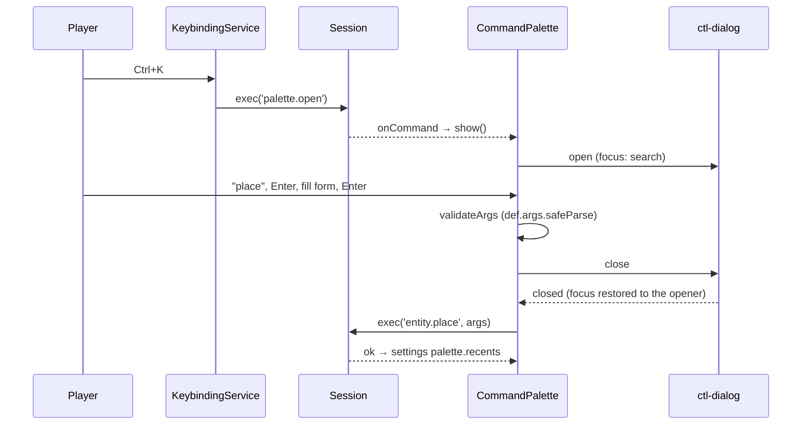
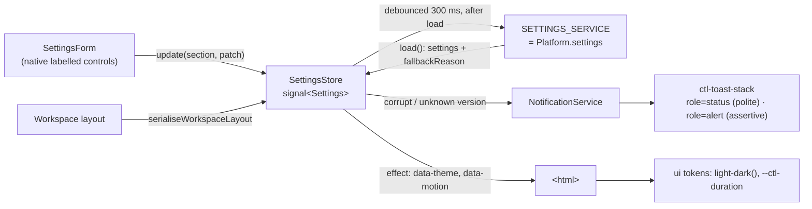
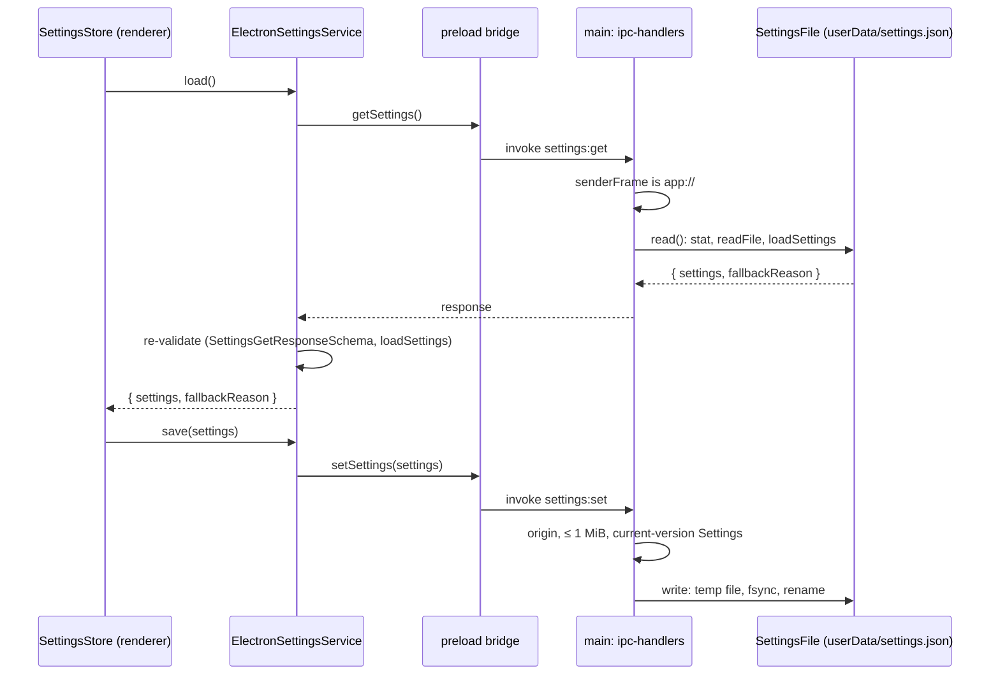
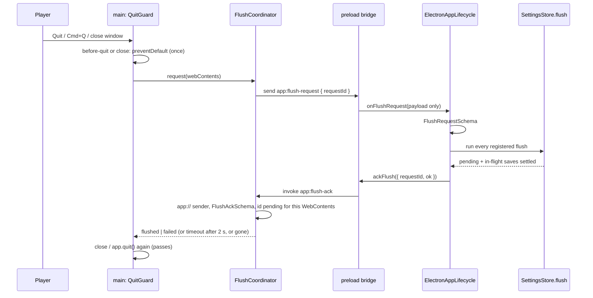

# UI shell

> **Status (F1.5):** the shell, workspace, settings screen, HUD, notifications and theming exist. The command registry and `feature-session` landed in F1.2 ([commands](commands.md)), the keybinding service, the Key bindings dialog and the tool belt in F1.4, the command palette (`feature-palette`) in F1.3, and the dev console in F1.5 ([dev console](console.md)). Settings persist on both platforms (below). Reset layout runs the `view.resetLayout` command, and the HUD's assisted badge reads the world's `assisted` flag from the session. Gotchas: [UI caveats](../caveats/ui.md). Docking choice: [ADR 0005](../decisions/0005-docking-workspace.md).

## Libraries

`ui` is presentational: it holds no services, state or commands. Features may use each other (`feature-settings` uses `NotificationService` from `feature-shell`), but none of them imports a concrete platform. The app provides `PLATFORM` (Electron bridge or web harness) and will provide the real `SETTINGS_SERVICE`.

## Screens and focus

The workspace is always mounted. Behind the main menu it shows only the viewport (`[chrome]="false"`) and is `inert`, so the menu sits over a live 3D backdrop.

```mermaid
stateDiagram-v2
    [*] --> Menu: boot (focus: first menu item)
    Menu --> NewGameDialog: New sandbox (focus: Seed, a fresh seed)
    NewGameDialog --> Workspace: Enter / Start, valid seed → Session.newSandbox (focus: viewport canvas)
    NewGameDialog --> Menu: Escape / Cancel (focus returns to New sandbox)
    Menu --> Workspace: Resume (focus: viewport canvas)
    Workspace --> Menu: Menu button, or Escape outside the canvas (focus: Resume)
    Menu --> Workspace: Escape (session running)
    state Menu {
        [*] --> Items
        Items --> SettingsDialog: Settings
        SettingsDialog --> Items: Back / Escape (focus returns to Settings)
        SettingsDialog --> KeyBindingsDialog: Key bindings…
        KeyBindingsDialog --> SettingsDialog: Back / Escape (focus returns to Key bindings…)
        Items --> AboutDialog: About
        AboutDialog --> Items: Close / Escape (focus returns to About)
    }
    Workspace --> Palette: Ctrl+K / Ctrl+Shift+P (palette.open; also from the menu or a dialog)
    Palette --> Workspace: Escape or a command runs (focus returns to the opener)
```

- **Dialogs** are native `<dialog>` elements opened with `showModal()` (`ctl-dialog`). The page behind them is inert, focus moves inside and is trapped, Escape closes, and focus returns to the opener.
- **Escape** is handled innermost-first: a key capture in the Key bindings dialog, a dialog or the focused viewport canvas (cancel a move, cancel placement, clear the selection, in that order; F1.7) consumes it; otherwise `App.onEscape` toggles between the menu and the workspace. Escape is the shell's fixed "back" key, reserved by the keybinding service, so no command can take it.
- **New sandbox** (F1.9) opens the new-game dialog: the level (Workshop), a seed field with a fresh seed (`SEED_SOURCE`, `crypto.getRandomValues`) and a New seed button. A typed seed must be a whole number from 0 to 4294967295 (`parseSeed`); an invalid one is refused inline (`aria-invalid`, an alert) and the dialog stays open. Start runs `Session.newSandbox({ seed, difficulty: settings.gameplay.defaultDifficulty })`, which loads the workshop level with a fresh history and replay log; the viewport resets to its starting view (`Session.generation`).
- **Main menu** items are plain buttons in a `<nav>`. Tab, Up/Down, Home and End move between them. Continue and Load are `aria-disabled` with a reason until F1.8b, and Quit is hidden where `Platform.canQuit` is false (the web harness).

## Workspace layout

- `WorkspaceLayout` is plain JSON: `{ inspector: { size, collapsed }, bottom: { size, collapsed } }`, with integer CSS pixels clamped by `normaliseLayout` (inspector 200–640, bottom 96–560, and at most 60 % of the window in CSS).
- It is two-way bound to `settings.workspace.layout`, so it persists once F1.8a wires the storage.
- Splitters follow the WAI-ARIA window-splitter pattern: arrows resize (Shift for big steps), Home/End jump to the limits, and Enter collapses or restores. Pointer drags use pointer capture.
- **`console.toggle`** (backtick) is applied by the workspace too: it expands the bottom panel and focuses its `[data-autofocus]` element, or collapses it and restores focus when focus is already inside. See [dev console](console.md).
- **Reset layout** runs the `view.resetLayout` view command through `Session.exec`. The workspace applies it when the command reports back (`Session.onCommand`), so any surface that runs the command resets the layout. It is logged and never changes the world hash.

## Keybindings and the tool belt

- `KeybindingService` (`feature-session`) owns the one document `keydown` listener for commands. It builds its keymap from the registry (`defaultBindingDecls`) and the player's overrides, which `apps/game` stores in settings with `provideKeybindingOverridesFromSettings()` (`feature-settings`). Without that provider the overrides live in memory.
- The **viewport** pushes `KeybindingService.inputBindings()` into the renderer, names the current keys in the canvas's accessible name, and sets the `viewport.focused` context key while the canvas has focus.
- **Settings → Key bindings…** opens a sibling dialog (`ctl-keybindings-dialog`) with one table per category. **Change** captures the next key press (Escape cancels, Tab leaves); **Unbind**, **Reset** and **Reset all bindings** act at once. Conflicts and ignored stored bindings are shown in the row and wired to the Change button with `aria-describedby`; a polite status region announces each change. Inactive buttons are `aria-disabled`, so focus never falls out of the dialog.
- The **HUD** shows the active tool-belt slot and the prop it holds (settings `toolBelt.slots`).
- The **viewport** places the active slot's prop (F1.7): it arms the renderer's ghost with it, runs one `entity.place` per click or Enter, and calls `ToolBelt.clear()` (UI state, not a command) when Escape cancels placement. It also applies `view.mode` / `view.focus` and publishes the `mode` and `selection.*` context keys that the V, F and Delete bindings use ([rendering](rendering.md#placement-and-moves)).

## Command palette (F1.3)

`ctl-command-palette` (`feature-palette`, mounted once by `App`) is one of the four surfaces over the registry. `palette.open` is a view command with the default chords `Mod+K` and `Mod+Shift+P` and `globalKeybinding: true`, so it fires from a text field or an open dialog too; the palette opens when the session reports it (`Session.onCommand`). It is `logged: false` UI chrome: it runs through the registry and fires `onCommand`, but never enters the replay log. Closing isn't a command.

- **List.** An ARIA combobox (`role="combobox"`, `aria-controls`, `aria-activedescendant`, `aria-autocomplete="list"`) over a `listbox` of every registered command except `palette.open`. Focus stays in the search field; Up/Down wrap. `paletteItems` ranks with a small fuzzy matcher (`fuzzyMatch`: ordered subsequence, bonuses for word starts, camelCase humps and runs, a charge for gaps) over title, id and category; every query word must match. Commands whose `when` is false stay listed after the enabled ones, `aria-disabled`, with the reason; Enter on one announces the reason in a status region. Recent commands (settings `palette.recents`, at most 20, most recent first) lead an empty query and get a score boost otherwise. Each option shows the command's current keys.
- **Form.** `buildArgForm(def.args)` runs `z.toJSONSchema(args, { io: 'input' })` and turns the JSON Schema into fields: string, integer/number (bounds become a hint such as "Whole number, 1 to 9"), boolean (a checkbox, or Yes/No/Not set when optional without a default), enum and literal (a `<select>`), nested object (a `fieldset`) and optional object ("Include …"). Defaults, including a parent object's default, prefill the fields. `.meta()` hints: `title` (label), `description` (help text) and `x-controls-ref: entity` (an entity id: prefilled from the `selection.entityId` context key and suggested from the world's entities). Labels otherwise come from the key (`positionMm` → "Position (mm)").
- **Validation** is the command's own schema: `validateArgs` maps each Zod issue to the field at its path (a missing value reads "Required"), shown inline with `aria-invalid` and `aria-describedby`. Errors appear after the first Run and then update as the player types; focus moves to the first invalid field only on Run.
- **Running.** The palette closes first and runs `Session.exec` once the dialog has restored focus, so a command that moves focus keeps it. If the command is refused, the palette reopens on it with the message. A success is added to the recents.
- **Cheats** (`cheat: true`) ask "Run a cheat?" once per world: confirming runs the command, and the bus sets the world's `assisted` flag, which the HUD badge shows and the save keeps. Once the world is assisted there is nothing left to lose, so the palette runs cheats without asking.
- **Keyboard.** List: type, Up/Down, Enter, Escape. Form: Up/Down or Tab between fields (a `<select>` keeps Up/Down for its options), Enter runs (Enter also toggles a checkbox), Escape goes back. Confirmation: arrows switch buttons, Enter, Escape.
- A spec builds and renders a form for every registered command, so a command whose args the palette can't express fails at registration time.

## Settings, theme and notifications

- **Document:** `Settings` from `@controls/save-format` (`settingsVersion` 1). The store edits it section by section; edits made before the first load finishes are replayed on top of the loaded document, and nothing is saved until the load has finished.
- **Theme:** tokens are `light-dark()` pairs under `color-scheme: light dark`, so they follow `prefers-color-scheme`. A settings override pins `color-scheme` through `data-theme`.
- **Reduced motion:** `display.reducedMotion` is `system` (follow `prefers-reduced-motion`), `reduce` (`data-motion="reduce"`) or `full` (`data-motion="full"`, ignores the OS preference).

### Persistence

- **Web harness:** `WebSettingsService` stores the same JSON in `localStorage` (`controls.settings`), with every access in try/catch. Both platforms parse stored text with `parseStoredSettings` from `@controls/ipc-contract`, so fallback behaviour is identical.
- **Quit:** `Platform.quit()` → `app:quit` → `app.quit()` on desktop (including macOS). The web harness has no Quit.

### Flush before quit

Buffered writes (the settings debounce now, autosave from F1.8b) must reach disk before the window closes or the app quits; Angular's `DestroyRef` doesn't run then. Features register a flush with `Platform.lifecycle.onBeforeQuit` (Angular: `APP_LIFECYCLE`), and main holds the close or quit until the renderer acknowledges.

| Channel             | Direction       | Payload (`@controls/ipc-contract`)                   | Notes                                                                                  |
| ------------------- | --------------- | ---------------------------------------------------- | -------------------------------------------------------------------------------------- |
| `app:flush-request` | main → renderer | `FlushRequestSchema`: `{ requestId: int > 0 }`       | `webContents.send`; the preload forwards the payload only, never the IPC event.        |
| `app:flush-ack`     | renderer → main | `FlushAckSchema`: `{ requestId: int > 0, ok: bool }` | `invoke`/`handle`; refused unless the sender is `app://` and the id is pending for it. |

- **Every close path:** `before-quit` (menu Quit through `app:quit`, Cmd+Q, the Dock, `window-all-closed`) flushes every open window; a window's `close` (title-bar button) flushes that window. A close during a quit shares its flush.
- **Never blocks quitting:** `FLUSH_BEFORE_QUIT_TIMEOUT_MS` (2 s) bounds the wait, a destroyed or crashed renderer isn't waited for, and a failed flush still closes (the store has already shown an error).
- **Web harness:** `WebAppLifecycle` runs the flushes on `pagehide`. The browser doesn't wait for promises, so each flush is called synchronously (`runFlushes`), which is enough for the `localStorage` write.
- **Notifications:** info and success auto-dismiss after 8 s; warnings and errors stay until dismissed. Expiry pauses while the pointer or keyboard focus is in the stack. Each toast has a Dismiss button, Escape dismisses the focused toast, and focus then moves to the next toast or back to where it came from.

## Related

- [ADR 0005 Docking workspace](../decisions/0005-docking-workspace.md) · [UI caveats](../caveats/ui.md) · [Architecture overview](overview.md)
- Plan §4.6 (one registry, four surfaces), §4.9 (modes) and the [phase-1 plan](../../plans/phase-1-game-shell.md) F1.1–F1.5.
- [Commands](commands.md) (registry, `when`, view commands) · [Scripting](scripting.md) (the palette scenario's hash against `sim run`).
