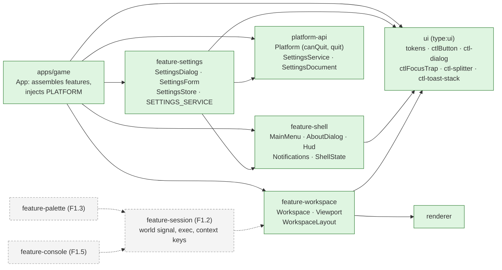
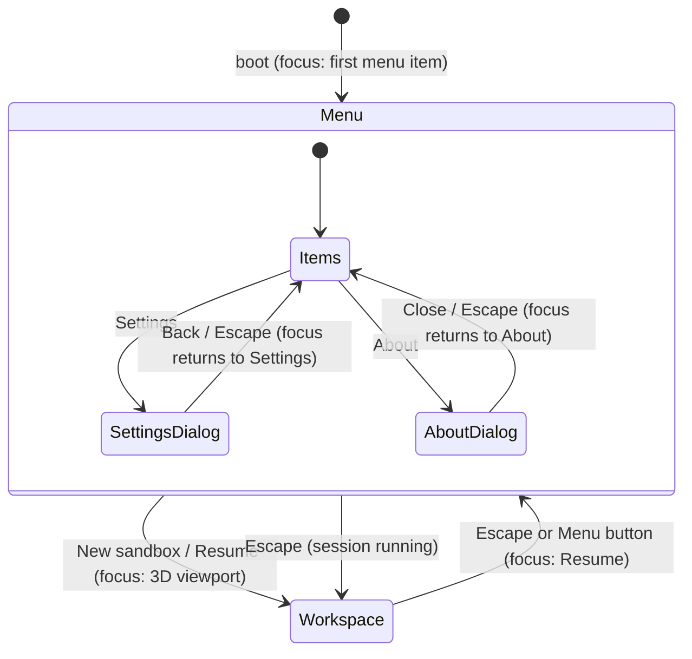
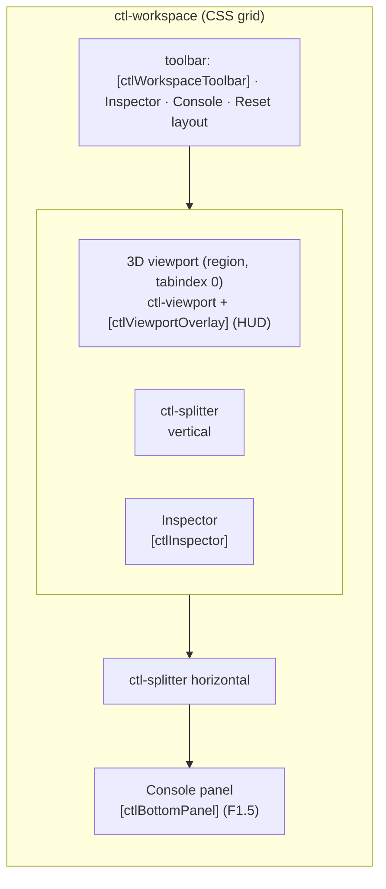
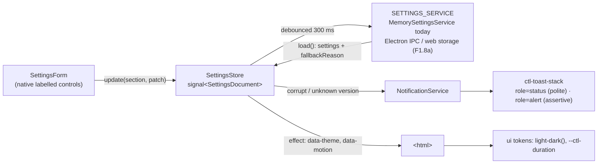

# UI shell

> **Status (F1.1):** the shell, workspace, settings screen, HUD, notifications and theming exist. The command registry (F1.2), keybinding service (F1.4), palette (F1.3), console (F1.5) and `feature-session` are still to come; their hooks are marked `TODO(F1.x)` in the code. Settings persistence lands with F1.8a. Gotchas: [UI caveats](../caveats/ui.md). Docking choice: [ADR 0005](../decisions/0005-docking-workspace.md).

## Libraries

`ui` is presentational: it holds no services, state or commands. Features may use each other (`feature-settings` uses `NotificationService` from `feature-shell`), but none of them imports a concrete platform. The app provides `PLATFORM` (Electron bridge or web harness) and will provide the real `SETTINGS_SERVICE`.

## Screens and focus

The workspace is always mounted. Behind the main menu it shows only the viewport (`[chrome]="false"`) and is `inert`, so the menu sits over a live 3D backdrop.

- **Dialogs** are native `<dialog>` elements opened with `showModal()` (`ctl-dialog`). The page behind them is inert, focus moves inside and is trapped, Escape closes, and focus returns to the opener.
- **Escape** is handled innermost-first: a dialog consumes it, then `App.onEscape` toggles between the menu and the workspace. F1.4 moves this into the keybinding service.
- **Main menu** items are plain buttons in a `<nav>`. Tab, Up/Down, Home and End move between them. Continue and Load are `aria-disabled` with a reason until F1.8b, and Quit is hidden where `Platform.canQuit` is false (the web harness).

## Workspace layout

- `WorkspaceLayout` is plain JSON: `{ inspector: { size, collapsed }, bottom: { size, collapsed } }`, with integer CSS pixels clamped by `normaliseLayout` (inspector 200–640, bottom 96–560, and at most 60 % of the window in CSS).
- It is two-way bound to `settings.workspace.layout`, so it persists once F1.8a wires the storage.
- Splitters follow the WAI-ARIA window-splitter pattern: arrows resize (Shift for big steps), Home/End jump to the limits, and Enter collapses or restores. Pointer drags use pointer capture.
- **Reset layout** becomes the `view.resetLayout` command in F1.2.

## Settings, theme and notifications

- **Theme:** tokens are `light-dark()` pairs under `color-scheme: light dark`, so they follow `prefers-color-scheme`. A settings override pins `color-scheme` through `data-theme`.
- **Reduced motion:** applies when `prefers-reduced-motion: reduce` is set or `data-motion="reduce"` is on `<html>`.
- **Notifications:** info and success auto-dismiss after 8 s; warnings and errors stay until dismissed. Expiry pauses while the pointer or keyboard focus is in the stack. Each toast has a Dismiss button, Escape dismisses the focused toast, and focus then moves to the next toast or back to where it came from.

## Related

- [ADR 0005 Docking workspace](../decisions/0005-docking-workspace.md) · [UI caveats](../caveats/ui.md) · [Architecture overview](overview.md)
- Plan §4.6 (one registry, four surfaces), §4.9 (modes) and the [phase-1 plan](../../plans/phase-1-game-shell.md) F1.1–F1.5.
