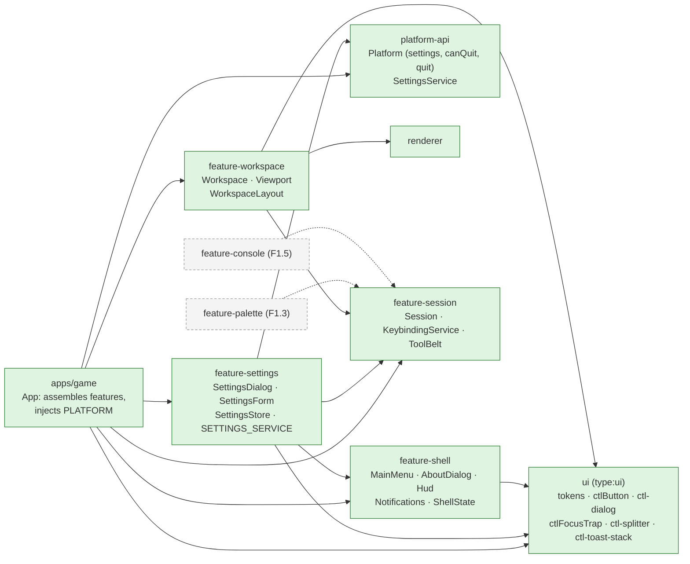
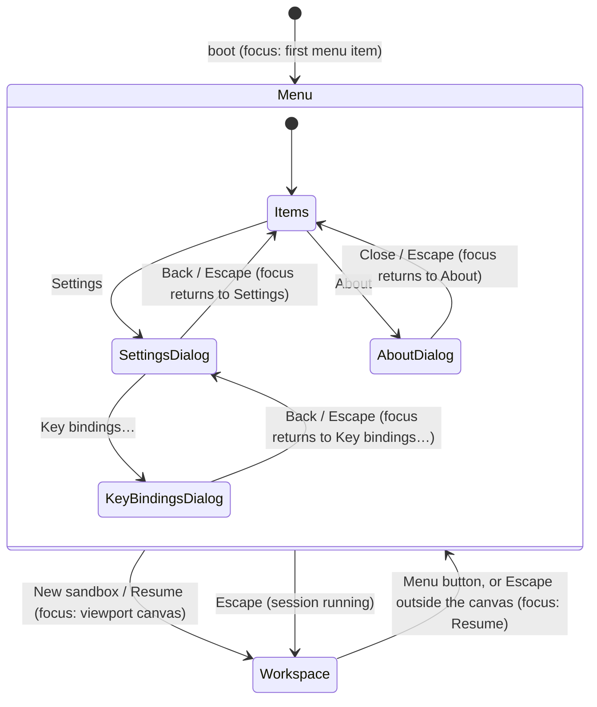
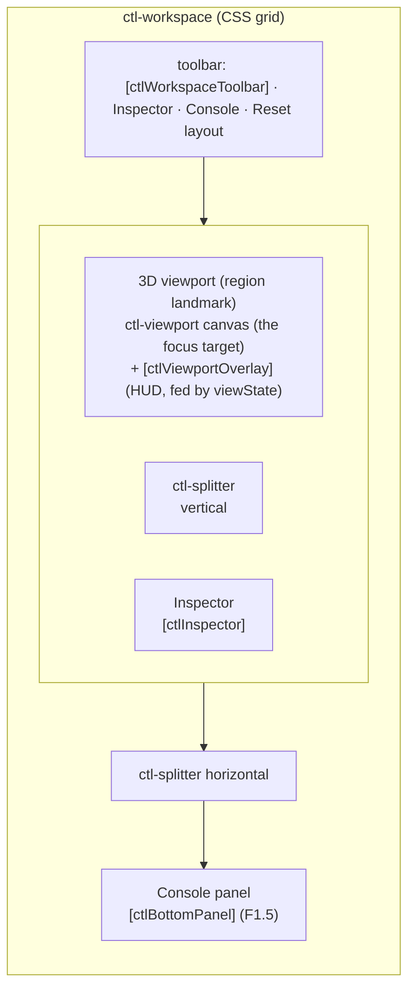
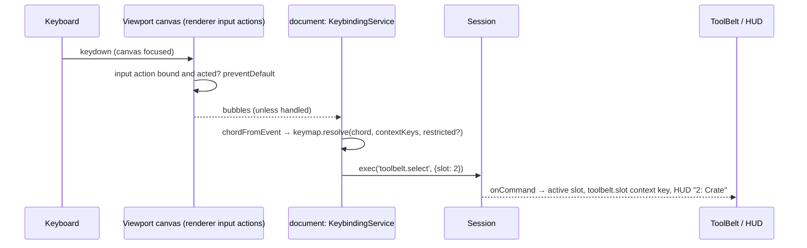
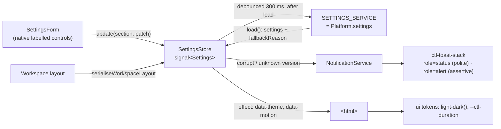
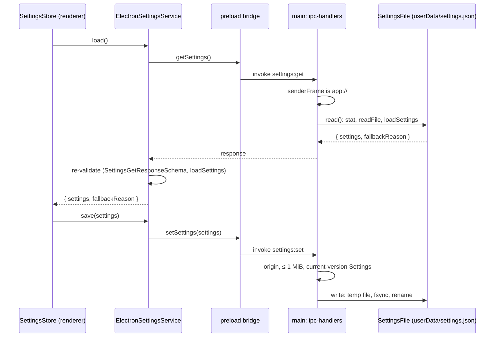

# UI shell

> **Status (F1.4):** the shell, workspace, settings screen, HUD, notifications and theming exist. The command registry and `feature-session` landed in F1.2 ([commands](commands.md)), and the keybinding service, the Key bindings dialog and the tool belt in F1.4. The palette (F1.3) and console (F1.5) are still to come, and their hooks are marked `TODO(F1.x)` in the code. Settings persist on both platforms (below). Reset layout runs the `view.resetLayout` command, and the HUD's assisted badge reads the world's `assisted` flag from the session. Gotchas: [UI caveats](../caveats/ui.md). Docking choice: [ADR 0005](../decisions/0005-docking-workspace.md).

## Libraries

`ui` is presentational: it holds no services, state or commands. Features may use each other (`feature-settings` uses `NotificationService` from `feature-shell`), but none of them imports a concrete platform. The app provides `PLATFORM` (Electron bridge or web harness) and will provide the real `SETTINGS_SERVICE`.

## Screens and focus

The workspace is always mounted. Behind the main menu it shows only the viewport (`[chrome]="false"`) and is `inert`, so the menu sits over a live 3D backdrop.

- **Dialogs** are native `<dialog>` elements opened with `showModal()` (`ctl-dialog`). The page behind them is inert, focus moves inside and is trapped, Escape closes, and focus returns to the opener.
- **Escape** is handled innermost-first: a key capture in the Key bindings dialog, a dialog or the focused viewport canvas (clear selection) consumes it; otherwise `App.onEscape` toggles between the menu and the workspace. Escape is the shell's fixed "back" key, reserved by the keybinding service, so no command can take it.
- **Main menu** items are plain buttons in a `<nav>`. Tab, Up/Down, Home and End move between them. Continue and Load are `aria-disabled` with a reason until F1.8b, and Quit is hidden where `Platform.canQuit` is false (the web harness).

## Workspace layout

- `WorkspaceLayout` is plain JSON: `{ inspector: { size, collapsed }, bottom: { size, collapsed } }`, with integer CSS pixels clamped by `normaliseLayout` (inspector 200–640, bottom 96–560, and at most 60 % of the window in CSS).
- It is two-way bound to `settings.workspace.layout`, so it persists once F1.8a wires the storage.
- Splitters follow the WAI-ARIA window-splitter pattern: arrows resize (Shift for big steps), Home/End jump to the limits, and Enter collapses or restores. Pointer drags use pointer capture.
- **Reset layout** runs the `view.resetLayout` view command through `Session.exec`. The workspace applies it when the command reports back (`Session.onCommand`), so any surface that runs the command resets the layout. It is logged and never changes the world hash.

## Keybindings and the tool belt

- `KeybindingService` (`feature-session`) owns the one document `keydown` listener for commands. It builds its keymap from the registry (`defaultBindingDecls`) and the player's overrides, which `apps/game` stores in settings with `provideKeybindingOverridesFromSettings()` (`feature-settings`). Without that provider the overrides live in memory.
- The **viewport** pushes `KeybindingService.inputBindings()` into the renderer, names the current keys in the canvas's accessible name, and sets the `viewport.focused` context key while the canvas has focus.
- **Settings → Key bindings…** opens a sibling dialog (`ctl-keybindings-dialog`) with one table per category. **Change** captures the next key press (Escape cancels, Tab leaves); **Unbind**, **Reset** and **Reset all bindings** act at once. Conflicts and ignored stored bindings are shown in the row and wired to the Change button with `aria-describedby`; a polite status region announces each change. Inactive buttons are `aria-disabled`, so focus never falls out of the dialog.
- The **HUD** shows the active tool-belt slot and the prop it holds (settings `toolBelt.slots`).

## Settings, theme and notifications

- **Document:** `Settings` from `@controls/save-format` (`settingsVersion` 1). The store edits it section by section; edits made before the first load finishes are replayed on top of the loaded document, and nothing is saved until the load has finished.
- **Theme:** tokens are `light-dark()` pairs under `color-scheme: light dark`, so they follow `prefers-color-scheme`. A settings override pins `color-scheme` through `data-theme`.
- **Reduced motion:** `display.reducedMotion` is `system` (follow `prefers-reduced-motion`), `reduce` (`data-motion="reduce"`) or `full` (`data-motion="full"`, ignores the OS preference).

### Persistence

- **Web harness:** `WebSettingsService` stores the same JSON in `localStorage` (`controls.settings`), with every access in try/catch. Both platforms parse stored text with `parseStoredSettings` from `@controls/ipc-contract`, so fallback behaviour is identical.
- **Quit:** `Platform.quit()` → `app:quit` → `app.quit()` on desktop (including macOS). The web harness has no Quit.
- **Notifications:** info and success auto-dismiss after 8 s; warnings and errors stay until dismissed. Expiry pauses while the pointer or keyboard focus is in the stack. Each toast has a Dismiss button, Escape dismisses the focused toast, and focus then moves to the next toast or back to where it came from.

## Related

- [ADR 0005 Docking workspace](../decisions/0005-docking-workspace.md) · [UI caveats](../caveats/ui.md) · [Architecture overview](overview.md)
- Plan §4.6 (one registry, four surfaces), §4.9 (modes) and the [phase-1 plan](../../plans/phase-1-game-shell.md) F1.1–F1.5.
