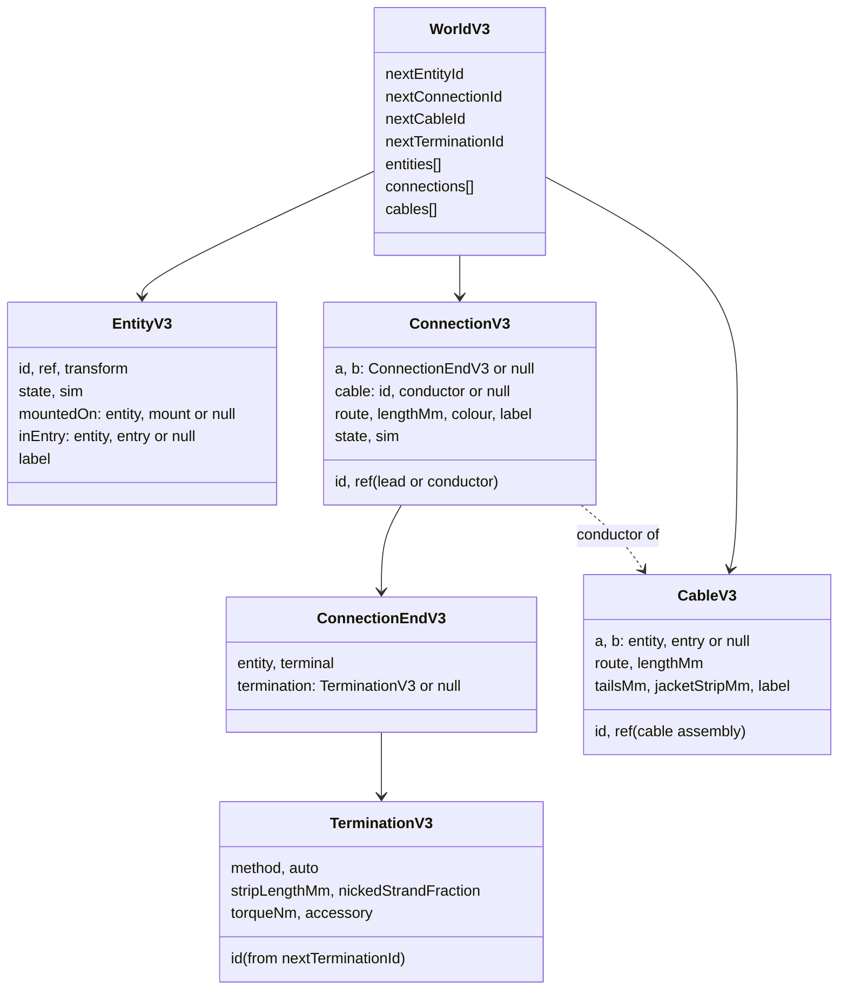
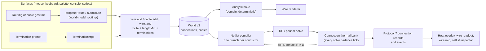

# Wiring (P3)

How a wire gets from the player's hands into the simulator, and back out as a reading. P3 spread the wiring code across the save format, the world model, the simulator, the renderer and the workspace UI; this page is the map. Each section links to the page that holds the detail.

Decisions: [ADR 0015](../decisions/0015-world-document-v3.md) (world v3 and the wire contract), [ADR 0016](../decisions/0016-catalogue-format-v2.md) (catalogue v2), [ADR 0017](../decisions/0017-routing-and-bake.md) (routing and bake), [ADR 0018](../decisions/0018-conductor-and-termination-physics.md) (conductor and termination physics), and the [ADR 0011 amendment](../decisions/0011-sim-worker-contract.md#amendment-protocol-7-connection-records-and-connection-events-f36-part-3) (protocol 7 connection records). Plan: [`plans/phase-3-wiring.md`](../../plans/phase-3-wiring.md).

## The as-built model (world v3)

Test leads and conductors share one array, `connections`, and one id space. A conductor that belongs to a cable shares the cable's route and length. Mounting and conduit connectors are relations, not transform parents: every entity keeps its absolute transform (D11).

- **A null end is unlanded** and the connection is not netlisted: wired, not drawn. A lead's ends are clips (`termination: null`); a landed conductor end always has a termination.
- **`lengthMm` is a logged argument**, cut by the command and stored, so the compiler never runs routing code and a later routing fix never changes an old save's resistance (D5, ADR 0017).
- **Commands** (`wire.*`, `cable.*`, `enclosure.openEntry`, `raceway.cut`, `wire.pull`, the label commands, `entity.place` with `mountedOn` and `inEntry`) are the only writers; their argument shapes are frozen in `json-schema/command-args/`. See [commands](commands.md#world-commands), [cables in framing](commands.md#cables-in-framing-f32-part-4) and [drilling, punching and pulling](commands.md#drilling-punching-and-pulling-f34-part-2); the schemas and migration are in [world and saves](world-and-saves.md#documents).

## From a route to a reading

1. **Routing** is domain maths in `world-model/src/lib/routing/`: auto-route through ducts, waypoint snapping to ducts, conduit, staples and bores, `route-collides`, the length rule and duct lanes. The bake is analytic and deterministic, so its centreline hash is identical in Node and Chromium; the Verlet rope is only the live preview. See [routing maths and the bake](rendering.md#routing-maths-and-the-bake-f32-part-1).
2. **The gestures** turn picks into exactly one logged command: [routing a wire](ui-shell.md#routing-a-wire-f32-part-3), [cables: run, strip, land and label](ui-shell.md#cables-run-strip-land-and-label-f32-part-4), [the fish tape](ui-shell.md#tools-in-hand-entries-and-the-fish-tape-f34-part-2). The renderer half (terminal and wire picking, the routing view) is [pickers and the routing gesture](rendering.md#pickers-and-the-routing-gesture-f32-part-3).
3. **Terminations** above Trainee come from the [termination prompts](ui-shell.md#termination-prompts-f33-part-2) (D9). The command resolves the outcome (achieved torque, nicks, crimp) from the tool and the termination's own seeded streams (`termination:<id>:strip|crimp|clamp`), so the same arguments give the same termination from any surface.
4. **The compiler** turns each netlisted conductor into one resistor: R_conductor(T, L, A, lay) plus each end's contact resistance (D4). Each end's voltage is derived after the solve as V_terminal ∓ I·R_contact. See [contact resistance](simulation.md#contact-resistance-f33-part-1).
5. **Heat**: the [connection thermal bank](simulation.md#connection-thermal-bank-f36-part-1) steps one conductor node and one hot-spot node per landed end at every solve cadence tick, with the exact elapsed time; a value change over 1 % re-solves. Above the oxidation onset a contact degrades for good, then glows, goes intermittent, arcs and burns open; a conductor at its melting point fuses and stays open (the sticky `fused` key). See [degradation, end states and the failure rule](simulation.md#degradation-end-states-and-the-failure-rule-f36-part-2).
6. **Readings** leave the worker as [connection records and events](simulation.md#connection-records-and-events-f36-part-3-protocol-7): drops, temperatures and end states per lead and wire, never 0 V across a gap. They feed the [heat overlay](rendering.md#the-heat-overlay-f36-part-3), the [wire readout](ui-shell.md#the-wire-readout-f36-part-3), `wire.info <id>` and the netlist inspector.

## Enclosures, raceways and tools

- **Enclosures and mounting**: boxes and the DIN-rail panel declare mounts and entries in the catalogue; `entity.place` records `mountedOn`, an occupied enclosure refuses move and delete, and placement maths keeps bodies apart. See [enclosures and mounting](rendering.md#enclosures-and-mounting-f35-part-1) and [raceways and terminal blocks](rendering.md#raceways-and-terminal-blocks-f35-part-2).
- **Tools** are catalogue entries (`content/tools/`) checked by capability, not kind (`wrong-tool`, `beyond-tool-capacity`, `wrong-drive`, `wrong-size`). The tool belt holds tool refs and spools. See [tools on the belt](ui-shell.md#tools-on-the-belt-f34-part-1).
- **Content**: conductors, NM-B cables, accessories, tools and the materials, insulation and colour tables are described in the [authoring guide](../guides/authoring-content.md).

## Determinism

- Routes and lengths are integer millimetres; routing, contact and thermal maths use IEEE-exact operations and `Math.sqrt`, never a transcendental (the D6 lint covers `sim-core` and `world-model/src/lib/routing/`).
- Seeded outcomes come from per-termination streams keyed by `nextTerminationId`, so they don't depend on which surface did the wiring.
- The thermal bank integrates on a fixed absolute schedule (every tick with t % `SOLVE_INTERVAL_TICKS` = 0, dt exactly 10 ms), never staggered by id. Connection sim state is saved, so a hot termination loads hot.
- The P3 acceptance scenarios (`lamp-circuit`, `bad-termination`) reach the same hashes in Node, in Chromium's worker on both transports, and in Electron.

## Related

- Caveats: [commands](../caveats/commands.md), [save format](../caveats/save-format.md), [simulation](../caveats/simulation.md), [rendering](../caveats/rendering.md), [UI](../caveats/ui.md), [content](../caveats/content.md).
- Glossary: [electrical trade](../glossary.md#electrical-trade) (conductor, cable assembly, termination, wire nut and more).
