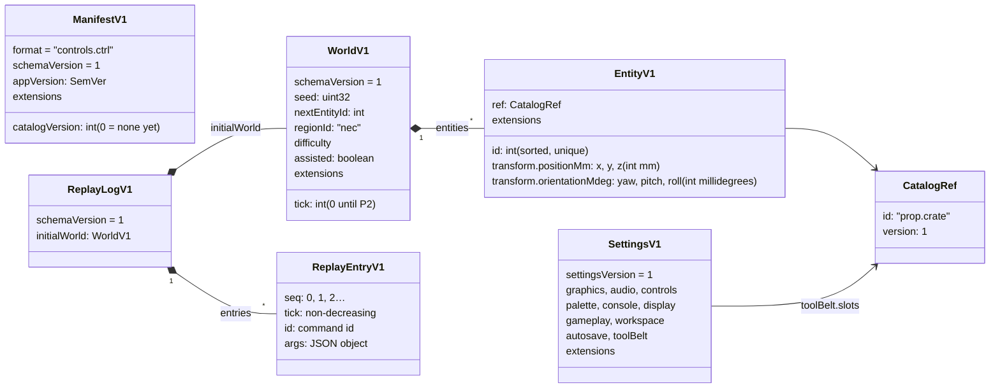
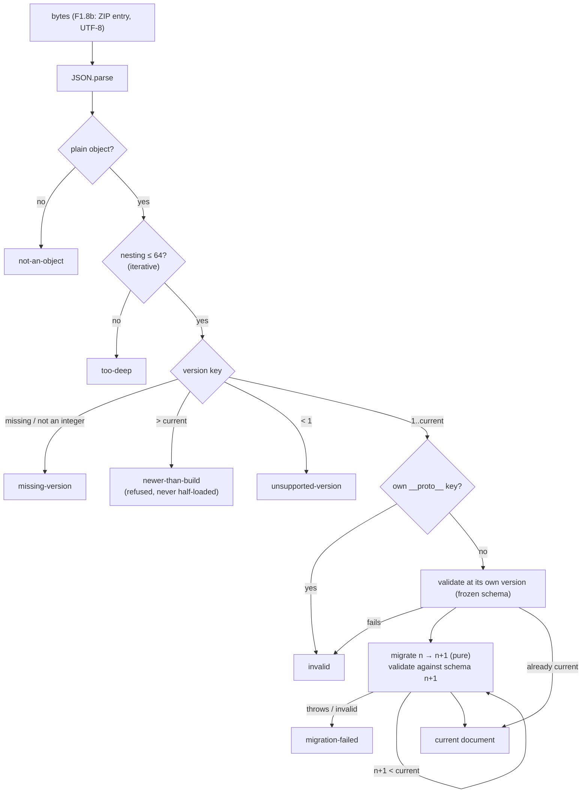
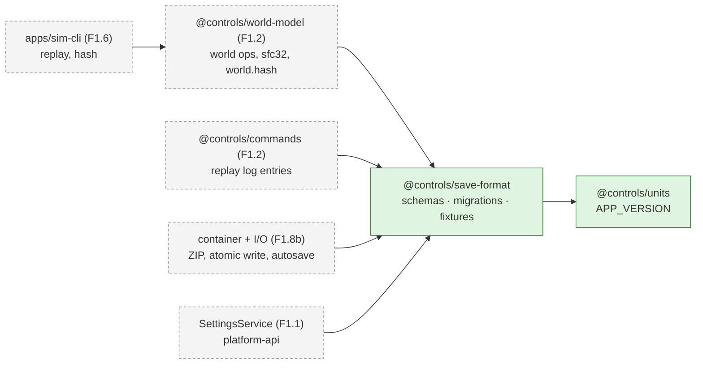

# World document and saves

> **Status (P1):** F1.8a has landed: the v1 document schemas, settings schema, migration framework, fixtures and JSON Schema export in `libs/domain/save-format` (`@controls/save-format`). The ZIP container, file I/O, IPC and autosave are F1.8b _(later in P1)_. Decisions: [ADR 0004](../decisions/0004-save-format.md) (container and rules) and [ADR 0007](../decisions/0007-world-document-v1.md) (v1 shape and determinism). Gotchas: [save-format caveats](../caveats/save-format.md). The world's operations, `world.hash` and replay are on the [commands](commands.md) page (F1.2).

## Documents

A `.ctrl` save is a ZIP of JSON documents that share one `schemaVersion`. Settings are a separate document with their own `settingsVersion`. Catalogue entries are referenced by id and version, never inlined.

| Document                | File in `.ctrl`           | Schema         | Version key       |
| ----------------------- | ------------------------- | -------------- | ----------------- |
| Manifest                | `manifest.json`           | `ManifestV1`   | `schemaVersion`   |
| World                   | `world.json`              | `WorldV1`      | `schemaVersion`   |
| Replay log              | `replay.log` (optional)   | `ReplayLogV1`  | `schemaVersion`   |
| Prints, PLC, HMI        | `prints/`, `plc/`, `hmi/` | (P6, P10, P12) | `schemaVersion`   |
| Settings (not in saves) | settings store (F1.1)     | `SettingsV1`   | `settingsVersion` |

JSON Schema for each document is generated from Zod into `libs/domain/save-format/json-schema/` for docs, mods and tools. Zod stays authoritative.

## Loading

Every load goes through a migrator, which never throws and returns `{ ok: true, value, fromVersion }` or a typed `LoadError`.

## Who uses it

## Determinism hooks

- **Ids:** `nextEntityId` counter in the world. Undoing a place restores it, and undoing a delete reinserts the same id.
- **Randomness:** the world `seed` feeds sfc32 streams derived per use, so no generator state is persisted (ADR 0007).
- **Hash:** SHA-256 over canonical JSON of the world document only (sorted keys, normalised `-0`).
- **Replay:** `initialWorld` plus `{ seq, tick, id, args }` entries reproduce the saved world's hash.

## Related

- [Architecture overview](overview.md) · [ADR 0004](../decisions/0004-save-format.md) · [ADR 0007](../decisions/0007-world-document-v1.md) · [save-format caveats](../caveats/save-format.md)
- [Phase 1 plan](../../plans/phase-1-game-shell.md) F1.2, F1.8
