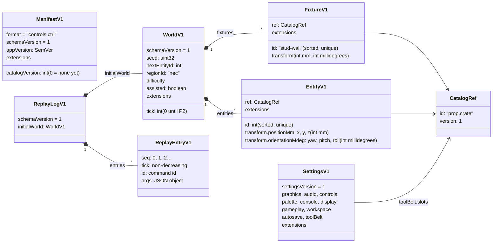
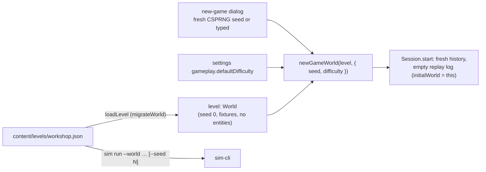
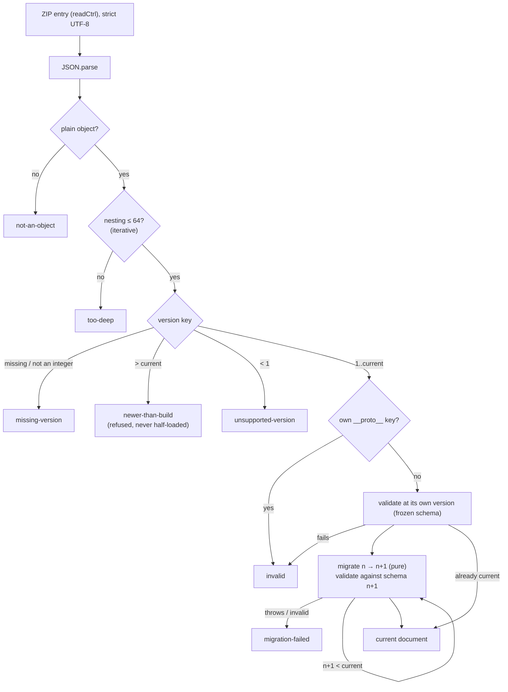
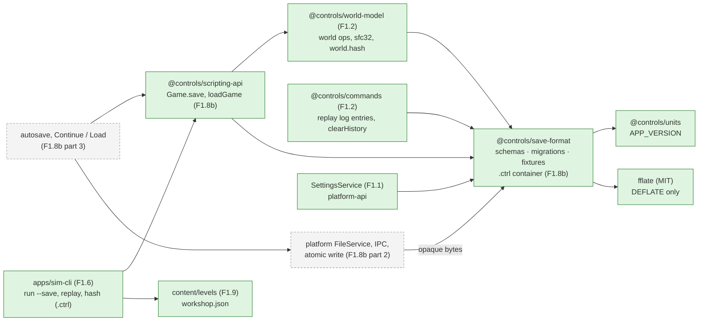

# World document and saves

> **Status (P1):** F1.8a has landed: the v1 document schemas, settings schema, migration framework, fixtures and JSON Schema export in `libs/domain/save-format` (`@controls/save-format`). F1.8b part 1 has landed: the pure `.ctrl` container (`writeCtrl` / `readCtrl`), `Game.save()` and `loadGame()` in `@controls/scripting-api`, and `.ctrl` in `sim-cli`. File I/O, IPC and the web harness store (F1.8b part 2), and autosave and the Continue/Load UI (part 3) _are later in P1_. Decisions: [ADR 0004](../decisions/0004-save-format.md) (container and rules) and [ADR 0007](../decisions/0007-world-document-v1.md) (v1 shape and determinism). Gotchas: [save-format caveats](../caveats/save-format.md). The world's operations, `world.hash` and replay are on the [commands](commands.md) page (F1.2).

## Documents

A `.ctrl` save is a ZIP of JSON documents that share one `schemaVersion`. Settings are a separate document with their own `settingsVersion`. Catalogue entries are referenced by id and version, never inlined.



| Document                | File in `.ctrl`           | Schema         | Version key       |
| ----------------------- | ------------------------- | -------------- | ----------------- |
| Manifest                | `manifest.json`           | `ManifestV1`   | `schemaVersion`   |
| World                   | `world.json`              | `WorldV1`      | `schemaVersion`   |
| Replay log              | `replay.log` (optional)   | `ReplayLogV1`  | `schemaVersion`   |
| Prints, PLC, HMI        | `prints/`, `plc/`, `hmi/` | (P6, P10, P12) | `schemaVersion`   |
| Settings (not in saves) | settings store (F1.1)     | `SettingsV1`   | `settingsVersion` |

JSON Schema for each document is generated from Zod into `libs/domain/save-format/json-schema/` for docs, mods and tools. Zod stays authoritative.

## Fixtures and levels (F1.9)

A world has two lists of placed things:

- **`entities`**: what the player (or a script) places, moves and deletes, with integer ids from `nextEntityId`. Every entity command acts on these.
- **`fixtures`**: the level's fixed geometry (floor, walls, benches, backboards, backplates, DIN rails), with string ids (`stud-wall`, `din-rail-1`) sorted by code units. No command creates, moves or deletes a fixture, and fixtures take no entity ids. Ids starting with `entity-` are refused, so a fixture id never collides with an entity's view id. Both lists are in `world.hash`.

A **level** is a world document in `content/levels/` (data only; Nx project `content`, tag `type:content`). New sandbox loads `content/levels/workshop.json` through `migrateWorld` (`loadLevel`) and copies it with the game's seed, difficulty and tick 0 (`newGameWorld`). The decision and its alternatives are in [ADR 0007](../decisions/0007-world-document-v1.md#fixtures-and-levels-f19).



## The `.ctrl` container (F1.8b)

A save is a ZIP written and parsed by `libs/domain/save-format/src/lib/container/` (fflate supplies only DEFLATE). Bytes in, bytes out: no file system, no clock, no framework. The Electron main process or the web harness stores the bytes (F1.8b part 2).

| Entry                     | Required | Stored as                      | Cap    |
| ------------------------- | -------- | ------------------------------ | ------ |
| `manifest.json`           | yes      | DEFLATE, sorted-key JSON       | 64 KiB |
| `world.json`              | yes      | DEFLATE, sorted-key JSON       | 16 MiB |
| `replay.log`              | no       | DEFLATE, sorted-key JSON       | 32 MiB |
| `thumbnail.png`           | no       | stored (PNG signature checked) | 4 MiB  |
| `prints/`, `plc/`, `hmi/` | no       | empty directory entries (v1)   |        |
| whole file / all entries  |          | at most 64 entries             | 48 MiB |

**Writing is deterministic.** The same documents give the same bytes on every machine and in every time zone: entries sorted by name, every timestamp 1980-01-01 00:00, no extra fields, comments or attributes, DEFLATE level 6 / mem 12, and JSON written with sorted keys, two-space indents and a final newline. A test pins the SHA-256 of a sample container. `appVersion` is in the manifest, so a new release changes new saves' bytes but never `world.hash`.

```mermaid
flowchart TD
    subgraph write["writeCtrl(documents) → Uint8Array"]
        W1["validate each document at the current schemaVersion<br/>(migrator pre-checks, Zod)"] --> W2["ctrlJson: sorted keys, indent 2, final newline<br/>strict UTF-8 encode"]
        W2 --> W3["apply CTRL_LIMITS (never write what we'd refuse)"]
        W3 --> W4["ZIP: sorted entries, fixed DOS date, DEFLATE 6/12, PNG stored"]
    end
    subgraph read["readCtrl(bytes) → contents | CtrlError (never throws)"]
        R1{"≤ 48 MiB?"} -- no --> X1["too-large"]
        R1 --> R2["parse end record + central directory<br/>no ZIP64 / encryption / other methods / multi-disk"]
        R2 -- fails --> X2["not-a-zip / unsupported-zip / too-many-entries"]
        R2 --> R3["names: plain relative ASCII, no '..', '/', '\\', ':'<br/>no duplicates, ranges inside the file, no overlap"]
        R3 -- fails --> X3["unsafe-path / duplicate-entry / not-a-zip"]
        R3 --> R4["declared sizes ≤ per-entry caps and total cap"]
        R4 -- fails --> X4["entry-too-large / total-too-large"]
        R4 --> R5["manifest.json: inflate in 4 KiB slices, abort past declared size<br/>size + CRC-32 must match; strict UTF-8; JSON.parse; migrate"]
        R5 -- "schemaVersion > build" --> X5["newer-than-build<br/>(names the writer's appVersion)"]
        R5 --> R6["entry list ⊆ layout of that version"]
        R6 -- fails --> X6["unexpected-entry"]
        R6 --> R7["world.json, replay.log: same extraction;<br/>schemaVersion must equal the manifest's; migrate + validate"]
        R7 --> R8["thumbnail.png: PNG signature"]
        R8 --> OK["{ manifest, world, replayLog | null, thumbnail | null, fromVersion }"]
    end
```



### Saving and loading a game

`@controls/scripting-api` turns a running `Game` into bytes and back, so the UI (part 3), `sim-cli` and scripts share one path.

```mermaid
sequenceDiagram
    participant Host as Session / sim-cli
    participant API as scripting-api
    participant SF as save-format
    participant WM as world-model
    Host->>API: game.save({ thumbnail })
    API->>SF: writeCtrl({ createManifest(), world, replayLog, thumbnail })
    SF-->>Host: Uint8Array
    Host->>API: loadGame(bytes)
    API->>SF: readCtrl(bytes)
    SF-->>API: contents (or CtrlError → returned as is)
    API->>WM: replayLog(contents.replayLog)
    alt replays to world.json's hash
        API->>API: bus.clearHistory(); continue the same log
    else no log, fails, or different hash
        API->>API: new game on world.json; new log (replay: absent / restarted)
    end
    API-->>Host: { game, manifest, thumbnail, fromVersion, replay }
```

- **The world always wins.** `world.json` is what loads. The log is kept only when replaying it from its `initialWorld` reproduces that world's `world.hash`; otherwise a new log starts from the loaded world and `replay.status` is `restarted` (the UI should say so).
- **The undo stack is cleared and the log continues** (plan F1.8b). The next command gets the next `seq`, so seeded streams don't shift. A full replay of a log that spans loads still reaches the live hash, because the live undo/redo stacks are always the top part of the replayed ones.
- **`sim-cli`:** `sim hash <save>` hashes `world.json`; `sim replay <save>` replays `replay.log` and fails unless it reaches `world.json`'s hash; `sim run --world <save>` loads it like the game; `sim run --save <file>` writes one.

## Loading a document

Every load goes through a migrator, which never throws and returns `{ ok: true, value, fromVersion }` or a typed `LoadError`.



## Who uses it



## Determinism hooks

- **Ids:** `nextEntityId` counter in the world. Undoing a place restores it, and undoing a delete reinserts the same id. Fixtures have their own string ids and never use the counter.
- **Seeds:** domain code never draws a seed. The new-game dialog draws a fresh one with `crypto.getRandomValues` (UI side) or takes a typed one; the same seed on the same level gives the same initial world and hash.
- **Randomness:** the world `seed` feeds sfc32 streams derived per use, so no generator state is persisted (ADR 0007).
- **Hash:** SHA-256 over canonical JSON of the world document only (sorted keys, normalised `-0`).
- **Replay:** `initialWorld` plus `{ seq, tick, id, args }` entries reproduce the saved world's hash.

## Related

- [Architecture overview](overview.md) · [ADR 0004](../decisions/0004-save-format.md) · [ADR 0007](../decisions/0007-world-document-v1.md) · [save-format caveats](../caveats/save-format.md)
- [Phase 1 plan](../../plans/phase-1-game-shell.md) F1.2, F1.8
