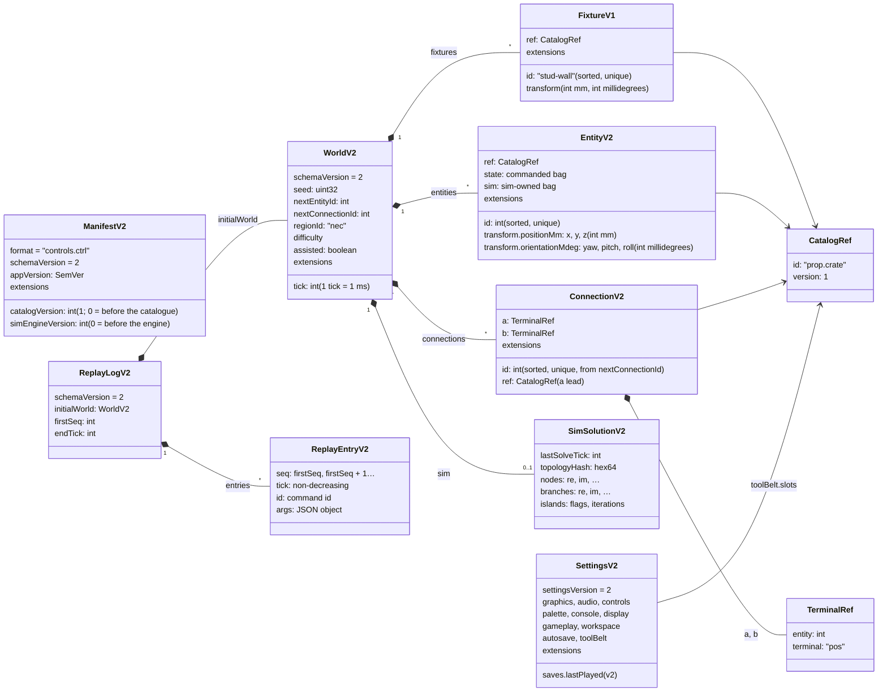
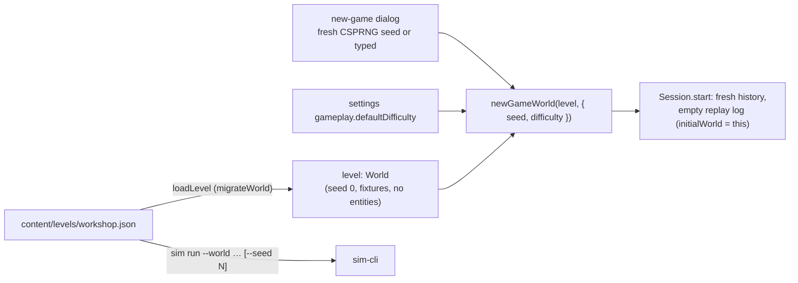
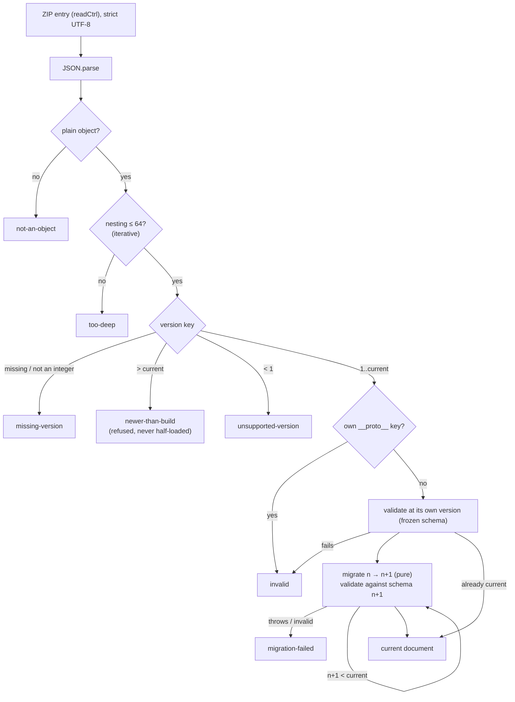
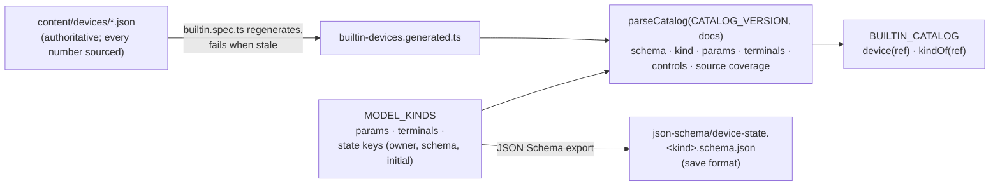
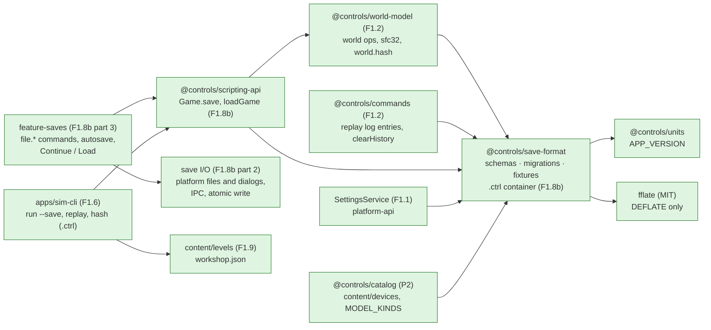
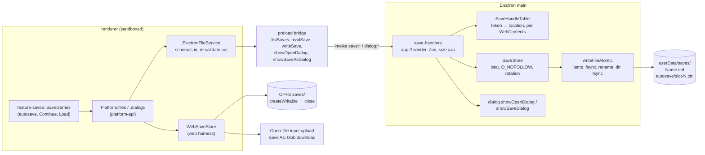
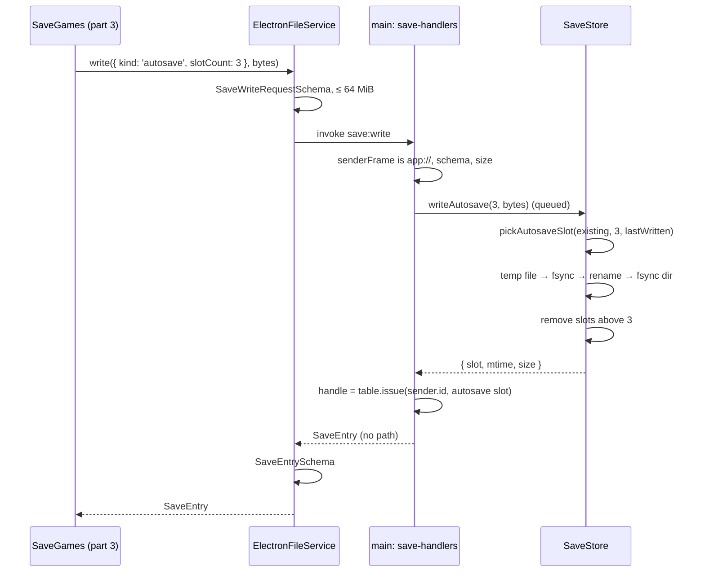
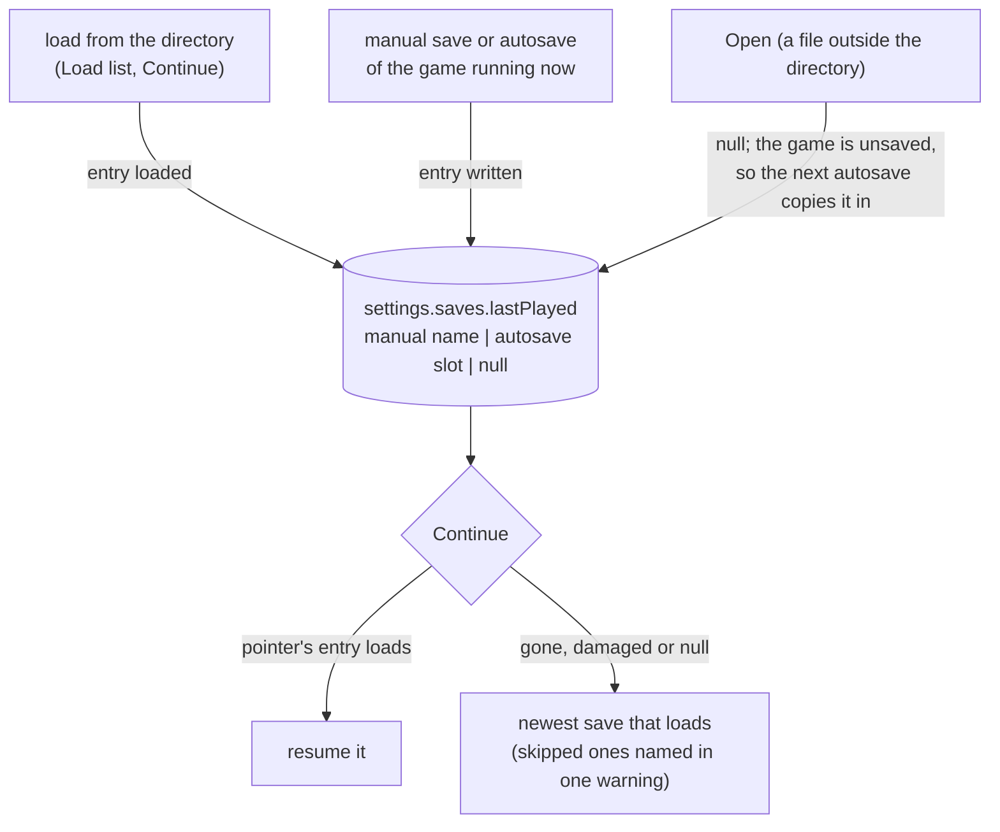

# World document and saves

> **Status (P2 kickoff):** world v2 has landed (connections, device state bags, the solution record, `firstSeq`/`endTick`; [ADR 0013](../decisions/0013-world-document-v2.md)) with the device catalogue v1. **P1:** F1.8a has landed: the v1 document schemas, settings schema, migration framework, fixtures and JSON Schema export in `libs/domain/save-format` (`@controls/save-format`). F1.8b part 1 has landed: the pure `.ctrl` container (`writeCtrl` / `readCtrl`), `Game.save()` and `loadGame()` in `@controls/scripting-api`, and `.ctrl` in `sim-cli`. F1.8b part 2 has landed the platform save I/O ([below](#save-io-f18b), [ADR 0009](../decisions/0009-save-io-boundary.md)). F1.8b part 3 has landed saving and loading in the game: the unlogged `file.*` commands, the Save game and Load game dialogs, Continue and autosave ([below](#saving-and-loading-in-the-game-f18b-part-3)). Decisions: [ADR 0004](../decisions/0004-save-format.md) (container and rules) and [ADR 0007](../decisions/0007-world-document-v1.md) (v1 shape and determinism). Gotchas: [save-format caveats](../caveats/save-format.md). The world's operations, `world.hash` and replay are on the [commands](commands.md) page (F1.2).

## Documents

A `.ctrl` save is a ZIP of JSON documents that share one `schemaVersion`. Settings are a separate document with their own `settingsVersion`. Catalogue entries are referenced by id and version, never inlined.



| Document                | File in `.ctrl`           | Schema         | Version key       |
| ----------------------- | ------------------------- | -------------- | ----------------- |
| Manifest                | `manifest.json`           | `ManifestV2`   | `schemaVersion`   |
| World                   | `world.json`              | `WorldV2`      | `schemaVersion`   |
| Replay log              | `replay.log` (optional)   | `ReplayLogV2`  | `schemaVersion`   |
| Prints, PLC, HMI        | `prints/`, `plc/`, `hmi/` | (P6, P10, P12) | `schemaVersion`   |
| Settings (not in saves) | settings store (F1.1)     | `SettingsV2`   | `settingsVersion` |

JSON Schema for each document is generated from Zod into `libs/domain/save-format/json-schema/` for docs, mods and tools (every version keeps its file). Zod stays authoritative.

**World v2** (P2, [ADR 0013](../decisions/0013-world-document-v2.md)) adds connections (test leads) with their own id counter, two device state bags on every entity (`state`, commanded; `sim`, written only by the simulator), and the last electrical solution (`sim`). The bags' keys come from each device's model kind and are checked at load (`invalid-device-state`); the world schema checks only their generic shape, so a new device kind needs no bump. The log gains `firstSeq` and `endTick`, and the manifest `simEngineVersion`. v1 migrates with empty bags, no connections and no solution.

## Fixtures and levels (F1.9)

A world has two lists of placed things:

- **`entities`**: what the player (or a script) places, moves and deletes, with integer ids from `nextEntityId`. Every entity command acts on these.
- **`fixtures`**: the level's fixed geometry (floor, walls, benches, backboards, backplates, DIN rails), with string ids (`stud-wall`, `din-rail-1`) sorted by code units. No command creates, moves or deletes a fixture, and fixtures take no entity ids. Ids starting with `entity-` are refused, so a fixture id never collides with an entity's view id. Both lists are in `world.hash`.

A **level** is a world document in `content/levels/` (data only; Nx project `content`, tag `type:content`). New sandbox loads `content/levels/workshop.json` through `migrateWorld` (`loadLevel`) and copies it with the game's seed, difficulty and tick 0 (`newGameWorld`). The decision and its alternatives are in [ADR 0007](../decisions/0007-world-document-v1.md#fixtures-and-levels-f19).



## The `.ctrl` container (F1.8b)

A save is a ZIP written and parsed by `libs/domain/save-format/src/lib/container/` (fflate supplies only DEFLATE). Bytes in, bytes out: no file system, no clock, no framework. The Electron main process or the web harness stores the bytes (F1.8b part 2).

| Entry                     | Required | Stored as                      | Cap    |
| ------------------------- | -------- | ------------------------------ | ------ |
| `manifest.json`           | yes      | DEFLATE, sorted-key JSON       | 64 KiB |
| `world.json`              | yes      | DEFLATE, sorted-key JSON       | 16 MiB |
| `replay.log`              | no       | DEFLATE, sorted-key JSON       | 32 MiB |
| `thumbnail.png`           | no       | stored (PNG signature checked) | 4 MiB  |
| `prints/`, `plc/`, `hmi/` | no       | empty directory entries (v1)   |        |
| whole file / all entries  |          | at most 64 entries             | 48 MiB |

**Writing is deterministic.** The same documents give the same bytes on every machine and in every time zone: entries sorted by name, every timestamp 1980-01-01 00:00, no extra fields, comments or attributes, DEFLATE level 6 / mem 12, and JSON written with sorted keys, two-space indents and a final newline. A test pins the SHA-256 of a sample container. `appVersion` is in the manifest, so a new release changes new saves' bytes but never `world.hash`.

```mermaid
flowchart TD
    subgraph write["writeCtrl(documents) → Uint8Array"]
        W1["validate each document at the current schemaVersion<br/>(migrator pre-checks, Zod)"] --> W2["ctrlJson: sorted keys, indent 2, final newline<br/>strict UTF-8 encode"]
        W2 --> W3["apply CTRL_LIMITS (never write what we'd refuse)"]
        W3 --> W4["ZIP: sorted entries, fixed DOS date, DEFLATE 6/12, PNG stored"]
    end
    subgraph read["readCtrl(bytes) → contents | CtrlError (never throws)"]
        R1{"≤ 48 MiB?"} -- no --> X1["too-large"]
        R1 --> R2["parse end record + central directory<br/>no ZIP64 / encryption / other methods / multi-disk"]
        R2 -- fails --> X2["not-a-zip / unsupported-zip / too-many-entries"]
        R2 --> R3["names: plain relative ASCII, no '..', '/', '\\', ':'<br/>no duplicates, ranges inside the file, no overlap"]
        R3 -- fails --> X3["unsafe-path / duplicate-entry / not-a-zip"]
        R3 --> R4["declared sizes ≤ per-entry caps and total cap"]
        R4 -- fails --> X4["entry-too-large / total-too-large"]
        R4 --> R5["manifest.json: inflate in 4 KiB slices, abort past declared size<br/>size + CRC-32 must match; strict UTF-8; JSON.parse; migrate"]
        R5 -- "schemaVersion > build" --> X5["newer-than-build<br/>(names the writer's appVersion)"]
        R5 --> R6["entry list ⊆ layout of that version"]
        R6 -- fails --> X6["unexpected-entry"]
        R6 --> R7["world.json, replay.log: same extraction;<br/>schemaVersion must equal the manifest's; migrate + validate"]
        R7 --> R8["thumbnail.png: PNG signature"]
        R8 --> OK["{ manifest, world, replayLog | null, thumbnail | null, fromVersion }"]
    end
```



### Saving and loading a game

`@controls/scripting-api` turns a running `Game` into bytes and back, so the UI (part 3), `sim-cli` and scripts share one path.

```mermaid
sequenceDiagram
    participant Host as Session / sim-cli
    participant API as scripting-api
    participant SF as save-format
    participant WM as world-model
    Host->>API: game.save({ thumbnail })
    API->>SF: writeCtrl({ createManifest(), world, replayLog, thumbnail })
    SF-->>Host: Uint8Array
    Host->>API: loadGame(bytes)
    API->>SF: readCtrl(bytes)
    SF-->>API: contents (or CtrlError → returned as is)
    API->>WM: replayLog(contents.replayLog)
    alt replays to world.json's hash
        API->>API: bus.clearHistory(); continue the same log
    else no log, fails, or different hash
        API->>API: new game on world.json; new log (replay: absent / restarted)
    end
    API-->>Host: { game, manifest, thumbnail, fromVersion, replay }
```

- **The world always wins.** `world.json` is what loads. The log is kept only when replaying it from its `initialWorld` reproduces that world's `world.hash`; otherwise a new log starts from the loaded world and `replay.status` is `restarted` (the UI should say so).
- **The undo stack is cleared and the log continues** (plan F1.8b). The next command gets the next `seq`, so seeded streams don't shift. A full replay of a log that spans loads still reaches the live hash, because the live undo/redo stacks are always the top part of the replayed ones.
- **`sim-cli`:** `sim hash <save>` hashes `world.json`; `sim replay <save>` replays `replay.log` and fails unless it reaches `world.json`'s hash; `sim run --world <save>` loads it like the game; `sim run --save <file>` writes one.

## Loading a document

Every load goes through a migrator, which never throws and returns `{ ok: true, value, fromVersion }` or a typed `LoadError`.



## The device catalogue (P2 kickoff)

A save names every device by catalogue reference (`{ id, version }`); `@controls/catalog` resolves it. The catalogue's entries are data in `content/devices/<id>.v<version>.json`, mirrored into `builtin-devices.generated.ts` (domain code can't import `content/`, and the game, the sim worker and `sim-cli` must resolve refs identically) and validated when the module loads. Its version, `catalogVersion` (1), goes in each save's manifest. Built-in props (`prop.*`) are not catalogue entries; they stay in `world-model` (`BUILTIN_PROPS`).



| Model kind          | Placement  | Terminals    | State keys (owner)                   | P2 entry                                     |
| ------------------- | ---------- | ------------ | ------------------------------------ | -------------------------------------------- |
| `battery`           | entity     | `neg`, `pos` | `stateOfCharge` (sim, starts 1)      | Ferrovane FV12-7, 12 V 7 Ah sealed lead-acid |
| `lamp.incandescent` | entity     | `a`, `b`     | `filamentTempK` (sim, starts `null`) | Lumivane LV-12-5, 12 V 5 W                   |
| `switch.spst`       | entity     | `a`, `b`     | `closed` (commanded, starts `false`) | Tessaline TS-101 toggle                      |
| `lead`              | connection | none         | none                                 | Quillfern QF-TL1, 1 m, 18 AWG copper         |

Commanded keys are written only by commands (`device.operate`); sim keys only by the sim engine. Which keys a kind has is save format: a new kind needs no `schemaVersion` bump, changing an existing kind's keys does ([save-format caveats](../caveats/save-format.md#the-device-catalogue-p2-kickoff-catalogue-v1)).

## Who uses it



## Save I/O (F1.8b)

The `.ctrl` bytes are opaque to this layer. `Platform.files` (`FileService`) and `Platform.dialogs` (`DialogService`) from `@controls/platform-api` move them; the renderer only ever holds **handles**. Decisions and alternatives: [ADR 0009](../decisions/0009-save-io-boundary.md); gotchas: [electron caveats](../caveats/electron.md).





| Channel         | Payload (`@controls/ipc-contract`)                                          | Response                                   | Notes                                                                                            |
| --------------- | --------------------------------------------------------------------------- | ------------------------------------------ | ------------------------------------------------------------------------------------------------ |
| `save:list`     | none                                                                        | `SaveEntry[]` (newest first, ≤ 500)        | Manual saves and autosave slots; symlinks, temp files and invalid names are skipped.             |
| `save:read`     | `SaveReadRequestSchema`: `{ handle }`                                       | `Uint8Array` (≤ 64 MiB)                    | Write-only (Save As) handles are refused.                                                        |
| `save:write`    | `SaveWriteRequestSchema`: `{ target: manual \| autosave \| handle, bytes }` | `SaveEntry`                                | Atomic. `manual` refuses `exists` unless `overwrite`; autosave and opened handles are read-only. |
| `dialog:open`   | `DialogOpenRequestSchema`: `{ fileType: 'ctrl' }`                           | read-only `SaveEntry` (`external`) or null | Native dialog, modal to the window, one at a time (`busy`).                                      |
| `dialog:saveAs` | `DialogSaveAsRequestSchema`: `{ fileType, suggestedName }`                  | write-only `{ handle, name }` or null      | Adds `.ctrl` if missing; writing the handle with `save:write` saves the file.                    |

- **Handles:** 128 random bits per handle, valid only for the `WebContents` they were issued to; one stable handle per save-directory entry, a fresh one per dialog pick. They die with the window, so never persist one.
- **Autosave rotation:** after the first autosave of a session, the next slot in turn; at the first, the lowest free slot, else the oldest by mtime. Slots above `slotCount` are removed after a successful write; a failed write doesn't advance the rotation.
- **Web harness:** `WebSaveStore` keeps the same layout in OPFS with the same schemas, handles and codes. Open is an upload and Save As a download (no cancel, named after the suggested name).
- **One contract:** `describeSaveIoContract` (`@controls/platform-api/testing`) runs against Electron (in-process IPC to the real handlers and a temp directory) and the web store (in-memory OPFS).

## Saving and loading in the game (F1.8b part 3)

`SaveGames` (`@controls/feature-saves`) joins the three layers above: `Session` (the running `Game`), `loadGame` / `Game.save` (bytes) and `Platform.files` / `.dialogs` (storage). The UI side (dialogs, menu, keys) is on the [UI shell](ui-shell.md#saving-and-loading-f18b) page.

```mermaid
sequenceDiagram
    participant P as Player
    participant SES as Session
    participant SG as SaveGames
    participant API as scripting-api
    participant IO as Platform.files
    P->>SES: exec('file.save') (Mod+S, palette, console; unlogged)
    SES->>SG: onCommand('file.save')
    SG->>SES: saver() (bound to this game)
    SG->>SG: thumbnail (viewport PNG, optional)
    SG->>API: game.save({ thumbnail }) → .ctrl bytes
    SG->>IO: write({ kind: 'manual', name, overwrite }, bytes)
    IO-->>SG: SaveEntry (or SaveIoError → notification)
    P->>SG: Continue / Load / file.open
    SG->>IO: read(handle)
    SG->>API: loadGame(bytes, { registry: session.registry })
    alt CtrlError
        SG-->>P: error notification (from the kind; nothing from the file)
    else loaded
        SG->>SG: autosave the current game if it has unsaved changes
        SG->>SES: adopt(game): world, empty undo stack, log continued
        SG-->>P: "Loaded …" (+ warning if replay.status is restarted)
    end
```

- **Loading migrates, validates, then replaces.** Nothing about the session changes until `loadGame` has returned a game; a refused save leaves the current game, its undo stack and its log as they were. `Session.adopt` then swaps in the loaded game, whose undo history is empty and whose replay log continues the save's (or restarts, with a warning; `REPLAY_MISMATCH_POLICY` can make that a refusal instead).
- **Unsaved changes** (`SaveGames.isDirty`) means the save directory doesn't hold the game as it is: the world's hash differs from the hash last saved to or loaded from the directory for this session (`Session.generation`), or from the starting world if it never was, or the game came from a file outside the directory (Open) and hasn't been autosaved yet. View commands, an undone change and an untouched New sandbox don't count. Save As doesn't clear it: Continue can only resume what the directory holds.
- **Autosave** writes `write({ kind: 'autosave', slotCount })` (rotation stays in main or the web store) for a game with unsaved changes: every `autosave.intervalSeconds` while a game runs, on return to the menu, before a load replaces the game, and in the flush before quit (no thumbnail there: the flush has 2 s). A failed autosave warns and leaves the changes unsaved, so the next trigger tries again. The quit flush then flushes settings, so the pointer below is written too.
- **Continue** resumes the game the player was last in ([ADR 0009](../decisions/0009-save-io-boundary.md#continue-and-the-last-played-save)). `settings.saves.lastPlayed` names the save-directory entry that holds it (a manual save by name, an autosave by slot); Continue lists the directory and tries that entry first, then the rest newest first, manual or autosave alike. A last-played save that no longer loads or has gone, and any other save it skips, are named in one warning. With no saves, Continue is disabled with "No saved games yet."
- **Writes are serialised**, and each is bound to the game that asked (`Session.saver()`), so a load or New sandbox that replaces the session while a thumbnail is being captured never saves the new game under the old one's name.
- **Settings:** `autosave.enabled`, `autosave.slotCount` (1–10) and `autosave.intervalSeconds` (60–3600) were already in `SettingsV1` (F1.8a); Settings → Saves edits them. `saves.lastPlayed` is `settingsVersion` 2; nothing on the settings screen shows it, and Reset to defaults keeps it.



## Determinism hooks

- **Ids:** `nextEntityId` counter in the world. Undoing a place restores it, and undoing a delete reinserts the same id. Fixtures have their own string ids and never use the counter.
- **Seeds:** domain code never draws a seed. The new-game dialog draws a fresh one with `crypto.getRandomValues` (UI side) or takes a typed one; the same seed on the same level gives the same initial world and hash.
- **Randomness:** the world `seed` feeds sfc32 streams derived per use, so no generator state is persisted (ADR 0007).
- **Hash:** SHA-256 over canonical JSON of the world document only (sorted keys, normalised `-0`).
- **Replay:** `initialWorld` plus `{ seq, tick, id, args }` entries reproduce the saved world's hash.

## Related

- [Architecture overview](overview.md) · [ADR 0004](../decisions/0004-save-format.md) · [ADR 0007](../decisions/0007-world-document-v1.md) · [ADR 0009](../decisions/0009-save-io-boundary.md) · [save-format caveats](../caveats/save-format.md) · [electron caveats](../caveats/electron.md)
- [Phase 1 plan](../../plans/phase-1-game-shell.md) F1.2, F1.8
