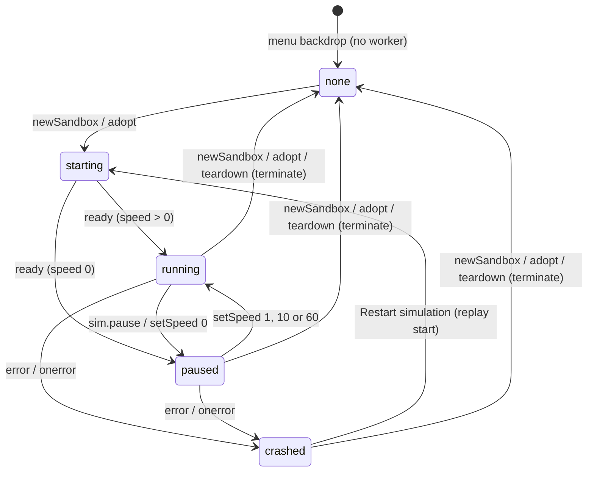
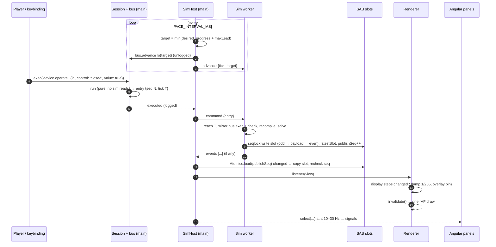
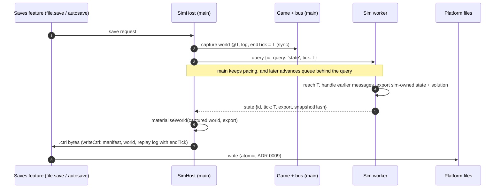

# ADR 0011: Sim worker contract

**Status:** Proposed (P2 kickoff step 3, agent-team review). Drafted by `sim-engine-engineer`; awaiting `renderer-engineer`, `angular-ui-engineer`, `electron-platform-engineer` and `save-format-guardian` (see [Open for review](#open-for-review)). Becomes Accepted when every owner has signed off, and before F2.3b starts.
**Date:** 2026-10-29 (Phase 2)
**Sources:** plan §4.3–§4.5, §4.11; [phase 2 plan](../../plans/phase-2-circuit-engine.md) kickoff step 3 and decisions D1–D6, F2.3a, F2.3b, F2.5, F2.6; [ADR 0002](0002-simulation-architecture.md) (layers, worker, SAB); [ADR 0004](0004-save-format.md) and [ADR 0007](0007-world-document-v1.md) (save format, ticks, hash, replay log); [ADR 0006](0006-command-system.md) (bus, undo, logging); [ADR 0009](0009-save-io-boundary.md) (saves, quit flush); [ADR 0010](0010-wire-routing-spike.md) (frame-cost practice); [commands](../caveats/commands.md), [rendering](../caveats/rendering.md), [electron](../caveats/electron.md) and [save-format](../caveats/save-format.md) caveats

## Context

P2 puts the simulator in a module Web Worker in the renderer process (ADR 0002, spec §4.3 v1.3) while the P1 game keeps running on the main thread: the `Session`, its `Game` and `CommandBus<World>`, every command surface, the renderer and the Angular panels. Four teams build against the seam between them at the same time:

- `sim-engine-engineer` writes the engine (`sim-core`), the protocol (`sim-protocol`) and the worker (`sim-worker`);
- `renderer-engineer` draws lamp brightness and the voltage and current overlays from solved values;
- `angular-ui-engineer` builds `SimHost`, the time controls, the HUD and the netlist inspector;
- `electron-platform-engineer` runs the worker under `app://` with COOP/COEP and the CSP;
- `save-format-guardian` owns everything that ends up in a save or a replay log.

D1 already decided the shape: the main thread stays authoritative and the worker follows deterministically, with commands sent by `postMessage`. This ADR fixes everything else at the level of byte offsets and message shapes, so each team can build against fake data generated by the shared codec before the engine exists.

The hard constraints:

- **Determinism.** The same seed and log give byte-identical snapshots in the worker (Chromium), in `sim-cli` (Node), through the `postMessage` fallback, and across a save and load.
- **Exact replay.** `exec` stays synchronous; a command's `run` can't wait for the worker.
- **On-demand rendering.** The viewport draws only when invalidated ([rendering caveats](../caveats/rendering.md)), so a new snapshot must not redraw unless something visible moved.
- **No allocation per frame** in the reading path.
- **Electron posture.** No new IPC, no `eval`, `crossOriginIsolated` for the fast path, with a fallback that gives the same bytes.

## Decision

### 1. Ownership and threads

| Thread                       | Owns                                                                                                                                                                                                                                                | Never                                                                            |
| ---------------------------- | --------------------------------------------------------------------------------------------------------------------------------------------------------------------------------------------------------------------------------------------------- | -------------------------------------------------------------------------------- |
| **Main** (Angular, renderer) | The world bus (`CommandBus<World>`), the undo and redo stacks, the replay log, `seq`, the clock (the current tick and the pacing), the save and load flow                                                                                           | Runs `sim-core` during play (only to verify a log on load, [§10](#10-lifecycle)) |
| **Sim worker**               | The `SimEngine`: netlist, solver, layers and all **sim-owned state** (tripped, blown, melt and thermal fractions, state of charge, filament temperature, PSU mode and hiccup timers, the last electrical solution); the snapshot buffer; sim events | Allocates `seq`, decides a tick, logs anything, or originates a world change     |

- **The worker keeps a mirror bus.** It runs `createWorldRegistry()` over its own `CommandBus<World>`, built with the new `firstSeq` option (§3), and re-executes every logged entry it receives. `run` is pure and never reads sim-owned state, so the mirror reaches the same world as the main bus. The worker compares each result with the entry it was sent (the same `seq`, tick and args checks as `replayEntries`); any difference is a `desync` error (§10).
- **Commands record intent; the sim resolves the effect.** A command's `run` never reads sim-owned state. Example: `device.operate {id, control: 'handle', value: 'on'}` on a breaker records the handle position; whether it stays tripped is the engine's decision at that tick ("after a trip, the handle must go off and then on again" is engine logic).
- **Commanded versus sim-owned state keys.** Each device model declares every key of its entity `state` bag (world v2, ADR 0013) as either:
  - **commanded**: written only by commands (a switch's `closed`, a supply's setpoint and current limit, a breaker's handle). It lives in the bus world like any other field;
  - **sim-owned**: written only by the engine. The bus world's copy is inert: it holds the value at the session's start or last load and is **never read during play**, by the engine or by the UI.
- **Materialisation.** The world document a save writes, and the one `world.hash` hashes, is `materialiseWorld(busWorld, simState)` (in `sim-protocol`): the bus world at tick T with every sim-owned key and the solution record overlaid from the engine's export at T. Headless (`sim-cli`), the export is synchronous. In the game it is a round trip to the worker (§9).
- **UI rule.** The UI and the renderer read sim-owned values from snapshots (§6), never from `world().entities[].state`.

### 2. Clock and pacing

- **1 tick = 1 ms of sim time**, an integer. Ticks are stored as JS numbers (exact up to 2^53) and as `Float64` in the snapshot, never as `Int32`: 2^31 ms is under 25 days, which a 60× sandbox reaches in about 10 hours.
- **Speeds:** 0 (paused), 1×, 10× and 60×. `sim.step {ticks}` advances by an exact number of ticks at any speed. It is meant for paused use, and works the same while running (the anchor moves, see below).
- **The pacing is on the main thread, in `SimHost`** (D1: main owns the clock). The policy is a pure class, `Pacer` in `sim-protocol`, that takes the wall time as an argument. `SimHost` is the only code that reads the wall clock for pacing. The plan put "pacing" in `libs/sim-worker`; this ADR splits it, because the main thread decides the tick. The worker's lint-excepted module (`libs/sim-worker/src/lib/worker-clock.ts`) reads the wall clock only for work slicing, publish throttling and the unhashed diagnostics (§5.6).
- **Each pacing tick** (a `setTimeout` loop every `PACE_INTERVAL_MS`, not `requestAnimationFrame`, so pacing never wakes the render loop):

  ```text
  desired  = anchorTick + floor((nowMs − anchorWallMs) × speed)
  progress = the tick of the latest snapshot (§6.3)
  maxLead  = speed × MAX_LEAD_WALL_MS                 (ticks)
  target   = min(desired, progress + maxLead)
  if target > bus.currentTick(): bus.advanceTo(target); post { type: 'advance', tick: target }
  if desired > target: anchorTick = target; anchorWallMs = nowMs   // drop the lost time: no catch-up spiral
  ```

  `sim.setSpeed` and `sim.pause` re-anchor at the current tick and time. `sim.step {ticks}` calls `bus.advanceTo(current + ticks)` at once, posts the advance and re-anchors. It isn't capped by the lead, so the worker may then need time to catch up, and the HUD shows "catching up".

- **Effective speed** is Δtick ÷ Δwall over a 1 s window. "Falling behind" is raised when the effective speed is below 0.9 × the requested speed for two windows in a row, and cleared after one window at 0.97 × or better (hysteresis, so it doesn't flicker). The HUD announces it through `aria-live="polite"`.
- **Determinism.** Wall-clock floats decide only _which_ integer tick the main thread advances to. Everything that reaches the bus, the log, the worker and the hash is an integer tick.

| Constant               | Value            | Kind                                                                                                                                                           |
| ---------------------- | ---------------- | -------------------------------------------------------------------------------------------------------------------------------------------------------------- |
| `TICK_MS`              | 1                | spec §4.3 (1 kHz)                                                                                                                                              |
| `SIM_SPEEDS`           | `[0, 1, 10, 60]` | spec §4.3                                                                                                                                                      |
| `SOLVE_INTERVAL_TICKS` | 10               | numerical choice inside spec §4.5's 10–20 ms                                                                                                                   |
| `MAX_STEP_TICKS`       | 3 600 000 (1 h)  | game-design bound on `sim.step`                                                                                                                                |
| `PACE_INTERVAL_MS`     | 10               | numerical choice: under a frame, coarse enough to be cheap                                                                                                     |
| `MAX_LEAD_WALL_MS`     | 25               | numerical choice: at most about 25 ms of wall time between what is shown and what is commanded; at least 2 × `PACE_INTERVAL_MS`, or 60× could never be reached |
| `WORK_SLICE_MS`        | 8                | numerical choice: the worker yields to its message queue at least this often                                                                                   |
| `PUBLISH_MIN_WALL_MS`  | 4                | numerical choice: the throttle on cadence publishes (§7)                                                                                                       |
| `MAX_READ_ATTEMPTS`    | 4                | numerical choice: seqlock attempts per slot (§6.2)                                                                                                             |
| `PANEL_SAMPLE_HZ`      | 10 (at most 30)  | spec §4.1                                                                                                                                                      |

### 3. Time versus undo

- **Time passing is not a command** and never touches the undo or redo stacks. This supersedes ADR 0006's example of `sim.step` as "a non-undoable change": `sim.step` changes nothing, so it leaves both stacks alone.
- **`CommandBus.advanceTo(tick)`** sets the state's tick through a new bus option, `withTick(state, tick)` (for `World`, `{ ...world, tick }`). It is unlogged, takes no `seq`, leaves the history alone and fires no `executed` event. It throws for `tick < currentTick()`, and is a no-op for an equal tick.
- **Every change preserves `tick`:** `change.apply(s).tick === s.tick` and `change.invert(s).tick === s.tick`, for every world command (a fast-check property in `world-model`). A change must never capture and restore a whole world, or undo would rewind time.
- **The "undo everything" property is restated:** for a session in which no time passed (every entry at the initial tick) and no cheat ran, undoing everything returns the initial `world.hash`. When time has passed, undoing everything returns a world whose commanded part (entities, connections, commanded state, `nextEntityId`, `fixtures`) equals the initial one; `tick` and the sim-owned state are whatever time made them.
- **Undoing a delete restores the entity as it was deleted.** When an entity leaves the world, the engine keeps its sim-owned state as a tombstone, keyed by entity id. Reinserting that id restores it, so a blown fuse comes back blown. A tombstone is dropped once its id is no longer below `nextEntityId` (its place was undone, so the id can be reused by a fresh entity). Tombstones aren't persisted: after a load the undo stack is empty, and ADR 0007's argument shows no logged undo can reach a pre-load delete.
- **`replayEntries(bus, entries, { time?, endTick? })`** no longer refuses an entry whose tick is ahead. For each entry with `tick > bus.currentTick()`, it calls `time.advanceTo(entry.tick)` (the engine; absent in P1 callers) and then `bus.advanceTo(entry.tick)` before executing it. At the end it advances to `endTick`, if given. A tick **lower** than the current one is still `tick-mismatch`. v1 logs (every entry at tick 0, no `endTick`) replay exactly as before (a property test on the P1 fixtures).
- **Host listeners never run during a replay.** Time in a replay comes only from entry ticks and `endTick`. A `sim.step` entry at tick t is a no-op on replay; the next entry's tick (or `endTick`) carries its effect.
- **`CommandBusOptions.firstSeq`** (default 0) starts a bus at a later `seq` with an empty log and history. Only the worker's mirror uses it, for a loaded game (§10). Such a bus can't produce a self-contained replay log.

### 4. Command flow and sim events

**Order.** `SimHost` subscribes to the game's `executed` events and forwards every **logged** entry (world, view, `edit.*` and `sim.*` commands: the mirror needs every `seq`) in `seq` order. Unlogged UI chrome (`palette.open`, `file.*`) is never sent. Advances and commands share one `postMessage` channel, so the worker sees them in the order main produced them. Main stamps each entry with its own current tick, which is never below anything the worker has reached, because the worker never goes past the last advance it was sent.

**The worker's step order** (also `SimEngine`'s, headless). `S_t` is the state at tick t; tick t's commands apply to `S_t`:

1. Apply every command logged at tick t, in `seq` order, through the mirror bus.
2. If they changed the netlist (topology or values), recompile incrementally and solve now. So a paused player who flips a switch sees the result at tick t.
3. Step t → t+1:
   1. solve if `t mod SOLVE_INTERVAL_TICKS == 0` (absolute ticks, so a restart or a load keeps the cadence) and nothing has solved at t yet;
   2. the discrete layer (empty in P2), then continuous, then protection, over [t, t+1);
   3. if protection changed the topology (a trip or a blow), recompile and re-solve at t+1, and emit the event at t+1.

A command whose tick is ahead of the engine waits in the inbox until the engine reaches that tick. Messages are consumed strictly in order: an `advance` isn't consumed until the engine has reached it, and a `query` is answered only after every earlier message has been handled (§9).

**Messages** (Zod schemas in `@controls/sim-protocol`, parsed on receipt at both ends; `World`, `ReplayEntry` and `ReplayLog` are the save-format types):

```ts
// main → worker
type HostToWorker =
  | { type: 'init'; protocol: number; transport: 'sab' | 'message'; start: SimStart }
  | { type: 'advance'; tick: number } // the new target; strictly increasing
  | { type: 'command'; entry: ReplayEntry } // every logged entry, contiguous seq
  | { type: 'query'; id: number; query: 'state' | 'snapshot'; tick: number }
  | { type: 'watch'; id: number; target: WatchTarget } // view state for traces; never affects the engine
  | { type: 'unwatch'; id: number }
  | { type: 'release'; buffer: ArrayBuffer } // fallback only: hands a pooled buffer back (transferred)
  | { type: 'stop' };

type SimStart =
  | { kind: 'world'; world: World; firstSeq: number } // world is materialised (sim-owned keys and solution set)
  | { kind: 'replay'; log: ReplayLog }; // initialWorld + entries + endTick: restart after a crash

type WatchTarget =
  | { kind: 'branch'; element: ElementRef } // current through a branch
  | { kind: 'device'; entity: number; field: string }; // one field of a device record

// worker → main
type WorkerToHost =
  | {
      type: 'ready';
      protocol: number;
      transport: 'sab' | 'message';
      isolated: boolean;
      buffer: SharedArrayBuffer | null;
      tick: number;
    }
  | { type: 'topology'; descriptor: TopologyDescriptor; buffer: SharedArrayBuffer | null } // buffer: a replacement when capacity grew
  | { type: 'snapshot'; buffer: ArrayBuffer } // fallback only: one slot, transferred
  | { type: 'events'; events: readonly SimEvent[] }
  | { type: 'trace'; id: number; samples: Float64Array } // (tick, value) pairs, at every solve since the last batch
  | { type: 'state'; id: number; tick: number; export: SimStateExport; snapshotHash: string }
  | { type: 'snapshotBytes'; id: number; tick: number; bytes: ArrayBuffer } // reply to query 'snapshot'
  | { type: 'error'; code: SimErrorCode; message: string; seq: number | null; tick: number | null };

type SimErrorCode = 'protocol-mismatch' | 'start-failed' | 'invalid-message' | 'desync' | 'engine-threw';

interface SimEvent {
  readonly tick: number;
  readonly kind: 'tripped' | 'blown' | 'hiccup' | 'nonConverged' | 'singular' | 'overRated';
  /** The device for device events; null for island events. */
  readonly entity: number | null;
  /** Island events: the island's entity ids, sorted ascending. Empty for device events. */
  readonly entities: readonly number[];
  /** Kind-specific detail: hiccup `{ phase: 'off' | 'retry' }`; empty `{}` otherwise. */
  readonly detail: Readonly<Record<string, number | string | boolean>>;
}

interface SimStateExport {
  readonly tick: number;
  /** Sim-owned keys only, entities sorted by id; every sim-owned key present, absent values null. */
  readonly entities: readonly {
    readonly id: number;
    readonly state: Readonly<Record<string, number | boolean | string | null>>;
  }[];
  /** The last electrical solution (§9): needed so a load continues bit-exactly between solves. */
  readonly solution: SolutionRecord;
}
```

- **Sim events** are batched with each publish and sorted by tick, then entity id, then kind. Island events (`nonConverged`, `singular`) fire on the rising edge only, not on every solve. Their content is deterministic: `game.on('sim')` gets the same list headless. Events are not in any hash. They feed the HUD, notifications and the netlist inspector.
- **Traces** sample each watched quantity at every electrical solve (cadence and topology solves both), so the bench demo's current trace shows the cold-filament inrush: the topology solve at the switch's tick is the peak. Watches are view state, never logged, and never change the engine.

### 5. Snapshot layout (`SIM_PROTOCOL_VERSION` 1)

One `SharedArrayBuffer`, allocated by the worker, holds a buffer header, an unhashed diagnostics area and two slots. Every multi-byte value is **little-endian**: typed arrays use the platform's order, so the worker refuses to start on a big-endian platform (`start-failed`). Every reserved or padding byte is written as zero, because hashed padding is hashed.

#### 5.1 Buffer header (bytes 0–63)

| Offset | Type  | Field             | Notes                                                                   |
| -----: | ----- | ----------------- | ----------------------------------------------------------------------- |
|      0 | `u32` | `magic`           | `0x4D495343` (the bytes `CSIM`)                                         |
|      4 | `u32` | `protocolVersion` | `SIM_PROTOCOL_VERSION`                                                  |
|      8 | `u32` | `slotsOffset`     | 256: the byte offset of slot 0                                          |
|     12 | `u32` | `slotBytes`       | the capacity of one slot, a multiple of 64                              |
|     16 | `u32` | `slotCount`       | 2                                                                       |
|     20 | `u32` | reserved          | 0                                                                       |
|     24 | `i32` | `publishSeq`      | **Atomics.** Incremented after each publish (wraps; compare with `!==`) |
|     28 | `i32` | `latestSlot`      | **Atomics.** 0 or 1: the last slot fully written; −1 before the first   |
|     32 | `i32` | `diagSeq`         | **Atomics.** The seqlock word of the diagnostics area                   |
|  36–63 | —     | reserved          | 0                                                                       |

Slot `i` starts at `slotsOffset + i × slotBytes`. The plan listed the tick, the topology generation and the counts in "the header"; they are in each **slot** header instead, because they must change atomically with the data they describe. The buffer header holds only constants and the three Atomics words.

#### 5.2 Slot header (slot bytes 0–95)

| Offset | Type     | Field                | Hashed | Notes                                                                                      |
| -----: | -------- | -------------------- | :----: | ------------------------------------------------------------------------------------------ |
|      0 | `i32`    | `slotSeq`            |   no   | **Atomics** seqlock: odd while being written                                               |
|      4 | `u32`    | `topologyGeneration` |   no   | Counts topology changes since this engine started, so it differs after a load or a restart |
|      8 | `f64`    | `tick`               |  yes   | The tick this snapshot describes                                                           |
|     16 | `f64`    | `lastSolveTick`      |  yes   | The tick of the electrical solution in this slot                                           |
|     24 | `u32`    | `nodeCount`          |  yes   |                                                                                            |
|     28 | `u32`    | `branchCount`        |  yes   |                                                                                            |
|     32 | `u32`    | `islandCount`        |  yes   |                                                                                            |
|     36 | `u32`    | `deviceCount`        |  yes   |                                                                                            |
|     40 | `u32`    | `deviceDataBytes`    |  yes   | A multiple of 8                                                                            |
|     44 | `u32`    | `flags`              |  yes   | bit 0: an island is singular; bit 1: an island didn't converge; bit 2: an island is mixed  |
|     48 | `u8[32]` | `topologyHash`       |  yes   | The raw SHA-256 bytes of F2.1's `topologyHash`                                             |
|     80 | `u32`    | `payloadBytes`       |  yes   | The bytes used after the header                                                            |
|  84–95 | —        | reserved             |  yes   | 0                                                                                          |

**The hashed region** is slot bytes `[8, 96 + payloadBytes)`. `snapshotHash` is its SHA-256 (the pure implementation in `world-model`), in lowercase hex.

#### 5.3 Payload (from slot byte 96)

Sections are packed in this order, each starting 8-aligned. Offsets are computed from the counts, which are constant within a topology generation.

| Section  | Size               | Entry layout                                                                                                                                                                             |
| -------- | ------------------ | ---------------------------------------------------------------------------------------------------------------------------------------------------------------------------------------- |
| Nodes    | `nodeCount × 16`   | `f64 re`, `f64 im`: the node voltage in V against the solver's ground                                                                                                                    |
| Branches | `branchCount × 16` | `f64 re`, `f64 im`: the branch current in A, positive from the descriptor's end `a` to end `b`                                                                                           |
| Islands  | `islandCount × 16` | `u8 kind` (0 empty, 1 dc, 2 ac, 3 mixed), `u8 flags` (bit 0 singular, bit 1 nonConverged), `u16 iterations`, `u32 referenceNode` (`0xFFFFFFFF` for none), `u32 unknowns`, `u32` reserved |
| Devices  | `deviceDataBytes`  | Fixed-width records at the descriptor's `recordOffset`, laid out by their kind's output schema (§5.4)                                                                                    |

- **AC values are RMS phasors** (V_rms∠θ) at the region frequency. DC values have `im = 0`.
- **Reference node.** For a grounded island, the reference is ground. For a floating DC island, it is the most negative source terminal. Readers subtract `V(referenceNode)` to show a voltage. No reader computes any other electrical quantity.
- **Every value is finite, and `-0` is written as `+0`.** The solver flags a singular island instead of producing NaN (F2.2); the writer turns any non-finite value that slips through into 0, sets the island's flag, and fails a debug assertion.
- `iterations` is the outer-loop count of the island's last solve (1 for a linear island).

#### 5.4 Device records and output schemas

Each device model kind that publishes outputs has a `DeviceOutputSchema` in `sim-protocol`'s `DEVICE_OUTPUT_SCHEMAS`:

```ts
interface DeviceOutputSchema {
  readonly kind: string; // the catalogue model kind, e.g. 'lamp.incandescent'
  readonly recordBytes: number; // a multiple of 8
  readonly fields: readonly DeviceOutputField[];
}
interface DeviceOutputField {
  readonly name: string;
  readonly type: 'f64' | 'u32' | 'i32' | 'u8';
  readonly offset: number; // naturally aligned within the record
  readonly unit: string | null; // SI symbol ('W', 'K', 'V', 'A') or null for ratios and enums
  readonly values: readonly string[] | null; // u8 enums: the code-to-name table
}
```

Fields are ordered `f64`, then 4-byte, then `u8`, and the record is zero-padded to 8 bytes. Records are in device-index order (entity id ascending), one for each entity whose model publishes outputs. Props publish none. The P2 schemas below are **provisional**: each device-model PR (F2.4, F2.5) finalises its own schema with `renderer-engineer` and `angular-ui-engineer`, and the ADR is amended in that PR.

| Kind                 | Fields (offset: type name)                                                              | Bytes |
| -------------------- | --------------------------------------------------------------------------------------- | ----: |
| `lamp.incandescent`  | 0: f64 `powerW` · 8: f64 `lightOutputRel` · 16: f64 `filamentTempK`                     |    24 |
| `fuse`               | 0: f64 `meltFraction` · 8: u8 `state` [`intact`, `blown`]                               |    16 |
| `breaker.thermalMag` | 0: f64 `thermalFraction` · 8: u8 `state` [`closed`, `tripped`, `open`]                  |    16 |
| `battery`            | 0: f64 `emfV` · 8: f64 `terminalV` · 16: f64 `currentA` · 24: f64 `stateOfCharge`       |    32 |
| `supply.bench`       | 0: f64 `outputV` · 8: f64 `outputA` · 16: u8 `mode` [`off`, `cv`, `cc`]                 |    24 |
| `supply.dinPsu`      | 0: f64 `outputV` · 8: f64 `outputA` · 16: u8 `mode` [`off`, `ok`, `limit`, `hiccupOff`] |    24 |
| `resistor`           | 0: f64 `powerW` · 8: u8 `overRated` [`no`, `yes`]                                       |    16 |
| `heater`             | 0: f64 `powerW`                                                                         |     8 |

Switches publish no record: the renderer draws the handle from the world's commanded `closed`. Leads are connections, not entities: their current is their branch's.

#### 5.5 Hashed and unhashed

- **Hashed:** the slot's hashed region (§5.2). It is a pure function of (seed, log, tick), the same in every runtime and through either transport.
- **Not hashed:** `slotSeq`, `topologyGeneration`, the buffer header, the diagnostics area, events and traces, and **which** ticks get published. Publishing is throttled by the wall clock (§7), so the set of published ticks varies between runs. The content of a snapshot at tick t never does.
- **Publishing never changes the engine.** It only serialises. Encoding at an off-cadence tick doesn't solve.

#### 5.6 Diagnostics (bytes 64–255, unhashed)

Guarded by `diagSeq` with the same seqlock rule as a slot. All `f64`, written by the worker clock module: 64 `lastSolveMs`, 72 `maxSolveMs` (over 1 s), 80 `meanTickUs` (over 1 s), 88 `ticksPerSecond`, 96 `busyFraction`, 104 `solveCount`, 112 `throttledPublishes`; 120–255 reserved. Solve timings live **only** here: never in a slot, an event, a trace or a save.

### 6. Seqlock and reading

#### 6.1 Writer (the worker, the only writer)

```ts
const w = latestSlot === 0 ? 1 : 0; // never the slot readers are pointed at (slot 0 first)
const s = Atomics.load(i32, slotSeqIndex[w]);
Atomics.store(i32, slotSeqIndex[w], s + 1); // odd: writing
encodeSnapshot(engine, slotBytes[w]); // plain typed-array stores, padding zeroed
Atomics.store(i32, slotSeqIndex[w], s + 2); // even: complete
Atomics.store(i32, LATEST_SLOT, w);
Atomics.add(i32, PUBLISH_SEQ, 1);
```

A reader of the latest slot conflicts only if the writer publishes **twice** while it copies. Atomics operations are sequentially consistent, and in V8 they are full fences on x64 and arm64. Formally, the plain reads race with the plain writes and may see torn values; the seqlock's second check discards every read that overlapped a write.

#### 6.2 Reader (`SnapshotReader` in `sim-protocol`)

```text
latest():
  p = Atomics.load(PUBLISH_SEQ); if p === lastSeen: return current          // nothing new: no work
  slot = Atomics.load(LATEST_SLOT); if slot < 0: return current
  for slot in [slot, 1 − slot]:                                             // latest, then the previous one
    repeat MAX_READ_ATTEMPTS times:
      s1 = Atomics.load(slotSeq[slot]); if s1 is odd: continue
      copy the slot's used bytes into the reader's private buffer           // preallocated; see below
      s2 = Atomics.load(slotSeq[slot]); if s1 === s2: accept; lastSeen = p; return current
  misses++; return current                                                  // keep the previous snapshot
accept: if the copy's generation has no descriptor yet, keep the previous snapshot and retry on the next call
```

- **The copy is preallocated.** The reader holds one private `ArrayBuffer` of `slotBytes` with its typed views, plus, for each slot, a `Uint8Array` view of the used length, which is rebuilt only when the generation (and so the counts) changes. A read is one `set()`, two `Atomics.load` calls and no allocation.
- **`latest()` returns the same `SnapshotView` object every time,** backed by the private copy. It stays valid until the next `latest()` call. Never keep it across calls; copy out the numbers you need.
- **The generation join.** The reader keeps the descriptors of the current and the previous generation. A slot whose generation has no descriptor yet (the message is slower than the SAB) is never shown; the previous snapshot stays current. A slot from an older generation than the current descriptor is ignored.

#### 6.3 `SnapshotView`

```ts
interface SnapshotView {
  readonly tick: number;
  readonly lastSolveTick: number;
  readonly generation: number;
  readonly descriptor: TopologyDescriptor;
  readonly nodeCount: number;
  readonly branchCount: number;
  readonly islandCount: number;
  readonly deviceCount: number;
  voltage(node: number, part: 0 | 1): number; // 0 = re, 1 = im
  current(branch: number, part: 0 | 1): number;
  islandKind(island: number): 0 | 1 | 2 | 3;
  islandFlags(island: number): number;
  islandReference(island: number): number; // −1 for none
  islandIterations(island: number): number;
  read(field: FieldRef): number; // u8 enums return the code; descriptor.schemas gives the names
  hashedBytes(): Uint8Array; // tests and `snapshot.hash` only (a view, no copy)
}
// Resolved once per generation, never per frame:
// descriptor.field(entityId, 'lightOutputRel') → FieldRef | null
```

The same `SnapshotView` is used headless (`game.snapshot()` returns the hashed bytes; `SnapshotView.fromBytes` wraps them) and in tests, so the renderer and the UI develop against fake snapshots that `encodeSnapshot` builds from fixtures.

### 7. Topology descriptor and publish cadence

**The descriptor** is sent by message (`topology`) once per generation, **before** the first slot of that generation is written. It is plain JSON-compatible data:

```ts
interface TopologyDescriptor {
  readonly protocol: number;
  readonly generation: number; // joins with slot.topologyGeneration
  readonly topologyHash: string; // lowercase hex; equals the slot's bytes
  readonly nodes: readonly { readonly island: number; readonly members: readonly TerminalRef[] }[]; // members sorted; index = F2.1 numbering
  readonly branches: readonly {
    readonly element: ElementRef;
    readonly a: number;
    readonly b: number;
    readonly island: number;
  }[];
  readonly islands: readonly { readonly kind: 'empty' | 'dc' | 'ac' | 'mixed'; readonly nodes: readonly number[] }[];
  readonly devices: readonly { readonly entity: number; readonly kind: string; readonly recordOffset: number }[]; // entity ascending
  readonly schemas: Readonly<Record<string, DeviceOutputSchema>>; // every kind used in `devices`
}
type TerminalRef = { readonly entity: number; readonly terminal: string }; // world v2 (ADR 0013)
type ElementRef =
  | { readonly kind: 'entity'; readonly entity: number; readonly part: string } // a device's internal element
  | { readonly kind: 'connection'; readonly connection: ConnectionId }; // a lead (wires from P3)
```

- **Capacity.** The worker sizes the SAB for twice the first topology, with minimums (1 024 nodes, 2 048 branches, 256 islands, 64 KiB of device records). A generation that doesn't fit gets a new, larger buffer, sent in the same `topology` message. Readers switch on that message; the worker never writes the old buffer again.
- **Publish cadence:**
  - after every electrical solve (every `SOLVE_INTERVAL_TICKS` and on every topology or value change), throttled to one per `PUBLISH_MIN_WALL_MS` of worker wall time;
  - **always**, unthrottled: after `init`, on a new generation, and when the engine reaches its current target and goes idle. So a paused sim always shows its exact tick, and an e2e test that steps and then waits sees that tick;
  - never on every tick.
- **Progress** for pacing (§2) is the latest snapshot's `tick`. The idle publish makes it exact when the worker has caught up.

### 8. The `postMessage` fallback (`?sab=0`)

- **When:** the page isn't `crossOriginIsolated`, `SharedArrayBuffer` is missing, or the URL has `?sab=0` (the test switch; any build). `init.transport` asks; `ready.transport` says what the worker chose.
- **The same bytes:** the worker keeps a pool of three `ArrayBuffer`s of `slotBytes`. Each publish encodes one slot into a free one with the same `encodeSnapshot`, `slotSeq` even, and transfers it in a `snapshot` message. The reader copies it into its private buffer, exactly as in the SAB path, and sends the buffer back with `release`. With no free buffer, the worker skips a throttled publish, and remembers a forced one until a buffer comes back.
- **Allocation:** one small `Uint8Array` view per received message (the transferred buffer is a new object). That is per snapshot, not per frame.
- **Tested:** the web harness runs `bench-lamp.console` with and without `?sab=0`, and both `snapshotHash`es equal `sim-cli`'s golden.

### 9. Readers: the renderer, Angular and saves

- **One reader per game.** `SimHost` owns the `SnapshotReader`. On each pacing tick, or each `snapshot` message in the fallback, it calls `latest()`. If the tick or generation moved, it calls its snapshot listeners synchronously with the view. Nobody else reads the buffer.
- **The renderer** (`type:rendering`) gets a `SnapshotSource` (an interface from `sim-protocol`: `subscribe(listener) → unsubscribe`) from the viewport host. It never imports `feature-session` or `sim-worker`. In its listener it:
  1. reads the fields it draws through `FieldRef`s resolved at the generation change;
  2. maps each to a **display step** in preallocated arrays: lamp emissive as `round(255 × displayCurve(lightOutputRel))`, where the display curve is a documented game-design function in a lint-fenced pure module; and overlay colours as a bin index on the overlay's fixed scale;
  3. calls `invalidate()` only if any display step changed. A moving current overlay is an animation (its `update` returns `true`), and is static under `prefers-reduced-motion`.

  The renderer never computes an electrical quantity. Voltage overlays colour by `|V(node) − V(islandReference)|`, a complex magnitude for AC.

- **Angular panels** don't subscribe per snapshot. `SimHost.select(selector, hz = PANEL_SAMPLE_HZ)` returns a `Signal<T>` that runs `selector(view)` at most `hz` times a second (at most 30) and sets the signal only when the result changes (`equal`). Selectors return small plain values. The HUD gets `SimHost.status`, `speed`, `effectiveSpeed`, `behind` and `simTick` (the latest snapshot's tick, which is what the player sees) as signals at the same rate.
- **`Session.world()` is updated by commands only.** Its `tick` is the tick of the last command. Read the current time from `SimHost.simTick`.
- **Saving (`state` query).** A save is taken at the main thread's current tick T:
  1. synchronously capture the bus world at T, the log up to the last `seq`, and `endTick = T`;
  2. post `query {query: 'state', tick: T}`. The worker answers once it has reached T and handled every earlier message: in order, so before any later advance;
  3. `materialiseWorld(capturedWorld, export)`, then `writeCtrl`.

  Main doesn't pause; the worker is never past T when the query arrives (§4). `world.hash` in the game is the same round trip, hashed instead of written: `SimHost.hashAt()` returns `Promise<{ tick, hash }>`. So the console's `world.hash`, `runConsoleScript` and the `?e2e=1` hook's `hash()` become asynchronous in a sim game. `snapshot.hash` (a console query and an e2e hook) uses `query {query: 'snapshot'}`, which returns the bytes encoded at exactly that tick.

- **The solution record.** A load at a tick between solves must continue bit-exactly, and the continuous layer between solves uses the last solution. So the export carries a `SolutionRecord` (`lastSolveTick`, `topologyHash`, and node voltages and branch currents in F2.1 order), and every solve's starting guess (CV/CC mode, any warm start) must come from sim-owned state or that record, never from engine history that isn't exported. Caches that never change results, such as the factorisation cache, are exempt. How the record is stored in world v2 is for `save-format-guardian` ([Open for review](#open-for-review)).

### 10. Lifecycle



- **One worker per game.** The main-menu backdrop has none: the reader is empty, and the renderer draws its defaults (lamps dark, no overlays).
- **The worker factory lives in `apps/game`:** `new Worker(new URL(…, import.meta.url), { type: 'module' })`, provided to `SimHost` through a `SIM_WORKER_FACTORY` token. So `feature-session` never imports `sim-worker`, and specs inject a fake or in-process worker.
- **Start:** `Session.newSandbox` sends `start {kind: 'world', world, firstSeq: 0}`. `Session.adopt(loaded)` sends `start {kind: 'world', world: <the loaded world.json>, firstSeq: <entries.length>}`; both sides have an empty history. A new game starts paused (speed 0) in P2.
- **Replace and teardown:** `worker.terminate()`, drop the listeners, the reader and the descriptors, and ignore any late message from the old worker. A disposal spec proves that no worker, timer or listener is left.
- **Crash** (`worker.onerror`, `onmessageerror`, or an `error` message):
  - pacing stops (the sim is paused), and a notification names the code and tick;
  - the world and the log are untouched, and world commands keep running on main;
  - **Restart simulation** (offered in the notification) starts a new worker with `start {kind: 'replay', log}`: the session's replay log with `endTick` = the current tick. The worker replays deterministically to that tick (it rebuilds a superset of the live undo stacks, which is harmless by ADR 0007's argument) and resumes paused. If it fails again, the sim stays stopped.
  - A save while crashed writes the bus world's inert sim-owned values (from the start or last load), and loading it reports `replay.status: 'restarted'` if the log no longer reaches it. The UI warns before such a save.
- **Protocol check:** `init.protocol !== SIM_PROTOCOL_VERSION` in the worker gives `error protocol-mismatch`. The host shows "simulation unavailable" and doesn't retry.
- **Loading verifies the log on main:** `loadGame` replays the log with an in-process engine, then that engine is dropped and the worker starts from `world.json`. This blocks the main thread for the length of the replay; moving the check into the worker is a P4 follow-up, alongside the log rebase.

### 11. Headless parity (`sim-cli`)

- `sim-cli` and every domain test run the same `SimEngine` in-process through the scripting API: `game.advance(ticks)`, `game.advanceTo(tick)`, `game.snapshot()` (the hashed bytes of `encodeSnapshot` at the current tick), `game.on('sim')`, and a synchronous `game.hash()` that materialises.
- **The bytes match by construction:** the worker and `sim-cli` call the same `encodeSnapshot` and differ only in transport. D6's `dmath` makes the floats match across V8 builds.
- **Pinned goldens:** the bench demo's `snapshotHash` and `world.hash` are pinned in `apps/sim-cli` (Node) and `apps/game-e2e` (Chromium: the worker, and the worker with `?sab=0`). Change them together, with the scripting caveats.
- A headless host implements `sim.step` by advancing, so a `.console` file steps time the same way in `sim-cli` and in the game. `sim.setSpeed` and `sim.pause` are no-ops headless.

### 12. Versioning

- `SIM_PROTOCOL_VERSION` (an integer in `@controls/sim-protocol`, starting at **1**) covers everything in §4–§8: the message union, the buffer header, the slot header, the section order and entry layouts, the island encoding, every `DeviceOutputSchema` and the descriptor shape.
- **Any change bumps it,** including additive ones: a new device kind, a new field, a new event kind. Nothing here is persisted, so a bump needs no migration. But hashed bytes usually change, so the pinned snapshot goldens are re-pinned in the same PR, with a CHANGELOG line.
- **To change the contract:** amend this ADR in the same PR as the code, get sign-off from the owners of every affected reader (renderer, UI, Electron for transport, save-format for anything in §3 or §9), and bump the version. Never change it silently.
- **Not covered by this version** (save format, owned by `save-format-guardian`): the `sim.*` command ids and args, the entity state keys, `SolutionRecord`'s persisted form, and `endTick`. Those follow `schemaVersion` (ADR 0004, ADR 0013).

## Sequence: a command and a snapshot



## Sequence: save



## Consequences

- **New libraries:** `@controls/sim-protocol` (`type:domain`: the layout constants, `encodeSnapshot`'s slot writer, `SnapshotReader`, `SnapshotView`, `Pacer`, the message schemas, `DEVICE_OUTPUT_SCHEMAS`, `materialiseWorld`) and `libs/sim-worker` (`type:worker`: the entry, the inbox and run loop, and `worker-clock.ts`). `sim-core` depends on `sim-protocol`, not the other way round. The renderer and features depend only on `sim-protocol`.
- **`@controls/commands` gains** `CommandBus.advanceTo`, the `withTick` and `firstSeq` options, and the `time`/`endTick` options of `replayEntries` (F2.3a). ADR 0006's "Ticks" section and its `sim.step` example are amended when F2.3a lands.
- **The scripting API's `world.hash` is asynchronous in the game.** `ConsoleTarget.hash` may return a promise, `runConsoleScript` becomes async, and the e2e hook's `hash()` returns a promise. Headless callers stay synchronous.
- **Device-model PRs** must declare each state key as commanded or sim-owned, finalise their output schema here, and keep every solve a function of exported state (§9). The save-and-load parity property catches violations.
- **ADR 0013** (world v2) must carry the sim-owned keys and the solution record, and include both in `world.hash` (D3).
- **Tests this contract requires:**
  - codec round trip;
  - a torn read detected and retried, with a simulated concurrent writer;
  - the fallback giving identical bytes;
  - mirror desync detection;
  - the step order (a command at T before step T);
  - `advanceTo` and tick preservation;
  - replay advancing, including v1 logs;
  - save and load at a mid-interval tick equalling a straight run;
  - disposal;
  - the worker under `app://` with `crossOriginIsolated` (`desktop-e2e`);
  - the main-thread read cost per frame, recorded in `docs/architecture/rendering.md`.

## Alternatives considered

- **Commands through a SAB ring buffer** (ADR 0002's original transport). Commands are rare and variable-length JSON; a ring adds framing, overflow and wake-up code for no measurable gain. Spec §4.3 was amended for D1.
- **Worker-owned clock, main follows** (D1, rejected). Commands would need the worker's tick to be stamped, making `exec` asynchronous or racy; `ctx.tick` would be unreliable.
- **Sending the resulting world (or a diff) after each command instead of a mirror bus.** No re-execution, but a late-game world is megabytes per message and a diff format is new contract. The mirror re-executes pure functions it already has, and doubles as a desync detector.
- **Reading the latest slot in place, without copying.** No copy, but at 60× the worker can overwrite a slot twice within one frame, so a view held for a frame would tear. Copying is about 10 µs for a 2 000-node plant.
- **Tick, generation and counts in the buffer header** (as the plan sketched). They would need their own lock to stay consistent with the slot; in the slot header they are covered by its seqlock for free.
- **The descriptor in the SAB** (a third region, with a generation number). Readers would never wait for a message, but the descriptor is variable-length JSON-like data, rarely changes, and would need its own seqlock and size management. Waiting one message for a new generation costs at most one frame of staleness.
- **Publishing every tick.** 60 000 publishes a second at 60×, nearly all unseen. Publishing after solves (plus forced publishes) shows every electrical change, and traces cover the high-rate samples.
- **Sim-owned state kept live in the main bus world** (the worker posting state changes back). Two writers to one document, and the delete-and-undo capture would differ between a straight run and a loaded one, breaking save parity.
- **`Int32` ticks for Atomics.** They overflow after 24.8 days of sim time; a `Float64` tick under the seqlock costs nothing.
- **Growable `SharedArrayBuffer`** (ES2024 `grow()`). Supported in our runtimes, but views need length tracking and readers must recheck bounds on every read. Reallocating on a rare generation change is simpler.

## Open for review

Each item names the owner whose sign-off it needs. The proposed default stands if the owner agrees.

**`renderer-engineer`**

1. **Lead bound:** `MAX_LEAD_WALL_MS` = 25 (lead = speed × 25 ticks). Is about 25 ms between a commanded change and its first possible snapshot acceptable, given `PACE_INTERVAL_MS` = 10?
2. **Push, not poll:** the renderer gets snapshots through `SnapshotSource.subscribe` (pushed from `SimHost`'s pacing tick), with the view valid only during the callback, rather than polling `latest()` in its own `update`. Agree?
3. **Display steps:** 1/255 for lamp emissive; how many colour bins per overlay scale (proposal: 32), and is the display curve's home `libs/rendering/renderer/src/lib/sim/display-curve.ts` (lint-fenced)?
4. **Is anything missing** from the payload for F2.6, such as per-terminal values or a lead's end-to-end voltage drop? Proposal: no; derive from node voltages and branch currents by indexing, not by computing.
5. **Whole-slot copy:** a full copy on each new publish (at most about 100 Hz into the reader). Do you want a section-only read (devices only, when overlays are off)?

**`angular-ui-engineer`**

6. **Asynchronous `world.hash` in the game:** `ConsoleTarget.hash()` returning `string | Promise<string>`, `runConsoleScript` becoming async, and the e2e hook's `hash()` returning a promise. Acceptable for F1.5's console and the game-e2e drivers?
7. **`sim.*` commands and chords:** `sim.pause {}` and `sim.setSpeed {speed: 0|1|10|60}` (is `sim.pause` redundant with `setSpeed 0`, or should it be a toggle expressed as two bindings on disjoint `when`s, the way `V` is?); `sim.step {ticks: 1..3 600 000}`; the default chords, and the `sim.paused` / `sim.speed` context keys.
8. **`SimHost.select(selector, hz)`** with an equality check, and `PANEL_SAMPLE_HZ` = 10 by default: enough for the inspector (F2.6 says up to 10 Hz)?
9. **Crash UX:** a "Restart simulation" action in the notification (is it an unlogged `sim.restart` command, so it is on every surface?), and the warning before saving while crashed.
10. **The HUD shows `simTick`** (the latest snapshot's tick), not the bus tick, which can be up to the lead ahead. Agree, and is `Session.world().tick` being "the tick of the last command" acceptable, or should `Session` expose `tick` itself?

**`electron-platform-engineer`**

11. **The worker factory** in `apps/game` (`new URL(…, import.meta.url)` pointing into `libs/sim-worker`): confirm that `@angular/build` bundles it from a lib path, and that the chunk gets COOP/COEP and the CSP from the `app://` handler (kickoff step 4). `ready.isolated` reports `self.crossOriginIsolated` for `desktop-e2e` to assert.
12. **Hidden or minimised window:** timers are throttled (`backgroundThrottling`), so pacing slows and the effective speed drops; nothing catches up afterwards. Keep that, pause explicitly on `visibilitychange`, or set `backgroundThrottling: false` for the game window?
13. **Quit flush:** the autosave on quit now needs a `state` round trip inside `FLUSH_BEFORE_QUIT_TIMEOUT_MS` (2 s). If the worker doesn't answer in time (or has crashed), proposal: skip that autosave, so the previous one stands, rather than write sim-less state.

**`save-format-guardian`**

14. **Commanded versus sim-owned keys:** declared per device model; the bus world's sim-owned copies are inert during play, and materialisation overlays them. Does ADR 0013 record the split in the catalogue entry, or in the model's state schema in code?
15. **The solution record:** where it lives in world v2 (proposal: `WorldV2.sim: { lastSolveTick, topologyHash, nodeV, branchI } | null`, in `world.hash`). Plain JSON numbers round-trip exactly; a 2 000-node plant adds about 100 KB to `world.json`. Or should saves be restricted to solve ticks instead (rejected here: a save would have to move time)?
16. **Tombstones** for undo-of-delete are engine memory only, never persisted. Agree that ADR 0007's post-load argument covers it?
17. **Bus additions:** `advanceTo`, `withTick`, `firstSeq`, and `replayEntries(bus, entries, { time, endTick })`, with a lower tick still `tick-mismatch`.
18. **The `sim.*` argument shapes** (item 7) are save format once logged. `MAX_STEP_TICKS` = 3 600 000 goes in the schema.
19. **Load verification on the main thread** with an in-process engine (it blocks for the length of the replay): acceptable for P2, with the move into the worker deferred to P4 with the log rebase?

**All (lead's own open choices)**

20. `MAX_READ_ATTEMPTS` = 4 per slot before falling back to the other slot, then to the previous snapshot. Should misses be shown on the frame-time HUD?
21. **The descriptor by message** (this ADR) versus in the SAB with generation numbers (Alternatives). By message is proposed; revisit if F2.3b measures a visible lag on topology changes.
22. `PUBLISH_MIN_WALL_MS` = 4 and `WORK_SLICE_MS` = 8: to be confirmed by F2.3b's measurements.
