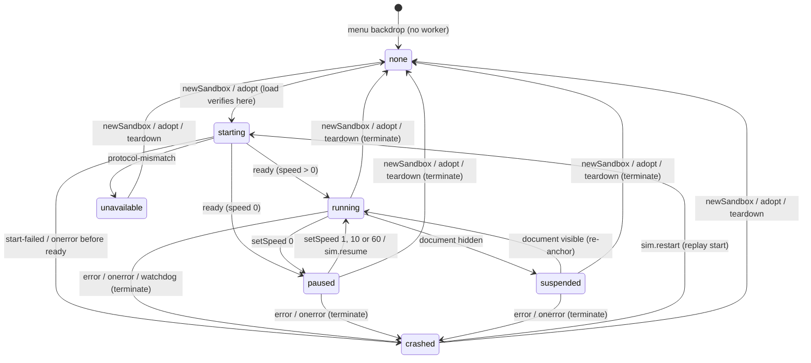
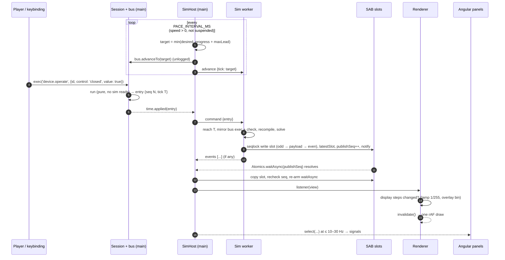
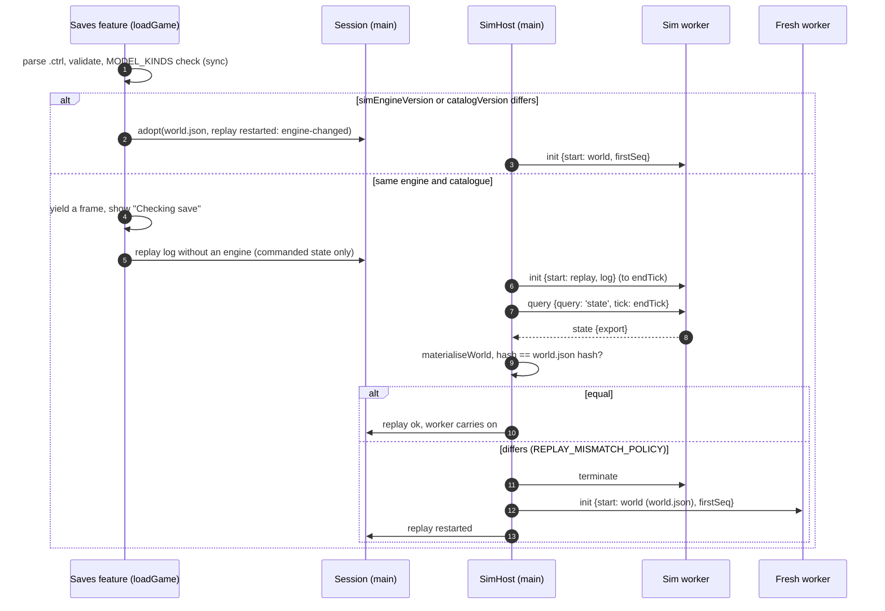

# ADR 0011: Sim worker contract

**Status:** Accepted (2026-10-29). P2 kickoff step 3, the agent-team contract. Drafted by `sim-engine-engineer`.
**Review:** `renderer-engineer`, `angular-ui-engineer`, `electron-platform-engineer` and `save-format-guardian` reviewed the proposal and every required change is applied below. The user decided U1–U3 (hidden window suspends, engine-changed saves load with a restarted log, the solution record is saved and hashed), and the main agent ruled on the three conflicts (R1–R3); see [Resolved in review](#resolved-in-review) and the [phase 2 plan](../../plans/phase-2-circuit-engine.md) decisions D7 and D8.
**Date:** 2026-10-29 (Phase 2)
**Sources:** plan §4.3–§4.5, §4.11; [phase 2 plan](../../plans/phase-2-circuit-engine.md) kickoff step 3 and decisions D1–D8, F2.3a, F2.3b, F2.5, F2.6; [ADR 0002](0002-simulation-architecture.md) (layers, worker, SAB); [ADR 0004](0004-save-format.md) and [ADR 0007](0007-world-document-v1.md) (save format, ticks, hash, replay log); [ADR 0006](0006-command-system.md) (bus, undo, logging); [ADR 0009](0009-save-io-boundary.md) (saves, quit flush); [ADR 0010](0010-wire-routing-spike.md) (frame-cost practice); [commands](../caveats/commands.md), [rendering](../caveats/rendering.md), [electron](../caveats/electron.md) and [save-format](../caveats/save-format.md) caveats

## Context

P2 puts the simulator in a module Web Worker in the renderer process (ADR 0002, spec §4.3 v1.3) while the P1 game keeps running on the main thread: the `Session`, its `Game` and `CommandBus<World>`, every command surface, the renderer and the Angular panels. Four teams build against the seam between them at the same time:

- `sim-engine-engineer` writes the engine (`sim-core`), the protocol (`sim-protocol`) and the worker (`sim-worker`);
- `renderer-engineer` draws lamp brightness and the voltage and current overlays from solved values;
- `angular-ui-engineer` builds `SimHost`, the time controls, the HUD and the netlist inspector;
- `electron-platform-engineer` runs the worker under `app://` with COOP/COEP and the CSP;
- `save-format-guardian` owns everything that ends up in a save or a replay log.

D1 already decided the shape: the main thread stays authoritative and the worker follows deterministically, with commands sent by `postMessage`. This ADR fixes everything else at the level of byte offsets and message shapes, so each team can build against fake data generated by the shared codec before the engine exists.

The hard constraints:

- **Determinism.** The same seed and log give byte-identical snapshots in the worker (Chromium), in `sim-cli` (Node), through the `postMessage` fallback, and across a save and load.
- **Exact replay.** `exec` stays synchronous; a command's `run` can't wait for the worker.
- **On-demand rendering.** The viewport draws only when invalidated ([rendering caveats](../caveats/rendering.md)), so a new snapshot must not redraw unless something visible moved.
- **No allocation per frame** in the reading path.
- **Electron posture.** No new IPC, no `eval`, `crossOriginIsolated` for the fast path, with a fallback that gives the same bytes.

## Decision

### 1. Ownership and threads

| Thread                       | Owns                                                                                                                                                                                                                                                | Never                                                                                                      |
| ---------------------------- | --------------------------------------------------------------------------------------------------------------------------------------------------------------------------------------------------------------------------------------------------- | ---------------------------------------------------------------------------------------------------------- |
| **Main** (Angular, renderer) | The world bus (`CommandBus<World>`), the undo and redo stacks, the replay log, `seq`, the clock (the current tick and the pacing), the save and load flow                                                                                           | Runs `sim-core` in the game, not even to verify a log on load: the worker does that ([§10](#10-lifecycle)) |
| **Sim worker**               | The `SimEngine`: netlist, solver, layers and all **sim-owned state** (tripped, blown, melt and thermal fractions, state of charge, filament temperature, PSU mode and hiccup timers, the last electrical solution); the snapshot buffer; sim events | Allocates `seq`, decides a tick, logs anything, or originates a world change                               |

- **The worker keeps a mirror bus.** It runs `createWorldRegistry()` over its own `CommandBus<World>`, built with the `firstSeq` option (§3), and re-executes every logged entry it receives. `run` is pure and never reads sim-owned state, so the mirror reaches the same world as the main bus. The worker compares each result with the entry it was sent (the same `seq`, tick and args checks as `replayEntries`); any difference is a `desync` error (§10).
- **Commands record intent; the sim resolves the effect.** A command's `run` never reads sim-owned state. Example: `device.operate {id, control: 'handle', value: 'on'}` on a breaker records the handle position; whether it stays tripped is the engine's decision at that tick ("after a trip, the handle must go off and then on again" is engine logic).
- **Commanded versus sim-owned state is declared in code,** per model kind, in `MODEL_KINDS` in `@controls/catalog`: for every key, its owner (commanded or sim), its Zod schema and its initial value. World v2 (ADR 0013) persists them as **two bags**:
  - **`EntityV2.state`, commanded:** written only by commands (a switch's `closed`, a supply's setpoint and current limit, a breaker's handle);
  - **`EntityV2.sim`, sim-owned:** written only by `materialiseWorld`. The bus world's copy is inert: it holds the value at the session's start or last load and is **never read during play**, by the engine or by the UI. A property test shows every change preserves each entity's `sim` bag, except on insert and remove.
- **Materialisation.** The world document a save writes, and the one `world.hash` hashes, is `materialiseWorld(busWorld, simState)` (in `sim-protocol`): the bus world at tick T with every entity's `sim` bag and the solution record (`WorldV2.sim`, §9.6) taken from the engine's export at T. No wall-clock value reaches the export or `materialiseWorld`. Headless (`sim-cli`), the export is synchronous. In the game it is a round trip to the worker (§9.5).
- **UI rule.** The UI and the renderer read sim-owned values from snapshots (§6), never from the world. `Session.world().tick` and `world().entities[].sim` are never displayed.

### 2. Clock and pacing

- **1 tick = 1 ms of sim time**, an integer. Ticks are stored as JS numbers (exact up to 2^53) and as `Float64` in the snapshot, never as `Int32`: 2^31 ms is under 25 days, which a 60× sandbox reaches in about 10 hours.
- **Speeds:** 0 (paused), 1×, 10× and 60×. `sim.step {ticks}` advances by an exact number of ticks at any speed. It is meant for paused use, and works the same while running (the anchor moves, see below) and while suspended.
- **The pacing is on the main thread, in `SimHost`** (D1: main owns the clock). The policy is a pure class, `Pacer` in `sim-protocol`, that takes the wall time as an argument. `SimHost` reads the wall clock only through an injected `SIM_CLOCK` token (`now`, `setTimeout`, `clearTimeout`), next to `SIM_WORKER_FACTORY`, so pacing specs use fake timers and the disposal spec can count them. The plan put "pacing" in `libs/sim-worker`; this ADR splits it, because the main thread decides the tick. The worker's lint-excepted module, `libs/sim-worker/src/lib/pacing/worker-clock.ts` (the boundary PR exempts `src/lib/pacing/**`), reads the wall clock only for work slicing, publish throttling and the unhashed diagnostics (§5.6).
- **Each pacing tick** (a `setTimeout` loop every `PACE_INTERVAL_MS`, not `requestAnimationFrame`, so pacing never wakes the render loop). The loop runs only while the speed is above 0 and the sim isn't suspended or held:

  ```text
  desired  = anchorTick + floor((nowMs − anchorWallMs) × speed)
  progress = the tick of the latest snapshot read (§6.3)
  maxLead  = speed × MAX_LEAD_WALL_MS                 (ticks)
  target   = min(desired, progress + maxLead)
  if target > bus.currentTick(): bus.advanceTo(target); post { type: 'advance', tick: target }
  if desired > target: anchorTick = target; anchorWallMs = nowMs   // drop the lost time: no catch-up spiral
  ```

  `sim.setSpeed` and `sim.resume` re-anchor at the current tick and time. `sim.step {ticks}` advances at once through the time host (§3), posts the advance and re-anchors. It isn't capped by the lead, so the worker may then need time to catch up (§13).

- **Pacing writes no signals at 100 Hz.** The HUD's signals are sampled at the panel rate (§9.3).
- **Suspended (U1).** When the document becomes hidden (`visibilitychange`), `SimHost` stops pacing; this is host state, not a logged command, and the speed is unchanged. When it becomes visible again, `SimHost` re-anchors at the current tick and time and resumes at the player's speed. "Falling behind", the effective-speed windows and the watchdog (§10) are held while suspended. `sim.step` still works. `backgroundThrottling` stays at its default. The web harness behaves the same. Running in the background may become a setting later.
- **Held.** `SimHost.hold()` suspends pacing the same way while a console script runs (§9.5).
- **Effective speed** is Δtick ÷ Δwall over a 1 s window. "Falling behind" is raised when the effective speed is below 0.9 × the requested speed for two windows in a row, and cleared after one window at 0.97 × or better (hysteresis, so it doesn't flicker).
- **Determinism.** Wall-clock floats decide only _which_ integer tick the main thread advances to. Everything that reaches the bus, the log, the worker and the hash is an integer tick.

| Constant                  | Value            | Kind                                                                                                                                                           |
| ------------------------- | ---------------- | -------------------------------------------------------------------------------------------------------------------------------------------------------------- |
| `TICK_MS`                 | 1                | spec §4.3 (1 kHz)                                                                                                                                              |
| `SIM_SPEEDS`              | `[0, 1, 10, 60]` | spec §4.3                                                                                                                                                      |
| `SOLVE_INTERVAL_TICKS`    | 10               | numerical choice inside spec §4.5's 10–20 ms                                                                                                                   |
| `MAX_STEP_TICKS`          | 600 000 (10 min) | game-design bound on `sim.step`: a step can't be cancelled. It may be raised later without a bump, never lowered (§12)                                         |
| `DEFAULT_STEP_TICKS`      | 1 000            | game-design default of `sim.step`'s form                                                                                                                       |
| `PACE_INTERVAL_MS`        | 10               | numerical choice: under a frame, coarse enough to be cheap                                                                                                     |
| `MAX_LEAD_WALL_MS`        | 25               | numerical choice: at most about 25 ms of wall time between what is shown and what is commanded; at least 2 × `PACE_INTERVAL_MS`, or 60× could never be reached |
| `WORK_SLICE_MS`           | 8                | numerical choice: the worker yields to its message queue at least this often                                                                                   |
| `PUBLISH_MIN_WALL_MS`     | 4                | numerical choice: the throttle on cadence publishes (§7). F2.3b may try 8                                                                                      |
| `MAX_READ_ATTEMPTS`       | 4                | numerical choice: seqlock attempts per slot (§6.2)                                                                                                             |
| `PANEL_SAMPLE_HZ`         | 10 (at most 30)  | spec §4.1                                                                                                                                                      |
| `WATCHDOG_MS`             | 3 000            | numerical choice: no publish for this long while the target is ahead of progress is a crash (§10)                                                              |
| `MAX_SLOT_BYTES`          | 64 MiB           | numerical choice: a generation that needs more is `error {code: 'capacity'}` (§7)                                                                              |
| `STATE_QUERY_TIMEOUT_MS`  | 5 000            | numerical choice: the deadline of a `state` or `snapshot` query (§9.5). F2.3b tunes it                                                                         |
| `SIM_SETTLE_MS`           | 1 000            | numerical choice: the most the quit flush, a replace or a teardown waits for pending `state` queries (§9.5, §10)                                               |
| `AUTOSAVE_MAX_BEHIND_MS`  | 2 000            | numerical choice: an autosave is skipped if the worker is further behind than this, in wall time (§9.5). F2.3b tunes it                                        |
| `EVENT_TOAST_COALESCE_MS` | 2 000            | game-design choice: `tripped` and `blown` toasts are coalesced per entity over this window (§4)                                                                |

### 3. Time versus undo

- **Time passing is not a command** and never touches the undo or redo stacks. This supersedes ADR 0006's example of `sim.step` as "a non-undoable change": `sim.step` changes nothing in the world, so it leaves both stacks alone.
- **`CommandBus.advanceTo(tick)`** sets the state's tick through a new bus option, `withTick(state, tick)` (for `World`, `{ ...world, tick }`). It is unlogged, takes no `seq`, leaves the history alone and fires no `executed` event. It throws for a tick that isn't `Number.isSafeInteger`, for `tick < currentTick()`, and on a bus constructed without `withTick`; it is a no-op for an equal tick.
- **`bus.nextSeq()`** is the one source of the next `seq`, used by `exec`, `replayEntries` and `carryOver` (today each computes `log.length`).
- **`CommandBusOptions.firstSeq`** (default 0) starts a bus at a later `seq` with an empty log and history. It is persisted as `ReplayLogV2.firstSeq`, with `entries[i].seq === firstSeq + i`, so a rebased or restarted log keeps its `seq`s. This matters because randomness is keyed by `commandStreamKey(seq)`.
- **The time host.** `createGame({ world, registry, time })` takes a `TimeHost` (a `SimDriver`): `advanceTo(tick)`, `applied(entry, world)` and an optional `exportState()`. The headless in-process engine and `SimHost` in the game are the only implementations. `sim.step` takes effect only there, synchronously inside `exec`, so the next console line is stamped at the new tick. No bus listener drives time.
- **Every change preserves `tick`:** `change.apply(s).tick === s.tick` and `change.invert(s).tick === s.tick`, for every world command (a fast-check property in `world-model`). A change must never capture and restore a whole world, or undo would rewind time.
- **The "undo everything" property is restated:** for a session in which no time passed (every entry at the initial tick) and no cheat ran, undoing everything returns the initial `world.hash`. When time has passed, undoing everything returns a world whose commanded part (entities and their `state` bags, connections, `nextEntityId`, `fixtures`) equals the initial one; `tick`, the `sim` bags and the solution are whatever time made them.
- **Undoing a delete restores the entity as it was deleted.** When an entity is deleted, the engine keeps its sim-owned state as a tombstone, keyed by entity id. Reinserting that id restores it, so a blown fuse comes back blown. When an entity leaves because its `entity.place` was undone, its sim state is dropped immediately (the id can be reused by a fresh entity). Tombstones are never persisted: after a load the undo stack is empty, and ADR 0007's argument shows no logged undo can reach a pre-load delete. A parity test deletes a blown fuse, saves, loads, places a fuse and compares with a straight run.
- **`endTick` and "state at T".** `endTick ≥ last entry tick ≥ initialWorld.tick`. The state at tick T means: after every command logged at T so far, before step T's cadence solve.
- **`replayEntries(bus, entries, { time?, endTick? })`** no longer refuses an entry whose tick is ahead. For each entry with `tick > bus.currentTick()`, it calls `time.advanceTo(entry.tick)` (reaching the start of that tick) and then `bus.advanceTo(entry.tick)`, executes the entry and calls `time.applied(entry, world)`. At the end it advances to `endTick`, if given. A tick **lower** than the current one is still `tick-mismatch`. v1 logs (every entry at tick 0, migrated with `endTick` = `max(initialWorld.tick, last entry tick)`) replay exactly as before (a property test on the P1 fixtures).
- **Time in a replay comes only from entry ticks and `endTick`.** A `sim.step` entry at tick t doesn't advance on replay; the next entry's tick (or `endTick`) carries its effect.

### 4. Command flow and sim events

**Order.** `SimHost` gets each logged entry through `time.applied` and forwards every **logged** entry (world, view, `edit.*` and `sim.*` commands: the mirror needs every `seq`) in `seq` order. Unlogged UI chrome (`palette.open`, `file.*`, `sim.restart`) is never sent. Advances and commands share one `postMessage` channel, so the worker sees them in the order main produced them. Main stamps each entry with its own current tick, which is never below anything the worker has reached, because the worker never goes past the last advance it was sent. Commands executed before `ready` are queued by `postMessage` order and handled after `init`.

**The worker's step order** (also `SimEngine`'s, headless). `S_t` is the state at tick t; tick t's commands apply to `S_t`:

1. Apply every command logged at tick t, in `seq` order, through the mirror bus.
2. If they changed the netlist (topology or values), recompile incrementally and solve now. So a paused player who flips a switch sees the result at tick t.
3. Step t → t+1:
   1. solve if `t mod SOLVE_INTERVAL_TICKS == 0` (absolute ticks, so a restart or a load keeps the cadence) and nothing has solved at t yet;
   2. the discrete layer (empty in P2), then continuous, then protection, over [t, t+1);
   3. if protection changed the topology (a trip or a blow), recompile and re-solve at t+1, and emit the event at t+1.

A command whose tick is ahead of the engine waits in the inbox until the engine reaches that tick. Messages are consumed strictly in order: an `advance` isn't consumed until the engine has reached it, and a `query` is answered only after every earlier message has been handled (§9.5). The worker yields to its queue through a `MessageChannel` at least every `WORK_SLICE_MS`, never through nested `setTimeout`; when idle it waits for the next message. It never calls `Atomics.wait`.

**Messages** (Zod schemas in `@controls/sim-protocol`, parsed on receipt at both ends; `World`, `ReplayEntry` and `ReplayLog` are the save-format types):

```ts
// main → worker
type HostToWorker =
  | { type: 'init'; protocol: number; transport: 'sab' | 'message'; start: SimStart }
  | { type: 'advance'; tick: number } // the new target; strictly increasing
  | { type: 'command'; entry: ReplayEntry } // every logged entry, contiguous seq
  | { type: 'query'; id: number; query: 'state' | 'snapshot'; tick: number }
  | { type: 'watch'; id: number; target: WatchTarget } // view state for traces; never affects the engine
  | { type: 'unwatch'; id: number }
  | { type: 'release'; buffer: ArrayBuffer } // fallback only: hands a pooled buffer back (transferred)
  | { type: 'stop' };

type SimStart =
  | { kind: 'world'; world: World; firstSeq: number } // world is materialised (sim bags and WorldV2.sim set)
  | { kind: 'replay'; log: ReplayLog }; // initialWorld + firstSeq + entries + endTick: load verification and crash restart

type WatchTarget =
  | { kind: 'branch'; element: ElementRef } // current through a branch
  | { kind: 'device'; entity: number; field: string }; // one field of a device record

// worker → main
type WorkerToHost =
  | {
      type: 'ready';
      protocol: number;
      transport: 'sab' | 'message';
      isolated: boolean; // self.crossOriginIsolated, from the worker's own scope
      buffer: SharedArrayBuffer | null;
      tick: number;
    }
  | { type: 'topology'; descriptor: TopologyDescriptor; buffer: SharedArrayBuffer | null } // buffer: a replacement when capacity grew
  | { type: 'snapshot'; buffer: ArrayBuffer } // fallback only: one slot, transferred
  | { type: 'events'; events: readonly SimEvent[] }
  | { type: 'trace'; id: number; samples: Float64Array } // (tick, value) pairs, at every solve since the last batch
  | { type: 'state'; id: number; tick: number; export: SimStateExport; snapshotHash: string }
  | { type: 'snapshotBytes'; id: number; tick: number; bytes: ArrayBuffer } // reply to query 'snapshot'
  | { type: 'error'; code: SimErrorCode; message: string; seq: number | null; tick: number | null };

type SimErrorCode =
  | 'protocol-mismatch'
  | 'start-failed' // includes a big-endian platform and a solution record that doesn't match the netlist (§9.6)
  | 'invalid-message' // the message text never echoes the payload
  | 'desync'
  | 'engine-threw' // also self.onerror, unhandledrejection, and a non-finite value reaching the export
  | 'csp-violation' // a securitypolicyviolation seen in the worker scope
  | 'capacity'; // a slot can't be allocated (over MAX_SLOT_BYTES, or the allocation failed); never a partial publish

/** Host-side rejections of a pending query (never on the wire). */
type SimQueryError = 'superseded' | 'timeout' | 'crashed' | 'unavailable';

interface SimEvent {
  readonly tick: number;
  readonly kind: 'tripped' | 'blown' | 'hiccup' | 'nonConverged' | 'singular' | 'overRated';
  /** The device for device events; null for island events. */
  readonly entity: number | null;
  /** Island events: the island's entity ids, sorted ascending. Empty for device events. */
  readonly entities: readonly number[];
  /** Kind-specific detail: hiccup `{ phase: 'off' | 'retry' }`; empty `{}` otherwise. */
  readonly detail: Readonly<Record<string, number | string | boolean>>;
}

/** Both persisted shapes are z.infer of @controls/save-format schemas: no hand-written persisted interface (ADR 0004). */
interface SimStateExport {
  readonly tick: number;
  /** Every entity with a model kind, sorted by id; `state` is the entity's sim bag, every sim key present, absent values null. */
  readonly entities: readonly { readonly id: number; readonly state: z.infer<EntityV2['sim']> }[];
  /** The last electrical solution (§9.6). */
  readonly solution: NonNullable<z.infer<WorldV2['sim']>>;
}
```

`sim-protocol` parses every export with the save-format schemas before materialising it.

- **Sim events** are posted with each publish, as batches **cut at every command boundary**: what time raised up to a command is one batch, what that command and the time after it raised (up to the next command) the next, each sorted by tick, then entity id, then kind, and concatenated in order. Island events (`nonConverged`, `singular`) fire on the rising edge only, not on every solve. Their content and order are deterministic: `game.on('sim')` gets the same list headless, whatever the publish timing. (Headless delivers each `exec`/`advance` call's events as one sorted batch; extra cuts between time-only calls change nothing, since their ticks don't overlap, so only the command boundaries matter. One sorted batch per publish would not do: publishes are throttled by wall time, so a time-driven event and a command's event at the same tick would arrive in either order. F2.3b review, from the F2.4 test review.) Events are not in any hash. Where they go in the UI:

  | Event                                   | UI                                                                                        |
  | --------------------------------------- | ----------------------------------------------------------------------------------------- |
  | `tripped`, `blown`                      | One warning toast, coalesced per entity over `EVENT_TOAST_COALESCE_MS`; HUD and inspector |
  | `hiccup`                                | HUD and inspector only                                                                    |
  | `nonConverged`, `singular`, `overRated` | Inspector and dev console only                                                            |

- **Traces** sample each watched quantity at every electrical solve (cadence and topology solves both), so the bench demo's current trace shows the cold-filament inrush: the topology solve at the switch's tick is the peak. Watches are view state, never logged, and never change the engine.

### 5. Snapshot layout (`SIM_PROTOCOL_VERSION` 1)

One `SharedArrayBuffer`, allocated by the worker, holds a buffer header, an unhashed diagnostics area and two slots. Every multi-byte value is **little-endian**: typed arrays use the platform's order, so the worker refuses to start on a big-endian platform (`start-failed`). Every reserved or padding byte is written as zero, because hashed padding is hashed.

#### 5.1 Buffer header (bytes 0–63)

| Offset | Type  | Field             | Notes                                                                   |
| -----: | ----- | ----------------- | ----------------------------------------------------------------------- |
|      0 | `u32` | `magic`           | `0x4D495343` (the bytes `CSIM`)                                         |
|      4 | `u32` | `protocolVersion` | `SIM_PROTOCOL_VERSION`                                                  |
|      8 | `u32` | `slotsOffset`     | 256: the byte offset of slot 0                                          |
|     12 | `u32` | `slotBytes`       | the capacity of one slot, a multiple of 64                              |
|     16 | `u32` | `slotCount`       | 2                                                                       |
|     20 | `u32` | reserved          | 0                                                                       |
|     24 | `i32` | `publishSeq`      | **Atomics.** Incremented after each publish (wraps; compare with `!==`) |
|     28 | `i32` | `latestSlot`      | **Atomics.** 0 or 1: the last slot fully written; −1 before the first   |
|     32 | `i32` | `diagSeq`         | **Atomics.** The seqlock word of the diagnostics area                   |
|  36–63 | —     | reserved          | 0                                                                       |

Slot `i` starts at `slotsOffset + i × slotBytes`. The plan listed the tick, the topology generation and the counts in "the header"; they are in each **slot** header instead, because they must change atomically with the data they describe. The buffer header holds only constants and the three Atomics words.

#### 5.2 Slot header (slot bytes 0–95)

| Offset | Type     | Field                | Hashed | Notes                                                                                        |
| -----: | -------- | -------------------- | :----: | -------------------------------------------------------------------------------------------- |
|      0 | `i32`    | `slotSeq`            |   no   | **Atomics** seqlock: odd while being written                                                 |
|      4 | `u32`    | `topologyGeneration` |   no   | Counts topology changes since this engine started, so it differs after a load or a restart   |
|      8 | `f64`    | `tick`               |  yes   | The tick this snapshot describes                                                             |
|     16 | `f64`    | `lastSolveTick`      |  yes   | The tick of the electrical solution in this slot                                             |
|     24 | `u32`    | `nodeCount`          |  yes   |                                                                                              |
|     28 | `u32`    | `branchCount`        |  yes   |                                                                                              |
|     32 | `u32`    | `islandCount`        |  yes   |                                                                                              |
|     36 | `u32`    | `deviceCount`        |  yes   |                                                                                              |
|     40 | `u32`    | `deviceDataBytes`    |  yes   | A multiple of 8                                                                              |
|     44 | `u32`    | `flags`              |  yes   | bit 0: an island is singular; bit 1: an island didn't converge; bit 2: an island is mixed    |
|     48 | `u8[32]` | `topologyHash`       |  yes   | The raw SHA-256 bytes of F2.1's `topologyHash` (ADR 0013, "Solution order and topologyHash") |
|     80 | `u32`    | `payloadBytes`       |  yes   | The bytes used after the header                                                              |
|  84–95 | —        | reserved             |  yes   | 0                                                                                            |

**The hashed region** is slot bytes `[8, 96 + payloadBytes)`. `snapshotHash` is its SHA-256 (the pure implementation in `world-model`), in lowercase hex.

#### 5.3 Payload (from slot byte 96)

Sections are packed in this order, each starting 8-aligned. Offsets are computed from the counts, which are constant within a topology generation.

| Section  | Size               | Entry layout                                                                                                                                                                                                                          |
| -------- | ------------------ | ------------------------------------------------------------------------------------------------------------------------------------------------------------------------------------------------------------------------------------- |
| Nodes    | `nodeCount × 16`   | `f64 re`, `f64 im`: the node voltage in V against the solver's ground                                                                                                                                                                 |
| Branches | `branchCount × 16` | `f64 re`, `f64 im`: the branch current in A, positive from the descriptor's end `a` to end `b`                                                                                                                                        |
| Islands  | `islandCount × 16` | `u8 kind` (0 empty, 1 dc, 2 ac, 3 mixed), `u8 flags` (bit 0 singular, bit 1 nonConverged), `u16 iterations`, `u32 referenceNode` (`0xFFFFFFFF` for none), `u32 unknowns`, `u8 band` (an index into `NOMINAL_BANDS`), 3 bytes reserved |
| Devices  | `deviceDataBytes`  | Fixed-width records at the descriptor's `recordOffset`, laid out by their kind's output schema (§5.4)                                                                                                                                 |

- **AC values are RMS phasors** (V_rms∠θ) at the region frequency. DC values have `im = 0`.
- **Reference node.** For a grounded island, the reference is ground. For a floating DC island, it is the most negative source terminal. Readers subtract `V(referenceNode)` to show a voltage. No reader computes any other electrical quantity.
- **Magnitudes.** Readers may take the complex magnitude |V| or |I| for overlays. A mixed island is shown as AC.
- **The nominal band.** `NOMINAL_BANDS` in `sim-protocol` is a fixed table (0 = none; then 12 V DC, 24 V DC, 120 V AC, …), chosen by the engine from the island's source nameplates and setpoints, so overlays can pick a scale without computing anything. It is hashed; appending a band bumps the protocol (§12).
- **Every value is finite, and `-0` is `+0`.** The engine normalises `-0` to `+0` and refuses non-finite values wherever it stores sim-owned state and the solution, not only in the snapshot writer; the solver flags a singular island instead of producing NaN (F2.2). A non-finite value that still reaches the writer or the export is `engine-threw`.
- `iterations` is the outer-loop count of the island's last solve (1 for a linear island).

#### 5.4 Device records and output schemas

Each device model kind that publishes outputs has a `DeviceOutputSchema` in `sim-protocol`'s `DEVICE_OUTPUT_SCHEMAS`:

```ts
interface DeviceOutputSchema {
  readonly kind: string; // the catalogue model kind, e.g. 'lamp.incandescent'
  readonly recordBytes: number; // a multiple of 8
  readonly fields: readonly DeviceOutputField[];
}
interface DeviceOutputField {
  readonly name: string;
  readonly type: 'f64' | 'u32' | 'i32' | 'u8';
  readonly offset: number; // naturally aligned within the record
  readonly unit: string | null; // SI symbol ('W', 'K', 'V', 'A') or null for ratios and enums
  readonly values: readonly string[] | null; // u8 enums: the code-to-name table
}
```

Fields are ordered `f64`, then 4-byte, then `u8`, and the record is zero-padded to 8 bytes. Records are in device-index order (entity id ascending), one for each entity whose model publishes outputs. Props publish none. Readers join a descriptor device to a world entity by **(id, kind)**; a mismatch means the device is treated as absent. The P2 schemas below are **provisional**: each device-model PR (F2.4, F2.5) finalises its own schema with `renderer-engineer` and `angular-ui-engineer`, and the ADR is amended in that PR.

| Kind                 | Fields (offset: type name)                                                                          | Bytes |
| -------------------- | --------------------------------------------------------------------------------------------------- | ----: |
| `lamp.incandescent`  | 0: f64 `powerW` · 8: f64 `lightOutputRel` · 16: f64 `filamentTempK`                                 |    24 |
| `fuse`               | 0: f64 `meltFraction` · 8: u8 `state` [`intact`, `blown`]                                           |    16 |
| `breaker.thermalMag` | 0: f64 `thermalFraction` · 8: u8 `state` [`closed`, `tripped`, `open`]                              |    16 |
| `battery`            | 0: f64 `emfV` · 8: f64 `terminalV` · 16: f64 `currentA` · 24: f64 `stateOfCharge` · 32: u8 `status` |    40 |
| `supply.bench`       | 0: f64 `outputV` · 8: f64 `outputA` · 16: u8 `mode` [`off`, `cv`, `cc`] · 17: u8 `status`           |    24 |
| `supply.dinPsu`      | 0: f64 `outputV` · 8: f64 `outputA` · 16: u8 `mode` [`ok`, `limit`, `hiccupOff`] · 17: u8 `status`  |    24 |
| `resistor`           | 0: f64 `powerW` · 8: u8 `overRated` [`no`, `yes`]                                                   |    16 |
| `heater`             | 0: f64 `powerW`                                                                                     |     8 |

Switches publish no record: the renderer draws the handle from the world's commanded `closed`. Leads are connections, not entities: their current is their branch's.

**Amended in F2.4 (the source records are final; `sim-engine-engineer` with `renderer-engineer`; `angular-ui-engineer` to confirm):**

- **The validity rule.** Every F2.4 record ends with `u8 status` [`unsolved`, `solved`, `unsettled`, `singular`], the status of the device's island in the slot's solution (`islandStatus`: `unmodelled` and `mixed` are `unsolved`, `nonConverged` is `unsettled`). Code 0 is `unsolved`, so a zeroed record is never a reading. **Fields computed from the solution** (`terminalV`, `currentA`, `outputV`, `outputA`) are a reading only when `status` is `solved` and are written 0 otherwise; **fields that are the device's own sim state** (`emfV`, `stateOfCharge`, `mode`) are always written. A reader shows `unsettled` values and modes as unsettled, never as steady, and `unsolved` or `singular` ones as unknown, never as 0 V or 0 A. F2.5's lamp, fuse, breaker, resistor and heater records follow the same rule.
- `battery` gains `status` (40 bytes). `currentA` is the discharge current, positive out of `pos`; it is negative while charging.
- `supply.bench`'s `mode` is `off` while the output is switched off, else the regulation mode from the `sim` bag.
- `supply.dinPsu`'s `mode` drops `off`: P2's DIN PSU has no AC input to lose, so it is always powered. An input (P4) adds a value, which is a protocol bump.
- The schemas live with their models in `sim-core` (`BUILTIN_DEVICE_OUTPUTS`, each checked by `deviceOutputSchemaProblems`) and are registered in `sim-protocol`'s `DEVICE_OUTPUT_SCHEMAS` (protocol 3, F2.3b; 4, F2.5), the protocol's own copy; a sim-core spec requires the two to be equal, so a model changing its record fails until the table and `SIM_PROTOCOL_VERSION` follow. The `status` values are `RECORD_STATUS_VALUES`.

**Amended in F2.5 (the load and protection records are final; `sim-engine-engineer`; `renderer-engineer` and `angular-ui-engineer` to confirm):** every record follows the validity rule above (solved quantities only on a solved island; the device's own state always; an open fuse link or breaker pole reads `solved` at exactly 0 A).

| Kind                      | Fields (offset: type name)                                                                                                                                               | Bytes |
| ------------------------- | ------------------------------------------------------------------------------------------------------------------------------------------------------------------------ | ----: |
| `lamp.incandescent`       | 0: f64 `powerW` · 8: f64 `currentA` · 16: f64 `voltageV` (solved) · 24: f64 `resistanceOhm` · 32: f64 `filamentTempK` · 40: f64 `lightOutputRel` (own) · 48: u8 `status` |    56 |
| `fuse`                    | 0: f64 `currentA` (solved) · 8: f64 `meltFraction` (θ_e + θ_b, own) · 16: u8 `state` [`intact`, `blown`] · 17: u8 `status`                                               |    24 |
| `breaker.thermalMagnetic` | 0: f64 `currentA` (solved) · 8: f64 `thermalFraction` · 16: f64 `magneticPickupA` (own) · 24: u8 `state` [`off`, `on`, `tripped`] · 25: u8 `status`                      |    32 |
| `resistor`                | 0: f64 `voltageV` · 8: f64 `currentA` · 16: f64 `powerW` · 24: u8 `overRated` [`no`, `yes`] (all solved) · 25: u8 `status`                                               |    32 |
| `heater`                  | 0: f64 `voltageV` · 8: f64 `currentA` · 16: f64 `powerW` (solved) · 24: u8 `status`                                                                                      |    32 |

On an AC island the voltages and currents are RMS magnitudes. The breaker kind is `breaker.thermalMagnetic` (the table above abbreviated it), and its states are the handle's and the trip's: `off`, `on`, `tripped`. Registering these in `sim-protocol`'s `DEVICE_OUTPUT_SCHEMAS` (with the `SIM_PROTOCOL_VERSION` bump) is F2.3b's, as for F2.4's.

#### 5.5 Hashed and unhashed

- **Hashed:** the slot's hashed region (§5.2). It is a pure function of (seed, log, tick), the same in every runtime and through either transport. `encodeSnapshot` at T is a pure function of (the compiled netlist, the sim-owned state, the solution record), so everything hashed in a slot is derivable from the export (§9.6).
- **Not hashed:** `slotSeq`, `topologyGeneration`, the buffer header, the diagnostics area, events and traces, and **which** ticks get published. Publishing is throttled by the wall clock (§7), so the set of published ticks varies between runs. The content of a snapshot at tick t never does.
- **Publishing never changes the engine.** It only serialises. Encoding at an off-cadence tick doesn't solve.

#### 5.6 Diagnostics (bytes 64–255, unhashed)

Guarded by `diagSeq` with the same seqlock rule as a slot. All `f64`, written by the worker clock module: 64 `lastSolveMs`, 72 `maxSolveMs` (over 1 s), 80 `meanTickUs` (over 1 s), 88 `ticksPerSecond`, 96 `busyFraction`, 104 `solveCount`, 112 `throttledPublishes`; 120–255 reserved. Solve timings live **only** here: never in a slot, an event, a trace or a save. Without cross-origin isolation `performance.now()` is coarser, which affects these diagnostics only.

### 6. Seqlock and reading

#### 6.1 Writer (the worker, the only writer)

```ts
const w = latestSlot === 0 ? 1 : 0; // never the slot readers are pointed at (slot 0 first)
const s = Atomics.load(i32, slotSeqIndex[w]);
Atomics.store(i32, slotSeqIndex[w], s + 1); // odd: writing
encodeSnapshot(engine, slotBytes[w]); // plain typed-array stores, padding zeroed
Atomics.store(i32, slotSeqIndex[w], s + 2); // even: complete
Atomics.store(i32, LATEST_SLOT, w);
Atomics.add(i32, PUBLISH_SEQ, 1);
Atomics.notify(i32, PUBLISH_SEQ); // wakes SimHost's waitAsync
```

A reader of the latest slot conflicts only if the writer publishes **twice** while it copies. Atomics operations are sequentially consistent, and in V8 they are full fences on x64 and arm64. Formally, the plain reads race with the plain writes and may see torn values; the seqlock's second check discards every read that overlapped a write.

#### 6.2 Reader (`SnapshotReader` in `sim-protocol`)

```text
latest():
  p = Atomics.load(PUBLISH_SEQ); if p === lastSeen: return current          // nothing new: no work
  slot = Atomics.load(LATEST_SLOT); if slot < 0: return current
  for slot in [slot, 1 − slot]:                                             // latest, then the previous one
    repeat MAX_READ_ATTEMPTS times:
      s1 = Atomics.load(slotSeq[slot]); if s1 is odd: continue
      copy the slot's used bytes into the reader's private buffer           // preallocated; see below
      s2 = Atomics.load(slotSeq[slot]); if s1 === s2: goto accept
  misses++; return current                                                  // keep the previous snapshot
accept:
  if the copy's generation has no descriptor yet: awaitingDescriptor = true; return current  // lastSeen unchanged
  lastSeen = p; return the new view
```

- **The copy is preallocated.** The reader holds one private `ArrayBuffer` of `slotBytes` with its typed views, plus, for each slot, a `Uint8Array` view of the used length, which is rebuilt only when the generation (and so the counts) changes. A read is one `set()`, two `Atomics.load` calls and no allocation. A whole-slot copy is kept for P2; a devices-only read can be added later inside `SnapshotReader` without a version bump.
- **`latest()` returns the same `SnapshotView` object every time,** backed by the private copy. It stays valid until the next `latest()` call. Never keep it across calls; copy out the numbers you need.
- **The generation join.** The reader keeps the descriptors of the current and the previous generation. A slot whose generation has no descriptor yet (the message is slower than the SAB) is never shown, and `lastSeen` isn't updated; when the `topology` message arrives, `SimHost` re-reads and notifies. A slot from an older generation than the current descriptor is ignored. A test delivers a slot of a new generation before its descriptor.
- **Misses** are counted by `SimHost` and shown on the dev frame-time HUD and in the `sim.stats` console query (with the diagnostics), never on the player's HUD. The bench e2e asserts `misses === 0`.

#### 6.3 `SnapshotView`

```ts
interface SnapshotView {
  readonly tick: number;
  readonly lastSolveTick: number;
  readonly generation: number;
  readonly descriptor: TopologyDescriptor;
  readonly nodeCount: number;
  readonly branchCount: number;
  readonly islandCount: number;
  readonly deviceCount: number;
  voltage(node: number, part: 0 | 1): number; // 0 = re, 1 = im
  current(branch: number, part: 0 | 1): number;
  islandKind(island: number): 0 | 1 | 2 | 3;
  islandFlags(island: number): number;
  islandReference(island: number): number; // −1 for none
  islandIterations(island: number): number;
  islandBand(island: number): number; // index into NOMINAL_BANDS
  read(field: FieldRef): number; // u8 enums return the code; descriptor.schemas gives the names
  hashedBytes(): Uint8Array; // tests and `snapshot.hash` only (a view, no copy)
}
// Resolved once per generation, never per frame. The descriptor stays plain JSON:
// DescriptorIndex.of(descriptor).field(entityId, 'lightOutputRel') → FieldRef | null
```

The same `SnapshotView` is used headless (`game.snapshot()` returns the hashed bytes; `SnapshotView.fromBytes` wraps them) and in tests, so the renderer and the UI develop against fake snapshots that `encodeSnapshot` builds from fixtures.

### 7. Topology descriptor and publish cadence

**The descriptor** is sent by message (`topology`) once per generation, **before** the first slot of that generation is written. It is plain JSON-compatible data:

```ts
interface TopologyDescriptor {
  readonly protocol: number;
  readonly generation: number; // joins with slot.topologyGeneration
  readonly topologyHash: string; // lowercase hex; equals the slot's bytes
  readonly nodes: readonly { readonly island: number; readonly members: readonly TerminalRef[] }[]; // members sorted; index = F2.1 numbering
  readonly branches: readonly {
    readonly element: ElementRef;
    readonly a: number;
    readonly b: number;
    readonly island: number;
  }[];
  readonly islands: readonly { readonly kind: 'empty' | 'dc' | 'ac' | 'mixed'; readonly nodes: readonly number[] }[];
  readonly devices: readonly { readonly entity: number; readonly kind: string; readonly recordOffset: number }[]; // entity ascending
  readonly schemas: Readonly<Record<string, DeviceOutputSchema>>; // every kind used in `devices`
}
type TerminalRef = { readonly entity: number; readonly terminal: string }; // world v2 (ADR 0013)
type ElementRef =
  | { readonly kind: 'entity'; readonly entity: number; readonly part: string } // a device's internal element
  | { readonly kind: 'connection'; readonly connection: ConnectionId }; // a lead (wires from P3)
```

- **Descriptor identity.** A new `TopologyDescriptor` object is made for each generation and for each worker. Readers' caches key on the descriptor's identity, never on the generation number (a restarted worker counts generations from 0 again).
- **Netlist guarantees** (F2.1 tests them; the overlays rely on them):
  - each **netlisted** connection compiles to **exactly one branch**, with its contact resistances summed into it; `a` is `connection.a`'s node and `b` is `connection.b`'s node. A connection with an end on an absent entity (one whose ref the catalogue doesn't know, ADR 0013) is itself absent from the netlist and the descriptor (amended in the world v2 review);
  - a closed switch, or any other ideal merge, has no branch;
  - every catalogue terminal of every netlisted entity appears in exactly one node's `members`, and every node has at least one member.
- **Capacity.** The worker sizes the SAB for twice the first topology, with minimums (1 024 nodes, 2 048 branches, 256 islands, 64 KiB of device records), up to `MAX_SLOT_BYTES`. A generation that doesn't fit gets a new, larger buffer, sent in the same `topology` message; readers switch on that message and drop the old SAB, and the worker never writes the old buffer again. In the fallback, the worker drops released buffers smaller than the new `slotBytes`. A generation over `MAX_SLOT_BYTES`, or a failed allocation, is `error {code: 'capacity'}`, never a partial publish.
- **Publish cadence:**
  - after every electrical solve (every `SOLVE_INTERVAL_TICKS` and on every topology or value change), throttled to one per `PUBLISH_MIN_WALL_MS` of worker wall time;
  - **always**, unthrottled: after `init`, on a new generation, and when the engine reaches its current target and goes idle. So a paused sim always shows its exact tick, and an e2e test that steps and then waits sees that tick;
  - never on every tick.
- **Progress** for pacing (§2) is the latest snapshot's `tick`. The idle publish makes it exact when the worker has caught up.

### 8. The `postMessage` fallback (`?sab=0`)

- **When:** the page isn't `crossOriginIsolated`, `SharedArrayBuffer` is missing, or the URL has `?sab=0` (the test switch; any build). `init.transport` asks; `ready.transport` says what the worker chose. On Electron, falling back without `?sab=0` logs an error, and the about box shows the transport.
- **The same bytes:** the worker keeps a pool of three `ArrayBuffer`s of `slotBytes`. Each publish encodes one slot into a free one with the same `encodeSnapshot`, `slotSeq` even, and transfers it in a `snapshot` message. The reader copies it into its private buffer, exactly as in the SAB path, and sends the buffer back with `release`. With no free buffer, the worker skips a throttled publish, and remembers a forced one until a buffer comes back.
- **Reading is message-driven:** `SimHost` reads on each `snapshot` message instead of `waitAsync`.
- **Allocation:** one small `Uint8Array` view per received message (the transferred buffer is a new object). That is per snapshot, not per frame.
- **Tested:** the web harness runs `bench-lamp.console` with and without `?sab=0`, and both `snapshotHash`es equal `sim-cli`'s golden.

### 9. Readers: the renderer, Angular and saves

#### 9.1 One reader, pushed to listeners

- **`SimHost` owns the one `SnapshotReader`.** With the SAB it waits with `Atomics.waitAsync(i32, PUBLISH_SEQ, lastSeen)`, re-armed after each read (not while awaiting a descriptor: the `topology` message triggers that read), instead of polling; in the fallback it reads on each `snapshot` message. Nobody else reads the buffer. The reader is replaced when a crashed worker is restarted.
- **Notifying.** Listeners are called synchronously after every accepted read whose `publishSeq` differs from the last one delivered, including a re-solve at the same tick in the same generation (a setpoint change while paused). Listeners are never called from inside a rAF `update()`.
- **The listener signature** is `(view: SnapshotView | null) => void`. `null` means a source reset (a new sandbox, an adopt, a teardown or a crash restart), and readers return to their defaults: lamps dark, no overlays.

#### 9.2 The renderer

The renderer (`type:rendering`) gets a `SnapshotSource` (an interface from `sim-protocol`: `subscribe(listener) → unsubscribe`, plus `running: boolean`) from the viewport host. It never imports `feature-session` or `sim-worker`. Its subscription is registered with its `Disposer` and listed in the disposal spec. In its listener it:

1. reads the fields it draws through `FieldRef`s resolved once per descriptor;
2. maps each to a **display step** in preallocated arrays:
   - lamp emissive: `round(255 × displayCurve(lightOutputRel))`, steps of 1/255;
   - overlays: 32 bins per overlay scale plus an over-range bin, chosen by the island's band;
   - half-step hysteresis on both;
3. calls `invalidate()` only if any display step changed.

The rules:

- **Display modules.** The display curve, the overlay scales and the display steps live in `libs/rendering/renderer/src/lib/sim/{display-curve,overlay-scale,display-steps}.ts`, pure-module fenced by lint, each with a game-design `source`. The renderer never computes an electrical quantity: voltage overlays colour by `|V(node) − V(islandReference)|`, a complex magnitude for AC, and current overlays by |I|.
- **What a step change writes.** Only uniforms or instance attributes: never the light count, `visible` or material defines, and no storage buffers. Lamps get their own emissive material or instance attribute, not the shared `PropRecipes` material. The scene-graph snapshot records integer steps.
- **Current animation** runs only while `SnapshotSource.running` is true and some lead's |I| bin is above 0, with its phase driven by wall time (its `update` returns `true`). It is static while paused and under `prefers-reduced-motion`.
- **A generation change** rebuilds CPU-side index arrays only. GPU buffers are sized from the world and grow by doubling with a full re-upload (no `addUpdateRange`).
- **Picking.** Overlays recolour the existing lead and terminal meshes. Arrow meshes have a no-op `raycast` and are never among the picker's roots, so no BVH rebuild.
- **CI covers WebGL2 only.** The emissive and the overlays get the plan's manual WebGPU check.
- **Read budget:** at most 0.1 ms per read at p99 on a 500-device plant, measured in F2.3b together with the click-to-lamp latency (about 40–45 ms expected).

#### 9.3 Angular panels and the HUD

- **Panels don't subscribe per snapshot.** `SimHost.select(selector, hz = PANEL_SAMPLE_HZ)` returns a `Signal<T>` that runs `selector(view)` at most `hz` times a second (at most 30):
  - selectors return small plain values, display-rounded before the `equal` check, so the signal is set only when what is shown changes;
  - a trailing sample is taken when the sim goes idle or pauses, so the last value is exact;
  - it is bound to the caller's `DestroyRef`;
  - it resets on a generation change, with a selector memo per generation;
  - while crashed, values freeze and its `stale` flag is true.
- **`SimHost` signals,** at the panel rate unless noted: `status`, `speed`, `effectiveSpeed`, `behind`, `simTick` (the latest snapshot's tick, which is what the player sees), `commandedTick` (for "catching up x of y", §13) and `descriptor: Signal<TopologyDescriptor | null>` (unthrottled).
- **Never displayed:** `Session.world().tick` (the tick of the last command) and the world's `sim` bags. Read the time from `SimHost.simTick`.

#### 9.4 Hashes in the game

- **No synchronous materialisation in the game.** There, `game.hash()` and `game.save()` throw `NotAvailableError`. Callers use `SimHost.hashAt(): Promise<{ tick, hash }>` and `Session.saver()` (F2.3b: its `save()` resolves once the worker has answered for the captured tick). `Session.hash` is removed. The migrated callers are listed in Consequences.
- **The console.** `runConsoleScript` is async everywhere, with `ConsoleTarget.hash(): Promise<string>`; headless targets resolve at once. While a console script runs, `SimHost.hold()` suspends pacing, and the console is `aria-busy` and refuses input. An interactive `world.hash` line shows a placeholder, then fills in.
- **`snapshot.hash`** (a console query and an e2e hook) uses `query {query: 'snapshot'}`, which returns the bytes encoded at exactly that tick.
- **The `?e2e=1` hook:** `hash(): Promise<string>`, `simTick()`, `waitForTick(t)`, `snapshotHash(): Promise<string>` and `simStatus()`. `world()` is renamed `busWorld()`.
- **`world.hash` cost** at 2k and 20k nodes is measured in F2.3b, next to the read cost. It is never called per frame.

#### 9.5 Saving (`state` query)

A save is taken at the main thread's current tick T, the moment Save was pressed (not after the thumbnail):

1. `Session.saver()` synchronously captures the bus world at T, the log up to the last `seq` (with `firstSeq`), and `endTick = T`, and posts `query {query: 'state', tick: T}` in the same task, bound to that worker;
2. the worker answers once it has reached T and handled every earlier message: in order, so before any later advance;
3. `materialiseWorld(capturedWorld, export)`, then `writeCtrl`.

Main doesn't pause; the worker is never past T when the query arrives (§4). The rules around it:

- **Deadline.** A query is rejected with `timeout` after `STATE_QUERY_TIMEOUT_MS`.
- **Replacement.** Replace and teardown first settle pending queries for up to `SIM_SETTLE_MS`, then reject them with `superseded`.
- **Saving while crashed is refused** with "Restart simulation first" (R1). Autosaves and the quit autosave are skipped while crashed.
- **Quit flush.** The sim gets at most `SIM_SETTLE_MS` of `FLUSH_BEFORE_QUIT_TIMEOUT_MS`; then the settings flush (including the last-played pointer) always runs. With no answer, the quit autosave is skipped and the previous one stands. In the web harness the quit autosave is best effort; the periodic autosave is the guarantee. No new `Platform` capability or IPC.
- **Autosave** is skipped when the worker is behind by more than `AUTOSAVE_MAX_BEHIND_MS`, when there's no answer, when the sim has crashed, or when (`lastSeq`, tick) hasn't changed since the last one.
- **A manual save while catching up** shows progress and can be cancelled. Concurrent saves are merged.
- **The dirty model.** A game is dirty when its commanded world differs from the stored one (a synchronous `commandedHash`, with no tick and no `sim` bags), or when time has passed since the last store **and** the session has at least one logged world command. `sim.*` and view commands alone never make a game dirty, so an untouched running sandbox is never autosaved.

#### 9.6 The solution record

A load at a tick between solves must continue bit-exactly, and the continuous layer between solves uses the last solution. So the export carries the solution record, persisted in `WorldV2.sim` and included in `world.hash` (U3):

```text
sim: { lastSolveTick: Int, topologyHash: hex64,
       nodes: FiniteNumber[]      /* re,im interleaved, F2.1 order */,
       branches: FiniteNumber[]   /* re,im interleaved, F2.1 order */,
       islands: { flags: Int, iterations: Int }[] } | null
```

- `null` means "not solved since start": the engine solves at the start tick if `sim` is null, and adopts the record otherwise.
- On start, the engine checks the record's `topologyHash` and array lengths against the compiled netlist. A mismatch is `start-failed` with a reason, never a silent re-solve.
  - **Exception (F2.3a, D8):** for a save whose `simEngineVersion` or `catalogVersion` differs from the build's (`engineCompatible` isn't `verify`), a record that doesn't fit is another engine's: the load drops it and starts from `{ ...world, sim: null }`, so the engine solves at the save's tick and the log restarts as `engine-changed`. Such saves are never refused. `start-failed` stays for a same-engine save, where a misfit record means damage.
  - **`iterations` 0 means the island was not solved** (an AC island before F2.2 part 2, a mixed island, or an unmodelled one): its values are zeros and no reading.
- Every solve's starting guess (CV/CC mode, any warm start) comes from sim-owned state or this record, never from engine history that isn't exported. Caches that never change results, such as the factorisation cache, are exempt.
- Size: about 40 bytes of JSON per node or branch, roughly 200–260 KB at 2 000 nodes.
- A property test: export → JSON → start → export is identical under `Object.is`.

### 10. Lifecycle



- **One worker per game.** The main-menu backdrop has none: the reader is empty, and the renderer draws its defaults (lamps dark, no overlays).
- **The worker factory** is the literal `new Worker(new URL('<relative>', import.meta.url), { type: 'module' })`, alone in one factory module in `apps/game`, provided to `SimHost` through the `SIM_WORKER_FACTORY` token. Never `blob:`. So `feature-session` never imports `sim-worker`, and specs inject a fake or in-process worker. `apps/game` declares `implicitDependencies: ["sim-worker"]`, and `sim-worker` has its own typecheck target in `verify`.
- **The worker entry's first import** calls `z.config({ jitless: true })` (the page does the same in a module imported first) and adds a `securitypolicyviolation` listener on `self` that forwards any violation as `error {code: 'csp-violation'}`. It also turns `self.onerror` and `unhandledrejection` into `error {code: 'engine-threw'}`. The plan's follow-up "A CSP violation on every start" lands before F2.3b.
- **Electron.** F2.3b sets `nodeIntegrationInWorker: false` and `nodeIntegrationInSubFrames: false` explicitly. Fuses, IPC and the CSP are unchanged.
- **Start:** `Session.newSandbox` sends `start {kind: 'world', world, firstSeq: 0}`. A new game starts paused (speed 0) in P2.
- **Load** (R3, U2). In the game, `loadGame` is a synchronous parse plus an asynchronous sim check; headless, it stays synchronous with an in-process engine:
  1. parse and validate the `.ctrl`, then check every entity's `state` and `sim` bags against `MODEL_KINDS` (a failure is the new load error `invalid-device-state`);
  2. if the save's `simEngineVersion` or `catalogVersion` differs from the build's, skip verification: start from `world.json` with a new log (`replay.status: 'restarted'`, reason `engine-changed`). `REPLAY_MISMATCH_POLICY` never refuses this case;
  3. otherwise replay the log on the main thread without an engine (commanded state only, cheap), start the worker with `{kind: 'replay', log}` up to `endTick`, and send a `state` query;
  4. materialise and compare the hash with `world.json`'s. If they agree, that worker carries on. If not, terminate it and start one from `world.json` with `restarted`, subject to `REPLAY_MISMATCH_POLICY` as in P1.

  The loading UI yields a frame before blocking work and shows that the save is being checked. A restarted log starts from the loaded world with `firstSeq` = the loaded log's next `seq`; a `world` start after a load uses that same `firstSeq`.

- **Replace and teardown:** settle pending queries (§9.5), `worker.terminate()`, drop the listeners (they get `null`), the reader and the descriptors, and ignore any late message from the old worker. A disposal spec proves that no worker, timer, `waitAsync` or listener is left.
- **Crash.** Any of `onerror`, `onmessageerror`, an `error` message, or the watchdog (the target is ahead of progress and nothing has been published for `WATCHDOG_MS`; held while suspended) moves to `crashed` **and terminates the worker**. An `onerror` before `ready` is `start-failed`. Then:
  - pacing stops, listeners get `null`, `select` values freeze as `stale`, and a toast names the code and tick, with a **Restart simulation** action;
  - the world and the log are untouched, and world commands keep running on main;
  - **`sim.restart`** (unlogged, registered by the host next to `file.*`, not in the headless registry, `when: sim.status == 'crashed'`) starts a new worker and reader with `start {kind: 'replay', log}`: the session's replay log with `endTick` = the current tick. The worker replays deterministically to that tick (it rebuilds a superset of the live undo stacks, which is harmless by ADR 0007's argument) and resumes paused. If it fails again, the sim stays stopped;
  - saving is refused until then (§9.5).
- **A renderer process crash** is main's `render-process-gone` path (reload with a crash-loop limit), a separate P2 PR. The latest good autosave is the recovery point.
- **Protocol check:** `init.protocol !== SIM_PROTOCOL_VERSION` in the worker gives `error protocol-mismatch`. The host moves to `unavailable`, shows "simulation unavailable" and doesn't retry.

### 11. Headless parity (`sim-cli`)

- `sim-cli` and every domain test run the same `SimEngine` in-process as the `TimeHost` through the scripting API: `game.advance(ticks)`, `game.advanceTo(tick)`, `game.snapshot()` (the hashed bytes of `encodeSnapshot` at the current tick), `game.on('sim')`, and a synchronous `game.hash()` and `game.save()` that materialise.
- **The bytes match by construction:** the worker and `sim-cli` call the same `encodeSnapshot` and differ only in transport. D6's `dmath` makes the floats match across V8 builds.
- **Pinned goldens:** the bench demo's `snapshotHash` and `world.hash` are pinned in `apps/sim-cli` (Node) and `apps/game-e2e` (Chromium: the worker, and the worker with `?sab=0`). Change them together, with the scripting caveats.
- A headless host implements `sim.step` by advancing, so a `.console` file steps time the same way in `sim-cli` and in the game. `sim.setSpeed` and `sim.resume` are no-ops headless.

### 12. Versioning

- `SIM_PROTOCOL_VERSION` (an integer in `@controls/sim-protocol`, starting at **1**) covers everything in §4–§8: the message union, the buffer header, the slot header, the section order and entry layouts, the island encoding including `NOMINAL_BANDS`, every `DeviceOutputSchema` and the descriptor shape.
- **Any change bumps it,** including additive ones: a new device kind, a new field, a new event kind, a new band. Nothing here is persisted, so a bump needs no migration. But hashed bytes usually change, so the pinned snapshot goldens are re-pinned in the same PR, with a CHANGELOG line.
- **To change the contract:** amend this ADR in the same PR as the code, get sign-off from the owners of every affected reader (renderer, UI, Electron for transport, save-format for anything in §3 or §9), and bump the version. Never change it silently.
- **`ManifestV2.simEngineVersion`** (an integer, U2) is bumped whenever snapshot or world goldens are re-pinned for numeric reasons. A save from another engine or catalogue version loads with a restarted log (§10).
- **Not covered by this version** (save format, owned by `save-format-guardian`): the `sim.*` command ids and args, the state keys in `MODEL_KINDS`, the solution record's persisted form, `firstSeq` and `endTick`. Those follow `schemaVersion` (ADR 0004, ADR 0013). For the `sim.*` args, raising `MAX_STEP_TICKS` or adding a speed needs no bump; lowering or removing one is never allowed. Every logged command's argument JSON Schema is frozen in a staleness-checked export.

### 13. Time commands, keys and the HUD

- **Commands** (logged, `sim.*`, save format):
  - `sim.setSpeed {speed}`: `z.literal([0, 1, 10, 60])` (JSON Schema `enum`; a union of literals gives `anyOf`, which `buildArgForm` rejects), with `.meta` labels;
  - `sim.resume {}`: restores the last non-zero speed, 1× by default;
  - `sim.step {ticks}`: an integer from 1 to `MAX_STEP_TICKS`, default `DEFAULT_STEP_TICKS`, `.meta({ title: 'Sim time (ms)' })`.

  There is no `sim.pause`: pausing is `sim.setSpeed {speed: 0}`.

- **Context keys:** `sim.status` (`'none' | 'starting' | 'running' | 'paused' | 'suspended' | 'crashed' | 'unavailable'`), `sim.paused` (boolean) and `sim.speed` (number). Time commands add `&& sim.status != 'crashed'` to their `when`. `exec` doesn't evaluate `when`, so headless runs are unaffected.
- **Chords** (none bound today; Space is avoided because it would hijack focused buttons):
  - `P`: `sim.setSpeed {speed: 0}` when `session.active && !sim.paused`, and `sim.resume {}` when `sim.paused`;
  - `Shift+1`, `Shift+2`, `Shift+3`: 1×, 10×, 60×;
  - `Period`: `sim.step {ticks: 10}`; `Shift+Period`: `sim.step {ticks: 1000}`.
- **Catching up.** While `commandedTick − simTick` exceeds the lead, the HUD shows "Catching up" with progress. Commands are still stamped at the commanded tick.
- **Toasts** gain `action?: { label; commandId }`, used by the crash toast for `sim.restart`.
- **Accessibility.** The sim clock and the numbers are never in a live region. Only transitions are announced, once each, in a polite live region: falling behind, catching up, crashed, paused, suspended. Speed is one native radio group. Spinners are static under reduced motion.

## Sequence: a command and a snapshot



## Sequence: save

```mermaid
sequenceDiagram
    autonumber
    participant U as Saves feature (file.save / autosave)
    participant H as Session.saver() + SimHost (main)
    participant G as Game + bus (main)
    participant W as Sim worker
    participant F as Platform files

    U->>H: save request (refused while crashed)
    H->>G: capture world @T, log (firstSeq), endTick = T (sync)
    H->>W: query {id, query: 'state', tick: T} (same task, bound to this worker)
    Note over H,W: main keeps pacing; later advances queue behind the query; deadline STATE_QUERY_TIMEOUT_MS
    W->>W: reach T, handle earlier messages, export sim bags + solution
    W-->>H: state {id, tick: T, export, snapshotHash}
    H->>H: parse export (save-format schemas), materialiseWorld(captured world, export)
    H->>U: .ctrl bytes (writeCtrl: manifest, world, replay log with firstSeq and endTick)
    U->>F: write (atomic, ADR 0009)
```

## Sequence: load



## Consequences

- **New libraries:** `@controls/sim-protocol` (`type:domain`: the layout constants, `NOMINAL_BANDS`, `encodeSnapshot`'s slot writer, `SnapshotReader`, `SnapshotView`, `DescriptorIndex`, `Pacer`, the message schemas, `DEVICE_OUTPUT_SCHEMAS`, `materialiseWorld`) and `libs/sim-worker` (`type:worker`: the entry, the inbox and run loop, and `src/lib/pacing/worker-clock.ts`). `sim-core` depends on `sim-protocol`, not the other way round. The renderer and features depend only on `sim-protocol`. `@controls/catalog` gains `MODEL_KINDS`.
- **`@controls/commands` gains** `CommandBus.advanceTo`, `nextSeq()`, the `withTick` and `firstSeq` options, and the `time`/`endTick` options of `replayEntries` (F2.3a); the scripting API gains the `TimeHost` option of `createGame`. ADR 0006's "Ticks" section and its `sim.step` example are amended when F2.3a lands.
- **Callers migrated to the asynchronous hash and save** (F2.3b):
  - `Session.saver()` (capture and query synchronously, §9.5) and the removal of `Session.hash`;
  - `SaveGames.isDirty`, `markStored` and `apply` (the dirty model, §9.5);
  - `DevConsole`'s `target.hash` and its `world.hash` query, and `runConsoleScript` (async everywhere);
  - the `?e2e=1` hook (`hash()`, `snapshotHash()`, `busWorld()`, `simTick()`, `waitForTick()`, `simStatus()`) and the game-e2e drivers that use it.
- **Device-model PRs** must declare each state key in `MODEL_KINDS` (owner, schema, initial value), finalise their output schema here, and keep every solve a function of exported state (§9.6). The save-and-load parity property catches violations.
- **Nx:** `apps/game` declares `implicitDependencies: ["sim-worker"]`, with a test that `nx show project game` lists it; `sim-worker` gets its own typecheck target in `verify`.
- **Requirements on ADR 0013 (world v2),** owned by `save-format-guardian`:
  - **Two state bags:** `EntityV2.state` (commanded) and `EntityV2.sim` (sim-owned, written only by `materialiseWorld`), absent values `null`. Keys match `^[a-z][a-zA-Z0-9]*$`, at most 64 characters; enum strings are `SafeString`, at most 32. A property test shows every change preserves each entity's `sim` bag except on insert and remove.
  - **`MODEL_KINDS` in `@controls/catalog`:** owner, Zod schema and initial value per key. Adding a kind is no bump; changing an existing kind's keys is a `schemaVersion` bump. Load checks every entity's bags against it, with the new error kind `invalid-device-state` in the exhaustive `loadErrorReason` switch.
  - **`WorldV2.sim`,** the solution record of §9.6 or `null`, in `world.hash`. `SimStateExport` types are `z.infer` of `EntityV2['sim']` and `NonNullable<WorldV2['sim']>`.
  - **Numbers:** `FiniteNumber` only, `-0` normalised to `+0` by the engine; export → JSON → start → export is identical under `Object.is`. No wall-clock value in the export or `materialiseWorld`.
  - **`ReplayLogV2.firstSeq`,** with `entries[i].seq === firstSeq + i`.
  - **`ReplayLogV2.endTick`:** `endTick ≥ last entry tick ≥ initialWorld.tick`, with "state at T" as in §3. `endTick` below the last entry's tick is refused.
  - **`ManifestV2.simEngineVersion: Int`,** bumped on numeric re-pins; `catalogVersion` kept. A save whose either version differs loads with a restarted log (`engine-changed`), never refused.
  - **Exported JSON Schemas,** staleness-checked: `json-schema/device-state.<kind>.schema.json` for each kind, and every logged command's argument schema (including `sim.setSpeed`, `sim.resume` and `sim.step` with `MAX_STEP_TICKS` = 600 000).
  - **Undo after delete:** tombstones never persisted; the delete-blown-fuse save/load parity test.
  - **v1 → v2 migration:** each entity gets `state: {}` and `sim: {}`; the world gets `connections: []` and `sim: null`; the log gets `firstSeq: 0` and `endTick: max(initialWorld.tick, last entry tick)`; the manifest's `catalogVersion` is kept; every golden is re-pinned once.
  - **Fixtures:**
    - a bench lamp mid-interval, with a blown fuse, a partly melted fuse, a 17-digit float, a subnormal and a tick above 2^31;
    - electrical devices with `sim: null`;
    - `endTick` greater than the last entry's tick;
    - `firstSeq > 0`;
    - a `.ctrl` save from `pnpm sim run … --save`;
    - refused cases: `endTick` below the last entry's tick, and mismatched record lengths (refused at start, `start-failed`).
- **Tests this contract requires:**
  - codec round trip;
  - a torn read detected and retried, with a simulated concurrent writer;
  - a slot of a new generation arriving before its descriptor;
  - the fallback giving identical bytes;
  - mirror desync detection;
  - the step order (a command at T before step T);
  - `advanceTo` (safe integers, no `withTick`) and tick preservation;
  - replay advancing, including v1 logs;
  - save and load at a mid-interval tick equalling a straight run;
  - load verification in the worker, and the `engine-changed` restart;
  - pacing with fake timers through `SIM_CLOCK`, including suspend and re-anchor;
  - disposal (worker, timers, `waitAsync`, listeners, the renderer's subscription);
  - the main-thread read cost per frame and the `world.hash` cost, recorded in `docs/architecture/rendering.md`;
  - the bench e2e asserting `misses === 0`.
- **`desktop-e2e` tests:**
  - `ready.transport === 'sab'`, and isolation read from the worker's own scope (`page.waitForEvent('worker')`, then `.evaluate(() => self.crossOriginIsolated)`);
  - no `require` or `process` in the worker;
  - the forwarded `securitypolicyviolation` listener;
  - a crash via `worker.evaluate(() => setTimeout(() => { throw new Error('e2e') }))`;
  - a hang via `worker.evaluate(() => setTimeout(() => { for (;;); }))` (the watchdog);
  - hide/minimise suspend (dev build only);
  - `forcefullyCrashRenderer` (dev build only);
  - on the packaged CDP path, at least the isolation and violation checks.
- **Platform follow-ups in P2:** the main-thread `render-process-gone` handler, and the Zod `jitless` fix, which lands before F2.3b.

## Alternatives considered

- **Commands through a SAB ring buffer** (ADR 0002's original transport). Commands are rare and variable-length JSON; a ring adds framing, overflow and wake-up code for no measurable gain. Spec §4.3 was amended for D1.
- **Worker-owned clock, main follows** (D1, rejected). Commands would need the worker's tick to be stamped, making `exec` asynchronous or racy; `ctx.tick` would be unreliable.
- **Sending the resulting world (or a diff) after each command instead of a mirror bus.** No re-execution, but a late-game world is megabytes per message and a diff format is new contract. The mirror re-executes pure functions it already has, and doubles as a desync detector.
- **Reading the latest slot in place, without copying.** No copy, but at 60× the worker can overwrite a slot twice within one frame, so a view held for a frame would tear. Copying is about 10 µs for a 2 000-node plant.
- **Tick, generation and counts in the buffer header** (as the plan sketched). They would need their own lock to stay consistent with the slot; in the slot header they are covered by its seqlock for free.
- **The descriptor in the SAB** (a third region, with a generation number). Readers would never wait for a message, but the descriptor is variable-length JSON-like data, rarely changes, and would need its own seqlock and size management. Waiting one message for a new generation costs at most one frame of staleness.
- **Publishing every tick.** 60 000 publishes a second at 60×, nearly all unseen. Publishing after solves (plus forced publishes) shows every electrical change, and traces cover the high-rate samples.
- **Sim-owned state kept live in the main bus world** (the worker posting state changes back). Two writers to one document, and the delete-and-undo capture would differ between a straight run and a loaded one, breaking save parity.
- **`Int32` ticks for Atomics.** They overflow after 24.8 days of sim time; a `Float64` tick under the seqlock costs nothing.
- **Growable `SharedArrayBuffer`** (ES2024 `grow()`). Supported in our runtimes, but views need length tracking and readers must recheck bounds on every read. Reallocating on a rare generation change is simpler.
- **Verifying the log on the main thread at load** with an in-process engine (the proposal). It blocks the main thread for the length of the replay (R3); the worker does it instead.
- **A `sim.pause` command** (the proposal). Redundant with `sim.setSpeed {speed: 0}`; `P` toggles with `sim.resume` instead (R2).
- **Saving while crashed** with the inert sim values and a warning (the UI review's "Save anyway"). It writes a world the log may not reach; refused instead (R1).
- **`backgroundThrottling: false`, or letting a hidden window run slowly.** The first burns power in the background; the second gives an unpredictable effective speed. A hidden window suspends (U1).
- **Refusing saves from another engine version.** Every numeric re-pin would orphan the player's saves; they load with a restarted log instead (U2).
- **Saving only at solve ticks**, to avoid persisting the solution record. A save would have to move time (U3).

## Implementation notes (F2.3a)

F2.3a implemented the slot codec, the export, `materialiseWorld`, the events and the headless engine (`sim-core` `engine/`, `sim-protocol`). Where the text above left a point open, or the implementation had to pin one down, it did so as follows. No reader of the layout exists yet, so `SIM_PROTOCOL_VERSION` stays 1; **sign-off is pending** from `renderer-engineer` and `angular-ui-engineer` (the readers of §5–§7) and `save-format-guardian` (§4's export, §9.6).

- **An island's `iterations` of 0 means it was not solved** (§5.3, §9.6): a mixed island, or an island holding an element no device model can value yet (the lamp until F2.5: `unmodelled`). AC islands are solved since the rebase onto #51 (F2.2 part 2's phasor solver, after DC, into the same record). Its node and branch values are zeros, its `unknowns` 0, its `referenceNode` `0xFFFFFFFF`. No reader may present them as a reading. The solution record stores the same (`{ flags: 0, iterations: 0 }`), so a loaded engine reports the same status.
- **`SimStateExport.solution` is nullable** (§4): an empty netlist exports `null` (ADR 0013's empty-netlist rule), and so does the materialised `WorldV2.sim`. A snapshot holding no solution writes `lastSolveTick` 0.
- **Device records are a function of the export** (§5.4, §5.5): a model writes its record from its bag and the current solution (a power from the bag's temperature and the solved current), never from a value cached by the last step, so a loaded engine writes the same bytes.
- **`NOMINAL_BANDS` holds only `none`** (index 0) in F2.3a: the band follows from source nameplates and setpoints, which F2.4's source models provide. F2.4 appends the sourced bands and bumps the protocol. **`DEVICE_OUTPUT_SCHEMAS` is empty in code**: no built-in device model publishes a record yet, and §5.4's table stays provisional until F2.4 and F2.5.
- **Island events' rising edge across a topology change** (§4): a flag rises only if no island the new island's entities were in before the change already had it, so merging or splitting a singular island raises nothing new, while removing the loop and bringing it back (a delete and its undo) does. Island events sort by their smallest entity.
- **The game runs the engine in-process until F2.3b** (§1, §9.4): the session's `Game` has the same in-process engine as `sim-cli`, so `world.hash` and saves materialise synchronously and a `.console` file's `sim.step` steps time in the game too. No pacing runs (time moves only by `sim.step`). F2.3b moves the engine to the worker and makes `game.hash()` and `game.save()` throw `NotAvailableError` in the game, as §9.4 says.

## Implementation notes (F2.3b)

F2.3b implemented the transport and the worker (part 1) and `SimHost` with the session and saves changes (part 2). Where the text above left a point open, or the implementation pinned one down, it did so as follows. Nothing here changes a byte offset, a message shape or a hashed byte, so `SIM_PROTOCOL_VERSION` stays 1.

- **The host's view of a worker is `SimWorkerLike`** (`sim-protocol`, types only): `postMessage(message, transfer)`, `terminate()` and `listen({message, error, messageError})`. `apps/game`'s factory adapts the DOM `Worker` around the literal constructor; `@controls/sim-worker`'s `createInProcessSimWorker` runs the real runner on the calling thread for app specs; feature specs use a scripted fake.
- **A replay start runs through the inbox** (§4, §10): the worker starts the engine on the log's initial world, then queues each entry as a `command` and a final `advance` to `endTick`, so a long crash-restart log is sliced and published like live play. Its sim events are dropped, as headless replays drop them. Main validates the log first (commanded state only), and decides the `MAX_VERIFY_TICKS` bound before it ever sends a replay start.
- **Mirror checks are `replayEntries`'** (§1): each `command` runs through `replayEntries(bus, [entry], {time: engine})`, so `seq`, tick, args and refusals are checked exactly as on a replay; any failure is `desync` with the entry's `seq`.
- **`release`, `watch`, `unwatch` and `stop` are handled on receipt**, out of the inbox: none depends on the engine's progress, and a queued `release` would starve the fallback's pool behind a long `advance`.
- **Traces are F2.6's.** The worker records watches but sends no `trace` batches yet; the message schema is in place.
- **The reader's private copy is double-buffered**, so a slot held back for its descriptor never disturbs the current view (§6.2 "return current"). A slot of a generation older than both held descriptors is ignored; one of the previous generation is still shown (the descriptor of a new generation arrives before its first slot, so the latest slot may still be the old generation's).
- **Test-only sizing:** the worker's environment takes `maxSlotBytes` and `minSlotBytes` overrides, used by specs to provoke `capacity` and a buffer growth cheaply. The game uses the constants.
- **`SimHost` binds the session's game** (`bind({ tick, advanceTo, world })`) rather than owning it: `Session` creates each game with `time: simHost.time` and binds it on every start or adopt. Pacing advances the game through that binding, so the bus and the worker move together.
- **Load verification uses a candidate worker** (§10): `SimHost.prepare(start)` starts a worker that is not yet the game's, `Session.prepareLoad` verifies with it (or starts one from `world.json`), and `Session.adopt` promotes it. A refused or abandoned load disposes it. The prepared load's materialised hash is the dirty model's baseline (plan F2.3b: the game's own hash at adopt time, never the level's).
- **The dirty model** (§9.5, decided in the #58 review) is: a game opened from a file outside the save directory is dirty (checked first, whatever happened since); otherwise it is dirty when **this session** (since its start or adopt: entries at or above the `seq` it started at) has logged a world command (one whose definition is `undoable`, or `edit.undo`/`edit.redo`) **and** `hashAt()` differs from the stored hash or, for a game never stored, the baseline: the game's own hash at its start or adopt, captured with the saver. Entries carried over by a continued log don't count, so a continued and a restarted load of the same save behave alike; time, `sim.*` and view commands alone never make a game dirty.
- **Protocol 3: F2.4's records registered** (rebase onto F2.4): `battery`, `supply.bench`, `supply.dinPsu` in `DEVICE_OUTPUT_SCHEMAS`. Nothing hashed changed (`SIM_ENGINE_VERSION` stays 4).
- **Protocol 4: F2.5's records registered** (F2.5 on F2.3b): `lamp.incandescent`, `resistor` and `heater` (part 1), then `fuse` and `breaker.thermalMagnetic` (part 2, same version: neither part is released alone). Nothing in the layout changed; the engine's numbers did, separately (`SIM_ENGINE_VERSION` 5). The viewport reads lamps per snapshot (§9.2), and `decodeDeviceRecord` is the one whole-record decoder (headless `game.device`).
- **Protocol 2: `error.reason`** (#58 review). A `start-failed` error carries the engine's `SimStartError.reason` (`solution-on-empty-netlist`, `topology-mismatch`, `length-mismatch`), `null` for every other error, so the host refuses a save as damaged only for a real reason, never by reading message text. `SIM_PROTOCOL_VERSION` 1 → 2 (unreleased, nothing hashed changed: the version is only in the unhashed buffer header).
- **A load never depends on wall time or on the worker being well** (#58 review). Any failure of a verifying worker (a crash, a rejected query, a deadline) restarts the log from `world.json` as `verify-unavailable` (#58 review 2: the checker's fault, so like `engine-changed` and `too-long-to-verify` it is never refused by policy and the notice doesn't say the log mismatched; `engine-changed` for a migrated P1 save); it is never a refusal. The verification query's deadline is `STATE_QUERY_TIMEOUT_MS` plus `VERIFY_QUERY_MS_PER_TICK` (1 ms) per tick of the log, and a candidate that isn't ready within `STATE_QUERY_TIMEOUT_MS` is terminated. Starting from `world.json`: `start-failed` with a reason refuses a same-engine save (another engine's record is dropped, D8); any other failure is retried once with `START_RETRY_MS` (30 s) ready and state deadlines, and only a second failure is the new load error `sim-failed` ("the simulator failed", not "the save is damaged"); `sim-unavailable` only when there is no worker factory. At `MAX_VERIFY_TICKS` the verify deadline (15 s) is pinned by a spec to at least 5× the slowest runner's estimate (0.15 ms per tick).
- **The decision to verify is `planLoad`** (scripting-api), shared with the headless `gameFromSave`, so `MAX_VERIFY_TICKS` and D8 apply identically: a log the headless load wouldn't replay never reaches a replay start.
- **`onerror` before `ready` is `start-failed`; any other worker failure keeps its code**, plus two host-side codes in `SimCrash`: `watchdog` and `worker-error` (`onerror` after ready). `invalid-message` covers `onmessageerror` and a message outside the protocol.
- **The crash toast's action is a command id** (§13, "Toasts gain `action`"): `NotificationService.notify(…, { action: { label, commandId } })`, run through `Session.exec` by a runner the app sets. `sim.restart` is declared in `@controls/commands` (`simHostCommands()`) and registered by `Session` next to `file.*`, never by `createWorldRegistry()`.
- **Event toasts** (`tripped`, `blown`) are coalesced per device over `EVENT_TOAST_COALESCE_MS` of **wall** time, so a burst at 60× is one toast.
- **Measured** (the "Deferred to implementation" list): the read cost per frame is p99 about 11–18 µs on a 500-device plant ([rendering](../architecture/rendering.md#reading-the-sim-snapshot-f23b-measurements)), well inside the 0.1 ms budget; `sim bench` reports it on every `verify` and gates a frame's read on allocating nothing (#60 review: `SnapshotView.readAll` added, `read` given a small f64 path). `PUBLISH_MIN_WALL_MS` stays 4 (8 untried), `WORK_SLICE_MS` 8, `STATE_QUERY_TIMEOUT_MS` 5 000 and `AUTOSAVE_MAX_BEHIND_MS` 2 000, untuned. Headless Chromium and headless ozone report the page as visible, so suspend doesn't stall the e2e runs; the web e2e fakes `visibilityState` to test it, and the desktop test checks it only where minimising really hides the page. Still to measure: the click-to-lamp latency (F2.5's lamp) and `world.hash` at 2k and 20k nodes.
- **`desktop-e2e`'s violation probes are a blocked `fetch` and a deferred eval**: DevTools evaluation is exempt from the eval check only for the duration of the call, so the eval is scheduled with `setTimeout` and runs as the worker's own task (#60 review). The `forcefullyCrashRenderer` check waits for the `render-process-gone` handler (its own P2 PR).
- **`autosave`'s behind test** is `(lastAdvance − progress) ÷ max(1, requested speed)` against `AUTOSAVE_MAX_BEHIND_MS`: the commanded lead in wall time at the requested speed.

- **`netlist.dump` needs no message** (F2.6). `SimHost.netlistDumpAt()` captures the world as `hashAt` does (the `state` query, §9.4), materialises it and runs `sim-core`'s pure `netlistDump` on the main thread, so the text is byte for byte `sim-cli`'s. The message union is unchanged (protocol stays 3). The HUD's "Last solve" reads `SnapshotView.lastSolveTick` only when `islandCount > 0` (§5.2: an empty netlist writes 0).

## Resolved in review

The proposal's open questions, by number:

1. **Lead bound:** `MAX_LEAD_WALL_MS` = 25 agreed; click-to-lamp latency is measured in F2.3b.
2. **Push, not poll:** agreed. `SimHost` wakes on `Atomics.waitAsync`, listeners take `SnapshotView | null`, notify on every new `publishSeq`, never inside rAF (§9.1).
3. **Display steps:** 1/255 for lamps, 32 bins plus over-range per overlay, half-step hysteresis, in `sim/{display-curve,overlay-scale,display-steps}.ts` (§9.2).
4. **Payload:** nothing per-terminal; netlist guarantees added (one branch per connection, every terminal in one node), and the island entry gains `u8 band` (§5.3, §7).
5. **Whole-slot copy:** kept; a devices-only read can come later without a bump; budget 0.1 ms p99 at 500 devices (§6.2, §9.2).
6. **Asynchronous `world.hash`:** accepted and widened: `game.hash()`/`game.save()` throw in the game, `ConsoleTarget.hash()` is always a promise, `hold()` during scripts, a new e2e hook (§9.4).
7. **`sim.*` commands and chords:** no `sim.pause`; `sim.resume`; `setSpeed` as `z.literal`; `step` 1–600 000, default 1 000; `P`, `Shift+1–3`, `Period`, `Shift+Period`; `sim.status`/`paused`/`speed` keys (§13, R2).
8. **`select`:** agreed at 10 Hz, with a trailing sample, `DestroyRef`, a per-generation reset and memo, display rounding and a `stale` flag (§9.3).
9. **Crash UX:** unlogged host `sim.restart` with a toast action; saving while crashed is refused (§10, R1).
10. **HUD tick:** `simTick` shown; `Session.world().tick` never displayed; `commandedTick` added for catching up (§9.3, §13).
11. **Worker factory:** the literal constructor alone in one `apps/game` module, no `blob:`, `implicitDependencies`, an own typecheck target; isolation read from the worker scope (§10, Consequences).
12. **Hidden window:** suspends, host-side, `backgroundThrottling` default (§2, U1).
13. **Quit flush:** the sim gets at most 1 000 ms, the settings flush always runs, skip on no answer or crash; best effort on the web (§9.5).
14. **State split:** in code, `MODEL_KINDS` in `@controls/catalog`, persisted as two bags (§1).
15. **Solution record:** `WorldV2.sim` with nodes, branches and island flags/iterations, hashed, checked at start (§9.6, U3).
16. **Tombstones:** never persisted; undoing a place drops state at once; a parity test (§3).
17. **Bus additions:** agreed, plus `nextSeq()`, a persisted `firstSeq`, `isSafeInteger` checks, the `TimeHost` and the `endTick` rules (§3).
18. **`sim.*` args:** save format; arg JSON Schemas frozen; raise without a bump, never lower (§12).
19. **Load verification on main:** rejected; the worker verifies via a replay start and a `state` query; engine-changed saves restart (§10, R3, U2).
20. **`MAX_READ_ATTEMPTS`** = 4; misses on the dev HUD and `sim.stats`, asserted zero in the bench e2e (§6.2).
21. **Descriptor by message:** agreed, with a test of a slot arriving before its descriptor (§6.2).
22. **`PUBLISH_MIN_WALL_MS`** = 4 (F2.3b may try 8) and **`WORK_SLICE_MS`** = 8, with `MessageChannel` yielding (§2, §4).

## Deferred to implementation

F2.3b measures and records these (in `docs/architecture/rendering.md` and the PR):

- the read cost per frame: at most 0.1 ms at p99 on a 500-device plant;
- the click-to-lamp latency (about 40–45 ms expected);
- the `world.hash` cost at 2k and 20k nodes;
- the publish and slice tuning: `PUBLISH_MIN_WALL_MS` 4 or 8, `WORK_SLICE_MS`, `STATE_QUERY_TIMEOUT_MS` and `AUTOSAVE_MAX_BEHIND_MS`;
- whether headless Chromium and xvfb report the page as visible, so suspend (U1) doesn't stall the e2e runs.
