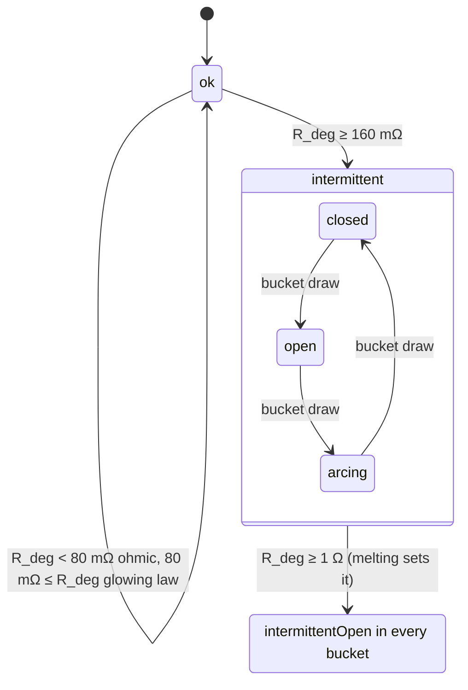

# ADR 0018: Conductor and termination physics

**Status:** Accepted (2026-11-12) after the `electrical-realism-reviewer` and `save-format-guardian` reviews, every required change applied (see [Review](#review)). It gates F3.3 part 1 (the contact half) and F3.6 parts 1 and 2. Drafted by `sim-engine-engineer`.
**Date:** 2026-11-12 (Phase 3)
**Amends:** [ADR 0015](0015-world-document-v3.md) (the clamp-geometry list, the arcing band in "What the netlist compiler reads", the intermittent phase rule and its onset, the end-reset rule, the engine draws; the ten sim keys confirmed), [ADR 0016](0016-catalogue-format-v2.md) (deviation 8: the clamp geometry and twist-on fields). Spec v1.5 records the arcing-band amendment to plan §4.5 ([below](#arcing-and-the-spec-45-band)).
**Sources:** [phase 3 plan](../../plans/phase-3-wiring.md) decisions D2, D4, D6, D7, D8, F3.1, F3.3, F3.6, the phase acceptance and "New in P3"; [ADR 0015](0015-world-document-v3.md) (the compiler reads static values, the bank stamps R at solve time, connection sim keys, the absolute integration schedule, intermittent dwell, termination streams, protocol 7 draft (drafted as 6), the sim-engine review); [ADR 0016](0016-catalogue-format-v2.md) (terminal method specs, the `materials` and `insulation` tables, deviation 8); [ADR 0011](0011-sim-worker-contract.md) §2 and §7 (cadence, one branch per connection); ADR 0014 (`dmath`, reserved and still deferred); the P3 source pre-audit by `electrical-realism-reviewer` (2026-11-11), whose vetted sources are the only external sources this ADR cites as read; [simulation caveats](../caveats/simulation.md).

## Context

P3 makes conductors netlist elements whose resistance follows material, size, length and temperature, and makes each landed end a contact whose resistance follows how well it was made (D4, D7, D8). ADR 0015 fixed the persisted shapes (the `TerminationV3` outcome and ten connection `sim` keys) and how the compiler sees a connection (static values at compile time, R(T) stamped by the connection bank at solve time). It left the physics to this ADR.

The P3 source pre-audit found four problems that would fail review if the plan's text were implemented as written:

1. **The bad-termination criterion doesn't follow from D8.** Holm constriction gives R ∝ F^−½, so 20 % of the specified torque gives √5 ≈ 2.24× the contact resistance, not the acceptance's "at least 10×". Measured data show a much larger jump between a good and a loose connection.
2. **The 0.5–2 Ω "arcing fault" band** (spec §4.5, quoted in D8 and ADR 0015) is unsourced. It came from the October 2026 research note, and it describes parallel (line-to-line or line-to-ground) arcing. A series arc at a termination is roughly constant-voltage, so its resistance falls as current rises.
3. **D6's derived ampacity** needs a free-air-only scope (no sourced raceway model), a 30 °C rating ambient kept separate from the game's 20 °C ambient, and a stated cross-check band.
4. **The thresholds** (oxidation onset, `terminationOverheat`, insulation damage, the intermittent dwell) must be labelled as game-design, each anchored where a source allows.

This ADR decides the conductor resistance, the thermal model, the contact model, degradation and the intermittent and arcing states, derived ampacity, the budget, and the goldens. Every number has a source kind. Values chosen for play say `game-design`, and solver settings say `numerical`.

## Decision

### 1. Layers touched, and what stays fixed

- **Netlist:** none. The compiler still emits one `resistor` branch per netlisted connection (D4, ADR 0015). `ConnectionNetlistModel.element(input)` returns two static values: R_cond at T₀ and each end's as-made contact resistance R_made. No new stamp kind, so the oracle corpus is unchanged and its staleness test proves it.
- **Electrical:** the connection bank's `dcValue`/`acValue` hooks stamp the solve-time value (§6). Two end regimes are nonlinear in the branch current: glowing and arcing. They use the existing warm-started outer loop as value updates, as constant-power loads already do. AC conductors are purely resistive (ADR 0015).
- **Continuous:** a new connection thermal bank (§3), integrated on the fixed absolute schedule.
- **Protection:** the bank's state machine (§6): end states, `terminationOverheat`, `insulationDamaged`. Only open versus not-open changes the topology (ADR 0015).
- **Discrete, transport:** none. The protocol 7 records, event payloads and descriptor (protocol 6 is F3.6 part 1's state export) are finalised by the ADR 0011 amendment in F3.6 part 3. This ADR adds no record field to ADR 0015's draft.

### 2. Conductor resistance R(T)

For a conductor of length L, cross-section A and material row m (table `materials` v1):

> R_cond(T) = ρ₀ · k_lay · L / A · (1 + α · (T_e − T₀)), T_e = min(T, T_lin)

- **ρ₀, α, T₀** come from the material row: annealed copper 1.724137931034483 × 10⁻⁸ Ω·m and 0.00393 K⁻¹ (NBS Handbook 100). For aluminium, AA-8000 at 61.0 % IACS: 2.8264 × 10⁻⁸ Ω·m and 0.00403 K⁻¹ (NBS Handbook 109). Both have T₀ = 293.15 K. The Al/Cu ratio is 1/0.610 = 1.6393.
- **A** comes from `AWG_GAUGES` (d = 0.127 mm · 92^((36 − n)/39), 4/0 = −3, NBS Handbook 100 §2). For example, 14 AWG is 2.08091 mm² and 4/0 is 107.22 mm².
- **k_lay** is 1.00 for solid conductors and 1.02 for Class B/C stranding up to 4/0 (HB 100 stranded tables; HB 109 twist factor). It is a conductor-entry parameter.
- **The clamp T_lin** is the row's `linearAlphaMaxK`, 473.15 K (200 °C), the top of the linear-α range in HB 100. For aluminium the same range is a stated game-design assumption (table source `aluminium-linear-range`). Above it, R stays at its 200 °C value. **Abstraction:** a real conductor's resistance keeps rising, slightly faster than linearly. The model under-reads R above 200 °C, which is past every P3 insulation rating and past the oxidation onset (§5). No lower clamp is needed in P3: the model never drops below the 293.15 K ambient (a property test), and copper's linear range reaches down to about 223 K.
- **Only `+ − × ÷`.** `conductorResistanceOhm` is the F3.1 function. The compiler calls it at T₀ for the static value. The bank calls the same function at T_e, so the two can't disagree.
- **Leads** keep their v2 static value, ρ₀L/A + 2 × the clip resistance, with no lay factor (ADR 0015: "a lead's static value is v2's"). From engine 7 their conductor part follows their conductor temperature (D2). Their clip resistance stays constant, and lead ends have no hot-spot node.

### 3. Thermal model

#### 3.1 Nodes

- **One conductor node per connection in the bank** (every connection of a known kind, netlisted or not; ADR 0015). Its state is `conductorTempK`. The node is lumped over the length, so it is written per unit length, and the length cancels: an unlanded or idle conductor relaxes towards ambient whatever its length.
- **One hot-spot node per landed conductor end**, with state `endATempK` or `endBTempK`. Lead clips have none (ADR 0015).
- **Ambient** is the constant `AMBIENT_TEMPERATURE_K` = 293.15 K. It is `LEAD_CONDUCTOR_TEMPERATURE_K` renamed, with the same value and source. The device terminal a conductor lands on is at ambient (D7, an abstraction). Conductors in one cable, duct or conduit are thermally independent and in free air (D7, an abstraction; bundling and raceways are P4+).

#### 3.2 Conductor node (per metre)

> C′ · dT_c/dt = I² · R′(T_c) − G′(T_c) · (T_c − T_a)

- **Heat input.** I is the branch current: its magnitude, or RMS on AC. R′ = R_cond / L, the §2 law per metre.
- **Heat capacity.** C′ = ρ_m · c_p · A for the metal: density and specific heat from the material row (HB 100 and HB 109 densities; NIST-JANAF specific heat). Insulation heat capacity is added only when the insulation row carries a sourced density and specific heat (§3.6). Until then it is left out, an abstraction that shortens τ by about 40 % for 14 AWG THHN and doesn't move any steady state.
- **Loss.** G′ = 1 / (R′_ins + R′_surf) is the conductance from the conductor to the air, through the insulation in series with the surface.
- **Insulation (conduction through a cylinder).** R′_ins = ln(r₁/r₀) / (2π k₁) + ln(r₂/r₁) / (2π k₂). Here r₀ = d/2. r₁ = r₀ + t₁ is the first layer, from the entry's insulation thickness and the insulation row's `thermalConductivityWPerMK`. r₂ = r₁ + t₂ is the outer jacket layer, using `jacketThermalConductivityWPerMK` and absent when that is null. The thicknesses are per conductor entry (ADR 0016).
  - **No `Math.log`.** `lnRatio(x)` takes four square roots (x^(1/16)), then the atanh series 2 · 16 · (z + z³/3 + z⁵/5 + z⁷/7 + z⁹/9 + z¹¹/11) with z = (y − 1)/(y + 1). That is a fixed sequence of IEEE-exact operations, so it is bit-identical across engines and lint-clean (D6, with ADR 0014 still deferred). Over 1.0001 ≤ x ≤ 8 its relative error against `Math.log` is below 2 × 10⁻¹¹ (prototype; the PR's spec pins vectors). The catalogue refuses r₂/r₀ > 8.
  - R′_ins is static per conductor entry, so it is computed when the bank is built, never per tick.
- **Surface.** R′_surf = 1 / (h · π · D), with D = 2r₂ the outer diameter, and h = h_conv + h_rad:
  - **Convection:** h_conv = 1.32 · (ΔT_s / D)^¼ W/(m²·K), with ΔT_s = max(T_s − T_a, 0) in K and **D in metres**. It is computed as `1.32 * Math.sqrt(Math.sqrt(dT / D))`. This is the simplified laminar relation for a horizontal cylinder in air at atmospheric pressure (Holman), vetted in the pre-audit. Against Churchill and Chu (1975) it is within −17 %/+22 % for D 2.6–16 mm and ΔT 10–60 K. Outside that envelope (the 30 m golden runs at ΔT ≈ 10 K, near its edge) it is an abstraction.
  - **Radiation, always on:** h_rad = ε · σ · (T_s² + T_a²) · (T_s + T_a), exact linearisation of εσ(T_s⁴ − T_a⁴), using only `+` and `×`. ε is the insulation row's `emissivity`, 0.9 (game-design judgement; PVC about 0.93 per the pre-audit). σ = 5.670374419 × 10⁻⁸ W/(m²·K⁴). A bare conductor uses `BARE_CONDUCTOR_EMISSIVITY` (game-design, §11). Radiation carries 20–30 % of a small conductor's heat (pre-audit: 14 AWG free-air ampacity 32 A with it, 27 A without).
- **The surface temperature is not a state.** T_s comes from T_c by **exactly one fixed-point iteration**, with no persisted key:
  1. h₀ = h(T_c);
  2. T_s = T_a + (T_c − T_a) · R′_surf(h₀) / (R′_ins + R′_surf(h₀));
  3. h₁ = h(T_s);
  4. G′ = 1 / (R′_ins + R′_surf(h₁)).

  This sequence _is_ the model; the goldens follow it. The iteration converges by a factor of about 0.2 · R′_ins/(R′_ins + R′_surf) per step. Against the fully converged surface balance, one iteration is within 0.02 % for 14 AWG THHN and 0.2 % for 18 AWG MTW (prototype). A second iteration would cost two more square roots per conductor for no visible change.

#### 3.3 Hot-spot node (per landed end)

> C_h · dT_h/dt = I² · R_end(T_h) − G_fin · (T_h − T_c) − G_term · (T_h − T_a)

- **I² · R_end** is the contact's own dissipation (§4 and §6).
- **G_fin = √(G′ · k · A)** is the conductance of the conductor leaving the terminal, treated as a semi-infinite fin (a physics derivation: a fin with perimeter conductance G′ per metre and axial conductance k·A has base conductance √(G′kA)). Its far field is the conductor node at T_c, so its heat goes out through the near-end surface, over the fin length 1/m = √(kA/G′), about 84 mm for 14 AWG at 12.5 A.
  - **The coupling is one-way:** the hot spot doesn't heat the lumped conductor node. That is exact by superposition for L ≫ 1/m, and an abstraction for short jumpers between two hot ends.
  - G′ is the conductor's current per-metre value, so G_fin costs one `Math.sqrt` per end per step.
- **k = L₀ · T₀ / ρ₀**, the Wiedemann–Franz law with the Sommerfeld Lorenz number L₀ = π²/3 · (k_B/e)² = 2.443004509 × 10⁻⁸ W·Ω/K², from the exactly defined SI constants. It is derived from the row's resistivity, so no new table field is needed. That gives 415.4 W/(m·K) for copper and 253.4 W/(m·K) for the 61 % aluminium alloy. **Abstraction:** measured Lorenz numbers for copper near room temperature are a few per cent below the Sommerfeld value, so k reads about 4 % high and G_fin about 2 % high. For the aluminium alloy, whose Lorenz number is unverified, k likely reads more than 4 % high. It is taken at T₀ and held constant.
- **G_term** is the terminal's heat path to the device at ambient, a per-method catalogue field (`heatPathWPerK`, §8). The screw-terminal class value, 0.026 W/K, is **calibrated, not measured**, against two anchors:
  - BSS 103's glowing connections dissipated 1.2–2.4 V × 15 A = 18–36 W;
  - a glow becomes visible at about the Draper point (≈ 525 °C).

  With 14 AWG copper at 15 A (T_c = 35.1 °C, G_fin = 0.01063 W/K), G_term = 0.026 puts 18 W at 516 °C, 27 W at 761 °C and 36 W at 1007 °C. So the bottom of the measured band sits at the threshold of visible glow, and its middle glows. The exact fit is 0.02533; 0.026 is rounded. This is a game-design calibration with real-world anchors, and the reviewer should confirm the Draper anchor.

- **C_h** is a per-method catalogue field (`hotSpotHeatCapacityJPerK`), estimated as the clamp parts' mass × c_p (physics estimate, product data or game-design). For example, 3 g of brass is about 1.1 J/K, giving τ_h ≈ 30 s on 14 AWG.
- **R_end(T_h):** the constriction part of the contact resistance scales with the metal's resistivity, R ∝ ρ(T) (Holm; Greenwood 1966, read), so it carries the conductor material's α, clamped at its melting point (§5). The loose-film part (§4) is temperature-independent. **Abstraction:** a Cu₂O film's resistance falls with temperature, and that is ignored.

#### 3.4 Integration: fixed absolute schedule, explicit, exact dt

- The bank integrates **only at ticks where t % `SOLVE_INTERVAL_TICKS` = 0** (ADR 0015), after that tick's cadence solve, over [t, t + 10). It uses forward Euler with dt = `SOLVE_INTERVAL_TICKS` × `TICK_S` = 0.01 s exactly every time.
- The heating power comes from the solution at t (zero-order hold). A command between cadence ticks re-solves at once, but the bank sees the new current at the next cadence tick. That lag of up to 9 ms is far below every τ (≥ 1 s).
- The bag at any tick holds the state after the last scheduled step, so a save or load anywhere continues identically by construction: no "last integrated" key, never staggered by id.
- **Steady states are integrator-independent.** Forward Euler's fixed point is exactly the model's steady state, so the steady-state goldens don't depend on dt.
- **Stability and accuracy: τ ≥ 100 dt = 1 s, catalogue-enforced** (`THERMAL_MIN_TAU_STEPS` = 100, numerical: forward Euler's per-step local error is (dt/τ)²/2 ≤ 5 × 10⁻⁵ and its stability limit is dt < 2τ). The catalogue load check computes conservative lower bounds and refuses an entry below 1 s:
  - conductor entries: τ_min = C′ · R′_ins (surface resistance → 0, the hottest possible bound). For a bare conductor, C′/G′ with G′ evaluated at T_lin and `BARE_CONDUCTOR_EMISSIVITY`. That gives 2.8 s for 14 AWG THHN, 2.3 s for 18 AWG MTW, 45 s for 14 AWG bare and 69.6 s for 4/0 THHN, all ≥ 1 s;
  - terminal methods: τ_h,min = C_h / (G_term + G_fin,max), with G_fin,max over every conductor entry in the catalogue that the method's `awgRange` and stranding admit, at that entry's bound;
  - leads: the conductor bound, from the lead's new thermal params (§8).

  The bank also asserts τ ≥ 1 s for every node when it is built, in tests. The arcing and glowing regimes add heat, not stiffness: their coupling conductances stay linear and bounded, so the bound holds.

- **The 1 % re-solve rule** (the lamp's, `CONNECTION_RESOLVE_RELTOL` = 0.01, numerical). After a scheduled step, if any netlisted connection carrying at least `CONNECTION_RESOLVE_MIN_A` = 1 µA has a branch value (R_cond(T_c) + both ends' R_end) more than 1 % away from the value the last solve saw, **read back from the solution as |ΔV|/|I| across the branch (the lamp's rule; never a value cached at the solve, which isn't in the `sim` bag)**, the continuous layer asks for a value-only re-solve at t + 1. Smooth heating moves R by far less than 1 % per 10 ms, so in practice this fires on regime and degradation steps, not while a conductor warms normally; fast fault heating (a shorted lead at hundreds of amps) re-solves every 3–4 steps (F3.6 part 1).

#### 3.5 Closed-form steady states (for the goldens)

- **Conductor, linearised test model.** With a test parameter that fixes G′ (no convection or radiation dependence) and the linear R(T):

  > T_c − T_a = I² R′₀ (1 + α (T_a − T₀)) / (G′ − I² R′₀ α)

  This holds when the denominator is positive; otherwise there is thermal runaway and no steady state.

- **Conductor, full model, by inversion.** Pick T_c, run §3.2's one-iteration surface step for G′(T_c), then I = √((T_c − T_a) · G′ / R′(T_c)). The golden drives that I and expects T_c.
- **Conductor in a circuit** (the 30 m golden): a scalar fixed point in T_c, with I from the circuit at R_cond(T_c), written out in the fixture and iterated by hand (a spreadsheet) to 10⁻⁹ K.
- **Two-node termination:** first T_c from the conductor, then, with R_end = a · (1 + α (T_h − T₀)) + b (a the constriction part, b the film part):

  > T_h = [I² (a (1 − α T₀) + b) + G_fin T_c + G_term T_a] / (G_fin + G_term − I² a α)

  Again this holds while the denominator is positive.

- **Tolerances are on the rise.** Every thermal golden's 0.5 % tolerance is 0.5 % of the **rise over ambient** (T − T_a), never of absolute kelvin: 0.5 % of 300 K would hide a 1.5 K error in a 10 K rise.

#### 3.6 Data the model reads

- Material rows: ρ₀, α, T₀, `linearAlphaMaxK`, density, c_p, and a new `meltingPointK` (§8).
- Insulation rows: k₁, k₂, ε, `ratedTempDryK`, and optionally a new `densityKgM3` and `specificHeatJPerKgK`. `content-designer` sources these in F3.6 part 1 while catalogue 2 is provisional. If no source passes review, the fields stay null and the insulation's heat capacity is left out, never guessed.
- Conductor entries: AWG, stranding, insulation thickness (and jacket layer).
- Terminal methods: §8.

### 4. Contact resistance from termination quality

The engine computes each landed end's **as-made** contact resistance R_made from the stored `TerminationV3` outcome, the method spec and the landed count. That is the compiler's static value (ADR 0015). At solve time the bank multiplies by degradation and applies temperature and the regimes (§6).

#### 4.1 Calibrating to measurement, with Holm for the shape only

- **R₀, the good-connection resistance at the specified torque, is catalogue data per method** (`contactOhm`), calibrated to measured connections, never computed from Holm's absolute formula (pre-audit finding 1). For the branch-circuit screw-terminal class, NBS BSS 103 (Meese and Beausoliel, 1977, read) measured 3–8 mV at 15 A for good connections, which is **0.2–0.5 mΩ**. Content takes 0.3 mΩ unless a product's own data say otherwise.
  - Spring-cage, back-stab and twist-on R₀ are game-design within NBS BSS 128's (1980, read) assembly acceptance limit of 1.5 mΩ. For example, 0.3, 1.0 and 0.5 mΩ, with the back-stab worst.
- **Holm gives only the relative dependence on clamp force.** R = ρ/(2a) and F = π a² H, so R ∝ F^−½ (Greenwood 1966).
  - Torque and force are related by T = K · F · d (NASA RP-1228, read; K ≈ 0.2 common, 0.15 steel on steel). For a given screw K and d are constant, so **F/F_spec = T/T_spec exactly, and K and d cancel**. The model needs only the torque ratio r = T_achieved / T_spec (from `TerminationV3.torqueNm` and the method's `torqueNm`).
  - So this ADR **does not add** the screw-diameter and nut-factor-class fields that ADR 0015 anticipated (a [deviation](#deviations-from-the-plan-and-from-adrs-0015-and-0016)).
  - **Abstraction:** K varies with plating and lubrication (the RP-1228 band), so equal torque on a different finish gives a different force. K is taken as constant per terminal, and its spread is part of what R₀'s measured band covers.
- **No benefit above the specified torque:** r is capped at 1. Over-torque damage (stripped threads, cut strands) is not modelled in P3.

#### 4.2 The seated and loose regimes (the 10× resolution)

Below some fraction of the specified torque a clamp isn't seated: the conductor is held by a few asperities through surface films, and the measured resistance is in a different regime. BSS 128 classes a connection of **100 mΩ or more as loose**; BSS 103's glowing connections were **80–160 mΩ** at 15 A. That is two to three decades above a good one, which no F^−½ law reaches. The model is two terms:

> R_clamp(r) = R₀ / √(clamp(r, r_seat, 1)) + R_loose · (max(0, 1 − r / r_seat))²

- **The seated term** is Holm's F^−½, valid only while the clamp is seated (r ≥ r_seat) and frozen at its r_seat value below that, so there is no singularity at r = 0.
- **The loose film term** is zero for r ≥ r_seat and rises quadratically to `LOOSE_FILM_OHM` = R_loose at zero torque. The film term alone is C¹ at r_seat, but R_clamp as a whole is not: R_clamp is **continuous, strictly decreasing up to the spec torque, with a slope step at r_seat**. Below r_seat the seated term is frozen (slope 0); just above it the slope is −R₀/(2 · r_seat^1.5) = −0.593 mΩ per unit of torque ratio.
  - R_loose = 0.100 Ω is anchored to BSS 128's loose class, so a finger-tight screw (r = 0) reads R₀/√r_seat + 0.1 ≈ 100.5 mΩ. Reading BSS 128's "loose" class as a fresh zero-torque termination is a game-design reading: only the 100 mΩ end point is sourced.
  - `SEAT_FRACTION` r_seat = 0.4 is game-design: "a screw clamp is seated from 40 % of its marked torque".
  - The quadratic shape is game-design.

| r (torque ratio) | 0     | 0.1   | **0.2**    | 0.3   | 0.4   | 0.5   | 1.0   |
| ---------------- | ----- | ----- | ---------- | ----- | ----- | ----- | ----- |
| R_clamp (mΩ)     | 100.5 | 56.72 | **25.474** | 6.724 | 0.474 | 0.424 | 0.300 |
| × R₀             | 335   | 189   | **84.9**   | 22.4  | 1.58  | 1.41  | 1     |

(R₀ = 0.3 mΩ, at T₀.)

**The acceptance's 10× now follows from the model:**

- At 20 % torque R_clamp/R₀ = 84.9. With temperature (§7's scenario) the end-drop ratio is 84.2.
- For any R₀ in BSS 103's 0.2–0.5 mΩ band the ratio stays above 50×.
- It stays at or above 10× for any r_seat ≳ 0.237 (R₀ = 0.3 mΩ) or ≳ 0.25 (R₀ = 0.5 mΩ).

No change to the acceptance criterion is needed. If the reviewer rejects the loose regime, the fallback is to change the criterion to "at least 2× (Holm, √5 = 2.24×)", which this ADR does not recommend: a 2× rise on 0.3 mΩ is 4 mV at 13 A and heats nothing.

#### 4.3 The other quality inputs

All are pure functions of the stored outcome, the method spec, the conductor entry and the landed count:

- **Effective clamp ratio.** r_eff = r × φ_strip × (rated / n) × s_strand, which then goes through §4.2. For methods without a torque (spring-cage, back-stab, twist-on), r = 1, because the spring's force is fixed (ADR 0015: the inputs are the strip length, the nicks and the combination).
  - **Strip length.** φ_strip = min(1, stripLengthMm / clampDepthMm), where `clampDepthMm` is the length of conductor the clamp grips (§8). A short strip puts part of the clamp's force on compressible insulation instead of metal, so it reduces the effective force. A strip at half the clamp depth seats like half torque (1.41 R₀); at 30 % it is in the loose regime. A long strip has no electrical effect: exposed copper is flagged for P4's inspector. Game-design.
  - **Conductor count.** If n conductors are landed by this method on the terminal (counted by the compiler; ADR 0015) and n > `ratedConductors`, the clamp force is shared evenly: × rated/n. Two under a one-conductor screw each get r_eff = 0.5, 1.41 R₀. **Abstraction:** a real double-tap shares unevenly, and one conductor can be nearly loose. Game-design.
  - **Bare stranded under a binding screw.** `STRAND_SPREAD_FACTOR` = 0.5 when the conductor is stranded, has no accessory and the method's `clampType` is `bindingScrew`: the strands splay out from under the screw head. Pressure plates, box lugs and spring cages hold strands and get no factor. A stranded conductor at full torque under a binding screw is 1.41 R₀. Game-design.
  - **The factors multiply, by intent.** Two bare stranded conductors under a one-conductor binding screw at full torque get r_eff = 0.5 × 0.5 = 0.25, so about 14.5 mΩ (≈ 48×): a double-tapped, splayed termination is in the loose regime.
- **Nicked strands (area loss).** Contact spots carry current only through the intact strands, so × 1/(1 − min(f, 0.9)), with f = `nickedStrandFraction` and the effect capped at `NICK_MAX_FRACTION` = 0.9. At 25 % nicks the factor is 1.333. A nick's local reduction of the conductor's own cross-section, and its later strand breakage, are not modelled in P3 (P5 faults). Game-design.
- **Ferrules and lugs** (the accessory) add a crimp resistance in series:
  - R_crimp = R_crimp,good / √(clamp(q, r_seat, 1)) + R_loose · (max(0, 1 − q/r_seat))², with q = `crimpQuality`. This is the same seated/loose shape, because an under-closed crimp is a loose mechanical joint.
  - `CRIMP_GOOD_OHM` = 0.05 mΩ (game-design: a good crimp is well below a screw contact).
  - A ferrule consolidates the strands, so `STRAND_SPREAD_FACTOR` doesn't apply.
  - A ring or fork lug lands on the screw like a solid conductor would.
- **Aluminium conductors** (on any terminal): the constriction scales with the mean resistivity of the two members (Holm), with the terminal taken as copper (an abstraction; a brass or plated-steel terminal gives a smaller ratio). R₀ × (ρ_Al + ρ_Cu)/(2ρ_Cu) = R₀ × 1.31967.
- **Aluminium on a method with `alRated: false`** changes **only the degradation rate** (× `AL_UNRATED_DEGRADATION_MULTIPLIER`, §5), not R_made (the plan's golden: "rate multiplier only"). Creep and cold flow loosening the clamp over thermal cycles, the real mechanism, are a P5 fault.

So:

> R_made = (R_clamp(r_eff) · m_Al + R_crimp) · 1/(1 − min(f, 0.9))

Of R_clamp, the constriction part (R₀ term) carries α at solve time and the film part does not (§3.3); the crimp term is counted with the film part (no α, an abstraction). So the compiler returns each end's R_made as two static parts, (a, b), constriction and film, and the bank keeps them separately.

#### 4.4 Twist-on splices

- A `splice.twistOn` device has one splice terminal with a `twistOn` method. Its `combination` bounds (§8) are a count range, an AWG range and a total-area range. The area is the sum of the landed conductors' `AWG_GAUGES[n].areaUm2`, a new **integer** column (µm², the six-significant-figure area × 10⁶, rounded once in code), so the check is exact integer arithmetic, like every other gauge check. **`areaUm2` values are pinned by a golden test and never change; changing one changes replay outcomes.**
- Each landed end's contact is R₀ (the method's `contactOhm`) through §4.3 with r = 1.
- Outside the bounds, landing is refused (`combination-out-of-range`, a command concern). So the engine never sees an out-of-range combination, except via a catalogue change, which needs a new entry version.
- The bounds are paraphrased from public packaging data under a fictional brand, never a reproduced chart.

### 5. Degradation

- **The multiplier.** `endADegradation`/`endBDegradation` D ≥ 1 multiplies the end's whole R_made (ADR 0015). It is **monotone**: it only grows, and cooling never reverses it.
- **Onset.** D grows only while the hot spot is above `OXIDATION_ONSET_K` = 422.15 K (149 °C). This is game-design anchored to CPSC Publication 516 (June 2011, read), whose "fire hazard condition" includes a cover-plate screw reaching 149 °C: a connection the CPSC study would count as hazardous is one that degrades.
- **Rate**, piecewise linear in the excess: dD/dt = `DEGRADATION_RATE_PER_K_S` × m_unrated × max(0, T_h − T_onset).
  - `DEGRADATION_RATE_PER_K_S` = 1/(600 s × 50 K) = 3.3333 × 10⁻⁵ K⁻¹·s⁻¹. Game-design: an end held 50 K above onset doubles its contact resistance in 10 minutes.
  - m_unrated = 10 for an aluminium conductor on a method with `alRated: false`, else 1. Game-design: CPSC 516 reports pre-1972 aluminium-wired homes as 55× more likely to reach fire-hazard conditions. That is a population statistic, not a rate constant, so it is used only as an order of magnitude. 10 keeps the effect visible without making every such end run away within minutes.
  - Forward Euler, in the same scheduled step as the temperatures.
  - **Runaway emerges.** D raises R_end, which raises T_h, which raises dD/dt. No separate runaway rule exists.
- **Burn-open.** If T_h reaches the conductor material's `meltingPointK`, D jumps to max(D, `BURNED_OPEN_OHM`/R_made,total). The end is then permanently open (§6). The melting points are copper 1357.77 K and aluminium 933.473 K, the ITS-90 defining fixed points (Preston-Thomas, _Metrologia_ 27, 1990). These are public references not re-read for this ADR, so the reviewer should confirm them. Pure aluminium stands in for the 8000-series alloy, whose solidus is slightly lower. For T_e in R_end, the hot spot is clamped at the same melting point.

### 6. End states and regimes

The four persisted states are `ok | intermittentClosed | intermittentOpen | arcing` (ADR 0015's key; no new key). All thresholds compare **R_deg = R_made,total(T₀) × D**: static × monotone, so the progression is monotone too, and temperature swings can't make an end chatter between regimes.

- **`ok`, ohmic** (R_deg < `GLOW_ONSET_OHM` = 80 mΩ): R_end = (a · (1 + α (T_h,e − T₀)) + b) · D.
- **`ok`, glowing** (80 mΩ ≤ R_deg < `INTERMITTENT_ONSET_OHM`), the pre-arcing signature:
  - **BSS 103's glowing connections were non-ohmic:** 1.2–2.4 V at 15 A, but 4–7 V at 0.8 A. A two-parameter law fits the midpoints of both bands exactly: V = V_G0 + P_G/|I|, with V_G0 = 1.5915 V and P_G = 3.1268 W (that is, dissipated power = V_G0·|I| + P_G). The law gives 0.120 Ω at 15 A and 6.875 Ω at 0.8 A. This is a real-world fit to two reported ranges; the two-parameter form is a game-design choice.
  - In this regime R_end = max(ohmic R_end, V_G0/|I|_f + P_G/|I|_f²), with |I|_f = max(|I|, `GLOW_CURRENT_FLOOR_A` = 0.5 A). That is numerical: it bounds the law at 15.7 Ω.
  - It is nonlinear in the branch current, so it is a value update in the warm-started outer loop. Under successive substitution the fixed-point map's local slope is (V_G0 + 2P_G/|I|)/V_source: about 0.017 at 12.5 A on 120 V and about 0.117 at the 0.5 A floor, so it converges in a few iterations. It is bounded by `OUTER_LOOP_MAX_ITERATIONS` and flagged `nonConverged` beyond, as always.
  - The glow is a regime, not a state: it is a pure function of D and R_made. Its measurable signature is a drop that doesn't scale with current (P5's meters will measure it). The lumped hot spot reaches about 500 °C only above about 9 A; at low current the law's power (3.9 W at 0.5 A) holds it near 138 °C (Abstraction 16).
- **Intermittent** (R_deg ≥ `INTERMITTENT_ONSET_OHM` = 160 mΩ, the top of BSS 103's glowing band, game-design). Time is cut into buckets of `INTERMITTENT_MIN_DWELL_TICKS` = 100 ticks. That is game-design: lights visibly flicker at 100 ms, and it bounds each end to one topology event per 100 ms. Buckets align with the absolute tick, and 100 is a multiple of `SOLVE_INTERVAL_TICKS`.
  - **Each bucket's draw.** u = fmix32(s ^ Math.imul(bucket, 0x9e3779b1)) / 2³², where s is the cached first output of the `termination:<id>:intermittent` stream (ADR 0015: integer operations only, no generator state, no per-tick string). It selects:
    - `intermittentOpen` if u < `INTERMITTENT_P_OPEN` = 0.3 (the branch leaves the netlist);
    - `arcing` if u < 0.3 + `INTERMITTENT_P_ARC` = 0.5;
    - else `intermittentClosed`, with the glowing law.
  - Both probabilities are game-design. Runs of equal draws make longer periods. **Every period after the first is a whole multiple of the dwell; the first ends at the next bucket boundary, so onset can add one extra topology event per end, once.** Sub-dwell chatter, a real loose contact's millisecond make-and-break, is a stated abstraction.
- **Burned open** (R_deg ≥ `BURNED_OPEN_OHM` = 1 Ω, game-design): `intermittentOpen` in every bucket, permanently, since D never falls. Melting forces it (§5).
- **Arcing, the series arc:** R_end = V_arc / |I|_a with |I|_a = max(|I|, `ARC_CURRENT_FLOOR_A` = 0.5 A). The arc has roughly constant voltage, so its resistance falls as the current rises.
  - V_arc is drawn once per termination from the first output of `termination:<id>:arcing`, uniform in [`ARC_VOLTAGE_MIN_V`, `ARC_VOLTAGE_MAX_V`] = [15, 30] V. So it is stateless, identical across runs, replays and transports, and new for a re-made termination (ADR 0015's deferred suggestion, taken).
  - The band is game-design, anchored to the pre-audit's "a series arc is roughly constant-voltage, a few to tens of volts". At 12.5 A it gives 1.2–2.4 Ω, at 0.5 A 30–60 Ω.
  - The floor is game-design. It bounds R_arc at 60 Ω, and it stands in for extinction: a real arc below its minimum current goes out instead.
  - On AC, V_arc is the RMS of the arc voltage's in-phase fundamental (an abstraction for a square-ish arc voltage). |I| is the RMS phasor magnitude.
  - Nonlinear in the outer loop like the glow. The fixed-point slope is V_arc/V_source < 1 (0.25 at 30 V on 120 V).
  - The arc's power V_arc·|I| goes into the hot spot: 250 W at 20 V and 12.5 A melts the end within seconds, and it burns open. On a lamp-only circuit (0.5 A) the arc dims the lamp and holds the hot spot near 300 °C.
  - Newbury and Greenwald (J. Res. NBS 85, 1980; abstract only) report temperatures above 1500 °C at an arcing screw terminal. That is qualitative support, not a parameter.
- **Where the decisions run.** End states are decided in the bank's **protection-layer hook** at cadence ticks, from the bag after that tick's continuous step. **End states are decided at every cadence tick and whenever the bank is rebuilt (membership, a termination or a terminal's landed count changes), so the persisted state equals the pure function at every export tick.** On an `engine-changed` load the end states are re-decided when the bank is built, before the first compile, since R_made may differ under the new engine. Only the protection and discrete layers may change the topology (simulation caveats). Entering or leaving `intermittentOpen` recompiles at t + 1, as a trip does. ok ↔ glowing ↔ intermittentClosed ↔ arcing are value changes, a value-only re-solve at t + 1.
- **The persisted state is a pure function** of (the bag's D, R_made (a pure function of the termination outcome, the catalogue entry's method spec and conductor, and the terminal's landed count), the termination's `:intermittent` stream, bucket(t)). Bucket boundaries are cadence ticks, and an export holds the state decided at the last cadence tick, which is in the same bucket. That **refines ADR 0015's statement** ("a pure function of (seed, the termination's stream, tick bucket)") by adding D. The property test checks the refined statement against every materialised bag. See [Persisted state and contract](#persisted-state-and-contract).
- **Landing and re-landing.** The end-reset rule of ADR 0015 (amended): when the world's termination id differs from the bag's `end*TerminationId`, the end resets: temperature = the conductor's, degradation 1, `end*TerminationId` = the new id, and **state = the §6 decision for (D = 1, R_made, the new termination's stream, bucket(t))**. A landed end whose temperature is null starts at T_c, or at ambient if T_c is null too (it goes into `world.hash`).
- **`terminationOverheat`** is raised when a scheduled step carries an end's T_h from below to at or above T_a + `TERMINATION_OVERHEAT_RISE_K` (100 K, so 393.15 K at the 20 °C ambient), once per upward crossing. It needs no re-arm state. Game-design anchored to BSS 128's 100 °C temperature-rise limit: the connection now fails the laboratory criterion. It sits below the oxidation onset on purpose, so a warning comes before damage starts.
- **`insulationDamaged`** (sticky, the existing key) is set when T_c or either end's T_h reaches the conductor insulation row's `ratedTempDryK` + `INSULATION_DAMAGE_MARGIN_K` (40 K, so 403.15 K for every P3 row, all rated 90 °C dry). Game-design anchored to one manufacturer's XHHW-2 emergency-overload rating of 130 °C, seen by the reviewer only as a snippet. An emergency rating is a permitted temperature, not a damage temperature, so using it is conservative. Applying that XLPE figure to PVC/nylon THHN is unverified. ~~**Leads never set `insulationDamaged` in P3**~~ _Superseded by F3.6 part 2's failure rule ([implementation notes](#implementation-notes-f36-part-2), note 2): a lead's insulation has a rating (its `insulationRatedTempK`), and its flag is set at that + 40 K on its conductor node._ Checking the hot spot is conservative too: the insulation edge sits one strip length (≈ 13 mm) up the fin from the contact. It raises an `insulationDamaged` event on the step that sets the flag.

### 7. The bad-termination scenario, by hand

At F3.6 part 2's `bad-termination.console`: the breaker's load screw lands 14 AWG copper (THHN-like insulation, 15 + 4 mil) at r = 0.2, with R₀ = 0.3 mΩ, G_term = 0.026 W/K and C_h = 1.1 J/K. The circuit is the 60 W lamp plus the 1500 W heater, about 12.5–13 A.

- **Conductor at 12.5 A:**
  - T_c = 304.0831 K (30.93 °C);
  - G′ = 0.123499 W/(m·K), G_fin = 0.0103319 W/K.
- **Contact:** a = 0.474342 mΩ (constriction), b = 25.000 mΩ (film).
- **Hot spot:**
  - **T_h = 406.7253 K (133.58 °C)**, with P_end = 4.013 W;
  - margin over T_c 102.6 K;
  - drop 0.3211 V, against 3.815 mV for the good end, **84.2×**;
  - τ_h ≈ 30 s.
- **The window.** With 5 K margins to both thresholds the current must lie in **12.01–13.07 A**. There T_h is above the overheat threshold (120 °C, so `terminationOverheat` is raised during the warm-up) and below the oxidation onset (149 °C, so D stays 1 and there is a steady state to compare against at 600 s). The built circuit (heater plus lamp) is expected near 12.8 A.
- **`insulationDamaged`** (130 °C) is set only at 12.30 A or more, as a real consequence of a hot terminal.
- **The fixture derives both expectations from the built circuit's computed current** (the window check and whether `insulationDamaged` is set). It never asserts either unconditionally.
- **The margin the acceptance asks for** ("above the conductor temperature by at least…") is **T_h − T_c ≥ 50 K**.

The constants are fixed by their anchors, never re-tuned to the scenario after sign-off. If the built circuit's current falls outside the window (overheat < T_h,ss < onset, with at least 5 K either side), the scenario's acceptance changes to a quasi-steady comparison at the recorded D, and the reviewer is told. The constants don't move.

### 8. Catalogue fields (ADR 0016 deferral)

These are added to `TerminalMethodSpec` and the tables **at entry or table version 1 while catalogue 2 is provisional** (ADR 0016's rule: entries only gain data; P2 entries keep version 1). Each needs a covering source (`terminals.<id>.methods.<method>.<field>`).

| Field                                | Type                                                                                                                                  | On                               | Meaning and source kind                                                                                                                                                                                       |
| ------------------------------------ | ------------------------------------------------------------------------------------------------------------------------------------- | -------------------------------- | ------------------------------------------------------------------------------------------------------------------------------------------------------------------------------------------------------------- |
| `clampType`                          | `'bindingScrew' \| 'pressurePlate' \| 'boxLug' \| 'springCage' \| 'pushIn' \| 'twistOn'`                                              | every method                     | How the conductor is held (`CLAMP_TYPES` registry in `@controls/catalog`). Consistent with `method` (screw → the first three; the others one each)                                                            |
| `clampDepthMm`                       | integer mm, 1..50                                                                                                                     | every method                     | Conductor length the clamp grips (§4.3); ≤ `stripLengthMm.nominal`. Product data or game-design                                                                                                               |
| `contactOhm`                         | number > 0                                                                                                                            | every method                     | R₀ at the specified torque (or the spring's force), copper conductor, at T₀. Real-world (BSS 103) for screw terminals; game-design within BSS 128's 1.5 mΩ for the others                                     |
| `heatPathWPerK`                      | number > 0                                                                                                                            | every method                     | G_term (§3.3). Game-design calibration (BSS 103 + Draper) for the screw class; physics estimates otherwise                                                                                                    |
| `hotSpotHeatCapacityJPerK`           | number > 0                                                                                                                            | every method                     | C_h (§3.3). Physics estimate (clamp mass × c_p) or game-design                                                                                                                                                |
| `combination`                        | `{ minConductors, maxConductors, awg: AwgRange, totalAreaUm2: { min, max } } \| null`                                                 | non-null exactly for `twistOn`   | §4.4; `maxConductors` equals the method's. Paraphrased from public packaging data, fictional brand                                                                                                            |
| `meltingPointK`                      | number                                                                                                                                | `materials` rows                 | §5. ITS-90 fixed points (to be confirmed by the reviewer)                                                                                                                                                     |
| `densityKgM3`, `specificHeatJPerKgK` | number \| null                                                                                                                        | `insulation` rows                | §3.6. Sourced in F3.6 part 1, or null (left out)                                                                                                                                                              |
| `areaUm2`                            | integer                                                                                                                               | `AWG_GAUGES` (code)              | §4.4. Derived from the definition                                                                                                                                                                             |
| lead thermal params                  | `linearAlphaMaxK`, `densityKgM3`, `specificHeatJPerKgK`, `insulationThicknessMm`, `insulationConductivityWPerMK`, `surfaceEmissivity` | the `lead` kind (`model.params`) | D2: leads join the conductor model. The test lead's copper values cite the material table's sources; PVC 0.18 W/(m·K) and ε 0.9 cite the insulation table's; its insulation thickness (0.8 mm) is game-design |

- **Not added** (ADR 0015 anticipated them): the screw nominal diameter, the nut-factor class and the contact material. K and d cancel (§4.1), and the terminal is taken as copper (§4.3). A later model that needs absolute force adds them with its own sources.
- **The P2 screw terminals** (the breaker's `line` and `load`, the DIN supply's `neg` and `pos`, and the split-phase stand-in's `l1`, `l2` and `n`) gain these fields in F3.3 part 1. The breaker and the stand-in get the screw-class values (0.3 mΩ, 0.026 W/K, 1.1 J/K, `pressurePlate`, a 10 mm clamp depth); the stand-in's are game-design, like its torque.
- **Counted as electrical after v0.4.0** (extending ADR 0016's rule for termination spec values): `clampType`, `clampDepthMm`, `contactOhm`, `heatPathWPerK`, `hotSpotHeatCapacityJPerK` and `combination`. Changing one after v0.4.0 needs a new entry version.
- **The catalogue freeze test (code, in the F3.6 part 1 PR that adds the lead params).** `libs/domain/catalog/src/lib/shipped.spec.ts` masks fields by **the shipped release's `catalogVersion`**, not globally:
  - **For catalogue-1 releases** (0.3.0), it drops:
    - the top-level `mounts`, `enclosure` and `conductor`, and `terminals[].methods`;
    - only for a `lead`-kind entry, exactly `linearAlphaMaxK`, `densityKgM3`, `specificHeatJPerKgK`, `insulationThicknessMm`, `insulationConductivityWPerMK` and `surfaceEmissivity` from `model.params`.

    The six existing lead params stay strictly compared.

  - **For catalogue-2+ releases** it masks no fields, only prose and added sources. This replaces today's global `V2_DEVICE_FIELDS` mask, which would hide 0.4.0's own method specs.
  - **Self-tests:**
    - changing an existing lead param fails;
    - adding one of the six passes;
    - adding any other param fails;
    - a changed method field in a catalogue-2 release's document fails.

### 9. Derived ampacity (D6)

- **Definition.** `derivedAmpacityA(conductor, { ratingTempK, ambientK })` is the current at which the §3 conductor steady state reaches the rating temperature **in free air**, by the same inversion as the golden:

  > I = √((T_r − T_amb) · G′(T_r; T_amb) / R′(T_r))

  It uses the same one-iteration G′, with ambient a parameter. It is exported from `sim-core` (the thermal module). P4 decides where its inspector calls it from. It is computed, never stored: the insulation table says so, and no figure enters content.

- **Rating ambient.** `RATING_AMBIENT_K` = 303.15 K (30 °C) is a constant **separate from** `AMBIENT_TEMPERATURE_K` (293.15 K). It is the common rating ambient for building-wire ampacity in air (NFPA 70 Art. 310.15(B)(1), the 30 °C basis of ambient temperature correction, cited by number only; the 2023 sub-numbering is unverified).
- **Free air only in P3.** A conductor in a raceway or a cable runs hotter. That needs a sourced conduit or bundle model, deferred to P4+, so derived ampacity is labelled "free air, 30 °C ambient, single conductor". **Abstraction:** the P3 engine also heats conductors in ducts, conduit and NM-B as if in free air, so it under-reads their temperature.
- **NM-B.** Its conductors are rated 90 °C and a conductor entry's ampacity uses 90 °C. The NM-cable rule limits the cable's ampacity to the 60 °C rating (NFPA 70-2023 Art. 334.80, by number). That is applied separately (P4's inspector calls `derivedAmpacityA` with T_r = 333.15 K for conductors of an NM assembly). No NM-B figure is ever derived at 90 °C, and an F3.1 test asserts the two calls differ.
- **Checks.**
  - Self-consistency: driving `derivedAmpacityA` puts the steady state at T_r within 0.5 % of the rise.
  - Cross-check: within **±20 %** of `electrical-realism-reviewer`'s independent recomputation (Churchill–Chu convection plus radiation at ε 0.9, the same insulation data), per insulation type, in the F3.1 PR.
  - Prototype values: 14 AWG THHN 31.77 A (reviewer's Churchill–Chu: 32.17 A), 12 AWG THHN 42.8 A, 4/0 THHN 446.89 A (reviewer: 427.4 A, +4.6 %), 14 AWG at 60 °C 21.9 A. No NEC table value appears anywhere.

### 10. Budget

- **Layout: struct of arrays**, preallocated `Float64Array`s sized at bank build (membership or termination change, ADR 0015), indexed by connection-id order, reused across steps:
  - per conductor: T_c, R′₀ k_lay, α, T_lin, C′, R′_ins, 1/D, πD, ε σ, k·A and the netlisted branch index (−1 if absent). There is no cached stamped value: the 1 % rule reads |ΔV|/|I| back from the solution (§3.4);
  - per end: T_h, D, a, b, the melting clamp, G_term, 1/C_h, the state code and the cached stream words (`Uint8Array`/`Uint32Array`);
  - plus the compact non-`ok` end list (ADR 0015).

  No allocation on the cadence or non-cadence path. Events go into the engine's preallocated event ring.

- **Per cadence step**, per conductor:
  - one R(T): 3 operations;
  - two h evaluations: 4 `Math.sqrt` and about 30 operations;
  - the node update;
  - per landed end: one `Math.sqrt` (G_fin) and about 15 operations, and the onset check;
  - the 1 % check.

  That is about 6 `Math.sqrt` and 100 operations. **Non-cadence ticks do no bank work.** Bucket decisions touch only the compact list.

- **Measured prototype** of that kernel (2,000 conductors, 4,000 landed ends, Node 24.12, AMD Ryzen 5 5600X, the P2 bench machine): **0.058 ms median per cadence step** (41 × 100 steps after a 20,000-step warm-up; the scratchpad script is not product code). `tick-device-mix` on the same machine is about 0.053 ms, so a cadence tick of `tick-wired-plant` (1,000 devices + 2,000 conductors, solve excluded) is estimated at **≈ 0.11–0.15 ms against 0.3 ms**. The real number comes from `sim bench` in F3.6 part 1, with the allocation gate. Over budget on a CI runner is reported to the user, never loosened.
- **`intermittent-toggle-wired`:** one end entering or leaving `intermittentOpen` is a values-and-topology recompile of one branch plus a re-solve on the wired 2,000-node plant, gated under the calibrated 2 ms (ADR 0015). Buckets align across ends, so many intermittent ends share one recompile per 100 ticks. Glow and arc ends add outer-loop iterations to their island's re-solve; the bound is `OUTER_LOOP_MAX_ITERATIONS`, and their slopes (§6) keep it to a few.

### 11. Constants

`kind` uses the code's vocabulary: `real-world` (a measurement or a public reference), `game-design` (chosen, with any anchor named), `numerical` (a solver setting). "Read" means read in full by `electrical-realism-reviewer` in the P3 pre-audit, or by this ADR's author.

| Name                                        | Value                          | Unit          | Kind                                 | Citation                                                                                                                                                                                                                                          |
| ------------------------------------------- | ------------------------------ | ------------- | ------------------------------------ | ------------------------------------------------------------------------------------------------------------------------------------------------------------------------------------------------------------------------------------------------- |
| `AMBIENT_TEMPERATURE_K`                     | 293.15                         | K             | game-design                          | Renamed `LEAD_CONDUCTOR_TEMPERATURE_K`, same source (a 20 °C indoor bench, the IACS reference temperature)                                                                                                                                        |
| `RATING_AMBIENT_K`                          | 303.15                         | K             | real-world (convention)              | Building-wire ampacity in air is rated at 30 °C ambient, NFPA 70 Art. 310.15(B)(1) by number (2023 sub-numbering unverified)                                                                                                                      |
| `H_CONV_COEFF`                              | 1.32                           | W·m⁻⁷ᐟ⁴·K⁻⁵ᐟ⁴ | real-world                           | Holman's simplified laminar horizontal-cylinder relation for air, vetted in the pre-audit; validated against Churchill and Chu (1975), −17 %/+22 %. Used below its laminar Rayleigh range (Ra ≈ 50 for 14 AWG), justified only by that comparison |
| `STEFAN_BOLTZMANN`                          | 5.670374419 × 10⁻⁸             | W·m⁻²·K⁻⁴     | real-world (physics)                 | σ = 2π⁵k_B⁴/(15h³c²) with the exactly defined SI 2019 constants (CODATA 2018 value)                                                                                                                                                               |
| `LORENZ_NUMBER`                             | 2.443004509 × 10⁻⁸             | W·Ω·K⁻²       | real-world (physics derivation)      | Sommerfeld value π²/3·(k_B/e)², exact SI constants; k = L₀T₀/ρ₀ (Wiedemann–Franz)                                                                                                                                                                 |
| emissivity (insulation rows)                | 0.9                            | 1             | game-design (existing)               | Insulation table v1 `surface-emissivity`                                                                                                                                                                                                          |
| `BARE_CONDUCTOR_EMISSIVITY`                 | 0.5                            | 1             | game-design                          | Between bright copper (a few per cent) and heavily oxidised copper; the bare EGC normally carries no current                                                                                                                                      |
| `SURFACE_ITERATIONS`                        | 1                              | 1             | numerical                            | §3.2: within 0.02–0.2 % of the converged surface balance                                                                                                                                                                                          |
| `LN_SQRT_STEPS`, `LN_SERIES_TERMS`          | 4, 6                           | 1             | numerical                            | §3.2: relative error < 2 × 10⁻¹¹ over 1.0001–8                                                                                                                                                                                                    |
| `THERMAL_MIN_TAU_STEPS`                     | 100                            | 1             | numerical                            | §3.4: forward Euler local error ≤ 5 × 10⁻⁵ per step                                                                                                                                                                                               |
| `CONNECTION_RESOLVE_RELTOL`                 | 0.01                           | 1             | numerical                            | The lamp's 1 % rule (`LAMP_RESOLVE_RELTOL`)                                                                                                                                                                                                       |
| `CONNECTION_RESOLVE_MIN_A`                  | 1 × 10⁻⁶                       | A             | numerical                            | As `LAMP_RESOLVE_MIN_A`                                                                                                                                                                                                                           |
| `contactOhm`, screw class                   | 3 × 10⁻⁴                       | Ω             | real-world                           | NBS BSS 103 (1977, read): good connections 3–8 mV at 15 A = 0.2–0.5 mΩ                                                                                                                                                                            |
| `contactOhm`, spring / twist-on / back-stab | 3 × 10⁻⁴ / 5 × 10⁻⁴ / 1 × 10⁻³ | Ω             | game-design                          | Within NBS BSS 128's (1980, read) 1.5 mΩ assembly acceptance limit                                                                                                                                                                                |
| `SEAT_FRACTION`                             | 0.4                            | 1             | game-design                          | §4.2: a screw clamp seats from 40 % of its marked torque                                                                                                                                                                                          |
| `LOOSE_FILM_OHM`                            | 0.100                          | Ω             | real-world anchor, game-design shape | NBS BSS 128: a connection of 100 mΩ or more is loose; reading that class as a fresh zero-torque termination, and the quadratic approach, are game-design                                                                                          |
| nut factor K                                | (cancels)                      | 1             | real-world                           | NASA RP-1228 (read): T = K·F·d, K ≈ 0.15–0.2. Used only to state F ∝ T                                                                                                                                                                            |
| `STRAND_SPREAD_FACTOR`                      | 0.5                            | 1             | game-design                          | §4.3, bare stranded under a binding screw                                                                                                                                                                                                         |
| `NICK_MAX_FRACTION`                         | 0.9                            | 1             | game-design                          | §4.3, caps 1/(1 − f) at 10×                                                                                                                                                                                                                       |
| `CRIMP_GOOD_OHM`                            | 5 × 10⁻⁵                       | Ω             | game-design                          | §4.3, a good crimp well below a screw contact                                                                                                                                                                                                     |
| Al contact factor                           | 1.31967                        | 1             | real-world (derived)                 | Holm, constriction ∝ mean resistivity (Greenwood 1966, read); ρ_Al/ρ_Cu = 1.6393 (HB 109, HB 100); terminal taken as copper                                                                                                                       |
| `heatPathWPerK`, screw class                | 0.026                          | W/K           | game-design calibration              | §3.3: BSS 103's 18–36 W glowing band against the Draper point (≈ 525 °C, reviewer to confirm a readable source)                                                                                                                                   |
| `hotSpotHeatCapacityJPerK`, screw class     | 1.1                            | J/K           | game-design (physics estimate)       | About 3 g of brass clamp parts × about 380 J/(kg·K)                                                                                                                                                                                               |
| `TERMINATION_OVERHEAT_RISE_K`               | 100                            | K             | game-design, real-world anchor       | NBS BSS 128's 100 °C temperature-rise limit                                                                                                                                                                                                       |
| `OXIDATION_ONSET_K`                         | 422.15                         | K             | game-design, real-world anchor       | CPSC Publication 516 (2011, read): 149 °C at a cover-plate screw counts as a fire-hazard condition                                                                                                                                                |
| `DEGRADATION_RATE_PER_K_S`                  | 3.3333 × 10⁻⁵                  | K⁻¹·s⁻¹       | game-design                          | 50 K above onset doubles R in 600 s                                                                                                                                                                                                               |
| `AL_UNRATED_DEGRADATION_MULTIPLIER`         | 10                             | 1             | game-design, real-world anchor       | CPSC 516's 55× likelihood (a population statistic, used as an order of magnitude)                                                                                                                                                                 |
| `meltingPointK`                             | Cu 1357.77, Al 933.473         | K             | real-world                           | ITS-90 defining fixed points (Preston-Thomas 1990; not re-read here, reviewer to confirm)                                                                                                                                                         |
| `BURNED_OPEN_OHM`                           | 1.0                            | Ω             | game-design                          | §6                                                                                                                                                                                                                                                |
| `GLOW_ONSET_OHM`                            | 0.080                          | Ω             | real-world anchor                    | NBS BSS 103: glowing connections 80–160 mΩ at 15 A (low end)                                                                                                                                                                                      |
| `GLOW_V0`, `GLOW_P`                         | 1.5915, 3.1268                 | V, W          | real-world fit, game-design form     | NBS BSS 103: 1.2–2.4 V at 15 A and 4–7 V at 0.8 A, fitted through both midpoints                                                                                                                                                                  |
| `GLOW_CURRENT_FLOOR_A`                      | 0.5                            | A             | numerical                            | Bounds the glowing law at 15.7 Ω                                                                                                                                                                                                                  |
| `INTERMITTENT_ONSET_OHM`                    | 0.160                          | Ω             | game-design, real-world anchor       | Top of BSS 103's glowing band                                                                                                                                                                                                                     |
| `INTERMITTENT_MIN_DWELL_TICKS`              | 100                            | tick          | game-design                          | ≥ 100 (ADR 0015); a visible 100 ms flicker; sub-dwell chatter abstracted                                                                                                                                                                          |
| `INTERMITTENT_P_OPEN`, `INTERMITTENT_P_ARC` | 0.3, 0.2                       | 1             | game-design                          | §6                                                                                                                                                                                                                                                |
| `ARC_VOLTAGE_MIN_V`, `ARC_VOLTAGE_MAX_V`    | 15, 30                         | V             | game-design, literature anchor       | The pre-audit: a series arc is roughly constant-voltage, a few to tens of volts; Newbury and Greenwald 1980 (abstract) for its heat                                                                                                               |
| `ARC_CURRENT_FLOOR_A`                       | 0.5                            | A             | game-design                          | Bounds R_arc at 60 Ω; stands in for extinction                                                                                                                                                                                                    |
| `INSULATION_DAMAGE_MARGIN_K`                | 40                             | K             | game-design, real-world anchor       | 90 °C + 40 K = one manufacturer's XHHW-2 130 °C emergency rating (snippet only); unverified, and applying it to PVC/nylon THHN is unverified too                                                                                                  |

Existing values this ADR reads without changing: the `materials` and `insulation` rows, `AWG_GAUGES`, `SOLVE_INTERVAL_TICKS`, `TICK_S` and `OUTER_LOOP_MAX_ITERATIONS`.

### 12. Goldens (each with its hand calculation written out in the fixture, tolerance ≤ 0.5 %)

**F3.3 part 1, contact (sim-core, headless):** R₀ = 0.3 mΩ test entry, copper, at T₀.

1. Ideal screw at the specified torque (and `'auto'`): 0.300 mΩ.
2. 20 % torque: 0.3/√0.4 + 100 × 0.5² = **25.4743 mΩ** (84.9×).
3. 25 % nicked strands, full torque: 0.3 × 4/3 = 0.4000 mΩ.
4. Ferrule versus bare stranded under a binding screw:
   - ferrule: 0.300 + 0.050 = 0.350 mΩ;
   - bare: 0.3/√0.5 = 0.4243 mΩ.
5. Under-crimped lug, q = 0.25: R_crimp = 0.05/√0.4 + 100 × 0.375² = 14.1416 mΩ, plus 0.300.
6. Two conductors under a one-conductor screw, full torque: 0.4243 mΩ each.
7. Aluminium on an `alRated: false` method: R_made = 0.3 × 1.31967 = 0.3959 mΩ (the same on a rated one); degradation rate × 10.
8. Short strip at half the clamp depth: 0.4243 mΩ.
9. Spring-cage and back-stab at nominal strip; a twist-on inside and at each bound (refused outside).

Properties:

- R decreases with torque up to the spec and is flat above it;
- R_clamp is continuous and strictly decreasing up to the spec torque, with a slope step at r_seat (the property checks continuity and monotonicity, not C¹);
- R is finite at r = 0;
- every outcome is a pure function of (args, seed, termination id);
- `'auto'` equals the ideal termination;
- a compile's static values are permutation-invariant.

**F3.6 part 1, thermal:** 14 AWG solid copper, THHN-like 0.381 mm PVC (k 0.18) + 0.102 mm nylon (k 0.25), T_a = 293.15 K, metal-only C′ unless the insulation rows are sourced.

1. **Linearised steady state** (fixed G′ = 0.15 W/(m·K), DC 20 A):
   - R′₀ = 8.285509 mΩ/m;
   - ΔT = 3.314204 / (0.15 − 0.0130248) = **24.1957 K**.
2. **Time constant** (α = 0, fixed G′ = 0.15):
   - τ = C′/G′ = 7.122219/0.15 = **47.481 s**;
   - T(τ) − T_a = 0.632121 × ΔT_ss (Euler's error ≈ dt/2τ = 10⁻⁴).
3. **Full model by inversion** at T_c = 343.15 K:
   - R′_ins = 0.391676;
   - h₀ = 22.168052, R′_surf = 5.536029, T_s = 339.846229;
   - h₁ = 21.797264, R′_surf = 5.630202;
   - G′ = 0.166061, R′ = 9.913611 mΩ/m;
   - **I = 28.9403 A**. Drive it; expect a rise of 50.00 K.
4. **Two-node termination** (§7's inputs, I = 12.5 A, r = 0.2):
   - **T_c = 304.0831 K, T_h = 406.7253 K**;
   - the good end (r = 1): T_h = 297.572 K.
5. **30 m voltage drop** (`apps/sim-cli/src/voltage-drop.spec.ts`): the split-phase L1–N half winding (r = 10.304 mΩ, x = 20.608 mΩ), 60 m of 14 AWG solid copper, four `'auto'` ends of 0.3 mΩ, and 9.6 Ω.
   - **First solve:** I = 11.8710 A, conductor drop 5.9014 V. The plan's 11.8724 A and 5.9021 V leave out the four contacts (−0.012 %); the fixture includes them.
   - **Steady state** (free air, each NM-B conductor independent; contacts excluded from the conductor drop): T_c ≈ 303.098 K (a 9.95 K rise), I ≈ 11.850 A, drop ≈ 6.121 V, written out as the §3.5 fixed point.
6. **Ampacity** (F3.1, but the function lands here or there):
   - 14 AWG THHN, 30 °C free air → 90 °C: 31.77 A; at 60 °C: 21.90 A;
   - self-consistency 0.5 %; cross-check ±20 % against the reviewer's figures.

Properties:

- energy balance: Σ I²R in = Σ C ΔT stored + Σ losses × dt, per step, within the floor;
- never below ambient;
- save or load mid-heating equals the uninterrupted run;
- conductors in any id order give the same bags;
- τ ≥ 1 s for every node of the catalogue.

**F3.6 part 2, degradation and states:**

1. Monotone D, never reversed by cooling.
2. D grows only above onset, at the stated rate: with T_h **held fixed** 50 K above onset (a test parameter, since the feedback would otherwise move D off the hand value), 600 s gives D = 2.000.
3. The glowing law at 15 A and 0.8 A: 1.800 V and 5.500 V.
4. R_arc = V_arc/|I| for the drawn V_arc, and its floor.
5. Bucket draws are identical across runs, replays and both transports, and a materialised bag's state equals the refined pure function.
6. Burn-open at melting.
7. `terminationOverheat` once per upward crossing.
8. `insulationDamaged` sticky.
9. The bad-termination scenario of §7.
10. Bounded outer-loop iterations with glowing and arcing ends (property).
11. Every materialised connection bag is finite, with D ≥ 1 (property); a lead's `insulationDamaged` stays `false` (property).
12. A re-landed end resets as in §6, its state decided for D = 1 (property).

**What `SIM_ENGINE_VERSION` 7 re-pins (F3.6 part 1).** Leads now heat (D2), so every scenario with a lead changes bits:

- `BENCH_LAMP_HASH` and its snapshot and lit hashes (sim-cli, `apps/game-e2e`, `apps/desktop-e2e`);
- the sources, mains, protection and sim-step scenario hashes;
- new `<scenario>-engine-7-catalog-2.ctrl` fixtures. The `-engine-6-catalog-2` ones become `engine-changed`, kept, never regenerated. They never shipped, but they stay as `engine-changed` regression tests: they prove a save from the previous engine under the same catalogue loads, re-solves and restarts its log instead of being refused.

`topologyHash` goldens don't move (no topology change; the `conductor` golden is F3.1's). The CHANGELOG lists each old → new pair.

**`SIM_ENGINE_VERSION` 7 is provisional until v0.4.0.** Each PR that changes engine-7 behaviour re-pins the affected hashes and **replaces** the `-engine-7-catalog-2` fixtures in the same PR. Its CHANGELOG `[Unreleased]` entry updates the single 6 → 7 old → new list instead of adding 7 → 7′ pairs. `docs/history.md` records `simEngineVersion` 7 as provisional, and it is frozen with `schemaVersion` 3 and `catalogVersion` 2 at v0.4.0. Any release from `main` before then, a patch included, freezes all three at that release. Dev-build saves from an earlier engine-7 PR may then fail `hash-mismatch` instead of loading as `engine-changed`; that is accepted for unreleased builds and goes in `docs/caveats/save-format.md`.

## Arcing and the spec §4.5 band

Spec §4.5's "arcing fault (0.5–2 Ω, nonlinear)", which D8 and ADR 0015 quote as the band for a termination's arcing stamp, has no measured anchor and describes **parallel** arcing: line to line or line to ground, where the arc is in parallel with the load and its current is limited by the source impedance. A **series** arc at a loose termination carries the load current, its voltage is roughly constant (a few to tens of volts), and its resistance therefore depends on the current: 1.2–2.4 Ω at 12.5 A, but 30–60 Ω at 0.5 A for this ADR's 15–30 V band.

**Spec amendment, recorded as spec v1.5 (plan §4.5, "Faults are stamps"; for the user's end-of-P3 review):** "arcing fault: **parallel** arcing 0.5–2 Ω, nonlinear (game-design, no measured anchor; revisited when P4/P5 build ground and line faults); **series** arcing at a termination R = V_arc/|I| (ADR 0018)". ADR 0015's "(+ the arcing resistance, inside §4.5's 0.5–2 Ω band)" now reads "(+ the end's regime resistance, ADR 0018 §6)". ADR 0011 has no arcing text to amend: the band lives in the spec, D8 and ADR 0015.

## Persisted state and contract

- **No new or changed `sim` key.** ADR 0015's ten keys are sufficient, and this ADR confirms them; they stay provisional with `schemaVersion` 3 until v0.4.0 ships, then freeze, and any key added after that is a `schemaVersion` bump (ADR 0013). The temperatures are `conductorTempK`, `endATempK` and `endBTempK`; degradation is `endADegradation` and `endBDegradation`; the termination identity is `endATerminationId` and `endBTerminationId`; the states are `endAState` and `endBState`; and `insulationDamaged`. The surface temperature, the glowing regime, V_arc and burned-open are all derived, never stored.
- **One semantic refinement (accepted by `save-format-guardian`):** an intermittent end's state is a pure function of (D in the bag, R_made, the termination's `:intermittent` stream, bucket(t)), where ADR 0015 said (seed, stream, bucket). The bag's D is persisted, and states are decided at every cadence tick and on every bank rebuild, so a save anywhere reproduces the state. A re-landed end's state is decided for D = 1 (§6). The property test checks the refined statement. ADR 0015 is amended to match.
- **No command argument, command id or world shape changes.** `TerminationV3` already holds everything §4 reads.
- **Catalogue fields** (§8) are catalogue format, not save format. They land while catalogue 2 is provisional, and P2 entries keep version 1 (ADR 0016).
- **Contract:** no change to `SIM_PROTOCOL_VERSION` 6's draft record.
- **Events are protocol.** The two event kinds and `SimEvent`'s connection and end fields are part of protocol 7 (F3.6 part 3; F3.6 part 1 took protocol 6 for the connection bags in the state export, [ADR 0011 amendment](0011-sim-worker-contract.md#amendment-protocol-6-connection-bags-in-the-export-f36-part-1)). Part 2 implements the detection in `sim-core` and tests it there; the bad-termination scenario's event assertion lands with part 3. If part 2 must publish them, part 2 takes protocol 7 and the records become protocol 8. The payloads (connection, end, tick, temperature) are finalised in the ADR 0011 amendment with `renderer-engineer` and `angular-ui-engineer`.

## Abstractions (for `electrical-realism-reviewer`)

1. Conductors are lumped per connection and in free air, including in cables, ducts and conduit, with no bundling or mutual heating (D7). The engine under-reads raceway and cable temperatures.
2. The device terminal and the splice body are at ambient. Real breakers and blocks warm. So a good termination reads cooler than its conductor (golden 4: a 4.4 K rise at the good end against the conductor's 10.9 K), whereas a real breaker lug usually reads warmer than the wire: fix before any thermal-imaging tool ships (realism review of F3.6 part 1, O4).
3. Hot-spot to conductor coupling is one-way (fin superposition): exact for L ≫ 1/m (≈ 84 mm for 14 AWG), approximate for short jumpers.
4. R(T) is clamped at 200 °C (under-reads above it). Thermal conductivity comes from Wiedemann–Franz at T₀ (≈ 4 % high for copper, likely more for the aluminium alloy, unverified). c_p and k are constant in temperature. Burn-open uses the conductor metal's melting point; a brass terminal melts below copper, which is not modelled.
5. Insulation heat capacity is left out unless sourced (τ ≈ 40 % short for 14 AWG; steady states unaffected).
6. The surface temperature is one fixed-point iteration (≤ 0.2 % from converged in the P3 range). Convection uses the simplified laminar relation, also outside its validated ΔT ≥ 10 K envelope and below its laminar Rayleigh range (Ra ≈ 50 for 14 AWG), justified only by the Churchill–Chu comparison.
7. Torque → force with a constant K (K and d cancel; the plating and lubrication spread is folded into R₀'s band). No over-torque damage.
8. The loose regime's onset (40 %) and quadratic shape, strip and count effects, strand spread and the crimp model are game-design shapes between measured end points.
9. The film part of the contact resistance has no temperature coefficient. The terminal metal is copper for the aluminium factor.
10. Aluminium on an unrated terminal multiplies the degradation rate only. Creep and cold flow under thermal cycling are not modelled.
11. Degradation is linear in the excess over a single onset temperature. Real oxidation and fretting depend on cycling and time.
12. Intermittency is 100 ms buckets with fixed open and arc probabilities; sub-dwell chatter is not modelled. Arcing is a constant-voltage resistance drawn once per termination, floored at 0.5 A instead of extinguishing.
13. AC arcs are represented by the in-phase fundamental. AC conductors are purely resistive. On a phasor island a glowing or arcing end is one in-phase RMS drop: no half-cycle extinction and re-ignition, no zero-crossing shoulders, no harmonics (a square-wave arc's fundamental is about 0.9 × V_arc).
14. Insulation damage is judged on the conductor node and the hot spots (conservative). It is an event and a sticky flag only (P4/P5 add breakdown).
15. The heat of a lead's clip contact is not modelled (lead ends have no hot-spot node, ADR 0015).
16. **The glowing regime switches on from R_deg alone, not from temperature** (charter rule 6). In BSS 103 the glow is a tiny oxide bridge; here its power heats the whole lumped clamp (about 3 g). So:
    - at low current the law's power (V_G0·|I| + P_G = 3.9 W at 0.5 A) holds the hot spot near 138 °C;
    - the "hot spot above about 500 °C" signature appears only above about 9 A;
    - entry is a step in resistance: at 12.5 A from 80 to 147 mΩ, at 1 A from 80 mΩ to 4.7 Ω.

    Charter rule 5 is still met: the non-ohmic drop is measurable.

17. **No fusing or insulation-failure limit in part 1** (F3.6 part 1 realism review, R2). _Decided in F3.6 part 2 ([implementation notes](#implementation-notes-f36-part-2), notes 1–2): fused at the metal's melting point, anchored to Preece; the model's fusing current reads 24–34 % high because R(T) is clamped at 200 °C._ A lead or conductor node has no melting, fusing or insulation-breakdown rule, and part 1 never sets `insulationDamaged`, so a reported temperature above about 200 °C is a lower bound on the damage, not a survivable state: a 12 V battery shorted through two test leads settles near 840 °C with its insulation intact. Part 2 decides the rule (Preece/Onderdonk-anchored; whether leads set `insulationDamaged`). Until part 2 the hot spot's α is also unclamped, so under a sustained overload a hot spot can report more than its metal's melting point.

## Deviations from the plan and from ADRs 0015 and 0016

1. **D8's "R ∝ F^(−½) via `Math.sqrt`" alone becomes a seated/loose two-regime law** (§4.2), calibrated to BSS 103 and BSS 128, so the acceptance's 10× holds (84×) without changing the criterion.
2. **D8's and ADR 0015's "inside §4.5's 0.5–2 Ω band" becomes R_arc = V_arc/|I|** (§6), with the spec amended as v1.5.
3. **D6's "free air or raceway" becomes free air only**, at a separate 30 °C rating ambient. NM-B's 60 °C limit is a separate rule (P4).
4. **D7 adds radiation** (mandatory) and Wiedemann–Franz fin coupling, and states the one-iteration surface rule.
5. **ADR 0015's clamp geometry list:** the screw diameter, nut-factor class and contact material are not added (K and d cancel). `clampType`, `clampDepthMm`, `contactOhm`, `heatPathWPerK`, `hotSpotHeatCapacityJPerK` and the twist-on `combination` are added (ADR 0016 deviation 8).
6. **ADR 0015's intermittent phase rule** gains D as an input; its end-reset rule decides the reset state for D = 1; the first intermittent period may be shorter than the dwell (above). ADR 0015 is amended in the same PR.
7. **F3.6 part 2's "intermittent state seeded by `connectionStreamKey(id)`"** is already corrected by ADR 0015 to `termination:<id>:intermittent`; this ADR uses that.
8. **The thermal goldens' 0.5 %** is of the rise over ambient (§3.5), which the plan didn't specify.

## Consequences

- **`sim-core`:**
  - a thermal module (`lnRatio`, `surfaceConductance`, `conductorStep`, `hotSpotStep`, `derivedAmpacityA`, the closed forms as test helpers) and a contact module (`asMadeContact`, `endResistance`, the regimes);
  - the connection bank (continuous step, protection-layer state machine, outer-loop hooks for the glowing and arcing ends, the 1 % rule);
  - `AMBIENT_TEMPERATURE_K` (renamed) and every constant in §11 as a `SourcedConstant`;
  - `SIM_ENGINE_VERSION` 7;
  - `tick-wired-plant`, `plant-resolve-topology-change-wired` and `intermittent-toggle-wired` move out of `PENDING_BENCH_CASES`.
- **`@controls/catalog`** (`content-designer`, with `save-format-guardian` reviewing):
  - the `TerminalMethodSpec` fields, `CLAMP_TYPES`, `AWG_GAUGES.areaUm2`, `materials.meltingPointK`, the optional insulation heat-capacity fields and the lead kind's thermal params;
  - the load-time τ check;
  - the P2 screw terminals' new values;
  - in the F3.6 part 1 PR, `shipped.spec.ts` masking by the shipped release's `catalogVersion` (§8).
- **The `AMBIENT_TEMPERATURE_K` rename** (F3.6 part 1), in one PR:
  - the constant's source text;
  - `lamp.ts`'s source string;
  - `docs/caveats/simulation.md`;
  - the imports in `lamp.spec.ts`, `resistive.spec.ts`, `netlist/models.ts` and `models.spec.ts`.

  Recommended: the lamp's ambient reads the same constant.

- **`world-model`:** none beyond F3.3's `resolveTermination` (ADR 0015). The twist-on combination check uses `areaUm2`.
- **`sim-protocol`:** the `terminationOverheat` and `insulationDamaged` event kinds and `SimEvent`'s connection and end fields, with the records, in protocol 7 (the ADR 0011 amendment, F3.6 part 3). F3.6 part 2 detects them in `sim-core` only.
- **Docs** (by `docs-keeper`, in the implementing PRs): `docs/architecture/simulation.md` (the thermal bank, contact model, regimes) and the new `wiring.md`; `docs/caveats/simulation.md` (thermal cadence, the R(T) clamp, the rise tolerance, the one-way fin, the `lnRatio` rule, the regimes in the outer loop); the glossary (contact and constriction resistance, seated and loose clamp, hot spot, fin conductance, glowing connection, series arcing, intermittent, burned open, derived ampacity); `docs/history.md` (`simEngineVersion` 7).

## Alternatives considered

- **Changing the acceptance to "≥ 2×"** (Holm alone): honest, but a 2× rise on 0.3 mΩ is invisible and heats nothing, and the measured loose and glowing data say real bad terminations are two or three decades worse. Rejected; kept as the fallback if the loose regime is rejected.
- **A film term in F^−1** (5× at 20 %): still short of 10×, and the film exponent is unsourced.
- **Keeping the 0.5–2 Ω arcing band:** unsourced and the wrong physics for a series arc (a fixed 1 Ω at 0.5 A drops 0.5 V; a real arc drops tens).
- **Persisting the surface temperature as a key:** exact surface iteration across steps, but a new save-format key for a value one iteration recovers to 0.02 %.
- **Two-way fin coupling into the lumped conductor:** exact energy routing for short jumpers, but the conductor's steady state would then depend on both ends, so no closed form would exist for the plan's goldens.
- **Implicit (backward Euler) integration:** unconditionally stable, but it needs a nonlinear solve per node per step (the surface h), and τ ≥ 100 dt already holds for every P3 entry with large margins.
- **Absolute Holm constriction from hardness and force:** needs the screw diameter, K and hardness, all poorly known, and lands far from BSS 103's measured values. Calibration to measurement is the pre-audit's rule.
- **`Math.log` for the insulation term:** not IEEE-exact across engines (D6), and ADR 0014's `dmath` is deferred. The square-root-reduced series is exact to 2 × 10⁻¹¹ and static.

## Implementation notes (F3.3 part 1)

Recorded by `sim-engine-engineer` in the F3.3 part 1 PR. Approved by `electrical-realism-reviewer` (2026-11-12, with notes; every golden reproduced; the notes are applied below: the widened screwdriver band, the strip factor with accessories, the aluminium factor's limits) and by `save-format-guardian` (2026-11-12; no `schemaVersion` bump; its nits applied).

1. **Where it lives.** `sim-core/src/lib/contact/` (`asMadeContactInto`, `asMadeContact`, `effectiveClampRatio`, `torqueRatio`, `clampResistanceOhm`, `crimpResistanceOhm`, `metalContactFactor`, `nickFactor`, `degradationRateMultiplier`) and its constants (`SEAT_FRACTION`, `LOOSE_FILM_OHM`, `STRAND_SPREAD_FACTOR`, `NICK_MAX_FRACTION`, `CRIMP_GOOD_OHM`, `TERMINAL_RESISTIVITY_OHM_M`, `AL_UNRATED_DEGRADATION_MULTIPLIER`). `+ − × ÷` and one `Math.sqrt` per term, in a fixed order; `asMadeContactInto` allocates nothing.
2. **The netlist values.** The `conductor` model returns `conductorOhm`, per end `end{A,B}ConstrictionOhm`, `end{A,B}FilmOhm` and `end{A,B}ContactOhm` (their sum), and `resistanceOhm` (the total). The film part holds the loose term (× the metal factor) and the crimp; both parts carry the nick factor (§4.3's formula, split).
3. **Landed counts** (ADR 0015 implementation note 3) are counted on every compile, per (plant terminal, method), over every connection end with a termination, netlisted or not; a connection's element is rebuilt when either end's count or method spec changes (a values-only compile). No topology, structure-list or hash change.
4. **The metal factor uses 100 % IACS exactly** (it scales resistivity only: it ignores aluminium's lower hardness, a larger a-spot at the same force and so a lower resistance, and its oxide film, the dominant real effect, which F3.6's degradation stands in for) (`TERMINAL_RESISTIVITY_OHM_M` = 1/58 × 10⁻⁶ Ω·m, bit-equal to the copper row), so copper's factor is exactly 1. For the aluminium row it is 1.319656 (§4.3 and §11 print 1.31967, a rounding slip; golden 7 is 0.3 × 1.319656 = 0.395897 mΩ).
5. **"Aluminium" for the unrated multiplier** is any conductor whose resistivity is above 100 % IACS on a method with `alRated: false`; `degradationRateMultiplier` returns 10 or 1 for F3.6 part 2. R_made never reads `alRated`.
6. **A clamp-torque outcome without a torque** (never written by `resolveTermination`) counts as r = 0, finger-tight.
7. **§8's fields on the P2 terminals:** the breaker and the stand-in service `pressurePlate`, 10 mm, 0.3 mΩ, 0.026 W/K, 1.1 J/K; the DIN supply `boxLug`, 7 mm, 0.3 mΩ and 0.026 W/K (the screw class's values, labelled game-design there), 0.5 J/K (a smaller physics estimate). The load-time τ check (§3.4) needs G_fin,max from the thermal model and lands with F3.6 part 1; every value here is far above 1 s (1.1 J/K over 0.026 + ~0.02 W/K ≈ 24 s).
8. **`resolveTermination`'s numbers** (ADR 0015 implementation note 11), decided as game-design: nicks 0.15 per AWG step plus 0.05 for a stranding mismatch with a ±25 % spread, **capped at the hole's geometric reach 1 − (d_hole/d_cond)²** with stranded diameters 3/√7 × solid (a 7-strand bundle; 19 and 37 strands would be 1.147 and 1.151); an unlisted die is an under-crimp at q = 0.25 (golden 5's loose crimp, 14.14 mΩ), 0.3 per AWG step outside the die's range, a −10 % spread; a torque driver within its stated accuracy; **a plain screwdriver biased low and wide**, uniform in [0.15, 1.45) × the marked torque (mean 0.8): about 50 % of hand-tightened landings under 80 % of the mark, 27 % under 50 %, 19 % below r_seat (the loose regime, up to about 130 × R₀) and 19 % over 120 %. That band is a game-design fit to a secondary real-world anchor: IAEI Magazine, "Are you the weakest link?" (July 2011, https://iaeimagazine.org/2011/july2011/are-you-the-weakest-link/), a trade-press summary of an unnamed 2009 study of set-screw connections made without a torque wrench (over half under 80 %, nearly a third under 50 %, about a quarter over 120 %); the original study is unidentified. The golden vectors in `termination/resolve.spec.ts` were re-pinned (vectors 3, 6 and 7 moved with the widening). NFPA 70-2023 Art. 110.14(D) (cited by number) requires an approved tightening means where a torque is marked.
9. **The twist-on check** (§4.4) is `combinationProblem` in `world-model/src/lib/termination/`: a landing is refused when the splice would hold more than `maxConductors`, a conductor outside `combination.awg`, or more than `totalAreaUm2.max`; the **minimum total is checked only once the splice holds `minConductors`**, since a splice is built one conductor at a time. So that rule can't make a refusal depend on landing order, the catalogue refuses a `combination` whose `totalAreaUm2.min` exceeds `minConductors` × the thinnest size's `areaUm2`. A landed conductor whose entry the catalogue can't size fails the check closed. Unlanding is never refused, so a splice can be left under its minimum; the engine treats every splice as made (r = 1).
10. **`splice.twistOn`** (a placed kind, category `splice`, no params, no state keys) has one `splice` terminal and no element: every conductor landed in it meets at one node. Its `topologyHash` goldens (lone and splicing) are pinned. Three Corvelle wire nuts (`splice.corvelle-tw-s|m|l`, 2–3 × 22–14, 2–4 × 18–12, 2–5 × 14–10 AWG) carry game-design bounds: no maker's combination chart was read, so none is cited as real-world.
11. **No pinned world, snapshot or bench hash moved; `SIM_ENGINE_VERSION` stays 6.** No pinned scenario holds a landed conductor.
12. **No strip factor with an accessory.** φ_strip applies to a bare conductor only: with a ferrule or a ring or fork lug the clamp grips the accessory, not the stripped conductor, so a short strip doesn't lighten the clamp. A strip too short for the accessory's barrel is a crimp defect and is not modelled (an abstraction; the crimp quality carries crimp defects).
13. **`MAX_TERMINAL_METHODS`** (8) is one constant exported by `@controls/catalog`: the schema's cap on a terminal's methods and the compiler's landed-count stride.

## Implementation notes (F3.6 part 1)

Recorded by `sim-engine-engineer` in the F3.6 part 1 PR (engine 7). Pending `electrical-realism-reviewer` (the constants and the lead's thermal params) and `save-format-guardian` (the bag semantics, the fixtures, the export).

1. **Where it lives.** `sim-core/src/lib/thermal/bank.ts`, `ConnectionThermalBank`: the engine owns one, outside the device banks (its members are connections, netlisted or not; bank membership is not topology, ADR 0015). The engine syncs it after every recompile that changed the netlist (a values-only one refreshes each member's branch and static contact parts) and after every command that replaced `world.connections` (a rebuild: membership, ends and the identity rules), and points every connection branch's `dcValue`/`acValue` at it (its member index as the branch's device index). It steps in the continuous layer only at `t % SOLVE_INTERVAL_TICKS === 0`, after the device banks, with `CONNECTION_STEP_S` = 10 × `TICK_S` = 0.01 s exactly.
2. **The heat path moved to `@controls/catalog`** (`conductor-thermal.ts`, `thermal-constants.ts`, and the `SourcedConstant` type): the load-time τ check (§3.4) needs `lnRatio` and h, and the catalogue can't import sim-core. sim-core re-exports every function and constant, so `derivedAmpacityA` (kept in sim-core) and the bank read one definition. The bank writes `conductanceToAirOf`'s operations out in its own loop (a call per member would box doubles); a spec pins one step bit for bit against `conductanceToAirOf`.
3. **The step runs in four phases over all members** (current and h₀; T_s; h₁; G′ and T_c; then the hot spots; then the 1 % rule), each member getting exactly the operations of a one-at-a-time loop, so the processor overlaps independent members' long sqrt-and-divide chains (0.131 → 0.090 ms for the bench's 2,600 members). Results are bit-identical to the single loop.
4. **Stamps.** A conductor's value is the compiler's static `conductorOhm` × (1 + α (min(T_c, T_lin) − T₀)) plus each landed end's (a (1 + α (T_h − T₀)) + b) · D, bit-equal to the static `resistanceOhm` at T₀; a lead's is ρ₀L/A × (1 + α (min(T_c, T_lin) − T₀)) + its two clips, bit-equal to v2's value at ambient. D is read from the bag (1 throughout part 1). **No clamp at the melting point yet**: `materials.meltingPointK` lands with part 2's burn-open (until then a hot spot's α is unclamped; no part 1 scenario comes near it).
5. **Bags.** A member's T_c starts at the bag's value, or ambient when null (exported non-null from then on). A conductor end with a termination whose method spec resolves has a hot-spot node (T_h from the bag, or T_c when null); an end whose termination's id differs from the bag's `end*TerminationId` resets (T_h = T_c, D = 1, the new id, state `ok`: part 2 adds the §6 decision for D = 1); an unlanded end's temperature is null and its D, state and id are kept. An end whose terminal or method can't be resolved (a missing mod's device) has no hot-spot node. A lead's end keys stay initial and its `insulationDamaged` false. Deleted members are kept as tombstones while their id is below `nextConnectionId` (undo restores them).
6. **Readings only.** A netlisted member on an island that isn't a reading is frozen (readability is evaluated once per island per step); a member that isn't netlisted carries no current and relaxes.
7. **The 1 % rule** reads |ΔV| / |I| from the solution (the branch's end nodes, cached per member at a sync) against the value `computeStamp` gives after the step; a member under `CONNECTION_RESOLVE_MIN_A` never asks. A shorted lead (hundreds of amps) re-solves within the step; leads at a lamp's current never do.
8. **The export** (`SimStateExport.connections`) carries every member's bag, and `materialiseWorld` writes them: a protocol change, `SIM_PROTOCOL_VERSION` 6 ([ADR 0011 amendment](0011-sim-worker-contract.md#amendment-protocol-6-connection-bags-in-the-export-f36-part-1)); part 3's records become protocol 7.
9. **The lead's six params** (§8) are required `LeadParams` fields; the catalogue checks the lead's τ bound (2.344 s) and its insulation radius ratio (2.563, at most 8). `shipped.spec.ts` masks by each release's `catalogVersion` as §8 fixes, and compares `tools`.
10. **The load-time τ check** runs once per otherwise valid catalogue; the bare-conductor bound takes the ambient at the material's T₀ (293.15 K, the game's ambient; a spec pins the equality). Values for the built-in catalogue: 14 AWG THHN 2.79 s, 4/0 THHN 69.6 s, 14 AWG bare 45.22 s (pinned to a hand value in `thermal-check.spec.ts`), the lead 2.34 s; every terminal method is far above 1 s.
11. **Insulation heat capacity stays out** (§3.6): no insulation row was given a sourced density and specific heat in this PR, so the rows have no such fields and C′ is the metal's (τ about 40 % short for 14 AWG THHN; steady states unaffected).
12. **Bench** (AMD Ryzen 5 5600X, Node 24.12): `tick-wired-plant` (1,000 devices, 2,000 landed conductors, 600 leads; a cadence tick's layers, the solve run untimed just before) 0.141 ms median against 0.3 ms, 0 B per tick against a 1 B allocation gate; `plant-resolve-topology-change-wired` (the plain case's compile and solve plus the bank's sync and stamps over the plant's ~2,000 leads) 1.66–1.70 ms reference-scaled against the calibrated 2 ms (the plain case 1.41–1.43). `intermittent-toggle-wired` is declared pending for part 2. The resistor-kind DC defaults now stamp from a slot (`RESISTOR_DEFAULT_MODELS`, `resistorAt`): the F2.5 mixed-world gate measured 0 B/step in 8 of 8 runs and was tightened from 2.5 to 1.
13. **What moved** (engine 7, provisional): every scenario with a lead (the bench lamp, bench leads, sim-step, sources, mains, protection), each listed in the CHANGELOG's single 6 → 7 table; no `topologyHash` golden. A breaker short in the protection property's generator now starts near 117 A and falls as its leads heat (≈ 100 K/s), so the bimetal trips later: the generator's long-advance arm now reaches 6,000 ticks (was 2,500), which keeps the generator-health count of tripped samples at 6 of 24 (the threshold stays above 3).

## Implementation notes (F3.6 part 2)

Recorded by `sim-engine-engineer` in the F3.6 part 2 PR (engine 7, still provisional). Pending `electrical-realism-reviewer` (the failure rule, the new constants, the scenario's out-of-window current) and `save-format-guardian` (a fused lead's end states, the load check, the fixtures).

1. **The fusing rule (Abstraction 17 decided).** A conductor or lead whose **conductor node** reaches its metal's melting point is **fused**, open for good. The node is held at the melting point that step (no node ever reports above it; the hot spots are held there too, §5), then cools with no current.
   - A **conductor** fuses through this ADR's own burned-open state: both landed ends' D are raised to `BURNED_OPEN_OHM` / R_made, so both decide `intermittentOpen` in every bucket. No new key or state.
   - A **lead** (no termination node, so no D) fuses by its two end states becoming `intermittentOpen`, sticky: the only non-initial value a lead's end keys can take. `checkWorldReferences` accepts exactly that (both ends open, every other lead end key initial). This amends ADR 0015's "a lead's end keys stay at their initial values".
   - The compiler leaves either out as `intermittent-open` (open versus not open is the only topological distinction, ADR 0015).
   - **Anchored to Preece** (I = 80 d^1.5 A, d in mm, bare copper in still air), as a cross-check, not a fit. The model's steady state reaches the melting point at 102.8 A for the 18 AWG lead against Preece's 82.9 A (+24 %), and at 221.8 A for bare 14 AWG against 166.1 A (+34 %). It is high because R(T) is clamped at 200 °C (§2), so the model under-reads the heating above it; it never fuses below Preece. A spec pins the two ratios in [1.2, 1.3] and [1.3, 1.4].
   - **Onderdonk** (adiabatic, short times): a lead across the stand-in's L1 and N (kiloamps) fuses in the model later than Onderdonk's adiabatic time from 20 °C at its first-step current, and within 5× of it (the clamp again, and the 10 ms zero-order hold). A spec checks both bounds.
   - **The melting point is catalogue data:** `materials.meltingPointK` (§8: copper 1357.77 K, aluminium 933.473 K, the ITS-90 points, for the reviewer to confirm) and a new lead param `meltingPointK` (1357.77 K, citing the same).
2. **The insulation-failure rule.** `insulationDamaged` (sticky) is set when the conductor node, or a conductor's hot spot, reaches the insulation's rating + `INSULATION_DAMAGE_MARGIN_K` (§6). **Leads now set it too**, on their conductor node, against a new lead param `insulationRatedTempK` = 363.15 K (game-design: the lead's single PVC wall taken at the insulation table's PVC machine-tool-wire rating, 90 °C dry; retail test leads range from about 60 °C PVC to 200 °C silicone, and none is cited). So a 12 V battery shorted through test leads (Abstraction 17's example, about 840 °C) now reports its insulation damaged. A bare conductor has no rating and never sets it.
   - **The lead's two failure params** are at entry version 1 while catalogue 2 is provisional; `shipped.spec.ts`'s catalogue-1 mask now drops exactly eight lead params (the six thermal ones and these two).
   - Insulation damage stays an event and a flag only (Abstraction 14): no breakdown, no leakage, no fire.
3. **Where it lives.** `sim-core/src/lib/contact/regimes.ts` holds the sixteen part-2 constants of §11 (`OXIDATION_ONSET_K`, `DEGRADATION_RATE_PER_K_S` = 1/30 000 exactly, `BURNED_OPEN_OHM`, `GLOW_ONSET_OHM`, `GLOW_V0`, `GLOW_P`, `GLOW_CURRENT_FLOOR_A`, `INTERMITTENT_ONSET_OHM`, `INTERMITTENT_MIN_DWELL_TICKS`, `INTERMITTENT_P_OPEN`, `INTERMITTENT_P_ARC`, `ARC_VOLTAGE_MIN_V`, `ARC_VOLTAGE_MAX_V`, `ARC_CURRENT_FLOOR_A`, `TERMINATION_OVERHEAT_RISE_K`, `INSULATION_DAMAGE_MARGIN_K`) and the pure functions the bank writes out inline (`endStateCode`, `intermittentDrawU32`, `intermittentBucket`, `arcVoltageV`, `glowResistanceOhm`, `arcResistanceOhm`, `degradationStep`; specs pin each against the bank). The bank (`thermal/bank.ts`) gains degradation, the regimes, the melting clamp, the failure rule, a protection layer `protection(ctx)` (unchanged, values or topology) and a detection ring.
4. **The state's tick.** The state a bag holds at tick T is `endStateCode(R_made · D, s, ⌊(T − 1)/100⌋)`. A cadence step at t decides for bucket(t), which is bucket(T − 1) for every T in (t, t + 10]; a rebuild at tick T (a command, a load) decides for bucket(T − 1) too, so a load reproduces the uninterrupted run's state exactly. A bucket boundary therefore takes effect at the re-solve at t + 1 after the step at t = 100k. Every period is still a whole number of buckets, the first one shorter (§6). The property test checks every materialised bag against this function, with R_made read from an all-closed compile's `end*ContactOhm`.
5. **R_made is the bank's own.** An open end's connection isn't netlisted, so its compiler values are gone. The bank computes R_made (and the degradation multiplier) for every landed end with `asMadeContactInto` and its own landed counts per (entity, terminal, method) at each rebuild, the compiler's rule. Stamps still use the compiler's static parts (bit-equal at T₀, as in part 1).
6. **Compact list.** Ends with R_deg ≥ `INTERMITTENT_ONSET_OHM` (promoted when D crosses it, or by a burn-open) are the only ones decided per cadence step; every other landed end is `ok` by the function. The list is rebuilt at each rebuild.
7. **Regimes in the electrical layer.** A glowing or arcing end makes its connection nonlinear. The engine points the branch's `iterate` hook at the bank only while one is (so the wired plant's outer loop calls no hook per conductor), re-pointing at every value change the protection layer reports. On DC the outer loop values the law at its iterate. **On AC (no outer loop in P2) the law takes |I| from the last solution**, and the 1 % read-back rule re-solves at t + 1 until it settles: a fixed-point iteration across ticks, slope at most 0.25 at 30 V on 120 V. Recorded in the simulation caveats.
8. **Engine order.** The bank's members and states are synced from the world **before** each compile (at construction too, so an `engine-changed` load re-decides there, §6), since the compiler reads the end states through `CompileOptions.connectionSim` (ADR 0015) and each connection model's `simTopologyKeys` (`endAState`, `endBState`). A command that replaced `world.connections` syncs the bank, then recompiles, then refreshes the branches.
9. **Detections.** `terminationOverheat` (a hot spot crossing T_a + 100 K upwards, once per crossing) and `insulationDamaged` (the step that sets the flag) go into the bank's preallocated ring (256 entries; the oldest is overwritten and counted). `SimEngine.takeConnectionDetections()` reads them. They are **not** in `takeEvents`, the snapshot or any hash: publishing them is protocol 7 (F3.6 part 3), so this PR changes no contract.
10. **The bad-termination scenario (§7, golden 9).** `apps/sim-cli/scenarios/bad-termination.console`: the stand-in's L1 → 14 AWG THHN (both screws at the marked 4 N·m) → the breaker; its load screw at 0.8 N·m (0.803 achieved, r = 0.2008) → 14 AWG THHN → a wire nut → a test lead → the 10 Ω resistor → a test lead → N; 600 s. **No 120 V heater or lamp exists in the catalogue yet**, so the 10 Ω resistor stands in for a 1.44 kW load (its 10 W rating isn't modelled), and the built current is **11.806 A, below §7's 12.01–13.07 A window**. As §7 provides, the acceptance is then the steady comparison at the recorded D (1: below the onset), with nothing re-tuned:
    - T_c = 303.0335 K by hand against 303.0334 K, and T_h = 393.8220 K against 393.8220 K (both within 10⁻⁶ of the rise); the good line-side end 297.145 K;
    - T_h − T_c = 90.8 K (at least 50 K), and the loose end's drop 81.5× the good end's (at least 10×);
    - `terminationOverheat` is detected once (T_h passes 393.15 K by only 0.67 K, inside the 5 K margin §7 wanted), and `insulationDamaged` is not set (403.15 K is not reached).

    The spec derives every expectation from the built current and the achieved torque. Its save, `bad-termination-engine-7-catalog-2.ctrl`, is the engine-7 save with landed conductors and non-null end keys the save-format review asked for.

11. **What moved** (engine 7, provisional; the CHANGELOG's single 6 → 7 list is updated in place): `SIM_STEP_HASH`, `SOURCES_HASH` and `PROTECTION_HASH` (world bags only: their shorted leads now set `insulationDamaged`; their snapshot hashes didn't move), and both mains hashes. **The mains scenario stops at tick 10, not 100**: its kiloamp leads now fuse (the L1–L2 lead at tick 11, the L1–N lead at tick 41), and the scenario exists for the series-inductance phasors with both faults on. The sim-step, sources and protection `-engine-7-catalog-2` fixtures were replaced in place; bench-lamp and checkpoint rebuilt byte-identical. No `topologyHash` golden moved. The battery-collapse spec now shorts the battery through two paths of two leads (one lead alone, about 190 A, fuses within seconds).
12. **Bench** (AMD Ryzen 5 5600X, Node 24.12): `intermittent-toggle-wired` (the wired plant materialised at 3,000 ticks; the first loop's breaker conductor opened through `connectionSim`: a structural recompile of the plant, the bank's sync, the values and the solve of its 200 islands) runs at **1.55–1.73 ms median, 1.21–1.99 ms reference-scaled, against the calibrated 2 ms**, over six runs of 51 or 101 timed runs each. It is within budget, but with little headroom (a gated ratio of 0.95–0.97 in four of the six). Most of the cost is the plant's own recompile (about 15 % of it SHA-256 over the topology) and the solve of 200 islands, not the toggle. `tick-wired-plant` is 0.175 ms against 0.3 ms (part 1: 0.141 ms; the step now carries the regimes, degradation and the limits), at 0 B per tick; `plant-resolve-topology-change-wired` 1.38–1.43 ms, 1.64–1.75 ms reference-scaled.
13. **The toggle path (perf, after the review asked for headroom).** An intermittent open or close removes or restores one branch of the same world, so `NetlistCompiler` takes an open-toggle path for it (re-evaluating only the open ends, patching the structure list, re-assembling branches and islands from the previous netlist, keeping the encoded node section and resuming SHA-256 from its midstate), SHA-256's rounds keep int32 arithmetic (about 10 % faster, golden vectors unchanged), and the bench's linear solve copies unchanged islands (`DcSolver` `reuseUnchangedIslands`, linear `solve` only: the engine's `solveNonlinear` never reuses, so the engine gains the compile path only). No result, hash or contract changed: property tests check the toggle path against from-scratch compiles (deep-equal netlists and `topologyHash`), the reuse against fresh solves (bit for bit), and the engine's netlist and snapshot against a full compile and a fresh start. `intermittent-toggle-wired`: 0.96–0.99 ms median, gated ratio about 0.48–0.51 (was 0.95–0.97), measured under load from other processes on the same machine (see the PR for quiet-machine numbers).
14. **After the reviews (both approved):** the ITS-90 melting points are confirmed by `electrical-realism-reviewer` (2026-11-12) and their citations say so; a frozen fused-lead save (`fused-lead-engine-7-catalog-2.ctrl`) is loaded by `apps/sim-cli/src/fused-lead.spec.ts`. If a dedicated `fused` key is ever added, it needs a `schemaVersion` bump whose migration step maps a lead with both ends `intermittentOpen` to `fused: true` with both ends `ok`. Fusing stays the only route to a non-initial lead end state; any new lead end state needs that bump too. On a phasor (AC) island a glowing or arcing end is a single in-phase RMS drop: no half-cycle extinction and re-ignition, no shoulders at the current zero crossings, no harmonics. A square-wave arc of amplitude V_arc has a fundamental of about 0.9 × V_arc (4/π ÷ √2), so the model's RMS V_arc stands for that fundamental (Abstraction 13). Latent heat of fusion (copper about 205 J/g) is ignored: a node fuses the moment it reaches the melting point, which partly offsets the R(T) clamp's lateness. **Known limitation (fix before v0.4.0, or with a schema bump in P4):** a melted conductor is stored only as burned-open ends (each end's D). Re-landing an end gives it a new termination id, which resets that end's D to 1, so a conductor that melted conducts again once both ends are re-made. A persistent fix needs an eleventh connection key (a save-format change). Deferred to the acceptance PR: the bad-termination scenario on the D12 120 V lamp and 1,500 W heater (a separate content PR adds them), its unconditional overheat assertion and an engine end-drop = I · R_contact check.

## Implementation notes (F3.6 part 3, headless)

Recorded by `sim-engine-engineer` in the F3.6 part 3 headless PR. No model, constant or engine number changed (`SIM_ENGINE_VERSION` stays 7); the protocol did (7, the [ADR 0011 amendment](0011-sim-worker-contract.md#amendment-protocol-7-connection-records-and-connection-events-f36-part-3), pending its readers' agreement).

1. **The detections are published** as sim events: `terminationOverheat` and `insulationDamaged`, with `SimEvent.connection`, `end` (`null` for the conductor node) and `detail.temperatureK`, at the step's tick + 1. `SimEngine` drains the bank's ring after every cadence step that recorded one, so `takeConnectionDetections` is gone; the bank's `takeDetections` stays (its specs read it).
2. **The bad-termination scenario now asserts** (on its current 11.8 A stand-in circuit, `apps/sim-cli/src/bad-termination.spec.ts`): the connection record's loose-end drop equals I × R_contact of the hand calculation within 0.5 % (R at the computed T_h), the record's contact equals that R within 0.5 %, the record-only drop ratio against the good breaker end is at least 10×, the drops add up to the probed terminal voltage, and `terminationOverheat` is raised once on connection 2, end a, as a sim event (the hot spot passes 393.15 K by 0.67 K). After the realism review the overheat assertion is unconditional (the computed T_h must be at least T_a + 100 K) and pins the event's tick: the hot spot is below the threshold a tick before it and at or above it at it, at the event's temperature. The acceptance PR still rebuilds the scenario on the D12 lamp and heater.
3. **Open records** (realism review R1, with the renderer's review): an `open` record's gap (an `intermittentOpen` end, a fused lead) carries the voltage across it, or no reading, never 0 V; see the [ADR 0011 amendment](0011-sim-worker-contract.md#amendment-protocol-7-connection-records-and-connection-events-f36-part-3) §3.
4. **`wire.info <id>`** prints the record (`sim-core` `wireInfo`); its golden for this scenario is `apps/sim-cli/src/goldens/wire-info/bad-termination.txt`, the same bytes in Chromium (`apps/game-e2e/src/wire-info.spec.ts`).

## Review

Both reviews (2026-11-12) applied below. `content-designer` reviews the §8 values in F3.3 part 1, where they are written.

- **`electrical-realism-reviewer`: changes required (five text and test fixes, no constant moved) → applied.**
  - **What checked out:** every number reproduced independently:
    - ampacities against Churchill–Chu: 14 AWG 31.77 against 32.17 A, 4/0 446.89 against 427.4 A;
    - the scenario's T_h of 406.7253 K, its 84.16× and its 102.64 K margin;
    - the 30 m golden's 11.871 A and 5.9014 V;
    - σ, the Lorenz number, the aluminium factor and the glow fit.

    No NEC or UL table values or text, and no real vendor names.

  - **Applied:**
    1. R_clamp is continuous and strictly decreasing with a slope step at r_seat, not C¹ (§4.2 and the property);
    2. the glowing outer-loop slope is (V_G0 + 2P_G/|I|)/V_source, about 0.017 at 12.5 A and 0.117 at the floor (§6);
    3. the plan no longer calls the 40 % onset and the quadratic shape sourced; only the 100 mΩ end point is;
    4. the glowing regime's abstraction (Abstraction 16);
    5. the scenario window is 12.01–13.07 A, `insulationDamaged` is set only from 12.30 A, and the fixture derives both from the built circuit's current (§7).
  - **Optional notes applied:**
    - the 4/0 τ_min of 69.6 s and the 84 mm fin length;
    - Art. 310.15(B)(1);
    - the r_seat sensitivity;
    - BSS 128's "loose" read as a game-design reading;
    - the Wiedemann–Franz note for the aluminium alloy and brass terminals;
    - the degradation golden holding T_h fixed;
    - clamp factors multiplying, intended;
    - Holman's form below its Rayleigh range;
    - the insulation-damage anchor "unverified";
    - the spec band labelled "game-design, no measured anchor".
  - **Deferred:**
    - an arcing bucket below the 0.5 A floor going out (open) instead of a 30–60 Ω arc. The current isn't in the bag, so the state would no longer be a pure function of the bag, stream and bucket. Revisit with P4's AFCI work if a readable source for copper's minimum arc current appears;
    - a readable source for copper's minimum arc voltage (none found).
- **`save-format-guardian`: approve with changes (six required) → applied.**
  1. The 1 % rule reads |ΔV|/|I| back from the solution, with no cached stamp (§3.4, §10); the ten keys are confirmed, provisional until v0.4.0.
  2. The intermittent rule:
     - the re-land reset decides for D = 1;
     - states are decided at every cadence tick and on every bank rebuild;
     - the first period may be shorter than the dwell;
     - R_made's inputs are spelt out;
     - states are re-decided on an `engine-changed` load (§6).
  3. The catalogue freeze:
     - `shipped.spec.ts` masks by the release's `catalogVersion`, with self-tests (§8; code in F3.6 part 1);
     - leads never set `insulationDamaged`;
     - `areaUm2` is pinned;
     - the §8 fields count as electrical after v0.4.0.
  4. Engine 7 is provisional until v0.4.0, with the freeze-on-any-release rule; the `-engine-6-catalog-2` fixtures are kept as regression tests (§12).
  5. ADR 0015 and ADR 0016 are amended in their own text (the clamp list, the arcing band, the phase rule, the engine draws, the onset exception, the reset rule, deviation 8).
  6. The event kinds are protocol 7 (part 3; renumbered from 6 by F3.6 part 1); part 2 tests detection in `sim-core` only.

  Smaller recommendations applied: a landed end's starting T_h (T_c, else ambient) and the finite-bag property.
