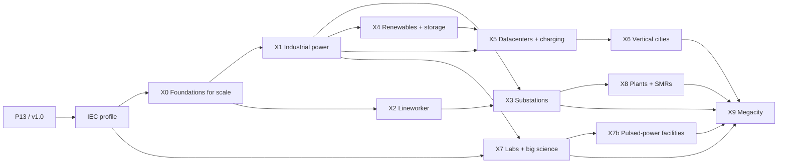

# Expansion proposal: power systems, big science and the cities of the future

**Status:** Accepted proposal, 2026-11-16; the user's decisions are recorded in §7. Not yet part of the spec. Nothing here is scheduled until the user approves it and the spec ([`controls-development-plan.md`](../controls-development-plan.md), v1.4) gains a matching section (a v2.0 "Expansions" chapter). Per CLAUDE.md: change the plan first, then the code.

**Relation to the spec.** Everything here is post-1.0. The spec's parked backlog (§6, "Post-1.0 backlog") already lists several pieces: lineman and utility content, generators, transfer switches and backfeed, solar PV, ESS and EV chargers, arc flash via IEEE 1584, and the IEC region profile. This proposal groups them with the new ideas into a dependency-ordered set of expansion phases (X0–X9, plus X7b for high-energy pulsed-power facilities). It also lists the architecture work that has to land first, because the simulator, world model, save format and renderer all assume one building today.

---

## 1. What the player gets

Today the career ends at controls engineer. The expansions add new career branches, all on the same simulator. The player is still hands-on: a lineworker climbs, grounds and splices; a relay technician injects test currents; a datacenter electrician swaps a UPS module under a switching order. Each branch also adds a **system view** of the network as a one-line diagram, the way prints sit beside the 3D world today.

| Branch                                   | Typical work                                                                               | Main expansion |
| ---------------------------------------- | ------------------------------------------------------------------------------------------ | -------------- |
| Industrial power electrician / engineer  | MV switchgear, motor control at 4.16 kV, protective relays, power factor, generators, ATS  | X1             |
| Lineworker (utility)                     | Overhead and underground distribution, poles, transformers, reclosers, storm restoration   | X2             |
| Substation and relay technician          | Substations, transmission protection, breaker failure, relay testing, station SCADA        | X3             |
| Renewables and storage technician        | Solar farms, battery storage, inverters, collection systems, microgrids                    | X4             |
| Critical facilities electrician          | AI datacenters, UPS, 2N redundancy, DC distribution, megawatt charging hubs                | X5             |
| High-rise and district electrician       | Skyscraper risers, life-safety power, elevators, district energy                           | X6             |
| Research facility electrician / engineer | Labs, pulsed power, superconducting magnets, accelerator and laser-facility power          | X7             |
| Pulsed-power facility electrician        | Capacitor-bank and pulsed-power infrastructure on secure test ranges, stored-energy safety | X7b            |
| Plant electrical engineer                | Generating stations, excitation and synchronising, small modular reactor station power     | X8             |
| Grid operator / city planner             | The megacity capstone: the whole network, planning and emergencies                         | X9             |

**Pillar check.** All five pillars carry over and get stronger at scale:

1. _Runs what is wired._ One-line diagrams and **switching orders** are documents that can be wrong, just as prints are. A switching order that opens the wrong disconnect is a scenario in its own right.
2. _Meters tell the truth._ New instruments: proximity voltage detectors, phasing sticks, relay test sets, power-quality analysers, insulation testers at kV, thermal cameras.
3. _One layer from wire to logic._ Protective relays are programmable devices (P10 PLC runtime and P12 networking reused); a datacenter's paralleling controls and a solar plant's controller are PLC and SCADA work.
4. _Safety is a mechanic._ High-voltage approach distances, equipotential grounding, step and touch potential, induced voltage from parallel lines, stored energy in capacitor banks, quench energy in magnets.
5. _Realistic within reason._ The new abstractions are listed per expansion (§4) and follow the realism charter.

### Qualifications and certificates (all branches)

Real electricians in these fields cannot just walk on site: they hold qualifications that say what they may do, where, and under whose supervision. The expansions make that a mechanic on top of the existing licence and strike system.

- **Credentials gate work orders.** Each job lists the qualifications it needs; the player can't accept it without them, and working outside a qualification at Realistic difficulty is a licence strike.
- **Earned in play.** A credential is earned through a written test (questions generated from the game's own content, cited by article number, never copied code text), a practical assessment scenario, and logged supervised hours.
- **Expiry and renewal.** Some lapse (refresher training, a periodic test of rubber goods, a periodic practical); a lapsed credential blocks jobs until renewed.
- **Revocation.** Serious violations (a switching error that energises a crew's work, entering a bank bay without verifying discharge) suspend or revoke a credential.
- **All names fictional**, modelled on real credential types. Examples by branch:
  - X1: qualified person for energised work (after NFPA 70E, cited by number), MV switching qualification, relay test technician.
  - X2: lineworker apprenticeship card and journeyman lineworker, qualified employee under OSHA 29 CFR 1910.269 (cited by number), climbing and bucket-truck rescue, rubber-gloving qualification.
  - X3: substation entry and switching authority, protection and control technician levels.
  - X4–X6: PV and storage installer, ESS fire-safety awareness, critical-facility switching, life-safety systems testing.
  - X7: radiation-area and beam-area access, cryogenics and oxygen-deficiency awareness, superconducting-magnet work, stored-energy (capacitor bank) qualification.
  - X7b: security clearance as a gameplay credential (a background-check wait, no narrative detail), explosives-area electrical safety (after DoD 6055.09-M, cited by number), electromagnetic-hazard-to-ordnance awareness (after MIL-STD-464, cited by number), lightning protection for explosives facilities (after NFPA 780, cited by number), stored-energy and two-person-rule qualification.
  - X8: plant switching authority, Class 1E maintenance qualification, emergency diesel generator operator.
- **Content work:** credentials are catalogue entries (requirements, expiry, assessment scenario), so they follow the content pipeline and `content-designer`; assessments reuse the career's work-order system.

---

## 2. Content and realism rules for this scope

The realism charter (spec §3) applies unchanged, plus these:

- **No real organisations, sites or brands.** CERN and NIF inspire two sites; the game uses fictional names (for example a fictional international particle-physics laboratory and a fictional laser-fusion facility). The same goes for utilities, grid operators, reactor vendors and datacenter operators. Nothing may imitate a real site's layout, branding or staff.
- **Codes cited by number, never copied.** New references: NESC (IEEE C2) for utility work instead of the NEC; NEC Arts. 690 (PV), 705 (interconnection), 706 (ESS), 625 (EV charging), 695 (fire pumps), 700/701/702 (emergency and standby); NFPA 70E and OSHA 29 CFR 1910.269 for approach distances and utility safety; IEEE 1547 and grid-code ride-through; IEEE 1584 for arc flash; IEEE 308 / Class 1E for nuclear station power. Values come from public data, physics, or are labelled game-design.
- **Region profiles split into two layers.** Premises wiring (NEC or IEC) and utility practice (NESC-like or IEC/European utility). The big-science site inspired by CERN is European, so **the IEC profile becomes a prerequisite for X7** (spec open question 8).
- **No sensitive security detail.** No real-grid vulnerabilities, no attack techniques against real control systems, no weapons-relevant detail for pulsed power or reactors. Defence sites (X7b) are covered from the facility electrician's side only: power, stored-energy safety, grounding, interlocks and qualifications. No weapon design, performance, targeting or effects is modelled or described; the loads are abstract boxes with an energy rating and a charge time. Reactor physics stays abstract (a load-following heat source with trips); the game covers station electrical systems, not reactor design.
- **Fictional numbers where real ones are proprietary.** Equipment ratings follow public product classes (for example 15 kV class switchgear, 138 kV breakers), not specific products.

---

## 3. Architecture work that must come first (X0)

The current engine is built for one building: quasi-static phasor MNA, one unknown per conductor node, a 2,000-node budget, a world document that holds every entity, and a scene sized to a workshop. City scale needs these changes, each with its own ADR and the usual agent reviews.

### 3.1 Multi-scale simulation (ADR: "Network solver and zones")

- **Zones.** The world is split into zones. The zone the player works in keeps today's detailed per-conductor MNA. Every other zone is solved by a network solver and reduced to a **boundary equivalent** (Thevenin/Norton per phase, updated each network solve). The player never sees a seam: walk into a zone and it is promoted to detail.
- **Network solver** in `sim-core`: unbalanced three-phase power flow (current injection or Newton–Raphson) with per-unit quantities, transformers with taps and vector groups, voltage regulators, capacitor banks, constant-P/Q, ZIP and inverter loads. Sparse LU already exists (P2); this adds the outer power-flow loop and per-unit bookkeeping.
- **Fault analysis** with symmetrical components (sequence networks) for protection settings and coordination, alongside the direct per-phase fault stamps the detailed zone already has.
- **Time scales.** Electromechanical dynamics (generator swing equation, governors, exciters, frequency) at a phasor-dynamics rate around 10 ms; thermal at seconds; process at minutes; solar and load at hours. Needs time compression (a solar farm's day in minutes) without breaking determinism: integer ticks stay, with a multi-rate scheduler.
- **Power electronics** as averaged models: grid-following and grid-forming inverters, rectifiers, DC/DC converters, UPS double conversion, MPPT. A switching-level waveform bench stays optional (the spec's post-P11 scope bench).
- **DC networks.** DC power flow for PV strings, battery strings, 800 V and ±400 V datacenter DC, and the DC fast-charging bus.
- **Oracles.** Permissive open-source tools as test oracles only, never as dependencies copied into the code: OpenDSS (BSD) for distribution, pandapower and MATPOWER (BSD) for power flow. Licence rows checked under ADR 0003 before use.
- **Budgets** (provisional, for `sim bench`): a 5,000-bus unbalanced power flow converging in under 50 ms on the reference machine; zone promotion under one frame; the detailed zone keeps its 2 ms and 0.3 ms gates.

### 3.2 Large worlds (ADR: "World chunks and templates")

- **Chunked world document.** `world.json` cannot hold a city. Split the world into chunks loaded on demand, each with its own hash; `world.hash` becomes a hash of chunk hashes. A new `schemaVersion` with a migration from v3 (`save-format-guardian` owns it).
- **Templates and arrays.** A solar array of 40,000 modules, or a row of 200 identical racks, is one entity with a count and a seeded per-instance variation (realism charter rule 4), not 40,000 entities. The player can "break out" any instance to work on it.
- **Procedural but deterministic generation** of the parts of a city the player hasn't built, from the world seed, so replays still reproduce exactly.
- **Commands stay the only mutation path.** New command families: `switch.operate`, `tag.hold`, `ground.apply` / `ground.remove`, `relay.set`, `order.step` (execute one step of a switching order), `breaker.rackOut`, `pole.climb`, and city-planning commands for X9. All logged and replayable.

### 3.3 Rendering at scale (renderer-engineer)

- Floating origin (kilometre coordinates break float precision), terrain, chunk streaming, LOD and impostors for towers, poles, panels and buildings, GPU instancing of whole arrays.
- Conductors at scale: spans with catenary sag from tension and temperature (a natural extension of the wire bake), galloping and blowout as visual only.
- New camera modes: bucket truck, climbing, aerial overview, and the 2D one-line and SCADA views.
- Frame budget set against the spec's minimum hardware (2020-era integrated GPU, 1080p60) with a "city" quality tier.

### 3.4 UI and editors (angular-ui-engineer, scada-engineer)

- One-line diagram editor and viewer (a sibling of the prints editor), switching-order editor, protection coordination plot (time-current curves), relay settings sheets.
- Grid-operator console built on the P12 SCADA/HMI builder.

### 3.5 New agents

Created at the expansion kickoffs, as the spec does for P10 and P12: `power-systems-engineer` (network solver, fault analysis, protection), `utility-safety-reviewer` (NESC/70E/1910.269 practice, approach distances, grounding; works with `electrical-realism-reviewer`), and `world-scale-engineer` (chunks, streaming, templates) if renderer and save-format work is too large for the existing agents.

---

## 4. Expansion phases

Each phase is a minor or major release after 1.0 with the usual Definition of Done, its own `plans/expansion-N-*.md` and a phase-acceptance scenario. Sizes are relative: S ≈ one spec phase, M ≈ two, L ≈ three or more.

### X0 — Foundations for scale (L)

Everything in §3: zones and boundary equivalents, the network solver, sequence-network faults, multi-rate time, averaged power electronics, DC power flow, chunked saves, templates, floating origin and streaming, one-line viewer, the new region-profile layer. **Acceptance:** a headless 5,000-bus feeder model that matches OpenDSS within tolerance; walking from a detailed building into the street and back with no change in `world.hash` and no visible seam; a save of a 10 km² world that loads in seconds.

### X1 — Industrial power systems (M)

Builds on P6 (three-phase) and P7 (motors).

- MV distribution at 4.16 and 13.8 kV: metal-clad switchgear, vacuum breakers that rack in and out, MV motors and starters, unit substations, dry and liquid transformers.
- Protective relays as programmable devices: 50/51 overcurrent, 87 differential, 27/59 under and over voltage, 81 frequency, 46 negative sequence; time-current coordination as a puzzle.
- Generators, paralleling, automatic and manual transfer switches, backfeed hazards (parked spec items).
- Power factor correction, harmonics from VFDs as a measurable THD signature (an extension of the "PWM harmonics are skipped" abstraction, as averaged harmonic injections), resonance with capacitor banks.
- Arc flash via IEEE 1584 (parked spec item): incident energy shown on generated labels; PPE categories as a mechanic.
- Labs at industrial scale: isolated-ground circuits, clean power, hipot and insulation testing at kV.

**Acceptance:** coordinate a plant's relays so a motor-feeder fault trips only its breaker; restore after a utility outage through the generator and ATS without backfeeding.

### X2 — Lineworker and distribution (L)

Needs X0's terrain and network solver.

- Overhead distribution: poles, crossarms, insulators, pole-mounted transformers, cutouts and fuses, reclosers and sectionalisers, regulators, capacitor banks, secondary and service drops. Underground: pad-mounts, elbows, loadbreak operation, cable faults and fault location.
- Utility safety as mechanics: minimum approach distances by voltage, rubber goods classes and testing, hot sticks, equipotential zone grounding, induced and backfed voltage, step and touch potential, test-before-touch with a proximity detector.
- Switching orders and clearances as documents that can be wrong; a tag-hold system; storm restoration jobs with crews and priorities (single-player crew AI; co-op multiplayer stays parked).
- Phasing and rotation checks, voltage-drop and regulator settings, cold-load pickup.

**Acceptance:** a storm scenario: patrol, isolate, ground, repair a downed span, remove grounds, re-energise in the right order, with every step a logged command and every hazard measurable.

### X3 — Substations and transmission (M)

- Transmission at 69–500 kV and the substation yard: breakers, disconnects, bus arrangements (breaker-and-a-half, ring bus), CTs and PTs, station batteries and DC systems, station service.
- Protection: distance (21) with zones, line differential, breaker failure, bus differential, reclosing, pilot schemes as abstract communication links.
- A fictional substation-automation protocol on the P12 networking stack (inspired by, not copying, IEC 61850 concepts), relay test sets and secondary injection.
- Grid frequency and inertia at the system level: load shedding (81U), islanding.

**Acceptance:** test and commission a line's protection with a relay test set; a fault on the line clears in zone 1 from both ends and recloses.

### X4 — Renewables, storage and microgrids (M)

Parked spec items: solar PV, ESS.

- Solar farms: modules with irradiance- and temperature-dependent I–V curves, strings, combiners, central and string inverters with MPPT, DC ground-fault detection and DC arc faults, rapid shutdown, MV collection system, collector substation and point of interconnection.
- Wind as a later add-on (turbine as an averaged source).
- Battery energy storage: string models with state of charge and thermal limits, BMS, PCS, fire-protection interlocks (thermal runaway as a fault signature, never graphic).
- Grid codes: ride-through, reactive power and voltage support, ramp limits; grid-following versus grid-forming behaviour visible in the network solver.
- Microgrids: islanding, black start from batteries, resynchronising.

**Acceptance:** commission a 50 MW solar plant with storage; it rides through a modelled transmission fault and islands a critical load correctly.

### X5 — Critical facilities: AI datacenters and fast-charging hubs (M)

- **AI datacenters:** a dedicated HV substation, MV ring distribution, unit substations, UPS (double conversion, static bypass, modules), static transfer switches, PDUs and RPPs, busway, rack power at 400/415 V AC and 800 V or ±400 V DC, 2N and N+1 topologies, paralleled generator plants, maintenance-bypass switching under live load.
- Facility behaviour that is specific to AI training: large synchronous load swings from GPU clusters (a measurable signature on the utility side), power capping, harmonics, cooling pumps and chillers (P8 process simulation reused, including liquid cooling loops).
- Redundancy as gameplay: a concurrent-maintenance job that must never drop a rack.
- **High-capacity fast charging** for EV and robot fleets: DC fast chargers through megawatt-class charging, a shared DC bus, battery-buffered charging, demand management and scheduling, robot fleets as a stochastic but seeded load (robots arrive, charge to a target and leave).

**Acceptance:** perform a UPS module replacement on a live 2N datacenter with zero load loss; size and commission a robot charging hub so the feeder never exceeds its rating under a seeded fleet schedule.

### X6 — Vertical cities: skyscrapers and districts (M)

- High-rise distribution: MV risers and unit substations on mechanical floors, busway risers, vertical voltage drop, emergency, legally required and optional standby systems with their transfer schemes, fire pumps, elevators with regenerative drives, smoke-control power.
- District level: several buildings on one MV loop, a district energy plant, rooftop and façade PV, building batteries, a shared charging hub (X5).
- Life-safety tests as jobs: monthly generator load tests, transfer-time verification.

**Acceptance:** a 60-storey tower survives a utility loss with life-safety loads transferred within the required time and the fire pump running.

### X7 — Labs and big science (L)

Needs the IEC profile for the European site.

- **Research labs:** laboratory power, isolated grounds and EMI-sensitive grounding, UPS for instruments, HV test sets, interlocked fume hoods and gas cabinets, lab equipment as P8 process loads.
- **Particle-accelerator laboratory** (fictional, inspired by large international labs): a 400 kV supply, reactive compensation (static VAR compensators) for pulsed loads, magnet power converters with tight current regulation, **superconducting magnets and quench protection** (stored energy, dump resistors, quench detection as a timing-critical interlock), cryogenics plant loads, personnel safety interlocks around beam areas, radiation areas as access-control zones (no radiation physics).
- **Laser-fusion facility** (fictional, inspired by large laser facilities): large capacitor banks for pulsed power, charging supplies, stored-energy safety (dump and grounding before entry), trigger and timing systems as abstract devices, interlocks and permissives. Pulsed power is modelled at the level of stored energy, charge time and interlocks, not device design.
- The control-system side reuses P10–P12: interlocks are PLC and safety logic; operations use the SCADA builder.

**Acceptance:** recover from a magnet quench without damage by keeping the protection system intact; perform a safe entry into a capacitor-bank bay with lockout, discharge verification and grounding.

### X7b — High-energy pulsed-power facilities (M)

Builds on X7's stored-energy work and X1's protection. Set on fictional secure test ranges and research sites; strictly the facility electrician's job (§2).

- **Facility power:** a dedicated substation and MV feeders, charging-power supplies drawing large, repetitive loads (a measurable flicker and demand signature on the utility side, a coordination problem in X1 terms), harmonic filters, backup power for safety systems.
- **Capacitor-bank and pulsed-power infrastructure** as abstract stored-energy loads (energy rating, charge time, discharge permissive): bank bays, charging and dump circuits, grounding sticks and automatic grounding switches, discharge verification before entry, two-person rule, safety watch.
- **Site safety systems:** access control and interlock chains (PLC and safety logic from P10–P12), warning beacons, emergency stops, explosives-area electrical rules (classified areas, bonding, static control), lightning protection and grounding grids, electromagnetic-hazard zones around ordnance as an access and procedure rule.
- **Credentials:** the clearance and site qualifications listed in §1 gate every job here.
- **Abstractions:** the load is never a weapon model. Its energy, charge time and interlock states are what the electrician works with; what it is for is out of scope.

**Acceptance:** commission a charging-power feeder so the site's repetitive pulsed demand stays within the utility's flicker limit; perform a bank-bay entry under the two-person rule with lockout, discharge verification and grounding, logged step by step.

### X8 — Power plants and small modular reactors (L)

- **Generating stations** (abstracted prime movers: steam, gas turbine, hydro as torque sources with governors): generator step-up transformers, excitation systems and AVR, synchronising (synchroscope, permissives), generator protection, station auxiliaries and start-up transformers, black start.
- **Small modular reactor station power:** the reactor as an abstract, load-following heat source with trips; the job is the station's electrical systems: Class 1E safety buses, emergency diesel generators, station batteries, loss-of-offsite-power and station-blackout scenarios, surveillance testing. Reactor physics stays abstract by design (§2).

**Acceptance:** synchronise a generator to the grid within the permissive window; an SMR station rides through loss of offsite power on its emergency diesels with every safety bus measured.

### X9 — Megacity of the future (capstone, L)

- The whole city as one network: transmission ring, substations, datacenter campuses (X5), towers (X6), solar farms and storage (X4), SMRs (X8), charging and robot fleets (X5), research campus (X7).
- A **grid-operator mode** built on the P12 SCADA builder: dispatch, contingency analysis (N-1), load shedding, black start of the city.
- A **planning mode**: grow the city decade by decade, choosing upgrades under budget and reliability targets, with seeded demand growth.
- **The far future, to 3026 AD** (decision 5, §7). The planning mode runs through eras, each clearly labelled speculative and game-design (realism charter rule 2); the physics stays the same simulator, only the equipment catalogue and its labelled assumptions change:
  - **Near future (to about 2075):** superconducting distribution cables, city-scale DC distribution, vehicle-to-grid and robot-to-grid, grid-forming inverters everywhere, MW-scale charging as the norm, fleets of small modular reactors.
  - **Mid future (to about 2300):** fusion power stations as abstract sources (like the X8 reactor), room-temperature superconductor bus and storage rings, arcology-scale vertical cities, continent-spanning HVDC supergrids, autonomous maintenance robots that the player supervises and audits.
  - **Far future (to 3026):** orbital solar collection delivered by an abstract energy link to rectennas, planetary-scale grids, cities kilometres tall, self-healing networks; the electrician's job shifts to commissioning, auditing and fault-finding systems that mostly run themselves, still with meters and still with "the simulator runs what is wired".
  - Each era is a catalogue layer with its own `source: game-design` labels; nothing speculative leaks into the realistic eras.

**Acceptance:** a seeded city survives a scripted N-2 contingency and a black start, with every action a logged command.

---

## 5. Order and dependencies

**Order (decided, §7):** IEC profile → X0 → X1 → X2 → X3 → X4 → X5 → X6 → X7 → X7b → X8 → X9. X1 first because it needs the least new architecture after X0 and leads straight out of P7, so it tests the network solver on familiar ground. X2 and X3 can run in parallel tracks once X0 lands. The IEC profile comes first after 1.0, before X0 (decision 3), so X7 is never blocked on it.

X1 stays post-1.0, after X0 (decision 1); pulling an X1 slice in before 1.0 was considered and declined.

---

## 6. Risks

| Risk                                                                  | Mitigation                                                                                                                                     |
| --------------------------------------------------------------------- | ---------------------------------------------------------------------------------------------------------------------------------------------- |
| Scope explosion: each X phase is as large as several spec phases      | Hard gates: X0 acceptance before any content phase; each phase ships alone and is playable alone                                               |
| Losing the hands-on feel at city scale                                | Every branch has hands-on jobs; system view is a second surface, never a replacement                                                           |
| Determinism across multi-rate, multi-zone solves                      | Integer ticks, fixed absolute schedules (as the P3 thermal bank does), oracle and replay tests per solver                                      |
| Performance on the minimum-spec machine                               | Zones, templates and LOD by design; new bench cases gated in `pnpm verify` like today's                                                        |
| Realism of high-voltage and nuclear content, and liability perception | `utility-safety-reviewer` plus `electrical-realism-reviewer`; abstraction listed per phase; no real sites or vendors; reactor physics abstract |
| Defence content (X7b) drifting into weapons detail                    | §2 rule: facility electrical side only, loads as abstract energy boxes; `electrical-realism-reviewer` checks every X7b entry against it        |
| Sensitive-information concerns (grid security, pulsed power)          | §2 rules: no real vulnerabilities, no weapons-relevant detail, station electrical systems only                                                 |
| Save-format churn from chunking                                       | One planned major `schemaVersion` in X0 with a total migration from v3; `save-format-guardian` owns it                                         |

---

## 7. Decisions (2026-11-16)

| #   | Question                                     | Decision                                                                                                                |
| --- | -------------------------------------------- | ----------------------------------------------------------------------------------------------------------------------- |
| 1   | Pull an X1 slice in before 1.0?              | No. X1 stays post-1.0, after X0.                                                                                        |
| 2   | Order                                        | As proposed: X0 → X1 → X2 → X3 → X4 → X5 → X6 → X7 → X8 → X9, with X7b added after X7.                                  |
| 3   | Move the IEC profile up for X7?              | Post-1.0, and the first thing after it: the IEC profile ships before X0.                                                |
| 4   | Design X2 for co-op from the start?          | No. Single-player crews; co-op stays parked.                                                                            |
| 5   | How far into the future?                     | Very far: eras through 3026 AD in X9, each labelled speculative.                                                        |
| 6   | Nuclear content                              | Abstract reactor; station electrical systems only.                                                                      |
| 7   | High-energy pulsed power and its credentials | Yes: X7b, facility electrical side only (§2), plus a qualifications-and-certificates mechanic across all branches (§1). |

## 8. Next steps after approval

1. Plan the IEC profile as the first post-1.0 phase (its own `plans/` file and spec section).
2. Add an "Expansions" chapter to the spec (v2.0) summarising §3–§5; record the plan correction in the version history.
3. Write the X0 ADRs (network solver and zones; world chunks and templates; region-profile layers; time scales), with `sim-engine-engineer`, `save-format-guardian` and `renderer-engineer` as an agent team, since three areas must agree a contract at once.
4. A dated research report in `docs/research/` on network-solver methods and permissive oracle licences before X0 starts.
