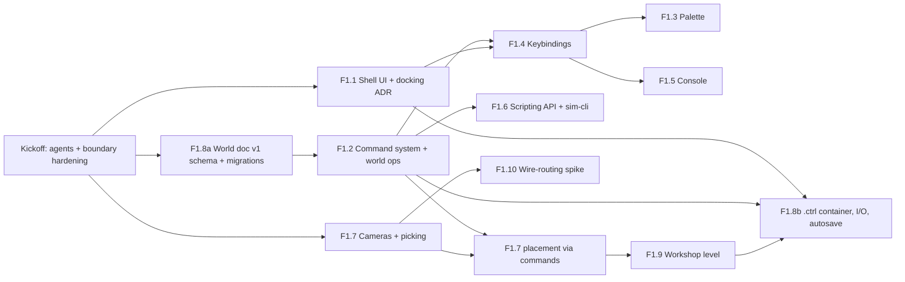

# Phase 1: Game shell ("Hands on the panel")

**Release:** v0.2.0 · **Status:** 🚧 In progress (kickoff 2026-10-27) · **Spec:** [plan §6 P1](../controls-development-plan.md#p1--game-shell-ui-commands-cameras-saveload-v020)

## Goal

A game you can start, look around, place things in and save: a keyboard-first Angular shell with a docking workspace, one command registry behind four surfaces (palette, keybindings, console, scripting API), walk and work cameras with BVH picking and snapping, a workshop sandbox level, and the `.ctrl` save format at `schemaVersion` 1 with a migration framework, atomic saves and autosave. `sim-cli` runs the game headless. No circuit simulation yet (P2).

## Phase acceptance

- [ ] Place, move and delete objects with undo/redo through the **mouse, palette, console and a `sim-cli` script**, with the same resulting world hash (`world.hash`) on every surface. _(One scenario, four drivers: `apps/game-e2e` for mouse, palette and console, `sim-cli` for the script.)_ _F1.9: every scenario now runs on the workshop level (New sandbox with seed 0 in `game-e2e`, `--world content/levels/workshop.json` in `sim-cli`), with goldens shared between them. Still open: no single scenario has all four drivers yet. The mouse scenario (`mouse-place-move-delete`) is driven by the mouse, the in-game console, a console file and a snapping TS script but not the palette, and has no undo/redo; the palette and four-surface scenarios have undo/redo but no mouse driver._
- [ ] Save then reload is lossless: a fast-check property test on the world document and an E2E save → reload → same hash, in the web harness and in Electron.
- [x] Replaying seed + command log from an empty world gives the same hash as the live session (property test in `domain/commands` and `sim-cli replay`). _(F1.2 property tests; F1.6's four-surface test replays the log a `sim run` wrote and gets the live hash.)_
- [x] E2E covers the palette and the console (including the console under the Electron CSP). _(`apps/game-e2e`: `palette.spec.ts` (F1.3) and `console.spec.ts` (F1.5); `apps/desktop-e2e/src/smoke.spec.ts` opens the console under the real `app://` CSP.)_
- [ ] `pnpm verify` green on all three OSes. Every new runtime dependency has a `THIRD_PARTY_NOTICES.md` row.

## Kickoff (before F1.x PRs)

1. [x] Create the P1 specialists from plan §10.2: `angular-ui-engineer`, `renderer-engineer`, `save-format-guardian` (`.claude/agents/`). The routing table in `CLAUDE.md` already lists them.
2. [x] **Boundary hardening PR** (`test-engineer`). P0 tested the domain boundary only against a workspace import. Close the gap:
   - add `bannedExternalImports` for `type:domain` (`@angular/*`, `electron`, `three`, `three/*`, `rxjs`);
   - give domain libs `lib: ["es2022"]` (no `dom`), so DOM globals fail typecheck;
   - ban `Math.random`, `Date.now`, `new Date()` and `performance.now` in `type:domain` with `no-restricted-properties` / `no-restricted-globals`;
   - add a `scope:headless` tag that may depend only on `type:domain` (for `apps/sim-cli`; `scope:desktop` is the precedent);
   - add `fast-check` (dev) and per-domain-lib Vitest coverage thresholds of 90 % (§8). These run in `test`, so they are part of `pnpm verify`, not CI-only.
   - _Landed with additions:_ the ban list also covers `zone.js`, `electron-updater`, `three-mesh-bvh`, CodeMirror, dockview, `jsdom` and Playwright; `crypto` and `new Date()` are banned too, and the determinism bans apply to domain specs; domain **source** may not import Node built-ins (it also runs in the renderer and worker) and gets no ambient `node` types. Shared config: `libs/domain/tsconfig.domain.json`, `libs/domain/vitest.domain.mts`. Details in [workspace caveats](../docs/caveats/workspace.md).
3. [x] `release-engineer` re-checks the versions of dockview, CodeMirror 6, three-mesh-bvh, fflate and fast-check, plus their licences and their Angular 22 / TS 6.0 / CSP compatibility (§12 toolchain churn).

## Kickoff decisions (2026-10-27)

Accepted from the planner's and `release-engineer`'s kickoff reports. Spec v1.2 and [ADR 0001](../docs/decisions/0001-stack.md) were amended to match.

- **F1.8 lands as two PRs** (F1.8a schemas before F1.2; F1.8b container and I/O after the shell). An accepted exception to one feature per PR.
- **Node stays on 24** and moves when Electron's embedded Node moves. **Vitest stays on 4.1** and **pnpm on 11.x** through P1.
- **In-game console `run` takes console-line files only** (the CSP bans eval). TypeScript scripts run in `sim-cli`.
- **No axe-core** (MPL-2.0 is outside [ADR 0003](../docs/decisions/0003-licence-policy.md)); accessibility is covered by keyboard-only Playwright tests.
- **Defaults taken for the remaining open questions:** `world-model` infers its types from `save-format` schemas; the main agent owns `commands`, `world-model`, `scripting-api` and `sim-cli` until P2; the world `tick` exists and stays 0 until the P2 sim clock; props use built-in `prop.*@1` catalogue refs until the catalogue lands; difficulty and region defaults live in settings and the actual values in the world; `RegionProfile` has identity and display-unit fields only; orientation encoding is decided in ADR 0007; WASD and mouse look are input actions, not Commands (ADR 0006); the tool belt lives in settings for now; autosave slot count and interval are settings; the settings schema lives in `save-format` with its own `settingsVersion`; a `scope:headless` tag is added for `sim-cli`; spike code is never merged; non-electrical snap constants need a cited `source` and are re-checked by `electrical-realism-reviewer` when it exists in P2.
- **Dependency patch PR** before feature work: pnpm 11.28.8, electron-builder 26.18.1 + electron-updater 6.8.12 (with a packaging smoke test). Nx 24.0.2 follows once it clears pnpm's 24-hour minimum release age (published 2026-10-26 20:25 UTC). Take Electron 45.0.x when it ships.

## Build order

One feature per PR. F1.8 is split into two PRs (a, b); see the open questions. Three tracks can run in parallel after the kickoff:

- **Domain track** (no Angular): F1.8a → F1.2 → F1.6. This is the critical path, because every surface depends on the registry.
- **UI track:** F1.1 starts at once (shell, settings, docking ADR), then F1.4 → F1.3 / F1.5 (palette and console in parallel).
- **Renderer track:** F1.7 cameras and BVH picking start at once against the existing panel scene. Placement merges after F1.2. F1.10 can run any time after picking.
- **Integration:** F1.9, then F1.8b, then the phase-acceptance E2E.

## Features

### F1.1 Shell UI

Main menu (New sandbox, Continue, Load, Settings, About, Quit), settings, docking workspace, HUD, notifications, theming and keyboard-first accessibility. New libs:

- `libs/ui` (`@controls/ui`, `type:ui`): design tokens, buttons, dialogs, focus trap, toasts;
- `libs/features/shell` (`@controls/feature-shell`, `type:feature`): menus, HUD frame, notifications;
- `libs/features/workspace` (`@controls/feature-workspace`, `type:feature`): docking, viewport panel, inspector;
- `libs/features/settings` (`@controls/feature-settings`, `type:feature`).

`SettingsService` joins `platform-api`, with Electron and web implementations. **Owner:** `angular-ui-engineer`; `electron-platform-engineer` for the settings IPC.

Acceptance:

- [x] ADR 0005 picks dockview or custom split panes before the workspace PR merges. Criteria: Angular 22 zoneless support, works under the strict CSP, keyboard operation, serialisable layout, licence, bundle size.
- [x] Workspace: the 3D viewport plus at least a side panel (inspector) and a bottom panel (console host). Panels resize and the layout persists in settings. `view.resetLayout` is a registered command. _(The command landed with F1.2: the button runs it through `Session.exec` and the workspace applies it in `Session.onCommand`.)_
- [x] Settings sections:
  - graphics: backend preference auto/webgl2, pixel-ratio cap;
  - audio: volumes, stored only; audio arrives in P4;
  - controls: look sensitivity, invert-Y, link to the F1.4 bindings;
  - units: display imperial/metric;
  - difficulty: default for new games;
  - region: NEC only, shown disabled.

  Settings persist across restarts in Electron and in the web harness.

- [x] The settings document is Zod-validated with its own `settingsVersion`. A corrupt or unknown file falls back to defaults with a notification (unit tests for main and web).
- [x] Settings IPC (`settings:get` / `settings:set`): Zod-validated in main, `senderFrame` checked, size-capped, written atomically.
- [x] HUD shows the current mode, a selection summary and an **assisted** badge once a cheat has run. _(Since F1.2 the badge reads the world's `assisted` flag through `Session`; the palette's cheat confirmation landed in F1.3; no cheat command is registered yet.)_
- [x] Notifications are announced through `aria-live` and can be dismissed from the keyboard.
- [x] Light and dark themes via CSS custom properties: follow `prefers-color-scheme`, can be overridden in settings, honour `prefers-reduced-motion`.
- [x] Keyboard-only Playwright test: menu → settings → back → New sandbox without the mouse, with visible focus and focus restored after each dialog closes.
- [x] The about box moves into the menu with its `data-testid`s intact. The existing `game-e2e` and `desktop-e2e` smoke tests stay green, and there is still no `zone.js`.

### F1.2 Command system

The registry, bus, undo/redo and replay log from §4.6 live in `libs/domain/commands` (`@controls/commands`, `type:domain`). The world document operations live in `libs/domain/world-model` (`@controls/world-model`, `type:domain`), which defines the world `CommandDef`s and infers its types from the `@controls/save-format` schemas. `libs/features/session` (`@controls/feature-session`, `type:feature`) is the Angular adapter: the world as a signal, `exec`, and context keys. **Owner:** main agent (no domain specialist until P2). Reviewers: `save-format-guardian` (world ops), `test-engineer` (replay harness), `angular-ui-engineer` (session API).

Acceptance:

- [x] `CommandDef<A>` matches §4.6 (`id`, `title`, `category`, Zod `args`, `when`, `keybinding`, `undoable`, `cheat`, `run`). The registry rejects duplicate or malformed ids.
- [x] `exec(id, args)` parses `args` with the command's Zod schema before `run`. Invalid args return a typed error and leave the world and the log unchanged.
- [x] `when` context expressions (`==`, `!=`, `&&`, `||`, `!`, dotted keys) go through a hand-written parser and evaluator. No `eval` or `new Function` (CSP). Unit-tested.
- [x] Undoable commands produce an apply/invert pair. `edit.undo` and `edit.redo` are registered commands. A new mutation clears redo. Deleting and then undoing restores the same entity id.
- [x] Replay log entries are `{ seq, tick, id, args }`, using the save-format schema. Only successful commands are logged. View/UI commands are logged but don't change the world hash.
- [x] World ops `entity.place`, `entity.move`, `entity.rotate` and `entity.delete`. Positions are integer mm. Entity ids come from a world counter, never `crypto.randomUUID`. The seeded PRNG (a reimplemented small-state generator) lives in `world-model` with its seed in the world document.
- [x] `world.hash`: canonical serialisation (sorted keys, normalised `-0`) hashed with pure TypeScript. It gives the same value in Node and Chromium (tested in both: golden hashes in `world-model` and in `apps/game-e2e/src/world-hash.spec.ts`).
- [x] fast-check properties (engine with a toy state in `commands`, real world commands and hash in `world-model`):
  - for any command sequence, undoing everything returns the initial hash;
  - `invert ∘ apply` is the identity for every undoable command;
  - replaying seed + log gives the live hash.
- [x] Coverage of at least 90 % for `commands` and `world-model`.
- _Decisions in [ADR 0006](../docs/decisions/0006-command-system.md): `edit.undo`/`edit.redo` are logged and re-executed on replay; `when` is advisory (not checked by `exec`); view commands are declared in domain code and applied by the UI through `Session.onCommand`._

### F1.3 Command palette

`libs/features/palette` (`@controls/feature-palette`, `type:feature`). Argument forms are generated from Zod `args` (via `z.toJSONSchema` plus `.meta()` hints). **Owner:** `angular-ui-engineer`.

Acceptance:

- [x] Ctrl+K and Ctrl+Shift+P open it, bound through F1.4 to the `palette.open` command (Cmd on macOS). _(`palette.open` is a view command with `globalKeybinding` and `logged: false`: UI chrome never enters the replay log.)_
- [x] Fuzzy search over title, category and id. Commands whose `when` is false are hidden or shown disabled with the reason. Recent commands come first and are stored in settings. _(Shown disabled, after the enabled ones; recents are commands run from the palette.)_
- [x] Forms support string, integer/number with bounds, boolean, enum, nested object, optional and default. Entity-reference args offer the current selection. _(Entity ids carry the `x-controls-ref: entity` `.meta()` hint and read the `selection.entityId` context key, which the viewport publishes once F1.7 selects world entities.)_
- [x] A unit test checks that **every registered command** can be rendered as a palette form, so a new command can't silently break the palette.
- [x] Validation errors come from the same Zod schema and show inline.
- [x] Running a `cheat` command asks for confirmation and sets the world's `assisted` flag, which persists. _(No cheat ships in P1 yet; the spec registers one. Once the world is assisted the palette stops asking.)_
- [x] ARIA combobox/listbox pattern, works with arrows, Enter and Esc only, focus restored on close.
- [x] E2E: place an object, then undo it, using only the palette. _(Keyboard only; the final hash is pinned and matches `sim run scenarios/palette-place-undo.console`.)_

### F1.4 Keybinding service

The framework-free core lives in `@controls/commands` (`keybindings/`): chord parsing and normalisation (`Mod` = Ctrl or Cmd), resolution against `when`, and conflict detection. The Angular `KeybindingService` is in `feature-session`, and the rebinding UI is in `feature-settings`. **Owner:** `angular-ui-engineer`.

Acceptance:

- [x] Default bindings come from `CommandDef.keybinding`. User overrides are saved in settings. Bindings can be reset one at a time or all at once.
- [x] A conflict is two bindings with the same chord whose `when` contexts are not provably disjoint. Conflicts are shown in the rebinding UI, never silently shadowed, and resolution order is deterministic. Unit-tested.
- [x] Bindings are ignored while focus is in a text field or CodeMirror, except global ones (palette, console toggle, Esc).
- [x] Tool belt slots 1–9 run `toolbelt.select --slot N`. In P1 a slot holds a placeable prop type.
- [x] Continuous walk-mode movement (WASD, mouse look) uses rebindable **input actions**, not Commands, so per-frame input never enters the replay log. This is recorded in ADR 0006.
- [x] E2E: rebind a command, use the new key, and the change survives a reload.
- _Decisions in [ADR 0006](../docs/decisions/0006-command-system.md#keybindings-f14) (amended): canonical chords (`Mod`, `Ctrl`, `Meta`, `Alt`, `Shift`, then a `code`-derived key name; command letters follow the layout, everything else is positional); binding ids (`edit.undo`, `toolbelt.select.slot3`, `input.moveForward`) share settings `controls.keybindings`, so the settings schema didn't change; conservative disjointness (NNF + DNF capped at 64 terms, with a soundness property test); user overrides first, then id; Tab, Shift+Tab and Escape reserved; `CommandDef.globalKeybinding` for the palette and console toggle. `toolbelt.select {slot: int 1..9}` is a view command. Mouse look stays on the mouse axes (sensitivity and invert-Y in settings)._

### F1.5 Dev console

`libs/features/console` (`@controls/feature-console`, `type:feature`) on CodeMirror 6. The `verb.noun --flag value` parser lives in `@controls/commands` (`console/`), so `sim-cli` accepts the same lines. **Owner:** `angular-ui-engineer`.

Acceptance:

- [x] The backtick key toggles it. It's available in Sandbox and dev builds and hidden elsewhere (gated by a context key). _(`console.toggle`, a global binding with `when: console.available`; the key is set from `isConsoleAvailable`: Sandbox or dev build, workspace on screen.)_
- [x] Grammar: dotted command id, positional args, `--flag value`, bare `--flag` = true, quoted strings and numbers. Flags map onto the Zod object shape. Parse errors point to a column. Grammar in ADR 0008.
- [x] Tab completion for command ids, flag names and enum values from the registry. History with ↑/↓, saved in settings and capped.
- [x] `help [id]` is generated from the registry. `world.hash` prints the current hash (read-only; the E2E tests use it).
- [x] Before a cheat command runs, a banner warns that it will mark the save as assisted. _(Unit-tested with a test cheat: no cheat command is registered in P1 yet.)_
- [x] `run <file>` runs a file of console lines (data only). Running JS/TS scripts inside the game is out of scope while the CSP bans eval (ADR 0008). _(`run` takes no path until F1.8b: it opens a file picker, or the player drops a file on the console; the same in the web harness and Electron.)_
- [x] `apps/desktop-e2e` opens the console in Electron, which proves CodeMirror 6 works under the real CSP. _(The CSP is unchanged: CodeMirror's `<style>` element and style attributes are covered by `style-src 'unsafe-inline'`.)_
- [x] E2E (web harness): place an object, undo, recall a line from history, and check the hash matches the palette path. _(`console.spec.ts`: place, undo, history and `world.hash` reach `CONSOLE_PLACE_UNDO_HASH` (also `pnpm sim run apps/sim-cli/scenarios/console-place-undo.console`); typing the lines of F1.3's `palette-place-undo.console` into a fresh session reaches `PALETTE_PLACE_UNDO_HASH`, the literal `palette.spec.ts` asserts, with the same logged commands. The console also runs `four-surface.console` to `FOUR_SURFACE_HASH`.)_

### F1.6 Scripting API v0 and `sim-cli`

The typed API over the registry lives in `libs/domain/scripting-api` (`@controls/scripting-api`, `type:domain`): `createGame({ seed, world? })` → `exec`, `world()` (read-only snapshot), `hash()`, `on(event)`. `feature-session` wraps the same object, so the UI and scripts run identical code. `apps/sim-cli` (`type:app`, `scope:headless`) is an esbuild Node bundle, and the root `package.json` gains a `sim` script. **Owner:** main agent, with `test-engineer` for the CI wiring.

Acceptance:

- [x] `pnpm sim run <script>`, `pnpm sim replay <file.ctrl>` (prints the hash), `pnpm sim hash <file.ctrl>`. Scripts are TS modules exporting `(game) => …`, or console-line files. _(Until F1.8b, `replay` and `hash` read the replay-log and world JSON a `.ctrl` contains and refuse `.ctrl` with a clear error; F1.8b adds `.ctrl` to the same commands. TS scripts are bundled with esbuild at run time; ADR 0008.)_
- [x] `sim-cli` lint fails on any import outside `type:domain`, and it runs under plain Node 24 with no DOM. _(`lint-boundary.spec.ts` lints a probe file with the real config; the four-surface test runs the bundle in a plain `node` child process.)_
- [x] Sim queries (`probe`, `tag`) are reserved in the API docs and not implemented. They arrive in P2 and P10. _(In the `Game` type, throwing `NotAvailableError`.)_
- [x] A `sim-cli` test target runs the four-surface scenario script and is part of `pnpm verify`. _(The headless drivers: API in-process, TS script, console-line file and replay, all to one pinned hash. Palette, keybindings and mouse are UI drivers in `apps/game-e2e`.)_
- [x] `docs/guides/scripting.md` shows a worked example.
- _Also landed: the console-line parser in `@controls/commands` (`console/`) for F1.5, ADR 0008 (grammar, script boundary, `.ctrl` forward compatibility; its CodeMirror section is left for F1.5), and the determinism lint extended to `apps/sim-cli`._

### F1.7 Cameras and interaction

All of this is in `@controls/renderer`, which now depends on `world-model` and `units`. The renderer syncs the scene from world snapshots by entity id and never mutates the world. Snap maths lives in `world-model` (`snap/`), so scripts and the mouse snap identically. `feature-workspace` turns gestures into Commands. New dependency: three-mesh-bvh 0.9.x (MIT). **Owner:** `renderer-engineer`; `angular-ui-engineer` for the workspace glue.

Acceptance:

- [x] `mm()` moves to `@controls/units`. Snapshot add/update/remove keeps the scene in sync (scene-graph JSON snapshot test). _(Part 1: `mm()`/`metresToMm()` moved. Part 2: `WorldSync` draws world entities by id with ref-counted prop recipes; snapshots cover add, move and remove; the snap maths moved to `world-model` `snap/`.)_
- [x] Walk mode: WASD plus mouse look with pointer lock, Esc releases, kept inside the room bounds.
- [x] Work mode: focus a backplate, wall or bench, then orbit and pan with limits. `view.mode walk|work` and `view.focus --target <id>` are commands, and the mode is a `when` context key. _(Part 1: orbit, zoom and pan limits on the backplate and rails. Part 2: both view commands, the `mode` and `selection.*` context keys, and V/F as their bindings (ADR 0006). Walls and benches became focus targets with F1.9.)_
- [x] Hover and selection by BVH raycast. Selection is UI state (`selection.kind`), not world state. Keyboard users can cycle through selectable entities.
- [x] Placement: _(Part 1: pure integer-mm `snap()` for all three targets with sourced constants. Part 2: the ghost, one Command per commit through `feature-workspace`, Escape and Delete; keyboard placement with Enter at the reticle and M to pick up. Wall studs are snapped and tested; F1.9 added the workshop's stud wall, live.)_
  - a ghost preview snaps to the DIN rail, the backplate grid and wall studs, with snap increments taken from sourced constants;
  - committing produces **one** `entity.place` or `entity.move` and dragging produces none;
  - Esc cancels without a command;
  - Delete runs `entity.delete`.
- [x] Every new geometry, material and BVH is disposed when the scene is torn down (unit test). The forced WebGL2 path stays covered by E2E. A dev HUD shows frame time.
- [x] E2E: place, move and delete with the mouse gives the same `world.hash` as the equivalent console lines. _(`apps/game-e2e/src/placement.spec.ts` (forced WebGL2) and `pnpm sim run apps/sim-cli/scenarios/mouse-place-move-delete.console` both end at the hash pinned in `apps/sim-cli/src/mouse-place-move-delete.spec.ts`. The in-game console (F1.5) should run the same file to it.)_

### F1.8 World document v1 and the `.ctrl` container

This is ADR 0004 implemented in `libs/domain/save-format` (`@controls/save-format`, `type:domain`), with fflate (MIT) for the ZIP. **Owner:** `save-format-guardian`; `electron-platform-engineer` for IPC and atomic writes, `angular-ui-engineer` for the Load/Continue UI. It lands as two PRs.

Acceptance, **F1.8a** (schema, ahead of F1.2):

- [x] Frozen v1 schemas `ManifestV1`, `WorldV1` and `ReplayLogV1`, with `schemaVersion: 1`. They are never edited after v0.2.0.
  - `WorldV1` holds seed, tick, next id, entities with catalogue refs (id + version), integer-mm transforms, `assisted`, region id, difficulty and an `extensions` bag.
  - The manifest records `APP_VERSION`.
- [x] Migration framework: `migrate(doc)` is total from every known version to the current one, and a newer-than-build version returns a typed error. Synthetic test-only migrations prove chaining works.
- [x] Lossless round-trip property (fast-check): for any valid `WorldV1` `w`, `parse(JSON.parse(JSON.stringify(w)))` deep-equals `w`. The schema rejects NaN and ±Infinity, normalises `-0`, and requires integer mm.
- [x] Fixtures go in `libs/domain/save-format/fixtures/v1/`. A test loads every fixture from every version.
- [x] JSON Schema is exported from Zod and checked in. A test fails if it's stale.
- [x] Settings schema (F1.1) lives here too, with its own `settingsVersion`.

Acceptance, **F1.8b** (container and I/O, after F1.1, F1.2 and F1.9):

- [ ] Reads and writes a `.ctrl` ZIP containing `manifest.json`, `world.json`, an optional `replay.log` and an optional `thumbnail.png` (from the renderer). `prints/`, `plc/` and `hmi/` are tolerated but empty in v1. Output bytes are deterministic (sorted entries, fixed mtimes). Oversized or unexpected entries are rejected.
- [ ] `FileService` and `DialogService` in `platform-api`. Electron channels (`save:list`, `save:read`, `save:write`, `dialog:open`, `dialog:saveAs`):
  - Zod-validated and size-capped, with `senderFrame` checked;
  - main owns the saves directory, and the renderer gets opaque handles, never raw paths;
  - writes are atomic (temp, fsync, rename), and a test that fails mid-write leaves the old file intact.
- [ ] The web harness stores saves in OPFS or IndexedDB. Save As / Open use download and upload. One contract test suite runs against both platforms.
- [ ] Autosave rotates N slots on an interval and when returning to the menu (N and the interval are settings). Continue loads the newest valid slot and skips corrupt ones with a notification.
- [ ] Loading migrates, validates and then replaces the session. The undo stack is cleared and the replay log continues.
- [ ] E2E: save → reload gives the same hash in the web harness, and save/load works in `desktop-e2e` (also part of `release-engineer`'s smoke procedure).
- [ ] `docs/history.md` records `schemaVersion` 1.

### F1.9 Sandbox "workshop" level

The level data lives in `content/levels/workshop.json` (a `WorldV1` document, validated by `@controls/save-format`). The bench, a wall section with exposed studs, the backplate with DIN rails and generic props (box, crate, spool) are procedural recipes in the renderer. Generic props use built-in catalogue refs (`prop.*@1`) until the catalogue arrives (see open questions). **Owner:** `renderer-engineer`; `save-format-guardian` for the level document.

Acceptance:

- [x] New sandbox loads the workshop with a fresh seed (or one typed in the new-game dialog). _(`NewGameDialog` in `feature-shell`: a fresh seed from `crypto.getRandomValues` on the UI side (domain code never draws one), or a typed one validated as 0…4294967295; keyboard only, Escape backs out. `Session.newSandbox({ seed, difficulty })` copies the level (`newGameWorld`) with a fresh history and replay log. The level is `content/levels/workshop.json`, bundled through `@controls/content/*` and validated with `migrateWorld`.)_
- [x] At least three generic props can be placed from the palette, the tool belt, the console and a script. _(Box, crate and spool, on the backplate grid, the DIN rails, the stud wall and the bench top. Tool belt and mouse: `placement.spec.ts` and the controller spec; palette and console: `entity.place` (`palette.spec.ts`, `console.spec.ts`); script: `apps/sim-cli/src/workshop.spec.ts` places on every workshop surface with `worldSnapTargets(game.world())`.)_
- [x] Every real-world dimension (TS35 rail, stud spacing, module pitch) carries a `source`. Game-design values are labelled as such. _(The DIN module is now 17.5 mm per DIN 43880, rounded once per slot; the old 18 mm pitch is gone. Stud depth (3-1/2 in, PS 20) joined spacing and thickness. Fixture sizes in `FIXTURE_SPECS` are game-design with sources; specs check every constant.)_
- [x] Scene-graph JSON snapshot plus one Playwright screenshot baseline (fixed seed, WebGL2, DPR 1). Baseline owned by `test-engineer`. _(The controller spec snapshots the whole workshop scene, now with mesh bounds. `apps/game-e2e/src/workshop.spec.ts`: seed 0, six props, SwiftShader WebGL2, 1280 × 720 at DPR 1, `view.focus stud-wall`, overlays hidden; Linux only; how to update it is in the [rendering caveats](../docs/caveats/rendering.md).)_
- [x] `pnpm sim hash content/levels/workshop.json` works headless. _(Pinned in `apps/sim-cli/src/workshop.spec.ts`, part of `pnpm verify`; the same golden is `workshopSeed0` in `world-model` and `game-e2e`.)_
- _Decisions: fixtures are a new `WorldV1.fixtures` list (string ids, built-in `prop.*` refs, no command touches them), not entities, recorded in [ADR 0007](../docs/decisions/0007-world-document-v1.md#fixtures-and-levels-f19). No `schemaVersion` bump (v1 is unpublished); every golden hash was re-pinned. `sim run --world <level> --seed N` is a new game on a level. `content/` became an Nx project (`type:content`)._

### F1.10 Spike: wire routing

A throwaway prototype of the §4.9 five-step flow on the workshop backplate:

1. pick a spool;
2. click the source terminal;
3. click waypoints or snap to a duct;
4. click the destination terminal;
5. apply the termination steps for the difficulty (auto at Trainee).

It uses a Verlet rope that bakes to a tube. The code stays on the `spike/wire-routing` branch and is **not merged**; only the ADR lands. **Owner:** `renderer-engineer`.

Acceptance:

- [ ] Measurements recorded:
  - frame time with N live ropes and N baked wires (WebGPU and WebGL2);
  - clicks and seconds per connection;
  - hit-target sizes that worked;
  - clipping and occlusion problems;
  - particles per wire.
- [ ] ADR 0010 records the findings, the recommended interaction model, the instancing approach, and what P3 must build and must avoid.
- [ ] No spike code or spike-only dependency reaches `main`.

## ADRs to write in P1

Numbers are assigned in landing order. Planned:

| ADR  | Topic                                                                                                                                       | Written in                                                     |
| ---- | ------------------------------------------------------------------------------------------------------------------------------------------- | -------------------------------------------------------------- |
| 0005 | Docking workspace: dockview vs custom split panes                                                                                           | F1.1                                                           |
| 0006 | Command system semantics: undo model, what is logged, view vs world commands, input actions vs commands, `when` grammar                     | F1.2                                                           |
| 0007 | World document v1 and determinism: id allocation, PRNG choice, canonical hash, orientation encoding, built-in prop refs, sim tick before P2 | F1.8a                                                          |
| 0008 | Console grammar, CodeMirror 6, and where scripts may run (no eval in the renderer; TS scripts only in `sim-cli` until the P13 sandbox)      | F1.6 (grammar, scripts); F1.5 completes the CodeMirror section |
| 0009 | Save I/O boundary: main-owned save directory, opaque handles, atomic writes, web harness storage, autosave rotation                         | F1.8b                                                          |
| 0010 | Wire-routing spike findings                                                                                                                 | F1.10                                                          |

## Determinism and invariant hooks

- **Framework-free domain:** `commands`, `world-model`, `save-format` and `scripting-api` are `type:domain`. Kickoff lint bans framework imports, DOM globals and wall-clock or `Math.random` calls. `sim-cli` (`scope:headless`) is the proof.
- **One registry:** palette, keybindings, console and `sim-cli` all go through `scripting-api` → `commands`. A test checks that the UI registers no command outside the registry.
- **Replay:** `{ seq, tick, id, args }` log plus the world seed. A property test and `sim-cli replay` give the same hash.
- **Saves:** Zod in `save-format` is the only schema source, `schemaVersion` 1, total migration chain, frozen published versions, fixtures for each version, fast-check round-trip.
- **No electrical constants in P1.** `RegionProfile` ships with identity and display-unit fields only. Electrical fields arrive in P2 with sources and `electrical-realism-reviewer`.

## Docs to create or update (by `docs-keeper`, in each feature PR)

- **Architecture:** new pages, each with Mermaid diagrams:
  - `docs/architecture/commands.md` (registry, four surfaces, undo, replay);
  - `world-and-saves.md` (world doc, `.ctrl`, migrations, I/O boundary);
  - `ui-shell.md` (shell, docking, keybindings, session);
  - `rendering.md` (scene sync, cameras, picking, snapping).

  Update `overview.md` ("P1 implements", module-boundary graph, the `sim-cli` and `scope:headless` edges).

- **Caveats**, each starting with "Load this when…", plus rows in the caveats index and in the `CLAUDE.md` table:
  - `docs/caveats/ui.md`;
  - `rendering.md`;
  - `save-format.md`;
  - `commands.md` (determinism traps: `Map` order, `-0`, float formatting, wall clock).
- **Glossary:**
  - UI: command palette, dev console, context expression (`when`), input action, tool belt, docking workspace;
  - world and saves: assisted, world hash, migration chain, fixture, autosave slot, workshop;
  - interaction: walk/work/editor mode, BVH, snap target;
  - tooling: `sim-cli`, scripting API, spike.
- **Guides:** `docs/guides/scripting.md`; a "changing the save schema" section for `save-format-guardian`.
- **Other files:**
  - `THIRD_PARTY_NOTICES.md` rows for fflate, three-mesh-bvh, CodeMirror 6 and dockview (if chosen);
  - `CLAUDE.md`: the `pnpm sim` command and the status line;
  - README feature bullets and TODO;
  - `CHANGELOG.md` `[Unreleased]`;
  - fix the P0 status in `plans/README.md`, which still says "🚧 In progress".

## Risks

| Risk                                                                    | Mitigation                                                                                                                         |
| ----------------------------------------------------------------------- | ---------------------------------------------------------------------------------------------------------------------------------- |
| dockview doesn't support Angular 22 zoneless or the CSP                 | ADR 0005 evaluates it first. `feature-workspace` hides the choice behind its own API, so custom split panes stay a cheap fallback. |
| CodeMirror 6 style injection under the CSP                              | Covered by `style-src 'unsafe-inline'` today. `desktop-e2e` asserts the console in real Electron.                                  |
| Determinism leaks (wall clock, `Math.random`, iteration order, `-0`)    | Lint bans, canonical serialisation, Node-vs-Chromium hash test, replay property tests.                                             |
| Drag and per-frame input flood the replay log                           | Commit-only placement commands. Movement is input actions, not commands (ADR 0006).                                                |
| Schema churn when wires and terminals arrive in P2–P3                   | Keep v1 minimal with an `extensions` bag. P2 moves to v2 through a migration and never edits v1.                                   |
| Zod-generated forms can't express some argument shapes                  | The every-command-renders test fails at registration time. `.meta()` hints handle entity refs.                                     |
| New file IPC widens the attack surface                                  | Opaque handles, size caps, path containment, `senderFrame` checks, owned by `electron-platform-engineer`.                          |
| Pointer lock and WebGPU are flaky in CI                                 | E2E drives cameras through commands and asserts on state. The WebGL2 path is forced in E2E.                                        |
| Web harness and Electron behave differently                             | One platform contract test suite runs against both implementations.                                                                |
| Shell scope creep (graphics and audio options with nothing behind them) | Settings stored only. Region is a disabled placeholder.                                                                            |
| Spike code leaks into `main`                                            | The spike branch is never merged; only ADR 0010 is.                                                                                |
| Loading TS scripts in `sim-cli`                                         | Bundle each script with esbuild at run time (dev tool), with a fallback to console-line files.                                     |

## Status

| Feature | Description                   | Status                                                |
| ------- | ----------------------------- | ----------------------------------------------------- |
| F1.1    | Shell UI                      | ✅ Done (`view.resetLayout` became a Command in F1.2) |
| F1.2    | Command system                | ✅ Done                                               |
| F1.3    | Command palette               | ✅ Done                                               |
| F1.4    | Keybinding service            | ✅ Done                                               |
| F1.5    | Dev console                   | ✅ Done                                               |
| F1.6    | Scripting API v0 + `sim-cli`  | ✅ Done (`.ctrl` input arrives with F1.8b)            |
| F1.7    | Cameras and interaction       | ✅ Done (walls and benches as targets in F1.9)        |
| F1.8    | World document v1 + `.ctrl`   | 🚧 F1.8a done (schemas, migrations); F1.8b planned    |
| F1.9    | Workshop level                | ✅ Done (fixtures in `WorldV1`, ADR 0007 amended)     |
| F1.10   | Wire-routing spike (ADR 0010) | 📐 Planned                                            |

## Close-out

1. `docs-keeper` sync: README features, CHANGELOG, `docs/history.md` P1 narrative and `schemaVersion` 1.
2. `version-keeper`: `0.1.0 → 0.2.0`.
3. `release-engineer`: package, smoke test (including new sandbox and save/load), tag on confirmation, check the draft. The user publishes.
4. Mark P1 shipped in [`plans/README.md`](README.md) and [`docs/history.md`](../docs/history.md). P2 kickoff writes `plans/phase-2-*.md` and creates `sim-engine-engineer` and `electrical-realism-reviewer`. P2 is one of the agent-team cases (sim ↔ worker ↔ renderer).
