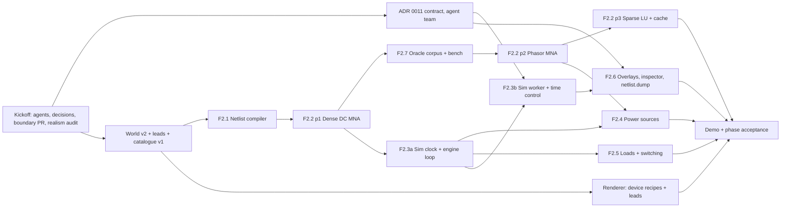

# Phase 2: Circuit engine and power sources ("First light")

**Release:** v0.3.0 · **Status:** 🚧 In progress (kickoff 2026-10-29, done 2026-10-30) · **Spec:** [plan §6 P2](../controls-development-plan.md#p2--circuit-engine-and-power-sources-v030)

## Goal

The simulator exists and runs what is wired. `sim-core` compiles the as-built world into a netlist and solves it with DC and 60 Hz phasor MNA. A fixed 1 kHz sim clock drives the continuous and protection layers. P2's sources, loads and switching devices are modelled from cited sources. A sim worker publishes solved voltages and currents to the renderer through a `SharedArrayBuffer` snapshot. `sim-cli` runs the same engine headless, and the same seed and log give byte-identical snapshots. Hand-calculated golden fixtures, fast-check properties and an ngspice oracle corpus check correctness; `sim-cli bench` checks performance inside `pnpm verify`.

The player-facing proof is a battery, an SPST switch and an incandescent lamp on the workshop bench, joined by test leads, with the lamp's brightness following the solved power.

**Not in P2** (do not pull forward):

- the conductor catalogue, wire routing, `wire.*` commands, terminations, termination quality and conductor heating (P3; ADR 0010's "What P3 must build");
- the mouse terminal picker (P3);
- receptacles, 3-way switches, the load centre, GFCI/AFCI and grounding/bonding (P4);
- DMMs, clamp meters, faults and difficulty gating (P5);
- the relay discrete layer, three-phase panelboards and control transformers (P6);
- motors (P7).

## Phase acceptance

- [ ] Hand-calculated golden fixtures agree with `sim-core` within **0.5 %**. Most linear ones are much tighter; each fixture states its tolerance. The ngspice oracle corpus passes at the tolerance fixed in ADR 0012.
- [ ] The §4.5 budgets are met and enforced by `sim-cli bench` inside `pnpm verify`:
  - a seeded synthetic 2,000-node plant re-solves in under 2 ms after a topology change;
  - discrete + continuous + protection work stays under 0.3 ms per tick.
- [ ] **Determinism.** Each of these gives byte-identical snapshots:
  - the same seed and log run twice headless;
  - a replay of that log;
  - the sim worker in Chromium (web harness) compared with `sim-cli` in Node.

  Also, saving at tick T, loading and advancing to T2 gives the same `world.hash` and snapshot as running straight to T2.

- [ ] **In-game demo.** In the workshop, a battery, an SPST switch and an incandescent lamp sit on the bench, joined by test leads. Closing the switch lights the lamp; opening it puts the lamp out. The lamp's brightness follows the solved light output, and the current trace shows the cold-filament inrush.
  - `apps/game-e2e` drives the demo with the console and the keyboard.
  - `apps/sim-cli/scenarios/bench-lamp.console` reaches the same pinned hashes.
  - A manual WebGPU check on a real GPU confirms the lamp and the overlays (a P1 follow-up).
- [ ] Every new device model and electrical constant has a `source`, and an `electrical-realism-reviewer` sign-off is recorded in its PR.
- [ ] `pnpm verify` is green on all three OSes. Every new dependency, and any adapted MIT/BSD code, has a `THIRD_PARTY_NOTICES.md` row.

## Kickoff (before F2.x PRs)

1. [x] Create the P2 specialists from plan §10.2: `sim-engine-engineer` and the read-only `electrical-realism-reviewer` (`.claude/agents/`).
   - **Routing:** the main agent keeps `commands` and `world-model`. `sim-engine-engineer` owns `sim-core`, `sim-protocol`, `sim-worker`, the sim-facing scripting API (`probe`, `advance`, sim events) and `sim-cli bench`. `save-format-guardian` still reviews world ops and command args.
   - The `CLAUDE.md` routing table is updated to match.
2. [x] The user answered the kickoff decisions (below, 2026-10-29). The spec is amended to v1.3: §4.3 now sends commands to the worker by `postMessage`, and §6 P2 makes the oracle a checked-in corpus.
3. [x] **Agent-team contract** (ADR 0011). It comes before F2.3b and before any renderer or UI code reads sim output. This is one of the planned agent-team cases (`CLAUDE.md`).

   **Done (2026-10-29):** [ADR 0011](../docs/decisions/0011-sim-worker-contract.md) is accepted after review by `renderer-engineer`, `angular-ui-engineer`, `electron-platform-engineer` and `save-format-guardian`, with the user's decisions D7 and D8 below and the main agent's rulings on three conflicts: saving while crashed is refused, there is no `sim.pause` (`P` toggles `sim.setSpeed {speed: 0}` and `sim.resume`), and load verification runs in the worker rather than on the main thread. It fixes the SAB layout (with an island `u8 band`), the seqlock reader woken by `Atomics.waitAsync`, the descriptor and its netlist guarantees, the asynchronous hash and save paths in the game (with a `TimeHost` driving `sim.step`), the crash and watchdog model, the time commands, chords and context keys, and the `desktop-e2e` checks. Its requirements on world v2 are listed in the world v2 PR's section below; the measurements it leaves to F2.3b are in its "Deferred to implementation" list.

   **The team:**
   - `sim-engine-engineer` (lead);
   - `renderer-engineer` and `angular-ui-engineer` (consumers);
   - `electron-platform-engineer` (the worker under `app://`, COOP/COEP, CSP);
   - `save-format-guardian` (anything persisted).

   **The ADR must pin down:**
   - **Ownership and threads.** D1: the main thread owns the world bus, the world document and the clock, and the worker follows deterministically. A command's `run` **never reads sim-owned state** (tripped, blown, state of charge). Commands record intent and the sim resolves the effect at the command's tick, so `exec` stays synchronous and replay stays exact.
   - **Clock:**
     - 1 tick = 1 ms of sim time, as an integer;
     - speeds 0 (pause), 1×, 10× and 60×, plus `sim.step {ticks}` while paused;
     - pacing picks an integer target tick from wall time, capped at the worker's progress plus a fixed maximum lead, so there is no catch-up spiral;
     - the effective speed is reported when it falls below the requested speed;
     - wall-clock reads happen only in the pacing module (UI or worker code), never in `sim-core`.
   - **Time and undo:**
     - time passing is not a command and never touches the undo or redo stacks;
     - `CommandBus.advanceTo(tick)` moves the state's tick without logging;
     - every change's `apply`/`invert` preserves `tick` (a property test);
     - "undo everything returns the initial hash" is restated for sessions where no time passed;
     - `replayEntries` advances the engine to each entry's tick instead of reporting `tick-mismatch`, then advances to the log's end tick, so v1 logs (all at tick 0) replay as before.
   - **Command flow.** Committed world commands reach the worker by `postMessage`, carrying their tick and `seq`. The worker applies each one exactly at its tick, before stepping that tick. Sim-originated events (`tripped`, `blown`, `hiccup`, `nonConverged`, `singular`) come back with their tick, for the HUD, notifications and `game.on('sim')`.
   - **Snapshot layout** (`SIM_PROTOCOL_VERSION`):
     - a header: magic, layout version, an `Int32` publish `seq` for `Atomics`, the latest slot index, tick, topology generation and counts;
     - double-buffered slots (§4.3), each guarded by a seqlock: the slot is odd while being written, and a reader retries, then falls back to the other slot;
     - per slot: node voltages and branch currents (`re` and `im`, `Float64`), the island table, and fixed-width per-device output records;
     - each island entry: its kind (DC, AC or empty), reference node, `singular`/`nonConverged` flags and outer-loop iterations;
     - device records, for example lamp `{ powerW, lightOutputRel, filamentTempK }`, fuse `{ state, meltFraction }`, breaker `{ state, thermalFraction }`, supply `{ mode }`;
     - **no wall-clock timings in the hashed bytes:** solve-time diagnostics go in a separate, unhashed area.
   - **Topology descriptor.** It is sent once per topology generation by `postMessage` and maps:
     - node index → member `(entityId, terminalId)` pairs;
     - branch index → element (entity or lead id) and its end nodes;
     - device-record index → entity id and output schema.

     Readers join on the generation number and ignore slots from another generation.

   - **Publish cadence.** A snapshot is published after every electrical solve (by default every 10 ticks, matching §4.5's 10–20 ms) and on every topology change, not on every tick.
   - **Fallback.** Without `crossOriginIsolated`, the same bytes in the same layout go by transferable `postMessage` through the same codec (§4.3). This is tested with `?sab=0`.
   - **Renderer reads:**
     - `SnapshotReader.latest()` returns a typed view that stays valid until the next read, with no allocation per frame;
     - the renderer draws on demand (rendering caveats), so a new `seq` calls `invalidate()` only when a drawn value moves by more than its display step: 1/255 for lamp intensity, or one colour bin for overlays;
     - Angular panels sample at 10–30 Hz into signals (§4.1).
   - **Lamp brightness and overlays:**
     - the device model publishes `lightOutputRel`, which is physics-derived and reviewed;
     - the renderer maps it to emissive intensity through a documented display curve (a game-design choice);
     - voltage overlays colour by |V| against the island's reference node: ground for grounded islands, the most negative source terminal for floating DC islands;
     - the renderer never computes an electrical quantity.
   - **Lifecycle:**
     - there is one worker per game;
     - it is restarted on `Session.newSandbox`/`adopt` and terminated on teardown (a disposal test);
     - if the worker crashes, the sim pauses with a notification and the world is left intact;
     - a save asks the worker for sim state at the save tick.
   - **Headless parity.** `sim-cli` runs the same `sim-core` engine and codec in-process. A worker snapshot and a `sim-cli` snapshot of the same log are byte-identical.

4. [x] `release-engineer` re-checks versions and licences, and records what it checked and where:
   - **ngspice:** the version used for the oracle and the licence of that exact build, including whether KLU (LGPL) is linked;
   - **eecircuit-engine, `@spice-ts/core` and brownout,** if any is used or adapted: the research doc (2026-10-26) says v1.9.0, v0.4.0 and v0.6.5, all MIT; verify;
   - **fast-check:** `^4.10.2` in `package.json`.

   `electron-platform-engineer` confirms, on Electron 45 and in the web harness:
   - module Web Workers bundle with `@angular/build` (`new Worker(new URL(…, import.meta.url), { type: 'module' })`) from a lib path;
   - the worker loads from `app://` with COOP/COEP and the current CSP (`worker-src 'self' blob:`);
   - `crossOriginIsolated` is true inside the worker.

   _Done 2026-10-29._
   - **ngspice 47** (2026-08-11): the core is Modified BSD, but numparam (LGPL) is always compiled in. The Fedora, Homebrew, Ubuntu and Windows builds all link KLU (LGPL), and some add readline (GPL-3), libsndfile (LGPL) or the `table.cm` plugin (GPL).
     - So ADR 0003 now has an exception for external programs that developers run and whose numeric outputs alone are checked in.
     - Each deck sets `.options sparse`, so the results don't depend on whether a build has KLU.
     - Installs for the guide: Fedora `dnf` (47), Homebrew (47), Scoop `extras/ngspice` or the official `ngspice-47_64.7z` extracted to `C:\Spice64`. Not Ubuntu 24.04's apt, which has 42.
   - **eecircuit-engine 1.9.0:** the MIT licence covers only the wrapper. Its WASM bundles KLU and numparam (LGPL) without notices. It stays rejected (D5).
   - **@spice-ts/core 0.4.0:** MIT, but there is no git tag for 0.4.0, so pin a commit SHA if any of it is adapted.
   - **brownout 0.6.5:** MIT. Its AMD follows SuiteSparse AMD (BSD-3), so adapting it means notices rows for both.
   - **fast-check 4.10.2:** current.
   - **Stay reference-only:** klu-js, SuiteSparse KLU, BTF and CSparse (all LGPL), and the code listings in Davis's book. SuiteSparse `AMD/` and `COLAMD/` are BSD-3, so they may be read.
   - **Citations confirmed:** Gilbert–Peierls 1988 (doi:10.1137/0909058); Amestoy–Davis–Duff 1996 (doi:10.1137/S0895479894278952) and 2004 (doi:10.1145/1024074.1024081).
   - **Module worker check** (`electron-platform-engineer`, a throwaway spike): passed in the web harness, under `app://` in the dev build, and in the packaged app.
     - `crossOriginIsolated` is true in the page and the worker, and a `SharedArrayBuffer` is really shared.
     - The CSP needs no change: `worker-src 'self'` covers the worker, and the CSP is enforced inside it.

     Gotchas for F2.3b:
     - **The constructor must be literal.** `@angular/build` only rewrites a literal `new Worker(new URL('…', import.meta.url), { type: 'module' })`, so keep it in one factory module provided by the app (features can't import `sim-worker`).
     - **The worker isn't type-checked by the game build.** `sim-worker` has its own typecheck target.
     - **A CSP violation already happens on every start.** Zod's eval probe triggers one; `z.config({ jitless: true })` fixes it.
     - **Worker violations are only visible inside the worker.** They fire on the worker's own scope, so tests need a listener there.
     - **Playwright can see the worker.** `page.workers()` works on both the `_electron` and CDP launch paths.

5. [x] **World document v2 and minimal connectivity PR** (`save-format-guardian`; see its section below). It lands before F2.1 reads connections. _Landed 2026-10-30 as #40 (catalogue v1), #41 (world v2 schemas, ADR 0013) and #42 (commands), after `electrical-realism-reviewer` and `sim-engine-engineer` approval; their notes were applied before merge._
6. [x] **Boundary and gate hardening PR** (`test-engineer`). Each rule is proven to fire, as in P1:
   - new libs `libs/domain/sim-core`, `libs/domain/sim-protocol` and `libs/domain/catalog`, all `type:domain`;
   - `libs/sim-worker` with a new `type:worker` tag that may depend only on `type:domain`;
   - `type:rendering` and `type:feature` read snapshot types from `@controls/sim-protocol`, never from `sim-worker`;
   - the determinism lint extended to `libs/sim-worker`, except its pacing module;
   - the D6 lint banning `Math.exp|log|pow|sin|cos|tan|atan2|hypot|cbrt` and `**` in `sim-core`;
   - an Nx `bench` target on `apps/sim-cli`, added to the `verify` script's `run-many` list. It runs the built bundle, outside coverage instrumentation, because domain tests always run with coverage (`libs/domain/vitest.domain.mts`) and that distorts timings.
7. [x] **First audit by `electrical-realism-reviewer`** of P1's sourced non-electrical constants: the snap constants in `libs/domain/world-model/src/lib/snap/constants.ts`, `FIXTURE_SPECS` and the prop sizes. The P1 kickoff decisions and the rendering caveats promised this. Findings are fixed in a small PR, and any value change that moves a golden hash gets a CHANGELOG note.

   _Done 2026-10-29: approved with notes, no hard fails. All 21 sourced items check out against public data, and there is no NEC text, table value or real vendor name. The wording fixes (DIN module pitch scope, the 27 mm crown dimension, the IEC 60715 edition, plywood thickness, walking pace) landed without moving any hash. Unverified: the 27 mm crown width against the IEC 60715 annex, and whether PS 20-20 is still the current edition._

## Kickoff decisions (2026-10-29)

The user chose the recommended option for D1, D2, D3 and D5, and accepted the recommendations for D4 and D6. D7 and D8 were decided in the ADR 0011 review.

- **D1 Thread and ownership.** The main-thread bus, world and clock stay authoritative, and the worker follows deterministically. `Session.exec` stays synchronous, so every P1 surface is unchanged. Commands reach the worker by `postMessage` with their tick; spec §4.3 is amended, because commands are rare and don't need a ring buffer. _Rejected:_ moving the whole game into the worker (a rewrite of every P1 surface), and a worker-owned clock (unreliable `ctx.tick`).
- **D2 Minimal P2 connectivity: test leads.**
  - **What a lead is:** a persisted, two-ended connection between device terminals.
  - **How:** made with `lead.connect` / `lead.disconnect` from the palette, console and scripts, and drawn as a simple sagging line.
  - **Not in P2:** routing, gauge choice, terminations and the mouse terminal picker (all P3).
  - **In P3:** `wire.*` arrives alongside leads, not in place of them, because leads stay useful for bench work and P5's meters.

  _Rejected:_ pre-wired assemblies in level data (the player couldn't wire anything), and bringing a minimal `wire.add` forward (it would commit P3's argument shape before routing is designed, which ADR 0010 warns against).

- **D3 One world `schemaVersion` 2 for the phase.** It adds:
  - `connections` (the leads);
  - a generic entity `state` bag of named finite values, validated by the device model, so new device kinds never need a schema bump;
  - `endTick` on the replay log.

  Sim state is included in `world.hash`, and every golden hash is re-pinned once. _Rejected:_ connections only (a tripped breaker would load closed, and a save made mid-sim would never replay to the same hash), and a separate v3 for sim state (two migrations in one phase).

- **D4 Device data: a minimal catalogue v1 now.** It lives in `libs/domain/catalog`, with entries in `content/devices/*.json` and `catalogVersion` 1. Each entry gives identity, a fictional brand and model, terminals (id, label, local position), the model kind, parameters and `sources`. `prop.*` stays built-in. It gives the realism reviewer one place to audit, and `content-designer` (P3) inherits it. _Rejected:_ device specs built into code, which P3 would have to migrate.
- **D5 Oracle: a checked-in ngspice corpus.**
  - **The corpus:** seeded random decks plus ngspice results, with the ngspice version and options in a header.
  - **In `pnpm verify`:** a staleness test regenerates the decks from the seeds and checks they match byte for byte. This follows the JSON Schema export precedent.
  - **Regenerating:** `pnpm sim oracle regen` needs ngspice installed and is never part of `verify`. So `verify` stays hermetic on all three OSes, and the ngspice build's licence never enters the dependency tree.
  - **Spec:** §6 P2 is amended.

  _Rejected:_ eecircuit-engine (ngspice in WASM) running live in `verify` (about 43 MB, unverified under Node 24, and its KLU linkage is LGPL), and a system ngspice in CI (no verified Windows install, and a CI-only check).

- **D6 Cross-runtime float determinism.** `sim-core` uses only IEEE-exact operations plus its own `dmath` for exp, log and pow, enforced by lint, and fixed phasor angles come from `sqrt`. A Node-vs-Chromium snapshot golden in `game-e2e` is the tripwire. Node 24's V8 and Electron's Chromium V8 are different builds, and `docs/caveats/commands.md` already treats `Math.sin`/`Math.cbrt` as engine-dependent. ADR 0014 records it.

- **D7 A hidden or minimised window suspends the sim** (ADR 0011 review, U1). It is host-side state in `SimHost`, not a logged `sim.pause`: pacing stops on `visibilitychange` and re-anchors at the player's speed when the window is visible again. "Falling behind" and the effective-speed windows are held, `sim.step` still works, and `backgroundThrottling` stays at its default. The web harness behaves the same. Running in the background may become a setting later. _Rejected:_ letting throttled timers slow the sim, and `backgroundThrottling: false`.
- **D8 Engine changes don't break old saves** (ADR 0011 review, U2). `ManifestV2.simEngineVersion` is bumped whenever snapshot or world goldens are re-pinned for numeric reasons. A save whose `simEngineVersion` or `catalogVersion` differs from the build's skips log verification and loads `world.json` as saved with a new log (`replay.status: 'restarted'`, reason `engine-changed`), which `REPLAY_MISMATCH_POLICY` never refuses. **Narrow v0 compatibility** (decided 2026-10-30 in the world v2 review): a save with `simEngineVersion === 0 && catalogVersion === 0` (a migrated P1 save, which holds no sim state) is verified as normal; if verification fails it falls back to `replay.status: 'restarted'` with reason `engine-changed`, never a refusal. Any other mismatch, including a single 0 on its own, stays `engine-changed` as above. The check is a pure, tested `engineCompatible(manifest, build)` in `scripting-api` (F2.3a). It relies on the empty-netlist rule: a world with no netlist exports `sim: null` (ADR 0013), so a P1 world verifies to the same hash. _Rejected:_ refusing such saves.

The spec also settles one point: the sim worker is a **module Web Worker** in the renderer (§4.3, ADR 0002). A `utilityProcess` can't share a `SharedArrayBuffer` with the renderer and doesn't exist in the web harness. `sim-cli` runs the engine in-process.

**Corrections to the research doc** (`docs/research/2026-10-circuit-simulation.md`), which stays unedited per the research rule:

- its §3 (Layer B) quotes NEC Chapter 9 conductor-resistance values, which ADR 0003 forbids; P2 computes resistance from resistivity;
- it gives IEC 60898 breaker figures (1.13 In / 1.45 In) for an NEC-first game; P2 uses NEC-region manufacturer-style data;
- it lists klu-js, and possibly eecircuit-engine's KLU build, which are LGPL and therefore reference-only.

All three are hard fails for the realism reviewer.

## Build order

One feature per PR. F2.2 lands in three parts, like F1.8b did. F2.3 is split into two:

- **F2.3a**, the headless clock and engine loop: pure domain code that unblocks every device model and the `sim-cli` tests;
- **F2.3b**, the worker transport: the agent-team contract.

The two halves have different owners and reviewers, and share no code beyond ADR 0011. Keeping them together would hold the device work hostage to Electron and Angular integration.

- **Domain track** (`sim-engine-engineer`, the critical path): world v2 → F2.1 → F2.2 part 1 → F2.7 → F2.2 parts 2 and 3. F2.3a starts after F2.2 part 1. F2.4 and F2.5 run in parallel after F2.3a; the utility and three-phase sources also need F2.2 part 2.
- **Transport track** (the agent team): ADR 0011 → F2.3b. It can start against a stub engine that only advances the tick, using the frozen layout, and integrates with F2.3a once that has merged.
- **Renderer and UI track:**
  - device recipes and lead drawing start once world v2 lands;
  - F2.6's overlays and inspector are built against fake snapshots generated by the codec, then integrated after F2.3b;
  - the time-control HUD ships in F2.3b.
- **Integration:** the bench demo, then the phase-acceptance E2E, then the manual WebGPU check.

## Features

### Kickoff PR: World document v2 and minimal connectivity (decisions D2–D4)

Not a spec feature. It is the persisted contract every P2 feature builds on; P1's boundary hardening PR is the precedent. **Owner:** `save-format-guardian`. The main agent writes the `world-model` commands. `sim-engine-engineer` reviews the device-state shape and `electrical-realism-reviewer` reviews catalogue values.

Acceptance:

- [x] `v2/world.ts`, `v2/manifest.ts` and `v2/replay-log.ts`, with a total v1 → v2 migration. There is one `schemaVersion` for the whole save, so documents that don't change get identity steps. v1 files and fixtures are untouched.
  - **`WorldV2.connections`:** strict objects sorted by id. Each is `{ id, ref: CatalogRef (lead type), a: TerminalRef, b: TerminalRef, extensions }`, where `TerminalRef` is `{ entity, terminal }`. ADR 0013 records the id allocation rule.
  - **`EntityV2.state`:** a strict record of named finite numbers, booleans or short enum strings. Absent values are `null`, never optional. It is validated by the device model's own state schema when the world loads, so a new device kind never needs a world `schemaVersion` bump.
  - **`ReplayLogV2.endTick`.**
- [x] Fixtures in `fixtures/v2/{world,manifest,replay-log,ctrl}`. Every v1 fixture migrates and validates. A fast-check round-trip property covers v2 (both JSON and the container), and `*.v2.schema.json` JSON Schema is exported with a staleness check.
- [x] `content/levels/workshop.json` is rewritten as v2 in canonical form (`levels.spec.ts`). Every pinned golden hash is re-pinned in one change, and the CHANGELOG says so:
  - `WORKSHOP_HASH`, `FOUR_SURFACE_HASH`, `PHASE_ACCEPTANCE_HASH`, `PALETTE_PLACE_UNDO_HASH`, `CONSOLE_PLACE_UNDO_HASH`;
  - the Node and Chromium hash goldens.
- [x] Commands in `world-model`. Their ids and argument shapes are save format, so `save-format-guardian` reviews them:
  - `lead.connect {ref, a, b}`: undoable. It refuses unknown entities, unknown terminals, `a == b` and duplicate leads.
  - `lead.disconnect {id}`: undoable, and undo restores the same id.
  - `device.operate {id, control, value}`: undoable, and checked against the device's controls in `run`. It **never reads sim-owned state** (ADR 0011).
- [x] Catalogue v1 (PR 1; `catalogVersion` 1 in the manifest from PR 2):
  - `@controls/catalog` holds the device-definition Zod schema: identity, fictional brand and model, category, terminals `{ id, label, positionMm }`, model `{ kind, params }`, controls and `sources[]`.
  - `content/devices/*.json` holds the P2 devices plus one test-lead type. Lead resistance is computed from resistivity × length ÷ area with a temperature coefficient, never taken from NEC tables.
  - `catalogVersion` 1 goes in the manifest and in `docs/history.md`.
- [x] **Requirements from [ADR 0011](../docs/decisions/0011-sim-worker-contract.md)** (its Consequences give the detail; ADR 0013 records them):
  - two state bags: `EntityV2.state` (commanded) and `EntityV2.sim` (sim-owned, written only by `materialiseWorld`), with keys matching `^[a-z][a-zA-Z0-9]*$` (at most 64 characters) and enum strings `SafeString` (at most 32); a property test that every change preserves each `sim` bag except on insert and remove;
  - `MODEL_KINDS` in `@controls/catalog` (owner, Zod schema and initial value per key): a new kind is no bump, changing a kind's keys is a `schemaVersion` bump; load checks both bags against it, with a new `invalid-device-state` load error;
  - `WorldV2.sim: { lastSolveTick, topologyHash, nodes, branches, islands: { flags, iterations }[] } | null`, in `world.hash`; `-0` normalised and finite numbers only, with an `Object.is` round-trip property;
  - `ReplayLogV2.firstSeq` (`entries[i].seq === firstSeq + i`) and `endTick` (`endTick ≥ last entry tick ≥ initialWorld.tick`; lower is refused);
  - `ManifestV2.simEngineVersion: Int` (D8);
  - staleness-checked JSON Schema exports for `device-state.<kind>` and every logged command's arguments, including `sim.setSpeed`, `sim.resume` and `sim.step` (`MAX_STEP_TICKS` 600 000);
  - the v1 → v2 migration (`state: {}`, `sim: {}`, `connections: []`, `sim: null`, `firstSeq: 0`, `endTick: max(initialWorld.tick, last entry tick)`) and the fixtures listed in the ADR.

  The `EntityV2.state` bullet above is superseded by the two bags.

- [x] Rebasing a replay log works: a test shows a log rebased onto a mid-session v2 world, sim state included, replays to the same hash. This is the groundwork for the P1 follow-up "the replay log never shrinks".
- [x] Palette forms render every new command (the every-command spec). Console lines and a TS script can connect a lead and operate a switch.

### F2.1 Netlist compiler

`libs/domain/sim-core` (`@controls/sim-core`, `type:domain`), in `netlist/`. **Owner:** `sim-engine-engineer`. Reviewers: `save-format-guardian` (what it reads from the world) and `test-engineer` (properties).

Acceptance:

- [x] `compileNetlist(world, catalog)` is a pure function. It turns entities, catalogue terminals, `connections` and commanded device state into nodes, branches, elements and islands.
- [x] Union-find merges ideal connections only: a closed switch, and terminals the device joins internally. Leads are resistive branches: R comes from the catalogue derivation, plus a sourced contact resistance at each end. An open switch drops its branch.
- [x] **Wired, not drawn.** A device placed touching a battery but not connected to it carries no current and sits at 0 V. When an entity is deleted, the deleting command's change removes its leads; they are never left in the world to be silently compiled.
- [x] **Deterministic numbering.** Each node is numbered by its smallest `(entityId, terminalId)` member in code-unit order. Property: permuting the input order of entities and connections gives an identical netlist.
- [x] **Canonical solution order.** The persisted order of `WorldV2.sim.nodes` and `branches` (and so the snapshot's) is a pure function of the world: canonical, and independent of the incremental-recompile history. Property: an incrementally recompiled netlist after any edit sequence numbers nodes and branches exactly as a from-scratch compile of the same world (ADR 0013).
- [x] **`topologyHash`:** SHA-256 (the pure implementation in `world-model`) over the canonical structure (the partition, branch ends and element kinds), excluding parameter values. Properties:
  - structurally equal netlists hash equally;
  - toggling a switch changes the hash;
  - changing only a value, such as a bench-supply setpoint, does not.
- [x] **Incremental recompile** on connect, disconnect, operate and sim topology events (trip, blow) equals a from-scratch compile. This is checked with fast-check over random edit sequences on random bench circuits.
- [x] **Islands** are connected components, each classified `dc`, `ac` or `empty`. A `mixed` island is reported as a diagnostic, since P2 has no converters.
- [x] `formatNetlist(netlist)` gives deterministic text, used by F2.6's `netlist.dump`. Coverage is at least 90 %.

_Done 2026-10-30 ([simulation architecture](../docs/architecture/simulation.md), [simulation caveats](../docs/caveats/simulation.md)). Notes:_

- _`topologyHash` digests a compact canonical **byte** encoding of the structure, not text: hashing 87 KB of text took 1.25 ms of a 1.9 ms structural recompile at 2,000 nodes; the encoding brings the recompile to about 1.3 ms (AMD Ryzen 5 5600X, Node 24). Element refs are in the hash, because the solution record is ordered by branch._
- _Sim topology events (trip, blow) are proven with a test-only fuse kind, since the real fuse and breaker arrive in F2.5. The engine passes its sim state as `options.sim`; a model sees only the keys it lists in `simTopologyKeys`._
- _The entity-delete cascade (deleting an entity removes its leads in the same change, and undo restores them with their ids) shipped with the world v2 commands in #42; this PR adds a `world-model` property test for it._
- _Review notes for later features: F2.2 gives every island its own reference node, including floating or partly floating nodes after an open switch or a dangling lead (`electrical-realism-reviewer`); an `empty` island must not be assumed dead once storage elements (capacitors, inductors with state) arrive. F2.3a: a save whose netlist is empty (`isEmptyNetlist`: no nodes) but whose `sim` is not `null` is `start-failed` (`save-format-guardian`)._
- _ADR 0014 (`dmath`) isn't written here: the compiler needs no transcendental. It belongs with the first use of `dmath` (the lamp's R(T) in F2.5, or earlier if F2.2 needs one)._

### F2.2 DC and phasor MNA solvers

`sim-core`, in `mna/` and `lu/`. **Owner:** `sim-engine-engineer`, with `test-engineer` for the property tests. It lands in three parts.

**Floor policy** for every solver property and golden in F2.2, decided in the #46 review (`test-engineer`); ADR 0012 (F2.7) refers to it. It replaces the literal 1e-12 A floor. ε is machine epsilon, y_b a branch's stamped admittance, and |·| a complex magnitude for phasors (part 2). **Amended in #51 (`test-engineer`):** a voltage-mode source behind a series R > 0 counts as a branch with y_b = 1/R, whose term is 16 ε (|V_a| + |V_b| + |E|) / R: its current (E − V_b + V_a)/R is resolved only to that, the slack its source-row bound already allows. y_b is 0 only for an ideal source (R = 0) and a current source, whose current is an unknown or exact. A generator-health ceiling keeps the floor honest: on islands carrying more than 1e-6 A, the 99th percentile of floor / max|I| stays at or under 3e-5 (DC) and 1e-4 (AC):

- **KCL at every node of an island:** `1e-9 · max|I| + 1e-12 A + Σ_b 2 · 16 ε |y_b| (|V_a| + |V_b|) + 2 · 16 ε · max_k t_k · max_n G_n`, with t_k a source row's term (below) and G_n a node's total conductance. The last term exists because elimination mixes the source rows (volts) into the KCL rows (amps) through the conductances. Seed 1369986703: an ideal 28 650 V source off a 1 S node leaves ε · 28 650 · 1 ≈ 6e-12 A where the node voltages are 3e-8 V. A resistor's current is g · (Va − Vb) from node voltages known only to an ulp, so it carries g · ulp(V) of rounding however exact the solve. The sum runs over the island's branches, gmin included, **not only those at node n**: Gaussian elimination's residual is normwise (|L||U|, not |A|). A weak node's row can carry a stiff neighbour's rounding, through the multipliers or through a source current that the neighbour's row sets. Seed −710639118: a 0 V ideal source joins a node held by 10 kΩ to one carrying 1e4 S at 21 V, giving 27× a per-node floor. The same covers the nodes whose own KCL isn't a row: the eliminated reference, and a floating component's representative.
- **Power balance:** `1e-9` relative to Σ|terms| plus `Σ_n |V_n| ×` node n's KCL floor (Tellegen's theorem).
- **Source rows** (the voltage-side counterpart of KCL): each source element's equation (Vb − Va + R·I = E, or I = amps) holds within `1e-9 · T + 1e-12 V + 16 ε t`, with t the row's `|Va| + |Vb| + |R·I| + |E|` (or `|I| + |amps|`) and T the island's largest t. With KCL, every row of the system is checked.
- **Linearity:** for k = 0 or ± a power of two, checked on values, exactly. Scaling every right-hand side by 2^m scales every rounding exactly, so x̂(k·b) = k·x̂(b) bit for bit. For other k, the residual-space check below.
- **Superposition, and linearity with other k:** checked in **residual space**, never on values. First, each solve compared must pass KCL and its source rows. Then, for d = Σ c_p x̂_p (x̂(k b) − k x̂(b), or x̂(all) − x̂(first) − x̂(second)), every row of the system applied to d must hold within Σ |c_p| × that solve's bound, plus 4 ε Σ |c_p| × the row's terms, with Σ c_p b_p cancelling exactly. Each row of d is that same combination of the solves' own residuals plus the rounding of forming d, so this holds by construction once the row checks pass. It also checks that the right-hand sides cancel.
- **Why not compare values:** a value comparison measures forward error, the residual times |A⁻¹|. Near-ideal source loops held by weak ties make that unbounded by any local or island term. CI on `48faae4` saw 1.4e-9 V and 7.3e-8 V, from 1e4 A and 7e4 A circulating against 1.3e-3 S and 1e-4 S of tie (ε·I/G). These were tried and failed fresh-seed runs (7 and 11 in 120):
  - the brief's per-island voltage term, `16 ε Σ_vsource (|E| + |R·I|)` (about 2000× too small on the first counterexample);
  - an ε·|I|/G_n extension;
  - a Skeel |A⁻¹||A||x̂| bound;
  - an a-posteriori 2·|A⁻¹ r| bound.

  The last two fail because GEPP's backward error is |L||U|, not |A|, and the measured A⁻¹ itself carries cond·ε error. The same applies to dense-against-sparse in part 3 and to the oracle comparison in F2.7: compare residuals, or use well-conditioned cases.

- **Floating clusters:** there the KCL floor is dominated by the common mode (5e8 V × 1e4 S ≈ 3e-2 A of rounding term), so it can't see an error in the cluster's internal currents or in its common mode. The checks there are exact value checks instead:
  - gmin · Σ V over the fed component equals the feed current (1e-13 relative in the property, 1e-15 in the unit cases);
  - each internal current matches its analytic value or its node's KCL, within that branch's rounding measured relative to the cluster (16 ε g (|u_a| + |u_b|));
  - the feed is either a current source on a resistor element or a `vsource` element in current limit, into a random member.
- **Generators** keep resistances down to 1e-4 Ω (busbar scale), a source's series resistance included (clamped since #51; it was drawn down to 1 µΩ before).

Acceptance, **part 1: dense DC**:

- [x] Real MNA with the ground node eliminated. Stamps: resistor, voltage source with internal resistance, and current source.
- [x] `gmin` from every node to ground. Its value has a `source` explaining its numerical role; it is not an electrical rating.
- [x] Dense LU with partial pivoting on preallocated `Float64Array`s. A singular island is flagged `singular` and never produces NaN.
- [x] **Golden fixtures,** each with its derivation written in the fixture file: a divider, a Wheatstone bridge, a battery with internal R into a load, two unequal batteries in parallel, and a floating island under `gmin`.
- [x] **fast-check properties:**
  - KCL holds at every node within the floor policy's bound (it was `1e-9 · max|I| + 1e-12 A`);
  - source power equals dissipated power, `gmin` losses included, within `1e-9` relative plus the policy's Tellegen floor;
  - linearity and superposition hold.

_Part 1 done 2026-10-30; reviewed by `test-engineer` (changes made) and `electrical-realism-reviewer` (approved with notes, below and in F2.3a and F2.4) ([simulation architecture](../docs/architecture/simulation.md#the-dc-solver-f22-part-1), [simulation caveats](../docs/caveats/simulation.md)). Notes:_

- _"Ground" is each island's own reference node (F2.1's review note): the negative end of its first `vsource` element, else its smallest node. `gmin` is `GMIN_S`, 1e-12 S, from every node to that reference; F2.7's decks match it with an explicit 1e12 Ω shunt resistor from each circuit node to the reference (not ngspice's `rshunt`, which also shunts sense-source and internal nodes)._
- _A current source is a stamp mode (`isource`), not a new netlist element kind: no P2 device is one, and a supply in current limit (part 3) is a `vsource` element stamped as one. The element kinds, the unknowns and so the matrix layout stay a function of `topologyHash`._
- _Singular is decided structurally (a loop of zero-ohm sources), with a numerical backstop. A planted fault showed the numerical check alone misses about 3 in 4 such loops inside resistive meshes._
- _Floating components are pinned structurally (#46 re-review). A conductive component that doesn't hold the island's reference is tied to it only by gmin, through current sources (a busbar section isolated by an open breaker, in parts 2 and 3). Once its conductance exceeds about gmin / ε (≈ 4.5e3 S, R below ≈ 0.2 mΩ), G + gmin rounds to G and the per-node formulation's last pivot is exactly 0: a false `singular`. The solver now gives such a component an exact change of variables, its common mode c = V(rep) and u = V − c for the other members (differences involve only u), and replaces the representative's row by the component's structural sum row (gmin · (|S| c + Σ u) plus the crossing currents). Same solution, well-conditioned; other islands are bit-identical (the 300-solve pin didn't move). So "singular ⇔ an ideal-source loop" holds again, and a property keeps generating clusters down to 0.1 mΩ (1e4 S per branch)._
- _The properties use the floor policy above, with resistances from 1e-4 Ω. A SHA-256 over the bits of 300 seeded solves is pinned in `mna/properties.spec.ts`: a deliberate numeric change re-pins it with the other numeric goldens and bumps `SIM_ENGINE_VERSION` (D8)._
- _`gmin` moves a result by a relative error of about gmin × R_th (1e-10 at 100 Ω, 1e-6 at 1 MΩ), so an insulation-resistance measurement (P5 meters) must exclude it (caveats)._
- _Branch values come from `dcBranchValues`: a hook (F2.4's EMF against state of charge, F2.5's R(T)), else per-kind defaults (a lead's resistance; a battery's nominal EMF behind its internal resistance, a placeholder until F2.4)._

Acceptance, **part 2: complex phasor** (needs F2.7):

- [x] Interleaved complex MNA for AC islands at the region frequency. P2 adds the `RegionProfile` type with its electrical fields (`frequencyHz` 60 and the nominal voltages), each with a `source`, and brings it to `electrical-realism-reviewer`. P1 never created the type: only `RegionId` exists (`save-format` `primitives.ts`), as the kickoff realism audit found.
- [x] Complex R, L and C impedance stamps, and phasor sources whose angles are exact constants: 0°, 180° and ±120° (from `cos = -0.5` and `sin = sqrt(3)/2`).
- [x] **Golden fixtures:**
  - an unbalanced 120/240 split-phase load, where the neutral current is the phasor sum of the line currents;
  - a balanced wye load, where the neutral current is about 0;
  - a series RL circuit at 60 Hz.
- [x] The AC oracle corpus passes.

_Part 2 done 2026-10-31; `electrical-realism-reviewer` **approved with notes** (#51, notes applied: the nominal-designation wording, IEEE Std 141's supersession by the IEEE 3000 series, v(t) = √2·Re(V·e^{jωt}) stated in `phasor.ts`, and the F2.4 notes below); `test-engineer` changes applied (#51: full-record checks, the dense warm-ω check, the amended floor policy with its ceiling, source R clamped in the generators, hand constants in the wye golden) and re-review pending ([simulation architecture](../docs/architecture/simulation.md#the-phasor-solver-f22-part-2), [simulation caveats](../docs/caveats/simulation.md)). Notes:_

- _**Complex LU, not the real 2n system.** `ComplexDenseLu` and `ComplexSparseLu` store every entry interleaved (`re, im`) and pivot by |re| + |im| (CABS1), with Smith's reciprocal once per pivot. The equivalent real system of order 2n would reuse the real LUs unchanged, but measured 4.1–6.1× slower dense (twice the flops and memory), and its pivoting can split a complex pair. The sparse kernels share the pattern work with DC: `sparseReach`, AMD, `buildSymbolic` (`mna/shared.ts`) and a generic `FactorisationCache<ComplexSparseFactors>`. The crossover has the same shape as DC (warm sparse wins from about 30 unknowns, cold from about 120), so `SPARSE_MIN_UNKNOWNS` (64) is shared._
- _**Inductance and capacitance are AC stamp modes on `resistor` elements** (`AcBranchValues`), as a DC current source is: F2.1's `ElementKind` and `topologyHash` are unchanged, and the DC pins didn't move. There is no AC current source yet: it would need the floating-component pinning in complex form._
- _**DC and AC share the solution record.** `AcSolver` writes only `ac` islands; the engine (F2.3a) runs `DcSolver.solve` then `AcSolver.solve` into one `DcSolution`. `mixed` islands are solved by neither._
- _**`RegionProfile`** is in `@controls/catalog` (`region.ts`): NEC is 60 Hz, 120/240 V split-phase, 208Y/120 V and 480Y/277 V, each value with a source (ANSI C84.1 and IEEE Std 141); the line-to-line values are the nominal names of the exact √3 multiples. **`electrical-realism-reviewer` signed off (#51).**_
- _**Floor policy with complex magnitudes** (`src/testing/ac.ts`): KCL, source rows and element laws; real power balance and reactive-power bookkeeping (Σ ωL|I|² − Σ |I|²/(ωC)), with each source's apparent power |E||I| as its term (a purely resistive island's Q is 0 only to ε |E||I|); linearity bit for bit for 0, ±2^m and ±j·2^m, in residual space for other complex k (the exact 120° rotation included) and for superposition; dense against sparse on residuals everywhere and on values over a well-conditioned subset with a resistive spanning tree (L–C resonance makes values elsewhere unbounded). Two new pins: a SHA-256 over 300 seeded dense AC solves and one over 40 large sparse AC solves; the generator clamp (#51) then moved the test pins without any solver change, and the pivoting change (#51, part 3 notes) moved the sparse ones again and made `SIM_ENGINE_VERSION` 2._
- _**The AC oracle** passes on both paths, worst 1.8e-5 of the allowance for volts and 5.0e-4 for amps (ADR 0012, now Accepted for AC). Twelve planted faults were all killed (listed in the PR)._
- _**For F2.4:** the utility and three-phase sources reach the solver through an `AcValueHook`, building each phase from the line-to-neutral magnitude and the exact ±120° angles (never from the 208 V name). An AC load with a nonlinear law needs an AC outer loop, which doesn't exist yet._
- _**For F2.4 (`electrical-realism-reviewer`, #51):**_
  - _add the ANSI C84.1 Range A and Range B service and utilization voltage bands to `RegionProfile`, paraphrased as facts with clause references, never copying the standard's table;_
  - _`game.probe` and the DMMs (P5) report the RMS magnitude by default;_
  - _any angle shown to the player (via `atan2`) is display-only: computed outside sim-core or in a readout, and never part of `world.hash` or a snapshot's hashed bytes (D6)._

Acceptance, **part 3: sparse, cache and nonlinear loop**:

- [x] Gilbert–Peierls sparse LU in CSC with AMD ordering, reimplemented from the published papers. MIT spice-ts or brownout code may be adapted only with a `THIRD_PARTY_NOTICES.md` row and an origin comment.
- [x] Above a threshold (§4.5 says about 300 unknowns; the bench confirms the crossover), dense and sparse results agree within `1e-9` relative on random systems (property test). How, per the F2.2 floor policy (#46 review):
  - compare **residuals on all circuits**: each solver's solution passes KCL and the source rows;
  - compare **values on a well-conditioned subset** (resistance minimums, no near-ideal source loops), so that a self-consistent but wrong sparse result fails.

  Value comparisons on ill-conditioned circuits measure forward error, which is unbounded.

- [x] **Factorisation cache** keyed by `topologyHash`:
  - the symbolic factorisation is reused when only values change;
  - a fixed-size LRU evicts deterministically and never changes results;
  - a counter proves that returning to a previous switch state hits the cache.
- [x] **Outer loop for nonlinear loads** (lamp R(T), CV/CC supply). It is warm-started, has an iteration cap and damping, and raises the island's `nonConverged` flag when it doesn't converge. A property test bounds the iterations on random bench circuits.
- [x] The 2,000-node re-solve case of `sim-cli bench` passes inside `pnpm verify` (gated since part 3b, calibrated). **Decided 2026-10-31 (the user): report it now, optimise the recompile, then gate it with a calibrated ratio.** The CI runners measured the warm re-solve inside `pnpm verify` at 2.12 ms (Ubuntu), 3.74 ms (macOS) and 4.77 ms (Windows) median, against 1.47 ms locally uncontended (AMD Ryzen 5 5600X, Node 24). So the case stays reported-only in `verify`, its numbers are printed in every CI log (the `sim bench report` step prints `dist/apps/sim-cli/bench-report.json`), and §4.5's 2 ms remains the target on player hardware. The gate moves to part 3b.

Acceptance, **part 3b: recompile optimisation and the calibrated re-solve gate** (follow-up to the decision above; **owner** `sim-engine-engineer`, with `test-engineer` designing the calibration):

- [x] **Optimise the structural recompile.** It is about 75 % of the re-solve's cost: 1.1 of 1.47 ms locally, mostly F2.1's assembly and the SHA-256 of the topology encoding. Measure on the built bundle before and after, and keep `topologyHash`, the netlist and every pinned golden bit-identical (or re-pin under the `SIM_ENGINE_VERSION` rule).
- [x] **Switch on a re-solve gate that holds on every runner.** The 2 ms budget is scaled by a calibration loop timed on the same machine, in the same process, in the same `sim bench` run (a fixed reference workload), so the gate compares a ratio, not raw milliseconds, and `pnpm verify` stays identical to CI. It never skips or relaxes per OS. `test-engineer` designs the calibration workload and its tolerance, and the median of N runs with a warm-up stays.
- [x] §4.5's 2 ms stays the target on player hardware, reported raw beside the ratio.

_Part 3b done 2026-10-31; `test-engineer` review pending ([simulation architecture](../docs/architecture/simulation.md#the-recompile-optimisation-and-the-calibrated-gate-f22-part-3b), [simulation caveats](../docs/caveats/simulation.md)). Notes:_

- _**Recompile 1.20 → 0.94 ms** (in-process A/B against the old compiler, 5,000 toggles each, interleaved; from-scratch compile 4.44 → 4.58 ms), netlist, `topologyHash` and every golden bit-identical, so `SIM_ENGINE_VERSION` stays 3 on main (F2.4 makes it 4). In place: the structure list is overwritten and compared while written; connection ends are cached against the entity entry they resolved to (by `epoch`); members and element refs are built once per fragment; the union-finds, index arrays and encoding buffer are reused; `TopologyWriter` writes the bytes directly, checked against `topologyBytes`. SHA-256 (about 0.3 ms) is now the largest single cost, and only a different hash could cut it._
- _**The gate pairs each run with its calibration run:** `median(tᵢ × CALIBRATION_REFERENCE_MS / cᵢ) ≤ 2 ms`, with `CALIBRATION_REFERENCE_MS` 0.69 ms on the Ryzen 5 5600X (Node 24.12.0). This deviates from the decision's literal `median(t) ≤ 2 ms × median(c) / ref`, which is still reported (`calibration.scale`): beside a saturating parallel test load the literal form's ratio spread 3.2× over 32 runs and failed one (1.75), the paired form 1.7×, peaking at 0.91. Ambient load: 31 of 31 pass, ratio 0.50–0.79 (median 0.67)._
- _**Sensitivity:** a planted exact 1.5× slowdown of the re-solve fails 25 of 30 runs (median ratio 1.10), and a planted triple hash in the compile (about 1.6×) 20 of 20, so the gate catches about 1.5× and more, not every smaller regression; `ratio` is printed on every CI run to watch the drift._
- _**CI, inside `pnpm verify`:** raw medians 3.35 ms (Ubuntu), 3.23 ms (macOS) and 3.32 ms (Windows); gated ratios 0.76, 0.58 and 0.85, all passing. In the built bundle the warm re-solve's best median went from 1.50 to 1.21 ms locally._

_Part 3 done 2026-10-30, except the re-solve gate; `test-engineer` review pending ([simulation architecture](../docs/architecture/simulation.md#sparse-lu-and-the-factorisation-cache-f22-part-3), [simulation caveats](../docs/caveats/simulation.md)). Notes:_

- _**The crossover is 64 unknowns, not §4.5's 300.** Measured on the built bundle: sparse with a warm cache beats dense from about 30 unknowns (16× at 290), and with a cold cache from about 130. 64 sits above every circuit of the pinned 300-solve hash (at most 40 unknowns), so small circuits keep their dense bits: the pin didn't move, and `SIM_ENGINE_VERSION` stays 1._
- _**The cache keeps what is a function of topology and stamp modes:** the pattern, the slot map, the AMD order, a recorded stamp program and the conductive components, keyed by `topologyHash`, island and stamp-mode signature (a supply in current limit changes the pattern without changing the hash). The island's last numeric factors are replayed when the pivot rule picks the same rows at every column, else refactored afresh, so warm and cold results are bit-identical by construction._
- _**Dense against sparse** compares residuals on every circuit and values (1e-9 of the island's largest, plus the ε·G·V current floor) on the well-conditioned subset (1 Ω–10 kΩ, sources behind ≥ 0.1 Ω): worst 5 % of the bound over 1,500 fresh circuits. The DC oracle passes on both paths._
- _**The outer loop's current tolerance includes each branch's own rounding** (per branch, never island-wide: an island-wide term let a small current on a stiff busbar island stop ×35 off, #49 review); without it a fresh-seed circuit ran to `nonConverged` on 6e-13 A of noise. Damping halves on oscillation and doubles back; iterations are bounded at 40 on the random bench and large-circuit properties (measured from a cold start: median 16, most seen 32)._
- _**The re-solve budget (2 ms, compile and solve).** On an AMD Ryzen 5 5600X under Node 24, the built bundle measured 1.45–1.49 ms with a warm cache (p90 2.5 ms), after making SHA-256 about twice as fast (byte-identical) and the sparse solve about 0.25 ms for the 8 islands. A topology never seen measures 4.5–4.6 ms. Beside `pnpm verify`'s parallel test workers the warm case measured 2.3–2.6 ms, and CI runners are slower. Per the risk table this went to the user, with the CI numbers (Ubuntu 2.12, macOS 3.74, Windows 4.77 ms). **Decided 2026-10-31: report now, optimise the recompile, then gate with a calibrated ratio** (part 3b)._
- _**Review notes for later features:** F2.4's CV/CC supply and F2.5's lamp plug into `DcIterationHook`; F2.3a passes the last solution record as `warmStart`. A strongly nonlinear law should give a good initial guess rather than rely on a cold start._
- _**#51 re-verification: 42 iterations on the dense path** (49 unknowns), and a forced-dense sample reached the cap of 50 (`nonConverged`). The stall was in the stopping test, not the LU or the damping. The loop required every branch current to repeat between solves to 1e-6 relative + 1 pA, but a current repeats only to cond · ε · V · g: 4.5e-12 A for 1.06e-6 A beside the reference in a 39 kV island, 5e-5 relative for 2e-7 A between 108 kV nodes. The loop now also stops in value space (the hook's values at x̃ match those x̃ was solved with, to `OUTER_LOOP_RELTOL`), the fixed point itself. Over 6,542 seeded islands the most iterations are 20 forced dense and 26 forced sparse (median 16), inside the derived bound of 40. No solver pin moved (the pins are linear solves). The property now forces both paths, and both seeds are fixed examples._
- _**#51 (F2.3a's fresh-seed runs): the large-circuit outer-loop property took 41 iterations against its bound of 40.** The cause was not the bound or the damping: at `PIVOT_THRESHOLD` 0.1 the sparse LU's multipliers up to 10 put about 3,000 ulps of noise on one node, so a near-open source's current moved by more than its tolerance between solves and the loop stalled from iteration 25 (dense: 18). `PIVOT_THRESHOLD` is now 1, plain partial pivoting, which the loop's resolution and the floor policy assume (+0.33 % fill, fewer replay fallbacks); the sparse pins moved and `SIM_ENGINE_VERSION` is 2. The bound of 40 is now derived from the schedule's contraction (`nonlinear.spec.ts`), and the counterexample is a fixed example._
- _**`electrical-realism-reviewer` (#49, approved with notes):**_
  - _F2.5: re-measure the outer loop's iterations once the real tungsten R(T) lands. The headroom today is 1.56× (the most seen, 32, against the bound of 50)._
  - _F2.4: add a CV/CC-crossover hysteresis test with a lamp load (a cold filament pulls the supply into CC, then lets it back to CV as it heats)._
  - _Elements whose resistance falls with current or temperature (a positive slope f′, an NTC) converge only as 1/(1 − f′): their models must leave that margin in the tolerance or the cap._
  - _F2.4 and P5: show a `nonConverged` island as unsettled in every readout (meters, overlays, the inspector, `game.probe`), never as a steady value. Its values are the last linear solve's and look real (caveats)._

### F2.3a Sim clock and engine loop (headless)

`sim-core` in `engine/`, plus `@controls/commands` (`advanceTo` and replay advancing) and `@controls/scripting-api`. **Owner:** `sim-engine-engineer`. Reviewers: `save-format-guardian` (replay semantics and sim state in saves) and `test-engineer` (the determinism harness).

Acceptance:

- [x] **`SimEngine.advanceTo(tick)`** steps at a fixed 1 tick = 1 ms. Each tick runs the layers in a fixed order:
  - discrete (empty in P2; P6 fills it);
  - continuous (filament temperature, battery state of charge);
  - protection (fuse I²t, breaker thermal and magnetic, PSU hiccup).

  The electrical layer runs on every topology change and every 10 ticks. A protection trip changes the topology and is re-solved within the same tick.

- [ ] No per-tick allocation in the hot path: struct-of-arrays, preallocated. Per-device tolerances come from `deriveStream(world.seed, entityStreamKey(id))`. _**Not yet met** (#52 review; re-measured in F2.4 with V8's sampling heap profiler): struct-of-arrays banks, preallocated buffers and indexed loops are in, and tolerances are seeded. The DC path's 21 bytes a step were heap numbers in the dense stamp and the outer loop's check, removed in F2.4 (bit-identical): a battery and a thermal load now allocate 0.0–0.8 B/step (140 runs under load, with and without coverage), a DIN PSU regulating 0.0–4.3 and hiccuping into a short 4.2–8.3. The AC path still allocates 30.6–32.6 B/step without coverage and 14.4–17.3 with, mostly values passed into `AcSolver`'s `add`. `engine/allocation.spec.ts` gates them (4, 6, 10.5 and 36 B/step; a planted 8 B/step fails the DC gates every run, the AC gate only without coverage). Getting to zero needs `ac.ts` to stamp as `dc.ts` now does and the remaining inlining-dependent sites removed (simulation caveats)._
- [x] **`CommandBus.advanceTo(tick)`:** unlogged, with no history change. A property test shows every world change's `apply`/`invert` preserves `tick`.
- [x] **`replayEntries`** advances the engine to each entry's tick, then to `endTick`. v1 logs replay unchanged (a property test on the P1 fixtures). A `tick` lower than the current one is still an error.
- [x] **Scripting API:**
  - `game.advance(ticks)` and `game.advanceTo(tick)`;
  - `game.probe(a, b)`, now implemented: an **ideal, non-loading** voltage difference between two terminals, given as `"<entityId>:<terminalId>"`. It returns DC volts, or AC RMS and phase. It is a script and test query, not a player instrument (DMMs are P5). `NotAvailableError` stays for `tag` (P10). _AC since the rebase onto #51: the engine solves AC islands after DC into the same record at the region frequency (60 Hz, `regionProfile(world.regionId)`), and `probe` returns the RMS magnitude and the phasor; the phase angle is computed in the scripting API with `Math.atan2`, display only, never hashed (D6)._
  - `game.snapshot()` (codec bytes) and `game.on('sim')`.
- [x] **Singular islands are surfaced, never silent** (`electrical-realism-reviewer`, #46). An island with `ISLAND_FLAG_SINGULAR` raises the `singular` sim event and a diagnostic (`game.on('sim')`, the inspector and the console, F2.3b and F2.6); its zeros are never presented as a 0 V reading. `game.probe` refuses or flags a probe on a singular island, and a probe across two islands reports a floating reading (their voltages aren't comparable), never a difference of two references.
- [x] **`engineCompatible(manifest, build)`** (D8, narrow v0 compatibility): pure and tested in `scripting-api`. Same `simEngineVersion` and `catalogVersion` → verify the log; both 0 (a migrated P1 save) → verify, falling back to `restarted` (`engine-changed`) on failure, never a refusal; any other mismatch, a single 0 included → `engine-changed` without verifying.
- [x] **Sim commands.** `sim.step {ticks}`, `sim.setSpeed {speed: 0|1|10|60}` and `sim.resume {}` are declared in domain code; they are logged and don't change the world. There is no `sim.pause`: `P` toggles `sim.setSpeed {speed: 0}` and `sim.resume` (ADR 0011, R2). A headless host implements `sim.step` by advancing, so a `.console` file can step time both in `sim-cli` and in the game.
- [x] **Determinism:**
  - the same seed and log give byte-identical snapshots over 10 s of sim time on the bench demo, across two runs and a replay;
  - saving at T, loading and advancing to T2 equals an uninterrupted run (property test);
  - D6's Node-vs-Chromium snapshot golden: `apps/game-e2e` runs the engine in the page, `sim-cli` runs it in Node, and the bytes match.

_Done 2026-10-31 ([simulation architecture](../docs/architecture/simulation.md#the-engine-loop-f23a), [simulation caveats](../docs/caveats/simulation.md)); `save-format-guardian` and `test-engineer` reviews pending. Notes:_

- _**Device models plug in as banks** (`SimDeviceModel`, `engine/device-model.ts`): struct-of-arrays per model kind, rebuilt from each device's sim bag at every topology change, with optional DC value, outer-loop, layer and record hooks. No built-in kind has one yet, so the hooks are proven with synthetic test models (`@controls/sim-core/testing`: a self-heating load, an I²t fuse, a resistance that never settles, an ideal twin source, layer-order probes). The battery keeps its placeholder EMF (F2.4); **the lamp has no filament model, so an island holding one is `unmodelled`**: not solved, recorded with 0 iterations and zeros, never a reading (until F2.5 part 1 gave it one)._
- _**The bench demo for the determinism criteria** is the synthetic engine bench (battery, switch, self-heating load, I²t fuse: the load heats and the fuse blows within 10 s) and, with the real catalogue, `apps/sim-cli/scenarios/sim-step.console` (a battery shorted through two leads by a switch, an unwired lamp, `sim.step 1234`). `bench-lamp.console` comes with F2.5's lamp._
- _**`SIM_ENGINE_VERSION` is 3** (D8; 2 is #51's sparse pivoting): saves and `world.hash` now hold the materialised solution record, so engine-1 and engine-2 saves load as `engine-changed`. Only goldens of worlds with a netlist moved (`BENCH_LEADS_HASH`); props-only worlds export `sim: null` and kept theirs._
- _**The game runs the engine in-process until F2.3b** (ADR 0011, "Implementation notes"), so the in-game console's `sim.step` works and the D6 golden runs in the page through the console's `run`._
- _The per-tick bench case (`tick-device-mix`: 750 devices, layers only) is gated at §4.5's 0.3 ms: 0.015 ms median on an AMD Ryzen 5 5600X._
- _**Load verification is bounded** (#52 review): a save's log is replayed to verify it only if it spans at most `MAX_VERIFY_TICKS` (10 000 ticks, 10 s of sim time; deterministic, never the wall clock). Past it the log restarts as `too-long-to-verify` (never refused, an info toast). The bound comes from `sim bench`'s `plant-advance-1000-ticks` (45 ms per 1,000 ticks of the 2,000-node plant locally, about 0.15 ms per tick on the slowest CI runner), for verification under about 2 s. So in practice only short sessions are verified for now._
- _**Open user decision (#52 review): should long logs be rebased or checkpointed so verification stays bounded?** For example a materialised checkpoint world every N ticks (ADR 0013's rebase caveat), verifying only the tail; or a bound in work (ticks × netlist size) rather than ticks. **Default until decided:** skip verification and restart the log past `MAX_VERIFY_TICKS`._
- _**The D6 golden moves to the bench lamp at F2.5** (done in F2.5 part 1): `sim-step.console` was a stand-in with no device model; `bench-lamp.console` is now the Node-vs-Chromium golden (`apps/game-e2e/src/bench-lamp.spec.ts`). Its lamp turned out not to need `dmath` (no transcendental), so ADR 0014 is still deferred._

### F2.3b Sim worker, snapshot transport and time control

Two libs and a host:

- `libs/domain/sim-protocol` (`@controls/sim-protocol`, `type:domain`): the layout, the codec, the seqlock reader and writer over `SharedArrayBuffer`/`Atomics` (ECMAScript, so allowed in domain code) and the Zod message schemas;
- `libs/sim-worker` (`type:worker`): the worker entry and pacing;
- a `SimHost` in `feature-session` on the main thread.

**Owners:** `sim-engine-engineer` (protocol, worker), `angular-ui-engineer` (`SimHost`, HUD, time controls) and `electron-platform-engineer` (the worker under `app://`, `desktop-e2e`). This is the agent-team feature; ADR 0011 is its contract.

Acceptance:

- [ ] The layout and protocol match ADR 0011. The worker checks `SIM_PROTOCOL_VERSION` when it starts and refuses a mismatch.
- [ ] **Codec property tests:**
  - a snapshot round-trips;
  - a torn read is detected and retried (with a simulated concurrent writer);
  - the `postMessage` fallback gives identical bytes.
- [ ] **`SimHost`:**
  - starts one worker per game and forwards each committed world command with its tick;
  - paces with integer targets capped by the worker's progress, so 60× degrades to the achievable speed with an indicator;
  - terminates the worker on new game, load and teardown (disposal test);
  - on a worker crash, pauses with a notification and leaves the world intact.
- [ ] Time control works from keybindings, the palette and the console. The default chords are conflict-free (checked by the existing keymap specs). The HUD shows sim time and the requested and effective speeds, with an `aria-live` "falling behind" notice.
- [ ] **E2E:**
  - the web harness runs `bench-lamp.console` and its snapshot hash equals `sim-cli`'s pinned golden;
  - with `?sab=0` (the fallback), the hash is the same;
  - `desktop-e2e` shows the worker running under `app://`, with `crossOriginIsolated === true` inside it and no `securitypolicyviolation`.
- [ ] The main-thread cost of reading a snapshot each frame is measured and recorded in the rendering architecture page.
- [ ] **Load verification stays bounded and the loading UI responsive** (#52 review): the worker's replay start honours `MAX_VERIFY_TICKS` exactly as the headless `gameFromSave` does (same deterministic bound, same `too-long-to-verify` restart), and verifying never blocks the page (the worker does it; the UI shows "Checking save").
- [ ] **`islandStatus(kind, flags, iterations)`**, a pure function exported from `sim-protocol` (`solved`, `singular`, `nonConverged`, `unmodelled`, `mixed`), so the inspector, overlays and HUD read an island's status from a snapshot exactly as `SimEngine.islands()` does (#52 review).
- [ ] **The dirty model moves to `hashAt`**: `SaveGames.isDirty` takes its baseline from the game's own hash at adopt time, not the level's, or an untouched sandbox counts as dirty once a level ships a netlist (the engine materialises a solution at start).
- [ ] **`Session.hash` is deleted, not adapted** (ADR 0011 §9.4); nothing in F2.3b is built on `Session.world().tick` or `Session.hash`: read `SimHost.simTick` and `SimHost.hashAt()`.

### F2.4 Power sources

`sim-core` in `devices/sources/`, with catalogue entries in `content/devices/`. **Owner:** `sim-engine-engineer`, with `renderer-engineer` for the placeable recipes. `electrical-realism-reviewer` signs off every model and constant.

Acceptance:

- [x] **Battery:**
  - EMF as a function of state of charge, from a sourced chemistry, under a fictional brand;
  - internal resistance;
  - state of charge, coulomb-counted, kept in the entity's sim-owned `sim` bag (ADR 0011 §1, ADR 0013).

  Golden fixtures:
  - terminal voltage = EMF − I·R within 0.5 %;
  - over one hour of sim time (headless `advance`), state of charge falls by ∫I dt ÷ capacity within 0.5 %.

- [x] **Remove the nominal-EMF placeholder** (`electrical-realism-reviewer`, #46): take `battery` out of `DC_DEFAULT_VALUES` in `mna/values.ts`, or replace its default with the open-circuit voltage against state of charge. A sealed lead-acid battery resting at 12.0 V is only about 25–30 % charged, so the placeholder must never reach a player build. The DC goldens that assume E = 12 V (`src/testing/dc-goldens.ts`) then need a hook giving that EMF.
- [x] **Bench DC supply:**
  - a non-zero output resistance (sourced, typical), so supplies paralleled in CV mode are never an ideal-source loop (`singular`) and settle through the CV/CC loop (`electrical-realism-reviewer`, #46);
  - `device.operate` controls for the voltage setpoint, the current limit and output on/off;
  - constant-voltage/constant-current crossover at R = V/I within 0.5 %, and a property test that it never exceeds either setpoint beyond its tolerance;
  - its mode is published in the device record, with no mode chatter at the crossover (tested), including a CV/CC-crossover hysteresis test with a lamp load (#49 review);
  - a supply or island the outer loop flags `nonConverged` is shown as unsettled, never as a steady reading, in the device record and every readout (#49 review; P5's meters carry it on).
- [x] **DIN 24 VDC PSU:**
  - current limit with hiccup mode: overload for t_detect, off for t_off, then retry, with tick-exact timing;
  - a short circuit gives a periodic hiccup at the documented period ±1 tick;
  - values come from typical published behaviour, attributed to a fictional model.
- [x] **Utility service, 120/240 split-phase:**
  - L1, L2 and N as separate conductor nodes;
  - behind a source impedance derived from the transformer's kVA and %Z, using sourced typical values;
  - golden: the available bolted fault current at the service is V/|Z| within 0.5 %.

  **Headless only in P2**; the service entrance and load centre are P4.

- [x] **Three-phase 208Y/120 and 480Y/277.** Golden fixtures: line-to-line = √3 × line-to-neutral (via `sqrt`), and a balanced load's neutral current is about 0. **Headless only**; gameplay is P6.
- [x] **Portable generator (stub):** a registered model with nameplate EMF and source impedance, and no engine dynamics. Not placeable, and documented as a stub; generators and transfer switches are in the backlog.
- [x] The battery, bench supply and DIN PSU can be placed on the bench, with procedural recipes and scene-graph snapshots. Their labels use fictional brands.

_Part 1 (battery, bench supply, DIN PSU, recipes) done 2026-10-31 ([simulation architecture](../docs/architecture/simulation.md#power-sources-f24), [simulation caveats](../docs/caveats/simulation.md#power-sources-f24)); `electrical-realism-reviewer` and `test-engineer` reviews pending. Part 2 (utility, three-phase, generator stub, the C84.1 bands) is the next PR in the stack. Notes:_

- _**Battery:** E(s) linear between the catalogue's empty and full open-circuit voltages (11.8 V and 12.9 V), behind the constant internal resistance; `stateOfCharge` coulomb-counted in the continuous layer, solved islands only. Its keys are unchanged, so no `schemaVersion` bump. The one-hour golden is in `apps/sim-cli/src/battery-hour.spec.ts` (sim-core's coverage instrumentation makes an hour 6× slower, past Vitest's default timeout on a slow runner); sim-core keeps a one-minute version._
- _**The placeholder:** `DC_DEFAULT_VALUES.battery` is now the full-charge EMF (a new battery) for solver callers with no engine model (the bench's re-solve cases); the battery's netlist values carry `openCircuitVoltageFullV` in place of `nominalVoltageV`. The DC goldens set their 12 V test EMF through their hook, so no solver pin moved._
- _**CV/CC:** the mode is decided in the outer loop from the iterate and the branch's stamp, with a 0.1 % hysteresis band (`CV_CC_HYSTERESIS`, numerical); the crossover is at R = V/I − R_out. A new engine hook, `afterSolve`, commits the mode into the bank after each solve (the `sim` bag `mode`). Output resistance: 1 mΩ (bench supply), 48 mΩ (DIN PSU), from the classes' load-regulation figures._
- _**Hiccup:** a second engine hook: a layer returning `true` re-solves within the step even for a value-only change, so the off and the retry are tick-exact; a short's period is exactly 1100 ticks._
- _**The validity rule (for F2.5):** every record ends in `u8 status` [`unsolved`, `solved`, `unsettled`, `singular`]; solved quantities are written only on a solved island, the device's own state always (ADR 0011 §5.4, amended). The schemas are `BUILTIN_DEVICE_OUTPUTS` in sim-core; registering them in `sim-protocol`'s `DEVICE_OUTPUT_SCHEMAS` with the `SIM_PROTOCOL_VERSION` bump, and the sources' nominal bands, are left to F2.3b, which owns the protocol tables._
- _**`SIM_ENGINE_VERSION` 4:** `SIM_STEP_HASH` and `SIM_STEP_SNAPSHOT_HASH` re-pinned (Node and Chromium), a new `sim-step-engine-4.ctrl` fixture; `BENCH_LEADS_HASH` didn't move._
- _**Placing:** the recipes draw from the catalogue entry; the mouse can't place catalogue devices yet (`propFootprint` covers built-in props only), so they are placed with `entity.place` and an orientation._
- _**Reviews of part 1 (2026-10-31):** `electrical-realism-reviewer` signed off on condition of its findings 1–4: the battery now collapses below 2 % and stops accepting charge towards 14.4 V (no energy created), and the Peukert gap is a caveat. `save-format-guardian`: every new kind's `topologyHash` pinned (with a guard over `MODEL_KINDS`), control values range-checked at load, `engine-changed` loads solve again from `sim: null`, the `sources-engine-4.ctrl` fixture and an engine-version collision guard. `test-engineer`: reload goldens (mid-hiccup, inside the hysteresis band, the battery), the source sessions split from the engine sessions' F2.3a mix, the unsettled-limit and charge/clamp tests, DIN PSU allocation gates, and the sources scenario pinned in Node and Chromium._

_Part 2 (utility, three-phase, generator stub, the C84.1 bands) done 2026-10-31, stacked on part 1; `electrical-realism-reviewer` and `test-engineer` reviews pending. Notes:_

- _**Source reactance:** the AC solver's `vsource` gained a series inductance (Z = R + jωL, R > 0 required with it, value code `VALUE_Z`), and the AC oracle corpus was extended (half its sources carry one) and regenerated with ngspice 47: worst 3.6e-5 of the allowance for volts, 4.6e-5 for amps (ADR 0012, amended), the inductance drawn from its own stream so each deck only gains its `LI` lines. No solver pin moved; no `SIM_ENGINE_VERSION` bump._
- _**Impedance:** from kVA, %Z and X/R on the source's own base (only `Math.sqrt`), V_LL = √3 · V_LN for wye, never the nominal name. Split-phase halves take half the full winding's impedance, so the L–N bolted fault equals the L–L one (an abstraction: real centre-tapped units give about 1.5× on L–N). A new hook, `SimDevice.frequencyHz`, gives a bank the region frequency (L = X/ω)._
- _**Typical values** (for the realism review): 25 kVA, 2 %, X/R 2 (split-phase, 5.2 kA bolted); 150 kVA, 4 %, X/R 3 (208Y/120 V, 10.4 kA); 1000 kVA, 5.75 %, X/R 6 (480Y/277 V, 20.9 kA); generator stub 7.5 kVA, 15 %, X/R 5 (208 A)._
- _**ANSI C84.1:** `RegionProfile.voltageRanges` holds Range A and B, service and utilization, as fractions of nominal on a 120 V base (114–126, 108–125, 110–127, 104–127 V), paraphrased; the clause references are for `electrical-realism-reviewer` to confirm against the 2020 edition._
- _**Not yet:** the services' device records and the sources' nominal bands (`NOMINAL_BANDS`) are F2.3b's protocol tables; the generator has no catalogue entry (not placeable, by the plan)._
- _**Reviews of part 2 (2026-10-31):** realism: the split-phase comment names the T-equivalent (I_LN / I_LL ≈ 1.5) that P4 must adopt, the C84.1 citation follows the reviewer's wording (no clause number, the 125 V note, the general utilization column, agreement within the table's rounding), and the fault currents say they are transformer-limited. Tests: the oracle's inductance from a derived stream (reviewable diff), sparse warm-equals-cold and bit-identity with series L, a 50 Hz bank test, services in the F2.4 source sessions, the mains scenario pinned in Node and Chromium, and an allocation gate for a split-phase service (the winding values precomputed, the source Z stamped in place). Save format: `topologyHash` pinned for the utility kinds and the generator stub (through the test catalogue)._

### F2.5 First loads and switching

`sim-core` in `devices/loads/` and `devices/protection/`. **Owner:** `sim-engine-engineer`, with `renderer-engineer` (lamp emissive, switch and lamp-holder recipes) and `angular-ui-engineer` (operating the selected device from the keyboard). `electrical-realism-reviewer` signs off.

Acceptance:

- [x] **Resistor:** R and a power rating. It publishes `overRated`, with no damage model in P2.
- [x] **Heater:** rated watts at rated volts.
- [x] **Incandescent lamp:**
  - filament R(T) with a thermal ODE: sourced tungsten resistivity against temperature, and a thermal time constant;
  - the cold-start inrush emerges from the model, with its peak ratio inside a sourced band;
  - `lightOutputRel` follows a sourced, published relation between light output and voltage or power.
- [x] **SPST switch:** `device.operate {control: 'closed'}`. Closed merges its terminals; open drops the branch. It can be operated from the selected entity with the keyboard or a mouse click, the palette, the console and a script, each logging one command.
- [ ] **Fuse:**
  - blows when ∫I²dt reaches the melting I²t, from a sourced, fictional datasheet;
  - blowing changes the topology and re-solves in the same tick, raises a `blown` event and is persisted in the fuse's sim-owned `sim` bag (ADR 0011 §1, ADR 0013);
  - melt time at k × rating falls inside the sourced band;
  - replacing a fuse in P2 means deleting it and placing a new one.
- [ ] **Basic thermal-magnetic breaker** (single-pole, standalone, no panel):
  - thermal state `dθ/dt = ((I/In)² − θ)/τ`, plus a magnetic band seeded per entity id so it is reproducible;
  - trip times at multiples of In fall inside the cited band, from NEC-region manufacturer-style data, not IEC 60898 figures;
  - after a trip, the handle must go off and then on again.
- [x] **Bench demo** (`apps/sim-cli/scenarios/bench-lamp.console` and `.ts`, starting from the workshop):
  - place the battery, switch and lamp, connect three leads, close the switch and advance;
  - `lightOutputRel` lies inside its band, and opening the switch takes it to 0;
  - the snapshot and world hashes are pinned in the spec, the game-e2e driver and the scripting caveats, together.
- [x] **Lamp rendering:** emissive intensity follows `lightOutputRel` through the documented display curve. The scene-graph snapshot records it, and a change calls `invalidate()`. _`lampDisplayCurve` (`1 − e^(−ln5·L)`, 255 levels, dark below 1/255; game-design), fed by the viewport from `Session.deviceRecord` until F2.3b's snapshot reader; the renderer's two ADR 0011 §9 deviations (no half-step hysteresis, an absent lamp is unknown) are in the rendering caveats for the ADR owners to confirm._
- [x] **A lamp on an unsolved island is not "dark = 0 W"** (#52 review): when its island isn't `solved` (0 iterations: unmodelled, AC pending, mixed; or singular, or non-converged), the record's values are no reading, and the renderer and inspector show the lamp as unknown or unsettled by a written validity rule, never as an off lamp drawing 0 W. _The renderer follows it (`lampDrawStatus`: unsolved and singular draw as unknown, unsettled with its own tint; rendering caveats). The inspector arrives with F2.6 and must read the same `status` field._

_Part 1 (resistor, heater, incandescent lamp, operating the switch, the bench demo) done 2026-10-31 ([simulation architecture](../docs/architecture/simulation.md#first-loads-f25), [simulation caveats](../docs/caveats/simulation.md#first-loads-f25)); `electrical-realism-reviewer` and `test-engineer` reviews pending. Lamp rendering and the unsolved-lamp rule's renderer side are with `renderer-engineer` in the same PR, not ticked here. Part 2 (fuse, breaker) is the next PR in the stack. Notes:_

- _**The lamp:** R(T) = R_r · ρ(T) / ρ(T_r), R_r = V_r² / P_r, with tungsten's resistivity piecewise linear between Jones and Langmuir's (1927) points (a loop-free bucket lookup). The thermal ODE C dT/dt = I²R(T) − k(T⁴ − T_a⁴) takes k from the rated point and C = 4kT_r³τ from the catalogue's thermal time constant, integrated by explicit Euler at the 1 ms tick. The catalogue entry gained `filamentRatedTempK` (2700 K) and `thermalTimeConstantMs` (50 ms); catalogue v1 is still provisional, so no `catalogVersion` bump, and no state key changed, so no `schemaVersion` bump._
- _**Inrush emerges:** the cold filament is about 1/15 of its hot resistance, and the bench lamp's first solve draws 14.3× its settled current (the sourced band is 10–15×), falling as it heats._
- _**Light output:** `lightOutputRel` = x^(17/8), x the radiated power over rated, from Fink and Beaty's L ∝ V^3.4 and P ∝ V^1.6. The bench demo checks it within 4 % of (V/12)^3.4 across the lamp. "Opening the switch takes it to 0" is checked as below one display step (1/255) after 0.5 s: radiation alone cools the filament slowly._
- _**A re-solve within the step:** a continuous layer may now return `true` (a value went stale), and the engine re-solves at t + 1 without a recompile (`stats.continuousSolves`). The lamp asks when R(T) has moved more than 1 % from the resistance the last solve saw, read back from the solution as |ΔV| / |I| (never cached, so a loaded engine re-solves at the same ticks), and never below 1 µA. The lamp sets R(T) once per solve (`dcValue`, `acValue`), with no outer-loop hook: its temperature can't move within a solve, so F2.2 part 3's note to re-measure the outer loop's iterations with the real R(T) has nothing to measure for the lamp._
- _**Validity rule:** on an island that isn't solved the filament is frozen (neither heated nor cooled), and the record's `status` says so. The record (`LAMP_OUTPUT`): `powerW`, `currentA`, `voltageV` (solved), `resistanceOhm`, `filamentTempK`, `lightOutputRel` (its own state), `status`._
- _**Resistor and heater:** the resistor's record has `overRated` (solved; no damage model); the heater is R = V² / P, constant. Both have DC and AC defaults. New kinds `resistor` and `heater`, entries `resistor.orrinwood-10r-10w` and `heater.hearthvale-12v-50w`._
- _**Operating a switch:** the `device.operate.selection` binding (E, when the viewport is focused and the selection has a toggle) takes its id, control and value from the context keys `selection.entityId`, `selection.toggleControl` and `selection.toggleValue`, which the viewport publishes from the commanded state (`selectionToggle`); a double-click on the canvas runs the same command. Each logs one `device.operate`._
- _**Reading a device:** `SimEngine.deviceRecord(entity)`, `game.device(id)` and `Session.deviceRecord(id)` (in-process until F2.3b) decode a record by its schema._
- _**`SIM_ENGINE_VERSION` 5:** `SIM_STEP_HASH`, `SIM_STEP_SNAPSHOT_HASH` and `BENCH_LEADS_HASH` re-pinned (the lamp's islands are now solved); `SOURCES_*` and `MAINS_*` didn't move. New fixtures `sim-step-engine-5.ctrl`, `sources-engine-5.ctrl` and `bench-lamp-engine-5.ctrl`; the engine-4 ones now load as `engine-changed`._
- _**Allocation:** a lit lamp's per-tick path is gated at 1 B/step in its own file, `engine/allocation-loads.spec.ts`, run uncovered beside F2.4's gates (`vitest.allocation.mts`; worst median of 100 uncovered runs 0.70). Two traps found on the way, and why the file is separate, are in the simulation caveats._
- _**No `dmath` yet:** the lamp needed no transcendental (x^(17/8) = x² · ⁸√x with `Math.sqrt`, tungsten piecewise linear, Euler), against this plan's expectation that it would be `dmath`'s first use. ADR 0014 stays deferred to the first real transcendental._

### F2.6 Debug tools

**Owners:** `renderer-engineer` (overlays), `angular-ui-engineer` (the inspector panel) and `sim-engine-engineer` (`netlist.dump` and the topology descriptor).

Acceptance:

- [ ] `view.overlay {name: 'voltage' | 'current', on}` is a view command: logged, with no world change, and `when: console.available` (sandbox and dev builds) until F5.3 adds difficulty gating.
- [ ] **Voltage overlay:** leads and terminals coloured by |V| against the island reference, on a fixed scale for each nominal band, with a legend.
- [ ] **Current overlay:** current animated along leads from |I|, showing direction for DC. AC shows magnitude only, which is a documented abstraction. With `prefers-reduced-motion`, the arrows are static.
- [ ] Frame time with both overlays on is measured on SwiftShader and on a real GPU, and recorded. Overlay resources pass the disposal test.
- [ ] **Netlist inspector:** a docked panel listing islands, nodes (with their member terminals) and branches, with live V and I at up to 10 Hz. It is keyboard-navigable, and selecting a node highlights its terminals in 3D (view state only).
- [ ] **`netlist.dump`:** a read-only console command, like `world.hash`. It prints `formatNetlist` plus the island diagnostics, gives the same text headless and in the game, and is golden-tested on the bench demo.
- [ ] **E2E:** the inspector's lamp-branch current equals the value derived from `game.probe`, within display rounding.
- [ ] **Band 0 means "no scale"**, not the first bin of some scale: an island in band 0 (`none`, every island until F2.4's sources choose one) gets no overlay colour (#52 review).
- [ ] **The HUD's "last solve" keys off `islandCount > 0`**: with no islands the snapshot holds no solution and writes `lastSolveTick` 0, which is not a solve at tick 0 (#52 review).

### F2.7 Oracle harness and performance gate

Per decision D5. **Owners:** `test-engineer` and `sim-engine-engineer`.

Acceptance:

- [x] **A seeded random-circuit generator:** 2–30 nodes; R, V and I sources for DC; R, L, C and phasor V at 60 Hz for AC. It emits both a `sim-core` netlist and a SPICE deck from one intermediate representation.
- [x] **A checked-in corpus** under `libs/domain/sim-core/oracle/`: the decks plus ngspice's results, with a header recording the ngspice version, its options (`gmin` matched to `sim-core`) and the seeds. ADR 0012 settles the size, targeting at least 500 DC and 500 AC circuits.
- [x] **A staleness test:** regenerating the decks from the pinned seeds reproduces the checked-in decks byte for byte, as for the JSON Schema export. Any generator drift fails `pnpm verify`.
- [x] **A comparison spec in `pnpm verify`** (`sim-core` against ngspice) at ADR 0012's tolerance: targeting at most 1e-6 relative with an absolute floor, and never looser than the 0.5 % golden bound. _DC done (worst 1.06e-3 of the allowance); AC done with F2.2 part 2 (worst 1.8e-5 for volts, 5.0e-4 for amps)._
- [x] **`pnpm sim oracle regen`** regenerates the results. It needs ngspice installed (the guide has install notes for Linux, macOS and Windows) and is never part of `verify`.
- [ ] **`pnpm sim bench`,** also run as the Nx `bench` target in `verify`:
  - it covers a seeded synthetic 2,000-node plant (mostly radial, with some loops) and a per-tick mix of devices;
  - it warms up, then takes the median of N runs;
  - it outputs JSON and exits non-zero over budget;
  - it runs the built bundle, never under coverage instrumentation;
  - the re-solve case switches on with F2.2 part 3, and the per-tick case is on from F2.3a.

_Harness landed 2026-10-30 ([ADR 0012](../docs/decisions/0012-oracle-corpus.md), Accepted for DC, and for AC since F2.2 part 2; [oracle guide](../docs/guides/oracle.md)). Notes:_

- _The corpus is 500 DC + 500 AC biconnected circuits, about 3.4 MB of text. Beyond the staleness test, `verify` checks ngspice's solution against every element equation and KCL in the sim-core netlist (worst residual 3e-9), which pins the deck ↔ netlist mapping before any solver exists, and that at least 95 % of branches carry real current (99 % do)._
- _test-engineer review (approved): the tolerance floor is `max(1e-12, 1e-7·max|x_ref|)`, above ngspice's own 3e-9 noise; an emulated float64 MNA solver stays at 1.1e-3 of the allowance or less. The solver adapter maps `isource` to a `resistor` with `DC_STAMP_ISOURCE` rather than widening F2.1's `ElementKind` (ADR 0012)._
- _**DC comparison on** (after #46): `oracleDcInput` adapts each circuit to a `Netlist` plus `DcBranchValues`; `DcSolver`'s values match ngspice's on all 500 DC circuits, worst 1.06e-3 of the allowance for volts (`dc-0170`) and 4.6e-4 for amps (`dc-0152`), with sim-core's own KCL and source rows holding; the reference node is 0 for every circuit; the decks' gmin is `GMIN_S.value`. A planted 1e-5 resistor-stamp error and a flipped isource sign both fail it. **AC comparison on** (F2.2 part 2): `oracleAcInput` adapts each AC circuit (R, L and C as `resistor` elements with their AC stamp); `AcSolver`'s values match ngspice's on all 500, worst 1.8e-5 of the allowance for volts (`ac-0007`) and 5.0e-4 for amps (`ac-0057`), with sim-core's own complex KCL and source rows holding, on both LU paths._
- _**Bench:** the seeded 2,000-node plant (8 feeders, 2,607 branches) and the report-only compile cases run in `verify`; the 2 ms re-solve and 0.3 ms per-tick budgets are listed as pending. Measured on a Ryzen 5 5600X: one topology change (`plant-recompile-switch`) is 1.2–1.3 ms (1.7–2.8 ms under heavy load), about two thirds of the 2 ms re-solve budget before any solve. F2.2 part 3 must measure compile and solve together on this plant and raise it if the budget is at risk._
- _`gmin` is stamped in the decks as explicit resistors on the circuit nodes, not `.options rshunt`, which would also shunt the decks' internal sense and source nodes (ADR 0012)._
- _**The per-tick case is on** (F2.3a): `tick-device-mix`, one step's discrete, continuous and protection layers on 250 battery–fuse–load loops of synthetic test devices, gated at §4.5's 0.3 ms (0.015 ms median locally). It moves to the real device models as F2.4 and F2.5 land._

## ADRs to write in P2

| ADR  | Topic                                                                                                                    | Written in           |
| ---- | ------------------------------------------------------------------------------------------------------------------------ | -------------------- |
| 0011 | Sim worker contract: ownership, clock, time vs undo, command flow, snapshot layout, descriptor, fallback, renderer reads | Kickoff (agent team) |
| 0012 | Oracle strategy: corpus, regeneration, tolerance, ngspice version and licence                                            | Kickoff / F2.7       |
| 0013 | World document v2: connections, entity state, `endTick`, catalogue v1, replay advancing, hash scope                      | Kickoff world v2 PR  |
| 0014 | Deterministic maths in `sim-core`: the allowed operations, `dmath`, the lint rule, the cross-runtime golden              | F2.1                 |

Numbers are assigned in the order the ADRs land.

## Determinism and invariant hooks

- **Framework-free:** `sim-core`, `sim-protocol` and `catalog` are `type:domain` under `libs/domain/`, covered by the path-scoped lints. `sim-worker` is `type:worker` and depends only on domain libs. `sim-cli` proves it all runs headless.
- **Wired, not drawn:** the netlist is compiled only from `connections`, catalogue terminals and device state. Placement proximity means nothing, and a test says so.
- **One registry:** `lead.*`, `device.operate`, `sim.*`, `view.overlay` and `netlist.dump` all go through `@controls/commands`. Commands never read sim-owned state.
- **Determinism:**
  - integer ticks;
  - per-entity tolerances seeded from the world seed;
  - iteration in sorted order;
  - no wall clock outside the pacing module;
  - D6 maths;
  - byte-identical snapshots, within one runtime and across runtimes;
  - no solve timings in hashed bytes.
- **Saves:** v2 with a migration, fixtures and a round-trip property. Sim state is persisted, so a load continues exactly where the save left off.
- **Realism:** every constant has a `source`; no NEC text or tables (resistance comes from resistivity); fictional brands; reviewer sign-off.

## Docs to create or update (by `docs-keeper`, in each feature PR)

- **Architecture:**
  - new `docs/architecture/simulation.md`, with Mermaid diagrams of the netlist pipeline, the layers in each tick, the worker and snapshot data flow, and clock ownership;
  - `overview.md`: what P2 implements, and the module graph with `sim-protocol`, `sim-worker`, `catalog` and `type:worker`;
  - `world-and-saves.md` (v2), `scripting.md` (`probe`, `advance`, `sim.*`) and `rendering.md` (snapshot reading, overlays).
- **Caveats:**
  - new `docs/caveats/simulation.md` ("Load this when…": `sim-core`, `sim-protocol`, `sim-worker`, device models, bench, oracle), with rows in the caveats index and the `CLAUDE.md` table;
  - `commands.md`: `advanceTo`, replay advancing, and changes preserving the tick;
  - `save-format.md`: v2, entity state, and the persisted args of `lead.*`, `device.operate`, `sim.*` and `view.overlay`;
  - `scripting.md`: the new pinned hashes;
  - `rendering.md`: invalidating on a new snapshot.
- **Glossary:** MNA, phasor, island, `gmin`, union-find, topology hash, factorisation cache, snapshot, seqlock, topology descriptor, test lead, I²t, hiccup mode, CV/CC, inrush, oracle corpus, effective speed.
- **Guides:** the scripting guide gains a worked circuit example using `probe` and `advance`. A new `docs/guides/oracle.md` covers regenerating the corpus and installing ngspice on all three OSes.
- **Also:**
  - `docs/history.md`: `schemaVersion` 2, `catalogVersion` 1, and the P2 narrative at close-out;
  - `THIRD_PARTY_NOTICES.md` rows for adapted code or new dependencies;
  - README feature bullets and TODO;
  - CHANGELOG `[Unreleased]`;
  - `CLAUDE.md` routing and status;
  - `plans/README.md`.

## Risks

| Risk                                                                                                                                 | Mitigation                                                                                                                                                                                                                                                                                                                                                                                                                                                                                                                                                                                                                                                                              |
| ------------------------------------------------------------------------------------------------------------------------------------ | --------------------------------------------------------------------------------------------------------------------------------------------------------------------------------------------------------------------------------------------------------------------------------------------------------------------------------------------------------------------------------------------------------------------------------------------------------------------------------------------------------------------------------------------------------------------------------------------------------------------------------------------------------------------------------------- |
| The sim, worker and renderer disagree on the contract and churn it                                                                   | Agent-team ADR 0011 before any consumer code; `SIM_PROTOCOL_VERSION`; a codec in one domain lib that all three import; the renderer and UI develop against fake snapshots.                                                                                                                                                                                                                                                                                                                                                                                                                                                                                                              |
| Cross-runtime float drift (Node 24's V8 vs Electron's Chromium V8) breaks save and replay parity                                     | D6: IEEE-exact operations plus `dmath`, enforced by lint; a Node-vs-Chromium snapshot golden as a tripwire; `loadGame` already restarts a diverging log rather than refusing the save.                                                                                                                                                                                                                                                                                                                                                                                                                                                                                                  |
| `sim-cli bench` is flaky or over budget on shared CI runners (three OSes)                                                            | Built bundle, outside coverage; warm-up, then the median of N runs; report the margin on every run. If a runner can't meet the §4.5 budget, raise it with the user; never loosen it silently or skip it per OS (no CI-only differences). **2026-10-31, the 2 ms re-solve:** CI measured 2.12 (Ubuntu), 3.74 (macOS) and 4.77 ms (Windows) against 1.47 ms locally; the user decided to report it now, optimise the recompile, then gate with a budget scaled by a same-process calibration loop (F2.2 part 3b). **Done 2026-10-31:** the recompile went from 1.20 to 0.94 ms and the gate pairs each re-solve run with a calibration run (ratio 0.43–0.91 under saturating local load). |
| Singular or ill-conditioned matrices                                                                                                 | Union-find merging, `gmin`, pivoting and a `singular` flag instead of NaN; fast-check fuzzing of random topologies.                                                                                                                                                                                                                                                                                                                                                                                                                                                                                                                                                                     |
| The nonlinear outer loop oscillates (CV/CC flip-flop, lamp R(T))                                                                     | Damping, hysteresis, an iteration cap, the `nonConverged` flag, and a property test bounding the iterations.                                                                                                                                                                                                                                                                                                                                                                                                                                                                                                                                                                            |
| Time passing interacts badly with undo                                                                                               | ADR 0011's rule: time passing is not a change, and `apply`/`invert` preserve the tick (property test). The weakened "undo everything" property is stated explicitly.                                                                                                                                                                                                                                                                                                                                                                                                                                                                                                                    |
| 60× is unattainable on big plants                                                                                                    | Pacing is capped by the worker's progress, with an effective-speed indicator; P2's circuits are small.                                                                                                                                                                                                                                                                                                                                                                                                                                                                                                                                                                                  |
| Worker bundling, or a module worker under `app://`, fails                                                                            | `electron-platform-engineer` verifies it at kickoff, before F2.3b starts, plus a `desktop-e2e` check.                                                                                                                                                                                                                                                                                                                                                                                                                                                                                                                                                                                   |
| Overlays never redraw (with on-demand rendering), or redraw at 60 Hz for nothing                                                     | Invalidate only on a display-step change (ADR 0011); a rendering caveat; an E2E check that the lamp intensity changes.                                                                                                                                                                                                                                                                                                                                                                                                                                                                                                                                                                  |
| The oracle disagrees because of ngspice options or printed precision                                                                 | Match `gmin` and the options and record them in the corpus header; ADR 0012 fixes the tolerance after measuring.                                                                                                                                                                                                                                                                                                                                                                                                                                                                                                                                                                        |
| Licence contamination (CircuitJS1 GPL-2.0, SimulIDE AGPL, klu-js LGPL; every ngspice build has LGPL numparam and most link LGPL KLU) | Agents never open GPL or LGPL source; ngspice is a regeneration tool, not a dependency (D5), and its build licence is checked at kickoff; any adapted MIT code gets a notices row.                                                                                                                                                                                                                                                                                                                                                                                                                                                                                                      |
| The research doc's NEC Chapter 9 resistance values and IEC breaker figures leak into content                                         | Resistance from resistivity (ADR 0003); NEC-region trip data from manufacturer-style sources; the reviewer hard-fails table values.                                                                                                                                                                                                                                                                                                                                                                                                                                                                                                                                                     |
| Scope creep into P3–P6 (routing, terminal picker, panels, meters, relays)                                                            | The "Not in P2" fence in the Goal; leads only through commands and scripts; utility and three-phase sources headless only.                                                                                                                                                                                                                                                                                                                                                                                                                                                                                                                                                              |
| Schema churn                                                                                                                         | One v2 for the whole phase (D3), with a generic entity `state` so new device kinds don't bump the schema; P3's wires are v3.                                                                                                                                                                                                                                                                                                                                                                                                                                                                                                                                                            |

## Status

| Feature | Description                                       | Status                                        |
| ------- | ------------------------------------------------- | --------------------------------------------- |
| —       | Kickoff: agents, decisions, boundary PR, audit    | ✅ Done                                       |
| —       | ADR 0011 sim worker contract (agent team)         | ✅ Accepted                                   |
| —       | World document v2 + leads + catalogue v1          | ✅ Done                                       |
| F2.1    | Netlist compiler                                  | ✅ Done                                       |
| F2.2    | DC + phasor MNA (parts 1–3)                       | 🟡 Parts 1–3 done (re-solve gate pending, 3b) |
| F2.3a   | Sim clock and engine loop (headless)              | ✅ Done (reviews pending)                     |
| F2.3b   | Sim worker, snapshot transport, time control      | ⬜ Not started                                |
| F2.4    | Power sources                                     | ✅ Done (reviews pending)                     |
| F2.5    | First loads and switching (bench demo)            | 🚧 Part 1 done (reviews pending)              |
| F2.6    | Debug tools (overlays, inspector, `netlist.dump`) | ⬜ Not started                                |
| F2.7    | Oracle harness and `sim-cli bench` gate           | 🟨 In progress                                |
| —       | Phase-acceptance E2E                              | ⬜ Not started                                |
| —       | v0.3.0 release                                    | ⬜ Not started                                |

## Open follow-ups

### Carried from P1

| P1 follow-up                                              | Decision                                                                                                                                                                                  |
| --------------------------------------------------------- | ----------------------------------------------------------------------------------------------------------------------------------------------------------------------------------------- |
| Manual WebGPU check on a real GPU (thumbnails too)        | **Pulled into P2's phase acceptance:** the lamp's emissive and the overlays must be checked on WebGPU anyway.                                                                             |
| The replay log never shrinks (32 MiB cap)                 | **Partly pulled in:** the world v2 PR proves a rebased log replays (sim state is now persisted). The rebase when the cap is reached goes to **P4**, with the first long sandbox sessions. |
| P1's sourced constants re-checked by the realism reviewer | **Pulled in** as kickoff step 7.                                                                                                                                                          |
| Placement overlap checks                                  | **Deferred to P3** (F3.5, enclosures and mounting).                                                                                                                                       |
| §4.9 frame budget on a 2020-era integrated GPU            | **Deferred to P3's** frame-time probe, as P1 planned. P2 records overlay frame time on SwiftShader and a real GPU only.                                                                   |
| Keybinding conflicts on non-QWERTY (AZERTY) layouts       | **Deferred to P13** (F13.3, accessibility and localisation). P2's new chords are checked on QWERTY by the existing specs.                                                                 |
| Load list: no delete, no thumbnails                       | **Deferred to P4** (the first playable sandbox, when players build up saves), for `electron-platform-engineer`.                                                                           |
| Continue's case-insensitive fallback                      | **Deferred to P4**, together with `save:delete` (the same save-name work).                                                                                                                |

### New in P2

- **A CSP violation on every start.** Zod 4's eval probe (`new Function("")`, caught) triggers a `script-src eval` violation at start-up under `app://` and in the web harness with the CSP. `smoke.spec.ts` attaches its listener too late to see it. Fix: call `z.config({ jitless: true })` in a module imported first, in the page and in the sim worker (ADR 0011), and have the smoke test listen from page load. It must land before F2.3b's "no `securitypolicyviolation`" check. **Owner:** `electron-platform-engineer`.
- **Renderer process crash recovery.** Main handles `render-process-gone` by reloading the window, with a crash-loop limit; the latest good autosave is the recovery point (ADR 0011 §10). A separate P2 PR. **Owner:** `electron-platform-engineer`.

## Close-out

1. [ ] `docs-keeper` sync: README features, CHANGELOG, the `docs/history.md` P2 narrative, `schemaVersion` 2 and `catalogVersion` 1.
2. [ ] `version-keeper`: `0.2.0 → 0.3.0`.
3. [ ] `release-engineer`: package, smoke test (new sandbox, the bench demo lights the lamp, save and load mid-sim), tag on confirmation, check the draft. The user publishes.
4. [ ] Mark P2 shipped in [`plans/README.md`](README.md) and [`docs/history.md`](../docs/history.md). The P3 kickoff writes `plans/phase-3-*.md` and creates `content-designer`. P3 must keep test leads working alongside `wire.*` (world v3).
