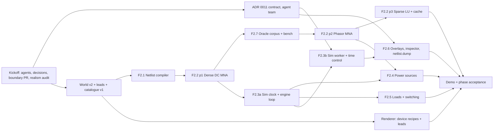

# Phase 2: Circuit engine and power sources ("First light")

**Release:** v0.3.0 · **Status:** 🚧 Kickoff in progress (2026-10-29) · **Spec:** [plan §6 P2](../controls-development-plan.md#p2--circuit-engine-and-power-sources-v030)

## Goal

The simulator exists and runs what is wired. `sim-core` compiles the as-built world into a netlist and solves it with DC and 60 Hz phasor MNA. A fixed 1 kHz sim clock drives the continuous and protection layers. P2's sources, loads and switching devices are modelled from cited sources. A sim worker publishes solved voltages and currents to the renderer through a `SharedArrayBuffer` snapshot. `sim-cli` runs the same engine headless, and the same seed and log give byte-identical snapshots. Hand-calculated golden fixtures, fast-check properties and an ngspice oracle corpus check correctness; `sim-cli bench` checks performance inside `pnpm verify`.

The player-facing proof is a battery, an SPST switch and an incandescent lamp on the workshop bench, joined by test leads, with the lamp's brightness following the solved power.

**Not in P2** (do not pull forward):

- the conductor catalogue, wire routing, `wire.*` commands, terminations, termination quality and conductor heating (P3; ADR 0010's "What P3 must build");
- the mouse terminal picker (P3);
- receptacles, 3-way switches, the load centre, GFCI/AFCI and grounding/bonding (P4);
- DMMs, clamp meters, faults and difficulty gating (P5);
- the relay discrete layer, three-phase panelboards and control transformers (P6);
- motors (P7).

## Phase acceptance

- [ ] Hand-calculated golden fixtures agree with `sim-core` within **0.5 %**. Most linear ones are much tighter; each fixture states its tolerance. The ngspice oracle corpus passes at the tolerance fixed in ADR 0012.
- [ ] The §4.5 budgets are met and enforced by `sim-cli bench` inside `pnpm verify`:
  - a seeded synthetic 2,000-node plant re-solves in under 2 ms after a topology change;
  - discrete + continuous + protection work stays under 0.3 ms per tick.
- [ ] **Determinism.** Each of these gives byte-identical snapshots:
  - the same seed and log run twice headless;
  - a replay of that log;
  - the sim worker in Chromium (web harness) compared with `sim-cli` in Node.

  Also, saving at tick T, loading and advancing to T2 gives the same `world.hash` and snapshot as running straight to T2.

- [ ] **In-game demo.** In the workshop, a battery, an SPST switch and an incandescent lamp sit on the bench, joined by test leads. Closing the switch lights the lamp; opening it puts the lamp out. The lamp's brightness follows the solved light output, and the current trace shows the cold-filament inrush.
  - `apps/game-e2e` drives the demo with the console and the keyboard.
  - `apps/sim-cli/scenarios/bench-lamp.console` reaches the same pinned hashes.
  - A manual WebGPU check on a real GPU confirms the lamp and the overlays (a P1 follow-up).
- [ ] Every new device model and electrical constant has a `source`, and an `electrical-realism-reviewer` sign-off is recorded in its PR.
- [ ] `pnpm verify` is green on all three OSes. Every new dependency, and any adapted MIT/BSD code, has a `THIRD_PARTY_NOTICES.md` row.

## Kickoff (before F2.x PRs)

1. [x] Create the P2 specialists from plan §10.2: `sim-engine-engineer` and the read-only `electrical-realism-reviewer` (`.claude/agents/`).
   - **Routing:** the main agent keeps `commands` and `world-model`. `sim-engine-engineer` owns `sim-core`, `sim-protocol`, `sim-worker`, the sim-facing scripting API (`probe`, `advance`, sim events) and `sim-cli bench`. `save-format-guardian` still reviews world ops and command args.
   - The `CLAUDE.md` routing table is updated to match.
2. [x] The user answered the kickoff decisions (below, 2026-10-29). The spec is amended to v1.3: §4.3 now sends commands to the worker by `postMessage`, and §6 P2 makes the oracle a checked-in corpus.
3. [x] **Agent-team contract** (ADR 0011). It comes before F2.3b and before any renderer or UI code reads sim output. This is one of the planned agent-team cases (`CLAUDE.md`).

   **Done (2026-10-29):** [ADR 0011](../docs/decisions/0011-sim-worker-contract.md) is accepted after review by `renderer-engineer`, `angular-ui-engineer`, `electron-platform-engineer` and `save-format-guardian`, with the user's decisions D7 and D8 below and the main agent's rulings on three conflicts: saving while crashed is refused, there is no `sim.pause` (`P` toggles `sim.setSpeed {speed: 0}` and `sim.resume`), and load verification runs in the worker rather than on the main thread. It fixes the SAB layout (with an island `u8 band`), the seqlock reader woken by `Atomics.waitAsync`, the descriptor and its netlist guarantees, the asynchronous hash and save paths in the game (with a `TimeHost` driving `sim.step`), the crash and watchdog model, the time commands, chords and context keys, and the `desktop-e2e` checks. Its requirements on world v2 are listed in the world v2 PR's section below; the measurements it leaves to F2.3b are in its "Deferred to implementation" list.

   **The team:**
   - `sim-engine-engineer` (lead);
   - `renderer-engineer` and `angular-ui-engineer` (consumers);
   - `electron-platform-engineer` (the worker under `app://`, COOP/COEP, CSP);
   - `save-format-guardian` (anything persisted).

   **The ADR must pin down:**
   - **Ownership and threads.** D1: the main thread owns the world bus, the world document and the clock, and the worker follows deterministically. A command's `run` **never reads sim-owned state** (tripped, blown, state of charge). Commands record intent and the sim resolves the effect at the command's tick, so `exec` stays synchronous and replay stays exact.
   - **Clock:**
     - 1 tick = 1 ms of sim time, as an integer;
     - speeds 0 (pause), 1×, 10× and 60×, plus `sim.step {ticks}` while paused;
     - pacing picks an integer target tick from wall time, capped at the worker's progress plus a fixed maximum lead, so there is no catch-up spiral;
     - the effective speed is reported when it falls below the requested speed;
     - wall-clock reads happen only in the pacing module (UI or worker code), never in `sim-core`.
   - **Time and undo:**
     - time passing is not a command and never touches the undo or redo stacks;
     - `CommandBus.advanceTo(tick)` moves the state's tick without logging;
     - every change's `apply`/`invert` preserves `tick` (a property test);
     - "undo everything returns the initial hash" is restated for sessions where no time passed;
     - `replayEntries` advances the engine to each entry's tick instead of reporting `tick-mismatch`, then advances to the log's end tick, so v1 logs (all at tick 0) replay as before.
   - **Command flow.** Committed world commands reach the worker by `postMessage`, carrying their tick and `seq`. The worker applies each one exactly at its tick, before stepping that tick. Sim-originated events (`tripped`, `blown`, `hiccup`, `nonConverged`, `singular`) come back with their tick, for the HUD, notifications and `game.on('sim')`.
   - **Snapshot layout** (`SIM_PROTOCOL_VERSION`):
     - a header: magic, layout version, an `Int32` publish `seq` for `Atomics`, the latest slot index, tick, topology generation and counts;
     - double-buffered slots (§4.3), each guarded by a seqlock: the slot is odd while being written, and a reader retries, then falls back to the other slot;
     - per slot: node voltages and branch currents (`re` and `im`, `Float64`), the island table, and fixed-width per-device output records;
     - each island entry: its kind (DC, AC or empty), reference node, `singular`/`nonConverged` flags and outer-loop iterations;
     - device records, for example lamp `{ powerW, lightOutputRel, filamentTempK }`, fuse `{ state, meltFraction }`, breaker `{ state, thermalFraction }`, supply `{ mode }`;
     - **no wall-clock timings in the hashed bytes:** solve-time diagnostics go in a separate, unhashed area.
   - **Topology descriptor.** It is sent once per topology generation by `postMessage` and maps:
     - node index → member `(entityId, terminalId)` pairs;
     - branch index → element (entity or lead id) and its end nodes;
     - device-record index → entity id and output schema.

     Readers join on the generation number and ignore slots from another generation.

   - **Publish cadence.** A snapshot is published after every electrical solve (by default every 10 ticks, matching §4.5's 10–20 ms) and on every topology change, not on every tick.
   - **Fallback.** Without `crossOriginIsolated`, the same bytes in the same layout go by transferable `postMessage` through the same codec (§4.3). This is tested with `?sab=0`.
   - **Renderer reads:**
     - `SnapshotReader.latest()` returns a typed view that stays valid until the next read, with no allocation per frame;
     - the renderer draws on demand (rendering caveats), so a new `seq` calls `invalidate()` only when a drawn value moves by more than its display step: 1/255 for lamp intensity, or one colour bin for overlays;
     - Angular panels sample at 10–30 Hz into signals (§4.1).
   - **Lamp brightness and overlays:**
     - the device model publishes `lightOutputRel`, which is physics-derived and reviewed;
     - the renderer maps it to emissive intensity through a documented display curve (a game-design choice);
     - voltage overlays colour by |V| against the island's reference node: ground for grounded islands, the most negative source terminal for floating DC islands;
     - the renderer never computes an electrical quantity.
   - **Lifecycle:**
     - there is one worker per game;
     - it is restarted on `Session.newSandbox`/`adopt` and terminated on teardown (a disposal test);
     - if the worker crashes, the sim pauses with a notification and the world is left intact;
     - a save asks the worker for sim state at the save tick.
   - **Headless parity.** `sim-cli` runs the same `sim-core` engine and codec in-process. A worker snapshot and a `sim-cli` snapshot of the same log are byte-identical.

4. [x] `release-engineer` re-checks versions and licences, and records what it checked and where:
   - **ngspice:** the version used for the oracle and the licence of that exact build, including whether KLU (LGPL) is linked;
   - **eecircuit-engine, `@spice-ts/core` and brownout,** if any is used or adapted: the research doc (2026-10-26) says v1.9.0, v0.4.0 and v0.6.5, all MIT; verify;
   - **fast-check:** `^4.10.2` in `package.json`.

   `electron-platform-engineer` confirms, on Electron 45 and in the web harness:
   - module Web Workers bundle with `@angular/build` (`new Worker(new URL(…, import.meta.url), { type: 'module' })`) from a lib path;
   - the worker loads from `app://` with COOP/COEP and the current CSP (`worker-src 'self' blob:`);
   - `crossOriginIsolated` is true inside the worker.

   _Done 2026-10-29._
   - **ngspice 47** (2026-08-11): the core is Modified BSD, but numparam (LGPL) is always compiled in. The Fedora, Homebrew, Ubuntu and Windows builds all link KLU (LGPL), and some add readline (GPL-3), libsndfile (LGPL) or the `table.cm` plugin (GPL).
     - So ADR 0003 now has an exception for external programs that developers run and whose numeric outputs alone are checked in.
     - Each deck sets `.options sparse`, so the results don't depend on whether a build has KLU.
     - Installs for the guide: Fedora `dnf` (47), Homebrew (47), Scoop `extras/ngspice` or the official `ngspice-47_64.7z` extracted to `C:\Spice64`. Not Ubuntu 24.04's apt, which has 42.
   - **eecircuit-engine 1.9.0:** the MIT licence covers only the wrapper. Its WASM bundles KLU and numparam (LGPL) without notices. It stays rejected (D5).
   - **@spice-ts/core 0.4.0:** MIT, but there is no git tag for 0.4.0, so pin a commit SHA if any of it is adapted.
   - **brownout 0.6.5:** MIT. Its AMD follows SuiteSparse AMD (BSD-3), so adapting it means notices rows for both.
   - **fast-check 4.10.2:** current.
   - **Stay reference-only:** klu-js, SuiteSparse KLU, BTF and CSparse (all LGPL), and the code listings in Davis's book. SuiteSparse `AMD/` and `COLAMD/` are BSD-3, so they may be read.
   - **Citations confirmed:** Gilbert–Peierls 1988 (doi:10.1137/0909058); Amestoy–Davis–Duff 1996 (doi:10.1137/S0895479894278952) and 2004 (doi:10.1145/1024074.1024081).
   - **Module worker check** (`electron-platform-engineer`, a throwaway spike): passed in the web harness, under `app://` in the dev build, and in the packaged app.
     - `crossOriginIsolated` is true in the page and the worker, and a `SharedArrayBuffer` is really shared.
     - The CSP needs no change: `worker-src 'self'` covers the worker, and the CSP is enforced inside it.

     Gotchas for F2.3b:
     - **The constructor must be literal.** `@angular/build` only rewrites a literal `new Worker(new URL('…', import.meta.url), { type: 'module' })`, so keep it in one factory module provided by the app (features can't import `sim-worker`).
     - **The worker isn't type-checked by the game build.** `sim-worker` has its own typecheck target.
     - **A CSP violation already happens on every start.** Zod's eval probe triggers one; `z.config({ jitless: true })` fixes it.
     - **Worker violations are only visible inside the worker.** They fire on the worker's own scope, so tests need a listener there.
     - **Playwright can see the worker.** `page.workers()` works on both the `_electron` and CDP launch paths.

5. [ ] **World document v2 and minimal connectivity PR** (`save-format-guardian`; see its section below). It lands before F2.1 reads connections.
6. [x] **Boundary and gate hardening PR** (`test-engineer`). Each rule is proven to fire, as in P1:
   - new libs `libs/domain/sim-core`, `libs/domain/sim-protocol` and `libs/domain/catalog`, all `type:domain`;
   - `libs/sim-worker` with a new `type:worker` tag that may depend only on `type:domain`;
   - `type:rendering` and `type:feature` read snapshot types from `@controls/sim-protocol`, never from `sim-worker`;
   - the determinism lint extended to `libs/sim-worker`, except its pacing module;
   - the D6 lint banning `Math.exp|log|pow|sin|cos|tan|atan2|hypot|cbrt` and `**` in `sim-core`;
   - an Nx `bench` target on `apps/sim-cli`, added to the `verify` script's `run-many` list. It runs the built bundle, outside coverage instrumentation, because domain tests always run with coverage (`libs/domain/vitest.domain.mts`) and that distorts timings.
7. [x] **First audit by `electrical-realism-reviewer`** of P1's sourced non-electrical constants: the snap constants in `libs/domain/world-model/src/lib/snap/constants.ts`, `FIXTURE_SPECS` and the prop sizes. The P1 kickoff decisions and the rendering caveats promised this. Findings are fixed in a small PR, and any value change that moves a golden hash gets a CHANGELOG note.

   _Done 2026-10-29: approved with notes, no hard fails. All 21 sourced items check out against public data, and there is no NEC text, table value or real vendor name. The wording fixes (DIN module pitch scope, the 27 mm crown dimension, the IEC 60715 edition, plywood thickness, walking pace) landed without moving any hash. Unverified: the 27 mm crown width against the IEC 60715 annex, and whether PS 20-20 is still the current edition._

## Kickoff decisions (2026-10-29)

The user chose the recommended option for D1, D2, D3 and D5, and accepted the recommendations for D4 and D6. D7 and D8 were decided in the ADR 0011 review.

- **D1 Thread and ownership.** The main-thread bus, world and clock stay authoritative, and the worker follows deterministically. `Session.exec` stays synchronous, so every P1 surface is unchanged. Commands reach the worker by `postMessage` with their tick; spec §4.3 is amended, because commands are rare and don't need a ring buffer. _Rejected:_ moving the whole game into the worker (a rewrite of every P1 surface), and a worker-owned clock (unreliable `ctx.tick`).
- **D2 Minimal P2 connectivity: test leads.**
  - **What a lead is:** a persisted, two-ended connection between device terminals.
  - **How:** made with `lead.connect` / `lead.disconnect` from the palette, console and scripts, and drawn as a simple sagging line.
  - **Not in P2:** routing, gauge choice, terminations and the mouse terminal picker (all P3).
  - **In P3:** `wire.*` arrives alongside leads, not in place of them, because leads stay useful for bench work and P5's meters.

  _Rejected:_ pre-wired assemblies in level data (the player couldn't wire anything), and bringing a minimal `wire.add` forward (it would commit P3's argument shape before routing is designed, which ADR 0010 warns against).

- **D3 One world `schemaVersion` 2 for the phase.** It adds:
  - `connections` (the leads);
  - a generic entity `state` bag of named finite values, validated by the device model, so new device kinds never need a schema bump;
  - `endTick` on the replay log.

  Sim state is included in `world.hash`, and every golden hash is re-pinned once. _Rejected:_ connections only (a tripped breaker would load closed, and a save made mid-sim would never replay to the same hash), and a separate v3 for sim state (two migrations in one phase).

- **D4 Device data: a minimal catalogue v1 now.** It lives in `libs/domain/catalog`, with entries in `content/devices/*.json` and `catalogVersion` 1. Each entry gives identity, a fictional brand and model, terminals (id, label, local position), the model kind, parameters and `sources`. `prop.*` stays built-in. It gives the realism reviewer one place to audit, and `content-designer` (P3) inherits it. _Rejected:_ device specs built into code, which P3 would have to migrate.
- **D5 Oracle: a checked-in ngspice corpus.**
  - **The corpus:** seeded random decks plus ngspice results, with the ngspice version and options in a header.
  - **In `pnpm verify`:** a staleness test regenerates the decks from the seeds and checks they match byte for byte. This follows the JSON Schema export precedent.
  - **Regenerating:** `pnpm sim oracle regen` needs ngspice installed and is never part of `verify`. So `verify` stays hermetic on all three OSes, and the ngspice build's licence never enters the dependency tree.
  - **Spec:** §6 P2 is amended.

  _Rejected:_ eecircuit-engine (ngspice in WASM) running live in `verify` (about 43 MB, unverified under Node 24, and its KLU linkage is LGPL), and a system ngspice in CI (no verified Windows install, and a CI-only check).

- **D6 Cross-runtime float determinism.** `sim-core` uses only IEEE-exact operations plus its own `dmath` for exp, log and pow, enforced by lint, and fixed phasor angles come from `sqrt`. A Node-vs-Chromium snapshot golden in `game-e2e` is the tripwire. Node 24's V8 and Electron's Chromium V8 are different builds, and `docs/caveats/commands.md` already treats `Math.sin`/`Math.cbrt` as engine-dependent. ADR 0014 records it.

- **D7 A hidden or minimised window suspends the sim** (ADR 0011 review, U1). It is host-side state in `SimHost`, not a logged `sim.pause`: pacing stops on `visibilitychange` and re-anchors at the player's speed when the window is visible again. "Falling behind" and the effective-speed windows are held, `sim.step` still works, and `backgroundThrottling` stays at its default. The web harness behaves the same. Running in the background may become a setting later. _Rejected:_ letting throttled timers slow the sim, and `backgroundThrottling: false`.
- **D8 Engine changes don't break old saves** (ADR 0011 review, U2). `ManifestV2.simEngineVersion` is bumped whenever snapshot or world goldens are re-pinned for numeric reasons. A save whose `simEngineVersion` or `catalogVersion` differs from the build's skips log verification and loads `world.json` as saved with a new log (`replay.status: 'restarted'`, reason `engine-changed`), which `REPLAY_MISMATCH_POLICY` never refuses. _Rejected:_ refusing such saves.

The spec also settles one point: the sim worker is a **module Web Worker** in the renderer (§4.3, ADR 0002). A `utilityProcess` can't share a `SharedArrayBuffer` with the renderer and doesn't exist in the web harness. `sim-cli` runs the engine in-process.

**Corrections to the research doc** (`docs/research/2026-10-circuit-simulation.md`), which stays unedited per the research rule:

- its §3 (Layer B) quotes NEC Chapter 9 conductor-resistance values, which ADR 0003 forbids; P2 computes resistance from resistivity;
- it gives IEC 60898 breaker figures (1.13 In / 1.45 In) for an NEC-first game; P2 uses NEC-region manufacturer-style data;
- it lists klu-js, and possibly eecircuit-engine's KLU build, which are LGPL and therefore reference-only.

All three are hard fails for the realism reviewer.

## Build order

One feature per PR. F2.2 lands in three parts, like F1.8b did. F2.3 is split into two:

- **F2.3a**, the headless clock and engine loop: pure domain code that unblocks every device model and the `sim-cli` tests;
- **F2.3b**, the worker transport: the agent-team contract.

The two halves have different owners and reviewers, and share no code beyond ADR 0011. Keeping them together would hold the device work hostage to Electron and Angular integration.

- **Domain track** (`sim-engine-engineer`, the critical path): world v2 → F2.1 → F2.2 part 1 → F2.7 → F2.2 parts 2 and 3. F2.3a starts after F2.2 part 1. F2.4 and F2.5 run in parallel after F2.3a; the utility and three-phase sources also need F2.2 part 2.
- **Transport track** (the agent team): ADR 0011 → F2.3b. It can start against a stub engine that only advances the tick, using the frozen layout, and integrates with F2.3a once that has merged.
- **Renderer and UI track:**
  - device recipes and lead drawing start once world v2 lands;
  - F2.6's overlays and inspector are built against fake snapshots generated by the codec, then integrated after F2.3b;
  - the time-control HUD ships in F2.3b.
- **Integration:** the bench demo, then the phase-acceptance E2E, then the manual WebGPU check.

## Features

### Kickoff PR: World document v2 and minimal connectivity (decisions D2–D4)

Not a spec feature. It is the persisted contract every P2 feature builds on; P1's boundary hardening PR is the precedent. **Owner:** `save-format-guardian`. The main agent writes the `world-model` commands. `sim-engine-engineer` reviews the device-state shape and `electrical-realism-reviewer` reviews catalogue values.

Acceptance:

- [ ] `v2/world.ts`, `v2/manifest.ts` and `v2/replay-log.ts`, with a total v1 → v2 migration. There is one `schemaVersion` for the whole save, so documents that don't change get identity steps. v1 files and fixtures are untouched.
  - **`WorldV2.connections`:** strict objects sorted by id. Each is `{ id, ref: CatalogRef (lead type), a: TerminalRef, b: TerminalRef, extensions }`, where `TerminalRef` is `{ entity, terminal }`. ADR 0013 records the id allocation rule.
  - **`EntityV2.state`:** a strict record of named finite numbers, booleans or short enum strings. Absent values are `null`, never optional. It is validated by the device model's own state schema when the world loads, so a new device kind never needs a world `schemaVersion` bump.
  - **`ReplayLogV2.endTick`.**
- [ ] Fixtures in `fixtures/v2/{world,manifest,replay-log,ctrl}`. Every v1 fixture migrates and validates. A fast-check round-trip property covers v2 (both JSON and the container), and `*.v2.schema.json` JSON Schema is exported with a staleness check.
- [ ] `content/levels/workshop.json` is rewritten as v2 in canonical form (`levels.spec.ts`). Every pinned golden hash is re-pinned in one change, and the CHANGELOG says so:
  - `WORKSHOP_HASH`, `FOUR_SURFACE_HASH`, `PHASE_ACCEPTANCE_HASH`, `PALETTE_PLACE_UNDO_HASH`, `CONSOLE_PLACE_UNDO_HASH`;
  - the Node and Chromium hash goldens.
- [ ] Commands in `world-model`. Their ids and argument shapes are save format, so `save-format-guardian` reviews them:
  - `lead.connect {ref, a, b}`: undoable. It refuses unknown entities, unknown terminals, `a == b` and duplicate leads.
  - `lead.disconnect {id}`: undoable, and undo restores the same id.
  - `device.operate {id, control, value}`: undoable, and checked against the device's controls in `run`. It **never reads sim-owned state** (ADR 0011).
- [ ] Catalogue v1:
  - `@controls/catalog` holds the device-definition Zod schema: identity, fictional brand and model, category, terminals `{ id, label, positionMm }`, model `{ kind, params }`, controls and `sources[]`.
  - `content/devices/*.json` holds the P2 devices plus one test-lead type. Lead resistance is computed from resistivity × length ÷ area with a temperature coefficient, never taken from NEC tables.
  - `catalogVersion` 1 goes in the manifest and in `docs/history.md`.
- [ ] **Requirements from [ADR 0011](../docs/decisions/0011-sim-worker-contract.md)** (its Consequences give the detail; ADR 0013 records them):
  - two state bags: `EntityV2.state` (commanded) and `EntityV2.sim` (sim-owned, written only by `materialiseWorld`), with keys matching `^[a-z][a-zA-Z0-9]*$` (at most 64 characters) and enum strings `SafeString` (at most 32); a property test that every change preserves each `sim` bag except on insert and remove;
  - `MODEL_KINDS` in `@controls/catalog` (owner, Zod schema and initial value per key): a new kind is no bump, changing a kind's keys is a `schemaVersion` bump; load checks both bags against it, with a new `invalid-device-state` load error;
  - `WorldV2.sim: { lastSolveTick, topologyHash, nodes, branches, islands: { flags, iterations }[] } | null`, in `world.hash`; `-0` normalised and finite numbers only, with an `Object.is` round-trip property;
  - `ReplayLogV2.firstSeq` (`entries[i].seq === firstSeq + i`) and `endTick` (`endTick ≥ last entry tick ≥ initialWorld.tick`; lower is refused);
  - `ManifestV2.simEngineVersion: Int` (D8);
  - staleness-checked JSON Schema exports for `device-state.<kind>` and every logged command's arguments, including `sim.setSpeed`, `sim.resume` and `sim.step` (`MAX_STEP_TICKS` 600 000);
  - the v1 → v2 migration (`state: {}`, `sim: {}`, `connections: []`, `sim: null`, `firstSeq: 0`, `endTick: max(initialWorld.tick, last entry tick)`) and the fixtures listed in the ADR.

  The `EntityV2.state` bullet above is superseded by the two bags.

- [ ] Rebasing a replay log works: a test shows a log rebased onto a mid-session v2 world, sim state included, replays to the same hash. This is the groundwork for the P1 follow-up "the replay log never shrinks".
- [ ] Palette forms render every new command (the every-command spec). Console lines and a TS script can connect a lead and operate a switch.

### F2.1 Netlist compiler

`libs/domain/sim-core` (`@controls/sim-core`, `type:domain`), in `netlist/`. **Owner:** `sim-engine-engineer`. Reviewers: `save-format-guardian` (what it reads from the world) and `test-engineer` (properties).

Acceptance:

- [ ] `compileNetlist(world, catalog)` is a pure function. It turns entities, catalogue terminals, `connections` and commanded device state into nodes, branches, elements and islands.
- [ ] Union-find merges ideal connections only: a closed switch, and terminals the device joins internally. Leads are resistive branches: R comes from the catalogue derivation, plus a sourced contact resistance at each end. An open switch drops its branch.
- [ ] **Wired, not drawn.** A device placed touching a battery but not connected to it carries no current and sits at 0 V. When an entity is deleted, the deleting command's change removes its leads; they are never left in the world to be silently compiled.
- [ ] **Deterministic numbering.** Each node is numbered by its smallest `(entityId, terminalId)` member in code-unit order. Property: permuting the input order of entities and connections gives an identical netlist.
- [ ] **`topologyHash`:** SHA-256 (the pure implementation in `world-model`) over the canonical structure (the partition, branch ends and element kinds), excluding parameter values. Properties:
  - structurally equal netlists hash equally;
  - toggling a switch changes the hash;
  - changing only a value, such as a bench-supply setpoint, does not.
- [ ] **Incremental recompile** on connect, disconnect, operate and sim topology events (trip, blow) equals a from-scratch compile. This is checked with fast-check over random edit sequences on random bench circuits.
- [ ] **Islands** are connected components, each classified `dc`, `ac` or `empty`. A `mixed` island is reported as a diagnostic, since P2 has no converters.
- [ ] `formatNetlist(netlist)` gives deterministic text, used by F2.6's `netlist.dump`. Coverage is at least 90 %.

### F2.2 DC and phasor MNA solvers

`sim-core`, in `mna/` and `lu/`. **Owner:** `sim-engine-engineer`, with `test-engineer` for the property tests. It lands in three parts.

Acceptance, **part 1: dense DC**:

- [ ] Real MNA with the ground node eliminated. Stamps: resistor, voltage source with internal resistance, and current source.
- [ ] `gmin` from every node to ground. Its value has a `source` explaining its numerical role; it is not an electrical rating.
- [ ] Dense LU with partial pivoting on preallocated `Float64Array`s. A singular island is flagged `singular` and never produces NaN.
- [ ] **Golden fixtures,** each with its derivation written in the fixture file: a divider, a Wheatstone bridge, a battery with internal R into a load, two unequal batteries in parallel, and a floating island under `gmin`.
- [ ] **fast-check properties:**
  - KCL holds at every node within `1e-9 · max|I| + 1e-12 A`;
  - source power equals dissipated power, `gmin` losses included, within `1e-9` relative;
  - linearity and superposition hold.

Acceptance, **part 2: complex phasor** (needs F2.7):

- [ ] Interleaved complex MNA for AC islands at the region frequency. P2 adds the `RegionProfile` type with its electrical fields (`frequencyHz` 60 and the nominal voltages), each with a `source`, and brings it to `electrical-realism-reviewer`. P1 never created the type: only `RegionId` exists (`save-format` `primitives.ts`), as the kickoff realism audit found.
- [ ] Complex R, L and C impedance stamps, and phasor sources whose angles are exact constants: 0°, 180° and ±120° (from `cos = -0.5` and `sin = sqrt(3)/2`).
- [ ] **Golden fixtures:**
  - an unbalanced 120/240 split-phase load, where the neutral current is the phasor sum of the line currents;
  - a balanced wye load, where the neutral current is about 0;
  - a series RL circuit at 60 Hz.
- [ ] The AC oracle corpus passes.

Acceptance, **part 3: sparse, cache and nonlinear loop**:

- [ ] Gilbert–Peierls sparse LU in CSC with AMD ordering, reimplemented from the published papers. MIT spice-ts or brownout code may be adapted only with a `THIRD_PARTY_NOTICES.md` row and an origin comment.
- [ ] Above a threshold (§4.5 says about 300 unknowns; the bench confirms the crossover), dense and sparse results agree within `1e-9` relative on random systems (property test).
- [ ] **Factorisation cache** keyed by `topologyHash`:
  - the symbolic factorisation is reused when only values change;
  - a fixed-size LRU evicts deterministically and never changes results;
  - a counter proves that returning to a previous switch state hits the cache.
- [ ] **Outer loop for nonlinear loads** (lamp R(T), CV/CC supply). It is warm-started, has an iteration cap and damping, and raises the island's `nonConverged` flag when it doesn't converge. A property test bounds the iterations on random bench circuits.
- [ ] The 2,000-node re-solve case of `sim-cli bench` passes inside `pnpm verify`.

### F2.3a Sim clock and engine loop (headless)

`sim-core` in `engine/`, plus `@controls/commands` (`advanceTo` and replay advancing) and `@controls/scripting-api`. **Owner:** `sim-engine-engineer`. Reviewers: `save-format-guardian` (replay semantics and sim state in saves) and `test-engineer` (the determinism harness).

Acceptance:

- [ ] **`SimEngine.advanceTo(tick)`** steps at a fixed 1 tick = 1 ms. Each tick runs the layers in a fixed order:
  - discrete (empty in P2; P6 fills it);
  - continuous (filament temperature, battery state of charge);
  - protection (fuse I²t, breaker thermal and magnetic, PSU hiccup).

  The electrical layer runs on every topology change and every 10 ticks. A protection trip changes the topology and is re-solved within the same tick.

- [ ] No per-tick allocation in the hot path: struct-of-arrays, preallocated. Per-device tolerances come from `deriveStream(world.seed, entityStreamKey(id))`.
- [ ] **`CommandBus.advanceTo(tick)`:** unlogged, with no history change. A property test shows every world change's `apply`/`invert` preserves `tick`.
- [ ] **`replayEntries`** advances the engine to each entry's tick, then to `endTick`. v1 logs replay unchanged (a property test on the P1 fixtures). A `tick` lower than the current one is still an error.
- [ ] **Scripting API:**
  - `game.advance(ticks)` and `game.advanceTo(tick)`;
  - `game.probe(a, b)`, now implemented: an **ideal, non-loading** voltage difference between two terminals, given as `"<entityId>:<terminalId>"`. It returns DC volts, or AC RMS and phase. It is a script and test query, not a player instrument (DMMs are P5). `NotAvailableError` stays for `tag` (P10);
  - `game.snapshot()` (codec bytes) and `game.on('sim')`.
- [ ] **Sim commands.** `sim.step {ticks}`, `sim.setSpeed {speed: 0|1|10|60}` and `sim.pause` are declared in domain code; they are logged and don't change the world. A headless host implements `sim.step` by advancing, so a `.console` file can step time both in `sim-cli` and in the game.
- [ ] **Determinism:**
  - the same seed and log give byte-identical snapshots over 10 s of sim time on the bench demo, across two runs and a replay;
  - saving at T, loading and advancing to T2 equals an uninterrupted run (property test);
  - D6's Node-vs-Chromium snapshot golden: `apps/game-e2e` runs the engine in the page, `sim-cli` runs it in Node, and the bytes match.

### F2.3b Sim worker, snapshot transport and time control

Two libs and a host:

- `libs/domain/sim-protocol` (`@controls/sim-protocol`, `type:domain`): the layout, the codec, the seqlock reader and writer over `SharedArrayBuffer`/`Atomics` (ECMAScript, so allowed in domain code) and the Zod message schemas;
- `libs/sim-worker` (`type:worker`): the worker entry and pacing;
- a `SimHost` in `feature-session` on the main thread.

**Owners:** `sim-engine-engineer` (protocol, worker), `angular-ui-engineer` (`SimHost`, HUD, time controls) and `electron-platform-engineer` (the worker under `app://`, `desktop-e2e`). This is the agent-team feature; ADR 0011 is its contract.

Acceptance:

- [ ] The layout and protocol match ADR 0011. The worker checks `SIM_PROTOCOL_VERSION` when it starts and refuses a mismatch.
- [ ] **Codec property tests:**
  - a snapshot round-trips;
  - a torn read is detected and retried (with a simulated concurrent writer);
  - the `postMessage` fallback gives identical bytes.
- [ ] **`SimHost`:**
  - starts one worker per game and forwards each committed world command with its tick;
  - paces with integer targets capped by the worker's progress, so 60× degrades to the achievable speed with an indicator;
  - terminates the worker on new game, load and teardown (disposal test);
  - on a worker crash, pauses with a notification and leaves the world intact.
- [ ] Time control works from keybindings, the palette and the console. The default chords are conflict-free (checked by the existing keymap specs). The HUD shows sim time and the requested and effective speeds, with an `aria-live` "falling behind" notice.
- [ ] **E2E:**
  - the web harness runs `bench-lamp.console` and its snapshot hash equals `sim-cli`'s pinned golden;
  - with `?sab=0` (the fallback), the hash is the same;
  - `desktop-e2e` shows the worker running under `app://`, with `crossOriginIsolated === true` inside it and no `securitypolicyviolation`.
- [ ] The main-thread cost of reading a snapshot each frame is measured and recorded in the rendering architecture page.

### F2.4 Power sources

`sim-core` in `devices/sources/`, with catalogue entries in `content/devices/`. **Owner:** `sim-engine-engineer`, with `renderer-engineer` for the placeable recipes. `electrical-realism-reviewer` signs off every model and constant.

Acceptance:

- [ ] **Battery:**
  - EMF as a function of state of charge, from a sourced chemistry, under a fictional brand;
  - internal resistance;
  - state of charge, coulomb-counted, kept in entity `state`.

  Golden fixtures:
  - terminal voltage = EMF − I·R within 0.5 %;
  - over one hour of sim time (headless `advance`), state of charge falls by ∫I dt ÷ capacity within 0.5 %.

- [ ] **Bench DC supply:**
  - `device.operate` controls for the voltage setpoint, the current limit and output on/off;
  - constant-voltage/constant-current crossover at R = V/I within 0.5 %, and a property test that it never exceeds either setpoint beyond its tolerance;
  - its mode is published in the device record, with no mode chatter at the crossover (tested).
- [ ] **DIN 24 VDC PSU:**
  - current limit with hiccup mode: overload for t_detect, off for t_off, then retry, with tick-exact timing;
  - a short circuit gives a periodic hiccup at the documented period ±1 tick;
  - values come from typical published behaviour, attributed to a fictional model.
- [ ] **Utility service, 120/240 split-phase:**
  - L1, L2 and N as separate conductor nodes;
  - behind a source impedance derived from the transformer's kVA and %Z, using sourced typical values;
  - golden: the available bolted fault current at the service is V/|Z| within 0.5 %.

  **Headless only in P2**; the service entrance and load centre are P4.

- [ ] **Three-phase 208Y/120 and 480Y/277.** Golden fixtures: line-to-line = √3 × line-to-neutral (via `sqrt`), and a balanced load's neutral current is about 0. **Headless only**; gameplay is P6.
- [ ] **Portable generator (stub):** a registered model with nameplate EMF and source impedance, and no engine dynamics. Not placeable, and documented as a stub; generators and transfer switches are in the backlog.
- [ ] The battery, bench supply and DIN PSU can be placed on the bench, with procedural recipes and scene-graph snapshots. Their labels use fictional brands.

### F2.5 First loads and switching

`sim-core` in `devices/loads/` and `devices/protection/`. **Owner:** `sim-engine-engineer`, with `renderer-engineer` (lamp emissive, switch and lamp-holder recipes) and `angular-ui-engineer` (operating the selected device from the keyboard). `electrical-realism-reviewer` signs off.

Acceptance:

- [ ] **Resistor:** R and a power rating. It publishes `overRated`, with no damage model in P2.
- [ ] **Heater:** rated watts at rated volts.
- [ ] **Incandescent lamp:**
  - filament R(T) with a thermal ODE: sourced tungsten resistivity against temperature, and a thermal time constant;
  - the cold-start inrush emerges from the model, with its peak ratio inside a sourced band;
  - `lightOutputRel` follows a sourced, published relation between light output and voltage or power.
- [ ] **SPST switch:** `device.operate {control: 'closed'}`. Closed merges its terminals; open drops the branch. It can be operated from the selected entity with the keyboard or a mouse click, the palette, the console and a script, each logging one command.
- [ ] **Fuse:**
  - blows when ∫I²dt reaches the melting I²t, from a sourced, fictional datasheet;
  - blowing changes the topology and re-solves in the same tick, raises a `blown` event and is persisted in `state`;
  - melt time at k × rating falls inside the sourced band;
  - replacing a fuse in P2 means deleting it and placing a new one.
- [ ] **Basic thermal-magnetic breaker** (single-pole, standalone, no panel):
  - thermal state `dθ/dt = ((I/In)² − θ)/τ`, plus a magnetic band seeded per entity id so it is reproducible;
  - trip times at multiples of In fall inside the cited band, from NEC-region manufacturer-style data, not IEC 60898 figures;
  - after a trip, the handle must go off and then on again.
- [ ] **Bench demo** (`apps/sim-cli/scenarios/bench-lamp.console` and `.ts`, starting from the workshop):
  - place the battery, switch and lamp, connect three leads, close the switch and advance;
  - `lightOutputRel` lies inside its band, and opening the switch takes it to 0;
  - the snapshot and world hashes are pinned in the spec, the game-e2e driver and the scripting caveats, together.
- [ ] **Lamp rendering:** emissive intensity follows `lightOutputRel` through the documented display curve. The scene-graph snapshot records it, and a change calls `invalidate()`.

### F2.6 Debug tools

**Owners:** `renderer-engineer` (overlays), `angular-ui-engineer` (the inspector panel) and `sim-engine-engineer` (`netlist.dump` and the topology descriptor).

Acceptance:

- [ ] `view.overlay {name: 'voltage' | 'current', on}` is a view command: logged, with no world change, and `when: console.available` (sandbox and dev builds) until F5.3 adds difficulty gating.
- [ ] **Voltage overlay:** leads and terminals coloured by |V| against the island reference, on a fixed scale for each nominal band, with a legend.
- [ ] **Current overlay:** current animated along leads from |I|, showing direction for DC. AC shows magnitude only, which is a documented abstraction. With `prefers-reduced-motion`, the arrows are static.
- [ ] Frame time with both overlays on is measured on SwiftShader and on a real GPU, and recorded. Overlay resources pass the disposal test.
- [ ] **Netlist inspector:** a docked panel listing islands, nodes (with their member terminals) and branches, with live V and I at up to 10 Hz. It is keyboard-navigable, and selecting a node highlights its terminals in 3D (view state only).
- [ ] **`netlist.dump`:** a read-only console command, like `world.hash`. It prints `formatNetlist` plus the island diagnostics, gives the same text headless and in the game, and is golden-tested on the bench demo.
- [ ] **E2E:** the inspector's lamp-branch current equals the value derived from `game.probe`, within display rounding.

### F2.7 Oracle harness and performance gate

Per decision D5. **Owners:** `test-engineer` and `sim-engine-engineer`.

Acceptance:

- [ ] **A seeded random-circuit generator:** 2–30 nodes; R, V and I sources for DC; R, L, C and phasor V at 60 Hz for AC. It emits both a `sim-core` netlist and a SPICE deck from one intermediate representation.
- [ ] **A checked-in corpus** under `libs/domain/sim-core/oracle/`: the decks plus ngspice's results, with a header recording the ngspice version, its options (`gmin` matched to `sim-core`) and the seeds. ADR 0012 settles the size, targeting at least 500 DC and 500 AC circuits.
- [ ] **A staleness test:** regenerating the decks from the pinned seeds reproduces the checked-in decks byte for byte, as for the JSON Schema export. Any generator drift fails `pnpm verify`.
- [ ] **A comparison spec in `pnpm verify`** (`sim-core` against ngspice) at ADR 0012's tolerance: targeting at most 1e-6 relative with an absolute floor, and never looser than the 0.5 % golden bound.
- [ ] **`pnpm sim oracle regen`** regenerates the results. It needs ngspice installed (the guide has install notes for Linux, macOS and Windows) and is never part of `verify`.
- [ ] **`pnpm sim bench`,** also run as the Nx `bench` target in `verify`:
  - it covers a seeded synthetic 2,000-node plant (mostly radial, with some loops) and a per-tick mix of devices;
  - it warms up, then takes the median of N runs;
  - it outputs JSON and exits non-zero over budget;
  - it runs the built bundle, never under coverage instrumentation;
  - the re-solve case switches on with F2.2 part 3, and the per-tick case is on from F2.3a.

## ADRs to write in P2

| ADR  | Topic                                                                                                                    | Written in           |
| ---- | ------------------------------------------------------------------------------------------------------------------------ | -------------------- |
| 0011 | Sim worker contract: ownership, clock, time vs undo, command flow, snapshot layout, descriptor, fallback, renderer reads | Kickoff (agent team) |
| 0012 | Oracle strategy: corpus, regeneration, tolerance, ngspice version and licence                                            | Kickoff / F2.7       |
| 0013 | World document v2: connections, entity state, `endTick`, catalogue v1, replay advancing, hash scope                      | Kickoff world v2 PR  |
| 0014 | Deterministic maths in `sim-core`: the allowed operations, `dmath`, the lint rule, the cross-runtime golden              | F2.1                 |

Numbers are assigned in the order the ADRs land.

## Determinism and invariant hooks

- **Framework-free:** `sim-core`, `sim-protocol` and `catalog` are `type:domain` under `libs/domain/`, covered by the path-scoped lints. `sim-worker` is `type:worker` and depends only on domain libs. `sim-cli` proves it all runs headless.
- **Wired, not drawn:** the netlist is compiled only from `connections`, catalogue terminals and device state. Placement proximity means nothing, and a test says so.
- **One registry:** `lead.*`, `device.operate`, `sim.*`, `view.overlay` and `netlist.dump` all go through `@controls/commands`. Commands never read sim-owned state.
- **Determinism:**
  - integer ticks;
  - per-entity tolerances seeded from the world seed;
  - iteration in sorted order;
  - no wall clock outside the pacing module;
  - D6 maths;
  - byte-identical snapshots, within one runtime and across runtimes;
  - no solve timings in hashed bytes.
- **Saves:** v2 with a migration, fixtures and a round-trip property. Sim state is persisted, so a load continues exactly where the save left off.
- **Realism:** every constant has a `source`; no NEC text or tables (resistance comes from resistivity); fictional brands; reviewer sign-off.

## Docs to create or update (by `docs-keeper`, in each feature PR)

- **Architecture:**
  - new `docs/architecture/simulation.md`, with Mermaid diagrams of the netlist pipeline, the layers in each tick, the worker and snapshot data flow, and clock ownership;
  - `overview.md`: what P2 implements, and the module graph with `sim-protocol`, `sim-worker`, `catalog` and `type:worker`;
  - `world-and-saves.md` (v2), `scripting.md` (`probe`, `advance`, `sim.*`) and `rendering.md` (snapshot reading, overlays).
- **Caveats:**
  - new `docs/caveats/simulation.md` ("Load this when…": `sim-core`, `sim-protocol`, `sim-worker`, device models, bench, oracle), with rows in the caveats index and the `CLAUDE.md` table;
  - `commands.md`: `advanceTo`, replay advancing, and changes preserving the tick;
  - `save-format.md`: v2, entity state, and the persisted args of `lead.*`, `device.operate`, `sim.*` and `view.overlay`;
  - `scripting.md`: the new pinned hashes;
  - `rendering.md`: invalidating on a new snapshot.
- **Glossary:** MNA, phasor, island, `gmin`, union-find, topology hash, factorisation cache, snapshot, seqlock, topology descriptor, test lead, I²t, hiccup mode, CV/CC, inrush, oracle corpus, effective speed.
- **Guides:** the scripting guide gains a worked circuit example using `probe` and `advance`. A new `docs/guides/oracle.md` covers regenerating the corpus and installing ngspice on all three OSes.
- **Also:**
  - `docs/history.md`: `schemaVersion` 2, `catalogVersion` 1, and the P2 narrative at close-out;
  - `THIRD_PARTY_NOTICES.md` rows for adapted code or new dependencies;
  - README feature bullets and TODO;
  - CHANGELOG `[Unreleased]`;
  - `CLAUDE.md` routing and status;
  - `plans/README.md`.

## Risks

| Risk                                                                                                                                 | Mitigation                                                                                                                                                                                                                               |
| ------------------------------------------------------------------------------------------------------------------------------------ | ---------------------------------------------------------------------------------------------------------------------------------------------------------------------------------------------------------------------------------------- |
| The sim, worker and renderer disagree on the contract and churn it                                                                   | Agent-team ADR 0011 before any consumer code; `SIM_PROTOCOL_VERSION`; a codec in one domain lib that all three import; the renderer and UI develop against fake snapshots.                                                               |
| Cross-runtime float drift (Node 24's V8 vs Electron's Chromium V8) breaks save and replay parity                                     | D6: IEEE-exact operations plus `dmath`, enforced by lint; a Node-vs-Chromium snapshot golden as a tripwire; `loadGame` already restarts a diverging log rather than refusing the save.                                                   |
| `sim-cli bench` is flaky or over budget on shared CI runners (three OSes)                                                            | Built bundle, outside coverage; warm-up, then the median of N runs; report the margin on every run. If a runner can't meet the §4.5 budget, raise it with the user; never loosen it silently or skip it per OS (no CI-only differences). |
| Singular or ill-conditioned matrices                                                                                                 | Union-find merging, `gmin`, pivoting and a `singular` flag instead of NaN; fast-check fuzzing of random topologies.                                                                                                                      |
| The nonlinear outer loop oscillates (CV/CC flip-flop, lamp R(T))                                                                     | Damping, hysteresis, an iteration cap, the `nonConverged` flag, and a property test bounding the iterations.                                                                                                                             |
| Time passing interacts badly with undo                                                                                               | ADR 0011's rule: time passing is not a change, and `apply`/`invert` preserve the tick (property test). The weakened "undo everything" property is stated explicitly.                                                                     |
| 60× is unattainable on big plants                                                                                                    | Pacing is capped by the worker's progress, with an effective-speed indicator; P2's circuits are small.                                                                                                                                   |
| Worker bundling, or a module worker under `app://`, fails                                                                            | `electron-platform-engineer` verifies it at kickoff, before F2.3b starts, plus a `desktop-e2e` check.                                                                                                                                    |
| Overlays never redraw (with on-demand rendering), or redraw at 60 Hz for nothing                                                     | Invalidate only on a display-step change (ADR 0011); a rendering caveat; an E2E check that the lamp intensity changes.                                                                                                                   |
| The oracle disagrees because of ngspice options or printed precision                                                                 | Match `gmin` and the options and record them in the corpus header; ADR 0012 fixes the tolerance after measuring.                                                                                                                         |
| Licence contamination (CircuitJS1 GPL-2.0, SimulIDE AGPL, klu-js LGPL; every ngspice build has LGPL numparam and most link LGPL KLU) | Agents never open GPL or LGPL source; ngspice is a regeneration tool, not a dependency (D5), and its build licence is checked at kickoff; any adapted MIT code gets a notices row.                                                       |
| The research doc's NEC Chapter 9 resistance values and IEC breaker figures leak into content                                         | Resistance from resistivity (ADR 0003); NEC-region trip data from manufacturer-style sources; the reviewer hard-fails table values.                                                                                                      |
| Scope creep into P3–P6 (routing, terminal picker, panels, meters, relays)                                                            | The "Not in P2" fence in the Goal; leads only through commands and scripts; utility and three-phase sources headless only.                                                                                                               |
| Schema churn                                                                                                                         | One v2 for the whole phase (D3), with a generic entity `state` so new device kinds don't bump the schema; P3's wires are v3.                                                                                                             |

## Status

| Feature | Description                                       | Status                                     |
| ------- | ------------------------------------------------- | ------------------------------------------ |
| —       | Kickoff: agents, decisions, boundary PR, audit    | 🚧 In progress (agents and decisions done) |
| —       | ADR 0011 sim worker contract (agent team)         | ✅ Accepted                                |
| —       | World document v2 + leads + catalogue v1          | ⬜ Not started                             |
| F2.1    | Netlist compiler                                  | ⬜ Not started                             |
| F2.2    | DC + phasor MNA (parts 1–3)                       | ⬜ Not started                             |
| F2.3a   | Sim clock and engine loop (headless)              | ⬜ Not started                             |
| F2.3b   | Sim worker, snapshot transport, time control      | ⬜ Not started                             |
| F2.4    | Power sources                                     | ⬜ Not started                             |
| F2.5    | First loads and switching (bench demo)            | ⬜ Not started                             |
| F2.6    | Debug tools (overlays, inspector, `netlist.dump`) | ⬜ Not started                             |
| F2.7    | Oracle harness and `sim-cli bench` gate           | ⬜ Not started                             |
| —       | Phase-acceptance E2E                              | ⬜ Not started                             |
| —       | v0.3.0 release                                    | ⬜ Not started                             |

## Open follow-ups

### Carried from P1

| P1 follow-up                                              | Decision                                                                                                                                                                                  |
| --------------------------------------------------------- | ----------------------------------------------------------------------------------------------------------------------------------------------------------------------------------------- |
| Manual WebGPU check on a real GPU (thumbnails too)        | **Pulled into P2's phase acceptance:** the lamp's emissive and the overlays must be checked on WebGPU anyway.                                                                             |
| The replay log never shrinks (32 MiB cap)                 | **Partly pulled in:** the world v2 PR proves a rebased log replays (sim state is now persisted). The rebase when the cap is reached goes to **P4**, with the first long sandbox sessions. |
| P1's sourced constants re-checked by the realism reviewer | **Pulled in** as kickoff step 7.                                                                                                                                                          |
| Placement overlap checks                                  | **Deferred to P3** (F3.5, enclosures and mounting).                                                                                                                                       |
| §4.9 frame budget on a 2020-era integrated GPU            | **Deferred to P3's** frame-time probe, as P1 planned. P2 records overlay frame time on SwiftShader and a real GPU only.                                                                   |
| Keybinding conflicts on non-QWERTY (AZERTY) layouts       | **Deferred to P13** (F13.3, accessibility and localisation). P2's new chords are checked on QWERTY by the existing specs.                                                                 |
| Load list: no delete, no thumbnails                       | **Deferred to P4** (the first playable sandbox, when players build up saves), for `electron-platform-engineer`.                                                                           |
| Continue's case-insensitive fallback                      | **Deferred to P4**, together with `save:delete` (the same save-name work).                                                                                                                |

### New in P2

- **A CSP violation on every start.** Zod 4's eval probe (`new Function("")`, caught) triggers a `script-src eval` violation at start-up under `app://` and in the web harness with the CSP. `smoke.spec.ts` attaches its listener too late to see it. Fix: call `z.config({ jitless: true })` in a module imported first, in the page and in the sim worker (ADR 0011), and have the smoke test listen from page load. It must land before F2.3b's "no `securitypolicyviolation`" check. **Owner:** `electron-platform-engineer`.
- **Renderer process crash recovery.** Main handles `render-process-gone` by reloading the window, with a crash-loop limit; the latest good autosave is the recovery point (ADR 0011 §10). A separate P2 PR. **Owner:** `electron-platform-engineer`.

## Close-out

1. [ ] `docs-keeper` sync: README features, CHANGELOG, the `docs/history.md` P2 narrative, `schemaVersion` 2 and `catalogVersion` 1.
2. [ ] `version-keeper`: `0.2.0 → 0.3.0`.
3. [ ] `release-engineer`: package, smoke test (new sandbox, the bench demo lights the lamp, save and load mid-sim), tag on confirmation, check the draft. The user publishes.
4. [ ] Mark P2 shipped in [`plans/README.md`](README.md) and [`docs/history.md`](../docs/history.md). The P3 kickoff writes `plans/phase-3-*.md` and creates `content-designer`. P3 must keep test leads working alongside `wire.*` (world v3).
