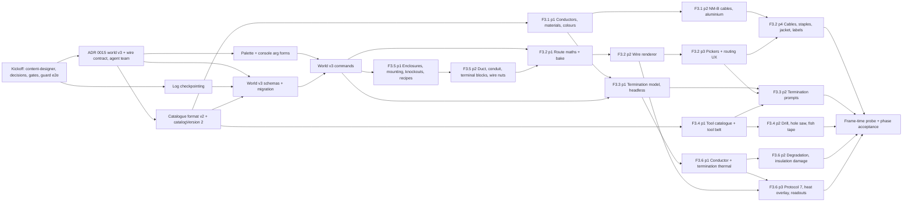

# Phase 3: Wires, terminations, enclosures and hand tools ("Pull, strip, land")

**Release:** v0.4.0 · **Status:** 🚧 Kickoff in progress (2026-11-11) · **Spec:** [plan §6 P3](../controls-development-plan.md#p3--wires-terminations-enclosures-and-hand-tools-v040) (v1.4)

## Goal

The player wires for real. Conductors and cables come from a sourced catalogue (THHN/THWN-2, MTW, NM-B; copper and some aluminium; 18 AWG to 4/0). They are routed in 3D through ducts, conduit and stapled runs, cut to a length that sets their resistance, stripped and terminated with hand tools, and labelled. Enclosures (device boxes, junction boxes, a DIN-rail panel) are mounted and their knockouts opened. Every conductor is a netlist element whose resistance comes from material, cross-section, length and temperature (resistivity × length ÷ area with α, never a table), and each termination adds a contact resistance set by how well it was made. Conductors and terminations heat with I²R, so a bad termination shows a voltage drop under load, heats up and degrades. Test leads keep working alongside wires. World document v3 and catalogue v2 carry it all, with a total migration from v2.

The player-facing proof: in the workshop, the player builds a 120 V lamp circuit from a supply through a DIN-rail panel and boxes in 14/2 NM-B, with real strip, splice and torque steps, and the lamp lights. A deliberately under-torqued termination shows a measurable voltage drop and heats up. A 30 m run of 14 AWG drops the voltage a hand calculation predicts.

**Not in P3** (do not pull forward):

- wall switches (single-pole, 3-way, 4-way), dimmers, receptacles, lamp holders with replaceable bulbs, GFCI/AFCI, the load centre, bus and neutral/ground bars, the main bonding jumper (P4);
- grounding and bonding rules, and the box-fill, conduit-fill, ampacity-versus-OCPD and colour inspector rules (P4 F4.5). P3 stores the data those rules need (box contents, conductor count, derived ampacity, colour) and checks none of it;
- audio (P4); DMMs, clamp meters and probing a conductor end (P5) — P3's readouts are debug or Trainee aids, gated like the overlays;
- the fault-injection framework, difficulty presets beyond termination detail, tool ownership, the economy and jobs (P5); P3 tools are sandbox-owned;
- AFCI arc-signature detection (P4), the thermal camera and IR thermometer (P9), prints and wire numbers on prints (P6);
- insulation breakdown to ground as a fault stamp (P4/P5). P3 records insulation damage as an event and a sticky flag only.

## Phase acceptance

- [ ] **The lamp circuit, with real tool steps.** At Journeyman difficulty, in the workshop: a temporary 120/240 V supply (the existing split-phase utility entity, a stand-in until P4's service and load centre; D12) feeds a DIN-rail panel with the 15 A breaker and terminal blocks; 14/2 NM-B is stapled along the studs to a junction box with wire-nut splices and on to a box holding the 120 V lamp. Each step uses its tool: knockouts opened, jacket stripped, conductors stripped through the right gauge hole, spliced with wire nuts, landed with a torque driver. The breaker on lights the lamp (`lightOutputRel` inside its band); off puts it out.
  - [ ] `apps/sim-cli/scenarios/lamp-circuit.console` (and `.ts`) builds it from `content/levels/workshop.json`; `LAMP_CIRCUIT_HASH` and `LAMP_CIRCUIT_SNAPSHOT_HASH` are pinned in `apps/sim-cli/src/lamp-circuit.spec.ts`.
  - [ ] `apps/game-e2e/src/wiring-acceptance.spec.ts` (both transports) drives one full cable run and its terminations with the mouse and keyboard and the rest with console lines, and reaches the same hashes. A keyboard-only variant routes one conductor (Tab/Shift+Tab terminal cycling, Enter, auto-route, the termination prompts). `apps/desktop-e2e` reaches the same hash in Electron.
- [ ] **A bad termination is measurable and heats.** `apps/sim-cli/scenarios/bad-termination.console`: the lamp circuit plus a 1500 W heater (D12), with one screw termination landed at 20 % of its specified torque. Under load the connection record's end drop equals I × R_contact within 0.5 % and is at least 10× the same end's drop in the good circuit; after 600 s of sim time the end's hot-spot temperature equals the two-node closed-form steady state (ADR 0018) within 0.5 %, above the conductor temperature by at least the margin ADR 0018 fixes; a `terminationOverheat` event is raised at the sourced threshold. Hashes pinned in Node and Chromium. `wire.info <id>` prints the drop and the temperatures.
  - _Note for the acceptance PR (D12 content review, 2026-11-12):_ with the D12 loads the built circuit (split-phase stand-in, 30 m of 14/2, heater plus lamp) computes about **12.27 A** once conductor heating and contact resistance are counted (≈ 12.33 A without them). That is inside ADR 0018 §7's 12.01–13.07 A window but only about 0.03 A below the 12.30 A at which `insulationDamaged` is set, and about 0.5 A short of §7's expected 12.8 A. Key the `insulationDamaged` expectation on the engine's own peak T_h against 403.15 K with at least a 5 K margin either way (or build the circuit nearer 12.8 A, e.g. a shorter run), and report the shortfall against §7 to `electrical-realism-reviewer`. Never re-tune ADR 0018's constants to the scenario.
- [ ] **Voltage drop over 30 m of 14 AWG matches a hand calculation.** Two goldens with the hand calculation written out:
  - unit (sim-core): one 30 m solid copper 14 AWG conductor at 20 °C; A = π/4 · (0.127 mm · 92^(22/39))² ≈ 2.0809 mm², R = ρ₀L/A ≈ 0.24856 Ω; the solved drop equals I × R within 0.5 %;
  - circuit (`apps/sim-cli/src/voltage-drop.spec.ts`): the split-phase service's L1–N (its sourced impedance included), 30 m of 14/2 NM-B (60 m of conductor), a 120 V 1500 W heater (9.6 Ω), four ideal terminations. At the first solve (conductors at ambient) the run's drop matches the hand calculation within 0.5 % (≈ 11.87 A, ≈ 5.90 V, 4.9 % of 120 V); at thermal steady state the conductor temperature and drop match the closed form within 0.5 %.
- [ ] **Determinism.** Byte-identical: `lamp-circuit` and `bad-termination` across two runs, a replay, and the Chromium worker (both transports) against `sim-cli`; a wire's baked centreline hash in Node and Chromium; saving mid-run (hot terminations, a degrading contact) → load → advance to T2 against running straight to T2 (property and scenario).
- [ ] **Budgets** (§4.5, §4.9) in `pnpm verify`: `sim bench` `tick-wired-plant` (1,000 catalogue devices plus 2,000 conductors with thermal state) under 0.3 ms per tick median, allocation-gated, timing the layers of a **cadence** tick (the solve excluded and gated on its own; ADR 0015); `intermittent-toggle-wired` (one intermittent toggle on the wired plant) under the calibrated 2 ms re-solve gate; the calibrated 2 ms re-solve gate holds on a wired 2,000-node plant (`plant-resolve-topology-change-wired`); `route-bake-500-wires` reported against a budget ADR 0017 fixes from measurement (_done in F3.2 part 1: 1.92 ms median measured, 16 ms budget_). Frame time with a 500-device plant and its wires recorded on SwiftShader (`apps/game-e2e/src/wiring-frame-time.spec.ts`, not gated) and on a real GPU by the user (manual, as in P2), including a 2020-era integrated GPU if one is available.
- [ ] **Saves.** World v3 with a total v2 → v3 migration (every v1 and v2 fixture migrates and validates); a fast-check round-trip property on v3 for JSON and the container; `*.v3.schema.json` exported with a staleness check; 0.3.0 saves (catalogue 1, engine 6) load as `engine-changed`, never refused, with a fixture test. Test leads still connect, solve and save, and the `lead.connect` / `lead.disconnect` argument schemas are byte-unchanged (`command-args.spec.ts`).
- [ ] Every new device, conductor, tool, table value and electrical or thermal constant has a `source`, and an `electrical-realism-reviewer` sign-off is recorded in its PR. No NEC/NFPA text or table values; fictional brands only.
- [ ] `pnpm verify` green on all three OSes; every new dependency (none expected) has a `THIRD_PARTY_NOTICES.md` row.

## Kickoff (before F3.x PRs)

1. [x] **Create `content-designer`** (`.claude/agents/content-designer.md`, plan §10.2); update `CLAUDE.md` routing and status, this plan and `plans/README.md`. Routing: `content-designer` owns `content/` and the catalogue format in `libs/domain/catalog`; `save-format-guardian` reviews every `MODEL_KINDS` state key and anything a save references; `electrical-realism-reviewer` signs off every value; `sim-engine-engineer` owns the conductor, contact and thermal models; `renderer-engineer` owns routing maths (`world-model/src/lib/routing/`), the wire renderer and the pickers; `angular-ui-engineer` owns the termination prompts, the tool UI and the fish-tape minigame; the main agent owns the `wire.*`, `cable.*`, `enclosure.*` and `entity.*` commands. No other P3 specialist (D14).
2. [x] **Kickoff decisions D1–D19** (below), defaults taken. The spec is amended to **v1.4**: derived ampacity (D6), the analytic bake (D5), the demo's stand-in supply and 120 V lamp and heater (D12), and leads heating (D2).
3. [x] **Agent-team contract, [ADR 0015](../docs/decisions/0015-world-document-v3.md) "World document v3 and the wire contract"**, before any v3 code. Team: `save-format-guardian` (lead), `sim-engine-engineer`, `renderer-engineer`, `angular-ui-engineer`, `content-designer`. The ADR pins: `ConnectionV3` (leads and wires in one array, nullable ends, `route`, `lengthMm`, `colour`, `label`, typed per-end `TerminationV3`, `state` and `sim` bags); `CableV3` and `nextCableId`; `EntityV3.mountedOn` and `label`; the route shape (integer mm; waypoint kinds `free | duct | conduit | staple | bore`); the length rule (D5); every new command id and argument shape (D1, D9, D10); what the netlist compiler reads (one branch per connection, D4); the connection `sim` keys and their owner; the `connectionStreamKey` / `cableStreamKey` PRNG derivations; the protocol 7 connection records and descriptor additions (renumbered from 6: F3.6 part 1 took protocol 6 for the state export) (an ADR 0011 amendment signed by `renderer-engineer` and `angular-ui-engineer`); the hash scope; the v2 → v3 migration (`mountedOn: null`, `label: null`; leads gain `route`, `lengthMm`, `colour`, `label`, `cable` = null and `ends` from their terminal refs with `termination: null` and empty bags; `cables: []`, `nextCableId: 1`; each `entity.place` log entry gains `mountedOn: null`). **Accepted 2026-11-11** after all four reviews; it refines these shapes (a `nextTerminationId` counter, `wire.land {id, end, at}`, labels by their own commands, `lengthMm` as a logged argument), and its deviations correct D5, D8 and D10 below.
4. [x] **Replay-log checkpointing** (the P2 kickoff item). Owner `sim-engine-engineer` with `save-format-guardian`. A save rebases its log onto the materialised world at the last checkpoint at or before the save tick: every `CHECKPOINT_TICKS` = `MAX_VERIFY_TICKS` (10 000), via `rebaseReplayLog(log, count, worldAtCut)` (ADR 0013's materialised rebase), so the verified tail never exceeds `MAX_VERIFY_TICKS` and real saves verify (`continued`) instead of restarting as `too-long-to-verify`. No schema change (ReplayLogV2/V3 already carry `initialWorld` and `firstSeq`). Property: a session saved at any T, loaded and advanced, equals the uninterrupted run; a save past 10 000 ticks loads `continued`. Lands before world v3. **Landed** (`feat(scripting-api)`): `Game.saveLog()` and `CHECKPOINT_TICKS` in the scripting API, `rebaseReplayLog(log, count, worldAtCut, registry)` in world-model, the game's checkpoint from the sim worker through `TimeHost.captureWorld` (an ordinary `state` query, no protocol change). Known limit, by design: a save whose tail undoes or redoes across its checkpoint keeps the whole log until the next checkpoint ([save-format caveats](../docs/caveats/save-format.md)).
5. [x] **P2 follow-ups that guard P3** (`test-engineer`; done in #87): the permanent mid-sim save/load `desktop-e2e` spec and the macOS bench-lamp selection flake, before world v3 re-pins the hashes those specs check.
6. [x] **Boundary and gate PR** (`test-engineer`): the determinism lint and D6 maths lint extended to `world-model/src/lib/routing/` (no `Math.hypot`, `**` or transcendentals; `Math.sqrt` only); `sim bench` cases declared pending (`tick-wired-plant`, `plant-resolve-topology-change-wired`, `route-bake-500-wires`, `cable-add-worst-command`); the frame-time spec scaffold; a `type:content` check that `content/tables/` and `content/tools/` are mirrored by staleness-tested generated files. _Done:_ the determinism lint already covered all of `libs/domain`, so D6 was extended (probes in `lint-determinism.spec.ts`); pending cases carry a note and a nullable budget; `wiring-frame-time.spec.ts` behind `CONTROLS_MEASURE_WIRING=1`; `catalog/src/lib/content-mirrors.spec.ts` checks every mirror generically and fails on an unlisted `content/` directory, so catalogue v2 adds `tables` and `tools` as one `MIRRORS` row each ([workspace caveats](../docs/caveats/workspace.md)). _ADR 0015 adds two more pending cases, `intermittent-toggle-wired` and a synthetic cadence-tick `tick-wired-plant`; they are declared with F3.6 part 1's prework._
7. [ ] `release-engineer` re-checks versions and licences: no new dependency expected (three.js core `InstancedMesh` and `BufferGeometry`; three-mesh-bvh already in); confirm three r186 is current; record the public references used for contact and thermal physics (books and papers are references, not code).
8. [x] **Pre-audit by `electrical-realism-reviewer`** of the source list before F3.1's values land: IACS copper and EC-grade aluminium resistivity and α; the AWG formula; insulation temperature ratings and thermal conductivities (PVC/nylon THHN, XLPE XHHW/THWN-2, the NM-B jacket); natural-convection correlations; Holm constriction theory and the torque–force relation; the aluminium-on-non-CO/ALR degradation evidence (public safety-agency reports); the region colour rules (article numbers only, paraphrased). _Done 2026-11-11, approved with notes:_ its vetted values and must-avoid list are applied in [ADR 0016](../docs/decisions/0016-catalogue-format-v2.md) (aluminium is the AA-8000-series alloy at 61.0 % IACS, not "EC-grade"); its plan problems are listed under [New in P3](#new-in-p3).

## Kickoff decisions (2026-11-11)

Defaults recommended at kickoff and taken under the user's instruction to proceed autonomously through P3 (2026-11-11). D5, D6 and D12 amend the spec (v1.4) and are listed for the user's review at the end of P3; none blocks work.

- **D1 World v3 shape.** Leads and wires share `connections` and `nextConnectionId`. `ConnectionV3` is `{ id, ref, a, b, cable, route, lengthMm, colour, label, state, sim, extensions }`; `a` and `b` are each `{ entity, terminal, termination } | null` (null is an unlanded end; a connection with a null end is not netlisted — wired, not drawn). `CableV3` `{ id, ref, a, b, route, lengthMm, jacketStripMm: { a, b }, label, extensions }` with `nextCableId`; each cable end is an enclosure entry `{ entity, entry }`; a cable owns its conductors (connections with `cable: id`, which share its route and get their own tails). `EntityV3` gains `mountedOn: { entity, mount } | null` and `label`. One `schemaVersion` 3 for the phase. ADR 0015 pins the shapes: `nextTerminationId` (each termination's identity), `ConnectionV3.cable` as `{ id, conductor }`, `CableV3.tailsMm` and nullable cable ends. _Rejected:_ a separate `wires` array (two id spaces, two compiler inputs); routing each cable conductor separately; transform-inheriting parents (too large for P3, D11).
- **D2 Test leads stay first-class.** `lead.connect` / `lead.disconnect` keep their ids and argument shapes. A lead is a `ConnectionV3` with `route`, `lengthMm`, `cable`, `colour` and `label` null and clip ends whose contact resistance stays in the catalogue. From F3.6 leads join the conductor thermal model (a `SIM_ENGINE_VERSION` bump that re-pins the bench-lamp hashes). _Rejected:_ leads frozen at 20 °C (two conductor models).
- **D3 Catalogue v2.** One `catalogVersion` 2 for the phase, provisional until v0.4.0 then frozen (v1 is frozen at 0.3.0, and `engineCompatible` compares by equality). Format v2 adds termination specs on terminals, enclosure data (mounts, knockouts and entries with trade sizes, interior volume), cable assemblies, and `content/tables/` (materials, insulation) and `content/tools/`, each sourced and mirrored like the devices. Existing v1 entries keep entry version 1 when they only gain termination data; any electrical change means a new entry version. 0.3.0 saves load as `engine-changed`, never refused. _Rejected:_ an "additive" rule for catalogue v1.
- **D4 One branch per connection** (ADR 0011 §7 kept). A wire compiles to one resistor R_conductor(T, L, A, stranding) + R_contact(a) + R_contact(b); each conductor end's voltage is derived after the solve as V_terminal ∓ I · R_contact (exact for series elements) and published in the connection record, which P5's meters will probe. No new stamp kind, so the oracle corpus is unchanged (its staleness test proves it). _Rejected:_ three branches and two internal nodes per wire (roughly doubles the unknowns for no new physics).
- **D5 Length and bake** (spec v1.4: "Verlet sag and baking" becomes an analytic bake with a Verlet live preview). `lengthMm` is an integer **logged argument** (corrected by ADR 0015): the surface fills it with `routeDefaultLengthMm` (the route polyline, `Math.sqrt`, plus a sourced slack allowance plus the tails, rounded up to mm), and the command refuses a length below `routeFloorMm` (the polyline). It is stored, so the compiler never runs routing code, a later routing fix never changes an old save's resistance or what an old log replays to, and a script can cut to length (the 30 m voltage-drop run). Logged arguments carry explicit waypoints; auto-route is expanded by the surface (mouse, the console's `--route auto` sugar, `game.autoRoute`) through the shared domain router before `exec`. The baked shape is analytic and deterministic in `world-model/src/lib/routing/` (taut spans along raceways, a parabolic sag on free spans, duct lanes by sorted id); Verlet runs only for the live preview in the renderer, never persisted or hashed. Recorded in ADR 0017 as a deviation from ADR 0010's fixed-step rope bake (about 8 ms per wire for a 200-step bake, roughly 4 s to load 500 wires). _Rejected:_ a fixed-step Verlet bake in domain code.
- **D6 Ampacity is derived** (spec v1.4 amendment to F3.1, allowed by §3's "or are derived"). Each conductor's `ampacityA` is the current at which the ADR 0018 model's steady conductor temperature reaches the insulation rating at stated conditions (30 °C ambient, free air or raceway). `electrical-realism-reviewer` cross-checks it against cited public manufacturer data within a stated band; NEC 310.16 values are never stored or quoted. P4's inspector chooses its own sourced rating approach. Reason: the "published data" are reprints of NEC tables. _Superseded in part by [ADR 0018](../docs/decisions/0018-conductor-and-termination-physics.md) §9 (Accepted): free air only in P3 (no raceway model), a separate 30 °C `RATING_AMBIENT_K`, a ±20 % cross-check band, NM-B's 60 °C limit applied as a separate rule._
- **D7 Thermal model** (ADR 0018). One lumped conductor node per connection and one termination hot-spot node per landed end, coupled to the conductor and to the device terminal at ambient. Heat leaves through the insulation and by natural convection (h from a sourced correlation, ΔT^¼ as `Math.sqrt(Math.sqrt(·))`, so no `dmath` and ADR 0014 stays deferred). Integrated at every electrical solve (every 10 ticks) with the exact elapsed dt; the catalogue refuses a time constant under 100 dt. R(T) clamped to copper's linear-α range; a change over 1 % triggers a value-only re-solve (the lamp's rule). Conductors in one cable are thermally independent (bundling is P4+), a documented abstraction. _Rejected:_ per-tick integration, finite-element models.
- **D8 Termination quality → contact resistance → degradation** (F3.3, F3.6). Contact resistance from Holm constriction with clamp force from torque (T = K · F · d, a sourced nut factor), R ∝ F^(−½) via `Math.sqrt`; it also depends on effective area (nicked strands), strip length (short: partial clamp, higher R; long: exposed copper, flagged for P4 with no electrical effect), conductor count against the terminal maximum, the method (screw, spring-cage, wire nut, ferrule, ring or fork lug, back-stab), and aluminium on a terminal not rated for it (multiplies the degradation rate). Outcomes are a pure function of the arguments plus a seeded spread for tools without a torque readout, drawn from the termination's own step streams (`termination:<id>:strip|crimp|clamp`, keyed by the world's `nextTerminationId`; corrected by ADR 0015 from `commandStreamKey(seq)`, which would make outcomes depend on which surface did the wiring). Contact R grows irreversibly above a sourced oxidation temperature (piecewise linear), feeding back into heating so runaway emerges; at sourced points the end becomes **intermittent** (seeded open/close from the termination's stream `termination:<id>:intermittent`, corrected by ADR 0015 from `connectionStreamKey`; periods are whole multiples of a sourced `INTERMITTENT_MIN_DWELL_TICKS` ≥ 100 ticks, so at most one topology event per dwell) and then **arcing** (a resistive stamp inside §4.5's 0.5–2 Ω band). No AFCI detection (P4), no fault-injection framework (P5). _Superseded in part by [ADR 0018](../docs/decisions/0018-conductor-and-termination-physics.md) (Accepted): Holm's F^−½ holds only while the clamp is seated, with a loose regime below 40 % of the marked torque (§4.2; the 40 % onset and the quadratic shape are game-design, only the 100 mΩ zero-torque end point is anchored, to BSS 128), so 20 % torque gives about 85×; series arcing is R = V_arc/|I| with a game-design V_arc band, not the 0.5–2 Ω band (§6); D7 adds mandatory radiation and the fin coupling (§3)._
- **D9 Termination detail by difficulty** (full presets are F5.3). Trainee: `termination: 'auto'` (ideal). Apprentice: prompts with the right gauge hole, die and torque preselected. Journeyman: prompts with nothing preselected. Realistic: as Journeyman, and no quality feedback until measured (P5). At command level `'auto'` is accepted only at Trainee (`termination-required` otherwise). Per ADR 0010 §5, strip and ferrule fold into one action per end; torque is a separate tool action.
- **D10 Tools.** `content/tools/*.json` (`ToolDefinition` in `@controls/catalog`: identity, fictional brand, a kind from `stripper | cutter | screwdriver | torqueDriver | crimper | nutDriver | drill | holeSaw | knockoutPunch | fishTape | labelMaker`, sourced params such as gauge holes, torque range and accuracy, a die set). Tool-belt slots hold tool refs (already `CatalogRef`, no `settingsVersion` bump). Every tool-mediated command takes `tool: CatalogRef` and checks the tool's **capability** for the step (`cut | strip | stripJacket | crimp | drive | torque | openEntry | bore | pull | label`, with a size limit), not its kind alone (corrected by ADR 0015: a stripper with cutting jaws can cut; `wrong-tool`, `beyond-tool-capacity`). No ownership in P3 (P5 adds the inventory). The fish tape is a UI-only minigame that logs `wire.pull` only on success; skippable at Trainee, keyboard-playable, honours reduced motion.
- **D11 Enclosures and mounting.** `mountedOn` records what is mounted where (P4's box fill counts from it). Moving or deleting an enclosure that holds devices or cable entries is refused (`occupied`); no transform inheritance in P3. Knockouts and entries are commanded state keys on the enclosure, opened with a knockout punch, drill or hole saw. The P1 placement overlap check and mouse placement of catalogue devices (a P2 gap) land in F3.5. Workshop fixtures stay `prop.*@1`; placeable rails and backplates are enclosure parts in the catalogue. `content/levels/workshop.json` is rewritten in v3 canonical form.
- **D12 The demo circuit** (spec v1.4 clarification of the P3 acceptance). The supply is the existing split-phase utility entity standing in for P4's service and load centre; the switch is the existing 15 A breaker on a DIN mount; new content is a 120 V 60 W incandescent lamp with screw terminals (an entry of the `lamp.incandescent` kind, using the τ ≈ 30 ms / f ≈ 0.05 pairing the realism reviewer recommended in P2) and a 120 V 1500 W heater entry (the `heater` kind). Lamp holders, wall switches and receptacles stay P4. _Rejected:_ a 12 V demo (NM-B and boxes aren't used that way). ✅ _Content done 2026-11-12 (`feat(catalog)`, catalogue 2): `lamp.lumivane-120v-60w@1` (240 Ω hot, 16.23 Ω cold, 2700 K, τ 30 ms with its own `conductionFraction` 0.05, a new optional lamp param; binding-screw holder terminals, 14–12 AWG Cu, 1.8 N·m) and `heater.hearthvale-120v-1500w@1` (9.6 Ω; pressure-plate terminals, 14–10 AWG Cu, 1.8 N·m). On a stiff 120 V the pair draws 13.0 A, inside ADR 0018 §7's 12.01–13.07 A window before the wiring's drop; the acceptance PR checks the built circuit._
- **D13 No new libraries.** Routing maths in `world-model/src/lib/routing/` (the `snap/` precedent); thermal and contact models in `sim-core`. _Rejected:_ a new `@controls/routing` lib (would need a §4.2 boundary amendment).
- **D14 Specialists.** Only `content-designer` (§10.2).
- **D15 `SIM_PROTOCOL_VERSION` 6.** Connection records (conductor temperature, end temperatures, contact R per end, end drops, conductor drop, end state `ok | intermittent | arcing`, insulation damage, `status`); the descriptor gains connection-record indexes; amended in ADR 0011 with `renderer-engineer` and `angular-ui-engineer`, protocol fingerprint re-pinned. The overlays recolour the real conductor meshes; their own lead segments stay for leads only. _Renumbered: F3.6 part 1 took protocol 6 for the state export, so the records are protocol 7 (F3.6 part 3's headless half, [ADR 0011 amendment](../docs/decisions/0011-sim-worker-contract.md#amendment-protocol-7-connection-records-and-connection-events-f36-part-3), Accepted)._
- **D16 Readouts are debug aids until P5.** The `wire.info <id>` console query (read-only, like `netlist.dump`), the netlist inspector's drop and temperature rows, the hover readout and `view.overlay {name: 'heat'}`, all `when: console.available`. Adding an overlay name is additive (no schema bump).
- **D17 Lamp recalibration** (optional P2 follow-up): not applied to `lamp.lumivane-12v-5w@1` (keeps the bench demo's meaning); the new 120 V lamp entry uses the recalibrated pairing from the start.
- **D18 Bundle size.** Done before kickoff (P2 follow-up, `perf/game-initial-bundle`): the initial bundle is 1.88 MB against the 2.00 MB warning after switching zod to namespace imports. P3's new UI (prompts, minigame, readouts) is lazy-loaded (`@defer` / `loadComponent`) where it isn't on the first-frame path; if the build goes over again, raise the warning only with a written rationale in its own PR.
- **D19 Checkpoint cadence** `CHECKPOINT_TICKS` = `MAX_VERIFY_TICKS` (kickoff step 4), no schema change; the in-session undo stack is unaffected.

## Build order

One feature per PR; F3.1–F3.6 land in parts, as P2's did.

- **Contract track** (critical path): ADR 0015 → catalogue v2 → world v3 → world v3 commands. Nothing reads a `ConnectionV3` before it lands.
- **Content track** (`content-designer`): catalogue v2, F3.1, the content halves of F3.5 and F3.4 part 1, each through `electrical-realism-reviewer`.
- **Physics track** (`sim-engine-engineer`): F3.3 part 1 headless, then F3.6 parts 1–3; needs world v3 commands and F3.1 part 1 only.
- **Renderer and UI track** (`renderer-engineer`, `angular-ui-engineer`): F3.5 part 1 recipes and placement → F3.2 parts 1–4 → F3.3 part 2 and F3.4 part 2. Route maths and bake are domain code proven headless before any mesh exists.
- **Integration:** the frame-time probe, the lamp-circuit and bad-termination scenarios, the acceptance E2E, then the user's manual real-GPU check.

## Features

### Kickoff PRs: catalogue v2, world v3 and its commands (D1–D3, D5, D9–D11)

The persisted contract every P3 feature builds on (P2's #40/#41/#42 precedent).

**Catalogue format v2** (owner `content-designer`; reviewers `save-format-guardian`, `electrical-realism-reviewer`):

- [x] `DeviceTerminal` gains per-method termination specs (ADR 0015): `methods: { method, ratedConductors, maxConductors, awgRange, stranding, stripLengthMm, torqueNm, alRated, entryMm, exitAxis }[]`, possibly empty (clip-only), in a save-format order (`'auto'` takes the first); gauge checks by integer AWG designation through a gauge table, never floating-point areas. Source coverage extends to `terminals.<id>.methods.<method>.<field>`. _Done (ADR 0016):_ the one gauge table is `AWG_GAUGES` in code, computed from the AWG formula; the `TERMINATION_METHODS` registry.
- [x] Enclosure data: `mounts` (DIN rail, backplate grid, device yoke, stud flange) and `entries` (knockouts with trade size and position, cable clamps); `interiorVolumeMm3` stored for P4 box fill (not checked). _Done as format (ADR 0016):_ the `MOUNT_TYPES` and `ENTRY_TYPES` registries, device `mounts` declarations, a mount frame of `axis` and `facing` (ADR 0015's `yoke` field became the mount type's occupancy); the boxes themselves are F3.5.
- [x] Cable assemblies: `conductors[]` `{ index, conductorRef, role: 'ungrounded' | 'grounded' | 'egc', insulated, colour }` plus jacket params; `conductorRef` is a pinned `(id, version)`. Accessories (ferrules, lugs) are family `accessory` in `content/accessories/`. Tool entries declare capabilities and stable hole and die ids (ADR 0015). _Done as format and loaders, proved on test-only fixtures (ADR 0016); the first real cables, tools and accessories are F3.1 part 2, F3.4 part 1 and F3.3 part 1._
- [x] `content/tables/materials.v1.json` (copper IACS, AA-8000-series aluminium at 61.0 % IACS (corrected from "EC-grade" by the pre-audit): ρ₀, α, T₀, density, specific heat) and `insulation.v1.json` (THHN/THWN-2, MTW, XHHW-2, NM-B jacket: temperature rating, thermal conductivity, wet/dry); `content/tools/` on the same mirror pattern, with staleness tests. Entries reference table rows by `{ table, version, key }` (a changed value is a new table version). An append-only colour table (`content/tables/colours.v1.json`): ids are never removed or renamed, and each conductor entry lists the colours it is made in. _Done (ADR 0016):_ insulation thickness is per conductor entry, not a table column (pre-audit); `content/tools/`, `content/cables/` and `content/accessories/` get their directories and mirror rows with their first entries.
- [x] `RegionProfile.conductorColours` for NEC (grounded, EGC, conventional ungrounded colours), paraphrased with article numbers cited.
- [x] Every v1 entry gains terminal termination specs at entry version 1 (D3), where a conductor really lands (the breaker, the DIN supply, the split-phase stand-in supply; clip-only `[]` elsewhere). `catalogVersion` 2 in the manifest and `docs/history.md`; `device.v2.schema.json` exported; `docs/guides/authoring-content.md` created; ADR 0016. _Done:_ engine-numbered fixtures are now `<scenario>-engine-N-catalog-C.ctrl`, the engine-6 catalogue-1 ones load as `engine-changed`; no hash moved.

**World v3 schemas** (owner `save-format-guardian`):

- [x] `v3/world.ts`, `v3/manifest.ts`, `v3/replay-log.ts` with a total v2 → v3 migration (ADR 0015); v1 and v2 files and fixtures untouched. _Done (PR 7):_ `v3/from-v2.ts` holds the lead's initial bag as a frozen literal (`LEAD_SIM_BAG_V3`, parity-tested in `catalog`); ADR 0015's id primitives moved into `save-format` and the catalogue re-exports them.
- [x] Invariants: connections, cables and entities sorted by id and below their counters; a conductor's `cable` exists; landed ends name existing entities; `lengthMm` ≥ the straight-line distance between landed ends; `mountedOn` names an existing enclosure mount; leads have null route, length, cable, colour and label. _Done:_ ADR 0015's invariants 1–8 in the schema, each with a refused fixture, plus a stripe differing from its base; the length and mount rules in `checkWorldReferences` (exact integer chord and cable floor, quarter-turn geometry).
- [x] Fixtures in `fixtures/v3/{world,manifest,replay-log,ctrl}`: empty world, leads only, a routed wire with hot terminations mid-degradation, a cable with one unlanded conductor, mounted devices, 17-digit floats. Every v1 and v2 fixture migrates. Round-trip property for JSON and the container. `*.v3.schema.json` exported with a staleness check.
- [x] The workshop level rewritten as v3; every pinned golden hash re-pinned once and listed old → new in the CHANGELOG (`WORKSHOP_HASH`, `FOUR_SURFACE_HASH`, `PHASE_ACCEPTANCE_HASH`, `PALETTE_PLACE_UNDO_HASH`, `CONSOLE_PLACE_UNDO_HASH`, `BENCH_LEADS_HASH`, `BENCH_LAMP_*`, `SIM_STEP_*`, `SOURCES_*`, `MAINS_*`, `PROTECTION_*`, the Node and Chromium goldens).
- [x] The engine-6 v2 `.ctrl` fixtures are kept and load as `engine-changed` (catalogue 1 ≠ 2); never regenerated. _Done:_ the four v2 `-engine-6-catalog-2.ctrl` saves are kept too, migrate to exactly what the v3 build writes and load as `continued`; this build's are under `fixtures/v3/ctrl/` with a checkpointed save.

**World v3 commands** (main agent; `save-format-guardian` reviews ids and argument shapes, frozen in `json-schema/command-args/`):

- [x] Argument shapes and refusals exactly as [ADR 0015](../docs/decisions/0015-world-document-v3.md) pins them (it supersedes the sketch below: `lengthMm` logged, tools inside the termination, `wire.land {id, end, at}`, `wire.pull` by route, `wire.label` / `cable.label` / `entity.label`). The exact quarter-turn helper `entityPointMm` / `entityDirection` (`renderer-engineer`, next to `snap/`) is used by the commands, the load check, `routing/` and the terminal picker.
- [x] `wire.add {ref, a, b, route, colour, label, tool}` (an end is `{ entity, terminal, termination } | null`, `termination` is `'auto' | TerminationArgs` (D9), `route` explicit waypoints (D5)); `wire.delete {id}`; `wire.reroute {id, route}` (refused while both ends are landed and the new length exceeds the conductor's: re-cut first); `wire.land {id, end, terminal, termination, tool}`; `wire.unland {id, end}`; `wire.label {id, text, tool}`.
- [x] `cable.add {ref, a, b, route, label}` creates the cable and its conductors (unlanded, colours from the assembly); `cable.strip {id, end, jacketMm, tool}`; `cable.delete {id}` (removes its conductors; undo restores the ids); `cable.reroute`.
- [x] `enclosure.openEntry {id, entry, tool}`. `entity.place` gains `mountedOn` (default `null`; v2 log entries migrated). `entity.move` and `entity.delete` refuse an occupied enclosure (`occupied`). _Partly done in PR 7 (world v3 needs it to replay migrated logs):_ the `mountedOn` argument (frozen in `entity.place.args.schema.json`), the v2 log migration, and conservative `occupied` / `mounted` / `wired` refusals; a non-null `mountedOn` is refused (`mounting-unavailable`) after the host and mount checks until PR 8 adds the position, frame and room checks. _Done (PR 8):_ `checkMount` (host, mount, fit, frame, position, room), sliding along the same mount, delete unlands.
- [x] Refusals: unknown refs, a non-conductor `ref`, a wrong tool kind, a terminal over its `maxConductors`, an area outside the terminal's range (`gauge-out-of-range`), `'auto'` above Trainee, a route through a device body (`route-collides`; straight segments until F3.2 part 1). None reads sim-owned state.
- [x] Undo restores ids and counters (properties). Deleting an entity unlands the conductor ends on it (never dangling); leads are removed as in v2.
- [x] Palette forms render every new command (the every-command spec); a console line and a TS script can add and land a wire. _Done (PR 8):_ on the TEST-ONLY catalogue (`scripting-api/src/lib/wiring.spec.ts`, pinned hash); no real conductor or tool exists before F3.1/F3.4, so no `sim-cli` scenario yet. `--lengthMm auto` is registered; `--route auto` waits for F3.2 part 1. Implementation decisions: ADR 0015 "Implementation notes (P3 PR 8)".

### F3.1 Conductor catalogue

Owner `content-designer`, with `sim-engine-engineer` for the `conductor` netlist model; `electrical-realism-reviewer` signs off. Two parts.

- [x] **Part 1:** a `conductor` connection kind in `MODEL_KINDS` (params: area from the AWG formula, strand count and lay factor, material ref, insulation ref, insulation thickness, outer diameter; sim keys reserved for F3.6, declared now so they freeze with v3); THHN/THWN-2 (14 AWG–4/0, solid and stranded where made), MTW (18–10 AWG) and XHHW-2 aluminium (two sizes); each entry lists its product colours from the colour table (`RegionProfile.conductorColours` holds the region's rules over those ids for P4, not the products; ADR 0015). _Done (PR 9), pending `electrical-realism-reviewer` sign-off:_ params are `{ layFactor }` only (area, diameter and the material and insulation data come from the gauge table and the pinned rows; the outer diameter is derived); `ConductorSpec.jacketThicknessMm` holds THHN's nylon layer; 21 entries (Tallowmere THHN/THWN-2 14 AWG–4/0, solid at 14–10 AWG; Tallowmere MTW 18–10 AWG; Quorvale aluminium XHHW-2 4 AWG and 4/0). The netlist model is one branch, R_cond at T₀ plus two contact terms that are ideal until F3.3 part 1.
- [x] **Resistance is derived, never tabulated:** R = ρ₀ · L · k_lay / A · (1 + α(T − T₀)) (`conductorResistanceOhm`, `+ − × ÷` only). Hand-calculated goldens for 18, 14, 12, 4 and 4/0 AWG, copper and aluminium, within 0.5 %. Properties: R strictly decreases with area, scales linearly with length, Al/Cu ratio = ρ_Al/ρ_Cu. _Done (PR 9):_ `catalog/src/lib/conductor.spec.ts`; the 30 m 14 AWG unit golden runs through the netlist and the DC solver in `sim-core/src/lib/netlist/conductor.spec.ts`.
- [x] **`ampacityA` is derived (D6)**, with a self-consistency test and a cited cross-check band per insulation type. No NEC 310.16 value in content, code, tests or docs. _Done (PR 9), pending `electrical-realism-reviewer` sign-off:_ `derivedAmpacityA` in `sim-core/src/lib/thermal/` per ADR 0018 §9 (free air, 30 °C, one surface iteration, radiation on); self-consistency by integration, a ±20 % cross-check per insulation type against an independent Churchill–Chu plus radiation balance (worst 4.9 %) and the reviewer's 14 AWG and 4/0 THHN figures; the NM 60 °C call is a separate constant.
- [x] **Part 2:** NM-B assemblies (14/2, 14/3, 12/2, 12/3, 10/2, 10/3, 8/3, 6/3 with ground; the set follows public product lines, under a fictional brand) as `cable` entries with their conductor lists; the bare EGC is `insulated: false`. _Done (PR 10), pending `electrical-realism-reviewer` sign-off:_ eight Sorrelby NM-B cables pinning eight new conductor entries (THHN-type NM conductors 14–10 AWG solid, 8 and 6 AWG 7-strand; bare solid EGCs 14, 12 and 10 AWG, 10 AWG in 8/3 and 6/3), product data from one maker's NM-B sheet with no ampacity column (the jacket wall game-design); no ampacity stored. With it, the termination accessories of F3.3's content half: five Thimbleby insulated ferrules (18–10 AWG, die `square`, no ferrule crimper yet) and seven insulated ring and fork lugs (dies `red`, `blue`, `yellow`, the F3.4 part 1 crimper's). Wire nuts wait for F3.3 part 1 (a `splice.twistOn` device with `combination` bounds, ADR 0018 §4.4, not an accessory). The plan's "aluminium" in F3.1 part 2 is part 1's two XHHW-2 sizes; no aluminium NM-B (the public copper product line followed has none).
- [ ] The test lead is unchanged and still connects; `bench-lamp.console` reaches its (v3-repinned) hashes.
- [x] A `topologyHash` pin for the `conductor` kind (`hash.spec.ts`), no `CNT` encoding version bump. _Done (PR 9):_ no existing pin moved.

### F3.2 3D wire routing

Owner `renderer-engineer` (domain routing maths and rendering), with `angular-ui-engineer` (routing UX) and the main agent (commands). ADR 0017. Four parts.

- [x] **Part 1, route maths** (`world-model/src/lib/routing/`, domain, headless): auto-route through ducts (out of the terminal along its exit direction, into the nearest duct, along it, through risers, out to the other terminal); waypoint snapping to ducts, conduit, staple points on studs and bores; `route-collides` against catalogue `sizeMm` boxes; the D5 length rule; duct lanes by sorted connection id (at bake, never by collision); the deterministic baked centreline (quantised to 0.1 mm); `game.autoRoute(a, b, opts)` and the console's `--route auto` sugar use the same function. Goldens: a hand-measured route length; the centreline hash equal in Node and Chromium (`apps/game-e2e/src/routing-parity.spec.ts`); identical lanes under permuted insertion order (property); `route-bake-500-wires` in `sim bench`. _Done ([ADR 0017](../docs/decisions/0017-routing-and-bake.md), Proposed; pending `save-format-guardian` and `test-engineer`, and `electrical-realism-reviewer` for the 5 % slack, labelled game-design):_ `autoRoute` (ducts ahead first, junctions where duct bodies touch, Dijkstra, the command's own `routeCollision`, direct and lead-out fallbacks) behind `game.autoRoute` and `--route auto` (`wire.add`, `wire.reroute`); `snapWaypoint` (duct trough axis, conduit stick or connector axis and elbow ports, staple on a stud face, bore at mid-depth); the host rule (`bad-waypoint`); `route-collides` kept on the stored polyline against `sizeMm` bodies; the length rule unchanged (5 % game-design); lanes by cable id then connection id; the analytic bake (straight lead-outs, taut in raceways with elbow arcs, parabolic sag capped at 1 %, coils only past 20 %, 0.1 mm quantum); connector entries derived, not stored. Goldens: the hand-measured 79.757 mm route (floor 80, default 84); the centreline and proposal digests equal in Node and Chromium (`routing-parity.spec.ts`); lanes and the centreline hash identical under permuted listing and insertion order (properties); `route-bake-500-wires` measured 1.92 ms median, gated at 16 ms, with a 50-wire smoke form. No world, scenario or fixture hash moved.
- [ ] **Part 2, wire renderer:** one `InstancedMesh` of 6-sided segments per conductor look, colour per instance, pooled capacity that doubles when full (ADR 0010); full `needsUpdate` uploads, never `addUpdateRange` on large instanced attributes; one live Verlet preview rope; baked wires from the domain bake only; labels drawn; disposal test and scene-graph snapshots; the overlays recolour conductor instances (D15).
- [ ] **Part 3, pickers and routing UX:** screen-space terminal picking, nearest within `min(16 px, pitch / 2)`, occlusion-filtered with the BVH picker, hover highlight; a key zooms to the device (`view.focus`) when a terminal group's pitch is under 24 CSS px; Tab/Shift+Tab cycle a focused device's terminals and Enter picks; a wire BVH over segment bounds with ray-to-capsule picking at a 4 px minimum radius; the spool is the active tool-belt slot; two clicks per connection with auto-route by default, optional waypoints, Backspace and Esc; each completed route logs exactly one `wire.add`. E2E: mouse, keyboard-only and palette routes reach the same `world.hash`.
- [ ] **Part 4, cables:** NM-B routed from one enclosure entry to another, stapled along studs (staple waypoints within the sourced maximum spacing from a box and between staples; game-design where unsourced) and through bored studs; `cable.strip` exposes tails whose length bounds what can be landed (`tail-too-short`); conductors landed individually; labels and numbers via the label maker (`wire.label`, drawn sleeve markers). E2E: a box-to-box cable run with the jacket stripped and both conductors landed.

### F3.3 Terminations

Owners `sim-engine-engineer` (contact model), `content-designer` (termination specs and accessories: ferrules, ring and fork lugs, wire-nut sizes with conductor-combination ranges from public manufacturer data, fictional brands), `angular-ui-engineer` (prompts). ADR 0018. Two parts.

- [x] **Part 1, headless:** `TerminationArgs` `{ method, stripHoleArea, stripLengthMm, accessory, crimpDie, torqueNm }` → `TerminationV3` (method plus resolved outcome: nicked-strand fraction, achieved torque, clamp area); quality → contact resistance per D8. Hand-calculated goldens: an ideal screw termination at specified torque; 20 % torque; 25 % nicked strands; ferrule versus bare stranded under a screw clamp; an under-crimped lug (wrong die); two conductors under a one-conductor screw; aluminium on a terminal not rated for it (rate multiplier only). Properties: contact R decreases with torque up to the spec; every outcome is a pure function of the arguments and `seq`; `'auto'` equals the ideal termination.
- [x] Source or replace `resolveTermination`'s provisional nick, crimp and screwdriver-spread numbers (P3 PR 8, ADR 0015 implementation note 11); cap nicks at min(model, 1 − (d_hole/d_cond)²) (stranded conductors are wider than solid at the same AWG); decide whether hand-tightening is biased low (with ±40 % a plain screwdriver can never reach ADR 0018's loose regime); re-pin the goldens. _Done (F3.3 part 1, ADR 0018 implementation note 8): nicks capped at the geometric reach with stranded diameters 3/√7 × solid; an unlisted die q = 0.25, 0.3 per AWG step; a plain screwdriver uniform in 0.15–1.45 × the mark (fitted to a trade-press summary of a 2009 field study); goldens re-pinned; game-design, approved by `electrical-realism-reviewer` 2026-11-12._
- [x] Back-stab and spring-cage modelled and tested on test catalogue entries (spring-cage appears on F3.5's terminal blocks; back-stab's first real device is P4's receptacle).
- [x] A wire-nut splice: the `splice.twistOn` device kind joins its ports ideally; each conductor end's contact R comes from the wire-nut rating and conductor combination; outside its rated combination it is refused (`combination-out-of-range`).
- [ ] **Part 2, prompts** (D9): one strip-and-ferrule prompt per end and one torque action; difficulty selects automatic, preselected or blank prompts; keyboard-operable and announced; each logs one `wire.land`. A UI spec per difficulty and an E2E at Journeyman.

### F3.4 Hand tools and the tool belt

Owners `content-designer` (tool entries), `angular-ui-engineer` (tool belt, tool UI, minigame), `renderer-engineer` (tool cursors), main agent (commands). Two parts.

- [x] **Part 1:** tool entries in `content/tools/` (wire strippers with gauge holes and an NM slot, diagonal cutters, screwdriver, torque screwdriver with range and accuracy, crimper with a die set, nut driver, label maker), sourced, fictional brands; the tool belt holds tool refs, the HUD shows the active tool, and the active tool selects what a click does; tool-gated commands check their tool kind (`wrong-tool`); a plain screwdriver's torque has a seeded spread (D8), the torque driver's comes from its stated accuracy. _Done:_ nine tools in `content/tools/` (Veltmark general strippers `sol*`/`str*` holes with cut, NM cable stripper with stripJacket, 8 in cutters, screwdriver, nut driver, crimper with `red`/`blue`/`yellow` dies; Calderyn 0.3–1.2 and 1–5 N·m ±6 % torque screwdrivers; Penmarrow label printer), reviewed by `electrical-realism-reviewer` (verified values `real-world`); drive types (`DRIVE_TYPES`, `wrong-drive`, ADR 0016 amendment); belt slots hold any `CatalogRef` and what they arm follows `beltSlotKind` (a tool or spool never arms placement); `ActiveTool` feeds the HUD, the new belt bar (a keyboard toolbar) and the viewport; the default-tool rule is world-model's `defaultTool`; Settings → Tool belt edits the slots. The capability checks (`wrong-tool`, `beyond-tool-capacity`) and the torque spread and accuracy shipped with PR 8 (`checkTool`, `resolveTermination`); the active tool selecting what a click does waits for the wiring flows (F3.2 part 3, F3.3 part 2), which bind on the `toolbelt.kind` / `toolbelt.tool` context keys.
- [ ] **Part 2:** drill and hole saw (bores through studs as route waypoints, custom entries on enclosures) and a knockout punch; the fish tape minigame to pull conductors through conduit, logging `wire.pull {conduit, conductors, tool}` on success only (D10), keyboard-playable, reduced motion respected, skippable at Trainee. E2E: one conduit pull with the keyboard.
- [x] A single-command cost gate: `cable-add-worst-command` (the largest assembly with auto terminations, plus its re-solve on the 2,000-node plant) stays well under `WATCHDOG_MS` (the P2 backlog item "bound the cost of a single command"). _Done:_ a real `sim bench` case on a bench-only synthetic 16-conductor assembly (no real cable before F3.1 part 2), gated at `WATCHDOG_MS / 10` = 300 ms; median about 2 ms locally. `cable.add` lands no terminations, so "auto terminations" don't apply to it.

### F3.5 Enclosures and mounting

Owners `content-designer` (entries), `renderer-engineer` (recipes, snapping, overlap), main agent (commands). Two parts.

- [ ] **Part 1:** 1-gang and 2-gang device boxes, a 4 in square junction box, a round ceiling box and a DIN-rail panel enclosure (backplate, two rails), each with sourced sizes, mounts, entries and interior volume; mouse placement of catalogue devices with snapping to their mounts (the P2 gap); `mountedOn` recorded; overlap checks for placement and move (the P1 follow-up; `overlaps` refusal, property test); recipes for the enclosures, the 15 A breaker with a DIN mount and the fuse (both drew as unknown objects in P2); knockouts opened with tools (F3.4); an occupied enclosure refuses move and delete. _Landed (PR 11, pending `electrical-realism-reviewer`):_
  - [x] The five enclosure entries (`box.tinmoor-*`, `panel.pellmoor-din-400x500`) and the `enclosure.box` / `enclosure.panel` kinds; interior volumes computed from inside dimensions (never a code table); sizes labelled game-design and **unverified** until the reviewer checks them against public drawings.
  - [x] Mouse and reticle placement of catalogue devices (`placeInWorld`, `worldMountTargets`): onto enclosure mounts (DIN module slots on a rail, the 5 mm grid on a backplate, a yoke exactly) with `mountedOn`, else onto the fixtures; moves slide a mounted device along its own mount. Scripts and `sim-cli` use the same maths (`din-panel-breaker.ts`).
  - [x] Overlap: the placement maths refuses every overlap; `entity.place`/`entity.move` refuse `overlaps` where an enclosure or a mounted device is involved (pre-v3 logs stack free props and must replay); property test over random place/mount/move/undo sequences.
  - [x] Recipes, scene-graph goldens and disposal tests for the enclosures, the breaker (with its handle) and the fuse; knockouts and clamps drawn open or closed from `openEntries` (two meshes per enclosure).
  - [x] An occupied enclosure refuses move and delete in the UI: the drag ghost says why, and Delete raises a warning toast (`Session.execFromInput` / `onRefusal`).
  - [x] Knockouts opened with tools: since F3.4 part 1 a real slotted screwdriver opens the boxes' knockouts and pryouts with `enclosure.openEntry` (palette, console, scripts; a hex nut driver is `wrong-drive`), and the viewport draws them open. A click-to-open tool flow is F3.4 part 2's.
  - [x] Catalogue devices on the tool belt: F3.4 part 1's Settings → Tool belt picker now offers every placeable catalogue device with a body (`beltChoices`, group `Devices`); the enclosures e2e puts the panel and breaker on the belt there.
  - [ ] **Decide before v0.4.0** (save-format review): whether `entity.rotate` checks overlap, or freeze "rotate never checks overlap" (it doesn't in part 1).
  - P4 open questions (electrical-realism review): box fill needs a separate marked-volume field sourced from manufacturer markings, or a stated rule; `interiorVolumeMm3` is geometric and above the marked volume, never the allowance unchanged. The P2 breaker's 40 mm base is about two DIN modules; a one-module entry version may come with the panel.
- [x] **Part 2:** slotted wire duct and cover (sourced section sizes, commanded `lengthMm`); EMT-lite (straight sticks with a commanded length, 90° elbows, connectors into entries; no bending minigame); DIN terminal blocks (screw and spring-cage feed-through, a ground block); wire nuts as placeable splice devices inside boxes. Golden scene-graph snapshots per recipe. _Landed (PR 12; `save-format-guardian` approved, `electrical-realism-reviewer` signed off with its required changes applied, 2026-11-12):_
  - [x] Three Lattisby slotted wire ducts with covers (25 × 40, 40 × 60, 60 × 80 mm, 2 m stock), cut to length by the new `raceway.cut` (commanded `lengthMm`, placed at the entry's `defaultLengthMm`) with a commanded `coverOn` toggle; fixed to a backplate (area mount); sections, stock and slot patterns read from makers' data (reviewed 2026-11-12).
  - [x] EMT-lite in 1/2, 3/4 and 1 in (Stavenor): 10 ft sticks cut to length, factory 90° elbows (makers' standard radii and legs, never a code table) and set-screw connectors; outside diameters and walls as published for ANSI C80.3 / UL 797 (by number; verified 2026-11-12, never NEC Chapter 9). A connector snaps into an open entry of its trade size, sticks and elbows end to end (`snapConduit`, four turns, R cycles them). No bending.
  - [x] Quennick DIN terminal blocks: a 4 mm²-class screw feed-through, a 2.5 mm²-class spring-cage feed-through and a 4 mm²-class ground block, with ADR 0018 §8 method fields, drives on the screw clamps, centred on the rail (`DeviceMount.crossMm`, an ADR 0016 amendment) and packed at their own width; the netlist joins their two clamps.
  - [x] Ducts and conduit hollow for `route-collides` (`obstacleBoxes`), solid for placement overlap (no block inside a duct); recipes, per-recipe geometry and scene-graph snapshots, per-length recipe and cover disposal tests; `apps/sim-cli/src/raceway-panel.spec.ts` pins the hash of a duct, four blocks and an EMT run placed on the panel by the snapping maths and by console lines.
  - [x] Wire nuts as placeable splice devices: done by F3.3 part 1 (`splice.corvelle-tw-*`, `splice.twistOn`).
  - [ ] Follow-ups: vertical duct on a backplate (a quarter-turn about the plate's normal; `checkMount` requires the mount's exact frame today), recording which entry a connector occupies (F3.4 part 2's `wire.pull`; F3.2 part 1 derives it with the three rules and stores nothing, ADR 0017 §8), ~~duct and conduit waypoints (F3.2 part 1)~~ (done: `snapWaypoint` and the host rule), a drag-to-length gesture, a per-method two-conductor size cap (the 4 mm² cage takes two only up to 1.5 mm²).
- [x] The workshop level gains nothing by default (the sandbox spawns P3 content) and its hash is unchanged by F3.5. _(Parts 1 and 2: unchanged, `apps/sim-cli/src/workshop.spec.ts` and the e2e screenshot.)_

### F3.6 Conductor and termination thermal model, insulation damage, voltage-drop readout

Owner `sim-engine-engineer`; `renderer-engineer` for the heat overlay, `angular-ui-engineer` for the readouts; `electrical-realism-reviewer` signs off. ADR 0018 and the ADR 0011 amendment. Three parts.

- [x] **Part 1:** a connection thermal bank in the continuous layer per D7, for wires and leads (D2), state in each connection's `sim` bag (`conductorTempK`, `endATempK`, `endBTempK`), materialised like devices' bags; `LEAD_CONDUCTOR_TEMPERATURE_K` becomes the ambient (`AMBIENT_TEMPERATURE_K`, same value and source); `SIM_ENGINE_VERSION` 6 → 7 with the bench-lamp, sources, mains and protection hashes re-pinned once and new `-engine-7` fixtures. Goldens: conductor steady state (closed form with linear R(T)) and time constant (α = 0 test parameter) within 0.5 %; the two-node termination steady state within 0.5 %. Properties: energy balance (Σ I²R in = stored + lost, within the floor); never below ambient without a heat sink; save/load mid-heating equals the uninterrupted run. The bank integrates on a fixed absolute schedule (`t % SOLVE_INTERVAL_TICKS === 0`, exact dt), never staggered by id (ADR 0015). Bench: `tick-wired-plant` gated at 0.3 ms per cadence tick with an allocation gate (over budget on a CI runner is reported to the user, never loosened); `intermittent-toggle-wired` under the re-solve gate (with part 2); the calibrated re-solve gate on the wired plant; tighten the F2.5 mixed-world allocation gate. Also (ADR 0018 §8): the `lead` kind gains its six thermal params at entry version 1, and `libs/domain/catalog/src/lib/shipped.spec.ts` masks by **the shipped release's `catalogVersion`**, not globally. For catalogue-1 releases it drops the top-level `mounts`, `enclosure` and `conductor`, `terminals[].methods`, and, only for a `lead`-kind entry, exactly `linearAlphaMaxK`, `densityKgM3`, `specificHeatJPerKgK`, `insulationThicknessMm`, `insulationConductivityWPerMK` and `surfaceEmissivity` from `model.params`; the six existing lead params stay strictly compared. For catalogue-2+ releases it masks no fields, only prose and added sources, replacing the global `V2_DEVICE_FIELDS` mask. Self-tests: changing an existing lead param fails; adding one of the six passes; adding any other param fails; a changed method field in a catalogue-2 release's document fails. `SIM_ENGINE_VERSION` 7 stays provisional until v0.4.0 (ADR 0018 §12): later PRs that change engine-7 behaviour replace the `-engine-7-catalog-2` fixtures and update the single 6 → 7 CHANGELOG list. _Done (F3.6 part 1 PR, engine 7 provisional; [ADR 0018 implementation notes](../docs/decisions/0018-conductor-and-termination-physics.md#implementation-notes-f36-part-1)), pending `electrical-realism-reviewer` and `save-format-guardian`:_ `ConnectionThermalBank` in `sim-core/src/lib/thermal/` (every lead and conductor, netlisted or not; stepped at cadence ticks only; the 1 % rule read back from the solution); the export carries connection bags (`SIM_PROTOCOL_VERSION` 6, ADR 0011 amendment pending its owners' agreement; part 3's records become protocol 7); the heat path moved to `@controls/catalog` for the load-time τ check; goldens 1–4 of §12 and the properties; `tick-wired-plant` 0.141 ms (0 B/tick) and `plant-resolve-topology-change-wired` 1.66–1.70 ms reference-scaled, on the P2 bench machine; the F2.5 mixed-world gate tightened from 2.5 to 1 B/step (measured 0); `intermittent-toggle-wired` declared pending for part 2.
- [ ] **Part 2:** decide a lead and conductor fusing and insulation-failure rule (Preece/Onderdonk-anchored; whether leads set `insulationDamaged`): in part 1 a node has no limit, so a shorted lead reports 840–1000 K with its insulation intact (F3.6 part 1 realism review R2), and part 2 replaces the engine-7 fixtures in place (the sources fixture holds a 996 K lead with `insulationDamaged` false; save-format follow-up). Degradation per D8 (contact R grows only above the oxidation threshold; property: monotone, never reversed by cooling); the intermittent state seeded by `connectionStreamKey(id)` (identical across runs, replays and transports; ADR 0015 corrected the key to `termination:<id>:intermittent`); arcing as a resistance inside the §4.5 band (_superseded by ADR 0018 §6: R = V_arc/|I|_); `insulationDamaged` events and a sticky flag at the sourced temperature; `terminationOverheat` events; every state has a measurable signature (drop, temperature, intermittent current), checked in the bad-termination scenario. _Done (F3.6 part 2 PR, engine 7 still provisional; [ADR 0018 implementation notes](../docs/decisions/0018-conductor-and-termination-physics.md#implementation-notes-f36-part-2)), pending `electrical-realism-reviewer` and `save-format-guardian`:_ the failure rule decided (a conductor or lead whose conductor node reaches its metal's melting point fuses, open for good: a conductor's ends burned open, a lead's two end states `intermittentOpen`; anchored to Preece, 24–34 % high from the R(T) clamp; leads set `insulationDamaged` at a new `insulationRatedTempK` + 40 K; no node reports above its melting point); degradation, the glowing law, intermittent buckets seeded from `termination:<id>:intermittent` (identical across runs, a save and load, and both worker transports), arcing V_arc/|I|, burn-open; `terminationOverheat` and `insulationDamaged` detected in sim-core (published in part 3); `intermittent-toggle-wired` real (1.55–1.73 ms, 1.21–1.99 ms reference-scaled against the calibrated 2 ms: little headroom); `bad-termination.console` with its save, at 11.8 A (below ADR 0018 §7's window: no 120 V load in the catalogue yet, so the comparison is at D = 1); the sim-step, sources and protection fixtures replaced in place, the mains scenario stopped at tick 10. Both reviews approved (2026-11-12); a frozen fused-lead save added. **Left unticked until the acceptance PR**, which lands the bad-termination scenario on the D12 120 V lamp and 1,500 W heater (after the content PR that adds them), its unconditional overheat assertion and an engine end-drop = I · R_contact check. Known limitation for the end-of-P3 review: a melted conductor re-landed conducts again (fix before v0.4.0 or with a schema bump in P4).
- [ ] **Part 3:** `SIM_PROTOCOL_VERSION` 6 connection records (D15), fingerprint re-pinned; `view.overlay {name: 'heat'}` on a sourced temperature scale with a legend, frame time recorded, disposal test; the `wire.info <id>` console query and `game.connection(id)` (length, R at temperature, current, conductor drop, end drops, temperatures, state) with golden output in Node and Chromium; the netlist inspector's connection rows show drop and temperatures; a hover readout in work mode; all `when: console.available` (D16).
  - [x] **Headless half** (F3.6 part 3 headless PR; [ADR 0011 amendment](../docs/decisions/0011-sim-worker-contract.md#amendment-protocol-7-connection-records-and-connection-events-f36-part-3), Accepted 2026-11-12 by `renderer-engineer` and `angular-ui-engineer` after review; the realism review's R1 applied: an open record never claims 0 V across a gap): `SIM_PROTOCOL_VERSION` **7** (renumbered from 6, D15) with a 104-byte record per lead and wire in its own slot section (`open` when not netlisted), the descriptor's `connections` and `connectionSchemas` (the generation follows the bank's membership), the `terminationOverheat` and `insulationDamaged` events with `SimEvent.connection` and `end`, the fingerprint pinned as 7; `NetlistReadout` reads every record allocation-free; `game.connection(id)` and `wire.info <id>` with a golden identical in Node and Chromium (`apps/sim-cli/src/goldens/wire-info/bad-termination.txt`, `apps/game-e2e/src/wire-info.spec.ts`); the inspector's connection rows (drops and temperatures); `sim bench`'s read cases carry 2,000 records at 0 B per read. The bad-termination scenario now asserts the record's end drop = I · R_contact within 0.5 % and the `terminationOverheat` event on its current circuit (the acceptance PR rebuilds it on the D12 loads). Snapshot hashes of scenarios with leads or wires re-pinned (no world hash moved).
  - [ ] **Renderer half** (needs the wire renderer, F3.2 part 2): `view.overlay {name: 'heat'}` with its scale, legend, frame time and disposal test; the overlays recolouring conductor meshes from the records; the hover readout in work mode.

## ADRs to write in P3

| ADR  | Topic                                                                                                                                                  | Written in           |
| ---- | ------------------------------------------------------------------------------------------------------------------------------------------------------ | -------------------- |
| 0015 | World document v3 and the wire contract: connections, cables, mounting, terminations, routes, commands, stream keys, the migration, hash scope         | Kickoff (agent team) |
| 0016 | Catalogue format v2 and `catalogVersion` 2: termination specs, enclosures, cable assemblies, tables, tools, entry-version rules, derived ampacity      | Catalogue v2 PR      |
| 0017 | Routing and bake: route maths, the length rule, the analytic bake (deviation from ADR 0010), lanes, pickers, logged explicit waypoints                 | F3.2 part 1          |
| 0018 | Conductor and termination physics: thermal nodes and cadence, contact resistance from quality, degradation, intermittent and arcing, insulation damage | F3.3 part 1 / F3.6   |
| 0011 | Amendment: protocol 7 connection records and descriptor                                                                                                | F3.6 part 3          |

ADR 0014 (`dmath`) stays reserved and deferred; P3's maths needs only `Math.sqrt`. Numbers are assigned in landing order.

## Determinism and invariant hooks

- **Wired, not drawn:** only landed conductor ends are netlisted; a conductor routed past a terminal or lying in a box carries nothing (tested). Route geometry never reaches `sim-core`; only `lengthMm` does.
- **One registry:** every `wire.*`, `cable.*`, `enclosure.*` and tool action is a registered command; `wire.info` is a console query; the renderer never mutates the world and the live preview is never persisted.
- **Determinism:** integer mm routes and lengths; `Math.sqrt` only in routing, contact and thermal maths (lint); seeded outcomes from `commandStreamKey(seq)` and `connectionStreamKey(id)`; sorted id iteration; thermal integration at solve ticks with exact dt; bake hash equal across runtimes.
- **Saves:** v3 with a migration, fixtures, a round-trip property and frozen command-argument schemas; connection sim state is persisted, so a hot termination reloads hot.
- **Realism:** every value has a `source`; resistance and ampacity are derived; no NEC tables; fictional brands; reviewer sign-off.

## Docs to create or update (by `docs-keeper`, in each feature PR)

- **Architecture:** new `docs/architecture/wiring.md` (Mermaid: connection and cable model; route → length → netlist; termination → contact R → thermal → degradation; the routing UX state machine); `world-and-saves.md` (v3), `simulation.md` (conductor model, thermal bank, protocols 6 and 7), `rendering.md` (wire renderer, pickers, heat overlay), `ui-shell.md` (termination prompts, tool belt, minigame), `scripting.md` (`game.autoRoute`, `game.connection`, `wire.info`), `overview.md`.
- **Caveats:** new `docs/caveats/content.md` ("Load this when…": `content/`, `libs/domain/catalog`, tables, tools, levels) with rows in the caveats index and `CLAUDE.md`; `save-format.md` (v3, new commands' persisted args, `catalogVersion` 2, entry-version rules); `simulation.md` (thermal cadence, R(T) clamp, the series-element end-voltage rule); `rendering.md` (instanced uploads, picking radius, bake-only-from-domain); `commands.md` (new stream keys); `scripting.md` (new pinned hashes).
- **Glossary:** conductor, cable assembly, NM-B, THHN/THWN-2, MTW, stranding and lay factor, ampacity (derived), termination, contact and constriction resistance, nicked strands, ferrule, ring and fork lug, wire nut, back-stab, spring-cage, CO/ALR, knockout, entry, mount, wire duct, EMT, staple, bore, tail, jacket strip, route, lane, bake, live preview, voltage drop, hot spot, oxidation, intermittent, series arcing, insulation damage.
- **Guides:** new `docs/guides/authoring-content.md`; the scripting guide gains a worked wiring example.
- **Also:** `docs/history.md` (`schemaVersion` 3, `catalogVersion` 2, `simEngineVersion` 7, `SIM_PROTOCOL_VERSION` 6, the P3 narrative at close-out); README features and TODO; CHANGELOG `[Unreleased]`; `CLAUDE.md` routing, status and caveats index; `plans/README.md`; spec v1.4.

## Risks

| Risk                                                                | Mitigation                                                                                                                                                                                                           |
| ------------------------------------------------------------------- | -------------------------------------------------------------------------------------------------------------------------------------------------------------------------------------------------------------------- |
| The wire contract churns across save, sim, renderer, UI and content | Agent-team ADR 0015 before any v3 code; one `schemaVersion` 3; command argument schemas frozen at the commands PR; protocols 6 and 7 by ADR 0011 amendments only.                                                    |
| Routing UX is fiddly (plan §12's top UX risk)                       | ADR 0010's measured design (two-click auto-route, ≥ 24 px targets via zoom, occlusion-filtered terminal picking, keyboard cycling); the user runs ADR 0010's manual protocol after F3.2 part 3, results in ADR 0017. |
| Bake cost or load time grows with wire count                        | Analytic domain bake (D5), instanced segments, `route-bake-500-wires` in bench, Verlet only for the live rope.                                                                                                       |
| The per-tick budget breaks with thousands of conductors             | Thermal at solve cadence (D7), struct-of-arrays, `tick-wired-plant` with an allocation gate, the re-solve gate on a wired plant. Report rather than loosen (P2 policy).                                              |
| R(T) feedback oscillates or runs away numerically                   | Quasi-static R per solve, the 1 % re-solve rule, τ ≥ 100 dt enforced by the catalogue, clamped α range; runaway only through the degradation model, never numerically.                                               |
| NEC table leakage (ampacity, colours, box fill, staple spacing)     | Derived ampacity (D6), paraphrased article citations, realism-reviewer hard fails, the `content-designer` checklist.                                                                                                 |
| Scope creep into P4 and P5                                          | The "Not in P3" fence; demo stand-ins (D12); data stored for P4 rules but never checked; tools sandbox-owned.                                                                                                        |
| Catalogue v2 restarts every 0.3.0 save's log                        | Never refused; a fixture test; the CHANGELOG says so plainly.                                                                                                                                                        |
| Hashes re-pinned in several PRs confuse reviewers                   | Re-pin once at world v3 and once at engine 7, each listed old → new in the CHANGELOG, as in P2.                                                                                                                      |

## PR stack

| #   | PR                                                                                                                                                                                                                                                                                    | Owner (reviewers)                                                            | Depends on |
| --- | ------------------------------------------------------------------------------------------------------------------------------------------------------------------------------------------------------------------------------------------------------------------------------------- | ---------------------------------------------------------------------------- | ---------- |
| 1   | `docs(plan)`: P3 kickoff, `content-designer`, spec v1.4, CLAUDE.md, plans and README                                                                                                                                                                                                  | main agent                                                                   | —          |
| 2   | `test(desktop-e2e)`: mid-sim save/load spec; macOS selection flake                                                                                                                                                                                                                    | `test-engineer`                                                              | —          |
| 3   | `feat(scripting-api)`: replay-log checkpointing                                                                                                                                                                                                                                       | `sim-engine-engineer` (`save-format-guardian`)                               | 1          |
| 4   | `chore(workspace)`: routing lint scope, pending bench cases, frame-time scaffold, mirror checks                                                                                                                                                                                       | `test-engineer`                                                              | 1          |
| 5   | `docs(adr)`: ADR 0015 world v3 and the wire contract                                                                                                                                                                                                                                  | agent team led by `save-format-guardian`                                     | 1          |
| 5a  | ✅ `feat(palette, commands)`: choice, nullable and list arg fields, `connection`/`cable` ref kinds, console JSON words and query arguments (ADR 0015, ADR 0008 amendment); done: `MAX_CONSOLE_LINE_LENGTH` 393,216, `expandConsoleArgs` hook (no shorthand yet), `CONSOLE_QUERY_ARGS` | `angular-ui-engineer` + main agent                                           | 5          |
| 6   | `feat(catalog)`: catalogue format v2, `catalogVersion` 2, tables and tools loaders, region colours, ADR 0016                                                                                                                                                                          | `content-designer` (`save-format-guardian`, realism)                         | 5          |
| 7   | `feat(save-format)`: world v3, migration, fixtures, one re-pin of every hash                                                                                                                                                                                                          | `save-format-guardian` (`sim-engine-engineer`)                               | 3, 5, 6    |
| 8   | `feat(world-model)`: `wire.*`, `cable.*`, `enclosure.openEntry`, `mountedOn`, frozen argument schemas                                                                                                                                                                                 | main agent (`save-format-guardian`)                                          | 5a, 7      |
| 9   | `feat(catalog, sim-core)`: F3.1 part 1                                                                                                                                                                                                                                                | `content-designer` + `sim-engine-engineer` (realism)                         | 6, 8       |
| 10  | `feat(catalog)`: F3.1 part 2, NM-B                                                                                                                                                                                                                                                    | `content-designer` (realism)                                                 | 9          |
| 11  | `feat(renderer, world-model)`: F3.5 part 1                                                                                                                                                                                                                                            | `renderer-engineer` + `content-designer` + main                              | 8          |
| 12  | `feat(catalog, renderer)`: F3.5 part 2                                                                                                                                                                                                                                                | `content-designer` + `renderer-engineer` (realism)                           | 11         |
| 13  | `feat(sim-core, catalog)`: F3.3 part 1, ADR 0018 (contact half)                                                                                                                                                                                                                       | `sim-engine-engineer` + `content-designer` (realism, `save-format-guardian`) | 9          |
| 14  | `feat(world-model)`: F3.2 part 1, ADR 0017                                                                                                                                                                                                                                            | `renderer-engineer` (`save-format-guardian`, `test-engineer`)                | 12         |
| 15  | `feat(renderer)`: F3.2 part 2                                                                                                                                                                                                                                                         | `renderer-engineer`                                                          | 14         |
| 16  | `feat(renderer, workspace)`: F3.2 part 3                                                                                                                                                                                                                                              | `renderer-engineer` + `angular-ui-engineer`                                  | 15         |
| 17  | ✅ `feat(catalog, workspace)`: F3.4 part 1, single-command gate                                                                                                                                                                                                                       | `content-designer` + `angular-ui-engineer` + main (realism)                  | 6, 8       |
| 18  | `feat(workspace)`: F3.3 part 2                                                                                                                                                                                                                                                        | `angular-ui-engineer`                                                        | 13, 16, 17 |
| 19  | `feat(renderer, workspace)`: F3.2 part 4                                                                                                                                                                                                                                              | `renderer-engineer` + `angular-ui-engineer`                                  | 10, 16     |
| 20  | `feat(workspace)`: F3.4 part 2                                                                                                                                                                                                                                                        | `angular-ui-engineer` + `renderer-engineer`                                  | 17, 19     |
| 21  | `feat(sim-core)`: F3.6 part 1, engine 7                                                                                                                                                                                                                                               | `sim-engine-engineer` (realism, `test-engineer`)                             | 13         |
| 22  | `feat(sim-core)`: F3.6 part 2                                                                                                                                                                                                                                                         | `sim-engine-engineer` (realism)                                              | 21         |
| 23  | `feat(sim-protocol, renderer, workspace)`: F3.6 part 3, ADR 0011 amendment                                                                                                                                                                                                            | `sim-engine-engineer` + `renderer-engineer` + `angular-ui-engineer`          | 15, 22     |
| 24  | `test`: frame-time probe with 500 devices and their wires                                                                                                                                                                                                                             | `test-engineer` + `renderer-engineer`                                        | 19, 23     |
| 25  | `feat`: phase acceptance (lamp-circuit and bad-termination scenarios, voltage-drop goldens, wiring E2E)                                                                                                                                                                               | `test-engineer` + main (realism)                                             | all        |
| 26  | `chore(release)`: v0.4.0                                                                                                                                                                                                                                                              | `version-keeper` → `release-engineer` (needs the user)                       | 25         |

PRs 2–4 run in parallel; after PR 8 the content (9–10, 17), physics (13, 21–23) and renderer (11–12, 14–16) tracks run side by side.

## Status

| Feature | Description                                              | Status                                       |
| ------- | -------------------------------------------------------- | -------------------------------------------- |
| —       | Kickoff: `content-designer`, decisions, gates, guard e2e | ✅ Done                                      |
| —       | Replay-log checkpointing                                 | ✅ Done                                      |
| —       | ADR 0015 world v3 and wire contract (agent team)         | ✅ Accepted                                  |
| —       | Palette and console argument forms (PR 5a)               | ✅ Done                                      |
| —       | Catalogue format v2 + `catalogVersion` 2                 | ✅ Done                                      |
| —       | World document v3 + migration                            | ✅ Done                                      |
| —       | World v3 commands                                        | ✅ Done                                      |
| F3.1    | Conductor catalogue (parts 1–2)                          | ✅ Done (parts 1–2)                          |
| F3.2    | 3D wire routing (parts 1–4)                              | 🚧 Part 1 in review                          |
| F3.3    | Terminations (parts 1–2)                                 | 🚧 Part 1 in review                          |
| F3.4    | Hand tools and the tool belt (parts 1–2)                 | 🟡 Part 1 done                               |
| F3.5    | Enclosures and mounting (parts 1–2)                      | ✅ Parts 1–2 done                            |
| F3.6    | Thermal, degradation, readouts (parts 1–3)               | 🚧 Parts 1–2 and part 3's headless half done |
| —       | Frame-time probe (500 devices with wires)                | ⬜ Not started                               |
| —       | Phase-acceptance scenarios and E2E                       | ⬜ Not started                               |
| —       | v0.4.0 release                                           | ⬜ Not started                               |

## Open follow-ups

### Carried from P2

| P2 follow-up                                                                      | Decision                                                                                                        |
| --------------------------------------------------------------------------------- | --------------------------------------------------------------------------------------------------------------- |
| Checkpoint long replay logs                                                       | **Pulled in** as kickoff step 4 (D19).                                                                          |
| A permanent mid-sim save/load `desktop-e2e` spec                                  | **Pulled in** as kickoff step 5 (`test-engineer`, in progress).                                                 |
| The macOS bench-lamp selection flake                                              | **Pulled in** as kickoff step 5 (`test-engineer`, in progress).                                                 |
| Bundle-size warning (2.24 MB vs 2.00 MB)                                          | **Done before kickoff** (zod namespace imports; 1.88 MB). D18 covers P3's new UI.                               |
| Draft release notes and the release caveats                                       | **Done before kickoff** (`release.yml` `draft` job fills title and notes from the CHANGELOG).                   |
| The unnamed Electron fuse                                                         | **Done before kickoff:** it is `WasmTrapHandlers`, left on; set it explicitly once on electron-builder 27.      |
| Optional lamp τ / conduction-fraction recalibration                               | **Applied to the new 120 V lamp only** (D17, done: `lamp.lumivane-120v-60w@1`); the 12 V v1 entry is unchanged. |
| Bound the cost of a single command                                                | **Pulled in** (`cable-add-worst-command`, F3.4 part 1).                                                         |
| Tighten the F2.5 mixed-world allocation gate                                      | **Done** in F3.6 part 1: 2.5 → 1 B/step (measured 0).                                                           |
| §4.9 frame budget on a 2020-era integrated GPU                                    | **Pulled in** (the frame-time probe and the user's manual check).                                               |
| The catalogue's lamp heat-capacity note (0.4 mJ/K)                                | Fixed with catalogue v2 (`lamp.lumivane-12v-5w` text only; the entry's values are unchanged).                   |
| Linux WebGPU (no flag by default)                                                 | Unchanged; revisit after P3.                                                                                    |
| Load list: no delete, no thumbnails; Continue's case fallback; the log cap rebase | **P4**, as planned.                                                                                             |

### New in P3

- **ADR 0015 review corrections (2026-11-11):** D5 (`lengthMm` a logged argument), D8 (termination streams keyed by `nextTerminationId` instead of `commandStreamKey(seq)` and `connectionStreamKey`; a minimum intermittent dwell), D10 (capability-checked tools), F3.1 (product colours from an append-only table), catalogue v2 (per-method terminal specs, pinned table refs, accessories), the budgets (`tick-wired-plant` times a cadence tick; `intermittent-toggle-wired`), F3.6 part 1 (an absolute integration schedule), a palette and console PR (5a) before the commands PR, and the `entityPointMm` quarter-turn helper.
- **Plan problems from the P3 source pre-audit (2026-11-11), to be resolved in ADR 0018** (F3.3 part 1, F3.6), each an expected hard fail if left as it is. _Resolved 2026-11-12 by [ADR 0018](../docs/decisions/0018-conductor-and-termination-physics.md) (Accepted after the realism and save-format reviews): 1 with a loose-clamp regime (§4.2, the 10× criterion unchanged), 2 with R_arc = V_arc/|I| and spec v1.5, 3 and 4 in §9; the thresholds are labelled in §5–§6 and §11._
  1. **The bad-termination criterion doesn't follow from D8's model.** Holm/Greenwood constriction gives R ∝ F^−½, so 20 % of the specified torque gives only √5 ≈ 2.24× the contact resistance (a film term in F^−1 gives 5×), not the acceptance's "at least 10×". Measured data support a much larger jump (NBS BSS 103: good connections 0.2–0.5 mΩ, glowing ones 80–160 mΩ; NBS BSS 128: loose ≥ 100 mΩ). ADR 0018 adds a sourced loose or partly seated clamp regime below some fraction of the specified torque, with R0 calibrated to BSS 103 and Holm used only for the relative F^−½ scaling, or the acceptance criterion changes.
  2. **§4.5's 0.5–2 Ω arcing band is unsourced** (it came from the 2026-10 circuit-simulation research note) and suits parallel arcing; a series arc is roughly constant-voltage (a few to tens of volts: 0.96–4 Ω at 12.5 A, 24–100 Ω at 0.5 A). ADR 0018 either models R_arc = V_arc / |I| with a game-design V_arc band anchored in the literature, or amends §4.5 (the band for parallel faults, series arcing game-design). BSS 103's non-ohmic glowing connection is the pre-arcing signature.
  3. **D6's derived ampacity is limited to free air** unless a conduit (raceway) thermal model is sourced, and the 30 °C rating ambient is a constant separate from `AMBIENT_TEMPERATURE_K` (20 °C). The cross-check band is ±20 % against `electrical-realism-reviewer`'s independent recomputation (Churchill–Chu convection plus radiation at ε 0.9, the same insulation data); self-consistency stays 0.5 %. Radiation is not optional (it adds 20–30 %). 4. **NM-B's ampacity is limited to its 60 °C rating** (NFPA 70-2023 Art. 334.80, by number), although its conductors are rated 90 °C: derived ampacity must not use 90 °C for NM-B (catalogue review, 2026-11-11). Aluminium building wire starts at 12 AWG (Art. 310.3(A)), so F3.1 has no 14 AWG aluminium entry.
     Also from the pre-audit: oxidation onset and `terminationOverheat` (anchored to BSS 128's 100 °C rise and CPSC Publication 516's 149 °C), insulation damage temperatures and `INTERMITTENT_MIN_DWELL_TICKS` are labelled game-design in ADR 0018.
- **Spec v1.5 (for the user's end-of-P3 review):** ADR 0018 amends plan §4.5's "Faults are stamps": the 0.5–2 Ω arcing band applies to parallel faults (game-design, no measured anchor); a series arc at a termination is V_arc/|I| (ADR 0018). Recorded in the spec's status line (Plan v1.5, 2026-11-12).

## Next steps (recorded 2026-11-11)

1. Land the kickoff PR (this plan, `content-designer`, `CLAUDE.md`, `plans/README.md`, README TODO, spec v1.4).
2. Kickoff step 5 (guard e2e, in progress) and step 4 (checkpointing), in parallel.
3. Convene the ADR 0015 agent team; then the catalogue v2 → world v3 → commands stack.
4. Start F3.1 part 1 and F3.5 part 1 as soon as their dependencies merge; F3.3 part 1 and F3.2 part 1 next.
5. After F3.2 part 3, the user runs ADR 0010's manual routing protocol on the real feature.

## Close-out

1. [ ] `docs-keeper` sync: README features, CHANGELOG, the `docs/history.md` P3 narrative, `schemaVersion` 3, `catalogVersion` 2, `simEngineVersion` 7, `SIM_PROTOCOL_VERSION` 7 (6 since F3.6 part 1, 7 with part 3).
   - Before `/release minor`: `shipped.spec.ts` masks only the v2 fields a frozen document lacks (by its release's `catalogVersion`) and its `Shipped` list gains `tools`, so 0.4.0's frozen list locks methods, drives, holes, dies and tools (save-format-guardian, F3.4 review). _Done in F3.6 part 1._
   - Before v0.4.0 (save-format-guardian, F3.6 part 1 review): an engine-7 `.ctrl` fixture with landed conductors and non-null end keys, written from a scenario console file (`sim run … --save`), so a real save carries `endATempK`, `endATerminationId` and degradation through the load path. _Done in F3.6 part 2: `bad-termination-engine-7-catalog-2.ctrl`, from `scenarios/bad-termination.console`._
2. [ ] `version-keeper`: `0.3.0 → 0.4.0`.
3. [ ] `release-engineer`: package and smoke-test (new sandbox; the lamp circuit lights; save and load mid-heating), tag on the user's confirmation, check the draft. The user publishes.
4. [ ] Mark P3 shipped in [`plans/README.md`](README.md) and [`docs/history.md`](../docs/history.md). The P4 kickoff writes `plans/phase-4-*.md`; P4 builds wall switches, receptacles and the load centre on P3's terminations, uses `mountedOn` and `interiorVolumeMm3` for box fill, and replaces D12's stand-in supply with the service and load centre.
