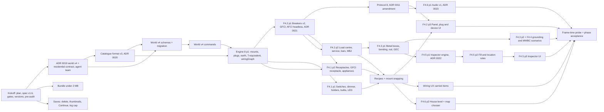

# Phase 4: Lights, switches, receptacles, panels and protection ("First playable sandbox")

**Release:** v0.5.0 · **Status:** Kickoff (2026-11-16); step 1 done · **Spec:** [plan §6 P4](../controls-development-plan.md#p4--lights-switches-receptacles-panels-and-protection-first-playable-sandbox-v050) (v1.5; this kickoff amends it to v1.6, see D13, D7 and D6)

## Goal

The player wires a house. A utility service (pole transformer, drop and meter base, with a sourced split-phase impedance whose line-to-neutral fault current is about 1.58× its line-to-line one at the terminals; 1.5× is the rule of thumb) feeds a load centre in the garage: a main breaker, a bus with plug-on 1-pole and 2-pole breakers (thermal-magnetic, GFCI and AFCI), an isolated neutral bar, a ground bar, a main bonding jumper and a grounding electrode conductor to a ground rod with a real earth resistance. Branch circuits in NM-B run to boxes holding single-pole, 3-way and 4-way switches, an abstracted dimmer, lamp holders with replaceable bulbs, LED fixtures with constant-power drivers, NEMA 5-15/5-20/6-20/14-30/14-50 receptacles and GFCI receptacles with line and load terminals and test and reset buttons, and plug-in appliances draw their load profiles through cords. Grounding and bonding are physical: metal boxes, yokes, conduit and bars bond only through what is mounted, landed or plugged, so a subpanel's neutral bond puts objectionable current on its EGC, a lost EGC leaves a faulted enclosure live, and a multiwire branch circuit that loses its neutral puts one load at well above 120 V. A data-driven inspector cites NFPA 70 article numbers (never their text or tables) for undersized conductors, box and conduit fill, GFCI and AFCI locations, conductor identification and bonding. Breakers, GFCIs and switches make sounds. World document v4, catalogue v3, sim engine 8 and protocol 8 carry it, with a total v3 → v4 migration.

The player-facing proof: in the house sandbox the player wires the panel and its circuits; a hall 3-way works in all four switch states; a bolted short at a kitchen receptacle trips its 20 A breaker magnetically, inside the breaker's published clearing band; a 12 A ground fault downstream of a GFCI trips it in under 25 ms while the breaker holds; the inspector flags a 14 AWG circuit on a 20 A breaker and an unbonded metal box, and reports nothing on the clean house.

**Not in P4** (do not pull forward):

- test instruments (DMM, clamp meter, NCVT, receptacle tester, megger), the shock model, PPE, LOTO and live-dead-live tracking (P5); readouts stay debug or Trainee aids under `console.available` (P3 D16), and `game.probe` stays the scripting probe;
- the fault-injection framework, hidden faults, `fault.*` commands, parallel arcing and insulation breakdown to ground as stamps, the career, jobs, tool ownership and the economy (P5). P4's faults are made with physical things the player already has (D9);
- three-phase panelboards, control transformers, relays, prints and drawn wire numbers (P6); motor loads (P7) — a fridge or fan appliance is a non-motor load profile in P4;
- interrupting ratings, let-through I²t, series ratings and selective coordination; ampacity adjustment for bundling or raceways; GEC and EGC sizing tables; service and feeder load calculations (Art. 220); split-wired receptacles (a broken tab), dual-function AFCI/GFCI breakers, surge protection and smoke-alarm interconnect (P5 content or later);
- a soil model per site (each ground rod carries its earth resistance at a stated reference soil, D5); step and touch potential and earth grids (expansion X0/X2, `plans/expansion-power-systems.md`);
- drawn label text (font atlas, P6), vertical duct and drag-to-length raceways (P6 control panels), pickable test leads (P5's meter and lead overhaul).

## Phase acceptance

- [ ] **The house is wired from the panel out.** `apps/sim-cli/scenarios/house/` holds TypeScript builders shared by every house scenario (`panel.ts`, `circuits.ts`), each scenario a `.ts` with a generated `.console` twin whose equality with the `.ts` command log is staleness-tested (the console's `run` takes console-line files only, ADR 0008). From `content/levels/house.json` at Trainee (D17):
  - `house-panel` places the load centre on the garage studs, the 100 A main breaker on its main mount, the main bonding jumper, the ground-bar kit and a ground rod; lands the service-entrance conductors from the meter base to the main lugs and neutral bar, and the GEC from the ground bar to the rod's acorn clamp. Pinned: `HOUSE_PANEL_HASH`, `HOUSE_PANEL_SNAPSHOT_HASH`. Hand-checked: with one 1500 W heater on L1–N, the bus L1–N voltage equals the T-equivalent hand calculation (EMF minus I · (Z_half + Z_n + R_drop + R_SE + contacts)) within 0.5 %.
  - `house-circuits` adds, on that panel: a kitchen 20 A AFCI circuit in 12/2 NM-B (a 15 A GFCI receptacle, then a 5-20R on its load terminals; a 15 A GFCI on a 20 A circuit with two or more outlets is permitted, 210.21(B)(3), and the inspector must not flag it), a hall 15 A AFCI lighting circuit in 14/2 and 14/3 (two 3-way switches, both boxes with a neutral present per 404.2(C), and a lamp holder with a 60 W A19 bulb), a bedroom 15 A AFCI circuit (a 5-15R and an LED fixture), and a garage 12/3 multiwire branch circuit on a 2-pole 20 A breaker (two 5-20 GFCI receptacles). Every circuit satisfies the plan's own location rules (210.8(A), 210.12(B)), so the clean house really is clean. The AFCI breaker entry states whether it has ground-fault sensing; the kitchen one must not (the GFCI scenario needs it to hold). Pinned: `HOUSE_CIRCUITS_HASH`, `HOUSE_CIRCUITS_SNAPSHOT_HASH`, and in `acceptance-hashes.json`.
- [ ] **A 3-way works.** `apps/sim-cli/scenarios/three-way.ts` at **Journeyman** (every termination spelled out; the 14/3 travellers landed on the switches' screw terminals, the fixture's 14/2 landed with back-stab on the switch side where the device allows it, D17): for each of the four (S1, S2) positions the lamp is lit (`lightOutputRel` inside its L ∝ V^3.4 band) exactly when the positions differ, and the travellers' conductor records show current only in the selected traveller. A 4-way variant (`three-way.ts --four-way`) proves all eight states. Pinned: `THREE_WAY_HASH`.
- [ ] **A bolted short trips the breaker within the curve band.** `apps/sim-cli/scenarios/bolted-short.ts`: on `house-circuits`, a short bolted jumper (a test-lead entry of a few milliohms, not the 41 mΩ bench lead) from the downstream kitchen 5-20R's hot screw to its neutral screw (D9). Hand calculation in `bolted-short.spec.ts`: prospective current from the T-equivalent half winding plus neutral, the drop, the service-entrance conductors, both 12 AWG branch conductors at ambient, every contact, the lead and its clips; engine against hand within 0.5 % at the fault's first solve (about 455–580 A for 15 m of 12/2 depending on the drop and contacts, pre-audit; the hand current must be at least 1.1× the top of the plug-on breaker's instantaneous band, 240–400 A from a manufacturer's published 15–20 A residential curve, so every drawn pickup trips magnetically. If the built house doesn't reach that, shorten the kitchen run or state the drop; never move the band to the scenario). The `tripped` event (cause `magnetic`) falls inside the breaker entry's sourced opening-time band (D6) counted in ticks from the fault, and the 15 A GFCI upstream and the other breakers stay closed. A sim-core unit golden pins I_LN = 8230 A and I_LL = 5208 A (ratio 1.580) at the 25 kVA service terminals, computed with complex phasors (the simulation caveats' P4 obligation). Pinned: `BOLTED_SHORT_HASH`.
- [ ] **A ground fault on a GFCI circuit trips in under 25 ms.** `apps/sim-cli/scenarios/gfci-ground-fault.ts`: the 1500 W heater element (9.6 Ω) from the downstream 5-20R's hot screw to its box's ground screw (≈ 12.3 A residual, D9). The GFCI receptacle's `tripped` event (cause `groundFault`) is less than 25 ticks after the fault and no earlier than its drawn mechanism time; the 20 A breaker does not trip (its thermal fraction stays below 1); the load-side receptacles read 0 V hot–neutral after the trip. Datasheet-style goldens in `sim-core` (D7): no trip at 3 mA for 60 s; trip inside the sourced Class A curve band at 10 mA and 100 mA; the test button trips; reset relatches only with line power and no residual; a GFCI fed on its load terminals never latches (line/load reversal). Pinned: `GFCI_GROUND_FAULT_HASH`.
- [ ] **The inspector flags an undersized conductor and a missing bond, and nothing on a clean house.** `apps/sim-cli/scenarios/inspector-faults.ts`: `house-circuits` with the bedroom circuit's breaker swapped for a 20 A one (14 AWG on 20 A) and a steel 4 in square box in the garage whose cable's EGC is spliced through without a pigtail to the box's ground screw. The `inspect` console query prints exactly two findings (the clean house is laid out to pass every location rule, see `house-circuits`), golden in `apps/sim-cli/src/goldens/inspect/house-faults.txt` (rule ids, `NFPA 70-2023 240.4(D)` and `250.148(C)` by number with the pre-audit's confirmed numbering, the entity and connection ids, and a paraphrase in our own words); `house-clean.txt` is empty for `house-circuits` itself. The same text in Chromium (`apps/game-e2e/src/inspector.spec.ts`).
- [ ] **In the game, with the mouse and keyboard.** `apps/game-e2e/src/house-acceptance.spec.ts` (both transports): New sandbox → House; the load centre placed on the garage studs and one breaker plugged onto the bus with the mouse; one 12/2 run from the panel to the kitchen box with the cable gesture, stripped and landed through the prompts; the rest typed through the console's `run` of `house-circuits.console`; the 3-way switched by clicking both switches in work mode; the bolted short made with a lead; the inspector panel opened. Every logged command equals the script's, and the `HOUSE_*`, `THREE_WAY_HASH`, `BOLTED_SHORT_HASH` and `GFCI_GROUND_FAULT_HASH` pins are reached. A keyboard-only variant plugs a breaker onto the bus and presses the GFCI's test and reset with no pointer press. Audio: the trip plays the breaker cue (asserted through the audio test hook, D15). `apps/desktop-e2e/src/house.spec.ts` reaches `HOUSE_CIRCUITS_HASH` and `GFCI_GROUND_FAULT_HASH` in Electron.
- [ ] **Grounding, bonding and MWBC behave physically** (F4.3, F4.4; headless goldens with hand calculations in the spec):
  - `subpanel-bond.ts`: a garage subpanel fed with 8/3 NM-B (10 AWG EGC) with its neutral bonded: the feeder EGC carries the share of the return current the current divider predicts (about 39 % at ambient, from A₁₀ / (A₁₀ + A₈) with the contacts counted) within 0.5 %; unbonded, it carries under 1 mA.
  - `lost-egc.ts`: a hot-to-enclosure fault in a steel box whose EGC is unlanded: the box's `touchVoltageV` (against remote earth) equals the hand value within 0.5 %, no breaker trips; with the EGC landed, the breaker trips magnetically.
  - `mwbc-lost-neutral.ts`: the garage MWBC with two fixed-resistance appliances (for example 9.6 Ω and 48 Ω) and its shared neutral unlanded at the panel: each load's voltage equals the series divider across L1–L2 within 0.5 % (≈ 40 V and ≈ 200 V); with the neutral landed, both read 120 V within the drop; the lower-wattage A19 lamp on the same leg reaches `burnedOut` (D1). Same-leg miswiring of the MWBC shows a neutral current equal to the sum, not the difference, of the two loads.
  - `earth-path.ts`: a hot-to-earth fault into a **separate** ground rod (not the service's: a fault to the service rod returns through the GEC and trips the breaker) draws V / (R_rod + (R_utility ∥ R_service-rod)) within 0.5 % (≈ 2.70 A at 40 Ω, 5 Ω and 40 Ω) and trips nothing (the Art. 250.4(A)(5) teaching point).
- [ ] **Determinism.** Byte-identical: every scenario above across two runs, a replay, the Chromium worker on both transports and Electron; the AFCI's seeded detection (D8) identical across runs, a save and load, and both transports; saving mid-run with a tripped GFCI, a part-heated breaker and hot terminations → load → advance equals running straight through (property and scenario).
- [ ] **Budgets** (§4.5, §4.9) in `pnpm verify`, new cases in `BENCH_CASES`: `tick-house` (the acceptance house, every circuit loaded) under 0.3 ms per cadence tick with a 0 B allocation gate; `tick-protected-plant` (the wired plant with plug-on breakers, 100 GFCIs and 50 AFCIs; the protection layer runs every tick) under 0.3 ms; `house-trip-resolve` (the re-solve after a breaker trip in the house) under the calibrated 2 ms; `inspect-house` and `inspect-wired-plant` reported with `budgetMs: null` (the spec sets no inspector budget); `intermittent-toggle-wired` headroom restored (carried) or reported, never loosened. Frame time of the wired house recorded on SwiftShader (`apps/game-e2e/src/house-frame-time.spec.ts`, not gated) and on a real GPU by the user.
- [ ] **Saves.** World v4 with a total v3 → v4 migration (every v1, v2 and v3 fixture migrates and validates); round-trip properties on v4 for JSON and the container; `*.v4.schema.json` with staleness; 0.4.0 saves (catalogue 2, engine 7) load as `engine-changed`, never refused, with a fixture test; every P3 command's argument schema byte-unchanged (SHA-256 pins in `command-args.spec.ts`, as for the leads).
- [ ] Every new device, rule, table value and electrical constant has a `source`, with an `electrical-realism-reviewer` sign-off recorded in its PR. No NEC/NFPA text or table reproduced; article numbers only; fictional brands only.
- [ ] `pnpm verify` green on all three OSes; every new dependency (none expected) has a `THIRD_PARTY_NOTICES.md` row; the initial bundle under 2.00 MB (D19).

## Kickoff (before F4.x PRs)

1. [x] **No new specialist** (D21; §10.2 lists none for P4). Update the briefs and `CLAUDE.md` routing: `content-designer` owns `content/rules/` and `content/levels/house.json`; `electrical-realism-reviewer` also reviews every inspector rule's paraphrase and article number; `renderer-engineer` owns audio (`libs/rendering/renderer/src/lib/audio/`) and the house props; the main agent owns `@controls/inspector` and the new commands, with `sim-engine-engineer` for `wiringGraph`. Spec amended to **v1.6** (D6, D7, D13).
2. [ ] **Kickoff decisions D1–D22** (below), defaults taken unless the user answers an open question.
3. [x] **Agent-team contract, ADR 0019 "World document v4 and the residential contract"**, before any v4 code. Team: `save-format-guardian` (lead), `sim-engine-engineer`, `renderer-engineer`, `angular-ui-engineer`, `content-designer`. It pins: `EntityV4.pluggedInto`, `ConnectionV4.marking`, `WorldV4.areas`, the `lamp.incandescent` `burnedOut` key (D1); the v3 → v4 migration; every new command id and argument shape (`plug.insert`, `plug.remove`, `wire.mark`, `panel.directory`, `device.press`) and refusals; **what the compiler reads** (D3: mount contacts from `mountedOn`, conduit bonding from `inEntry`, plug contacts from `pluggedInto`, the remote-earth node, D5); the hash scope; the catalogue v3 field list it depends on (D2); and the protocol 8 records and events (an ADR 0011 amendment signed by `renderer-engineer` and `angular-ui-engineer`). _Accepted 2026-11-17 after four reviews ([ADR 0019](../docs/decisions/0019-world-document-v4.md)); the amendments below (D1, D3, D4, D7, D8, F4.3, determinism hooks) follow it._
4. [x] **Boundary and gate PR** (`test-engineer`): the `libs/domain/inspector` scaffold (`type:domain`, depends on `catalog`, `save-format`, `world-model`, `sim-core`) with its `lint-boundary.spec.ts` probe; the D6 maths lint extended to the protection and grounding code paths that are new (already all of `sim-core`) and to `libs/domain/inspector`; `MIRRORS` rows for `content/rules/`; the pending bench cases above; the house frame-time scaffold behind `CONTROLS_MEASURE_HOUSE=1`. _Done:_ `@controls/inspector` with a placeholder export, boundary probes both ways (it reads the four domain libs and is refused features, UI, rendering, platform, the worker and framework packages; features and UI may import it); D6 over all of `libs/domain/inspector` source (probes in `lint-determinism.spec.ts`; the protection and grounding code lives in `sim-core`, already covered); `PENDING_BENCH_CASES` holds `tick-house`, `tick-protected-plant`, `house-trip-resolve`, `inspect-house` and `inspect-wired-plant` (pinned in `bench.spec.ts`); `house-frame-time.spec.ts` behind `CONTROLS_MEASURE_HOUSE=1`. **The `content/rules/` `MIRRORS` row moves to catalogue v3 (PR 6):** git can't hold an empty directory, a mirror's directory may hold only `*.json` files (no `.gitkeep`), and a placeholder rule file would be content that isn't a rule set, so the row lands with `nec.v1.json` ([workspace caveats](../docs/caveats/workspace.md)).
5. [ ] **`release-engineer` re-checks versions and licences:** Electron 45.0.0 → the latest 45.x patch (45.3.x at the time of writing; a patch upgrade in its own PR with `desktop-e2e` and the Fuses check green on three OSes, `electron-platform-engineer` reviewing); whether three r186 is still current (the open P3 kickoff item 7); Angular 22.x, Nx 24.x and Playwright patches; whether electron-builder 27 is out (then set `WasmTrapHandlers` explicitly, carried from P2). No new dependency expected (WebAudio is a platform API). Record the public references used for P4's physics (IEEE Std 142 for rod resistance, short-circuit guides for the half-winding impedance, manufacturers' time-current curves and GFCI application notes) as references, not code.
6. [x] **Pre-audit by `electrical-realism-reviewer`** of the source list before the catalogue v3 values land: the centre-tapped transformer half-winding impedance factors (1.5 R, 1.2 X per unit on the 120 V base) and a utility neutral grounding resistance; residential plug-on breaker time-current data (the thermal band and the instantaneous clearing band, UL 489 by number); UL 943 Class A GFCI pickup (not above 6 mA, not below 4 mA) and its inverse-time trip limit as published in manufacturers' application notes, plus the mechanism time; UL 1699 AFCI behaviour (detection-time band, by number); UL 498 push-in (back-stab) limits (14 AWG solid copper); NEMA WD 6 configurations (by number) and which plugs mate which receptacles; Dwight's single-rod formula (IEEE Std 142 by number) and a reference soil resistivity; marked box volumes (UL 514A by number) and the box-fill and conduit-fill allowances (Q1); constant-power LED driver dropout voltage; appliance load profiles; and the NFPA 70-2023 article numbers each inspector rule cites (Q2). Its vetted values and must-avoid list go into ADRs 0020 and 0021. _Done 2026-11-17, changes requested and applied to this plan:_ see [Pre-audit outcome](#pre-audit-outcome-2026-11-17).
7. [ ] **P3 and P2 carried items** triaged in [Carried into P4](#carried-into-p4) below.

## Kickoff decisions (2026-11-16)

Defaults recommended at kickoff. D6, D7 and D13 amend the spec (v1.6) and are listed for the user's review at the end of P4; none blocks work.

- **D1 World v4 shape.** One `schemaVersion` 4 for the phase, provisional until v0.5.0. New, all non-optional (null or empty when absent):
  - `EntityV4.pluggedInto: { entity, outlet } | null` — an appliance's cord plug in a receptacle outlet (`outlet` an id from the receptacle entry's `outlets`). A relation, not a transform: the appliance stands where it was placed, within its cord's reach (`cordLengthMm`, refused `out-of-reach`). At most one plug per outlet.
  - `ConnectionV4.marking: { a: ColourId | null, b: ColourId | null }` — re-identification tape at each end (Art. 200.7 by number), set by `wire.mark`.
  - `WorldV4.areas: { id, use, minMm, maxMm }[]` — axis-aligned level zones (`kitchen | bathroom | garage | outdoor | laundry | bedroom | living | hall | basement | crawlSpace`; ids from the append-only `AREA_USES` registry, not a closed enum, ADR 0019), level data for the inspector's location rules; no command creates them in P4.
  - `lamp.incandescent` gains a sticky sim key `burnedOut` (filament open for good above a sourced temperature) and `overvoltageSinceTick` (the F4.4 dwell, so the event survives a save), migrated `false` and `null` by a frozen list of the shipped lamp refs.
  - The persisted and derived key lists of every new kind (breakers, GFCI, AFCI, LED driver, load centre, switches, dimmer, appliances) are in [ADR 0019](../docs/decisions/0019-world-document-v4.md#sim-and-commanded-state-keys).

  Deliberately **not** in v4: the panel directory (a commanded state key of the new load-centre kind, D14), the main bonding jumper and ground bar (devices mounted on the load centre, D3), the bus (mount contacts, D3), remote earth (implicit in the compiler, D5). _Rejected:_ a cord as a `connection` (a three-conductor cord is three connections with plug "terminals" that aren't screws); a plug as `mountedOn` (mounting fixes the transform at the host).

- **D2 Catalogue v3** (`catalogVersion` 3, provisional until v0.5.0; ADR 0020). Format additions: a terminal `role` (`ungrounded | grounded | egc | traveller | common | line | load | null`, plus `side: 'line' | 'load' | null` for GFCI devices) that the inspector reads and the sim never does; a per-method `multiConductor: { awgRange, equalSize } | null` (the carried P3 cap: the 4 mm² screw cage takes two only up to 16 AWG, equal sizes); `EnclosureSpec.markedVolumeMm3` (from the maker's marking, nullable) and `material: 'steel' | 'nonmetallic'`; mount-type contacts (D3); receptacle `outlets: { id, config }[]` and appliance `plug: { config, cordAwg, cordLengthMm }` over a code registry `NEMA_CONFIGS` (which plug mates which receptacle, NEMA WD 6 by number); a `momentary` control type (D7). Existing entries are frozen by `shipped.spec.ts`; where a v3 field changes behaviour for a shipped entry (the 4 mm² block's cap) a new entry version ships (`tb.quennick-st4@2`), so 0.4.0 saves keep loading.
- **D3 Electrical mounts: the compiler reads `mountedOn`, `inEntry` and `pluggedInto`** (ADR 0019; amends ADR 0011 §7 and ADR 0015's compiler section). The host's enclosure mount declares its host terminals (and, for a bus, an integer pitch and a per-mount leg pattern); the device's mount declares contacts `{ id, terminal, positionOffset, contactOhm }`, `contactOhm` per entry and sourced. A bus position's leg comes from `busStabIndex` (one world-model function): each column indexed from 0, legs alternating **by row**, both columns starting on the same leg, so spaces 1 and 2 are L1 and 3 and 4 L2 (corrected from "odd spaces L1, even L2", ADR 0019). Each contact compiles to one resistor branch with that sourced contact resistance (a bus stab from makers' watts-loss data; an E26 base and a yoke-screw bond game-design), never an ideal join, so bus, bond and plug currents are known. Metal-to-metal bonds (a yoke on a steel box, a ground bar kit on the can, an MBJ) are contacts to the host's `chassis` terminal. Conduit bonding through `inEntry` (EMT as an EGC) is **deferred past P4** (ADR 0019 deviation 7): conduit joints are drawn, not wired, there is no sourced joint impedance and no acceptance needs it. No thermal node on mount contacts in P4 (an abstraction, documented). _Rejected:_ commands that wire bus and bond "virtually" (wired, not drawn); ideal joins (no current, so no objectionable current reading).
- **D4 The service and the T-equivalent.** A new kind `service.splitPhase` (the pole transformer, the drop and the meter base as one entity; terminals at the meter base's load-side lugs) uses the T-equivalent from the simulation caveats: Z_full / 2 in each line plus Z_n = Z_LN − Z_full / 2 in the neutral, with the half-winding factors as sourced sim-core constants applied to **every** split-phase source (`utility.splitPhase` and the generator stub included; an engine-8 change, no catalogue change). ADR 0019 pins only the terminal behaviour (Z_full / 2 per line, Z_n in the neutral, the I_LN 8230 A / I_LL 5208 A golden); there is **no negative branch element**: ADR 0021 chooses the representation, recommended as an eliminated coupled 2 × 2 source impedance [[Z_h + Z_n, Z_n], [Z_n, Z_h + Z_n]] (real part positive definite), so split-phase `topologyHash`es don't move; the oracle deck uses the T with negative R and L if ngspice accepts it, else K-coupled inductors. The drop's resistance is derived (ρL/A) from params. The P3 stand-in (`utility.larkmoor-split-phase-25kva@1`) stays for the workshop and old saves; the house uses the service. _Rejected:_ a mutual-inductance element between the halves (a new element kind that moves every `topologyHash`); an internal centre-tap node with a negative neutral element (breaks the AC solver's singularity argument and the R > 0, L > 0 stamps).
- **D5 Remote earth.** One implicit `earth` node per netlist (a compiler-only terminal ref, never in the world). The service's transformer neutral reaches it through a sourced utility grounding resistance; a ground rod through its `earthResistanceOhm`, computed offline from Dwight's formula at a stated reference soil (the spec computes it with `Math.log`; sim code never does, D6 lint). Records report enclosure voltages against it (`touchVoltageV`). A `CNT` encoding bump if the hash needs one. Forward-compatible with the expansion's earth grids.
- **D6 Breakers v2** (spec v1.6: the bolted-short clearing band). New kinds `breaker.plugOn1p`, `breaker.plugOn2p` (common trip; one bimetal per pole), `breaker.gfci1p` and `breaker.afci1p` (with a pigtail neutral and a load-neutral terminal). Above the magnetic pickup the breaker opens after an opening time drawn once per bank build from its entity stream inside the entry's sourced clearing band, instead of within the tick (P2's model, which opens faster than any published curve). The DIN `breaker.thermalMagnetic` keeps its P2 behaviour and its kind. A tripped event carries its cause (`thermal | magnetic | groundFault | arcFault | test`).
- **D7 GFCI model** (spec v1.6: §4.5's "above 5 mA trips in under 25 ms" becomes UL 943 Class A behaviour). A GFCI compiles its hot and neutral poles as branches and senses the residual |I_hot + I_neutral| each tick. Pickup is drawn once from its own entity stream as min + (max − min) u over the entry's band (4–6 mA; the region profile holds the Class A limits), and the mechanism time likewise (ADR 0019 stream keys); trip time follows the sourced inverse-time limit **tabulated as a rate (1/t)** at the pre-audit points (6, 10, 20, 30, 50, 100, 150 and 264 mA) and interpolated linearly in rate, which stays inside the limit (linear in t overshoots it by up to 22 %; a power law needs `Math.pow`, banned by D6); the curve is an upper limit only, so any lower edge is labelled game-design; above 264 mA the trip is the drawn mechanism time (3–14 ms: detection delay, the half-cycle SCR wait and the solenoid), never a clamp at 25 ms; no UL 943C class values, integrated as Σ dt / t(I) ≥ 1 for a varying residual, floored by a drawn mechanism time. Test and reset are `momentary` controls pressed with `device.press` (a commanded press counter the bank sees through the `commanded` hook; one logged command per press). The test injects its residual through a real internal resistor; reset latches on line power alone (decided at the press from the last solution); with a standing ground fault it re-trips through the normal path no earlier than the mechanism time; a new GFCI starts unlatched, and fed on its load terminals it never latches. _Rejected:_ a held `test` toggle (two commands per press, and a test the player can leave held).
- **D8 AFCI.** Detection of series arcing (ADR 0018's `arcing` end state) on a conductor whose current passes through the AFCI (its load side), as a probabilistic trip (realism charter §3.2): the persisted `arcExposure` grows by Δt / T_limit(I) over each 100-tick bucket in which a downstream end arcs at I ≥ 5 A ("only arcing buckets count" is game-design; it resets after a quiet gap since `arcLastSeenTick`), and at each absolute bucket boundary the AFCI trips if u < Δx / (1 − x_prev), u from the `entity:<id>:afci` stream mixed with the bucket index by integer operations (ADR 0018's intermittent pattern, ADR 0019), so the outcome is a pure function of seed, id, bucket and the persisted keys, identical across replays, transports and a save and load. "Downstream" is a cut set, computed lazily only when some end is arcing. No parallel-arc stamp (P5).
- **D9 Acceptance faults are physical.** A bolted short is a test lead between two terminals; a ground fault is a resistive load (the heater element, or new test-resistor entries for the GFCI curve) between hot and ground. No `fault.*` command before P5's framework.
- **D10 Wiring devices** (new kinds; none reuse `switch.spst`, whose terminal set is fixed): `switch.wall1p`, `switch.wall3way` (`position` selector), `switch.wall4way` (`straight | crossed`), `dimmer.wall` (a `setpoint` 0–1), `lampholder.e26`, `lamp.incandescent` A19 bulbs and `light.led` bulbs that mount on `e26`, `light.ledFixture`, `receptacle.duplex`, `receptacle.single`, `receptacle.gfci`, `appliance.*` (D12). Each has a `ground` terminal bonded to its yoke. The dimmer is abstracted as a lossless series reactance chosen at each solve so the load sees the RMS voltage of a forward-phase-cut sine at its level (from a tabulated curve; a value-only re-solve like the lamp's), so it dissipates nothing and a meter later reads the drop across it. _Rejected:_ a series resistance (fictitious heat); a voltage-controlled source stamp (new element kind, moves `topologyHash` and the oracle).
- **D11 LED constant-power driver.** Y = conj(S) / |V|² updated at each solve with the lamp's 1 % value-only re-solve rule; below a sourced dropout voltage the driver draws nothing (a stable branch); iteration capped, `nonConverged` reported, never hidden. Light output is constant above dropout.
- **D12 Appliances and plugs.** `appliance.resistive` (kettle, toaster, space heater) and `appliance.constantPower` (TV, computer, charger) with `on` and an optional deterministic duty cycle (period, duty, phase from the entity stream). Cord resistance derived from `cordAwg` and `cordLengthMm` like a conductor (no thermal node in P4). `plug.insert` refuses a configuration that doesn't mate (`wrong-configuration`: a 5-20P won't enter a 5-15R; a 6-20P won't enter a 5-20R).
- **D13 Inspector** (spec v1.6 amends §4.2 with `libs/domain/inspector`). A rules engine over the world, the catalogue and the region profile: check kinds are code (a registry like `MODEL_KINDS`), rule sets are data (`content/rules/nec.v1.json`: id, article by number with edition, a short paraphrase in our own words, severity, check kind and params, `source`). Connectivity comes from `sim-core`'s new `wiringGraph` (the compiler's own join rules with switching devices treated as closed and protective devices as line → load paths), so the inspector and the simulator never disagree about what is connected; ampacity from `derivedAmpacityA` (ADR 0018 §9; at 60 °C for an NM assembly, Art. 334.80). Findings are derived, never stored or hashed; `inspect` is a console query (`CONSOLE_QUERY_ARGS`) and `game.inspect()`. _Rejected:_ the inspector in `world-model` (duplicating the compiler's joins; `world-model` cannot import `sim-core`); in `scripting-api` (a facade, not a home for rules).
- **D14 Panel directory.** A commanded state key `directory` (space number → label text) on the load-centre kind, edited with `panel.directory {id, space, text}`; it may be wrong (that's P5's mislabelled-breaker fault). Breaker `entity.label` stays available. The inspector checks every used space is described (Art. 408.4 by number).
- **D15 Audio v1.** WebAudio in `libs/rendering/renderer/src/lib/audio/`, procedurally synthesised (no samples: no asset licence rows, no bundle cost), positional at the source entity, driven by sim events, records and applied commands (a breaker trip, a handle on or off, a GFCI trip, test and reset, a switch click, a plug in or out, a crackle loop while any end is arcing, a faint panel hum scaled by bus current). It uses the existing `settings.audio` volumes (settings v1 already stores them "until audio arrives in P4"; no settings bump). The context starts on the first user gesture. Every cue with gameplay meaning is also announced in the existing polite live region. A test hook records cues for E2E. Presentation only: nothing in the domain or the hash.
- **D16 The house level.** `content/levels/house.json`: a small single-storey house (kitchen, bathroom, two bedrooms, living room, hall) and an attached garage, as built-in props (stud walls, top plates, ceiling joists, floor and slab) plus `areas`; the service entity pre-placed on the exterior wall and nothing else (the player builds the rest). New sandbox gains a map chooser (Workshop, House); the workshop and its hash are otherwise unchanged.
- **D17 Acceptance difficulty.** The house scenarios run at Trainee with `'auto'` terminations (P3 proved the tool steps at Journeyman); the 3-way scenario runs at Journeyman so the new devices' termination specs, back-stab included, are exercised end to end.
- **D18 Versions.** `schemaVersion` 4, `catalogVersion` 3, `SIM_ENGINE_VERSION` 8 and `SIM_PROTOCOL_VERSION` 8, each provisional until v0.5.0 (later P4 PRs re-pin in place, one old → new list per version in the CHANGELOG). Protocol 8: records for every new kind (bus and neutral currents, per-pole currents, residual mA, `touchVoltageV`, driver state, appliance power), the connection record's degradation factors (the carried readout item), the extended `tripped` causes, and `lampBurnout` and `overvoltage` events. _Done for the kinds on main (PR 11, [ADR 0011 amendment](../docs/decisions/0011-sim-worker-contract.md#amendment-protocol-8-residential-records-and-events-p4), sign-off by `renderer-engineer` and `angular-ui-engineer` pending):_ records for the plug-on, GFCI and AFCI breakers (per-pole currents, `state` and `tripCause`, `residualMa`, the line-side voltage, `arcExposure`, `arcingDownstream`), the service (per-leg and neutral currents, the utility grounding's) and the ground rod (`touchVoltageV`); the lamp's `burnedOut`; the degradation factors; `tripped` causes typed on the wire; the `lampBurnout` and `overvoltage` schemas; pending schemas for the LED driver and dimmer (PR 12 registers them). **Left for their PRs, each an in-place re-pin:** emitting `lampBurnout` (PR 12) and `overvoltage` (F4.4); appliance power, the GFCI receptacle and receptacle face voltages (PR 13); the load centre's bus, MBJ and GEC currents and `touchVoltageV` on `chassis` kinds (PRs 14, 15); the UI rules for the events (toast with cause, `test` announced only; PRs 18, 23). Deviations in the amendment (a GFCI breaker's `state` is the breakers' enum; `readings` bits on the sensing breakers; the lamp's `status` at byte 49).
- **D19 Bundle size.** The initial bundle (2.53 MB measured at v0.4.0, over the 2.00 MB warning) goes back under 2.00 MB before P4's new UI lands: lazy-load the termination prompts, fish tape, wire readout, netlist inspector and settings dialog (`@defer` / `loadComponent`); every new P4 panel is lazy from the start. If it can't, raise the warning only with a written rationale in its own PR (P3 D18 rule). _Done (PR 3, `perf(game)`): initial 2.53 MB → **1.17 MB** (estimated transfer 567 kB → 277 kB), budget unchanged. The named UI alone was about 150 kB of the 529 kB over, so `ctl-viewport` itself is `@defer (on immediate)` (three.js, the renderer, three-mesh-bvh and every prompt and readout inside it, a 1.34 MB lazy chunk); the netlist inspector loads on first open and the settings dialog on first open (prefetched on idle, from `@controls/feature-settings/dialog`). Focus into a lazy block waits for it to render. The lazy panel rule is in the [UI caveats](../docs/caveats/ui.md)._
- **D20 Fault I²t on conductors.** The connection thermal bank stays on its fixed 10-tick cadence (ADR 0018); a fault shorter than one cadence is integrated as sample-and-hold, an error bounded by one cadence interval, documented. Revisit when let-through matters (P5/P7).
- **D21 Specialists.** None new (kickoff step 1). A code-compliance reviewer was considered and rejected: it would duplicate `electrical-realism-reviewer`'s "no NEC text, cite by number" check.
- **D22 Carried items.** As decided in [Carried into P4](#carried-into-p4).

## Build order

One feature per PR; F4.1–F4.6 land in parts.

- **Contract track** (critical path): ADR 0019 → catalogue v3 → world v4 → world v4 commands → engine 8 part 1.
- **Physics track** (`sim-engine-engineer`): engine 8 part 1, breakers v2 and GFCI/AFCI, protocol 8; then the models behind each content part.
- **Content track** (`content-designer`, through `electrical-realism-reviewer`): F4.1 parts 1–2, F4.2 part 2, F4.3 part 1, the rules data, the house level.
- **Renderer and UI track:** recipes and mount snapping → the panel, plug and device UI → wiring UX → inspector UI; audio once protocol 8 lands.
- **Integration:** grounding and MWBC scenarios, the frame-time probe, acceptance PRs A (headless) and B (browser and desktop), then the user's manual checks.

## Features

### Kickoff PRs: catalogue v3, world v4 and its commands (D1–D3, D12, D14)

**Catalogue format v3** (owner `content-designer`; reviewers `save-format-guardian`, `electrical-realism-reviewer`; ADR 0020):

- [x] Terminal `role` and `side`; per-method `multiConductor`; `EnclosureSpec.markedVolumeMm3` and `material`; mount-type contacts with sourced contact resistance; receptacle `outlets`, appliance `plug`; the `NEMA_CONFIGS` and new `MOUNT_TYPES` rows (`busStab` linear by space with phase by position, `mainBreaker`, `mbj`, `groundBarKit`, `e26`), the `momentary` control type. Source coverage paths extended; `device.v3.schema.json` exported; `docs/guides/authoring-content.md` updated. _Done (PR 6, [ADR 0020](../docs/decisions/0020-catalogue-format-v3.md)):_ plus terminal `access`, terminal families, a device contact's `host`, the bus pattern `{ pitchMm, stabs, legs }`, the single-mount anchor `alongMm`, `hostMounts` for a lampholder (R5), panel `spaces`, `supersededBy`, the `text` and `counter` key types and `AREA_USES`; `mainFeed` chosen over `mainBreaker` (ADR 0019 left it open); contact resistances covered at `fits.<type>.contacts.<id>.contactOhm`. Deviations in ADR 0020.
- [x] `RegionProfile` (in `libs/domain/catalog/src/lib/region.ts`) gains `protection` (GFCI class and its sourced band, AFCI) and `inspectorRules: { table, version }`; NEC only. _Done:_ named `{ ruleSet, version }` (ADR 0020 deviation 6); the Class A limit stored as eight offline points.
- [x] `content/rules/` as a mirrored, sourced, staleness-tested family (`content-mirrors.spec.ts` row); rule ids append-only like colour ids. _Done:_ `nec.v1.json` seeded with 240.4(D), 250.148(C) and 210.11(C)(1), each `check: null` until PR 20; frozen in `shipped.spec.ts` from catalogue 3.
- [x] `tb.quennick-st4@2` with the two-conductor cap; `@1` unchanged. `shipped.spec.ts` masks the v3 fields for catalogue-2 releases only, with self-tests. `catalogVersion` 3 in `docs/history.md`. _Done:_ the mask covers catalogue-1 releases too (0.3.0 lacked the fields as well); `@1` gains `supersededBy`; twelve `-engine-7-catalog-3.ctrl` fixtures, 0.4.0's catalogue-2 saves load `engine-changed`. Raised: `tb.quennick-pe4@1` has the same two-conductor abstraction and isn't versioned.

**World v4 schemas** (owner `save-format-guardian`):

- [x] `v4/world.ts`, `v4/manifest.ts`, `v4/replay-log.ts`, total `v4/from-v3.ts` (entities gain `pluggedInto: null`, connections `marking: {a: null, b: null}`, `areas: []`, the shipped lamps' bags `burnedOut: false` and `overvoltageSinceTick: null` by a frozen ref list, ADR 0019); v1–v3 untouched. _Done (PR 7):_ plus the `OutletId`, `AreaUseId` and `AreaId` primitives (the catalogue's copies deleted, re-exported), `DeviceStateBagV4` (its description covers `text` and `counter`), the `LAMP_INCANDESCENT_REFS_V3` parity test against 0.3.0's and 0.4.0's frozen catalogues, and `lamp.incandescent`'s two keys in `MODEL_KINDS` (engine 7 carries them through).
- [x] Invariants: `pluggedInto` names an existing entity and outlet, one plug per outlet, never with `mountedOn`; `marking` colours are table ids; areas sorted by id, non-empty boxes. Catalogue-dependent checks (outlet ids, configuration mates, reach) in `checkWorldReferences`. _Done (PR 7):_ one cycle walk over mounts, entries and plugs; the shared `checkPlugInsert` and `plugReach` (written here for the load check, PR 8's command calls them); tape never `bare`; area uses in `AREA_USES`; `directory<n>` above the panel's `spaces` null; `mountedOn` through `offeredMounts`; interim `plugged`/`occupied` guards in the P3 entity commands. `busStab` positions (PR 8) and `tripCause` consistency (PR 10) wait for their functions and kinds.
- [x] Fixtures in `fixtures/v4/` (a plugged appliance, marked conductors, areas, a tripped GFCI mid-run, a burned-out lamp); every older fixture migrates; round-trip properties; `*.v4.schema.json` staleness. The workshop rewritten as v4; every golden hash re-pinned once and listed old → new. _Done (PR 7):_ `house-relations.json` and `protection-state.json` (fixture-only refs for the new kinds until ADR 0021), nine refused fixtures, the twelve `-engine-7-catalog-3.ctrl` saves written as v4 (the v3 ones kept under `fixtures/v3/ctrl` as regressions that migrate to them) and `house-relations.ctrl`; 34 world hashes (30 in Node specs, 4 built only in the Chromium e2e) and the container golden re-pinned (CHANGELOG).

**World v4 commands** (main agent; `save-format-guardian` reviews, frozen in `json-schema/command-args/`):

- [x] `plug.insert {appliance, receptacle, outlet}`, `plug.remove {appliance}` (`wrong-configuration`, `outlet-occupied`, `out-of-reach`, `not-an-appliance`); `wire.mark {id, end, colour}`; `panel.directory {id, space, text}`; `device.press {id, control}` (momentary controls only, `not-momentary`). None reads sim state. _Done (PR 8):_ plus `plug-cycle`, `already-plugged`, `not-a-receptacle`, `unknown-outlet`, `not-axis-aligned` (`checkPlugInsert` unchanged), `not-plugged`, `not-a-wire`, `unavailable-colour`, `not-a-panel`, `unknown-space`, `ids-exhausted`; `device.operate` refuses `momentary`; the operate key flips a two-option selector; `lead.connect` refuses `inaccessible`; landings enforce `multiConductor` (`multi-conductor-out-of-range`); `busStabIndex`/`busStabLeg` and the `busStab` mount and load check; snapping and the ghost read `offeredMounts`, the single-mount anchor and bus stabs; `beltChoices` hides superseded entries; `entityPurposeStreamKey` with golden first outputs. ADR 0019 implementation notes (PR 8).
- [x] Undo restores relations and counters (properties); deleting a receptacle unplugs what's in it; deleting an appliance removes its plug. _Done (PR 8):_ `world-v4-properties.spec.ts` (validity, undo-all, replay, counters, no sim reads); `entityHold`/`moveBlocker`/`WorldPlacementFailure` gain `plugged`.
- [x] Palette forms render every new command; console lines and TS scripts reach the same hash; P3 argument schemas byte-unchanged. _Done (PR 8):_ `x-controls-options` suggestion lists (`argOptionChoices`), only the first reference of each kind prefilled; one hash pinned by the console file, the TS script (`scripting-api` `world-v4.spec.ts`) and the palette forms (`feature-palette` `world-v4.spec.ts`); every P3 schema pinned by a hint-stripped SHA-256 (`command-args.spec.ts`). Keybindings deferred to the panel UI (part 3; ids named there).
- [ ] A replay-log fixture under `fixtures/v4/replay-log/` exercising all five world v4 commands (`plug.insert`, `plug.remove`, `wire.mark`, `panel.directory`, `device.press`) with an undo and a redo, written from a `sim-cli` scenario once the content PRs ship real receptacles, appliances, a load centre and a GFCI (until then the TEST-ONLY residential catalogue covers them in specs).

### Engine 8 part 1: mounts, plugs, earth and the service (D3–D5)

Owner `sim-engine-engineer`; `electrical-realism-reviewer` signs off; ADR 0021 (service, grounding and protection physics), part 1.

- [x] The compiler reads mount contacts, `inEntry` bonds and plug contacts as resistor branches (D3); the implicit `earth` node (D5); `topologyHash` pins for each; `CNT` encoding bump only if needed. _Done (PR 9, [ADR 0021](../docs/decisions/0021-service-grounding-and-protection-physics.md) §3–§5):_ mount and plug contacts and earth links as `contact`-model resistor branches after the connections, `absent-contact` when both sides declare one that can't compile, the earth node at entity 0 (node 0 when present); a golden per relation and for the earth node, and the byte layout of a contact branch; `CNT` stays at version 1 (tag 2, relation codes 0–3). `inEntry` bonds stay out (ADR 0019 deviation 7; the `entry` code is reserved). An incremental-against-scratch, permutation and `wiringGraph` property over random residential worlds.
- [x] The T-equivalent for every split-phase source (D4), with the negative neutral branch permitted inside the source network only; golden I_LN 8230 A and I_LL 5208 A on the 25 kVA unit (ratio 1.580; 1.5 is the rule of thumb), within 0.5 % of the complex-phasor hand values; the half-winding factors are for the 25–100 kVA class, and applying them to the generator stub is a labelled abstraction; utility neutral grounding 5 Ω, game-design inside a sourced 1–25 Ω range; ngspice oracle cases regenerated for it (`pnpm sim oracle regen`, corpus and results together). _Done (PR 9, ADR 0021 §1, §7):_ no negative branch at all: the neutral arm is eliminated into a coupled 2 × 2 source impedance (ADR 0019 §7's recommendation), checked symmetric and positive definite at every solve, its own factorisation-cache class; I_LN 8229.96 A and I_LL 5208.33 A within 1e-5 (`ac-source.spec.ts`, `ac-coupled.spec.ts`); the oracle's AC corpus couples the first two sources of about half its two-source circuits (decked as controlled sources, ADR 0021 deviation 3), regenerated and inside the 10× margin. The realism review sourced the factors to Kersting's centre-tapped transformer approximation (reproduced by EPRI's 25 kVA example) and dropped the unsourced "25–100 kVA class" for "typical single-phase centre-tapped distribution transformers" (ADR 0021 reference notes).
- [x] `service.splitPhase` kind (transformer, derived drop resistance, utility neutral to earth). `wiringGraph` exported for the inspector, property-tested against `compileNetlist` (every pair joined in the netlist with switches closed is joined in the graph). _Done (PR 9, ADR 0021 §2, §3, §6):_ plus `electrode.groundRod`; the service's fourth terminal `x0` (the transformer neutral at the pole, where the utility's grounding sits; deviation 2); the earth-path golden (2.704 A into a separate rod, nothing trips) and a fault into the service rod returning through the GEC and the bond, on test entries (`service.spec.ts`; the scenario itself stays F4.3 part 2's).
- [x] `SIM_ENGINE_VERSION` 8 (provisional); every scenario re-pinned once; new `-engine-8-catalog-3` fixtures; the `-engine-7-catalog-2` ones kept and loading as `engine-changed`. _Done (PR 9):_ the split-phase line-to-neutral scenarios moved (lamp circuit, bad termination, mains, the fused saves; CHANGELOG old → new), the DC and line-to-line ones didn't; the never-shipped v4 `-engine-7-catalog-3` saves are replaced, the v3 ones load `engine-changed`. `SIM_PROTOCOL_VERSION` 8 starts here with the descriptor's part (ADR 0021 deviation 1). Not here: the lamp's `burnedOut` and `overvoltageSinceTick` stay carried through (deviation 5) and the numeric structure code waits for kinds with sim topology keys (deviation 6).

### F4.1 Wiring devices

Owners `content-designer` (entries), `sim-engine-engineer` (models), `renderer-engineer` (recipes, with the recipes PR). Two parts.

- [ ] **Part 1, lighting:** `switch.wall1p`, `switch.wall3way`, `switch.wall4way`, `dimmer.wall` (D10), `lampholder.e26` (keyless and pull-chain), A19 incandescent bulbs (60 W, 100 W; the P3 120 V filament data with the E26 mount), `light.led` A19 bulbs and `light.ledFixture` (D11). Switch terminals: binding screws and back-stab where the product class has it (14 AWG solid only, UL 498 by number). Goldens: 3-way and 4-way truth tables on a bench circuit; the dimmer's RMS fraction at 0.25, 0.5 and 0.75 against the tabulated curve within 0.5 %, its own dissipation exactly 0; LED power constant within 1 % from 108 to 127 V and zero below dropout; `burnedOut` set once at the sourced temperature and never cleared.
- [ ] **Part 2, receptacles and appliances:** `receptacle.duplex` 5-15R and 5-20R (screw and back-stab terminals, joined hot and neutral pairs, a `ground` terminal on the yoke), `receptacle.single` 6-20R, 14-30R and 14-50R (box lugs), `receptacle.gfci` 5-15R and 5-20R (line and load terminal pairs, test and reset, D7); appliances (kettle 1500 W, toaster 900 W, space heater 1500 W on 5-15P; dryer and range loads on 14-30P and 14-50P; a TV and a computer as constant power), with sourced or labelled game-design profiles. Goldens: plug and receptacle contact currents equal the branch currents; GFCI datasheet tests (D7); the mating matrix for every configuration pair (`wrong-configuration`).

### F4.2 Load centre and protection

Owners `sim-engine-engineer` (models), `content-designer` (entries), `angular-ui-engineer` + `renderer-engineer` (panel UI). Three parts.

- [x] **Part 1, protection headless** (ADR 0021 part 2): breakers v2 (D6), `breaker.gfci1p`, `breaker.afci1p` (D8), the GFCI device logic shared by the receptacle and the breaker. Datasheet-style tests: thermal trips inside the sourced band at 135 %, 200 %, 500 % and 10× (200 A on a 20 A breaker is still thermal, ≈ 0.45–1.1 s); never below k_u; magnetic (instantaneous band 240–400 A for 15 and 20 A, opening 8–20 ms above it) at ≥ 25× and 50×; the frozen DIN entry's "near ten times" band is never carried into plug-on entries; a 2-pole breaker trips both poles on either pole's fault; GFCI goldens; the AFCI (a combination type) trips on a downstream arcing termination carrying at least 5 A within the detection limit (1 s at 5 A down to under 0.2 s at 1.5× rated, the points between labelled interpolation; its cumulative trip probability reaches 1 by the limit) for every seed in a fast-check run, and never on an arcing end that isn't downstream nor on a degraded or glowing joint that isn't arcing. _Done (PR 10, [ADR 0021](../docs/decisions/0021-service-grounding-and-protection-physics.md) part 2):_ also `breaker.plugOn1p` and `breaker.plugOn2p` (D6), ADR 0019's keys final and unchanged, the `tripCause` load check, the non-allocating structure code (`intermittent-toggle-wired` unchanged at 0.78 ms), `wiringGraph` through every new kind, on test-only entries (content PR 14). Deviations in ADR 0021 part 2: a GFCI opens at the last tick at or before its limit; the AFCI's limit is quantised to whole buckets; the new kinds' records wait for protocol 8 (PR 11); `protection-state.json` needed no change.
- [ ] **Part 2, content:** `service.splitPhase` entry (25 kVA, a sourced drop, meter-base lugs for 4/0–2 AWG Al/Cu); a 100 A, 20-space main-breaker load centre (`enclosure.loadCentre` kind: can with `chassis`, isolated neutral bar terminals one grounded conductor each, knockouts, `busStab` spaces, `mainBreaker`, `mbj` and `groundBarKit` mounts, a `directory` key, D14); plug-on breakers 15, 20, 30, 40 and 50 A 1P/2P plus GFCI and AFCI 15 and 20 A; a green MBJ screw; a ground bar kit; 2 AWG and 4/0 Al service-entrance conductors where the catalogue lacks them. Goldens: bus currents and neutral-bar current from the records; a main-lug subpanel variant without its MBJ.
- [ ] **Part 3, panel UI:** placing breakers onto bus spaces by mouse and keyboard (snapping to the next free space of the right phase pattern); handle operation, trip shown from the record's `state` (never `on`); `device.press` buttons for GFCI test and reset; the panel directory editor (lazy, keyboard-operable); the plug gesture (pick an appliance, then an outlet; refusals shown before logging); switch, dimmer and appliance operation in work mode. UI specs and E2E `panel.spec.ts`, `plugs.spec.ts`. **Binding ids to land before v0.5.0** (deferred from PR 8; they are persisted in settings `controls.keybindings`, ADR 0019 "Commands"): `device.press.test.selection` (T, `viewport.focused && selection.momentary.test`), `device.press.reset.selection` (Shift+T), `plug.remove.selection` (I, when `selection.plugged`), the unlogged `plugging.begin` gesture (I when `selection.pluggable && !selection.plugged`; outlets cycled with Tab and Shift+Tab, refused ones announced), and the context keys `selection.momentary.test`, `selection.momentary.reset`, `selection.plugged` and `selection.pluggable`.

### F4.3 Grounding and bonding

Owners `content-designer` + `sim-engine-engineer`; `electrical-realism-reviewer`. Two parts.

- [ ] **Part 1:** steel boxes as new entries of a new `enclosure.metalBox` kind with a `chassis`/ground-screw terminal (the existing `enclosure.box` entries untouched; P3 content caveat); the shipped `enclosure.box` steel boxes marked `supersededBy` the new ones (they have no `chassis` terminal; the inspector says "replace"); EMT as an EGC is deferred past P4 (ADR 0019 deviation 7); a ground rod with acorn clamp (`earthResistanceOhm` at the reference soil, D5); green and bare pigtails are conductor entries already in the catalogue. Goldens: rod current and potential rise; a box bonded only through its yoke screws vs through a pigtail (both conduct; the inspector distinguishes them).
- [ ] **Part 2, scenarios:** `subpanel-bond`, `lost-egc`, `earth-path` (phase acceptance), each with its hand calculation and pinned hash.

### F4.4 Multiwire branch circuits and lost neutral

Owner `sim-engine-engineer` with `content-designer`; scenario `mwbc-lost-neutral` (phase acceptance). The overvoltage emerges from the solver; the `overvoltage` event fires when a device's voltage exceeds ANSI C84.1 Range B utilization (already in `NEC_REGION.voltageRanges`) for a sourced dwell. Goldens: shared-neutral current equals |I₁ − I₂| (opposite legs) and I₁ + I₂ (same leg) within 0.5 %.

### F4.5 Inspector

Owner main agent (engine) with `content-designer` (rules data) and `angular-ui-engineer` (panel); `electrical-realism-reviewer` reviews every paraphrase and article number. ADR 0022. Three parts.

- [ ] **Part 1, engine and core rules:** the `@controls/inspector` lib (D13), the check-kind registry and `content/rules/nec.v1.json`; rules: conductor vs OCPD (small-conductor limits only as each conductor entry's own published circuit rating, never a gauge-to-amps table in `content/rules/`, citing 240.4(D) by number; 334.80 restricted to the 240.4(D) sizes in P4, because `derivedAmpacityA` is free-air and would pass, say, 8/3 NM-B on 50 A); conductor identification (white or grey on an ungrounded terminal without `marking`, 200.7; green or bare used as a current-carrying conductor, 250.119; polarity on a receptacle, 200.11); bonding (main panel without an MBJ, 250.24(B); a subpanel with its neutral bonded, 250.24(A)(5) and 250.142(B); a metal box not bonded to the EGC, 250.148(C); a receptacle without a bonding jumper on a non-self-grounding yoke, 250.146; no rod, 250.50 and 250.53(A)(2); no GEC connection, 250.24(A)); a used panel space with no directory entry (408.4(A)); two grounded conductors under one neutral-bar terminal (408.41); MWBC on two independent 1-pole breakers (210.4(B)) or on the same leg (the Art. 100 definition with 210.4). Rules not implemented (for example the two kitchen small-appliance circuits, 210.11(C)(1)) are listed in the panel; the inspector never claims a full inspection. Each rule has a positive and a negative fixture; a property: a world with no conductors has no findings; the `inspect` console query and `game.inspect()` with goldens.
- [ ] **Part 2, fill and location rules:** box fill as a **report**, not a pass/fail (Q1 default): the conductor count by the counting rules (conductors that originate or terminate, EGCs counted once, devices by yoke, internal clamps) from `mountedOn`, landed ends and cable entries, the marked volume and a derived conductor volume labelled game-design, citing 314.16(B) by number; conduit fill likewise reported as the derived conductor area against the derived EMT inside area (358.22 by number), with no stored code percentages; GFCI-required receptacles by area use (210.8(A)) and AFCI-required circuits (210.12(B), the 2023 dwelling-unit locations; 210.12(A) is now the means of protection), protection decided by tracing `wiringGraph` upstream to a GFCI device's load side or a GFCI/AFCI breaker; a switch box without a grounded conductor (404.2(C)).
- [ ] **Part 3, UI:** a docked Inspector panel (lazy), findings grouped by severity with article, paraphrase and a focus action (`view.focus` on the entity or wire); re-run on demand (`inspect.run` palette entry, unlogged); keyboard-operable and announced. E2E `inspector.spec.ts` with the golden text.

### F4.6 Audio v1 and the residential sandbox

- [ ] **Part 1, audio** (`renderer-engineer`, ADR 0023): D15; unit tests for the event → cue mapping, the synthesis graph's creation and disposal, volume buses from settings; E2E via the cue log on both transports; a reduced-sound check that every gameplay cue has its announcement.
- [ ] **Part 2, the house** (`content-designer` + `renderer-engineer` + `angular-ui-engineer`): house props and recipes (wall sections with studs and plates, joists, floor and slab, an exterior wall with the service), `content/levels/house.json` with `areas` and the pre-placed service, `HOUSE_LEVEL_HASH`; the New sandbox map chooser; a screenshot and scene-graph snapshot; walk-mode navigation between rooms; the workshop unchanged.

### Wiring UX (carried from P3)

Owners `angular-ui-engineer` + `renderer-engineer`. One PR, or two if large:

- [ ] keyboard waypoints for wires and cables (a reticle waypoint; keyboard DoD for house-length runs);
- [ ] a colour picker in the routing gesture (the inspector now judges colour), and the re-identification flow (`wire.mark`) from a conductor end;
- [ ] the termination prompt follows the active belt tool;
- [ ] landing pulled conductors' free ends from the UI (`wiring.land` beyond cable conductors);
- [ ] camera framing of both ends of a run (a `view.frame` over two enclosures, for cross-room cables);
- [ ] E2E for each, keyboard-only where the item is about the keyboard.

### Saves (carried from P1/P2)

Owners `electron-platform-engineer` + `angular-ui-engineer`; `sim-engine-engineer` + `save-format-guardian` for the log cap.

- [x] `save:delete` and `save:thumbnail` IPC (reading only the thumbnail entry from the ZIP; an ADR 0009 amendment), the Load list's delete and thumbnails, Continue's case-insensitive fallback; `desktop-e2e` and web-harness specs. _Done (PR 25):_ `readCtrlThumbnail` in `save-format` reads tail, central directory and the one entry on both platforms (main through the descriptor, the web store through `File.slice()`); delete is save-directory handles only (`read-only` otherwise) and clears Continue's pointer; the fallback became case-unique names on both platforms (`saveNameKey`) and an exact-only Continue match. ADR 0009 amended.
- [x] Rebase the in-session replay log onto the last checkpoint before it reaches the `replay.log` cap (32 MiB), with a property that a capped session saves, loads `continued` and replays to the same hash. _Done (PR 25):_ a log-size checkpoint (`LOG_CHECKPOINT_BYTES`, 4 MiB compact, taken at the next tick) plus `writeSave`'s fallback onto the save's own world for a log still over a cap (time standing still, or an undo across the checkpoint); the in-memory bus log is not trimmed (it still backs `sim.restart` and undo). No engine, protocol or hash change; `sim-engine-engineer` review requested for the checkpoint trigger.

## Budgets

| Case                                                                                   | Gate                                                                 |
| -------------------------------------------------------------------------------------- | -------------------------------------------------------------------- |
| `tick-house` (acceptance house, every circuit loaded, cadence tick)                    | 0.3 ms median, 0 B/tick allocation gate                              |
| `tick-protected-plant` (wired plant + plug-on breakers, 100 GFCI, 50 AFCI; every tick) | 0.3 ms median, allocation-gated                                      |
| `house-trip-resolve` (re-solve after a breaker trip)                                   | calibrated 2 ms                                                      |
| `plant-resolve-topology-change-wired`, `tick-wired-plant` (re-run at engine 8)         | unchanged gates; report, never loosen                                |
| `intermittent-toggle-wired` (1.21–1.99 ms reference-scaled at v0.4.0)                  | calibrated 2 ms; profile and restore headroom, or report to the user |
| `inspect-house`, `inspect-wired-plant`                                                 | reported (`budgetMs: null`); a UI worker if over one frame           |
| House frame time (SwiftShader recorded; real GPU by the user)                          | recorded, not gated (P3 practice)                                    |

## ADRs to write in P4

| ADR  | Topic                                                                                                                                                          | Written in            |
| ---- | -------------------------------------------------------------------------------------------------------------------------------------------------------------- | --------------------- |
| 0019 | World document v4 and the residential contract: plugs, markings, areas, `burnedOut`, commands, what the compiler reads (mounts, entries, plugs, earth), hash   | Kickoff (agent team)  |
| 0020 | Catalogue format v3 and `catalogVersion` 3: roles, multi-conductor caps, marked volumes, mount contacts, NEMA configurations, momentary controls, rules family | Catalogue v3 PR       |
| 0021 | Service, grounding and protection physics: the T-equivalent, remote earth and rods, mount contacts, breakers v2, GFCI, AFCI, dimmer and LED models             | Engine 8 p1 / F4.2 p1 |
| 0022 | The inspector: check kinds, rule data, `wiringGraph`, citation and paraphrase rules, box and conduit fill counting                                             | F4.5 part 1           |
| 0023 | Audio v1: procedural synthesis, cue sources, settings, accessibility                                                                                           | F4.6 part 1           |
| 0011 | Amendment: protocol 8 records and events                                                                                                                       | Protocol 8 PR         |
| 0009 | Amendment: `save:delete` and `save:thumbnail`                                                                                                                  | Saves PR              |

ADR 0014 (`dmath`) stays reserved and deferred: the GFCI curve, dimmer curve and rod resistance are tabulated or computed offline (D5, D7, D10).

## Determinism and invariant hooks

- **Wired, not drawn:** a breaker conducts from the bus only when mounted on a stab; a box is bonded only through what is landed, mounted or entered; an appliance draws only when plugged. The inspector reads the same joins as the compiler (`wiringGraph`).
- **One registry:** `plug.*`, `wire.mark`, `panel.directory` and `device.press` are registered commands; `inspect` is a console query; audio and the inspector never mutate the world.
- **Determinism:** breaker opening times, GFCI pickups and mechanism times are drawn once per bank build, each the first output of its own `entity:<id>:<purpose>` stream (the first breaker pickup stays on `entity:<id>`, P2's rule; ADR 0019); AFCI detection from the `entity:<id>:afci` stream mixed with the bucket index; no transcendental maths in sim code (tables and offline constants); integer ticks for every trip time.
- **Saves:** v4 with a migration, fixtures, round-trip properties and frozen command-argument schemas; GFCI and breaker sim state persisted, so a tripped GFCI reloads tripped.
- **Realism:** every value has a `source`; article numbers only; tables never reproduced (Q1: fill is reported, not judged); fictional brands.

## Docs to create or update (by `docs-keeper`, in each feature PR)

- **Architecture:** new `docs/architecture/protection-and-grounding.md` (Mermaid: service T-equivalent → bus → breakers → devices; bond paths and remote earth; the GFCI and AFCI state machines) and `docs/architecture/inspector.md` (rules → check kinds → `wiringGraph` → findings); `simulation.md` (mount contacts, earth, protocol 8), `world-and-saves.md` (v4), `wiring.md` (devices, plugs, markings), `rendering.md` (recipes, audio), `ui-shell.md` (panel, plug, inspector), `scripting.md` (`game.inspect`, new commands), `overview.md`.
- **Caveats:** `simulation.md` (the negative neutral branch, mount-contact branches, D20's cadence bound, tabulated curves), `content.md` (roles are for the inspector only; marked volume vs `interiorVolumeMm3`; the stand-in supply now only in the workshop), `save-format.md` (v4, `catalogVersion` 3, engine 8), `commands.md` (new refusals), `rendering.md` (audio context and gestures), `ui.md` (lazy panels and the bundle).
- **Glossary:** service drop, meter base, load centre, bus stab, plug-on breaker, main bonding jumper, grounded conductor, EGC, GEC, ground rod, remote earth, earth resistance, objectionable current, touch voltage, MWBC, lost neutral, 3-way and 4-way switch, traveller, dimmer, constant-power driver, E26, NEMA configuration, GFCI, residual current, line and load terminals, AFCI, re-identification, box fill, conduit fill, inspector finding, panel directory.
- **Guides:** `authoring-content.md` (rules family, mount contacts); the scripting guide's worked house example; a short "Building a house circuit" player guide.
- **Also:** `docs/history.md` (`schemaVersion` 4, `catalogVersion` 3, `simEngineVersion` 8, `SIM_PROTOCOL_VERSION` 8, the P4 narrative at close-out); README features and TODO; CHANGELOG `[Unreleased]`; `CLAUDE.md` status, routing (the inspector row) and caveats index; `plans/README.md`; spec v1.6.

## Risks

| Risk                                                               | Mitigation                                                                                                                                                |
| ------------------------------------------------------------------ | --------------------------------------------------------------------------------------------------------------------------------------------------------- |
| The contract churns across save, sim, renderer, UI and content     | Agent-team ADR 0019 before any v4 code; one `schemaVersion` 4; command schemas frozen at the commands PR; protocol 8 by ADR 0011 amendment only.          |
| The negative neutral branch destabilises the AC solver             | Allowed only inside a source network, passivity checked as a whole, oracle-tested against ngspice, a dense-against-sparse property on islands holding it. |
| Constant-power loads and lost-neutral series loads don't converge  | Driver dropout below a sourced voltage, the 1 % rule, an iteration cap with `nonConverged` reported; a property over random lost-neutral pairs.           |
| NEC table leakage (box fill, conduit fill, small-conductor limits) | Q1 decided (fill reported, not judged); manufacturer-published sources; paraphrased rules with article numbers; the realism reviewer's hard fail.         |
| The inspector disagrees with the simulator about connectivity      | `wiringGraph` shares the compiler's joins; a property ties them together.                                                                                 |
| Scope: many device kinds and recipes                               | The "Not in P4" fence; device kinds share models (one GFCI logic, one breaker bank); recipes from a parametric face-plate family.                         |
| The house scenarios are long and brittle                           | Shared TS builders, generated `.console` twins with staleness tests, Trainee `'auto'` terminations except the 3-way (D17).                                |
| Audio blocked by autoplay policy or noisy in CI                    | Context resumed on the first gesture; a test hook instead of real output in E2E; presentation only.                                                       |
| Hashes re-pinned in several PRs                                    | Re-pin once at world v4 and once at engine 8, each listed old → new in the CHANGELOG.                                                                     |
| Bundle grows past 2 MB again                                       | D19 before any new panel; every P4 panel lazy.                                                                                                            |

## PR stack

| #   | PR                                                                                                      | Owner (reviewers)                                                            | Depends on |
| --- | ------------------------------------------------------------------------------------------------------- | ---------------------------------------------------------------------------- | ---------- |
| 1   | `docs(plan)`: P4 kickoff, spec v1.6, CLAUDE.md routing, agent briefs, plans README                      | main agent                                                                   | —          |
| 2   | `chore(deps)`: Electron 45.x patch; three, Angular, Nx and Playwright currency                          | `release-engineer` (`electron-platform-engineer`)                            | 1          |
| 3   | `perf(game)`: initial bundle under 2.00 MB (D19)                                                        | `angular-ui-engineer`                                                        | 1          |
| 4   | `chore(workspace)`: inspector scaffold and boundary, lint scope, mirrors, pending bench, frame scaffold | `test-engineer`                                                              | 1          |
| 5   | `docs(adr)`: ADR 0019 world v4 and the residential contract                                             | agent team led by `save-format-guardian`                                     | 1          |
| 6   | `feat(catalog)`: catalogue format v3, `catalogVersion` 3, registries, rules family, ADR 0020            | `content-designer` (`save-format-guardian`, realism)                         | 5          |
| 7   | `feat(save-format)`: world v4, migration, fixtures, one re-pin                                          | `save-format-guardian` (`sim-engine-engineer`)                               | 5, 6       |
| 8   | `feat(world-model)`: `plug.*`, `wire.mark`, `panel.directory`, `device.press`, frozen schemas           | main agent (`save-format-guardian`)                                          | 7          |
| 9   | `feat(sim-core)`: engine 8 part 1 (mounts, plugs, earth, T-equivalent, `wiringGraph`), ADR 0021 p1      | `sim-engine-engineer` (realism, `test-engineer`)                             | 6, 8       |
| 10  | `feat(sim-core, catalog)`: F4.2 part 1, breakers v2, GFCI, AFCI headless, ADR 0021 p2                   | `sim-engine-engineer` + `content-designer` (realism)                         | 9          |
| 11  | `feat(sim-protocol)`: protocol 8, ADR 0011 amendment                                                    | `sim-engine-engineer` + `renderer-engineer` + `angular-ui-engineer`          | 10         |
| 12  | `feat(catalog, sim-core)`: F4.1 part 1, lighting devices                                                | `content-designer` + `sim-engine-engineer` (realism)                         | 9          |
| 13  | `feat(catalog, sim-core)`: F4.1 part 2, receptacles, GFCI receptacle, appliances                        | `content-designer` + `sim-engine-engineer` (realism)                         | 10, 12     |
| 14  | `feat(catalog)`: F4.2 part 2, service, load centre, breakers, MBJ, bars                                 | `content-designer` (realism, `save-format-guardian`)                         | 10         |
| 15  | `feat(catalog, sim-core)`: F4.3 part 1, metal boxes, bonding, rod                                       | `content-designer` + `sim-engine-engineer` (realism)                         | 14         |
| 16  | `feat(sim-cli)`: F4.3 part 2 and F4.4 scenarios                                                         | `sim-engine-engineer` + `test-engineer` (realism)                            | 13, 15     |
| 17  | `feat(renderer, world-model)`: recipes for P4 devices, bus, E26 and yoke snapping                       | `renderer-engineer` + `content-designer`                                     | 12–15      |
| 18  | `feat(workspace)`: F4.2 part 3, panel, plug and device UI                                               | `angular-ui-engineer` + `renderer-engineer`                                  | 11, 17     |
| 19  | `feat(workspace, renderer)`: wiring UX carried items                                                    | `angular-ui-engineer` + `renderer-engineer`                                  | 8, 17      |
| 20  | `feat(inspector)`: F4.5 part 1, engine and core rules, ADR 0022                                         | main agent + `content-designer` (realism)                                    | 9, 15      |
| 21  | `feat(inspector)`: F4.5 part 2, fill and location rules                                                 | main agent + `content-designer` (realism)                                    | 20         |
| 22  | `feat(workspace)`: F4.5 part 3, inspector panel                                                         | `angular-ui-engineer`                                                        | 21         |
| 23  | `feat(renderer)`: F4.6 part 1, audio v1, ADR 0023                                                       | `renderer-engineer` (`angular-ui-engineer`)                                  | 11         |
| 24  | `feat(content, renderer, shell)`: F4.6 part 2, house level, props, map chooser                          | `content-designer` + `renderer-engineer` + `angular-ui-engineer`             | 17         |
| 25  | `feat(saves)`: Load list delete and thumbnails, Continue fallback, log-cap rebase, ADR 0009 amendment   | `electron-platform-engineer` + `angular-ui-engineer` + `sim-engine-engineer` | 1          |
| 26  | `test`: house frame-time probe, bench cases real                                                        | `test-engineer` + `renderer-engineer`                                        | 16, 24     |
| 27  | `feat`: phase acceptance A, headless scenarios and goldens                                              | `test-engineer` + main (realism)                                             | 16, 21, 24 |
| 28  | `test(game-e2e, desktop-e2e)`: phase acceptance B                                                       | `test-engineer`                                                              | all        |
| 29  | `chore(release)`: v0.5.0                                                                                | `version-keeper` → `release-engineer` (needs the user)                       | 28         |

PRs 2–4 and 25 run in parallel with the contract track; after PR 9 the physics (10–11), content (12–16) and renderer/UI (17–19, 23–24) tracks run side by side.

## Status

| Feature | Description                                             | Status                |
| ------- | ------------------------------------------------------- | --------------------- |
| —       | Kickoff: plan, spec v1.6, gates, versions, pre-audit    | Not started           |
| —       | ADR 0019 world v4 and residential contract (agent team) | Accepted (2026-11-17) |
| —       | Catalogue format v3 + `catalogVersion` 3                | PR 6 (provisional)    |
| —       | World document v4 + migration + commands                | Not started           |
| —       | Engine 8 part 1 (mounts, plugs, earth, service)         | PR 9 (provisional)    |
| —       | Protocol 8 records and events, ADR 0011 amendment       | PR 11 (provisional)   |
| F4.1    | Wiring devices (parts 1–2)                              | Not started           |
| F4.2    | Load centre and protection (parts 1–3)                  | Part 1: PR 10         |
| F4.3    | Grounding and bonding (parts 1–2)                       | Not started           |
| F4.4    | MWBC and lost neutral                                   | Not started           |
| F4.5    | Inspector (parts 1–3)                                   | Not started           |
| F4.6    | Audio v1 and the house (parts 1–2)                      | Not started           |
| —       | Wiring UX and saves (carried)                           | Not started           |
| —       | Phase acceptance and E2E                                | Not started           |
| —       | v0.5.0 release                                          | Not started           |

## Carried into P4

| Item (from)                                                                                     | Decision                                                                                                |
| ----------------------------------------------------------------------------------------------- | ------------------------------------------------------------------------------------------------------- |
| 4 mm² terminal two-conductor size cap (P3 F3.5 part 2)                                          | **In:** catalogue v3 `multiConductor`, `tb.quennick-st4@2` (D2).                                        |
| Box fill needs a marked volume or a stated rule (P3 F3.5 part 1)                                | **In:** `markedVolumeMm3` (D2), F4.5 part 2, Q1.                                                        |
| Box-end landing, the lamp circuit's folded-back EGC, back-stab's first real device (P3 content) | **In:** F4.1 devices with ground terminals and back-stab; the P3 lamp circuit itself is unchanged.      |
| A one-module breaker entry version (P3 content)                                                 | **Superseded:** residential breakers are plug-on (F4.2); the DIN breaker stays for control panels (P6). |
| Readout "degrading" only above the oxidation onset (P3)                                         | **Done (PR 11):** protocol 8 carries the degradation factors (D18); a cooled end reads `degraded`.      |
| Keyboard waypoints; colour picker; prompt follows belt tool; landing pulled conductors (P3)     | **In:** Wiring UX PR.                                                                                   |
| Camera framing of two boxes (P3 UX)                                                             | **In:** Wiring UX PR (`view.frame` over both ends); scope confirmed by the UI owner.                    |
| Pickable test leads (P3)                                                                        | **Deferred to P5** (meters and leads are reworked there).                                               |
| Drawn label text / font atlas (P3)                                                              | **Deferred to P6** (prints and wire numbers); the panel directory is DOM text.                          |
| Vertical duct; drag-to-length (P3)                                                              | **Deferred to P6** (control-panel building).                                                            |
| Load list delete and thumbnails; Continue's case fallback; log-cap rebase (P1/P2)               | **Done:** Saves PR (25).                                                                                |
| Initial bundle 2.53 MB over the 2.00 MB warning (P3 D18)                                        | **In:** PR 3 (D19).                                                                                     |
| Electron 45.0.0 → 45.x patch; three r186 currency; `WasmTrapHandlers` on electron-builder 27    | **In:** kickoff step 5, PR 2.                                                                           |
| `intermittent-toggle-wired` headroom; `route-bake-500-wires` calibrated gate (P3)               | **In** (headroom: profile or report); the calibrated bake gate **deferred** (not on P4's path).         |
| ADR 0018 §6 insulation judged at the hot spot; termination draw follows termination id (P3)     | **Unchanged**, recorded for the user's end-of-P3 review; no P4 work.                                    |
| User manual: real-GPU frame time; ADR 0010 routing protocol (P3)                                | **Still the user's**, now on the house as well.                                                         |
| Spec v1.4/v1.5 review (P3)                                                                      | **The user's**, together with v1.6 at the end of P4.                                                    |
| Linux WebGPU (P2); ADR 0014 `dmath`                                                             | **Deferred** (unchanged).                                                                               |

## Pre-audit outcome (2026-11-17)

`electrical-realism-reviewer` vetted the source list (kickoff step 6). Changes requested and applied above: the plug-on breaker's instantaneous band (240–400 A from a manufacturer's published 15–20 A residential curve, not 8–12×) and the bolted-short margin; 210.12(B) for dwelling AFCI locations (2023); a clean house that passes the plan's own location rules; the earth-path return through R_utility ∥ R_service-rod; Q1's default reversed (fill reported, not judged); 334.80 limited to 240.4(D) sizes; the GFCI curve tabulated in rate; article cites corrected (250.118(A), 250.148(C), 250.50/250.53(A)(2), 250.24(A)(5), 210.4(B), 408.4(A), 314.16(B)).

**Vetted values** (for ADRs 0020 and 0021; sources in the ADRs' reference notes, never maker names in content `source` strings):

- Split-phase 25 kVA, 2 %, X/R 2: Z_line 10.30 + j20.61 mΩ, Z_n −2.576 − j8.243 mΩ (passive as a two-port); I_LN 8230 A, I_LL 5208 A. Utility neutral grounding 5 Ω (game-design inside 1–25 Ω).
- Ground rod 8 ft × 5/8 in at ρ = 100 Ω·m: 39.9 Ω by Dwight's formula with the radius (IEEE Std 142 by number), computed offline.
- Plug-on 15/20 A: instantaneous 240–400 A; opening above it 8–20 ms (top read from the curve, bottom game-design); the P2 bimetal law (τ 60 s, k_u 1.25) lands inside the read thermal bands at 135 %, 200 %, 500 % and 10×; pole contact 5–10 mΩ.
- GFCI (UL 943 Class A): pickup 4–6 mA; limit stored as rate points at 6, 10, 20, 30, 50, 100, 150, 264 mA (5.594, 2.695, 1.000, 0.560, 0.2697, 0.1001, 0.0561, 0.0250 s); mechanism 3–14 ms.
- AFCI (UL 1699): ≤ 1 s at 5 A, < 0.2 s at 1.5× rated; nothing required below 5 A.
- Push-in: 14 AWG solid copper, 15 A devices only (receptacles UL 498, switches UL 20, by number); no push-in on 5-20R or GFCI receptacles.
- NEMA WD 6 mating: 5-15R takes 1-15P and 5-15P; 5-20R takes 1-15P, 5-15P and 5-20P; 6-20R takes 6-15P and 6-20P; 14-30R and 14-50R take their own plug only. _(Corrected by the realism review, 2026-11-17: a two-blade 1-15P enters a 5-15R and a 5-20R; it read "5-15R … take their own plug only"; ADR 0020 deviation 10.)_
- LED driver: constant power from 108 V, dropout about 90 V (labelled), PF 0.9. Appliances as labelled class figures; the dryer and range carry a 120 V L1–N share; constant-power loads state a PF.
- Subpanel EGC share 38.6 % (39.1 % with a 2 % stranding factor on 8 AWG). Lost-neutral divider 40.00 V and 200.00 V for 9.6 Ω and 48 Ω.

**Labelled game-design:** `burnedOut`'s threshold (anchored below tungsten's 3695 K; an instant burnout is a game compression), the dimmer's setpoint-to-firing-angle map, the GFCI curve's lower edge, the AFCI's interpolated points. The dimmer as a lossless reactance is exact for RMS, P, S and PF on resistive loads; its harmonics (including MWBC neutral harmonics) and triac loss (about 1 W per 100 W) are documented omissions, and it never drives a constant-power LED driver.

**Must avoid:** NEC table values anywhere (314.16 allowances, Chapter 9 Table 1, 310.16, Annex C, 250.66/250.122); quoting NEC or UL text; real maker names in content; Dwight with the diameter; linear-in-t GFCI interpolation; an 8–12× band or IEC 60898 curves on plug-on breakers; earth as an effective fault path; AFCI trips below 5 A or on non-arcing joints; UL 943C values for Class A; `Math.log`/`Math.pow` in sim code.

## Open questions for the user

Defaults are recorded; work proceeds on them.

1. **Q1 Fill allowances.** _Decided 2026-11-17: the default (reported, not judged)._ Box fill needs a per-conductor volume allowance by gauge, and conduit fill a fill percentage by conductor count. Both are NFPA 70 table values, and the pre-audit holds that storing them is reproducing the table even when cited through a maker's fill chart (charter §3). _Default (changed after the pre-audit):_ the inspector **reports** the conductor count, the marked volume and a derived conductor volume, with no code pass/fail; this narrows spec F4.5's "box fill". If you want a pass/fail, amend charter §3 explicitly first.
2. **Q2 Code edition.** _Decided 2026-11-17: the default (NFPA 70-2023)._ _Default (the pre-audit agrees):_ keep citing NFPA 70-2023 by number; it is the most widely enforced edition through 2026, the shipped content cites it, and 2026's renumbering isn't verified. Revisit at P13.

## Close-out

1. [ ] `docs-keeper` sync: README features, CHANGELOG, the `docs/history.md` P4 narrative, `schemaVersion` 4, `catalogVersion` 3, `simEngineVersion` 8, `SIM_PROTOCOL_VERSION` 8; the protection-and-grounding and inspector architecture pages.
2. [ ] `version-keeper`: `0.4.0 → 0.5.0`; `pnpm catalog:freeze` in the release commit.
3. [ ] `release-engineer`: package and smoke-test (New sandbox → House; the panel energises; the 3-way works; a GFCI test and reset; save and load with a tripped GFCI), tag on the user's confirmation, check the draft. The user publishes.
4. [ ] Mark P4 shipped in [`plans/README.md`](README.md) and [`docs/history.md`](../docs/history.md). The P5 kickoff writes `plans/phase-5-*.md`; P5 builds instruments, the shock model and fault injection on P4's records (`touchVoltageV`, residual current, receptacle face voltages) and the inspector's findings for scoring.
